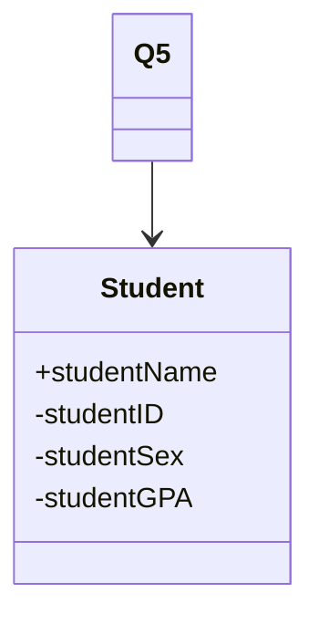
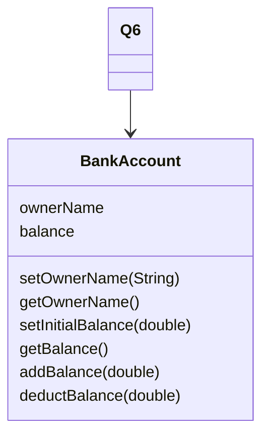

# HW2 과제 안내문 — 컬렉션과 파일 입출력

[레포지토리 안내](../../../README.ko.md) | [English](Assignment.md) | [한국어](Assignment.ko.md)

> **최종 수정일:** 2026-11-16

객체지향프로그래밍및실습의 2차 과제(HW#2)로, 2025-04-10에 올라왔다. 문제는 Q1\~Q9의 아홉 개이다. 과제가 올라온 시점에는 Javadoc 주석처럼 아직 배우지 않은 기술이 있으며, 그 내용은 다음 주에 배운다. 이 레포지토리에는 Q1, Q4, Q7의 풀이가 있다.

- **제출:** 문제와 결과 스크린샷을 채운 보고서(.docx)와 작성한 Java 코드(.java) 전체를 `HW2_YourID_Yourname.zip`으로 압축하여 정해진 시간까지 Blackboard에 제출한다. 조교가 실행했을 때 Java 코드가 깔끔하게 실행되어야 한다.
- **공통 규칙:** 모든 프로그램에 Javadoc 주석을 달고 표준 명명 규칙을 지켜야 한다. 또한 사용자가 잘못 입력해도 프로그램이 절대 종료되면 안 된다. 지키지 않으면 각각 1점을 감점한다.
- **부분 점수:** 부분 점수가 있으므로 완전히 해결하지 못하더라도 할 수 있는 만큼 시도한다.
- **ChatGPT:** ChatGPT의 남용을 막기 위해 대부분의 문제에서 문제의 패턴 인식은 개발자의 몫으로 남겼다. 문제 제기, 패턴 인식, 요구사항 분할 능력은 ChatGPT가 아직 인간 개발자를 넘어서지 못하는 부분이다.
- **배포 파일:** Q1의 [`Q1.data`](Q1.data)와 [`Q1_CodeBook.data`](Q1_CodeBook.data), Q9의 [`Q9.Data`](Q9.Data)가 이 폴더에 있다.

---

<br>

## Q1. 코드북에 따른 바이너리 파일 복호화

주어진 바이너리 파일을 코드북에 적힌 형식을 바탕으로 복호화하는 프로그램을 개발하라. 바이너리 파일은 주어진 코드북의 순서로만 복원할 수 있으며, 다음 두 결과를 얻어야 한다. 첫째, 복원이 성공했는지 확인하기 위해 아래 스크린샷과 같은 결과를 얻는다. 둘째, 서로 다른 형식의 값을 각각 분리해 사람이 읽을 수 있는 파일 형식으로 저장하고, 이 파일들(모두 5개)을 제출한다.

- **입력:** `Q1.data`는 바이너리 파일이고, `Q1_CodeBook.data`는 암호 해독용 코드북이다. 코드북은 한 줄에 자료형 이름 하나(`double`, `char`, `int`, `boolean`, `long`)를 적은 텍스트 파일이며, 첫 여덟 줄은 `double`, `char`, `int`, `char`, `double`, `boolean`, `boolean`, `int`이다.
- **결과 1:** 복호화가 성공했는지 확인하기 위해, 모든 `double` 값의 합과 자료형별 값의 개수를 다음과 같이 출력한다.

```text
The sum of all data of type double as a result of decryption is: 5986.477978998308
========================================================
# of integer values: 11939
# of boolean values: 11877
# of double values: 11955
# of char values: 11875
# of long values: 11836
```

- **결과 2:** 자료형마다 값을 사람이 읽을 수 있는 텍스트 형식으로 서로 다른 파일 `Q1_Int`, `Q1_Boolean`, `Q1_Double`, `Q1_Char`, `Q1_Long`에 쓴다. 각 파일은 한 줄에 값 하나를 담으며, 첫 다섯 줄은 표 1과 같다.

| 줄 | Q1_Int | Q1_Boolean | Q1_Double | Q1_Char | Q1_Long |
|:-----|-----:|:-----|-----:|:-----|-----:|
| 1 | 1832359680 | true | 0.9134358090941482 | A | 1859654906584037900 |
| 2 | 1586840465 | false | 0.19877939654072418 | L | -3992804692506318686 |
| 3 | 706663334 | true | 0.7179282167952834 | B | 7004933895813745171 |
| 4 | 684101284 | true | 0.25739747025569526 | E | -4326404132910526934 |
| 5 | -1998994167 | false | 0.9939611449891282 | L | 6367311866054759106 |

*표 1. 자료형별 출력 파일의 첫 다섯 줄*

---

<br>

## Q2. 정수 8개의 오름차순 정렬

정수 8개를 입력받아 1차원 배열에 저장하고 오름차순으로 정렬하는 프로그램 `Q2.java`를 작성하라. 정수가 아닌 값을 받으면 예외 처리로 경고 메시지를 보이고 올바른 정수를 다시 입력받아야 한다. 퀵 정렬이나 버블 정렬 알고리즘을 써도 된다.

입력, 출력, 예외 처리의 예:

```text
정수 입력 : 3
정수 입력 : 2
정수 입력 : s
Input value is not Integer. Please try it again!
정수 입력 : 1
정수 입력 : 7
정수 입력 : 6
정수 입력 : 5
정수 입력 : 4
정수 입력 : 3
1 2 3 3 4 5 6 7
```

---

<br>

## Q3. 실시간 계산기

다음과 같은 실시간 계산기 `Q3.java`를 구현하라. 기본적으로 (연산자 [공백] 실수)를 무한히 입력받을 수 있는 UI를 구현해야 한다. 실시간 계산기의 처음 값은 0이다. 0으로 나누거나 실수가 아닌 값을 입력하면 프로그램이 오류로 끝나지 않고 적절한 예외 처리를 해야 한다. 사용자가 마지막으로 "exit"를 입력하면 프로그램이 종료되며, 지금까지 입력한 모든 연산의 과정과 결과를 다음처럼 보여 주도록 출력 UI를 설계하라.

```text
[Real-time calculator]
Please enter the real number (1th) >> / 0
You can't divied by zero, please try it again!
Please enter the real number (1th) >> + 10
Current output (1th): 10
Please enter the real number (2th) >> + 100
Current output (2th): 110
Please enter the real number (3th) >> * 2
Current output (3th): 220
Please enter the real number (4th) >> I'm a troll user
Input value is not real numbers, please try it again!
Please enter the real number (4th) >> / 10
Current output (4th): 22
Please enter the real number (5th) >> exit
=======================================
You entered the following formula, and it was evaluated from left to right regardless of operator precedence rules: 0 +10 +100 *2 /10 = 22
Thank you for using our service.
```

---

<br>

## Q4. 이름을 받는 대화 상자

대화 상자로 이름을 입력받아 다음처럼 출력하는 클래스 `Q4.java`를 구현하라.

대화 상자의 안내 문구와 입력:

```text
What is your first name?
Minseok
```

출력:

```text
Goodbye Minseok from the OOP World!
```

---

<br>

## Q5. Student 클래스

다음 클래스 다이어그램을 바탕으로 요구 조건을 만족하는 `Student` 클래스와 메인 클래스 `Q5.java`를 작성하라.



*그림 1. Q5와 Student의 클래스 다이어그램 (Student의 메서드 칸에는 "Design yourself!"라고 적혀 있다)*

1. 학생의 이름, 학번, 성별, 평점을 데이터 멤버로 구현하고, 제시된 접근 제어자를 부여한다.
2. 주어진 데이터 멤버를 초기화하는 생성자와, 각 데이터 멤버에 값을 넣거나 빼는 멤버 메서드를 구현한다.
3. `studentName`과 `studentID`는 생성되는 객체끼리 겹치지 않도록 무작위로 정해야 한다.
4. `studentSex`는 "Male" 또는 "Female" 값을 무작위로 받아야 하고, `studentGPA`는 0.0\~4.5 범위에서 무작위로 생성해야 한다.
5. 구현한 `Student` 클래스를 바탕으로, 각 데이터 멤버를 무작위로 받은 학생 10,000명을 메인 클래스 `Q5`에서 생성한다.
6. 마지막으로, 무작위로 생성한 10,000명 가운데 평점이 가장 높은 학생의 이름, 학번, 성별, 평점을 보여 주는 메서드를 구현하고, main 함수에서 호출하여 그 학생을 찾는다.

---

<br>

## Q6. BankAccount 클래스

다음 클래스 다이어그램에 맞게 `Q6.java`와 `BankAccount.java`를 작성하라.



*그림 2. Q6와 BankAccount의 클래스 다이어그램*

1. `BankAccount` 클래스의 모든 메서드를 구현해야 한다.
2. 메인 클래스 `Q6`에서 은행 계좌를 모두 1,000개 만든다. 각 계좌의 초기 잔고는 0\~50,000 사이에서 무작위로 정하고, 계좌주 `ownerName`은 "owner_1, owner_2, ..., owner_1000"처럼 차례로 정한다.
3. 모든 계좌에 이자 5.64%를 더한다(x5.64%).
4. 1,000개 계좌 가운데 잔고가 가장 큰 계좌의 계좌주 이름과 잔고를 출력한다.
5. 계좌주 사이의 이체를 수행하는 `transfer(BankAccount, BankAccount, double)` 메서드를 구현한다. 첫째 인자는 보내는 사람, 둘째 인자는 받는 사람, 마지막 인자는 금액이다(예: `transfer(owner_112, owner5421, 20000)`). 금액은 보내는 사람의 계좌에서 빠지고 받는 사람의 계좌에 들어가야 한다. 이때 빼는 금액이 계좌 잔고보다 크면 이체가 일어나지 않아야 하며 오류 메시지를 내야 한다.

---

<br>

## Q7. 퀵 정렬과 버블 정렬의 속도 비교

Q2에서 구현한 대표적인 수치 정렬 알고리즘으로 퀵 정렬(quicksort)과 버블 정렬(bubblesort)이 있다. "In general, the quick sort algorithm is faster than the bubblesort algorithm"이라는 명제를 실제 Java 코드로 경험적으로 증명하라. 수업에서 배운 실행 시간 측정 방법을 적극적으로 활용하라.

---

<br>

## Q8. 날짜 차이를 계산하는 시스템 프로그램

다음과 같이 주어진 날짜와의 일수 차이를 계산하는 시스템 프로그램을 개발하라. 과거와 미래의 모든 시점을 계산할 수 있어야 하며, 미래 시점은 D+로, 과거 시점은 D-로 출력한다. 시스템 프로그램이므로 날짜를 별도의 UI로 입력받으면 오답으로 처리한다.

```text
C:\Users\Kim\eclipse-workspace\DdayCal\src>java DdayCal 2024/08/04
Today: 2024/04/21
Your input date: 2024/08/04
================================
D+105
```

---

<br>

## Q9. 중고차 관리 프로그램

중고차 관리 프로그램을 만들고자 한다. 다음 요구 조건을 만족하는 `Automobile` 클래스와 메인 클래스 `Q9.java`를 작성하라. [`Q9.Data`](Q9.Data)는 탭으로 구분된 텍스트 파일로, 첫 줄은 열 이름(Model, Miles/(US) gallon, Number of cylinders, Displacement (cu.in.), Gross horsepower, Rear axle ratio, Weight (1000 lbs), 1/4 mile time, Engine (0 = V-shaped, 1 = straight), Transmission (0 = automatic, 1 = manual), Number of forward gears, Number of carburetors)이고, 그 아래 32줄이 자동차 한 대씩이다(예: `Mazda RX4`, 21, 6, 160, 110, 3.9, 2.62, 16.46, 0, 1, 4, 4).

1. `Q9.Data` 파일에서 정보를 불러와 개별 객체로 바꿀 수 있는 `Automobile` 클래스를 구현한다. 주어진 자료의 모든 부분이 객체에 반영되어야 한다.
2. 개발자가 코드에서 자동차 객체를 추가로 만들 수 있는 생성자를 구현한다. 이때 특정 값을 모르면 "NA"로 처리할 수 있도록 오버로딩 생성자를 3개 이상 적극적으로 활용한다.
3. 메인 클래스 `Q9`에서 새 자동차 100대를 무작위로 생성한다. 모델명은 완전히 무작위로 지어도 되지만 중복은 허용하지 않는다. 다른 모든 특성값은 `Q9.Data` 파일의 기존 데이터 범위 안에서 생성되도록 `genAutomobile()` 메서드를 구현한다.
4. 마지막으로, 중고차 관리자가 데이터에 있는 차량을 여러 조건으로 쉽게 검색할 수 있는 CUI를 설계하고 구현한다. 예를 들어 "Miles > 20 and Number of cylinders == 4" 같은 조건을 받아 조건에 맞는 자동차를 출력하는 인터페이스를 만든다. 정해진 시간 안에 완벽한 인터페이스를 구현할 수는 없으므로, 궁극적으로 개발하고자 하는 UI의 방향을 서술하고, 차량이 검색되는 것을 보이는 프로토타입까지 개발하면 된다. 보고서에는 사용자를 고려한 가장 이상적인 CUI 설계와 프로토타입의 스크린샷을 적는다.

---

<br>

문제를 풀어 본 뒤 [과제 해설](../Assignment-Explanation.ko.md)에서 Q1, Q4, Q7의 풀이와 해설을 볼 수 있다.
