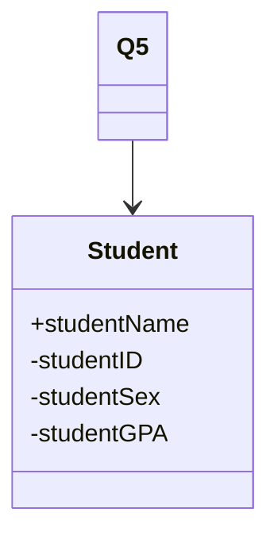
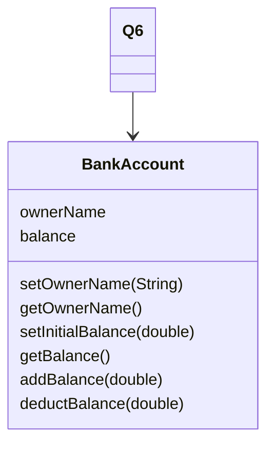

# HW2 Assignment Handout — Collections and File I/O

[Repository Guide](../../../README.md) | [English](Assignment.md) | [한국어](Assignment.ko.md)

> **Last Updated:** 2026-11-24

This is the second assignment (HW#2) of Object-Oriented Programming and Practice, uploaded on 2025-04-10. It has nine questions, Q1-Q9. When the assignment was uploaded, some skills such as Javadoc comments had not been taught yet; they are taught the following week. This repository contains solutions to Q1, Q4, and Q7.

- **Deliverables:** The report (.docx) filled in with the questions and result screenshots, and all the Java code (.java) you wrote. The Java code must run cleanly when the TA runs it.
- **Common rules:** Every program must have Javadoc comments and follow the standard naming rules. In addition, the program must never crash because of incorrect user input. Each failure costs 1 point.
- **Partial credit:** There is partial credit, so try as far as you can even if you cannot solve a question completely.
- **ChatGPT:** To prevent abuse of ChatGPT, pattern recognition for the issues is left to the developer in most questions. Raising an issue, recognizing patterns, and segmenting requirements are where ChatGPT still cannot beat a human developer.
- **Distributed files:** [`Q1.data`](Q1.data) and [`Q1_CodeBook.data`](Q1_CodeBook.data) for Q1 and [`Q9.Data`](Q9.Data) for Q9 are in this folder.

---

<br>

## Q1. Decrypting a Binary File with a Codebook

Develop a decryption program that decrypts the given binary file based on the format described in the codebook. The binary file can be restored only in the order of the given codebook, and the following two results should be obtained. First, to check whether the restoration succeeded, get the same result as the screenshot below. Second, separate the values of each different type, save each in a human-readable file format, and submit these files (5 files in total).

- **Input:** `Q1.data` is the binary file, and `Q1_CodeBook.data` is the codebook for decryption. The codebook is a text file with one type name (`double`, `char`, `int`, `boolean`, `long`) per line, and its first eight lines are `double`, `char`, `int`, `char`, `double`, `boolean`, `boolean`, `int`.
- **Outcome 1:** To check whether the decryption succeeded, print the sum of all `double` values and the number of values of each type as follows.

```text
The sum of all data of type double as a result of decryption is: 5986.477978998308
========================================================
# of integer values: 11939
# of boolean values: 11877
# of double values: 11955
# of char values: 11875
# of long values: 11836
```

- **Outcome 2:** Write the values of each type separately in a human-readable text format to the separate files `Q1_Int`, `Q1_Boolean`, `Q1_Double`, `Q1_Char`, and `Q1_Long`. Each file holds one value per line, and the first five lines are as in Table 1.

| Line | Q1_Int | Q1_Boolean | Q1_Double | Q1_Char | Q1_Long |
|:-----|-----:|:-----|-----:|:-----|-----:|
| 1 | 1832359680 | true | 0.9134358090941482 | A | 1859654906584037900 |
| 2 | 1586840465 | false | 0.19877939654072418 | L | -3992804692506318686 |
| 3 | 706663334 | true | 0.7179282167952834 | B | 7004933895813745171 |
| 4 | 684101284 | true | 0.25739747025569526 | E | -4326404132910526934 |
| 5 | -1998994167 | false | 0.9939611449891282 | L | 6367311866054759106 |

*Table 1. First five lines of the output file for each type*

---

<br>

## Q2. Sorting Eight Integers in Ascending Order

Write a program `Q2.java` that receives eight integers, stores them in a one-dimensional array, and sorts them in ascending order. If the program receives a non-integer value, it must show a warning message through exception handling and ask again for a correct integer. You may use the quick sort or bubble sort algorithm.

Example of input, output, and exception handling:

```text
정수 입력 : 3
정수 입력 : 2
정수 입력 : s
Input value is not Integer. Please try it again!
정수 입력 : 1
정수 입력 : 7
정수 입력 : 6
정수 입력 : 5
정수 입력 : 4
정수 입력 : 3
1 2 3 3 4 5 6 7
```

---

<br>

## Q3. Real-Time Calculator

Implement a real-time calculator `Q3.java` like the one below. Basically, a UI that can accept an unlimited number of inputs (operator [space] real number) must be implemented. The initial value of the real-time calculator is 0. When dividing by 0 or entering a value that is not a real number, the program must not end with an error but perform appropriate exception handling. When the user finally enters "exit", the program terminates; design the output UI so that it displays the process and result of all operations entered so far, as shown below.

```text
[Real-time calculator]
Please enter the real number (1th) >> / 0
You can't divied by zero, please try it again!
Please enter the real number (1th) >> + 10
Current output (1th): 10
Please enter the real number (2th) >> + 100
Current output (2th): 110
Please enter the real number (3th) >> * 2
Current output (3th): 220
Please enter the real number (4th) >> I'm a troll user
Input value is not real numbers, please try it again!
Please enter the real number (4th) >> / 10
Current output (4th): 22
Please enter the real number (5th) >> exit
=======================================
You entered the following formula, and it was evaluated from left to right regardless of operator precedence rules: 0 +10 +100 *2 /10 = 22
Thank you for using our service.
```

---

<br>

## Q4. A Dialog That Asks for a Name

Implement a class `Q4.java` that receives a name from a dialog and outputs it as shown below.

Dialog prompt and input:

```text
What is your first name?
Minseok
```

Output:

```text
Goodbye Minseok from the OOP World!
```

---

<br>

## Q5. The Student Class

Write a `Student` class and a main class `Q5.java` that satisfy the following requirements based on the class diagram below.



*Figure 1. Class diagram of Q5 and Student (the method compartment of Student reads "Design yourself!")*

1. Implement data members for the student's name, ID, gender, and grades, and give them the suggested access modifiers.
2. Implement a constructor that initializes the given data members and member methods that insert or take out the value of each data member.
3. `studentName` and `studentID` must be determined randomly so that the created objects do not overlap.
4. `studentSex` must be randomly assigned "Male" or "Female", and `studentGPA` must be randomly generated within the 0.0-4.5 scale.
5. Based on the implemented `Student` class, generate in the main class `Q5` 10,000 students who are randomly assigned each data member.
6. Finally, implement a method that displays the name, student ID, gender, and GPA of the student with the highest GPA among the 10,000 randomly generated students, and call it in the main function to find that student.

---

<br>

## Q6. The BankAccount Class

Write `Q6.java` and `BankAccount.java` based on the following class diagram.



*Figure 2. Class diagram of Q6 and BankAccount*

1. All methods of the `BankAccount` class must be implemented.
2. Create a total of 1,000 bank accounts in the main class `Q6`. Randomly allocate an initial balance between 0 and 50,000 for each account, and assign `ownerName` sequentially as "owner_1, owner_2, ..., owner_1000".
3. Deposit (add) 5.64% interest to every account (x5.64%).
4. Print the owner name and balance of the account with the largest balance among the 1,000 accounts.
5. Implement a `transfer(BankAccount, BankAccount, double)` method that performs transfers between account holders. The first argument is the sender, the second is the recipient, and the last is the amount (for example, `transfer(owner_112, owner5421, 20000)`). The amount must be deducted from the sender's account and deposited into the recipient's account. If the deducted amount is greater than the account balance, the transfer must not occur and an error message must be generated.

---

<br>

## Q7. Comparing the Speed of Quicksort and Bubble Sort

Representative numerical sorting algorithms implemented in Q2 include quicksort and bubble sort. Prove empirically, through actual Java code, the proposition "In general, the quick sort algorithm is faster than the bubblesort algorithm." Actively use the runtime estimation method learned in class.

---

<br>

## Q8. A System Program That Calculates Date Differences

Develop a system program that calculates the difference in days from a given date as follows. Calculations must be possible for all points in time, past and future; print D+ for future points and D- for past points. Since it is a system program, receiving the date through a separate UI is treated as a wrong answer.

```text
C:\Users\Kim\eclipse-workspace\DdayCal\src>java DdayCal 2024/08/04
Today: 2024/04/21
Your input date: 2024/08/04
================================
D+105
```

---

<br>

## Q9. A Used Car Management Program

We want to create a used car management program. Write an `Automobile` class and a main class `Q9.java` that satisfy the following requirements. [`Q9.Data`](Q9.Data) is a tab-delimited text file whose first line holds the column names (Model, Miles/(US) gallon, Number of cylinders, Displacement (cu.in.), Gross horsepower, Rear axle ratio, Weight (1000 lbs), 1/4 mile time, Engine (0 = V-shaped, 1 = straight), Transmission (0 = automatic, 1 = manual), Number of forward gears, Number of carburetors), followed by 32 lines of one car each (for example, `Mazda RX4`, 21, 6, 160, 110, 3.9, 2.62, 16.46, 0, 1, 4, 4).

1. Implement an `Automobile` class that loads the information from the `Q9.Data` file and turns it into individual objects. Every part of the given data must be reflected in the objects.
2. Implement constructors that let developers create additional car objects from code. Actively use at least three overloaded constructors so that a value that is not known can be treated as "NA".
3. Randomly generate 100 new cars in the main class `Q9`. The car model names may be completely random, but duplicates are not allowed. Implement the `genAutomobile()` method so that all other feature values are generated within the existing data range of the `Q9.Data` file.
4. Finally, design and implement a CUI that lets used car managers easily search for vehicles in the data under various conditions. For example, create an interface that receives a condition such as "Miles > 20 and Number of cylinders == 4" and outputs the cars that meet it. Since a perfect interface cannot be implemented in time, describe the direction of the UI you ultimately want to develop and complete a prototype that shows vehicles being searched for. The report gives the most ideal CUI design considering the user and a screenshot of the prototype.

---

<br>

After solving the problems, see the [assignment explanation](../Assignment-Explanation.md) for the solutions and explanations of Q1, Q4, and Q7.
