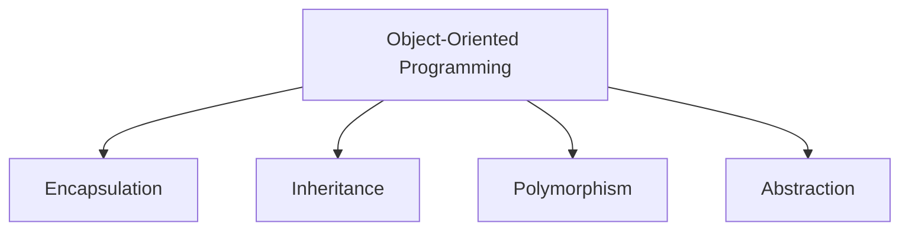
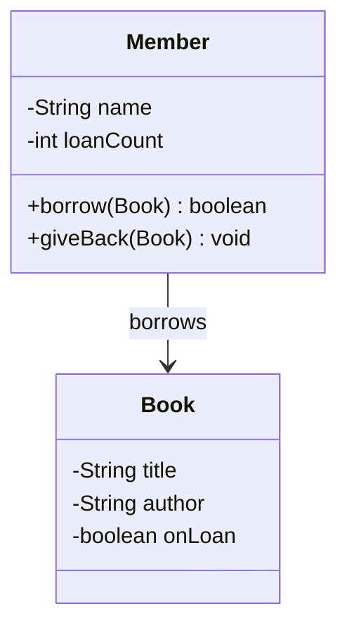
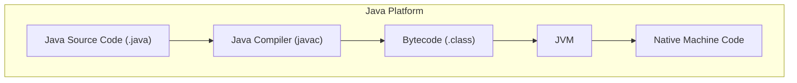
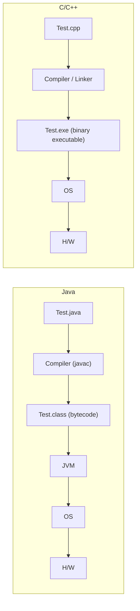
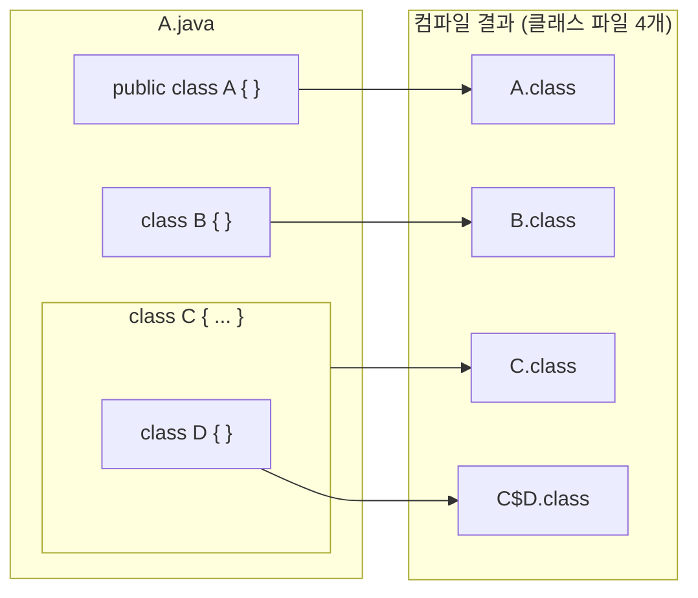
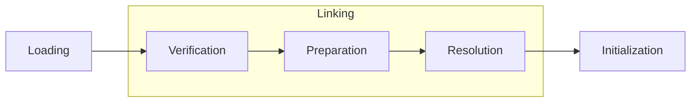

# 1강 — 객체 지향 프로그래밍 개론

[레포지토리 안내](../../README.ko.md) | [English](Concepts_Lecture.md) | [한국어](Concepts_Lecture.ko.md)

> **최종 수정일:** 2026-11-19

> **학습 목표:**
> 1. 객체 지향 프로그래밍 개념(클래스, 객체, 캡슐화)을 정의할 수 있다
> 2. Java 개발 환경을 설정할 수 있다
> 3. 기본 Java 프로그램을 작성하고 컴파일할 수 있다
> 4. 소스 파일, 클래스 파일, JVM의 관계를 C/C++의 빌드 과정과 비교하여 설명할 수 있다
> 5. javap로 바이트코드를 읽고 클래스의 적재, 링크, 초기화 과정을 설명할 수 있다
> 6. JVM의 실행 시 데이터 영역(메서드 영역, 힙, JVM 스택)을 구분하고 흔한 컴파일 오류와 실행 오류를 진단할 수 있다

---

## 목차

- [1. 객체 지향 프로그래밍의 개념](#1-객체-지향-프로그래밍의-개념)
  - [1.1 프로그래밍 언어의 수준](#11-프로그래밍-언어의-수준)
  - [1.2 프로그래밍 패러다임](#12-프로그래밍-패러다임)
  - [1.3 OOP의 4대 핵심 원칙](#13-oop의-4대-핵심-원칙)
  - [1.4 절차적 설계와 객체 지향 설계의 비교](#14-절차적-설계와-객체-지향-설계의-비교)
  - [1.5 문제 기술에서 클래스 찾기](#15-문제-기술에서-클래스-찾기)
- [2. Java 개요](#2-java-개요)
  - [2.1 역사와 설계 목표](#21-역사와-설계-목표)
  - [2.2 Java의 응용 분야](#22-java의-응용-분야)
  - [2.3 Java 플랫폼 아키텍처](#23-java-플랫폼-아키텍처)
  - [2.4 JDK, JRE, JVM](#24-jdk-jre-jvm)
  - [2.5 JDK의 주요 도구](#25-jdk의-주요-도구)
- [3. Java 프로그램의 실행 과정](#3-java-프로그램의-실행-과정)
  - [3.1 컴파일과 인터프리팅](#31-컴파일과-인터프리팅)
  - [3.2 Java와 C/C++의 차이](#32-java와-cc의-차이)
  - [3.3 Write Once, Run Anywhere](#33-write-once-run-anywhere)
  - [3.4 소스 파일과 클래스 파일](#34-소스-파일과-클래스-파일)
  - [3.5 배포, 진입점, 패키지, 가비지 컬렉션](#35-배포-진입점-패키지-가비지-컬렉션)
  - [3.6 바이트코드와 javap](#36-바이트코드와-javap)
  - [3.7 클래스 파일의 형식과 버전](#37-클래스-파일의-형식과-버전)
  - [3.8 클래스의 적재, 링크, 초기화](#38-클래스의-적재-링크-초기화)
  - [3.9 JVM의 실행 시 데이터 영역](#39-jvm의-실행-시-데이터-영역)
  - [3.10 인터프리터와 JIT 컴파일](#310-인터프리터와-jit-컴파일)
  - [3.11 Java와 C++의 언어 차이](#311-java와-c의-언어-차이)
- [4. 개발 환경 설정](#4-개발-환경-설정)
  - [4.1 JDK 설치](#41-jdk-설치)
  - [4.2 Eclipse IDE 설치와 설정](#42-eclipse-ide-설치와-설정)
  - [4.3 자주 쓰는 단축키](#43-자주-쓰는-단축키)
- [5. 첫 번째 Java 프로그램](#5-첫-번째-java-프로그램)
  - [5.1 콘솔 버전](#51-콘솔-버전)
  - [5.2 명령 줄에서 컴파일하고 실행하기](#52-명령-줄에서-컴파일하고-실행하기)
  - [5.3 GUI 버전](#53-gui-버전)
  - [5.4 흔한 컴파일 오류와 실행 오류](#54-흔한-컴파일-오류와-실행-오류)
  - [5.5 소스 파일 모드](#55-소스-파일-모드)
- [6. 흔한 실수](#6-흔한-실수)
- [개념 적용](#개념-적용)
- [요약](#요약)
- [점검 문제](#점검-문제)
- [참고 문헌](#참고-문헌)

---

<br>

## 1. 객체 지향 프로그래밍의 개념

### 1.1 프로그래밍 언어의 수준

컴퓨터가 직접 실행하는 것은 0과 1로 된 **기계어**(machine code)이다. 기계어 명령을 사람이 읽을 수 있는 기호(니모닉)로 바꾼 것이 **어셈블리어**(assembly code)이고, 수식과 문장에 가까운 형태로 프로그램을 쓰게 한 것이 **고급 언어**(high-level language)이다. Java는 고급 언어이다.

```text
기계어:
    10110011 00011001
    01111010 11010001 10010100
    10011111 00011001
    01011100 11010001 10010000
    10111011 11010001 10010110

어셈블리어:
    MV  0,   SUM
    MV  NUM, AC
    ADD SUM, AC
    STO SUM, TOT

고급 언어:
    X = (Y + Z) / 2
```

어셈블리어와 고급 언어로 쓴 프로그램은 어셈블러나 컴파일러가 기계어(Java의 경우 3.1절의 바이트코드)로 번역해야 실행할 수 있다.

프로그래밍 언어는 하드웨어에 얼마나 가까운지에 따라 다음과 같은 계층으로 나눌 수 있다. 아래 계층일수록 기계가 직접 처리하는 형태에 가깝고, 위 계층일수록 사람이 읽고 쓰기 쉽다.

- **2진 코드(binary code):** 하드웨어가 읽는 0과 1의 나열이다. 사람이 읽을 수 있는 형태가 아니다.
- **기계어(machine code):** 2진 코드를 16진수 같은 형태로 나타낸 명령의 나열이다. 운영체제가 메모리에 적재하여 CPU가 실행한다.
- **어셈블리어(assembly language):** Intel x86 어셈블리처럼 기계어 명령 하나하나에 `ADD`, `MOV` 같은 기호를 붙인 언어이다. 사람이 읽을 수 있는 첫 번째 계층이며, 명령과 기계어가 거의 일대일로 대응한다.
- **고급 언어와 중급 언어:** C, C++처럼 수식, 조건문, 반복문, 함수로 프로그램을 쓰는 언어이다. C는 포인터로 메모리 주소를 직접 다룰 수 있어 고급 언어와 어셈블리어 사이의 중급 언어로 부르기도 한다.
- **스크립트 언어와 인터프리터 언어:** Perl, Python, 셸 스크립트처럼 인터프리터가 소스 코드를 읽어 바로 실행하는 언어이다.

위 계층의 표현을 아래 계층의 표현으로 번역하는 일이 컴파일(compile)이고, 거꾸로 기계어를 어셈블리어 같은 위 계층의 표현으로 되돌리는 일이 역어셈블(disassemble)이다. 이 분류에서 Java는 흔히 인터프리터 언어와 함께 묶이지만, 실제로는 소스 코드를 먼저 바이트코드로 컴파일하고 JVM이 그 바이트코드를 해석하거나 다시 기계어로 컴파일하는 두 단계 구조를 가진다(3.1절, 3.10절). 3.6절의 `javap -c`는 클래스 파일의 바이트코드를 사람이 읽을 수 있는 명령 목록으로 보여 주는 역어셈블러이다.

### 1.2 프로그래밍 패러다임

프로그래밍 패러다임은 코드를 구조화하고 사고하는 방식을 정의한다. 주요 패러다임은 다음과 같다.

| 패러다임 | 핵심 개념 | 대표 언어 |
|:---------|:---------|:----------|
| 절차적 | 단계별 명령 수행 | C, Pascal |
| 객체 지향 | 실세계 엔티티를 객체로 모델링 | Java, C++, Python |
| 함수형 | 수학 함수로서의 계산 | Haskell, Lisp |
| 선언적 | *어떻게*가 아닌 *무엇을* 계산할지 기술 | SQL, Prolog |

*표 1. 주요 프로그래밍 패러다임과 대표 언어*

> **핵심:** OOP는 소프트웨어를 데이터(필드)와 행위(메서드)를 모두 캡슐화한 상호작용하는 객체의 집합으로 모델링한다.

### 1.3 OOP의 4대 핵심 원칙



*그림 1. OOP의 4대 핵심 원칙*

1. **캡슐화(Encapsulation):** 데이터와 메서드를 하나로 묶고, 접근 제어자(`private`, `protected`, `public`)를 통해 직접 접근을 제한한다.
2. **상속(Inheritance):** 기존 클래스로부터 새로운 클래스를 생성하여 코드 재사용을 촉진한다.
3. **다형성(Polymorphism):** 하나의 인터페이스에 여러 구현을 가능하게 한다(메서드 오버로딩 및 오버라이딩).
4. **추상화(Abstraction):** 구현 세부사항을 숨기고 필수적인 기능만 외부에 노출한다.

### 1.4 절차적 설계와 객체 지향 설계의 비교

절차적 설계는 프로그램을 데이터와 그 데이터를 처리하는 함수의 모음으로 나누고, 함수가 필요한 데이터를 매개변수나 전역 변수로 받아 처리하게 한다. 데이터와 함수가 떨어져 있으므로, 데이터가 지켜야 할 규칙(예: 잔액은 음수가 될 수 없다)을 지키는 책임이 그 데이터를 만지는 모든 코드에 흩어진다. 다음은 은행 잔액을 절차적으로 다루는 예이다.

```java
public class ProceduralBank {
    static double balance = 0.0;

    static void deposit(double amount) {
        balance = balance + amount;
    }

    public static void main(String[] args) {
        deposit(100.0);
        balance = -500.0;
        System.out.println(balance);
    }
}
```

```text
-500.0
```

`deposit` 함수가 있어도 `balance`는 누구나 바꿀 수 있는 변수이므로, `main`이 `balance = -500.0;`으로 규칙을 어겨도 막을 방법이 없다. 또 잔액 변수가 하나뿐이므로 계좌를 두 개 다루려면 변수나 배열을 새로 만들고 모든 함수가 계좌 번호를 받도록 고쳐야 한다.

객체 지향 설계는 데이터와 그 데이터를 다루는 연산을 한 클래스에 묶고, 데이터를 바꾸는 길을 그 클래스의 메서드로 제한한다.

```java
public class BankAccount {
    private double balance;

    public void deposit(double amount) {
        if (amount > 0) {
            balance = balance + amount;
        }
    }

    public double getBalance() {
        return balance;
    }
}
```

```java
public class OopBank {
    public static void main(String[] args) {
        BankAccount account = new BankAccount();
        account.deposit(100.0);
        account.deposit(-30.0);
        System.out.println(account.getBalance());
    }
}
```

```text
100.0
```

음수 입금은 `deposit` 안의 검사에 걸려 무시되므로 잔액은 100.0이다. 클래스 밖에서 `account.balance = -500.0;`을 쓰면 다음처럼 컴파일 단계에서 거부된다.

```text
BadBank.java:4: error: balance has private access in BankAccount
        account.balance = -500.0;
               ^
1 error
```

이 예에서 4대 원칙 중 두 가지가 드러난다. 클라이언트는 `deposit`과 `getBalance`가 무엇을 하는지만 알면 되고 잔액을 어떤 변수로 저장하는지는 몰라도 되므로 추상화가 이루어지고, `private`이 그 변수를 숨기므로 캡슐화가 이루어진다. `new BankAccount()`를 여러 번 실행하면 계좌마다 자기 `balance`를 가진 객체가 생기므로, 계좌 수가 늘어도 클래스를 고칠 필요가 없다. 상속은 이 클래스를 바탕으로 이자를 주는 계좌 같은 새 클래스를 만드는 수단이고(2강 1.7절), 다형성은 여러 종류의 계좌를 같은 메서드 호출로 다루게 하는 성질이다(11강).

| 기준 | 절차적 설계 | 객체 지향 설계 |
|:-----|:-----|:-----|
| 프로그램의 단위 | 함수 | 데이터와 메서드를 묶은 클래스 |
| 데이터 보호 | 데이터를 쓰는 모든 코드가 규칙을 지켜야 한다 | 클래스가 메서드 안에서 규칙을 검사한다 |
| 같은 종류의 대상이 여럿일 때 | 변수나 배열을 늘리고 함수를 고친다 | 같은 클래스의 객체를 더 만든다 |
| 내부 표현을 바꿀 때 | 그 데이터를 쓰는 모든 함수를 고친다 | 공개된 메서드만 유지하면 클래스 안만 고친다 |

*표 2. 절차적 설계와 객체 지향 설계의 비교*

> **주의:** 객체 지향 언어로 쓴다고 해서 설계가 객체 지향이 되지는 않는다. 위의 `ProceduralBank`도 Java 클래스이지만, 데이터를 `static` 변수로 공개하고 모든 일을 `static` 메서드로 처리하므로 구조는 절차적이다.

### 1.5 문제 기술에서 클래스 찾기

객체 지향 프로그램을 설계할 때 처음 할 일은 문제에 등장하는 대상 가운데 어떤 것을 클래스로 만들지 정하는 것이다. 널리 쓰이는 출발점은 문제를 기술한 문장에서 명사와 동사를 찾는 방법이다. 명사는 클래스나 필드의 후보가 되고, 동사는 메서드의 후보가 된다. 다음 기술을 예로 든다.

"도서관 회원은 도서를 대출하고 반납한다. 회원은 최대 3권까지 빌릴 수 있고, 도서는 제목과 저자를 가지며 대출 중인지 여부를 기록한다."

| 후보 | 출처 | 판단 |
|:-----|:-----|:-----|
| 회원 | 명사 | 이름과 대출 목록을 가진 독립된 대상이므로 `Member` 클래스로 만든다 |
| 도서 | 명사 | 제목, 저자, 대출 상태를 가지므로 `Book` 클래스로 만든다 |
| 제목, 저자 | 명사 | 도서에 딸린 단순한 값이므로 `Book`의 필드 `title`, `author`로 둔다 |
| 대출 중인지 여부 | 명사구 | 참과 거짓의 상태이므로 `Book`의 `boolean` 필드 `onLoan`으로 둔다 |
| 최대 3권 | 수량 | 모든 회원에게 같은 규칙이므로 클래스 상수 `MAX_LOANS = 3`으로 둔다 |
| 대출하다, 반납하다 | 동사 | 회원의 행위이므로 `Member`의 메서드 `borrow(Book)`, `giveBack(Book)`으로 만든다 |

*표 3. 도서관 기술에서 뽑은 클래스, 필드, 메서드의 후보*

이렇게 정한 클래스는 다음처럼 나타낼 수 있다. `borrow`는 회원이 이미 3권을 빌렸거나 도서가 대출 중이면 거절해야 하므로, 이 규칙을 지키는 책임이 `Member`의 메서드 안에 모인다.



*그림 2. 도서관 기술에서 만든 Member와 Book의 클래스 다이어그램*

명사를 모두 클래스로 만들 필요는 없다. "도서관"은 이 기술에서 회원과 도서를 담는 배경일 뿐 고유한 상태나 행위가 언급되지 않으므로 처음에는 클래스로 만들지 않는다. 판단의 기준은 그 대상이 스스로 지켜야 할 상태와 그 상태를 바꾸는 행위를 가지는지이다. 클래스 다이어그램의 표기는 2강 1.4절과 7강 1.4절에서 자세히 다룬다.

---

<br>

## 2. Java 개요

### 2.1 역사와 설계 목표

Java는 Sun Microsystems의 James Gosling 팀이 개발하여 1995년에 발표하였다. 핵심 설계 목표는 다음과 같다.

- **단순성(Simple):** 포인터 연산, 클래스의 다중 상속 등 복잡한 기능을 제거하였다.
- **객체 지향(Object-Oriented):** 기본 자료형을 제외한 모든 것이 객체이다. 상속, 다형성, 캡슐화를 지원한다.
- **플랫폼 독립성(Platform-Independent):** 바이트코드로 컴파일되어 모든 JVM에서 실행 가능하다.
- **보안성(Secure):** 바이트코드 검증기와 보안 관리자(Security Manager)를 제공한다.
- **견고성(Robust):** 강력한 타입 검사, 예외 처리, 가비지 컬렉션을 지원한다.
- **멀티스레드(Multithreaded):** 동시성 프로그래밍을 기본적으로 지원한다.

> **참고:** 보안 관리자는 Java 17에서 제거 예정(deprecated for removal)으로 지정되었고, Java 24부터는 활성화할 수 없다. 현재 Java의 보안은 바이트코드 검증, 타입 안전성, 모듈 시스템 등에 주로 의존한다.

Java는 객체 지향 프로그래밍을 대표하는 언어로, 오랫동안 가장 널리 쓰이는 프로그래밍 언어 중 하나였다.

### 2.2 Java의 응용 분야

- **데스크톱 응용 프로그램:** 가장 전형적인 Java 프로그램으로, 데스크톱 컴퓨터에 설치하여 실행한다(예: 데스크톱 게임). Java 실행 환경(JRE)이 있는 컴퓨터라면 어디서나 실행된다.
- **서블릿(servlet) 응용 프로그램:** 웹 서버의 JVM에서 실행되는 Java 프로그램이다. 브라우저의 요청을 인터넷을 통해 받아 데이터베이스 등을 사용해 처리하고 결과를 돌려준다. 이름이 비슷한 JavaScript는 주로 브라우저에서 실행되는 별개의 언어이다.
- **Android:** Google이 주도하고 여러 모바일 기업이 참여한 무료 모바일 플랫폼이다. 개발 언어로 Java를 쓰지만, JVM에 해당하는 Android의 실행 환경(초기의 Dalvik, Android 5.0부터의 ART)은 JVM과 호환되지 않으므로 Java 바이트코드를 Android용 형식(DEX)으로 변환해야 한다.

### 2.3 Java 플랫폼 아키텍처



*그림 3. 소스 코드가 기계어로 실행되기까지의 Java 플랫폼 구조*

### 2.4 JDK, JRE, JVM

| 구성 요소 | 설명 |
|:----------|:-----|
| **JDK** (Java Development Kit) | 컴파일러, 디버거 등의 개발 도구와 JRE를 포함하는 완전한 개발 환경 |
| **JRE** (Java Runtime Environment) | Java 프로그램 실행을 위한 런타임 라이브러리와 JVM |
| **JVM** (Java Virtual Machine) | 바이트코드를 실행하는 추상 머신으로, 플랫폼별로 구현된다 |

*표 4. JDK, JRE, JVM의 역할*

```math
\text{JDK} \supset \text{JRE} \supset \text{JVM}
```

> **참고:** Java 11부터 Oracle은 JRE를 따로 배포하지 않는다. JDK를 설치하면 프로그램 실행에 필요한 런타임도 함께 설치되므로, 위 포함 관계는 구성 요소의 역할을 나타내는 개념적 구분으로 이해하면 된다.

### 2.5 JDK의 주요 도구

JDK의 `bin` 디렉터리에는 컴파일러와 실행기 말고도 여러 명령이 들어 있다. 이 과목의 예제에서 쓰는 도구는 다음과 같다.

| 명령 | 하는 일 | 예 |
|:-----|:-----|:-----|
| `javac` | 소스 파일을 컴파일하여 클래스 파일을 만든다 | `javac HelloWorld.java` |
| `java` | JVM을 시작하고 지정한 클래스의 `main`을 실행한다 | `java HelloWorld` |
| `javap` | 클래스 파일의 구조와 바이트코드를 보여 준다 | `javap -c HelloWorld` |
| `jar` | 클래스 파일과 자원을 JAR 파일 하나로 묶는다 | `jar cf app.jar *.class` |
| `javadoc` | javadoc 주석으로 HTML 문서를 만든다 | `javadoc -d doc Bicycle.java` |
| `jshell` | Java 문장을 한 줄씩 입력하여 바로 결과를 보는 대화형 도구이다 | `jshell` |

*표 5. JDK의 주요 명령*

`javac`의 `--release N` 옵션은 Java N의 언어 규칙과 표준 API에 맞추어 컴파일하고, Java N의 JVM이 읽을 수 있는 클래스 파일을 만든다. 각 단원의 예제 출력은 모두 `javac --release 21`로 컴파일한 클래스를 JDK 24의 `java`로 실행한 결과이다.

---

<br>

## 3. Java 프로그램의 실행 과정

### 3.1 컴파일과 인터프리팅

Java는 **하이브리드** 언어로, 컴파일과 인터프리팅을 모두 거친다.

1. **컴파일:** `javac MyProgram.java` 명령으로 `MyProgram.class`(바이트코드)를 생성한다.
2. **실행:** `java MyProgram` 명령으로 JVM을 시작하고, 바이트코드를 인터프리팅하거나 JIT 컴파일한다.


*그림 4. javac와 java 명령에 따른 컴파일과 실행 단계*

Java 프로그램은 여러 소스 파일(`.java`)로 나누어 개발한다. 각 소스 파일을 컴파일하면 클래스마다 바이트코드 파일(`.class`)이 생기며, 이들을 하나의 실행 파일(`.exe`)로 묶는 링크 단계는 없다. 실행은 `main()` 메서드가 있는 클래스에서 시작하고, JVM은 실행 중에 클래스가 처음 필요해질 때 그 클래스 파일을 적재(loading)한다. 필요한 클래스만 적재하므로 적은 메모리로 실행할 수 있다. 이때 JVM은 Java 클래스 라이브러리(API)의 클래스(예: `Math.class`, `String.class`)도 같은 방식으로 적재한다.

### 3.2 Java와 C/C++의 차이



*그림 5. Java와 C/C++의 빌드와 실행 과정 비교*

- **Java:** 컴파일러가 소스 코드를 플랫폼 독립적인 바이트코드(`Test.class`)로 번역하고, 각 운영체제 위의 JVM이 이 바이트코드를 실행한다.
- **C/C++:** 컴파일러와 링커가 소스 코드를 특정 운영체제와 하드웨어용 기계어 실행 파일(`Test.exe`)로 만든다. 운영체제가 다르면 다시 컴파일해야 한다.

> **[시스템프로그래밍]** C/C++의 링커는 따로 컴파일한 목적 파일(`.o`, `.obj`)과 라이브러리를 모아, 함수와 전역 변수 같은 기호의 참조를 실제 주소로 연결해 실행 파일 하나를 만든다. Java에는 이 링크 단계가 없고, 3.1절처럼 JVM이 실행 중에 필요한 클래스 파일을 적재하면서 클래스 사이의 참조를 연결한다.

### 3.3 Write Once, Run Anywhere

바이트코드는 플랫폼 독립적이므로, 동일한 `.class` 파일이 Windows, macOS, Linux 등 호환되는 JVM이 있는 모든 운영체제에서 실행된다.

> **핵심:** JVM은 컴파일된 바이트코드와 하위 하드웨어와 운영체제 사이에 추상화 계층을 제공하여 진정한 플랫폼 독립성을 가능하게 한다.

### 3.4 소스 파일과 클래스 파일

- 하나의 소스 파일에 여러 클래스를 작성할 수 있다.
- 한 소스 파일에서 `public` 클래스는 최대 하나이다.
- `public` 클래스가 있으면 소스 파일 이름은 그 클래스 이름과 같아야 한다(`public class A`는 `A.java`).
- 컴파일하면 클래스마다 `.class` 파일이 하나씩 생긴다. 다른 클래스 안에 선언한 클래스(중첩 클래스)는 `바깥클래스$안쪽클래스.class` 이름의 파일이 된다.



*그림 6. 소스 파일 하나에서 클래스 파일 네 개가 생성되는 과정*

### 3.5 배포, 진입점, 패키지, 가비지 컬렉션

- **실행 파일 배포:** 여러 클래스 파일과 자원을 하나로 묶어 배포할 때는 JAR(`.jar`) 파일을 쓴다.
- **main() 메서드:** Java 프로그램은 실행할 때 지정한 클래스의 `main()` 메서드에서 시작한다. 여러 클래스가 각자 `main()`을 가질 수 있지만, 한 클래스에는 `public static void main(String[] args)` 형태의 `main()`이 하나만 있다.
- **패키지(package):** 관련된 클래스를 묶는 단위이다. Java는 강력한 표준 라이브러리를 패키지 단위로 제공한다(예: `javax.swing`, `java.util`).
- **가비지 컬렉션(garbage collection):** Java에는 메모리 할당 연산자 `new`만 있고, 응용 프로그램이 메모리를 직접 반환하는 함수는 없다. 더 이상 참조되지 않는 객체의 메모리는 JVM의 가비지 컬렉터가 회수하므로 개발자의 부담이 줄어든다.

### 3.6 바이트코드와 javap

**바이트코드**(bytecode)는 JVM이 실행하는 명령 집합으로, 명령마다 1바이트짜리 연산 코드(opcode)가 있어 이런 이름이 붙었다. JVM은 레지스터 대신 **피연산자 스택**(operand stack)을 쓰는 스택 기계로 설계되어 있다. 명령은 값을 스택에 넣거나(push), 스택에서 값을 꺼내 계산한 뒤 결과를 다시 넣는다. 다음 프로그램을 컴파일하고 `javap -c`로 역어셈블하면 바이트코드를 볼 수 있다.

```java
public class Add {
    public static void main(String[] args) {
        int a = 3;
        int b = 4;
        int c = a + b;
        System.out.println(c);
    }
}
```

```text
$ javac --release 21 Add.java
$ javap -c Add
Compiled from "Add.java"
public class Add {
  public Add();
    Code:
         0: aload_0
         1: invokespecial #1                  // Method java/lang/Object."<init>":()V
         4: return

  public static void main(java.lang.String[]);
    Code:
         0: iconst_3
         1: istore_1
         2: iconst_4
         3: istore_2
         4: iload_1
         5: iload_2
         6: iadd
         7: istore_3
         8: getstatic     #7                  // Field java/lang/System.out:Ljava/io/PrintStream;
        11: iload_3
        12: invokevirtual #13                 // Method java/io/PrintStream.println:(I)V
        15: return
}
```

각 줄의 앞 숫자는 메서드 코드 안에서 그 명령이 시작하는 바이트 위치(오프셋)이다. `main`의 지역 변수는 번호로 구별되며, 0번은 매개변수 `args`, 1\~3번은 차례로 `a`, `b`, `c`이다. 명령 이름의 첫 글자 `i`는 `int` 값을, `a`는 참조를 다룬다는 뜻이다.

| 오프셋 | 명령 | 하는 일 | 실행 뒤 피연산자 스택 | 실행 뒤 지역 변수 1, 2, 3 |
|:-----|:-----|:-----|:-----|:-----|
| 0 | `iconst_3` | 상수 3을 넣는다 | 3 | -, -, - |
| 1 | `istore_1` | 꺼내서 1번 변수에 저장한다 | (비어 있음) | 3, -, - |
| 2 | `iconst_4` | 상수 4를 넣는다 | 4 | 3, -, - |
| 3 | `istore_2` | 꺼내서 2번 변수에 저장한다 | (비어 있음) | 3, 4, - |
| 4 | `iload_1` | 1번 변수의 값을 넣는다 | 3 | 3, 4, - |
| 5 | `iload_2` | 2번 변수의 값을 넣는다 | 3, 4 | 3, 4, - |
| 6 | `iadd` | 두 값을 꺼내 더한 값을 넣는다 | 7 | 3, 4, - |
| 7 | `istore_3` | 꺼내서 3번 변수에 저장한다 | (비어 있음) | 3, 4, 7 |
| 8 | `getstatic` | `System.out`의 참조를 넣는다 | out | 3, 4, 7 |
| 11 | `iload_3` | 3번 변수의 값을 넣는다 | out, 7 | 3, 4, 7 |
| 12 | `invokevirtual` | 두 값을 꺼내 `out.println(7)`을 호출한다 | (비어 있음) | 3, 4, 7 |
| 15 | `return` | 메서드를 끝낸다 | (비어 있음) | 3, 4, 7 |

*표 6. Add의 main을 실행하는 동안의 피연산자 스택과 지역 변수*

소스에 생성자를 쓰지 않았는데도 `public Add();`가 있는 것은 컴파일러가 기본 생성자를 만들었기 때문이다(7강 2.1절). 이 생성자는 `aload_0`으로 자기 자신(`this`)의 참조를 넣고 `invokespecial`로 상위 클래스 `Object`의 생성자를 호출한다. `#7`, `#13` 같은 번호는 클래스 파일의 상수 풀(constant pool)에 있는 항목의 번호이며, 주석에 그 항목이 가리키는 필드와 메서드의 이름이 나온다. `(I)V`는 `int` 매개변수 하나를 받고 `void`를 반환한다는 메서드 기술자(descriptor)이다.

> **핵심:** 바이트코드는 특정 CPU의 기계어가 아니라 JVM이라는 가상 기계의 명령이다. 같은 클래스 파일을 Windows, macOS, Linux의 JVM이 모두 실행할 수 있는 이유가 여기에 있다.

### 3.7 클래스 파일의 형식과 버전

클래스 파일은 JVM 명세가 정한 형식을 따른다. 파일은 클래스 파일임을 나타내는 4바이트의 **매직 넘버** `0xCAFEBABE`로 시작하고, 그 뒤에 형식의 버전을 나타내는 부 버전(minor version)과 주 버전(major version)이 온다 [1]. 명세는 Java SE N을 따르는 JVM이 Java SE N에 정해진 범위의 주 버전만 지원하도록 정하므로, 새 버전으로 컴파일한 클래스 파일을 그보다 오래된 JVM에서 실행하면 `UnsupportedClassVersionError`로 거부된다. 반대로 오래된 버전의 클래스 파일은 새 JVM에서 실행된다. `--release 21`로 컴파일하면 JDK 24의 컴파일러를 쓰더라도 Java 21 이상의 JVM에서 실행할 수 있는 클래스 파일이 만들어진다.

### 3.8 클래스의 적재, 링크, 초기화

JVM은 클래스를 실행 중에 동적으로 적재하고, 링크하고, 초기화한다 [1].



*그림 7. 클래스가 적재되어 사용되기까지의 단계*

1. **적재**(loading): 클래스 이름으로 그 클래스의 2진 표현(보통 `.class` 파일)을 찾아 읽고, JVM 안에 클래스를 나타내는 구조를 만든다. 이 일을 맡는 구성 요소를 클래스 로더(class loader)라 한다.
2. **링크**(linking): 적재한 클래스를 실행할 수 있는 상태로 JVM에 결합한다. 링크는 다시 세 단계로 나뉜다.
   - **검증**(verification): 바이트코드가 구조적으로 올바른지, 예를 들어 스택에 `int`가 있어야 할 자리에 참조가 오지 않는지, 존재하지 않는 지역 변수를 쓰지 않는지 검사한다. 검증을 통과하지 못하면 `VerifyError`가 던져진다. 2.1절의 바이트코드 검증기가 이 단계이다.
   - **준비**(preparation): 클래스 변수(`static` 필드)의 공간을 만들고 기본값(0, `false`, `null`)으로 채운다.
   - **해석**(resolution): 상수 풀의 기호 참조(예: `java/io/PrintStream.println`)를 실제 메서드와 필드를 가리키는 참조로 바꾼다.
3. **초기화**(initialization): `static` 필드의 초기값 대입과 `static` 초기화 블록을 소스에 쓴 순서대로 실행한다(7강 8.3절). 클래스의 초기화는 그 클래스가 처음 실제로 쓰일 때 한 번만 일어난다.

다음 프로그램은 명령 줄 인자가 있을 때만 `Helper` 클래스를 쓴다. `static { ... }`는 클래스가 초기화될 때 한 번 실행되는 블록이다.

```java
public class LazyLoad {
    public static void main(String[] args) {
        System.out.println("main starts");
        if (args.length > 0) {
            Helper.greet();
        }
        System.out.println("main ends");
    }
}

class Helper {
    static {
        System.out.println("Helper is initialized");
    }

    static void greet() {
        System.out.println("Hello from Helper");
    }
}
```

```text
$ java LazyLoad
main starts
main ends
$ java LazyLoad x
main starts
Helper is initialized
Hello from Helper
main ends
```

인자 없이 실행하면 `Helper`의 초기화 블록이 한 번도 실행되지 않는다. JDK 24의 HotSpot JVM에서 `java -verbose:class`로 적재되는 클래스를 출력해 보면 인자 없이 실행했을 때는 `Helper`가 적재조차 되지 않았고, 인자 `x`를 주었을 때는 `LazyLoad` 다음에 `Helper`가 적재되었다. 3.1절에서 JVM이 필요한 클래스만 적재한다고 한 것이 이 동작이다. 같은 실행에서 JVM은 `String`, `System` 같은 표준 라이브러리 클래스도 수백 개 적재했으며, 이 클래스들도 같은 단계를 거친다. 초기화의 시점은 명세가 엄격히 정하지만, 적재와 링크를 언제 할지는 초기화 전에 적재, 검증, 준비가 끝난다는 조건 아래 구현에 맡겨져 있으므로 [1], 적재 시점은 JVM 구현에 따라 다를 수 있다.

### 3.9 JVM의 실행 시 데이터 영역

JVM 명세는 프로그램을 실행하는 동안 쓰는 메모리를 몇 개의 **실행 시 데이터 영역**(run-time data area)으로 나눈다 [1].

- **메서드 영역**(method area): 모든 스레드가 공유하며, 클래스마다 상수 풀, 필드와 메서드의 정보, 메서드와 생성자의 바이트코드를 저장한다.
- **힙**(heap): 모든 스레드가 공유하며, 모든 객체와 배열이 여기에 할당된다. 힙의 객체는 프로그램이 직접 해제하지 않고 가비지 컬렉터가 회수한다.
- **JVM 스택**(Java Virtual Machine stack): 스레드마다 하나씩 있으며 **프레임**(frame)을 쌓는다. 메서드를 호출할 때마다 새 프레임이 만들어지고, 메서드가 정상적으로 끝나거나 예외로 끝나면 그 프레임이 없어진다. 프레임은 자기의 지역 변수 배열과 피연산자 스택을 가진다.
- **pc 레지스터**: 스레드마다 하나씩 있으며, 지금 실행 중인 바이트코드 명령의 위치를 가리킨다.
- **네이티브 메서드 스택**: Java가 아닌 언어로 구현된 메서드(native method)를 실행할 때 쓰는 스택이다.

다음은 3.6절의 `Add`가 오프셋 12의 `invokevirtual`을 실행하기 직전의 모습이다.

```text
 JVM stack (main thread)              Heap
┌──────────────────────────────┐     ┌──────────────────────┐
│ frame of Add.main            │ ┌──▶│ String[] (length 0)  │
│  local variables             │ │   └──────────────────────┘
│   0: args  ●─────────────────┼─┘
│   1: a = 3                   │     ┌──────────────────────┐
│   2: b = 4                   │ ┌──▶│ PrintStream object   │
│   3: c = 7                   │ │   │ (System.out)         │
│  operand stack: ●, 7         │ │   └──────────────────────┘
│                 └────────────┼─┘
└──────────────────────────────┘
 Method area: class Add (bytecode of Add() and main, constant pool), class System, ...
```

*그림 8. Add.main을 실행하는 동안의 JVM 스택, 힙, 메서드 영역*

`int` 값 3, 4, 7은 프레임의 지역 변수에 값 자체로 들어 있고, `args`는 힙에 있는 배열 객체(인자 없이 실행했으므로 길이 0)를 가리키는 참조를 담는다. `System.out`이 가리키는 `PrintStream` 객체도 힙에 있으며, 피연산자 스택에는 그 객체의 참조와 값 7이 `println` 호출을 기다리고 있다. 기본형 값은 변수 안에, 객체는 힙에 두고 변수에는 참조만 둔다는 이 구조가 2강 2.5절과 3강 2.2절의 메모리 그림의 바탕이다.

### 3.10 인터프리터와 JIT 컴파일

JVM 명세는 특정한 구현 기술을 가정하지 않으므로, 바이트코드를 실행하는 방법은 구현마다 다를 수 있다 [1]. 가장 단순한 방법은 **인터프리터**(interpreter)로, 바이트코드 명령을 하나씩 읽어 그 뜻대로 실행한다. 구현이 간단하고 시작이 빠르지만, 같은 명령을 실행할 때마다 해석하는 비용이 든다.

**JIT 컴파일**(just-in-time compilation)은 실행 중에 자주 실행되는 메서드나 반복문의 바이트코드를 그 컴퓨터의 기계어로 컴파일해 두고, 그 뒤로는 기계어를 직접 실행하는 방법이다. 컴파일에 시간이 들지만 여러 번 실행되는 코드에서는 그 비용을 금방 되찾는다. JDK의 HotSpot JVM은 두 방법을 함께 쓴다. 처음에는 인터프리터로 실행하다가, 자주 실행되는 코드를 찾아 JIT 컴파일한다. 그래서 같은 코드도 프로그램이 시작된 직후보다 한동안 실행된 뒤에 더 빨라지는 경우가 많다.

JIT 컴파일러는 기계어로 바꾸면서 결과에 영향을 주지 않는 계산을 없애는 최적화도 한다. 4강 6절에서 본문이 빈 반복문의 실행 시간이 기대보다 짧게 나올 수 있는 이유가 이것이다. C/C++는 실행 전에 한 번 기계어로 컴파일하는 사전 컴파일(ahead-of-time compilation) 방식이고, Java는 바이트코드 컴파일과 실행 중의 JIT 컴파일을 함께 쓰는 방식이라는 점에서 컴파일 언어와 인터프리터 언어라는 1.1절의 이분법에 그대로 들어맞지 않는다.

### 3.11 Java와 C++의 언어 차이

3.2절은 빌드와 실행 과정의 차이를 보였다. 문법이 C++와 비슷한 Java는 C++에서 오류를 자주 일으키는 기능을 빼거나 바꾸는 쪽으로 설계되었다. 2.1절의 설계 목표인 단순성과 견고성이 구체적으로 드러나는 차이는 다음과 같다.

| 항목 | C++ | Java |
|:-----|:-----|:-----|
| 포인터 | 포인터 변수와 포인터 산술이 있다 | 포인터 산술이 없고, 객체는 참조로만 다룬다 |
| 메모리 해제 | `delete`로 직접 해제하며, 소멸자가 있다 | 가비지 컬렉터가 회수하며, 소멸자가 없다 |
| 기본 자료형의 크기 | `int`의 크기 등이 컴파일러와 플랫폼에 따라 다를 수 있다 | 언어 명세가 정한다(`int`는 항상 32비트) |
| 배열 범위 검사 | 범위를 벗어난 접근을 검사하지 않는다 | 실행 중에 검사하여 `ArrayIndexOutOfBoundsException`을 던진다 |
| 클래스의 다중 상속 | 허용한다 | 허용하지 않으며, 인터페이스로 여러 타입을 갖게 한다 |
| 연산자 오버로딩 | 프로그래머가 정의할 수 있다 | 정의할 수 없다(`String`의 `+`만 언어가 정한다) |
| 전처리기와 헤더 파일 | `#include`, `#define`과 `.h` 파일을 쓴다 | 없다. 다른 클래스는 `import`로 이름만 가져온다 |
| 전역 함수와 전역 변수 | 클래스 밖에 둘 수 있다 | 모든 메서드와 필드가 클래스 안에 있다 |

*표 7. C++와 Java의 주요 언어 차이*

이 차이 때문에 C나 C++에서 흔한 오류 중 일부는 Java에서 아예 생기지 않거나 즉시 드러난다. 해제한 메모리를 다시 쓰는 오류는 프로그램이 메모리를 해제하지 않으므로 생기지 않고, 배열 끝을 넘어 쓰는 오류는 다른 변수를 몰래 덮어쓰는 대신 예외로 바로 드러난다. 그 대가로 프로그래머는 메모리 배치를 직접 제어할 수 없고, 가비지 컬렉터가 동작하는 시점을 정할 수 없다.

---

<br>

## 4. 개발 환경 설정

### 4.1 JDK 설치

Java 개발을 위한 일반적인 설정 과정은 다음과 같다.

1. **JDK 설치:** Oracle에서 다운로드하거나 OpenJDK를 사용한다. 설치 프로그램은 기본 설정으로 진행하면 되며, 설치된 폴더(예: `C:\Program Files\Java\jdk-17.0.2`)를 기억해 둔다.
2. **환경 변수 설정:** `JAVA_HOME`을 설정하고, `bin` 디렉터리(예: `C:\Program Files\Java\jdk-17.0.2\bin`)를 `PATH`에 추가한다. 대부분의 경우 설치 프로그램이 이 단계를 자동으로 처리한다.
3. **IDE 선택:** IntelliJ IDEA, Eclipse, VS Code 또는 간단한 텍스트 편집기를 사용한다.
4. **설치 확인:** 명령 프롬프트에서 다음 명령으로 버전이 출력되는지 확인한다.
   ```bash
   java -version
   javac -version
   ```

### 4.2 Eclipse IDE 설치와 설정

1. Eclipse 다운로드 페이지에서 설치 프로그램을 내려받는다.
2. 설치 후 **Window > Preferences**에서 작업 공간의 텍스트 파일 인코딩을 UTF-8로 설정한다. 한글 주석과 문자열이 깨지지 않게 하기 위해서이다.
3. 새 Java 프로젝트에 `main` 메서드를 가진 `HelloWorld` 클래스를 만들고, 코드를 작성하여 실행한 뒤 출력을 확인한다.

### 4.3 자주 쓰는 단축키

Eclipse에서 자주 쓰는 단축키는 컴파일과 실행(Ctrl + F11), 한 줄 주석의 처리와 해제(Ctrl + /), 블록 주석의 처리(Ctrl + Shift + /)와 해제(Ctrl + Shift + \\), 들여쓰기 정렬(Ctrl + I)이다. `sysout`을 입력한 뒤 Ctrl + Space를 누르면 `System.out.println();`이 자동 완성된다.

---

<br>

## 5. 첫 번째 Java 프로그램

### 5.1 콘솔 버전

최소한의 Java 프로그램 구조는 다음과 같다.

```java
public class HelloWorld {
    public static void main(String[] args) {
        System.out.println("Hello, OOP World!");
    }
}
```

주요 관찰 사항은 다음과 같다.
- 모든 Java 프로그램에는 최소 하나의 클래스가 필요하다.
- `main` 메서드가 진입점(entry point)이다: `public static void main(String[] args)`.
- `System.out.println()`은 콘솔에 텍스트를 출력한다.
- Java는 대소문자를 구분하며, 파일 이름은 public 클래스 이름과 일치해야 한다.

이 프로그램의 각 요소가 하는 일은 다음과 같다.

| 요소 | 뜻 |
|:-----|:-----|
| `public class HelloWorld` | 어디서나 쓸 수 있는(`public`) 클래스 `HelloWorld`를 선언한다. 이름이 같은 `HelloWorld.java`에 있어야 한다 |
| `{ ... }` | 클래스 본문과 메서드 본문의 범위를 정한다 |
| `public` (메서드 앞) | JVM이 클래스 밖에서 `main`을 호출할 수 있게 한다 |
| `static` | 객체를 만들지 않고 클래스 이름으로 호출할 수 있게 한다. JVM은 `HelloWorld` 객체 없이 `main`을 호출한다 |
| `void` | `main`이 값을 돌려주지 않는다 |
| `String[] args` | 명령 줄 인자를 문자열 배열로 받는다(6강 2.5절) |
| `System` | 표준 입출력을 제공하는 `java.lang` 패키지의 클래스이다 |
| `.out` | `System`의 클래스 변수로, 표준 출력에 연결된 `PrintStream` 객체를 가리킨다 |
| `.println(...)` | `out` 객체에 인자를 출력하고 줄을 바꾸라는 메시지를 보낸다 |
| `;` | 문장의 끝을 나타낸다 |

*표 8. HelloWorld 프로그램의 요소별 의미*

### 5.2 명령 줄에서 컴파일하고 실행하기

IDE 없이도 메모장 같은 텍스트 편집기로 소스 코드를 작성하여 `HelloWorld.java`로 저장한 뒤, 명령 프롬프트에서 그 파일이 있는 폴더로 이동하여 컴파일하고 실행할 수 있다.

```bash
javac HelloWorld.java
java HelloWorld
```

`javac`가 같은 폴더에 `HelloWorld.class`를 만들고, `java`가 JVM을 시작하여 그 클래스의 `main()`을 실행한다. `java` 명령에는 확장자 `.class`를 붙이지 않고 클래스 이름만 쓴다.

### 5.3 GUI 버전

같은 프로그램을 `javax.swing.JOptionPane`의 대화 상자로 입출력하게 바꿀 수 있다.

```java
import javax.swing.JOptionPane;

public class Chap1HelloWorld {

    public static void main(String[] args) {
        String firstName = JOptionPane.showInputDialog(null, "Please enter your first name");
        String lastName = JOptionPane.showInputDialog(null, "Please enter your last name");

        JOptionPane.showMessageDialog(null, "Hello World! " + firstName + " " + lastName);
    }
}
```

`showInputDialog`는 입력 창을 띄워 사용자가 입력한 문자열을 반환하고, `showMessageDialog`는 메시지 창을 띄운다. C로 작성하는 기본 프로그램은 콘솔(CUI)에서 동작하지만, Java는 표준 라이브러리만으로 GUI 프로그램을 만들 수 있다. 또 JVM 덕분에 이 프로그램은 운영체제마다 다시 컴파일하지 않고 실행된다.

### 5.4 흔한 컴파일 오류와 실행 오류

`javac`의 오류 메시지는 `파일 이름:줄 번호: error: 설명` 형식이며, 다음 줄에 문제가 된 소스 줄을, 그 아래 줄에 `^`로 오류를 발견한 위치를 보여 준다. 오류를 발견한 위치는 실제 실수의 위치와 다를 수 있으므로 `^`의 앞뒤를 함께 살펴야 한다. 다음은 5.1절의 `HelloWorld`를 조금씩 틀리게 고친 뒤 얻은 실제 메시지이다.

문장 끝의 세미콜론을 빠뜨리면 컴파일러는 문장이 끝나야 할 자리에서 `;`를 기대했다고 알린다.

```text
HelloWorld.java:3: error: ';' expected
        System.out.println("Hello")
                                   ^
1 error
```

Java는 대소문자를 구별하므로 `System`을 `system`으로 쓰면 `system`이라는 이름을 찾지 못한다. 컴파일러는 `system.out`의 `system`을 패키지 이름으로 해석하려다 실패하여 다음 메시지를 낸다.

```text
HelloWorld.java:3: error: package system does not exist
        system.out.println("Hello");
              ^
1 error
```

컴파일에 성공해도 실행 명령을 잘못 쓰면 실행 오류가 난다. `java` 명령에는 파일 이름이 아니라 클래스 이름을 써야 하므로, `java HelloWorld.class`라고 쓰면 JVM은 `HelloWorld.class`라는 이름의 클래스를 찾다가 실패한다.

```text
$ java HelloWorld.class
Error: Could not find or load main class HelloWorld.class
Caused by: java.lang.ClassNotFoundException: HelloWorld.class
```

실행을 시작할 클래스에 `public static void main(String[] args)`가 없으면, 예를 들어 `static`을 빠뜨려 `public void main(String[] args)`로 쓰면, Java 21의 언어 규칙으로 컴파일한 클래스는 컴파일은 되지만 실행할 때 다음 메시지가 나온다.

```text
$ java Hello
Error: Main method not found in class Hello, please define the main method as:
   public static void main(String[] args)
or a JavaFX application class must extend javafx.application.Application
```

> **참고:** **main 메서드 규칙의 변화.** `static`이 없는 `main`과 매개변수가 없는 `main`을 시작점으로 허용하는 기능은 Java 21에서 정식 기능이 아닌 미리 보기(preview) 기능으로 시작되었다 [2]. 미리 보기 기능은 `--enable-preview` 옵션을 줄 때만 쓸 수 있으므로, Java 21의 정식 규칙으로 컴파일하면 위와 같이 `public static void main(String[] args)`가 필요하다. 이 기능은 몇 차례의 미리 보기를 거쳐 Java 25에서 정식 기능이 되었다 [3].

### 5.5 소스 파일 모드

파일 하나로 된 작은 프로그램은 `javac` 없이 `java` 명령에 소스 파일 이름을 바로 넘겨 실행할 수 있다. 이를 **소스 파일 모드**(source-file mode)라 하며, `java` 명령은 소스 파일을 메모리 안에서 컴파일한 뒤 그 파일에서 처음 나오는 최상위 클래스를 실행하고, 파일 이름 뒤의 인자는 그 클래스의 `main`에 넘긴다 [4].

```java
public class Greeting {
    public static void main(String[] args) {
        System.out.println("Hello, " + args[0]);
    }
}
```

```text
$ java Greeting.java Java
Hello, Java
$ ls
Greeting.java
```

실행 뒤에도 디렉터리에는 `Greeting.class`가 없다. 컴파일 결과를 메모리에만 두기 때문이다. 이 방식은 짧은 예제를 시험할 때 편리하지만, 여러 소스 파일로 된 프로그램이나 다른 사람에게 배포할 프로그램은 `javac`로 클래스 파일을 만들고 필요하면 JAR로 묶는다.

---

<br>

## 6. 흔한 실수

| 실수 | 나타나는 결과 | 바로잡는 방법 |
|:-----|:-----|:-----|
| public 클래스의 이름과 파일 이름이 다르다 | `class HelloWorld is public, should be declared in a file named HelloWorld.java` 컴파일 오류 | 파일 이름을 클래스 이름과 같게 한다 |
| 실행할 때 `.class`를 붙인다 | `Could not find or load main class` 실행 오류 | `java HelloWorld`처럼 클래스 이름만 쓴다 |
| `System`, `String`을 소문자로 쓴다 | `package system does not exist` 같은 컴파일 오류 | 대소문자를 정확히 쓴다 |
| `main`의 `static`이나 `String[] args`를 빠뜨린다 | `Main method not found` 실행 오류 | `public static void main(String[] args)`로 쓴다 |
| JDK 대신 실행 환경만 설치한다 | `javac` 명령을 찾을 수 없다 | JDK를 설치하고 `bin` 디렉터리를 `PATH`에 넣는다 |
| 바이트코드를 특정 CPU의 기계어로 생각한다 | 플랫폼 독립성의 이유를 설명하지 못한다 | 바이트코드는 JVM의 명령이고, 기계어로의 번역은 각 플랫폼의 JVM이 맡는다 |
| 새 JDK로 컴파일한 클래스를 오래된 JVM에서 실행한다 | `UnsupportedClassVersionError` | 실행할 JVM에 맞추어 `--release` 옵션으로 컴파일한다 |

*표 9. Java 프로그램을 만들고 실행할 때의 흔한 실수*

---

<br>

## 개념 적용

**T/F 점검:**

| 문장 | 판단과 근거 |
|:-----|:-----|
| `javac`는 소스 코드를 그 컴퓨터의 CPU가 실행하는 기계어로 번역한다. | **F.** `javac`는 JVM이 실행하는 바이트코드를 만든다. 기계어로의 번역은 실행 중에 JVM의 JIT 컴파일러가 한다. |
| JVM은 프로그램을 시작할 때 프로그램이 쓰는 모든 클래스를 한꺼번에 적재한다. | **F.** 클래스는 처음 실제로 쓰일 때 초기화되며, HotSpot JVM은 적재도 처음 필요해질 때 한다. 3.8절의 `Helper`는 쓰이지 않으면 적재되지 않았다. |
| 메서드의 지역 변수와 `new`로 만든 객체는 같은 메모리 영역에 있다. | **F.** 지역 변수는 그 메서드를 실행하는 스레드의 JVM 스택 프레임에, 객체는 모든 스레드가 공유하는 힙에 있다. |
| 바이트코드 검증은 클래스를 링크하는 과정의 한 단계이다. | **T.** 링크는 검증, 준비, 해석으로 이루어지며, 검증에 실패하면 `VerifyError`가 던져진다. |
| `java Greeting.java`처럼 실행하면 현재 디렉터리에 `Greeting.class`가 생긴다. | **F.** 소스 파일 모드는 메모리 안에서 컴파일하므로 클래스 파일을 남기지 않는다. |
| `private` 필드에 클래스 밖에서 대입하는 코드는 실행 중에 예외를 던진다. | **F.** 접근 규칙은 컴파일러가 검사하므로 `has private access` 컴파일 오류가 나며, 실행할 클래스 파일이 만들어지지 않는다. |

---

<br>

## 요약

| 개념 | 핵심 요약 |
|:-----|:-----------|
| OOP | 소프트웨어를 데이터와 행위를 가진 상호작용하는 객체로 모델링한다. |
| 4대 원칙 | OOP의 4대 원칙은 캡슐화, 상속, 다형성, 추상화이다. |
| Java | 플랫폼 독립적이고, 객체 지향적이며, 컴파일 후 인터프리팅하는 언어이다. |
| JVM | 바이트코드를 실행하며 "Write Once, Run Anywhere"를 가능하게 한다. |
| JDK vs JRE | JDK는 개발 도구와 JRE를 포함하고, JRE는 런타임 라이브러리와 JVM을 포함한다. |
| Java와 C/C++ | Java는 바이트코드를 만들어 JVM에서 실행하고 링크 단계가 없으며, C/C++는 플랫폼별 실행 파일을 만든다. |
| 클래스 파일 | 소스 파일 하나에 여러 클래스를 둘 수 있고, 컴파일하면 클래스마다 `.class` 파일이 생긴다. |
| 프로그램 구조 | 파일당 public 클래스는 최대 하나이고, `main` 메서드가 진입점이다. |
| 가비지 컬렉션 | 참조되지 않는 객체의 메모리를 JVM이 자동으로 회수한다. |
| 언어의 계층 | 2진 코드, 기계어, 어셈블리어, 고급 언어, 스크립트 언어의 순으로 사람이 읽기 쉬워지며, 위에서 아래로의 번역이 컴파일이다. |
| 절차적 설계와 객체 지향 설계 | 절차적 설계는 데이터와 함수를 나누고, 객체 지향 설계는 둘을 클래스에 묶어 데이터를 바꾸는 길을 메서드로 제한한다. |
| 바이트코드 | 피연산자 스택을 쓰는 JVM의 명령 집합이며, `javap -c`로 역어셈블하여 볼 수 있다. |
| 클래스 파일 형식 | 클래스 파일은 매직 넘버와 버전 번호로 시작하며, 새 버전으로 컴파일한 클래스 파일은 그보다 오래된 JVM에서 `UnsupportedClassVersionError`로 거부된다. |
| 클래스의 생애 | 클래스는 처음 필요해질 때 적재되고, 검증, 준비, 해석의 링크를 거쳐 초기화된다. |
| 실행 시 데이터 영역 | 메서드 영역과 힙은 모든 스레드가 공유하고, JVM 스택과 pc 레지스터는 스레드마다 있으며, 프레임은 메서드 호출마다 만들어진다. |
| JIT 컴파일 | 자주 실행되는 바이트코드를 실행 중에 기계어로 컴파일하여 이후의 실행을 빠르게 한다. |
| 소스 파일 모드 | `java Name.java`는 파일 하나짜리 프로그램을 메모리 안에서 컴파일하여 바로 실행한다. |
| 클래스 찾기 | 문제 기술의 명사는 클래스나 필드의 후보, 동사는 메서드의 후보이며, 상태와 행위를 가진 대상만 클래스로 만든다. |
| Java와 C++ | Java는 포인터 산술, 명시적 메모리 해제, 클래스의 다중 상속, 연산자 오버로딩, 전처리기를 두지 않고 배열 범위를 실행 중에 검사한다. |

---

<br>

## 점검 문제

1. **클래스 파일:** 다음 `A.java`를 컴파일하면 어떤 클래스 파일이 생기는가?

   ```java
   public class A { }
   class B { }
   class C {
       class D { }
   }
   ```

   <details>
   <summary>정답</summary>

   `A.class`, `B.class`, `C.class`, `C$D.class`의 네 파일이 생긴다. 클래스마다 클래스 파일이 하나씩 생기며, `C` 안에 선언한 중첩 클래스 `D`는 `C$D.class`가 된다.

   </details>

2. **파일 이름 규칙:** `Hello.java` 파일 안에 `public class HelloWorld { ... }`를 작성하고 `javac Hello.java`로 컴파일하면 어떻게 되는가? 해결 방법은 무엇인가?

   <details>
   <summary>정답</summary>

   컴파일 오류 "class HelloWorld is public, should be declared in a file named HelloWorld.java"가 발생한다. public 클래스는 이름이 같은 소스 파일에 있어야 하므로, 파일 이름을 `HelloWorld.java`로 바꾸거나 클래스 이름을 `Hello`로 바꾼다.

   </details>

3. **JDK, JRE, JVM:** Java 프로그램을 작성하여 컴파일하려는 개발자와 이미 컴파일된 `.class` 파일을 실행만 하려는 사용자에게 각각 필요한 구성 요소는 무엇인가?

   <details>
   <summary>정답</summary>

   개발자에게는 컴파일러 `javac`가 들어 있는 JDK가 필요하다. 실행만 하려면 런타임 라이브러리와 JVM을 갖춘 실행 환경(JRE)이면 된다. JVM은 두 경우 모두 바이트코드를 실행하는 핵심 구성 요소이며, Java 11부터는 JRE를 따로 배포하지 않으므로 보통 JDK를 설치한다.

   </details>

4. **플랫폼 독립성:** Windows에서 컴파일한 C 프로그램의 `Test.exe`는 Linux에서 실행되지 않지만, Windows에서 컴파일한 `Test.class`는 Linux에서 실행된다. 그 이유를 설명하라.

   <details>
   <summary>정답</summary>

   C 컴파일러와 링커는 특정 운영체제와 하드웨어용 기계어 실행 파일을 만들므로 다른 플랫폼에서는 다시 컴파일해야 한다. Java 컴파일러는 특정 기계어가 아닌 바이트코드를 만들고, 각 플랫폼에 구현된 JVM이 이 바이트코드를 해석하거나 JIT 컴파일하여 실행하므로 같은 `.class` 파일이 JVM이 있는 모든 플랫폼에서 실행된다.

   </details>

5. **바이트코드 읽기:** 다음은 `int x = 5; int y = x * 2;`를 컴파일한 `main`의 앞부분이다. 오프셋 4의 `imul`을 실행한 직후 피연산자 스택에 있는 값과, 오프셋 5를 실행한 뒤 지역 변수 2번의 값을 쓰라.

   ```text
   0: iconst_5
   1: istore_1
   2: iload_1
   3: iconst_2
   4: imul
   5: istore_2
   ```

   <details>
   <summary>정답</summary>

   오프셋 0, 1에서 5가 지역 변수 1번(`x`)에 저장된다. 오프셋 2, 3이 5와 2를 차례로 넣고, `imul`이 두 값을 꺼내 곱한 10을 넣으므로 스택에는 10 하나가 있다. 오프셋 5의 `istore_2`가 이 값을 꺼내 지역 변수 2번(`y`)에 저장하므로 `y`는 10이다.

   </details>

6. **실행 시 데이터 영역:** `main` 안에서 `int count = 3; BankAccount acc = new BankAccount();`를 실행했다. (a) `count`의 값 3, (b) 변수 `acc`, (c) `BankAccount` 객체, (d) `deposit` 메서드의 바이트코드는 각각 어느 영역에 있는가?

   <details>
   <summary>정답</summary>

   (a)와 (b)는 `main`을 실행하는 스레드의 JVM 스택에 있는 `main` 프레임의 지역 변수이다. `count`에는 값 3이, `acc`에는 객체를 가리키는 참조가 들어 있다. (c) 객체는 `new`로 만들었으므로 힙에 있다. (d) 메서드의 바이트코드는 클래스 정보와 함께 메서드 영역에 있다.

   </details>

7. **오류 진단:** 컴파일은 성공했는데 실행하자 `Error: Could not find or load main class Test.class`가 나왔다. 사용자가 입력한 명령과 고칠 방법을 쓰라.

   <details>
   <summary>정답</summary>

   `java Test.class`처럼 클래스 파일 이름을 입력했다. `java` 명령은 클래스 이름을 받으므로 `Test.class`라는 이름의 클래스를 찾다가 실패한 것이다. 확장자를 빼고 `java Test`로 실행한다.

   </details>

8. **클래스 초기화 시점:** 3.8절의 `LazyLoad`를 `java LazyLoad`로 실행할 때와 `java LazyLoad a b`로 실행할 때의 출력 줄 수를 각각 쓰고, 차이가 나는 이유를 설명하라.

   <details>
   <summary>정답</summary>

   인자가 없으면 `main starts`와 `main ends`의 두 줄이다. 인자가 있으면 `args.length > 0`이 참이라 `Helper.greet()`가 호출되고, 이때 처음 쓰이는 `Helper`가 초기화되면서 `Helper is initialized`가 출력되므로 `Hello from Helper`까지 네 줄이다. 클래스의 초기화는 그 클래스가 처음 실제로 쓰일 때 일어나기 때문이다.

   </details>

---

<br>

## 참고 문헌

1. T. Lindholm, F. Yellin, G. Bracha, A. Buckley, and D. Smith, *The Java Virtual Machine Specification, Java SE 21 Edition*. Oracle, 2023. [Online]. Available: https://docs.oracle.com/javase/specs/jvms/se21/html/index.html
2. R. Pressler, "JEP 445: Unnamed Classes and Instance Main Methods (Preview)," OpenJDK, 2023. [Online]. Available: https://openjdk.org/jeps/445
3. R. Pressler, J. Laskey, and G. Bierman, "JEP 512: Compact Source Files and Instance Main Methods," OpenJDK, 2024. [Online]. Available: https://openjdk.org/jeps/512
4. Oracle, "The java Command," *JDK 21 Documentation*. [Online]. Available: https://docs.oracle.com/en/java/javase/21/docs/specs/man/java.html
