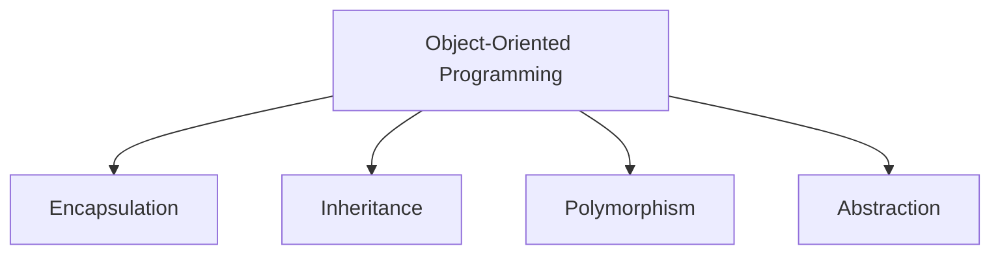
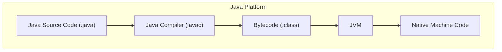
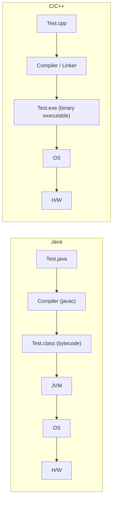

# 1강 — 객체 지향 프로그래밍 개론

[레포지토리 안내](../../README.ko.md) | [English](Concepts_Lecture.md) | [한국어](Concepts_Lecture.ko.md)

> **최종 수정일:** 2026-10-19

> **학습 목표:**
> 1. 객체 지향 프로그래밍 개념(클래스, 객체, 캡슐화)을 정의할 수 있다
> 2. Java 개발 환경을 설정할 수 있다
> 3. 기본 Java 프로그램을 작성하고 컴파일할 수 있다
> 4. 소스 파일, 클래스 파일, JVM의 관계를 C/C++의 빌드 과정과 비교하여 설명할 수 있다

---

## 목차

- [1. 객체 지향 프로그래밍이란?](#1-객체-지향-프로그래밍이란)
  - [1.1 프로그래밍 언어의 수준](#11-프로그래밍-언어의-수준)
  - [1.2 프로그래밍 패러다임](#12-프로그래밍-패러다임)
  - [1.3 OOP의 4대 핵심 원칙](#13-oop의-4대-핵심-원칙)
- [2. Java 개요](#2-java-개요)
  - [2.1 역사와 설계 목표](#21-역사와-설계-목표)
  - [2.2 Java의 응용 분야](#22-java의-응용-분야)
  - [2.3 Java 플랫폼 아키텍처](#23-java-플랫폼-아키텍처)
  - [2.4 JDK, JRE, JVM](#24-jdk-jre-jvm)
- [3. Java 프로그램의 실행 과정](#3-java-프로그램의-실행-과정)
  - [3.1 컴파일과 인터프리팅](#31-컴파일과-인터프리팅)
  - [3.2 Java와 C/C++의 차이](#32-java와-cc의-차이)
  - [3.3 Write Once, Run Anywhere](#33-write-once-run-anywhere)
  - [3.4 소스 파일과 클래스 파일](#34-소스-파일과-클래스-파일)
  - [3.5 배포, 진입점, 패키지, 가비지 컬렉션](#35-배포-진입점-패키지-가비지-컬렉션)
- [4. 개발 환경 설정](#4-개발-환경-설정)
  - [4.1 JDK 설치](#41-jdk-설치)
  - [4.2 Eclipse IDE 설치와 설정](#42-eclipse-ide-설치와-설정)
  - [4.3 자주 쓰는 단축키](#43-자주-쓰는-단축키)
- [5. 첫 번째 Java 프로그램](#5-첫-번째-java-프로그램)
  - [5.1 콘솔 버전](#51-콘솔-버전)
  - [5.2 명령 줄에서 컴파일하고 실행하기](#52-명령-줄에서-컴파일하고-실행하기)
  - [5.3 GUI 버전](#53-gui-버전)
- [요약](#요약)
- [점검 문제](#점검-문제)

---

<br>

## 1. 객체 지향 프로그래밍이란?

### 1.1 프로그래밍 언어의 수준

컴퓨터가 직접 실행하는 것은 0과 1로 된 **기계어**(machine code)이다. 기계어 명령을 사람이 읽을 수 있는 기호(니모닉)로 바꾼 것이 **어셈블리어**(assembly code)이고, 수식과 문장에 가까운 형태로 프로그램을 쓰게 한 것이 **고급 언어**(high-level language)이다. Java는 고급 언어이다.

```text
기계어:
    10110011 00011001
    01111010 11010001 10010100
    10011111 00011001
    01011100 11010001 10010000
    10111011 11010001 10010110

어셈블리어:
    MV  0,   SUM
    MV  NUM, AC
    ADD SUM, AC
    STO SUM, TOT

고급 언어:
    X = (Y + Z) / 2
```

어셈블리어와 고급 언어로 쓴 프로그램은 어셈블러나 컴파일러가 기계어(Java의 경우 3.1절의 바이트코드)로 번역해야 실행할 수 있다.

### 1.2 프로그래밍 패러다임

프로그래밍 패러다임은 코드를 구조화하고 사고하는 방식을 정의한다. 주요 패러다임은 다음과 같다.

| 패러다임 | 핵심 개념 | 대표 언어 |
|:---------|:---------|:----------|
| 절차적 | 단계별 명령 수행 | C, Pascal |
| 객체 지향 | 실세계 엔티티를 객체로 모델링 | Java, C++, Python |
| 함수형 | 수학 함수로서의 계산 | Haskell, Lisp |
| 선언적 | *어떻게*가 아닌 *무엇을* 계산할지 기술 | SQL, Prolog |

*표 1. 주요 프로그래밍 패러다임과 대표 언어*

> **핵심:** OOP는 소프트웨어를 데이터(필드)와 행위(메서드)를 모두 캡슐화한 상호작용하는 객체의 집합으로 모델링한다.

### 1.3 OOP의 4대 핵심 원칙



*그림 1. OOP의 4대 핵심 원칙*

1. **캡슐화(Encapsulation):** 데이터와 메서드를 하나로 묶고, 접근 제어자(`private`, `protected`, `public`)를 통해 직접 접근을 제한한다.
2. **상속(Inheritance):** 기존 클래스로부터 새로운 클래스를 생성하여 코드 재사용을 촉진한다.
3. **다형성(Polymorphism):** 하나의 인터페이스에 여러 구현을 가능하게 한다(메서드 오버로딩 및 오버라이딩).
4. **추상화(Abstraction):** 구현 세부사항을 숨기고 필수적인 기능만 외부에 노출한다.

---

<br>

## 2. Java 개요

### 2.1 역사와 설계 목표

Java는 Sun Microsystems의 James Gosling 팀이 개발하여 1995년에 발표하였다. 핵심 설계 목표는 다음과 같다.

- **단순성(Simple):** 포인터 연산, 클래스의 다중 상속 등 복잡한 기능을 제거하였다.
- **객체 지향(Object-Oriented):** 기본 자료형을 제외한 모든 것이 객체이다. 상속, 다형성, 캡슐화를 지원한다.
- **플랫폼 독립성(Platform-Independent):** 바이트코드로 컴파일되어 모든 JVM에서 실행 가능하다.
- **보안성(Secure):** 바이트코드 검증기와 보안 관리자(Security Manager)를 제공한다.
- **견고성(Robust):** 강력한 타입 검사, 예외 처리, 가비지 컬렉션을 지원한다.
- **멀티스레드(Multithreaded):** 동시성 프로그래밍을 기본적으로 지원한다.

> **참고:** 보안 관리자는 Java 17에서 제거 예정(deprecated for removal)으로 지정되었고, Java 24부터는 활성화할 수 없다. 현재 Java의 보안은 바이트코드 검증, 타입 안전성, 모듈 시스템 등에 주로 의존한다.

Java는 객체 지향 프로그래밍을 대표하는 언어로, 오랫동안 가장 널리 쓰이는 프로그래밍 언어 중 하나였다.

### 2.2 Java의 응용 분야

- **데스크톱 응용 프로그램:** 가장 전형적인 Java 프로그램으로, 데스크톱 컴퓨터에 설치하여 실행한다(예: 데스크톱 게임). Java 실행 환경(JRE)이 있는 컴퓨터라면 어디서나 실행된다.
- **서블릿(servlet) 응용 프로그램:** 웹 서버의 JVM에서 실행되는 Java 프로그램이다. 브라우저의 요청을 인터넷을 통해 받아 데이터베이스 등을 사용해 처리하고 결과를 돌려준다. 이름이 비슷한 JavaScript는 주로 브라우저에서 실행되는 별개의 언어이다.
- **Android:** Google이 주도하고 여러 모바일 기업이 참여한 무료 모바일 플랫폼이다. 개발 언어로 Java를 쓰지만, JVM에 해당하는 Android의 실행 환경(초기의 Dalvik, Android 5.0부터의 ART)은 JVM과 호환되지 않으므로 Java 바이트코드를 Android용 형식(DEX)으로 변환해야 한다.

### 2.3 Java 플랫폼 아키텍처



*그림 2. 소스 코드가 기계어로 실행되기까지의 Java 플랫폼 구조*

### 2.4 JDK, JRE, JVM

| 구성 요소 | 설명 |
|:----------|:-----|
| **JDK** (Java Development Kit) | 완전한 개발 환경: 컴파일러, 디버거, 도구 + JRE 포함 |
| **JRE** (Java Runtime Environment) | Java 프로그램 실행을 위한 런타임 라이브러리 + JVM |
| **JVM** (Java Virtual Machine) | 바이트코드를 실행하는 추상 머신; 플랫폼별로 구현됨 |

*표 2. JDK, JRE, JVM의 역할*

$$
\text{JDK} \supset \text{JRE} \supset \text{JVM}
$$

> **참고:** Java 11부터 Oracle은 JRE를 따로 배포하지 않는다. JDK를 설치하면 프로그램 실행에 필요한 런타임도 함께 설치되므로, 위 포함 관계는 구성 요소의 역할을 나타내는 개념적 구분으로 이해하면 된다.

---

<br>

## 3. Java 프로그램의 실행 과정

### 3.1 컴파일과 인터프리팅

Java는 **하이브리드** 언어로, 컴파일과 인터프리팅을 모두 거친다.

1. **컴파일:** `javac MyProgram.java` 명령으로 `MyProgram.class`(바이트코드)를 생성한다.
2. **실행:** `java MyProgram` 명령으로 JVM을 시작하고, 바이트코드를 인터프리팅/JIT 컴파일한다.

```text
Source Code (.java)  -->  Bytecode (.class)  -->  JVM  -->  Output
        [javac]                                  [java]
```

*그림 3. javac와 java 명령에 따른 컴파일과 실행 단계*

Java 프로그램은 여러 소스 파일(`.java`)로 나누어 개발한다. 각 소스 파일을 컴파일하면 클래스마다 바이트코드 파일(`.class`)이 생기며, 이들을 하나의 실행 파일(`.exe`)로 묶는 링크 단계는 없다. 실행은 `main()` 메서드가 있는 클래스에서 시작하고, JVM은 실행 중에 클래스가 처음 필요해질 때 그 클래스 파일을 적재(loading)한다. 필요한 클래스만 적재하므로 적은 메모리로 실행할 수 있다. 이때 JVM은 Java 클래스 라이브러리(API)의 클래스(예: `Math.class`, `String.class`)도 같은 방식으로 적재한다.

### 3.2 Java와 C/C++의 차이



*그림 4. Java와 C/C++의 빌드와 실행 과정 비교*

- **Java:** 컴파일러가 소스 코드를 플랫폼 독립적인 바이트코드(`Test.class`)로 번역하고, 각 운영 체제 위의 JVM이 이 바이트코드를 실행한다.
- **C/C++:** 컴파일러와 링커가 소스 코드를 특정 운영 체제와 하드웨어용 기계어 실행 파일(`Test.exe`)로 만든다. 운영 체제가 다르면 다시 컴파일해야 한다.

### 3.3 Write Once, Run Anywhere

바이트코드는 플랫폼 독립적이므로, 동일한 `.class` 파일이 Windows, macOS, Linux 등 호환되는 JVM이 있는 모든 운영 체제에서 실행된다.

> **핵심:** JVM은 컴파일된 바이트코드와 하위 하드웨어/운영 체제 사이에 추상화 계층을 제공하여 진정한 플랫폼 독립성을 가능하게 한다.

### 3.4 소스 파일과 클래스 파일

- 하나의 소스 파일에 여러 클래스를 작성할 수 있다.
- 한 소스 파일에서 `public` 클래스는 최대 하나이다.
- `public` 클래스가 있으면 소스 파일 이름은 그 클래스 이름과 같아야 한다(`public class A`는 `A.java`).
- 컴파일하면 클래스마다 `.class` 파일이 하나씩 생긴다. 다른 클래스 안에 선언한 클래스(중첩 클래스)는 `바깥클래스$안쪽클래스.class` 이름의 파일이 된다.

```text
A.java                         컴파일 결과 (클래스 파일 4개)
┌──────────────────────┐
│ public class A {     │  ──>  A.class
│ }                    │
│ class B {            │  ──>  B.class
│ }                    │
│ class C {            │  ──>  C.class
│     class D {        │  ──>  C$D.class
│     }                │
│ }                    │
└──────────────────────┘
```

*그림 5. 소스 파일 하나에서 클래스 파일 네 개가 생성되는 과정*

### 3.5 배포, 진입점, 패키지, 가비지 컬렉션

- **실행 파일 배포:** 여러 클래스 파일과 자원을 하나로 묶어 배포할 때는 JAR(`.jar`) 파일을 쓴다.
- **main() 메서드:** Java 프로그램은 실행할 때 지정한 클래스의 `main()` 메서드에서 시작한다. 여러 클래스가 각자 `main()`을 가질 수 있지만, 한 클래스에는 `public static void main(String[] args)` 형태의 `main()`이 하나만 있다.
- **패키지(package):** 관련된 클래스를 묶는 단위이다. Java는 강력한 표준 라이브러리를 패키지 단위로 제공한다(예: `javax.swing`, `java.util`).
- **가비지 컬렉션(garbage collection):** Java에는 메모리 할당 연산자 `new`만 있고, 응용 프로그램이 메모리를 직접 반환하는 함수는 없다. 더 이상 참조되지 않는 객체의 메모리는 JVM의 가비지 컬렉터가 회수하므로 개발자의 부담이 줄어든다.

---

<br>

## 4. 개발 환경 설정

### 4.1 JDK 설치

Java 개발을 위한 일반적인 설정 과정은 다음과 같다.

1. **JDK 설치:** Oracle에서 다운로드하거나 OpenJDK를 사용한다. 설치 프로그램은 기본 설정으로 진행하면 되며, 설치된 폴더(예: `C:\Program Files\Java\jdk-17.0.2`)를 기억해 둔다.
2. **환경 변수 설정:** `JAVA_HOME`을 설정하고, `bin` 디렉토리(예: `C:\Program Files\Java\jdk-17.0.2\bin`)를 `PATH`에 추가한다. Windows 10에서는 제어판에서 "환경 변수"를 검색하여 시스템 환경 변수 편집 창을 열고, 시스템 변수의 `Path`를 편집하여 `bin` 폴더 경로를 추가한다. 대부분의 경우 설치 프로그램이 이 단계를 자동으로 처리한다.
3. **IDE 선택:** IntelliJ IDEA, Eclipse, VS Code 또는 간단한 텍스트 편집기를 사용한다.
4. **설치 확인:** 명령 프롬프트에서 다음 명령으로 버전이 출력되는지 확인한다.
   ```bash
   java -version
   javac -version
   ```

### 4.2 Eclipse IDE 설치와 설정

1. Eclipse 다운로드 페이지에서 설치 프로그램을 내려받는다. 국내에서는 가까운 미러 서버(예: Kakao 미러)를 선택하면 다운로드가 빠르다.
2. 설치 후 **Window > Preferences**에서 작업 공간의 텍스트 파일 인코딩을 UTF-8로 설정한다. 한글 주석과 문자열이 깨지지 않게 하기 위해서이다.
3. 새 Java 프로젝트를 만들고, 새 클래스 이름으로 `HelloWorld`를 입력한 뒤 `public static void main(String[] args)` 생성 옵션을 선택하고 Finish를 눌러 클래스를 만든다. 코드를 작성하고 실행하여 출력을 확인한다.

### 4.3 자주 쓰는 단축키

| 단축키 | 기능 |
|:-------|:-----|
| Ctrl + F11 | 컴파일하고 실행 |
| Ctrl + / | 한 줄 주석 처리와 해제 |
| Ctrl + Shift + / | 여러 줄 블록 주석 처리 |
| Ctrl + Shift + \\ | 블록 주석 해제 |
| Ctrl + I | 코드 들여쓰기 정렬 |
| `sysout` 입력 후 Ctrl + Space | `System.out.println();` 자동 완성 |

*표 3. Eclipse에서 자주 쓰는 단축키*

---

<br>

## 5. 첫 번째 Java 프로그램

### 5.1 콘솔 버전

최소한의 Java 프로그램 구조는 다음과 같다.

```java
public class HelloWorld {
    public static void main(String[] args) {
        System.out.println("Hello, OOP World!");
    }
}
```

주요 관찰 사항은 다음과 같다.
- 모든 Java 프로그램에는 최소 하나의 클래스가 필요하다.
- `main` 메서드가 진입점(entry point)이다: `public static void main(String[] args)`.
- `System.out.println()`은 콘솔에 텍스트를 출력한다.
- Java는 대소문자를 구분하며, 파일 이름은 public 클래스 이름과 일치해야 한다.

### 5.2 명령 줄에서 컴파일하고 실행하기

IDE 없이도 메모장 같은 텍스트 편집기로 소스 코드를 작성하여 `HelloWorld.java`로 저장한 뒤, 명령 프롬프트에서 그 파일이 있는 폴더로 이동하여 컴파일하고 실행할 수 있다.

```bash
javac HelloWorld.java
java HelloWorld
```

`javac`가 같은 폴더에 `HelloWorld.class`를 만들고, `java`가 JVM을 시작하여 그 클래스의 `main()`을 실행한다. `java` 명령에는 확장자 `.class`를 붙이지 않고 클래스 이름만 쓴다.

### 5.3 GUI 버전

같은 프로그램을 `javax.swing.JOptionPane`의 대화 상자로 입출력하게 바꿀 수 있다.

```java
import javax.swing.JOptionPane;

public class Chap1HelloWorld {

    public static void main(String[] args) {
        String firstName = JOptionPane.showInputDialog(null, "Please enter your first name");
        String lastName = JOptionPane.showInputDialog(null, "Please enter your last name");

        JOptionPane.showMessageDialog(null, "Hello World! " + firstName + " " + lastName);
    }
}
```

`showInputDialog`는 입력 창을 띄워 사용자가 입력한 문자열을 반환하고, `showMessageDialog`는 메시지 창을 띄운다. C로 작성하는 기본 프로그램은 콘솔(CUI)에서 동작하지만, Java는 표준 라이브러리만으로 GUI 프로그램을 만들 수 있다. 또 JVM 덕분에 이 프로그램은 운영 체제마다 다시 컴파일하지 않고 실행된다.

---

<br>

## 요약

| 개념 | 핵심 요약 |
|:-----|:-----------|
| OOP | 소프트웨어를 데이터와 행위를 가진 상호작용하는 객체로 모델링한다. |
| 4대 원칙 | OOP의 4대 원칙은 캡슐화, 상속, 다형성, 추상화이다. |
| Java | 플랫폼 독립적이고, 객체 지향적이며, 컴파일 후 인터프리팅하는 언어이다. |
| JVM | 바이트코드를 실행하며 "Write Once, Run Anywhere"를 가능하게 한다. |
| JDK vs JRE | JDK는 개발 도구와 JRE를 포함하고, JRE는 런타임 라이브러리와 JVM을 포함한다. |
| Java와 C/C++ | Java는 바이트코드를 만들어 JVM에서 실행하고 링크 단계가 없으며, C/C++는 플랫폼별 실행 파일을 만든다. |
| 클래스 파일 | 소스 파일 하나에 여러 클래스를 둘 수 있고, 컴파일하면 클래스마다 `.class` 파일이 생긴다. |
| 프로그램 구조 | 파일당 public 클래스는 최대 하나이고, `main` 메서드가 진입점이다. |
| 가비지 컬렉션 | 참조되지 않는 객체의 메모리를 JVM이 자동으로 회수한다. |

---

<br>

## 점검 문제

1. **클래스 파일:** 다음 `A.java`를 컴파일하면 어떤 클래스 파일이 생기는가?

   ```java
   public class A { }
   class B { }
   class C {
       class D { }
   }
   ```

   <details>
   <summary>정답</summary>

   `A.class`, `B.class`, `C.class`, `C$D.class`의 네 파일이 생긴다. 클래스마다 클래스 파일이 하나씩 생기며, `C` 안에 선언한 중첩 클래스 `D`는 `C$D.class`가 된다.

   </details>

2. **파일 이름 규칙:** `Hello.java` 파일 안에 `public class HelloWorld { ... }`를 작성하고 `javac Hello.java`로 컴파일하면 어떻게 되는가? 해결 방법은 무엇인가?

   <details>
   <summary>정답</summary>

   컴파일 오류 "class HelloWorld is public, should be declared in a file named HelloWorld.java"가 발생한다. public 클래스는 이름이 같은 소스 파일에 있어야 하므로, 파일 이름을 `HelloWorld.java`로 바꾸거나 클래스 이름을 `Hello`로 바꾼다.

   </details>

3. **JDK, JRE, JVM:** Java 프로그램을 작성하여 컴파일하려는 개발자와 이미 컴파일된 `.class` 파일을 실행만 하려는 사용자에게 각각 필요한 구성 요소는 무엇인가?

   <details>
   <summary>정답</summary>

   개발자에게는 컴파일러 `javac`가 들어 있는 JDK가 필요하다. 실행만 하려면 런타임 라이브러리와 JVM을 갖춘 실행 환경(JRE)이면 된다. JVM은 두 경우 모두 바이트코드를 실행하는 핵심 구성 요소이며, Java 11부터는 JRE를 따로 배포하지 않으므로 보통 JDK를 설치한다.

   </details>

4. **플랫폼 독립성:** Windows에서 컴파일한 C 프로그램의 `Test.exe`는 Linux에서 실행되지 않지만, Windows에서 컴파일한 `Test.class`는 Linux에서 실행된다. 그 이유를 설명하라.

   <details>
   <summary>정답</summary>

   C 컴파일러와 링커는 특정 운영 체제와 하드웨어용 기계어 실행 파일을 만들므로 다른 플랫폼에서는 다시 컴파일해야 한다. Java 컴파일러는 특정 기계어가 아닌 바이트코드를 만들고, 각 플랫폼에 구현된 JVM이 이 바이트코드를 해석하거나 JIT 컴파일하여 실행하므로 같은 `.class` 파일이 JVM이 있는 모든 플랫폼에서 실행된다.

   </details>
