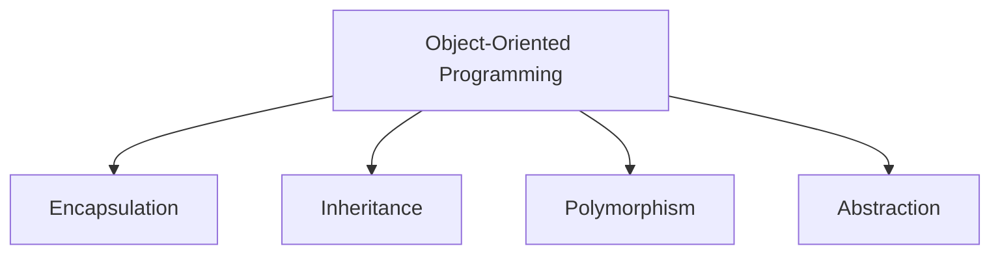
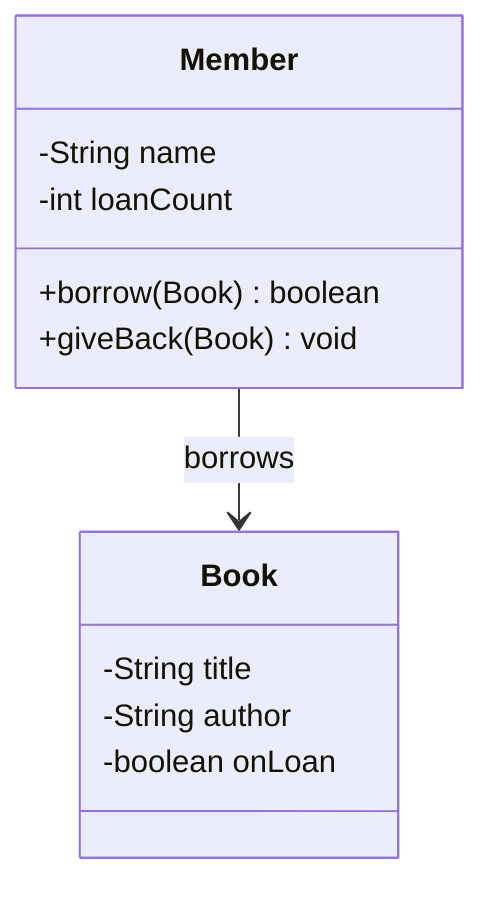
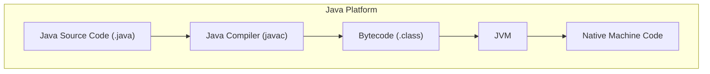
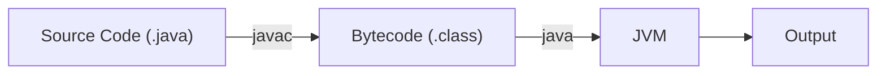
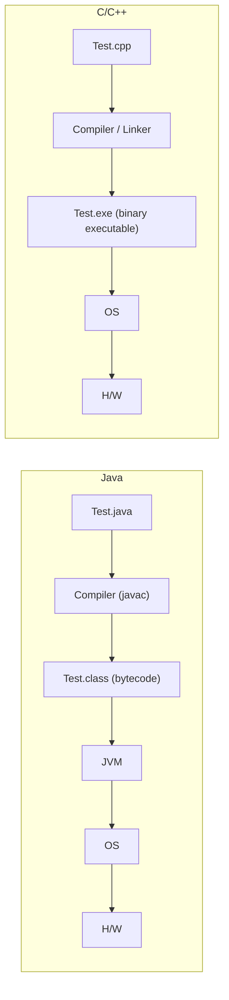
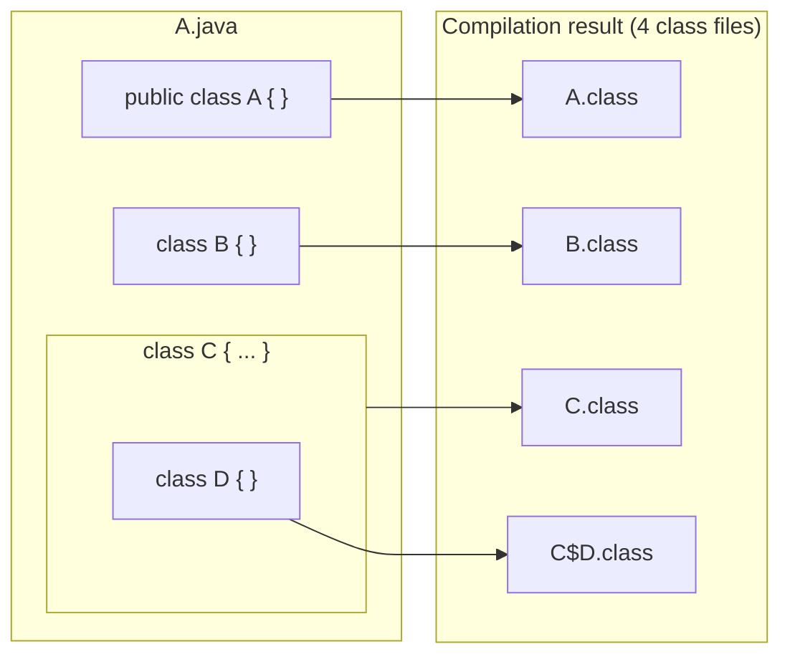
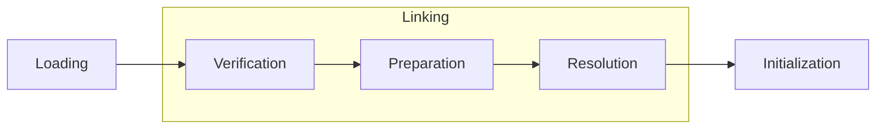

# Lecture 1 — Introduction to OOP

[Repository Guide](../../README.md) | [English](Concepts_Lecture.md) | [한국어](Concepts_Lecture.ko.md)

> **Last Updated:** 2026-11-19

> **Learning Objectives:**
> 1. Define object-oriented programming concepts (class, object, encapsulation)
> 2. Set up a Java development environment
> 3. Write and compile basic Java programs
> 4. Explain the relationship among source files, class files, and the JVM in comparison with the C/C++ build process
> 5. Read bytecode with javap and explain how a class is loaded, linked, and initialized
> 6. Distinguish the run-time data areas of the JVM (method area, heap, JVM stack) and diagnose common compile-time and run-time errors

---

## Table of Contents

- [1. The Concept of Object-Oriented Programming](#1-the-concept-of-object-oriented-programming)
  - [1.1 Levels of Programming Languages](#11-levels-of-programming-languages)
  - [1.2 Programming Paradigms](#12-programming-paradigms)
  - [1.3 The Four Pillars of OOP](#13-the-four-pillars-of-oop)
  - [1.4 Procedural Design Versus Object-Oriented Design](#14-procedural-design-versus-object-oriented-design)
  - [1.5 Finding Classes in a Problem Statement](#15-finding-classes-in-a-problem-statement)
- [2. Java Overview](#2-java-overview)
  - [2.1 History and Design Goals](#21-history-and-design-goals)
  - [2.2 Application Areas of Java](#22-application-areas-of-java)
  - [2.3 Java Platform Architecture](#23-java-platform-architecture)
  - [2.4 JDK, JRE, and JVM](#24-jdk-jre-and-jvm)
  - [2.5 Main Tools in the JDK](#25-main-tools-in-the-jdk)
- [3. How Java Programs Execute](#3-how-java-programs-execute)
  - [3.1 Compilation and Interpretation](#31-compilation-and-interpretation)
  - [3.2 Differences Between Java and C/C++](#32-differences-between-java-and-cc)
  - [3.3 Write Once, Run Anywhere](#33-write-once-run-anywhere)
  - [3.4 Source Files and Class Files](#34-source-files-and-class-files)
  - [3.5 Distribution, Entry Point, Packages, and Garbage Collection](#35-distribution-entry-point-packages-and-garbage-collection)
  - [3.6 Bytecode and javap](#36-bytecode-and-javap)
  - [3.7 Class File Format and Version](#37-class-file-format-and-version)
  - [3.8 Loading, Linking, and Initializing a Class](#38-loading-linking-and-initializing-a-class)
  - [3.9 Run-Time Data Areas of the JVM](#39-run-time-data-areas-of-the-jvm)
  - [3.10 Interpretation and JIT Compilation](#310-interpretation-and-jit-compilation)
  - [3.11 Language Differences Between Java and C++](#311-language-differences-between-java-and-c)
- [4. Development Environment Setup](#4-development-environment-setup)
  - [4.1 Installing the JDK](#41-installing-the-jdk)
  - [4.2 Installing and Configuring the Eclipse IDE](#42-installing-and-configuring-the-eclipse-ide)
  - [4.3 Frequently Used Shortcuts](#43-frequently-used-shortcuts)
- [5. First Java Program](#5-first-java-program)
  - [5.1 Console Version](#51-console-version)
  - [5.2 Compiling and Running from the Command Line](#52-compiling-and-running-from-the-command-line)
  - [5.3 GUI Version](#53-gui-version)
  - [5.4 Common Compile-Time and Run-Time Errors](#54-common-compile-time-and-run-time-errors)
  - [5.5 Source-File Mode](#55-source-file-mode)
- [6. Common Mistakes](#6-common-mistakes)
- [Concept Applications](#concept-applications)
- [Summary](#summary)
- [Self-Check Questions](#self-check-questions)
- [References](#references)

---

<br>

## 1. The Concept of Object-Oriented Programming

### 1.1 Levels of Programming Languages

What a computer executes directly is **machine code** made of 0s and 1s. **Assembly code** replaces machine instructions with human-readable symbols (mnemonics), and a **high-level language** lets programs be written in a form close to formulas and sentences. Java is a high-level language.

```text
Machine code:
    10110011 00011001
    01111010 11010001 10010100
    10011111 00011001
    01011100 11010001 10010000
    10111011 11010001 10010110

Assembly code:
    MV  0,   SUM
    MV  NUM, AC
    ADD SUM, AC
    STO SUM, TOT

High-level code:
    X = (Y + Z) / 2
```

Programs written in assembly or a high-level language must be translated by an assembler or a compiler into machine code (for Java, into the bytecode of Section 3.1) before they can run.

Programming languages can be arranged in layers by how close they are to the hardware. The lower a layer, the closer it is to the form the machine processes directly; the higher a layer, the easier it is for people to read and write.

- **Binary code:** the sequence of 0s and 1s that the hardware reads. It is not in a form people can read.
- **Machine code:** the sequence of instructions written as binary code in a form such as hexadecimal. The operating system loads it into memory, and the CPU executes it.
- **Assembly language:** a language such as Intel x86 assembly that attaches a symbol like `ADD` or `MOV` to each machine instruction. It is the first layer people can read, and its instructions correspond almost one to one to machine code.
- **High-level and middle-level languages:** languages such as C and C++ in which programs are written with expressions, conditionals, loops, and functions. C is sometimes called a middle-level language, between high-level languages and assembly, because pointers let it manipulate memory addresses directly.
- **Scripting and interpreted languages:** languages such as Perl, Python, and shell scripts whose source code an interpreter reads and executes directly.

Translating a representation in an upper layer into one in a lower layer is compiling, and turning machine code back into an upper-layer representation such as assembly is disassembling. In this classification Java is often grouped with the interpreted languages, but it actually has a two-stage structure: the source code is first compiled into bytecode, and the JVM then interprets that bytecode or compiles it again into machine code (Sections 3.1 and 3.10). The `javap -c` command of Section 3.6 is a disassembler that shows the bytecode of a class file as a readable list of instructions.

### 1.2 Programming Paradigms

Programming paradigms define how we structure and reason about code. The major paradigms include the following.

| Paradigm | Key Idea | Example Languages |
|:---------|:---------|:------------------|
| Procedural | Step-by-step instructions | C, Pascal |
| Object-Oriented | Model real-world entities as objects | Java, C++, Python |
| Functional | Computation as mathematical functions | Haskell, Lisp |
| Declarative | Describe *what* to compute, not *how* | SQL, Prolog |

*Table 1. Major programming paradigms and example languages*

> **Key Point:** OOP models software as a collection of interacting objects, each encapsulating both data (fields) and behavior (methods).

### 1.3 The Four Pillars of OOP



*Figure 1. The four pillars of OOP*

1. **Encapsulation:** Bundling data and methods together; restricting direct access with access modifiers (`private`, `protected`, `public`).
2. **Inheritance:** Creating new classes from existing ones, promoting code reuse.
3. **Polymorphism:** A single interface with multiple implementations (method overloading and overriding).
4. **Abstraction:** Hiding implementation details and exposing only essential features.

### 1.4 Procedural Design Versus Object-Oriented Design

Procedural design divides a program into data and a collection of functions that process that data, and each function receives the data it needs through parameters or global variables. Because data and functions are separate, the responsibility for keeping the rules the data must satisfy (for example, that a balance cannot be negative) is spread over every piece of code that touches the data. The following example handles a bank balance procedurally.

```java
public class ProceduralBank {
    static double balance = 0.0;

    static void deposit(double amount) {
        balance = balance + amount;
    }

    public static void main(String[] args) {
        deposit(100.0);
        balance = -500.0;
        System.out.println(balance);
    }
}
```

```text
-500.0
```

Even though a `deposit` function exists, `balance` is a variable that anyone can change, so nothing stops `main` from breaking the rule with `balance = -500.0;`. In addition, there is only one balance variable, so handling two accounts requires new variables or an array and a change to every function so that it takes an account number.

Object-oriented design bundles data and the operations on that data into one class and restricts the ways to change the data to the methods of that class.

```java
public class BankAccount {
    private double balance;

    public void deposit(double amount) {
        if (amount > 0) {
            balance = balance + amount;
        }
    }

    public double getBalance() {
        return balance;
    }
}
```

```java
public class OopBank {
    public static void main(String[] args) {
        BankAccount account = new BankAccount();
        account.deposit(100.0);
        account.deposit(-30.0);
        System.out.println(account.getBalance());
    }
}
```

```text
100.0
```

The negative deposit is caught by the check inside `deposit` and ignored, so the balance is 100.0. Writing `account.balance = -500.0;` outside the class is rejected at compile time as follows.

```text
BadBank.java:4: error: balance has private access in BankAccount
        account.balance = -500.0;
               ^
1 error
```

Two of the four pillars appear in this example. The client only needs to know what `deposit` and `getBalance` do, not which variable stores the balance, which is abstraction, and `private` hides that variable, which is encapsulation. Executing `new BankAccount()` several times creates several objects, each with its own `balance`, so the class need not change as the number of accounts grows. Inheritance is the means of building a new class, such as an interest-bearing account, on top of this class (Lecture 2, Section 1.7), and polymorphism is the property that lets different kinds of accounts be handled through the same method call (Lecture 11).

| Criterion | Procedural design | Object-oriented design |
|:-----|:-----|:-----|
| Unit of the program | Function | Class that bundles data and methods |
| Protection of data | Every piece of code using the data must keep the rules | The class checks the rules inside its methods |
| Several objects of the same kind | Add variables or arrays and change the functions | Create more objects of the same class |
| Changing the internal representation | Change every function that uses the data | Change only the inside of the class, keeping the public methods |

*Table 2. Procedural design versus object-oriented design*

> **Caution:** Writing in an object-oriented language does not by itself make a design object-oriented. `ProceduralBank` above is also a Java class, but it exposes its data as a `static` variable and does all the work in `static` methods, so its structure is procedural.

### 1.5 Finding Classes in a Problem Statement

The first task in designing an object-oriented program is to decide which of the things appearing in the problem should become classes. A widely used starting point is to look for the nouns and verbs in the sentences that describe the problem. Nouns are candidates for classes or fields, and verbs are candidates for methods. Consider the following statement.

"A library member borrows and returns books. A member can borrow at most three books, and a book has a title and an author and records whether it is on loan."

| Candidate | Source | Decision |
|:-----|:-----|:-----|
| member | Noun | An independent thing with a name and a list of loans, so it becomes the class `Member` |
| book | Noun | It has a title, an author, and a loan state, so it becomes the class `Book` |
| title, author | Nouns | Simple values belonging to a book, so they become the fields `title` and `author` of `Book` |
| whether it is on loan | Noun phrase | A true-or-false state, so it becomes the `boolean` field `onLoan` of `Book` |
| at most three | Quantity | The same rule for every member, so it becomes the class constant `MAX_LOANS = 3` |
| borrow, return | Verbs | Actions of a member, so they become the methods `borrow(Book)` and `giveBack(Book)` of `Member` |

*Table 3. Candidate classes, fields, and methods taken from the library statement*

The classes chosen this way can be drawn as follows. `borrow` must refuse when the member has already borrowed three books or when the book is on loan, so the responsibility for keeping this rule is gathered inside the methods of `Member`.



*Figure 2. Class diagram of Member and Book built from the library statement*

Not every noun needs to become a class. "Library" is only the setting that holds members and books in this statement, and no state or behavior of its own is mentioned, so it is not made a class at first. The criterion is whether the thing has a state it must keep for itself and actions that change that state. The notation of class diagrams is covered in detail in Lecture 2, Section 1.4, and Lecture 7, Section 1.4.

---

<br>

## 2. Java Overview

### 2.1 History and Design Goals

Java was developed by James Gosling's team at Sun Microsystems and released in 1995. Its core design goals are as follows.

- **Simple:** Eliminated complex features like pointer arithmetic and multiple inheritance of classes.
- **Object-Oriented:** Everything (except primitives) is an object. Java supports inheritance, polymorphism, and encapsulation.
- **Platform-Independent:** Compiled to bytecode that runs on any JVM.
- **Secure:** Provides a bytecode verifier and a security manager.
- **Robust:** Strong type checking, exception handling, garbage collection.
- **Multithreaded:** Native support for concurrent programming.

> **Note:** The security manager was deprecated for removal in Java 17 and cannot be enabled from Java 24 onward. Security in current Java relies mainly on bytecode verification, type safety, and the module system.

Java is a representative object-oriented language and has long been one of the most widely used programming languages.

### 2.2 Application Areas of Java

- **Desktop applications:** The most typical Java programs, installed and run on a desktop computer (e.g., a desktop game). They run on any computer that has the Java Runtime Environment (JRE).
- **Servlet applications:** Java programs that run in the JVM of a web server. A servlet receives a browser's request over the Internet, processes it using a database or other resources, and returns the result. JavaScript, despite the similar name, is a separate language that mainly runs in the browser.
- **Android:** A free mobile platform led by Google with several mobile companies. It uses Java as a development language, but Android's counterpart of the JVM (Dalvik at first, ART from Android 5.0) is not compatible with the JVM, so Java bytecode must be converted to an Android format (DEX).

### 2.3 Java Platform Architecture



*Figure 3. Structure of the Java platform from source code to machine code*

### 2.4 JDK, JRE, and JVM

| Component | Description |
|:----------|:-----------|
| **JDK** (Java Development Kit) | Full development environment that contains development tools such as the compiler and debugger, together with the JRE |
| **JRE** (Java Runtime Environment) | Runtime libraries and the JVM for executing Java programs |
| **JVM** (Java Virtual Machine) | Abstract machine that executes bytecode, implemented for each platform |

*Table 4. Roles of the JDK, JRE, and JVM*

```math
\text{JDK} \supset \text{JRE} \supset \text{JVM}
```

> **Note:** Since Java 11, Oracle no longer distributes a separate JRE. Installing the JDK also installs the runtime needed to run programs, so the inclusion above is best read as a conceptual division of the components' roles.

### 2.5 Main Tools in the JDK

Besides the compiler and the launcher, the `bin` directory of the JDK contains several other commands. The tools used in the examples of this course are the following.

| Command | What it does | Example |
|:-----|:-----|:-----|
| `javac` | Compiles source files into class files | `javac HelloWorld.java` |
| `java` | Starts the JVM and runs `main` of the given class | `java HelloWorld` |
| `javap` | Shows the structure and bytecode of a class file | `javap -c HelloWorld` |
| `jar` | Bundles class files and resources into one JAR file | `jar cf app.jar *.class` |
| `javadoc` | Generates HTML documentation from javadoc comments | `javadoc -d doc Bicycle.java` |
| `jshell` | An interactive tool that evaluates Java statements one line at a time | `jshell` |

*Table 5. Main commands of the JDK*

The `--release N` option of `javac` compiles against the language rules and standard API of Java N and produces class files that a Java N JVM can read. All example outputs in the units come from classes compiled with `javac --release 21` and run with the `java` command of JDK 24.

---

<br>

## 3. How Java Programs Execute

### 3.1 Compilation and Interpretation

Java is a **hybrid** language: it is both compiled and interpreted.

1. **Compile:** `javac MyProgram.java` produces `MyProgram.class` (bytecode).
2. **Execute:** `java MyProgram` launches the JVM, which interprets or JIT-compiles the bytecode.



*Figure 4. Compilation and execution stages with the javac and java commands*

A Java program is developed as several source files (`.java`). Compiling each source file produces one bytecode file (`.class`) per class, and there is no link step that combines them into a single executable (`.exe`). Execution starts from the class that has a `main()` method, and the JVM loads a class file when that class is first needed at run time. Because only the needed classes are loaded, the program runs with less memory. The JVM loads classes of the Java class library (API), such as `Math.class` and `String.class`, in the same way.

### 3.2 Differences Between Java and C/C++



*Figure 5. Build and execution processes of Java and C/C++ compared*

- **Java:** The compiler translates source code into platform-independent bytecode (`Test.class`), and the JVM on each operating system executes the bytecode.
- **C/C++:** The compiler and linker turn source code into a machine-code executable (`Test.exe`) for a specific operating system and hardware. A different operating system requires recompilation.

> **[Systems Programming]** A C/C++ linker gathers separately compiled object files (`.o`, `.obj`) and libraries and resolves the references to symbols such as functions and global variables to actual addresses, producing a single executable. Java has no such link step: as in Section 3.1, the JVM loads the needed class files at run time and links the references between classes as it does so.

### 3.3 Write Once, Run Anywhere

Because bytecode is platform-independent, the same `.class` file runs on Windows, macOS, Linux, or any operating system with a compatible JVM.

> **Key Point:** The JVM provides an abstraction layer between the compiled bytecode and the underlying hardware and operating system, enabling true platform independence.

### 3.4 Source Files and Class Files

- A single source file can contain several classes.
- A source file has at most one `public` class.
- If there is a `public` class, the source file name must match its name (`public class A` goes in `A.java`).
- Compilation produces one `.class` file per class. A class declared inside another class (a nested class) becomes a file named `Outer$Inner.class`.



*Figure 6. Four class files generated from one source file*

### 3.5 Distribution, Entry Point, Packages, and Garbage Collection

- **Distributing executables:** To distribute many class files and resources as one unit, use a JAR (`.jar`) file.
- **main() method:** A Java program starts from the `main()` method of the class specified at launch. Several classes may each have a `main()`, but a class has only one `main()` of the form `public static void main(String[] args)`.
- **Package:** A unit that groups related classes. Java provides a powerful standard library organized into packages (e.g., `javax.swing`, `java.util`).
- **Garbage collection:** Java has only the memory allocation operator `new` and no function for an application to return memory directly. The JVM's garbage collector reclaims the memory of objects that are no longer referenced, which reduces the developer's burden.

### 3.6 Bytecode and javap

**Bytecode** is the instruction set that the JVM executes; it is so named because each instruction has a one-byte operation code (opcode). The JVM is designed as a stack machine that uses an **operand stack** instead of registers. Instructions push values onto the stack, or pop values from it, compute, and push the result back. Compiling the following program and disassembling it with `javap -c` shows its bytecode.

```java
public class Add {
    public static void main(String[] args) {
        int a = 3;
        int b = 4;
        int c = a + b;
        System.out.println(c);
    }
}
```

```text
$ javac --release 21 Add.java
$ javap -c Add
Compiled from "Add.java"
public class Add {
  public Add();
    Code:
         0: aload_0
         1: invokespecial #1                  // Method java/lang/Object."<init>":()V
         4: return

  public static void main(java.lang.String[]);
    Code:
         0: iconst_3
         1: istore_1
         2: iconst_4
         3: istore_2
         4: iload_1
         5: iload_2
         6: iadd
         7: istore_3
         8: getstatic     #7                  // Field java/lang/System.out:Ljava/io/PrintStream;
        11: iload_3
        12: invokevirtual #13                 // Method java/io/PrintStream.println:(I)V
        15: return
}
```

The number at the start of each line is the byte position (offset) at which the instruction begins in the method's code. The local variables of `main` are identified by number: number 0 is the parameter `args`, and numbers 1-3 are `a`, `b`, and `c` in that order. The first letter `i` of an instruction name means that it handles `int` values, and `a` means that it handles references.

| Offset | Instruction | What it does | Operand stack after | Local variables 1, 2, 3 after |
|:-----|:-----|:-----|:-----|:-----|
| 0 | `iconst_3` | Pushes the constant 3 | 3 | -, -, - |
| 1 | `istore_1` | Pops and stores into variable 1 | (empty) | 3, -, - |
| 2 | `iconst_4` | Pushes the constant 4 | 4 | 3, -, - |
| 3 | `istore_2` | Pops and stores into variable 2 | (empty) | 3, 4, - |
| 4 | `iload_1` | Pushes the value of variable 1 | 3 | 3, 4, - |
| 5 | `iload_2` | Pushes the value of variable 2 | 3, 4 | 3, 4, - |
| 6 | `iadd` | Pops two values and pushes their sum | 7 | 3, 4, - |
| 7 | `istore_3` | Pops and stores into variable 3 | (empty) | 3, 4, 7 |
| 8 | `getstatic` | Pushes the reference in `System.out` | out | 3, 4, 7 |
| 11 | `iload_3` | Pushes the value of variable 3 | out, 7 | 3, 4, 7 |
| 12 | `invokevirtual` | Pops two values and calls `out.println(7)` | (empty) | 3, 4, 7 |
| 15 | `return` | Ends the method | (empty) | 3, 4, 7 |

*Table 6. Operand stack and local variables while main of Add runs*

The class has `public Add();` even though the source declares no constructor, because the compiler generated a default constructor (Lecture 7, Section 2.1). This constructor pushes the reference to the object itself (`this`) with `aload_0` and calls the constructor of the superclass `Object` with `invokespecial`. Numbers such as `#7` and `#13` are indices of entries in the constant pool of the class file, and the comment gives the name of the field or method each entry refers to. `(I)V` is a method descriptor meaning that the method takes one `int` parameter and returns `void`.

> **Key Point:** Bytecode is not the machine code of a particular CPU but the instruction set of a virtual machine, the JVM. This is why the JVMs of Windows, macOS, and Linux can all run the same class file.

### 3.7 Class File Format and Version

A class file follows the format defined by the JVM specification. It begins with the four-byte **magic number** `0xCAFEBABE`, which identifies a class file, followed by a minor version and a major version that give the version of the format [1]. The specification requires a JVM conforming to Java SE N to support exactly the range of major versions defined for Java SE N, so running a class file compiled for a newer version on an older JVM is rejected with an `UnsupportedClassVersionError`. Conversely, class files of older versions run on a newer JVM. Compiling with `--release 21` produces class files that run on a Java 21 or later JVM even when the compiler of JDK 24 is used.

### 3.8 Loading, Linking, and Initializing a Class

The JVM loads, links, and initializes classes dynamically during execution [1].



*Figure 7. Stages a class passes through before it is used*

1. **Loading:** finds and reads the binary representation of a class by its name (usually a `.class` file) and creates a structure inside the JVM that represents the class. The component in charge of this is called a class loader.
2. **Linking:** combines the loaded class into the JVM so that it can be executed. Linking is divided into three stages.
   - **Verification:** checks that the bytecode is structurally correct, for example that a reference never appears where the stack should hold an `int` and that no nonexistent local variable is used. If verification fails, a `VerifyError` is thrown. The bytecode verifier of Section 2.1 is this stage.
   - **Preparation:** creates the storage for the class variables (`static` fields) and fills it with default values (0, `false`, `null`).
   - **Resolution:** replaces the symbolic references in the constant pool (for example, `java/io/PrintStream.println`) with references to the actual methods and fields.
3. **Initialization:** executes the initial-value assignments of `static` fields and the `static` initializer blocks in the order written in the source (Lecture 7, Section 8.3). A class is initialized only once, when it is first actually used.

The following program uses the class `Helper` only when there is a command-line argument. `static { ... }` is a block that runs once when the class is initialized.

```java
public class LazyLoad {
    public static void main(String[] args) {
        System.out.println("main starts");
        if (args.length > 0) {
            Helper.greet();
        }
        System.out.println("main ends");
    }
}

class Helper {
    static {
        System.out.println("Helper is initialized");
    }

    static void greet() {
        System.out.println("Hello from Helper");
    }
}
```

```text
$ java LazyLoad
main starts
main ends
$ java LazyLoad x
main starts
Helper is initialized
Hello from Helper
main ends
```

When run without arguments, the initializer block of `Helper` never runs. Printing the loaded classes with `java -verbose:class` on the HotSpot JVM of JDK 24 shows that without arguments `Helper` was not even loaded, and with the argument `x` it was loaded right after `LazyLoad`. This is the behavior meant in Section 3.1 by the statement that the JVM loads only the classes it needs. In the same run the JVM also loaded hundreds of standard library classes such as `String` and `System`, and they pass through the same stages. The specification fixes the timing of initialization strictly, but it leaves the timing of loading and linking to the implementation, under the condition that loading, verification, and preparation finish before initialization [1], so the moment of loading can differ between JVM implementations.

### 3.9 Run-Time Data Areas of the JVM

The JVM specification divides the memory used while a program runs into several **run-time data areas** [1].

- **Method area:** shared by all threads; it stores per-class structures such as the constant pool, field and method data, and the bytecode of methods and constructors.
- **Heap:** shared by all threads; every object and array is allocated here. Objects on the heap are never freed by the program directly but are reclaimed by the garbage collector.
- **Java Virtual Machine stack:** one per thread; it holds **frames**. A new frame is created each time a method is invoked and is destroyed when the method completes, either normally or with an exception. Each frame has its own array of local variables and its own operand stack.
- **pc register:** one per thread; it holds the position of the bytecode instruction being executed.
- **Native method stack:** a stack used to run methods implemented in languages other than Java (native methods).

The following shows `Add` of Section 3.6 just before it executes `invokevirtual` at offset 12.

```text
 JVM stack (main thread)              Heap
┌──────────────────────────────┐     ┌──────────────────────┐
│ frame of Add.main            │ ┌──▶│ String[] (length 0)  │
│  local variables             │ │   └──────────────────────┘
│   0: args  ●─────────────────┼─┘
│   1: a = 3                   │     ┌──────────────────────┐
│   2: b = 4                   │ ┌──▶│ PrintStream object   │
│   3: c = 7                   │ │   │ (System.out)         │
│  operand stack: ●, 7         │ │   └──────────────────────┘
│                 └────────────┼─┘
└──────────────────────────────┘
 Method area: class Add (bytecode of Add() and main, constant pool), class System, ...
```

*Figure 8. JVM stack, heap, and method area while Add.main runs*

The `int` values 3, 4, and 7 sit directly in the local variables of the frame, while `args` holds a reference to an array object on the heap (of length 0, since the program was run without arguments). The `PrintStream` object referred to by `System.out` is also on the heap, and the operand stack holds a reference to that object and the value 7, waiting for the call to `println`. This structure, in which primitive values are stored in the variables themselves while objects live on the heap and variables hold only references, underlies the memory pictures of Lecture 2, Section 2.5, and Lecture 3, Section 2.2.

### 3.10 Interpretation and JIT Compilation

The JVM specification does not assume any particular implementation technology, so the way bytecode is executed can differ between implementations [1]. The simplest way is an **interpreter**, which reads bytecode instructions one at a time and carries out what each means. It is simple to implement and starts quickly, but it pays the cost of interpretation every time the same instruction is executed.

**Just-in-time (JIT) compilation** compiles the bytecode of frequently executed methods and loops into the machine code of the computer during execution and from then on executes that machine code directly. Compilation takes time, but for code that runs many times the cost is soon recovered. The HotSpot JVM of the JDK uses both methods. It first runs code with the interpreter and then finds frequently executed code and JIT-compiles it. As a result, the same code often becomes faster after the program has been running for a while than right after it starts.

While translating into machine code, the JIT compiler also performs optimizations such as removing computations that do not affect the result. This is why, in Lecture 4, Section 6, the measured time of a loop with an empty body can be shorter than expected. C/C++ compiles into machine code once before execution (ahead-of-time compilation), whereas Java combines compilation into bytecode with JIT compilation during execution, so it does not fit neatly into the dichotomy of Section 1.1 between compiled and interpreted languages.

### 3.11 Language Differences Between Java and C++

Section 3.2 showed the difference in the build and execution processes. Java, whose syntax resembles C++, was designed to remove or change the features of C++ that often cause errors. The differences in which the design goals of Section 2.1, simplicity and robustness, show concretely are the following.

| Item | C++ | Java |
|:-----|:-----|:-----|
| Pointers | Pointer variables and pointer arithmetic exist | No pointer arithmetic; objects are handled only through references |
| Freeing memory | Freed explicitly with `delete`; destructors exist | Reclaimed by the garbage collector; no destructors |
| Sizes of primitive types | The size of `int` and others can vary with the compiler and platform | Fixed by the language specification (`int` is always 32 bits) |
| Array bounds checking | Out-of-range access is not checked | Checked during execution, throwing `ArrayIndexOutOfBoundsException` |
| Multiple inheritance of classes | Allowed | Not allowed; interfaces give a class several types |
| Operator overloading | Can be defined by the programmer | Cannot be defined (only `+` of `String` is fixed by the language) |
| Preprocessor and header files | `#include`, `#define`, and `.h` files are used | None; other classes are brought in by name with `import` |
| Global functions and variables | Can be placed outside classes | Every method and field is inside a class |

*Table 7. Main language differences between C++ and Java*

Because of these differences, some errors common in C and C++ either never arise in Java or show up immediately. Reusing freed memory cannot happen because the program never frees memory, and writing past the end of an array shows up at once as an exception instead of silently overwriting another variable. The price is that the programmer cannot control the memory layout directly and cannot decide when the garbage collector runs.

---

<br>

## 4. Development Environment Setup

### 4.1 Installing the JDK

A typical setup for Java development is as follows.

1. **Install JDK:** Download from Oracle or use OpenJDK. The installer can proceed with default settings; note the installation folder (e.g., `C:\Program Files\Java\jdk-17.0.2`).
2. **Set environment variables:** Set `JAVA_HOME` and add the `bin` directory (e.g., `C:\Program Files\Java\jdk-17.0.2\bin`) to `PATH`. In most cases the installer handles this step automatically.
3. **Choose an IDE:** IntelliJ IDEA, Eclipse, VS Code, or even a simple text editor.
4. **Verify installation:** In a command prompt, check that the following commands print a version.
   ```bash
   java -version
   javac -version
   ```

### 4.2 Installing and Configuring the Eclipse IDE

1. Download the installer from the Eclipse download page.
2. After installation, set the workspace text file encoding to UTF-8 in **Window > Preferences**. This keeps Korean comments and strings from being garbled.
3. Create a `HelloWorld` class with a `main` method in a new Java project, write the code, run it, and check the output.

### 4.3 Frequently Used Shortcuts

Frequently used shortcuts in Eclipse are compile and run (Ctrl + F11), toggling a single-line comment (Ctrl + /), adding a block comment (Ctrl + Shift + /) and removing it (Ctrl + Shift + \\), and correcting indentation (Ctrl + I). Typing `sysout` and pressing Ctrl + Space autocompletes `System.out.println();`.

---

<br>

## 5. First Java Program

### 5.1 Console Version

A minimal Java program structure is as follows.

```java
public class HelloWorld {
    public static void main(String[] args) {
        System.out.println("Hello, OOP World!");
    }
}
```

Key observations are as follows.
- Every Java program needs at least one class.
- The `main` method is the entry point: `public static void main(String[] args)`.
- `System.out.println()` prints text to the console.
- Java is case-sensitive; file name must match the public class name.

The role of each element of this program is as follows.

| Element | Meaning |
|:-----|:-----|
| `public class HelloWorld` | Declares a class `HelloWorld` usable anywhere (`public`); it must be in `HelloWorld.java`, the file of the same name |
| `{ ... }` | Delimits the body of the class and the body of the method |
| `public` (before the method) | Lets the JVM call `main` from outside the class |
| `static` | Lets the method be called through the class name without creating an object; the JVM calls `main` with no `HelloWorld` object |
| `void` | `main` returns no value |
| `String[] args` | Receives the command-line arguments as an array of strings (Lecture 6, Section 2.5) |
| `System` | A class of the `java.lang` package that provides standard input and output |
| `.out` | A class variable of `System` that refers to the `PrintStream` object connected to standard output |
| `.println(...)` | Sends the `out` object a message to print the argument and end the line |
| `;` | Marks the end of a statement |

*Table 8. Meaning of each element of the HelloWorld program*

### 5.2 Compiling and Running from the Command Line

Without an IDE, you can write the source code in a text editor such as Notepad, save it as `HelloWorld.java`, move to its folder in a command prompt, and compile and run it.

```bash
javac HelloWorld.java
java HelloWorld
```

`javac` creates `HelloWorld.class` in the same folder, and `java` launches the JVM to run that class's `main()`. The `java` command takes only the class name, without the `.class` extension.

### 5.3 GUI Version

The same program can be changed to use dialog boxes of `javax.swing.JOptionPane` for input and output.

```java
import javax.swing.JOptionPane;

public class Chap1HelloWorld {

    public static void main(String[] args) {
        String firstName = JOptionPane.showInputDialog(null, "Please enter your first name");
        String lastName = JOptionPane.showInputDialog(null, "Please enter your last name");

        JOptionPane.showMessageDialog(null, "Hello World! " + firstName + " " + lastName);
    }
}
```

`showInputDialog` opens an input window and returns the string the user typed, and `showMessageDialog` opens a message window. A basic C program runs in a console (CUI), whereas Java can build GUI programs with its standard library alone. Thanks to the JVM, this program also runs on each operating system without recompilation.

### 5.4 Common Compile-Time and Run-Time Errors

An error message from `javac` has the form `file name:line number: error: description`; the next line shows the offending source line, and the line below it marks with `^` the position where the error was detected. The position where an error is detected can differ from the position of the actual mistake, so the code before and after `^` should be examined together. The following are actual messages obtained after slightly breaking `HelloWorld` of Section 5.1.

If the semicolon at the end of a statement is missing, the compiler reports that it expected `;` where the statement should end.

```text
HelloWorld.java:3: error: ';' expected
        System.out.println("Hello")
                                   ^
1 error
```

Java is case-sensitive, so writing `system` instead of `System` leaves the name `system` undefined. The compiler tries to interpret the `system` of `system.out` as a package name, fails, and reports the following.

```text
HelloWorld.java:3: error: package system does not exist
        system.out.println("Hello");
              ^
1 error
```

Even after a successful compilation, a wrong launch command causes a run-time error. The `java` command takes a class name, not a file name, so `java HelloWorld.class` makes the JVM look for a class named `HelloWorld.class` and fail.

```text
$ java HelloWorld.class
Error: Could not find or load main class HelloWorld.class
Caused by: java.lang.ClassNotFoundException: HelloWorld.class
```

If the class where execution starts has no `public static void main(String[] args)`, for example because `static` was omitted as in `public void main(String[] args)`, a class compiled under the language rules of Java 21 compiles but produces the following message when run.

```text
$ java Hello
Error: Main method not found in class Hello, please define the main method as:
   public static void main(String[] args)
or a JavaFX application class must extend javafx.application.Application
```

> **Note:** **Changes to the main method rules.** The feature that accepts a `main` without `static` or a `main` without parameters as the entry point began in Java 21 not as a standard feature but as a preview feature [2]. A preview feature can be used only with the `--enable-preview` option, so compiling under the standard rules of Java 21 requires `public static void main(String[] args)` as shown above. After several rounds of preview, the feature became a standard feature in Java 25 [3].

### 5.5 Source-File Mode

A small program consisting of one file can be run without `javac` by passing the source file name directly to the `java` command. This is called **source-file mode**: the `java` command compiles the source file in memory, runs the first top-level class found in the file, and passes the arguments after the file name to the `main` of that class [4].

```java
public class Greeting {
    public static void main(String[] args) {
        System.out.println("Hello, " + args[0]);
    }
}
```

```text
$ java Greeting.java Java
Hello, Java
$ ls
Greeting.java
```

Even after the run there is no `Greeting.class` in the directory, because the result of compilation is kept only in memory. This mode is convenient for trying short examples, but a program made of several source files or a program to be distributed to others is compiled into class files with `javac` and, if needed, bundled into a JAR.

---

<br>

## 6. Common Mistakes

| Mistake | Result | Fix |
|:-----|:-----|:-----|
| The name of the public class differs from the file name | Compile error `class HelloWorld is public, should be declared in a file named HelloWorld.java` | Make the file name match the class name |
| Adding `.class` when running | Run-time error `Could not find or load main class` | Write only the class name, as in `java HelloWorld` |
| Writing `System` or `String` in lowercase | Compile errors such as `package system does not exist` | Write the exact case |
| Omitting `static` or `String[] args` from `main` | Run-time error `Main method not found` | Write `public static void main(String[] args)` |
| Installing only a runtime instead of the JDK | The `javac` command cannot be found | Install the JDK and add its `bin` directory to `PATH` |
| Thinking of bytecode as the machine code of a particular CPU | Cannot explain why Java is platform independent | Bytecode is the instruction set of the JVM, and the JVM of each platform translates it into machine code |
| Running a class compiled by a new JDK on an old JVM | `UnsupportedClassVersionError` | Compile with the `--release` option that matches the JVM that will run it |

*Table 9. Common mistakes when building and running Java programs*

---

<br>

## Concept Applications

**True/False Check:**

| Statement | Judgment and Reason |
|:-----|:-----|
| `javac` translates source code into the machine code that the CPU of the computer executes. | **F.** `javac` produces bytecode that the JVM executes. Translation into machine code is done during execution by the JIT compiler of the JVM. |
| When a program starts, the JVM loads every class the program uses at once. | **F.** A class is initialized when it is first actually used, and the HotSpot JVM also loads it only when it is first needed. `Helper` of Section 3.8 was not loaded when it was not used. |
| The local variables of a method and the objects created with `new` are in the same memory area. | **F.** Local variables are in a frame on the JVM stack of the thread running the method, and objects are on the heap shared by all threads. |
| Bytecode verification is one stage of linking a class. | **T.** Linking consists of verification, preparation, and resolution, and a failed verification throws a `VerifyError`. |
| Running `java Greeting.java` creates `Greeting.class` in the current directory. | **F.** Source-file mode compiles in memory, so it leaves no class file. |
| Code outside a class that assigns to a `private` field throws an exception at run time. | **F.** Access rules are checked by the compiler, so the code fails with a `has private access` compile error and no class file to run is produced. |

---

<br>

## Summary

| Concept | Key Summary |
|:--------|:----------|
| OOP | OOP models software as interacting objects with data and behavior. |
| Four Pillars | The four pillars of OOP are encapsulation, inheritance, polymorphism, and abstraction. |
| Java | Java is a platform-independent, object-oriented, compiled-then-interpreted language. |
| JVM | The JVM executes bytecode and enables "Write Once, Run Anywhere". |
| JDK vs JRE | The JDK contains development tools and the JRE, and the JRE contains runtime libraries and the JVM. |
| Java and C/C++ | Java produces bytecode that runs on the JVM with no link step, whereas C/C++ produces a platform-specific executable. |
| Class files | One source file can hold several classes, and compilation produces one `.class` file per class. |
| Program Structure | A file has at most one public class, and the `main` method is the entry point. |
| Garbage collection | The JVM automatically reclaims the memory of objects that are no longer referenced. |
| Language layers | Binary code, machine code, assembly, high-level languages, and scripting languages become easier for people to read in that order, and translation from an upper to a lower layer is compilation. |
| Procedural versus object-oriented design | Procedural design separates data and functions, whereas object-oriented design bundles them into a class and restricts changes to the data to its methods. |
| Bytecode | Bytecode is the instruction set of the JVM, which uses an operand stack, and can be disassembled and viewed with `javap -c`. |
| Class file format | A class file begins with a magic number and version numbers, and a class file compiled for a newer version is rejected by an older JVM with an `UnsupportedClassVersionError`. |
| Life of a class | A class is loaded when first needed, linked through verification, preparation, and resolution, and then initialized. |
| Run-time data areas | The method area and the heap are shared by all threads, the JVM stack and the pc register exist per thread, and a frame is created for each method call. |
| JIT compilation | JIT compilation compiles frequently executed bytecode into machine code during execution to speed up later executions. |
| Source-file mode | `java Name.java` compiles a single-file program in memory and runs it immediately. |
| Finding classes | Nouns in a problem statement are candidates for classes or fields and verbs for methods, and only things with state and behavior become classes. |
| Java and C++ | Java has no pointer arithmetic, explicit freeing of memory, multiple inheritance of classes, operator overloading, or preprocessor, and it checks array bounds during execution. |

---

<br>

## Self-Check Questions

1. **Class files:** Which class files are produced when the following `A.java` is compiled?

   ```java
   public class A { }
   class B { }
   class C {
       class D { }
   }
   ```

   <details>
   <summary>Answer</summary>

   Four files are produced: `A.class`, `B.class`, `C.class`, and `C$D.class`. Each class gets one class file, and the nested class `D` declared inside `C` becomes `C$D.class`.

   </details>

2. **File name rule:** What happens if you write `public class HelloWorld { ... }` in a file named `Hello.java` and compile it with `javac Hello.java`? How can you fix it?

   <details>
   <summary>Answer</summary>

   The compiler reports the error "class HelloWorld is public, should be declared in a file named HelloWorld.java". A public class must be in a source file with the same name, so rename the file to `HelloWorld.java` or rename the class to `Hello`.

   </details>

3. **JDK, JRE, and JVM:** Which components does a developer who writes and compiles Java programs need, and which does a user who only runs an already compiled `.class` file need?

   <details>
   <summary>Answer</summary>

   The developer needs the JDK, which contains the compiler `javac`. Running only requires a runtime environment (JRE) with the runtime libraries and the JVM. The JVM is the core component that executes bytecode in both cases, and since Java 11 the JRE is not distributed separately, so people usually install the JDK.

   </details>

4. **Platform independence:** A C program's `Test.exe` compiled on Windows does not run on Linux, but a `Test.class` compiled on Windows does. Explain why.

   <details>
   <summary>Answer</summary>

   The C compiler and linker produce a machine-code executable for a specific operating system and hardware, so another platform requires recompilation. The Java compiler produces bytecode rather than a specific machine code, and the JVM implemented on each platform interprets or JIT-compiles that bytecode, so the same `.class` file runs on every platform that has a JVM.

   </details>

5. **Reading bytecode:** The following is the beginning of `main` compiled from `int x = 5; int y = x * 2;`. Write the value on the operand stack right after `imul` at offset 4 executes, and the value of local variable 2 after offset 5 executes.

   ```text
   0: iconst_5
   1: istore_1
   2: iload_1
   3: iconst_2
   4: imul
   5: istore_2
   ```

   <details>
   <summary>Answer</summary>

   Offsets 0 and 1 store 5 into local variable 1 (`x`). Offsets 2 and 3 push 5 and 2 in turn, and `imul` pops both and pushes their product 10, so the stack holds the single value 10. `istore_2` at offset 5 pops this value and stores it into local variable 2 (`y`), so `y` is 10.

   </details>

6. **Run-time data areas:** Inside `main`, `int count = 3; BankAccount acc = new BankAccount();` was executed. In which area is each of the following: (a) the value 3 of `count`, (b) the variable `acc`, (c) the `BankAccount` object, (d) the bytecode of the method `deposit`?

   <details>
   <summary>Answer</summary>

   (a) and (b) are local variables of the frame of `main` on the JVM stack of the thread running `main`. `count` holds the value 3, and `acc` holds a reference to the object. (c) The object was created with `new`, so it is on the heap. (d) The bytecode of the method is in the method area together with the class data.

   </details>

7. **Diagnosing an error:** Compilation succeeded, but running produced `Error: Could not find or load main class Test.class`. Write the command the user typed and how to fix it.

   <details>
   <summary>Answer</summary>

   The user typed the class file name, as in `java Test.class`. The `java` command takes a class name, so it looked for a class named `Test.class` and failed. Run `java Test` without the extension.

   </details>

8. **When a class is initialized:** Write the number of output lines when `LazyLoad` of Section 3.8 is run as `java LazyLoad` and as `java LazyLoad a b`, and explain the difference.

   <details>
   <summary>Answer</summary>

   Without arguments there are two lines, `main starts` and `main ends`. With arguments `args.length > 0` is true, so `Helper.greet()` is called; `Helper`, used for the first time, is initialized and prints `Helper is initialized`, and with `Hello from Helper` there are four lines. A class is initialized when it is first actually used.

   </details>

---

<br>

## References

1. T. Lindholm, F. Yellin, G. Bracha, A. Buckley, and D. Smith, *The Java Virtual Machine Specification, Java SE 21 Edition*. Oracle, 2023. [Online]. Available: https://docs.oracle.com/javase/specs/jvms/se21/html/index.html
2. R. Pressler, "JEP 445: Unnamed Classes and Instance Main Methods (Preview)," OpenJDK, 2023. [Online]. Available: https://openjdk.org/jeps/445
3. R. Pressler, J. Laskey, and G. Bierman, "JEP 512: Compact Source Files and Instance Main Methods," OpenJDK, 2024. [Online]. Available: https://openjdk.org/jeps/512
4. Oracle, "The java Command," *JDK 21 Documentation*. [Online]. Available: https://docs.oracle.com/en/java/javase/21/docs/specs/man/java.html
