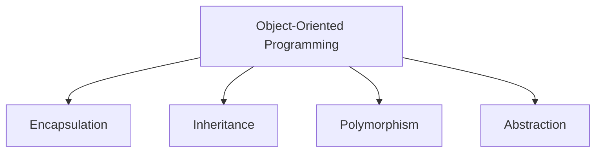
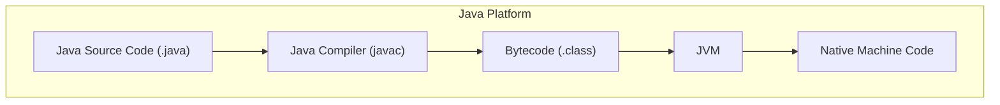
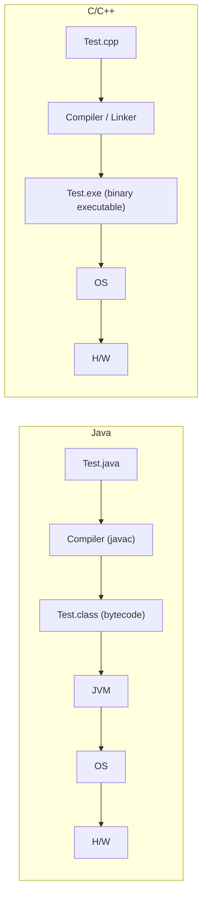

# Lecture 1 — Introduction to OOP

[Repository Guide](../../README.md) | [English](Concepts_Lecture.md) | [한국어](Concepts_Lecture.ko.md)

> **Last Updated:** 2026-10-26

> **Learning Objectives:**
> 1. Define object-oriented programming concepts (class, object, encapsulation)
> 2. Set up a Java development environment
> 3. Write and compile basic Java programs
> 4. Explain the relationship among source files, class files, and the JVM in comparison with the C/C++ build process

---

## Table of Contents

- [1. What is Object-Oriented Programming?](#1-what-is-object-oriented-programming)
  - [1.1 Levels of Programming Languages](#11-levels-of-programming-languages)
  - [1.2 Programming Paradigms](#12-programming-paradigms)
  - [1.3 The Four Pillars of OOP](#13-the-four-pillars-of-oop)
- [2. Java Overview](#2-java-overview)
  - [2.1 History and Design Goals](#21-history-and-design-goals)
  - [2.2 Application Areas of Java](#22-application-areas-of-java)
  - [2.3 Java Platform Architecture](#23-java-platform-architecture)
  - [2.4 JDK, JRE, and JVM](#24-jdk-jre-and-jvm)
- [3. How Java Programs Execute](#3-how-java-programs-execute)
  - [3.1 Compilation and Interpretation](#31-compilation-and-interpretation)
  - [3.2 Differences Between Java and C/C++](#32-differences-between-java-and-cc)
  - [3.3 Write Once, Run Anywhere](#33-write-once-run-anywhere)
  - [3.4 Source Files and Class Files](#34-source-files-and-class-files)
  - [3.5 Distribution, Entry Point, Packages, and Garbage Collection](#35-distribution-entry-point-packages-and-garbage-collection)
- [4. Development Environment Setup](#4-development-environment-setup)
  - [4.1 Installing the JDK](#41-installing-the-jdk)
  - [4.2 Installing and Configuring the Eclipse IDE](#42-installing-and-configuring-the-eclipse-ide)
  - [4.3 Frequently Used Shortcuts](#43-frequently-used-shortcuts)
- [5. First Java Program](#5-first-java-program)
  - [5.1 Console Version](#51-console-version)
  - [5.2 Compiling and Running from the Command Line](#52-compiling-and-running-from-the-command-line)
  - [5.3 GUI Version](#53-gui-version)
- [Summary](#summary)
- [Self-Check Questions](#self-check-questions)

---

<br>

## 1. What is Object-Oriented Programming?

### 1.1 Levels of Programming Languages

What a computer executes directly is **machine code** made of 0s and 1s. **Assembly code** replaces machine instructions with human-readable symbols (mnemonics), and a **high-level language** lets programs be written in a form close to formulas and sentences. Java is a high-level language.

```text
Machine code:
    10110011 00011001
    01111010 11010001 10010100
    10011111 00011001
    01011100 11010001 10010000
    10111011 11010001 10010110

Assembly code:
    MV  0,   SUM
    MV  NUM, AC
    ADD SUM, AC
    STO SUM, TOT

High-level code:
    X = (Y + Z) / 2
```

Programs written in assembly or a high-level language must be translated by an assembler or a compiler into machine code (for Java, into the bytecode of Section 3.1) before they can run.

### 1.2 Programming Paradigms

Programming paradigms define how we structure and reason about code. The major paradigms include the following.

| Paradigm | Key Idea | Example Languages |
|:---------|:---------|:------------------|
| Procedural | Step-by-step instructions | C, Pascal |
| Object-Oriented | Model real-world entities as objects | Java, C++, Python |
| Functional | Computation as mathematical functions | Haskell, Lisp |
| Declarative | Describe *what* to compute, not *how* | SQL, Prolog |

*Table 1. Major programming paradigms and example languages*

> **Key Point:** OOP models software as a collection of interacting objects, each encapsulating both data (fields) and behavior (methods).

### 1.3 The Four Pillars of OOP



*Figure 1. The four pillars of OOP*

1. **Encapsulation:** Bundling data and methods together; restricting direct access with access modifiers (`private`, `protected`, `public`).
2. **Inheritance:** Creating new classes from existing ones, promoting code reuse.
3. **Polymorphism:** A single interface with multiple implementations (method overloading and overriding).
4. **Abstraction:** Hiding implementation details and exposing only essential features.

---

<br>

## 2. Java Overview

### 2.1 History and Design Goals

Java was developed by James Gosling's team at Sun Microsystems and released in 1995. Its core design goals are as follows.

- **Simple:** Eliminated complex features like pointer arithmetic and multiple inheritance of classes.
- **Object-Oriented:** Everything (except primitives) is an object. Java supports inheritance, polymorphism, and encapsulation.
- **Platform-Independent:** Compiled to bytecode that runs on any JVM.
- **Secure:** Provides a bytecode verifier and a security manager.
- **Robust:** Strong type checking, exception handling, garbage collection.
- **Multithreaded:** Native support for concurrent programming.

> **Note:** The security manager was deprecated for removal in Java 17 and cannot be enabled from Java 24 onward. Security in current Java relies mainly on bytecode verification, type safety, and the module system.

Java is a representative object-oriented language and has long been one of the most widely used programming languages.

### 2.2 Application Areas of Java

- **Desktop applications:** The most typical Java programs, installed and run on a desktop computer (e.g., a desktop game). They run on any computer that has the Java Runtime Environment (JRE).
- **Servlet applications:** Java programs that run in the JVM of a web server. A servlet receives a browser's request over the Internet, processes it using a database or other resources, and returns the result. JavaScript, despite the similar name, is a separate language that mainly runs in the browser.
- **Android:** A free mobile platform led by Google with several mobile companies. It uses Java as a development language, but Android's counterpart of the JVM (Dalvik at first, ART from Android 5.0) is not compatible with the JVM, so Java bytecode must be converted to an Android format (DEX).

### 2.3 Java Platform Architecture



*Figure 2. Structure of the Java platform from source code to machine code*

### 2.4 JDK, JRE, and JVM

| Component | Description |
|:----------|:-----------|
| **JDK** (Java Development Kit) | Full development environment that contains development tools such as the compiler and debugger, together with the JRE |
| **JRE** (Java Runtime Environment) | Runtime libraries and the JVM for executing Java programs |
| **JVM** (Java Virtual Machine) | Abstract machine that executes bytecode, implemented for each platform |

*Table 2. Roles of the JDK, JRE, and JVM*

$$
\text{JDK} \supset \text{JRE} \supset \text{JVM}
$$

> **Note:** Since Java 11, Oracle no longer distributes a separate JRE. Installing the JDK also installs the runtime needed to run programs, so the inclusion above is best read as a conceptual division of the components' roles.

---

<br>

## 3. How Java Programs Execute

### 3.1 Compilation and Interpretation

Java is a **hybrid** language: it is both compiled and interpreted.

1. **Compile:** `javac MyProgram.java` produces `MyProgram.class` (bytecode).
2. **Execute:** `java MyProgram` launches the JVM, which interprets or JIT-compiles the bytecode.

```text
Source Code (.java)  -->  Bytecode (.class)  -->  JVM  -->  Output
        [javac]                                  [java]
```

*Figure 3. Compilation and execution stages with the javac and java commands*

A Java program is developed as several source files (`.java`). Compiling each source file produces one bytecode file (`.class`) per class, and there is no link step that combines them into a single executable (`.exe`). Execution starts from the class that has a `main()` method, and the JVM loads a class file when that class is first needed at run time. Because only the needed classes are loaded, the program runs with less memory. The JVM loads classes of the Java class library (API), such as `Math.class` and `String.class`, in the same way.

### 3.2 Differences Between Java and C/C++



*Figure 4. Build and execution processes of Java and C/C++ compared*

- **Java:** The compiler translates source code into platform-independent bytecode (`Test.class`), and the JVM on each operating system executes the bytecode.
- **C/C++:** The compiler and linker turn source code into a machine-code executable (`Test.exe`) for a specific operating system and hardware. A different operating system requires recompilation.

> **[Systems Programming]** A C/C++ linker gathers separately compiled object files (`.o`, `.obj`) and libraries and resolves the references to symbols such as functions and global variables to actual addresses, producing a single executable. Java has no such link step: as in Section 3.1, the JVM loads the needed class files at run time and links the references between classes as it does so.

### 3.3 Write Once, Run Anywhere

Because bytecode is platform-independent, the same `.class` file runs on Windows, macOS, Linux, or any operating system with a compatible JVM.

> **Key Point:** The JVM provides an abstraction layer between the compiled bytecode and the underlying hardware and operating system, enabling true platform independence.

### 3.4 Source Files and Class Files

- A single source file can contain several classes.
- A source file has at most one `public` class.
- If there is a `public` class, the source file name must match its name (`public class A` goes in `A.java`).
- Compilation produces one `.class` file per class. A class declared inside another class (a nested class) becomes a file named `Outer$Inner.class`.

```text
A.java                         Compilation result (4 class files)
┌──────────────────────┐
│ public class A {     │  ──>  A.class
│ }                    │
│ class B {            │  ──>  B.class
│ }                    │
│ class C {            │  ──>  C.class
│     class D {        │  ──>  C$D.class
│     }                │
│ }                    │
└──────────────────────┘
```

*Figure 5. Four class files generated from one source file*

### 3.5 Distribution, Entry Point, Packages, and Garbage Collection

- **Distributing executables:** To distribute many class files and resources as one unit, use a JAR (`.jar`) file.
- **main() method:** A Java program starts from the `main()` method of the class specified at launch. Several classes may each have a `main()`, but a class has only one `main()` of the form `public static void main(String[] args)`.
- **Package:** A unit that groups related classes. Java provides a powerful standard library organized into packages (e.g., `javax.swing`, `java.util`).
- **Garbage collection:** Java has only the memory allocation operator `new` and no function for an application to return memory directly. The JVM's garbage collector reclaims the memory of objects that are no longer referenced, which reduces the developer's burden.

---

<br>

## 4. Development Environment Setup

### 4.1 Installing the JDK

A typical setup for Java development is as follows.

1. **Install JDK:** Download from Oracle or use OpenJDK. The installer can proceed with default settings; note the installation folder (e.g., `C:\Program Files\Java\jdk-17.0.2`).
2. **Set environment variables:** Set `JAVA_HOME` and add the `bin` directory (e.g., `C:\Program Files\Java\jdk-17.0.2\bin`) to `PATH`. On Windows 10, search for "environment" in the Control Panel to open the system environment variables dialog, edit the `Path` system variable, and add the path of the `bin` folder. In most cases the installer handles this step automatically.
3. **Choose an IDE:** IntelliJ IDEA, Eclipse, VS Code, or even a simple text editor.
4. **Verify installation:** In a command prompt, check that the following commands print a version.
   ```bash
   java -version
   javac -version
   ```

### 4.2 Installing and Configuring the Eclipse IDE

1. Download the installer from the Eclipse download page. In Korea, choosing a nearby mirror server (e.g., the Kakao mirror) speeds up the download.
2. After installation, set the workspace text file encoding to UTF-8 in **Window > Preferences**. This keeps Korean comments and strings from being garbled.
3. Create a new Java project, enter `HelloWorld` as the new class name, select the option to generate `public static void main(String[] args)`, and click Finish to create the class. Write the code and run it to check the output.

### 4.3 Frequently Used Shortcuts

| Shortcut | Function |
|:---------|:---------|
| Ctrl + F11 | Compile and run |
| Ctrl + / | Toggle single-line comment |
| Ctrl + Shift + / | Add a multi-line block comment |
| Ctrl + Shift + \\ | Remove a block comment |
| Ctrl + I | Correct code indentation |
| Type `sysout`, then Ctrl + Space | Autocomplete `System.out.println();` |

*Table 3. Frequently used shortcuts in Eclipse*

---

<br>

## 5. First Java Program

### 5.1 Console Version

A minimal Java program structure is as follows.

```java
public class HelloWorld {
    public static void main(String[] args) {
        System.out.println("Hello, OOP World!");
    }
}
```

Key observations are as follows.
- Every Java program needs at least one class.
- The `main` method is the entry point: `public static void main(String[] args)`.
- `System.out.println()` prints text to the console.
- Java is case-sensitive; file name must match the public class name.

### 5.2 Compiling and Running from the Command Line

Without an IDE, you can write the source code in a text editor such as Notepad, save it as `HelloWorld.java`, move to its folder in a command prompt, and compile and run it.

```bash
javac HelloWorld.java
java HelloWorld
```

`javac` creates `HelloWorld.class` in the same folder, and `java` launches the JVM to run that class's `main()`. The `java` command takes only the class name, without the `.class` extension.

### 5.3 GUI Version

The same program can be changed to use dialog boxes of `javax.swing.JOptionPane` for input and output.

```java
import javax.swing.JOptionPane;

public class Chap1HelloWorld {

    public static void main(String[] args) {
        String firstName = JOptionPane.showInputDialog(null, "Please enter your first name");
        String lastName = JOptionPane.showInputDialog(null, "Please enter your last name");

        JOptionPane.showMessageDialog(null, "Hello World! " + firstName + " " + lastName);
    }
}
```

`showInputDialog` opens an input window and returns the string the user typed, and `showMessageDialog` opens a message window. A basic C program runs in a console (CUI), whereas Java can build GUI programs with its standard library alone. Thanks to the JVM, this program also runs on each operating system without recompilation.

---

<br>

## Summary

| Concept | Key Summary |
|:--------|:----------|
| OOP | OOP models software as interacting objects with data and behavior. |
| Four Pillars | The four pillars of OOP are encapsulation, inheritance, polymorphism, and abstraction. |
| Java | Java is a platform-independent, object-oriented, compiled-then-interpreted language. |
| JVM | The JVM executes bytecode and enables "Write Once, Run Anywhere". |
| JDK vs JRE | The JDK contains development tools and the JRE, and the JRE contains runtime libraries and the JVM. |
| Java and C/C++ | Java produces bytecode that runs on the JVM with no link step, whereas C/C++ produces a platform-specific executable. |
| Class files | One source file can hold several classes, and compilation produces one `.class` file per class. |
| Program Structure | A file has at most one public class, and the `main` method is the entry point. |
| Garbage collection | The JVM automatically reclaims the memory of objects that are no longer referenced. |

---

<br>

## Self-Check Questions

1. **Class files:** Which class files are produced when the following `A.java` is compiled?

   ```java
   public class A { }
   class B { }
   class C {
       class D { }
   }
   ```

   <details>
   <summary>Answer</summary>

   Four files are produced: `A.class`, `B.class`, `C.class`, and `C$D.class`. Each class gets one class file, and the nested class `D` declared inside `C` becomes `C$D.class`.

   </details>

2. **File name rule:** What happens if you write `public class HelloWorld { ... }` in a file named `Hello.java` and compile it with `javac Hello.java`? How can you fix it?

   <details>
   <summary>Answer</summary>

   The compiler reports the error "class HelloWorld is public, should be declared in a file named HelloWorld.java". A public class must be in a source file with the same name, so rename the file to `HelloWorld.java` or rename the class to `Hello`.

   </details>

3. **JDK, JRE, and JVM:** Which components does a developer who writes and compiles Java programs need, and which does a user who only runs an already compiled `.class` file need?

   <details>
   <summary>Answer</summary>

   The developer needs the JDK, which contains the compiler `javac`. Running only requires a runtime environment (JRE) with the runtime libraries and the JVM. The JVM is the core component that executes bytecode in both cases, and since Java 11 the JRE is not distributed separately, so people usually install the JDK.

   </details>

4. **Platform independence:** A C program's `Test.exe` compiled on Windows does not run on Linux, but a `Test.class` compiled on Windows does. Explain why.

   <details>
   <summary>Answer</summary>

   The C compiler and linker produce a machine-code executable for a specific operating system and hardware, so another platform requires recompilation. The Java compiler produces bytecode rather than a specific machine code, and the JVM implemented on each platform interprets or JIT-compiles that bytecode, so the same `.class` file runs on every platform that has a JVM.

   </details>
