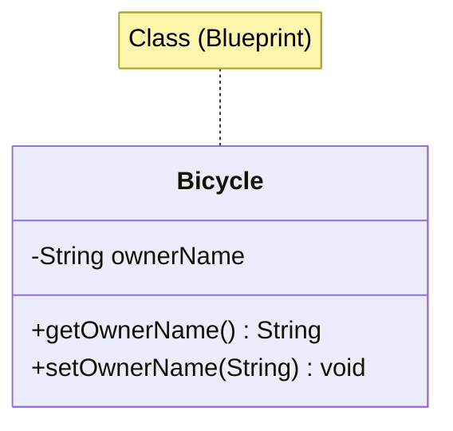
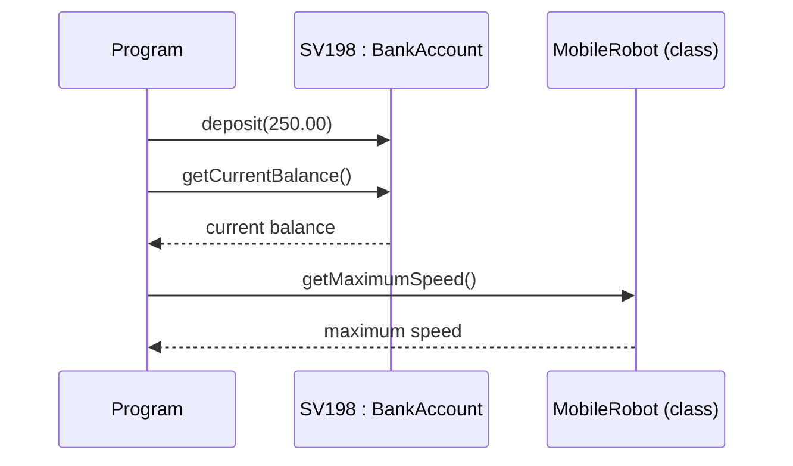
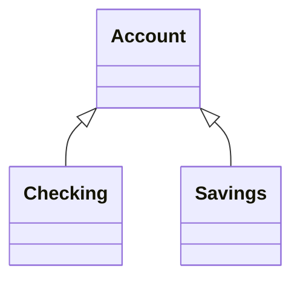
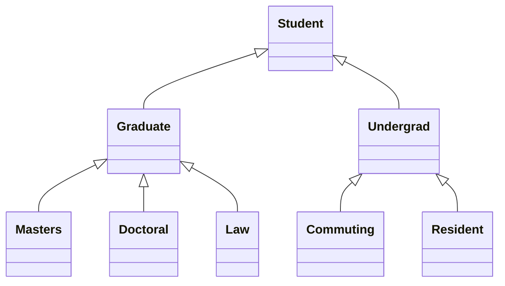
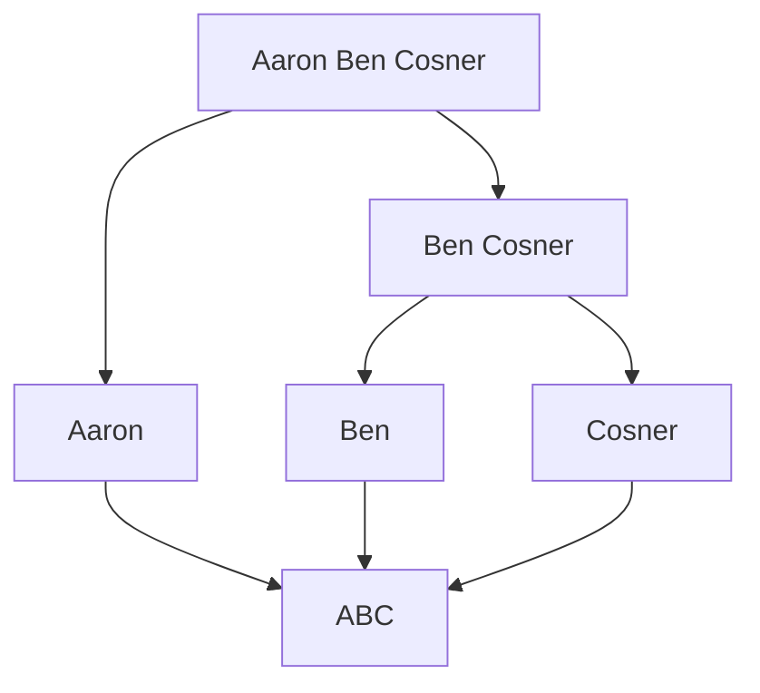

# 2강 — 객체와 클래스

[레포지토리 안내](../../README.ko.md) | [English](Concepts_Lecture.md) | [한국어](Concepts_Lecture.ko.md)

> **최종 수정일:** 2026-10-26

> **학습 목표:**
> 1. 클래스와 객체, 메시지와 메서드, 클래스 데이터 값과 인스턴스 데이터 값을 구별하여 설명할 수 있다
> 2. 필드와 메서드를 가진 클래스를 읽고 UML 표기로 나타낼 수 있다
> 3. 객체를 선언하고 생성하여 메서드를 호출할 수 있으며, 선언과 생성의 차이를 메모리 상태로 설명할 수 있다
> 4. Java 프로그램의 구성 요소(주석, import 문, 클래스 선언, 메서드 선언)를 식별할 수 있다
> 5. JOptionPane, String, Date, SimpleDateFormat 표준 클래스를 사용할 수 있다
> 6. 점진적 개발 방식으로 간단한 Java 프로그램을 작성할 수 있다

---

## 목차

- [1. Java의 객체와 클래스](#1-java의-객체와-클래스)
  - [1.1 객체란 무엇인가?](#11-객체란-무엇인가)
  - [1.2 클래스란 무엇인가?](#12-클래스란-무엇인가)
  - [1.3 객체와 클래스의 관계](#13-객체와-클래스의-관계)
  - [1.4 UML 표기](#14-uml-표기)
  - [1.5 메시지와 메서드](#15-메시지와-메서드)
  - [1.6 클래스 데이터 값과 인스턴스 데이터 값](#16-클래스-데이터-값과-인스턴스-데이터-값)
  - [1.7 상속](#17-상속)
  - [1.8 소프트웨어 공학과 소프트웨어 생명 주기](#18-소프트웨어-공학과-소프트웨어-생명-주기)
- [2. 객체 생성](#2-객체-생성)
  - [2.1 선언과 인스턴스화](#21-선언과-인스턴스화)
  - [2.2 선언과 생성의 메모리 상태](#22-선언과-생성의-메모리-상태)
  - [2.3 참조 변수](#23-참조-변수)
  - [2.4 객체에 메시지 보내기](#24-객체에-메시지-보내기)
- [3. 프로그램 구조와 주석](#3-프로그램-구조와-주석)
  - [3.1 예제 프로그램](#31-예제-프로그램)
  - [3.2 주석](#32-주석)
  - [3.3 import 문](#33-import-문)
  - [3.4 클래스 선언과 메서드 선언](#34-클래스-선언과-메서드-선언)
- [4. Java 표준 라이브러리 클래스](#4-java-표준-라이브러리-클래스)
  - [4.1 GUI 윈도우를 위한 JFrame](#41-gui-윈도우를-위한-jframe)
  - [4.2 대화 상자를 위한 JOptionPane](#42-대화-상자를-위한-joptionpane)
  - [4.3 문자열 조작](#43-문자열-조작)
  - [4.4 Date와 SimpleDateFormat](#44-date와-simpledateformat)
- [5. 점진적 개발: 모노그램 프로그램](#5-점진적-개발-모노그램-프로그램)
  - [5.1 문제와 전체 계획](#51-문제와-전체-계획)
  - [5.2 1단계: 이름 입력](#52-1단계-이름-입력)
  - [5.3 2단계: 모노그램과 날짜 출력](#53-2단계-모노그램과-날짜-출력)
  - [5.4 테스트와 프로그램 검토](#54-테스트와-프로그램-검토)
- [요약](#요약)
- [점검 문제](#점검-문제)

---

<br>

## 1. Java의 객체와 클래스

### 1.1 객체란 무엇인가?

객체 지향 프로그램은 객체를 사용한다. 객체는 계좌(Account), 차량(Vehicle), 직원(Employee)처럼 형태가 있거나 없는 모든 대상을 나타낸다.

**객체(Object)** 는 다음을 가지는 런타임 엔티티이다.
- **상태(State)** (필드/속성): 객체가 보유하는 데이터이다.
- **행위(Behavior)** (메서드): 객체가 수행할 수 있는 연산이다.
- **정체성(Identity)**: 다른 객체와 구별하는 고유한 참조이다.

실세계의 예로, `Car` 객체는 상태(색상, 속도), 행위(가속, 제동), 정체성(번호판)을 가질 수 있다.

### 1.2 클래스란 무엇인가?

**클래스(Class)** 는 객체를 생성하기 위한 설계도(blueprint) 또는 템플릿이다. 프로그램 안에서 객체를 만들려면 그 객체가 어떻게 행동하고 어떤 정보를 유지하는지 먼저 정의해야 하며, 이 정의가 클래스이다. 클래스는 다음을 정의한다.
- 객체가 가질 데이터 멤버(필드)
- 객체가 수행할 수 있는 메서드

```java
public class Bicycle {
    private String ownerName;  // field (state)

    public String getOwnerName() {   // method (behavior)
        return ownerName;
    }

    public void setOwnerName(String name) {
        ownerName = name;
    }
}
```

`private` 필드 `ownerName`은 클래스 밖에서 직접 접근할 수 없고, `public` 메서드 `getOwnerName`과 `setOwnerName`을 통해서만 읽고 바꿀 수 있다. 이것이 1강에서 본 캡슐화이다.

### 1.3 객체와 클래스의 관계



*그림 1. Bicycle 클래스의 클래스 다이어그램*

- **클래스**는 구조를 정의하고, **객체**는 구체적인 인스턴스이다.
- 동일한 클래스로부터 여러 객체를 생성할 수 있으며, 각 객체는 자신만의 상태를 가진다.
- 클래스로부터 만든 객체를 그 클래스의 **인스턴스**(instance)라고 한다. 예를 들어 은행 계좌 객체 100개를 만들 때 필요한 클래스(설계도)는 하나이며, 그 클래스로 찍어 낸 각 객체가 인스턴스이다.

### 1.4 UML 표기

클래스와 객체는 업계 표준 표기법인 **UML**(Unified Modeling Language)로 그린다.

- **클래스:** 사각형 안에 클래스 이름을 쓴다(예: `Account`, `Motorcycle`, `HelloWorld`).
- **객체:** 사각형 안에 밑줄 친 객체 이름을 쓴다(예: `SV198`).
- **클래스를 밝힌 객체:** `<객체 이름> : <클래스 이름>`을 밑줄 쳐서 쓰며, 그 객체가 어느 클래스의 인스턴스인지 나타낸다(예: `SV198 : BankAccount`).

```text
   클래스           객체           클래스를 밝힌 객체
┌───────────┐   ┌───────────┐   ┌─────────────────────┐
│  Account  │   │   SV198   │   │ SV198 : BankAccount │
│           │   │   ‾‾‾‾‾   │   │ ‾‾‾‾‾‾‾‾‾‾‾‾‾‾‾‾‾‾‾ │
└───────────┘   └───────────┘   └─────────────────────┘
```

*그림 2. UML의 클래스, 객체, 클래스를 밝힌 객체 표기*

UML 클래스 다이어그램을 보고 그에 맞는 Java 코드를 작성할 수 있어야 한다.

### 1.5 메시지와 메서드

- 클래스나 객체에 작업을 시키려면 그 대상에 **메시지**(message)를 보낸다.
- 메시지는 그 메시지를 이해하는 클래스나 객체에만 보낼 수 있다. 메시지를 처리하려면 받는 쪽에 그 메시지와 짝이 맞는 **메서드**(method)가 있어야 한다.
- 클래스에 정의된 메서드를 **클래스 메서드**(class method), 객체에 정의된 메서드를 **인스턴스 메서드**(instance method)라고 한다.
- 메시지를 보낼 때 함께 넘기는 값을 그 메시지의 **인자**(argument)라고 한다.



*그림 3. 객체와 클래스에 메시지를 보내고 결과를 받는 과정*

- `BankAccount` 객체 `SV198`에 인자 250.00과 함께 `deposit` 메시지를 보내면 그 계좌에 250.00이 입금된다.
- `SV198`에 `getCurrentBalance()` 메시지를 보내면 그 계좌의 현재 잔액이 반환된다.
- `MobileRobot` 클래스에 `getMaximumSpeed()` 메시지를 보내면 모든 `MobileRobot` 객체에 공통인 최대 속도가 반환된다. 특정 객체가 아니라 클래스에 보내는 메시지이므로 클래스 메서드가 처리한다.

### 1.6 클래스 데이터 값과 인스턴스 데이터 값

객체는 데이터 값과 메서드로 이루어진다.

- **인스턴스 데이터 값(instance data value):** 개별 인스턴스에 고유한 정보를 유지한다. 예를 들어 각 `BankAccount` 객체는 자신의 잔액(current balance)을 유지한다.
- **클래스 데이터 값(class data value):** 모든 인스턴스가 공유하는 정보나 인스턴스 전체에 대한 집계 정보를 유지한다. 예를 들어 최소 잔액(minimum balance)은 모든 계좌가 공유하는 정보이고, 모든 `BankAccount` 객체의 평균 잔액은 집계 정보이다.

```text
                    ┌──────────────────────────┐
                    │       BankAccount        │
                    │ minimum balance: 100.00  │
                    └──────────────────────────┘
                     ┆            ┆           ┆
┌─────────────────────┐ ┌─────────────────────┐ ┌─────────────────────┐
│ SV129 : BankAccount │ │ SV098 : BankAccount │ │ SV211 : BankAccount │
│ current balance:    │ │ current balance:    │ │ current balance:    │
│   908.55            │ │   1304.98           │ │   354.00            │
└─────────────────────┘ └─────────────────────┘ └─────────────────────┘
```

*그림 4. 클래스 데이터 값 하나와 객체별 인스턴스 데이터 값*

세 `BankAccount` 객체는 모두 current balance라는 인스턴스 데이터 값을 가지지만 실제 금액은 서로 다르다. 반면 minimum balance는 클래스 전체에 하나만 있으며 모든 인스턴스가 공유한다. 점선은 각 객체가 `BankAccount` 클래스의 인스턴스라는 instance-of 관계를 나타낸다.

### 1.7 상속

**상속**(inheritance)은 서로 다르지만 공통 특징이 많은 둘 이상의 대상을 설계하는 OOP의 메커니즘이다.

- 모든 클래스에 공통인 특징은 **상위 클래스**(superclass)에 정의한다.
- 상위 클래스에서 공통 특징을 물려받는 클래스를 **하위 클래스**(subclass)라고 한다.
- 상위 클래스를 조상(ancestor), 하위 클래스를 자손(descendant)이라고도 부른다.



*그림 5. 상위 클래스 Account와 하위 클래스 Checking, Savings*

하위 클래스가 다시 하위 클래스를 가지면 **상속 계층**(inheritance hierarchy)이 된다. 다음은 여러 종류의 학생 사이의 상속 계층이다.



*그림 6. 학생 종류의 상속 계층*

이 계층에서 각 클래스의 상위 클래스는 하나뿐이다. 한 클래스가 여러 상위 클래스를 동시에 상속하는 다중 상속과는 다르며, Java는 클래스의 다중 상속을 허용하지 않는다(1강).

### 1.8 소프트웨어 공학과 소프트웨어 생명 주기

고층 건물을 지을 때처럼 복잡한 소프트웨어를 개발할 때도 체계적인 접근이 필요하다. **소프트웨어 공학**(software engineering)은 프로그램의 개발, 테스트, 유지보수에 체계적이고 규율 있는 접근법을 적용하는 것이며, 5절의 예제 프로그램도 그 원칙에 따라 개발한다.

구상에서 운영에 이르는 프로그램의 단계를 **소프트웨어 생명 주기**(software life cycle)라 하며, 다음 다섯 단계로 이루어진다.

1. 분석(Analysis)
2. 설계(Design)
3. 코딩(Coding)
4. 테스트(Testing)
5. 운영과 유지보수(Operation and Maintenance)

> **[소프트웨어공학]** 소프트웨어공학은 이 단계들을 차례로 한 번씩 거치는 폭포수(waterfall) 모형, 짧은 주기로 여러 번 되풀이하는 반복적(iterative) 모형과 애자일(agile) 방법처럼 생명 주기의 단계를 어떤 순서로 진행할지 정하는 소프트웨어 프로세스를 다룬다. 5절의 점진적 개발은 프로그램을 작은 단계로 나누어 단계마다 설계, 코딩, 테스트를 되풀이하므로 반복적 모형에 가까운 방식이다.

---

<br>

## 2. 객체 생성

### 2.1 선언과 인스턴스화

Java에서 객체 생성은 두 단계로 이루어진다.

```java
// Step 1: 참조 변수 선언
JFrame myWindow;

// Step 2: 객체 인스턴스화(생성)
myWindow = new JFrame();

// 한 줄로 결합:
JFrame myWindow = new JFrame();
```

`new` 키워드는 힙(heap) 메모리에 공간을 할당하고 생성자를 호출한다.

객체 선언의 형식은 `<클래스 이름> <객체 이름>;`이며, 선언하기 전에 그 클래스가 정의되어 있어야 한다. 객체 생성의 형식은 `<객체 이름> = new <클래스 이름>(<인자>);`이며, 인자가 없으면 괄호를 비워 둔다. 다음 코드의 앞 세 줄은 선언의 예, 뒤 세 줄은 생성의 예이며, 하나의 프로그램이 아니라 각 형식을 따로 보이는 예이다.

```java
Account customer;
Student jan, jim, jon;
Vehicle car1, car2;

customer = new Customer();
minseok = new Student("Minseok Seo");
car1 = new Vehicle();
```

`int a;`처럼 기본 자료형 변수를 선언하면 그 자리에 값이 바로 저장되지만, `JFrame myWindow;`처럼 객체를 선언하면 참조를 담을 공간만 생기고 객체 자체는 실행 중에 `new`로 동적으로 생성된다.

### 2.2 선언과 생성의 메모리 상태

```java
Customer customer;           // 1. 선언
customer = new Customer();   // 2. 생성
```

1. 식별자 `customer`가 선언되고 메모리에 그 공간이 할당된다. 아직 가리키는 객체는 없다.
2. `Customer` 객체가 생성되고, 식별자 `customer`가 그 객체를 가리키게 된다.

```text
1. 선언 직후               2. 생성 후

customer                  customer
┌───────┐                 ┌───────┐
│       │                 │   ●───┼──┐
└───────┘                 └───────┘  │
                                     ▼
                              ┌────────────┐
                              │ : Customer │
                              └────────────┘
```

*그림 7. 객체 선언과 생성 후의 메모리 상태*

이처럼 변수와 객체를 따로 그리고 참조를 화살표로 나타내는 방식을 메모리 상태 표기(state-of-memory notation)라 한다. 프로그램 다이어그램 표기(program diagram notation)에서는 같은 상황을 `customer : Customer` 사각형 하나로 간단히 나타낸다.

### 2.3 참조 변수

참조 변수는 객체 자체가 아닌 객체의 **메모리 주소**를 저장한다.

```java
JFrame window1 = new JFrame();
JFrame window2 = window1;  // 두 변수가 동일한 객체를 가리킴
```

> **핵심:** 하나의 참조를 다른 참조에 대입하면 객체가 복사되는 것이 아니라, 두 변수가 메모리상의 동일한 인스턴스를 참조하게 된다.

반대로 한 변수에 새 객체를 대입하면 그 변수가 가리키던 이전 객체와의 연결이 끊어진다.

```java
Customer customer;
customer = new Customer();
customer = new Customer();
```

```text
customer
┌───────┐
│   ●───┼─────────────────────┐
└───────┘                     ▼
┌────────────┐         ┌────────────┐
│ : Customer │         │ : Customer │
└────────────┘         └────────────┘
 첫 번째 new로 생성      두 번째 new로 생성
 (참조를 잃음)
```

*그림 8. 두 번째 new 이후 첫 번째 객체의 참조를 잃은 상태*

첫 번째 `Customer` 객체를 가리키는 참조가 더 이상 없으므로 프로그램은 그 객체에 접근할 수 없고, 그 객체는 가비지 컬렉션의 대상이 된다(1강, 8강 5절).

### 2.4 객체에 메시지 보내기

객체에 메시지를 보내는 형식은 `<객체 이름>.<메서드 이름>(<인자>);`이다.

```java
myWindow.setVisible(true);
account.deposit(200.0);
student.setName("john");
car1.startEngine();
```

`myWindow.setVisible(true)`는 `myWindow` 객체에 인자 `true`와 함께 `setVisible` 메시지를 보낸다.

---

<br>

## 3. 프로그램 구조와 주석

### 3.1 예제 프로그램

다음은 윈도우를 하나 띄우는 프로그램이다. `main()`이 `JFrame` 객체 `myWindow`를 선언하고 생성한 뒤, `setSize`, `setTitle`, `setVisible` 메시지를 보낸다(실습 코드: [DisplayWindow.java](../../Coursework/Lab02_Objects-and-Classes/DisplayWindow.java)).

```java
/*
 *  Chap2Program1 Sample Program: Displaying a Window
 *  File: Chap2Program1.java
 */

import javax.swing.*;

public class Chap2Program1 {

    public static void main(String[] args) {

        JFrame myWindow;                         // 객체 선언

        myWindow = new JFrame();                 // 객체 생성

        myWindow.setSize(300, 200);              // 객체 사용
        myWindow.setTitle("My First Java Program");
        myWindow.setVisible(true);
    }
}
```

Java 프로그램은 (1) 주석, (2) import 문, (3) 클래스 선언으로 이루어진다. 모든 Java 소스 파일은 다음과 같은 구조를 따른다.

```java
// 1. 패키지 선언 (선택 사항)
// 2. import 문
import javax.swing.*;

// 3. 클래스 정의
public class MyProgram {

    // 4. main 메서드 (진입점)
    public static void main(String[] args) {
        // 프로그램 로직
    }
}
```

### 3.2 주석

주석 스타일은 다음과 같다.
- `//`: 단일 행 주석이다.
- `/* ... */`: 다중 행 주석이다.
- `/** ... */`: Javadoc 주석 (API 문서용)이다.

```java
/*
   This is a comment with
   three lines of
   text.
*/

// This is a comment
// This is another comment
// This is a third comment

/**
 * This class provides basic clock functions. In addition
 * to reading the current time and today's date, you can
 * use this class for stopwatch functions.
 */
```

### 3.3 import 문

import 문은 다른 패키지의 클래스를 이름만으로 쓸 수 있게 한다. 형식은 `import <패키지 이름>.<클래스 이름>;`이다. `import javax.swing.JFrame;`에서 `javax.swing`은 사용할 클래스가 들어 있는 패키지 이름이고, 대문자로 시작하는 `JFrame`이 클래스 이름이다. 클래스 이름 자리에 `*`를 쓰면 그 패키지의 모든 클래스를 가져온다.

```java
import javax.swing.JFrame;
import java.util.*;
import com.drcaffeine.simplegui.*;
```

### 3.4 클래스 선언과 메서드 선언

클래스 선언은 `public class Chap2Program1 {`부터 짝이 맞는 `}`까지이며, 그 안에 메서드 선언이 들어간다. 메서드 선언은 다음 요소로 이루어진다.

| 요소 | `main` 메서드의 예 |
|:-----|:-----|
| 제어자(modifier) | `public` |
| 제어자(modifier) | `static` |
| 반환 타입(return type) | `void` |
| 메서드 이름(method name) | `main` |
| 매개변수(parameter) | `String[] args` |
| 메서드 본문(method body) | `{`와 `}` 사이의 문장들 |

*표 1. 메서드 선언의 구성 요소*

따라서 간단한 Java 프로그램의 틀은 맨 위의 주석, import 문, `class` 뒤의 클래스 이름, `public static void main(String[] args)`의 메서드 본문 네 부분을 채워 완성한다.

---

<br>

## 4. Java 표준 라이브러리 클래스

이미 필요를 충족하는 클래스가 있으면 새로 만들지 않고 그대로 쓴다. 기존 표준 클래스를 쓰는 법을 익히는 것은 OOP를 익히는 첫걸음이며, 자신의 클래스를 정의하기 전에 먼저 기존 클래스를 사용하는 법을 배운다. 이 절에서는 `JFrame`과 함께 `JOptionPane`, `String`, `Date`, `SimpleDateFormat`의 네 표준 클래스를 다룬다.

### 4.1 GUI 윈도우를 위한 JFrame

`javax.swing.JFrame`은 제목 표시줄, 테두리, 콘텐츠 영역을 가진 윈도우를 나타낸다.

```java
JFrame myWindow = new JFrame();
myWindow.setSize(300, 200);
myWindow.setTitle("My First Java Program");
myWindow.setVisible(true);
```

주요 메서드는 다음과 같다.

| 메서드 | 설명 |
|:-------|:-----|
| `setSize(width, height)` | 윈도우 크기를 픽셀 단위로 설정 |
| `setTitle(String)` | 제목 표시줄 텍스트 설정 |
| `setVisible(boolean)` | 윈도우 표시 또는 숨기기 |
| `setDefaultCloseOperation(int)` | 윈도우 닫기 시 동작 정의 |

*표 2. JFrame의 주요 메서드*

`setDefaultCloseOperation`을 호출하지 않으면 기본값은 `HIDE_ON_CLOSE`여서, 닫기 버튼을 눌러도 윈도우만 숨겨지고 프로그램은 계속 실행된다. 닫을 때 프로그램을 끝내려면 `setDefaultCloseOperation(JFrame.EXIT_ON_CLOSE)`를 호출한다.

### 4.2 대화 상자를 위한 JOptionPane

`javax.swing.JOptionPane`은 입력과 출력을 위한 간단한 대화 상자를 제공한다.

```java
// 입력 대화 상자
String name = JOptionPane.showInputDialog(null, "Enter your name:");

// 메시지 대화 상자
JOptionPane.showMessageDialog(null, "Hello, " + name + "!");
```

- `showMessageDialog`는 계산 결과를 사용자에게 보여 주는 간단한 방법이다. 첫 번째 인자가 `null`이면 대화 상자가 화면 가운데에 나타난다. `JOptionPane.showMessageDialog(null, "I Love Java");`는 "I Love Java"를 표시하는 메시지 창을 띄운다.
- 문자열 안에 줄 바꿈 문자 `\n`을 넣으면 여러 줄을 표시할 수 있다. `JOptionPane.showMessageDialog(null, "one\ntwo\nthree");`는 one, two, three를 세 줄로 표시한다.
- `showInputDialog`는 문자열을 입력받는 간단한 방법이다. `name = JOptionPane.showInputDialog(null, "What is your name?");`는 입력 창을 화면 가운데에 띄우고, 사용자가 입력한 문자열을 반환한다.

### 4.3 문자열 조작

`showMessageDialog`에 넘긴 문자열 값은 모두 `String` 클래스의 인스턴스이다. 큰따옴표로 둘러싼 문자의 나열은 `String` 상수이다. `String`도 객체이므로 다른 객체처럼 선언하고 생성할 수 있다.

```java
String name;                   // 1. 식별자 name을 선언하고 공간을 할당한다
name = new String("Jon Java"); // 2. String 객체를 생성하고 name이 가리키게 한다
```

Java의 `String`은 불변(immutable)이다. 아래 메서드는 모두 원래 문자열을 바꾸지 않고 결과를 새로 만들어 반환한다. 주요 연산은 다음과 같다.

```java
String fullName = "John Doe Smith";
String first = fullName.substring(0, fullName.indexOf(" "));
int length = fullName.length();
String upper = fullName.toUpperCase();
```

문자열의 각 문자는 0부터 시작하는 위치(인덱스)로 가리킨다.

```text
String text = "Espresso";

  0   1   2   3   4   5   6   7
┌───┬───┬───┬───┬───┬───┬───┬───┐
│ E │ s │ p │ r │ e │ s │ s │ o │
└───┴───┴───┴───┴───┴───┴───┴───┘
```

*그림 9. 문자열 "Espresso"의 문자 인덱스*

`String` 클래스에는 50개 가까운 메서드가 있다. 그중 `substring`, `length`, `indexOf`와 연결 연산을 살펴본다. 아래에서 `str`은 올바르게 초기화된 `String` 객체이다.

- **substring:** `str.substring(i, j)`는 `str`의 위치 `i`부터 `j-1`까지의 문자를 뽑은 새 문자열을 반환한다. 이때 $0 \le i \le j \le$ `str.length()`여야 하며, 이 조건을 어기면 `StringIndexOutOfBoundsException`이 발생한다. `str`이 "programming"이면 `str.substring(3, 7)`은 위치 3의 g부터 위치 6의 m까지인 "gram"이다.
- **length:** `str.length()`는 `str`의 문자 수를 반환한다. "programming"이면 11이다.
- **indexOf:** `str.indexOf(substr)`는 `substr`가 `str`에서 처음 나타나는 위치를 반환한다. "programming"에서 "gram"의 위치는 3이다. `substr`가 없으면 -1을 반환하며, 대소문자를 구분하여 찾는다.
- **연결(concatenation):** `str1 + str2`는 두 문자열을 이은 새 문자열을 반환한다. "pro" + "gram"은 "program"이다. `+`는 `String` 클래스의 메서드가 아니라 연산자이다.

```java
String text = "Espresso";
text.substring(6, 8);   // "so"
text.substring(0, 8);   // "Espresso"
text.substring(1, 5);   // "spre"
text.substring(3, 3);   // "" (빈 문자열)
text.substring(4, 2);   // 오류: StringIndexOutOfBoundsException

String str1 = "Hello", str2 = "Java", str3 = "", str4 = " ";
str1.length();          // 5
str2.length();          // 4
str3.length();          // 0 (빈 문자열)
str4.length();          // 1 (공백 한 칸)

String str = "I Love Java and Java loves me.";
str.indexOf("J");       // 7
str.indexOf("love");    // 21
str.indexOf("ove");     // 3
str.indexOf("Me");      // -1

String s1 = "Jon", s2 = "Java";
String r1 = s1 + s2;               // "JonJava"
String r2 = s1 + " " + s2;         // "Jon Java"
String r3 = s2 + ", " + s1;        // "Java, Jon"
String r4 = "Are you " + s1 + "?"; // "Are you Jon?"
```

`indexOf("love")`가 2가 아닌 21인 이유는 위치 2의 "Love"가 대문자 L로 시작하기 때문이다. 위의 어떤 연산도 원래 문자열 `text`, `str`, `s1`, `s2`를 바꾸지 않는다.

### 4.4 Date와 SimpleDateFormat

`java.util` 패키지의 `Date` 클래스는 날짜와 시각을 나타낸다. `Date` 객체를 생성하면 컴퓨터에 설정된 현재 날짜와 시각으로 설정되며, `toString` 메서드는 내부 형식을 `"Fri Oct 31 10:05:18 PST 2003"` 같은 문자열로 바꾼다. `SimpleDateFormat` 클래스를 쓰면 날짜 정보를 원하는 형식으로 표시할 수 있다.

```java
import java.util.Date;
import java.text.SimpleDateFormat;

Date today = new Date();
SimpleDateFormat sdf = new SimpleDateFormat("MM/dd/yy");
String formatted = sdf.format(today);
```

| 형식 문자열 | 출력 예 (2025-03-10 월요일 14:05:09, 영어 로캘) |
|:-----|:-----|
| `"MM/dd/yy"` | `03/10/25` |
| `"yyyy-MM-dd"` | `2025-03-10` |
| `"HH:mm:ss"` | `14:05:09` |
| `"HH:mm:ss a"` | `14:05:09 PM` |
| `"HH:mm:ss a, E"` | `14:05:09 PM, Mon` |

*표 3. SimpleDateFormat 형식 문자열과 출력 예*

`MM`은 월, `dd`는 일, `yy`와 `yyyy`는 두 자리와 네 자리 연도, `HH`는 0~23시, `mm`은 분, `ss`는 초, `a`는 오전/오후 표시, `E`는 요일이다. 분을 나타내는 `mm`과 월을 나타내는 `MM`은 대소문자로 구별한다. `a`와 `E`의 출력은 로캘에 따라 달라지며, 한국어 로캘에서는 `오후`, `월`로 표시된다.

> **참고:** `Date`와 `SimpleDateFormat`은 오래된 API이다. Java 8부터는 `java.time` 패키지의 `LocalDate`, `LocalDateTime`, `DateTimeFormatter`를 쓰는 것이 권장된다.

---

<br>

## 5. 점진적 개발: 모노그램 프로그램

### 5.1 문제와 전체 계획

**문제:** 사용자의 이름(first), 중간 이름(middle), 성(last)을 입력받아 머리글자로 이루어진 모노그램(monogram)과 현재 날짜를 출력하는 프로그램을 작성한다(예: 입력 Min Seok Seo, 출력 MSS와 날짜).

개발하기 전에 무엇을 개발할지 알아야 하므로, 먼저 프로그램이 해야 할 주요 작업을 정한다.
- 사용자의 이름, 중간 이름, 성을 입력받는다.
- 머리글자를 뽑아 모노그램을 만든다.
- 모노그램과 날짜를 출력한다.

이 프로그램은 두 단계로 점진적으로 개발한다. (1) 프로그램 틀에서 시작하여 입력 코드를 추가하고, (2) 모노그램과 날짜를 계산하여 출력하는 코드를 추가한다.

### 5.2 1단계: 이름 입력

명세는 이름을 입력받으라고만 하고 방법은 정하지 않으므로, 입력 방법은 1단계 설계에서 정한다. 입력에는 `JOptionPane`을 쓴다. 이름, 중간 이름, 성을 따로 입력받는 방식과 전체 이름을 한 번에 입력받는 방식 중에서, 사용자가 더 쉽고 빠르게 입력할 수 있는 두 번째 방식을 고른다.

```java
import javax.swing.*;

public class Chap2Program2 {

    public static void main(String[] args) {

        String name;

        name = JOptionPane.showInputDialog(null, "Enter your full name (first, middle, last):");

        JOptionPane.showMessageDialog(null, name);
    }
}
```

1단계 테스트에서는 프로그램을 실행하여 이름을 입력할 수 있는지, 입력한 이름이 올바르게 표시되는지 확인한다.

### 5.3 2단계: 모노그램과 날짜 출력

아직 프로그래밍 기법이 제한적이므로 다음을 가정한다.
- 입력 문자열에는 이름, 중간 이름, 성이 모두 들어 있다.
- 이름, 중간 이름, 성은 공백 한 칸으로 구분된다.

예를 들어 "John Quincy Adams"는 올바른 입력이지만, "John Kennedy"(중간 이름 없음)와 "Harrison, William Henry"(쉼표 사용)는 올바르지 않다.

올바른 입력이 주어지면 모노그램은 다음 순서로 계산한다. 입력 이름을 이름, 중간 이름, 성으로 나누고, 각각의 첫 글자를 뽑아, 세 글자를 연결한다.



*그림 10. 전체 이름을 나누어 모노그램을 만드는 과정*

```java
import java.text.SimpleDateFormat;
import java.util.Date;
import javax.swing.*;

public class Chap2Program2 {

    public static void main(String[] args) {

        String name, first, middle, last, space, monogram;

        space = " ";

        // Input the full name
        name = JOptionPane.showInputDialog(null, "Enter your full name (first, middle, last):");

        // Extract first, middle, and last names
        first = name.substring(0, name.indexOf(space));
        name = name.substring(name.indexOf(space) + 1, name.length());

        middle = name.substring(0, name.indexOf(space));
        last = name.substring(name.indexOf(space) + 1, name.length());

        // Compute the monogram
        monogram = first.substring(0, 1) + middle.substring(0, 1) + last.substring(0, 1);

        // Get date information
        Date today = new Date();
        SimpleDateFormat dateFormat = new SimpleDateFormat("MM/dd/yy");

        // Output the result
        JOptionPane.showMessageDialog(null, "Your monogram is " + monogram + "\n"
                + "Today is " + dateFormat.format(today));
    }
}
```

`first`는 처음 공백 앞까지의 부분 문자열이다. 그다음 `name`을 처음 공백 뒤의 나머지("Ben Cosner")로 바꾸고, 같은 방법으로 `middle`과 `last`를 얻는다. 각 문자열의 `substring(0, 1)`은 첫 글자이며, 세 첫 글자를 `+`로 연결하여 모노그램을 만든다. 같은 기능을 하는 실습 코드는 [MonogramDateDisplay.java](../../Coursework/Lab02_Objects-and-Classes/MonogramDateDisplay.java)이다.

### 5.4 테스트와 프로그램 검토

테스트 단계에서는 프로그램을 실행하여 모든 올바른 입력에 대해 모노그램이 올바르게 표시되는지 확인한다. 한 번 맞는 답을 보는 것으로는 부족하므로, 여러 종류의 올바른 입력으로 여러 번 실행한다.

동작하는 프로그램을 완성한 뒤에도 빠진 기능이나 개선할 점이 없는지 비판적으로 검토한다. 예를 들어 처음 입력 안내 문구를 고쳐, 이름, 중간 이름, 성 사이에 공백을 한 칸씩 넣어야 한다는 입력 형식을 사용자가 알 수 있게 할 수 있다.

---

<br>

## 요약

| 개념 | 핵심 요약 |
|:-----|:-----------|
| 객체 | 객체는 상태, 행위, 정체성을 가진 클래스의 인스턴스이다. |
| 클래스 | 클래스는 필드와 메서드를 정의하는 설계도이다. |
| UML 표기 | 클래스는 사각형 안의 이름으로, 객체는 밑줄 친 이름(`SV198`, `SV198 : BankAccount`)으로 나타낸다. |
| 메시지와 메서드 | 객체나 클래스에 메시지를 보내면 짝이 맞는 인스턴스 메서드나 클래스 메서드가 처리한다. |
| 클래스와 인스턴스 데이터 | 인스턴스 데이터 값은 객체마다 따로 있고, 클래스 데이터 값은 모든 인스턴스가 공유한다. |
| 상속 | 하위 클래스는 상위 클래스에 정의된 공통 특징을 물려받는다. |
| `new` 키워드 | `new`는 메모리를 할당하고 생성자를 호출한다. |
| 참조 변수 | 참조 변수는 객체 자체가 아닌 객체의 주소를 저장한다. |
| 프로그램 구성 요소 | Java 프로그램은 주석, import 문, 클래스 선언으로 이루어진다. |
| JFrame | JFrame은 GUI 윈도우를 생성하기 위한 Swing 클래스이다. |
| JOptionPane | JOptionPane은 입출력 대화 상자를 제공한다. |
| String | String은 `substring`, `length`, `indexOf` 등 풍부한 조작 메서드를 가진 불변 문자 시퀀스이다. |
| Date와 SimpleDateFormat | Date는 현재 날짜와 시각을 나타내고, SimpleDateFormat은 이를 원하는 형식의 문자열로 바꾼다. |
| 점진적 개발 | 프로그램을 여러 단계로 나누어 단계마다 설계, 코딩, 테스트를 반복하며 완성한다. |

---

<br>

## 점검 문제

1. **String 메서드:** `String str = "programming";`일 때 `str.substring(3, 7)`, `str.length()`, `str.indexOf("gram")`, `str.indexOf("Gram")`의 값을 쓰라.

   <details>
   <summary>정답</summary>

   `str.substring(3, 7)`은 위치 3~6의 문자인 "gram"이다. `str.length()`는 11이다. `str.indexOf("gram")`은 3이다. `indexOf`는 대소문자를 구분하므로 `str.indexOf("Gram")`은 -1이다.

   </details>

2. **참조를 잃은 객체:** 다음 코드를 실행하면 `Customer` 객체는 몇 개 생성되는가? 첫 번째 객체는 어떻게 되는가?

   ```java
   Customer customer;
   customer = new Customer();
   customer = new Customer();
   ```

   <details>
   <summary>정답</summary>

   `new`가 두 번 실행되므로 객체는 두 개 생성된다. 두 번째 대입 이후 `customer`는 두 번째 객체를 가리키고, 첫 번째 객체를 가리키는 참조는 하나도 남지 않는다. 따라서 프로그램은 첫 번째 객체에 다시 접근할 수 없고, 그 객체는 가비지 컬렉션의 대상이 된다.

   </details>

3. **클래스 데이터와 인스턴스 데이터:** `BankAccount` 클래스에서 (a) 계좌의 현재 잔액, (b) 모든 계좌에 공통인 최소 잔액, (c) 계좌 소유자의 이름, (d) 모든 계좌의 평균 잔액을 각각 클래스 데이터 값과 인스턴스 데이터 값으로 분류하라.

   <details>
   <summary>정답</summary>

   (a)와 (c)는 계좌마다 다른 정보이므로 인스턴스 데이터 값이다. (b)는 모든 인스턴스가 공유하는 정보이고 (d)는 인스턴스 전체에 대한 집계 정보이므로 둘 다 클래스 데이터 값이다.

   </details>

4. **모노그램 프로그램의 가정:** 5.3절의 프로그램에 "John Kennedy"를 입력하면 어떻게 되는가? 이유를 설명하라.

   <details>
   <summary>정답</summary>

   `first`는 "John"이 되고 `name`은 "Kennedy"로 바뀐다. "Kennedy"에는 공백이 없으므로 `name.indexOf(space)`가 -1을 반환하고, `name.substring(0, -1)`을 호출하는 순간 `StringIndexOutOfBoundsException`이 발생하여 프로그램이 비정상 종료된다. 프로그램이 입력에 이름, 중간 이름, 성이 모두 있다고 가정하기 때문이다.

   </details>
