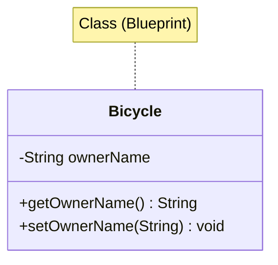
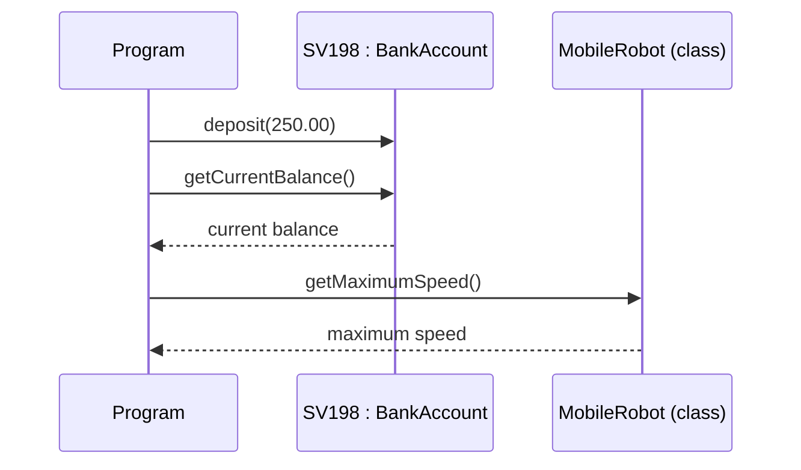
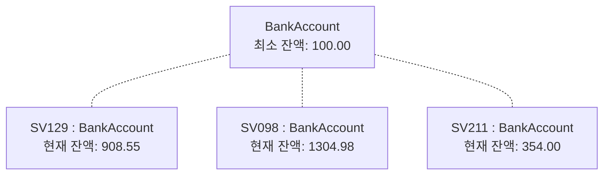
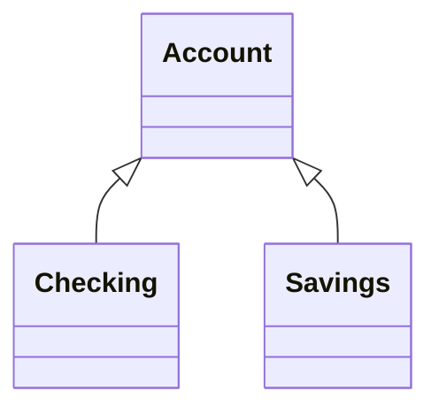
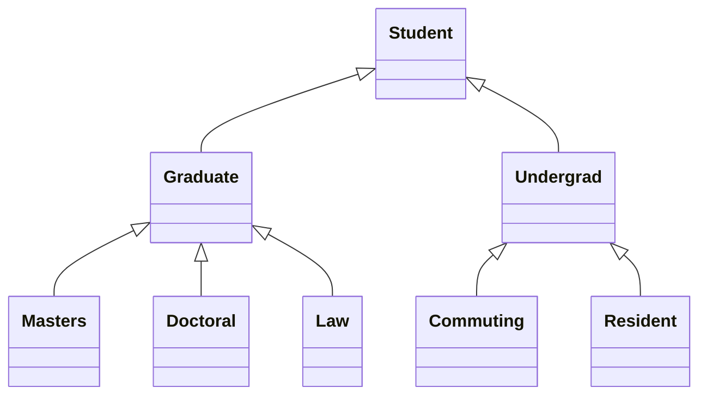
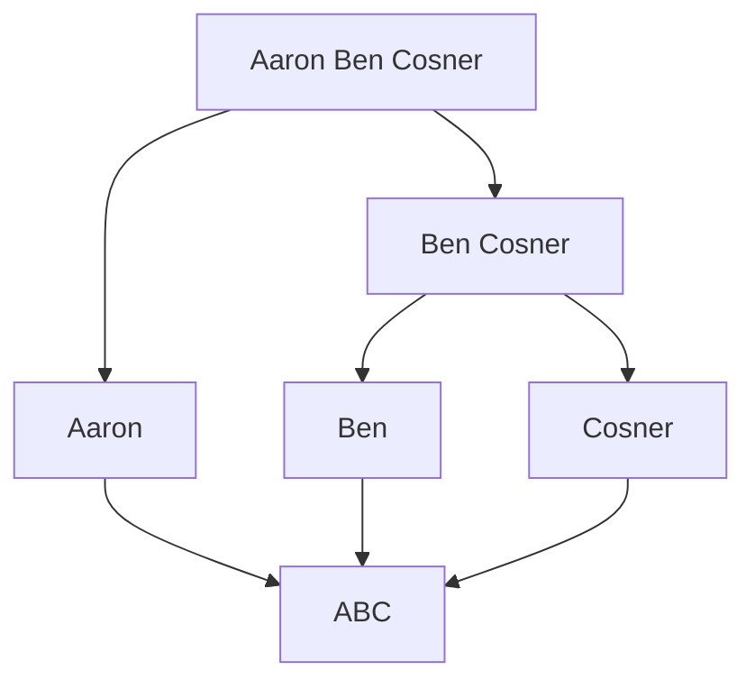

# 2강 — 객체와 클래스

[레포지토리 안내](../../README.ko.md) | [English](Concepts_Lecture.md) | [한국어](Concepts_Lecture.ko.md)

> **최종 수정일:** 2026-11-27

> **학습 목표:**
> 1. 클래스와 객체, 메시지와 메서드, 클래스 데이터 값과 인스턴스 데이터 값을 구별하여 설명할 수 있다
> 2. 필드와 메서드를 가진 클래스를 읽고 UML 표기로 나타낼 수 있다
> 3. 객체를 선언하고 생성하여 메서드를 호출할 수 있으며, 선언과 생성의 차이와 참조의 공유를 스택과 힙의 메모리 그림으로 설명할 수 있다
> 4. Java 프로그램의 구성 요소(주석, import 문, 클래스 선언, 메서드 선언)를 식별할 수 있다
> 5. JOptionPane, String, StringBuilder, Date, SimpleDateFormat 표준 클래스를 사용하고, ==와 equals의 차이와 String의 불변성을 설명할 수 있다
> 6. 점진적 개발 방식으로 간단한 Java 프로그램을 작성할 수 있다

---

## 목차

- [1. Java의 객체와 클래스](#1-java의-객체와-클래스)
  - [1.1 객체의 개념](#11-객체의-개념)
  - [1.2 클래스의 개념](#12-클래스의-개념)
  - [1.3 객체와 클래스의 관계](#13-객체와-클래스의-관계)
  - [1.4 UML 표기](#14-uml-표기)
  - [1.5 메시지와 메서드](#15-메시지와-메서드)
  - [1.6 클래스 데이터 값과 인스턴스 데이터 값](#16-클래스-데이터-값과-인스턴스-데이터-값)
  - [1.7 상속](#17-상속)
  - [1.8 소프트웨어 공학과 소프트웨어 생명 주기](#18-소프트웨어-공학과-소프트웨어-생명-주기)
  - [1.9 Java 코드로 본 클래스 데이터 값과 인스턴스 데이터 값](#19-java-코드로-본-클래스-데이터-값과-인스턴스-데이터-값)
- [2. 객체 생성](#2-객체-생성)
  - [2.1 선언과 인스턴스화](#21-선언과-인스턴스화)
  - [2.2 선언과 생성의 메모리 상태](#22-선언과-생성의-메모리-상태)
  - [2.3 참조 변수](#23-참조-변수)
  - [2.4 객체에 메시지 보내기](#24-객체에-메시지-보내기)
  - [2.5 스택과 힙의 메모리 모델](#25-스택과-힙의-메모리-모델)
  - [2.6 null과 NullPointerException](#26-null과-nullpointerexception)
  - [2.7 ==와 equals: 동일성과 동등성](#27-와-equals-동일성과-동등성)
- [3. 프로그램 구조와 주석](#3-프로그램-구조와-주석)
  - [3.1 예제 프로그램](#31-예제-프로그램)
  - [3.2 주석](#32-주석)
  - [3.3 import 문](#33-import-문)
  - [3.4 클래스 선언과 메서드 선언](#34-클래스-선언과-메서드-선언)
- [4. Java 표준 라이브러리 클래스](#4-java-표준-라이브러리-클래스)
  - [4.1 GUI 윈도우를 위한 JFrame](#41-gui-윈도우를-위한-jframe)
  - [4.2 대화 상자를 위한 JOptionPane](#42-대화-상자를-위한-joptionpane)
  - [4.3 문자열 조작](#43-문자열-조작)
  - [4.4 Date와 SimpleDateFormat](#44-date와-simpledateformat)
  - [4.5 String의 불변성과 문자열 풀](#45-string의-불변성과-문자열-풀)
  - [4.6 StringBuilder로 문자열 만들기](#46-stringbuilder로-문자열-만들기)
  - [4.7 그 밖의 주요 String 메서드](#47-그-밖의-주요-string-메서드)
  - [4.8 java.time으로 날짜 다루기](#48-javatime으로-날짜-다루기)
- [5. 점진적 개발: 모노그램 프로그램](#5-점진적-개발-모노그램-프로그램)
  - [5.1 문제와 전체 계획](#51-문제와-전체-계획)
  - [5.2 1단계: 이름 입력](#52-1단계-이름-입력)
  - [5.3 2단계: 모노그램과 날짜 출력](#53-2단계-모노그램과-날짜-출력)
  - [5.4 테스트와 프로그램 검토](#54-테스트와-프로그램-검토)
  - [5.5 split을 이용한 일반화](#55-split을-이용한-일반화)
- [6. 흔한 실수](#6-흔한-실수)
- [개념 적용](#개념-적용)
- [요약](#요약)
- [점검 문제](#점검-문제)
- [참고 문헌](#참고-문헌)

---

<br>

## 1. Java의 객체와 클래스

### 1.1 객체의 개념

객체 지향 프로그램은 객체를 사용한다. 객체는 계좌(Account), 차량(Vehicle), 직원(Employee)처럼 형태가 있거나 없는 모든 대상을 나타낸다.

**객체(Object)** 는 다음을 가지는 런타임 엔티티이다.
- **상태(State)** (필드/속성): 객체가 보유하는 데이터이다.
- **행위(Behavior)** (메서드): 객체가 수행할 수 있는 연산이다.
- **정체성(Identity)**: 다른 객체와 구별하는 고유한 참조이다.

실세계의 예로, `Car` 객체는 상태(색상, 속도), 행위(가속, 제동), 정체성(번호판)을 가질 수 있다.

### 1.2 클래스의 개념

**클래스(Class)** 는 객체를 생성하기 위한 설계도(blueprint) 또는 템플릿이다. 프로그램 안에서 객체를 만들려면 그 객체가 어떻게 행동하고 어떤 정보를 유지하는지 먼저 정의해야 하며, 이 정의가 클래스이다. 클래스는 다음을 정의한다.
- 객체가 가질 데이터 멤버(필드)
- 객체가 수행할 수 있는 메서드

```java
public class Bicycle {
    private String ownerName;  // field (state)

    public String getOwnerName() {   // method (behavior)
        return ownerName;
    }

    public void setOwnerName(String name) {
        ownerName = name;
    }
}
```

`private` 필드 `ownerName`은 클래스 밖에서 직접 접근할 수 없고, `public` 메서드 `getOwnerName`과 `setOwnerName`을 통해서만 읽고 바꿀 수 있다. 이것이 1강에서 본 캡슐화이다.

### 1.3 객체와 클래스의 관계



*그림 1. Bicycle 클래스의 클래스 다이어그램*

- **클래스**는 구조를 정의하고, **객체**는 구체적인 인스턴스이다.
- 동일한 클래스로부터 여러 객체를 생성할 수 있으며, 각 객체는 자신만의 상태를 가진다.
- 클래스로부터 만든 객체를 그 클래스의 **인스턴스**(instance)라고 한다. 예를 들어 은행 계좌 객체 100개를 만들 때 필요한 클래스(설계도)는 하나이며, 그 클래스로 찍어 낸 각 객체가 인스턴스이다.

### 1.4 UML 표기

클래스와 객체는 업계 표준 표기법인 **UML**(Unified Modeling Language)로 그린다.

- **클래스:** 사각형 안에 클래스 이름을 쓴다(예: `Account`, `Motorcycle`, `HelloWorld`).
- **객체:** 사각형 안에 밑줄 친 객체 이름을 쓴다(예: `SV198`).
- **클래스를 밝힌 객체:** `<객체 이름> : <클래스 이름>`을 밑줄 쳐서 쓰며, 그 객체가 어느 클래스의 인스턴스인지 나타낸다(예: `SV198 : BankAccount`).

```text
   Class            Object          Object with its class
┌───────────┐   ┌───────────┐   ┌─────────────────────┐
│  Account  │   │   SV198   │   │ SV198 : BankAccount │
│           │   │   ‾‾‾‾‾   │   │ ‾‾‾‾‾‾‾‾‾‾‾‾‾‾‾‾‾‾‾ │
└───────────┘   └───────────┘   └─────────────────────┘
```

*그림 2. UML의 클래스, 객체, 클래스를 밝힌 객체 표기*

UML 클래스 다이어그램을 보고 그에 맞는 Java 코드를 작성할 수 있어야 한다.

### 1.5 메시지와 메서드

- 클래스나 객체에 작업을 시키려면 그 대상에 **메시지**(message)를 보낸다.
- 메시지는 그 메시지를 이해하는 클래스나 객체에만 보낼 수 있다. 메시지를 처리하려면 받는 쪽에 그 메시지와 짝이 맞는 **메서드**(method)가 있어야 한다.
- 클래스에 정의된 메서드를 **클래스 메서드**(class method), 객체에 정의된 메서드를 **인스턴스 메서드**(instance method)라고 한다.
- 메시지를 보낼 때 함께 넘기는 값을 그 메시지의 **인자**(argument)라고 한다.



*그림 3. 객체와 클래스에 메시지를 보내고 결과를 받는 과정*

- `BankAccount` 객체 `SV198`에 인자 250.00과 함께 `deposit` 메시지를 보내면 그 계좌에 250.00이 입금된다.
- `SV198`에 `getCurrentBalance()` 메시지를 보내면 그 계좌의 현재 잔액이 반환된다.
- `MobileRobot` 클래스에 `getMaximumSpeed()` 메시지를 보내면 모든 `MobileRobot` 객체에 공통인 최대 속도가 반환된다. 특정 객체가 아니라 클래스에 보내는 메시지이므로 클래스 메서드가 처리한다.

### 1.6 클래스 데이터 값과 인스턴스 데이터 값

객체는 데이터 값과 메서드로 이루어진다.

- **인스턴스 데이터 값(instance data value):** 개별 인스턴스에 고유한 정보를 유지한다. 예를 들어 각 `BankAccount` 객체는 자신의 잔액(current balance)을 유지한다.
- **클래스 데이터 값(class data value):** 모든 인스턴스가 공유하는 정보나 인스턴스 전체에 대한 집계 정보를 유지한다. 예를 들어 최소 잔액(minimum balance)은 모든 계좌가 공유하는 정보이고, 모든 `BankAccount` 객체의 평균 잔액은 집계 정보이다.



*그림 4. 클래스 데이터 값 하나와 객체별 인스턴스 데이터 값*

세 `BankAccount` 객체는 모두 current balance라는 인스턴스 데이터 값을 가지지만 실제 금액은 서로 다르다. 반면 minimum balance는 클래스 전체에 하나만 있으며 모든 인스턴스가 공유한다. 점선은 각 객체가 `BankAccount` 클래스의 인스턴스라는 instance-of 관계를 나타낸다.

### 1.7 상속

**상속**(inheritance)은 서로 다르지만 공통 특징이 많은 둘 이상의 대상을 설계하는 OOP의 메커니즘이다.

- 모든 클래스에 공통인 특징은 **상위 클래스**(superclass)에 정의한다.
- 상위 클래스에서 공통 특징을 물려받는 클래스를 **하위 클래스**(subclass)라고 한다.
- 상위 클래스를 조상(ancestor), 하위 클래스를 자손(descendant)이라고도 부른다.



*그림 5. 상위 클래스 Account와 하위 클래스 Checking, Savings*

하위 클래스가 다시 하위 클래스를 가지면 **상속 계층**(inheritance hierarchy)이 된다. 다음은 여러 종류의 학생 사이의 상속 계층이다.



*그림 6. 학생 종류의 상속 계층*

이 계층에서 각 클래스의 상위 클래스는 하나뿐이다. 한 클래스가 여러 상위 클래스를 동시에 상속하는 다중 상속과는 다르며, Java는 클래스의 다중 상속을 허용하지 않는다(1강).

### 1.8 소프트웨어 공학과 소프트웨어 생명 주기

고층 건물을 지을 때처럼 복잡한 소프트웨어를 개발할 때도 체계적인 접근이 필요하다. **소프트웨어 공학**(software engineering)은 프로그램의 개발, 테스트, 유지보수에 체계적이고 규율 있는 접근법을 적용하는 것이며, 5절의 예제 프로그램도 그 원칙에 따라 개발한다.

구상에서 운영에 이르는 프로그램의 단계를 **소프트웨어 생명 주기**(software life cycle)라 하며, 다음 다섯 단계로 이루어진다.

1. 분석(Analysis)
2. 설계(Design)
3. 코딩(Coding)
4. 테스트(Testing)
5. 운영과 유지보수(Operation and Maintenance)

> **[소프트웨어공학]** 소프트웨어공학은 이 단계들을 차례로 한 번씩 거치는 폭포수(waterfall) 모형, 짧은 주기로 여러 번 되풀이하는 반복적(iterative) 모형과 애자일(agile) 방법처럼 생명 주기의 단계를 어떤 순서로 진행할지 정하는 소프트웨어 프로세스를 다룬다. 5절의 점진적 개발은 프로그램을 작은 단계로 나누어 단계마다 설계, 코딩, 테스트를 되풀이하므로 반복적 모형에 가까운 방식이다.

### 1.9 Java 코드로 본 클래스 데이터 값과 인스턴스 데이터 값

1.5절과 1.6절의 개념은 Java에서 `static` 키워드로 구별된다. 선언 앞에 `static`을 붙인 필드와 메서드는 클래스에 속하는 클래스 데이터 값과 클래스 메서드이고, 붙이지 않은 것은 객체마다 따로 있는 인스턴스 데이터 값과 인스턴스 메서드이다. 다음 `BankAccount`는 1.6절의 그림을 코드로 옮기되, 최소 잔액과 비교할 수 있도록 `SV211`의 잔액을 54.00으로 바꾼 것이다.

```java
public class BankAccount {
    static double minimumBalance = 100.00;
    static int accountCount = 0;

    double currentBalance;

    BankAccount(double initial) {
        currentBalance = initial;
        accountCount++;
    }

    static int getAccountCount() {
        return accountCount;
    }

    boolean isBelowMinimum() {
        return currentBalance < minimumBalance;
    }
}
```

```java
public class DataValueDemo {
    public static void main(String[] args) {
        BankAccount sv129 = new BankAccount(908.55);
        BankAccount sv098 = new BankAccount(1304.98);
        BankAccount sv211 = new BankAccount(54.00);

        System.out.println(BankAccount.getAccountCount());
        System.out.println(sv211.isBelowMinimum());

        BankAccount.minimumBalance = 50.00;
        System.out.println(sv211.isBelowMinimum());
        System.out.println(sv129.currentBalance + " " + sv098.currentBalance);
        System.out.println(Math.max(3, 7) + " " + "hello".length());
    }
}
```

```text
3
true
false
908.55 1304.98
7 5
```

- `minimumBalance`와 `accountCount`는 클래스에 하나만 있고, 세 객체가 함께 쓴다. 생성자가 세 번 실행될 때마다 같은 `accountCount`가 1씩 늘어 `getAccountCount()`는 3을 돌려준다. 이 값은 인스턴스 전체에 대한 집계 정보이다.
- `currentBalance`는 객체마다 따로 있으므로 세 계좌의 잔액이 서로 다르다.
- `BankAccount.minimumBalance = 50.00;`으로 클래스 데이터 값을 한 번 바꾸면 모든 객체가 바뀐 값을 본다. 그래서 잔액 54.00인 `sv211`은 최소 잔액 100.00일 때는 `true`, 50.00으로 바뀐 뒤에는 `false`가 된다.
- 클래스 메서드는 `BankAccount.getAccountCount()`, `Math.max(3, 7)`처럼 클래스 이름으로 보내는 메시지로 호출하고, 인스턴스 메서드는 `sv211.isBelowMinimum()`, `"hello".length()`처럼 특정 객체에 보내는 메시지로 호출한다.

이 예는 개념을 보이려고 필드를 공개해 두었다. 실제 클래스에서는 필드를 `private`으로 숨기고 메서드로만 바꾸게 한다(7강 5절). `static`의 세부 규칙은 7강 8절에서 다룬다.

---

<br>

## 2. 객체 생성

### 2.1 선언과 인스턴스화

Java에서 객체 생성은 두 단계로 이루어진다.

```java
// Step 1: Declare a reference variable
JFrame myWindow;

// Step 2: Instantiate (create) the object
myWindow = new JFrame();

// Combined in one line:
JFrame myWindow = new JFrame();
```

`new` 키워드는 힙(heap) 메모리에 공간을 할당하고 생성자를 호출한다.

객체 선언의 형식은 `<클래스 이름> <객체 이름>;`이며, 선언하기 전에 그 클래스가 정의되어 있어야 한다. 객체 생성의 형식은 `<객체 이름> = new <클래스 이름>(<인자>);`이며, 인자가 없으면 괄호를 비워 둔다. 다음 코드의 앞 세 줄은 선언의 예, 뒤 세 줄은 생성의 예이며, 하나의 프로그램이 아니라 각 형식을 따로 보이는 예이다.

```java
Account customer;
Student jan, jim, jon;
Vehicle car1, car2;

customer = new Customer();
minseok = new Student("Minseok Seo");
car1 = new Vehicle();
```

`int a;`처럼 기본 자료형 변수를 선언하면 그 자리에 값이 바로 저장되지만, `JFrame myWindow;`처럼 객체를 선언하면 참조를 담을 공간만 생기고 객체 자체는 실행 중에 `new`로 동적으로 생성된다.

### 2.2 선언과 생성의 메모리 상태

```java
Customer customer;           // 1. declaration
customer = new Customer();   // 2. creation
```

1. 식별자 `customer`가 선언되고 메모리에 그 공간이 할당된다. 아직 가리키는 객체는 없다.
2. `Customer` 객체가 생성되고, 식별자 `customer`가 그 객체를 가리키게 된다.

```text
1. After declaration       2. After creation

customer                  customer
┌───────┐                 ┌───────┐
│       │                 │   ●───┼──┐
└───────┘                 └───────┘  │
                                     ▼
                              ┌────────────┐
                              │ : Customer │
                              └────────────┘
```

*그림 7. 객체 선언과 생성 후의 메모리 상태*

이처럼 변수와 객체를 따로 그리고 참조를 화살표로 나타내는 방식을 메모리 상태 표기(state-of-memory notation)라 한다. 프로그램 다이어그램 표기(program diagram notation)에서는 같은 상황을 `customer : Customer` 사각형 하나로 간단히 나타낸다.

### 2.3 참조 변수

참조 변수는 객체 자체가 아닌 객체의 **메모리 주소**를 저장한다.

```java
JFrame window1 = new JFrame();
JFrame window2 = window1;  // Both point to the same object
```

> **핵심:** 하나의 참조를 다른 참조에 대입하면 객체가 복사되는 것이 아니라, 두 변수가 메모리상의 동일한 인스턴스를 참조하게 된다.

반대로 한 변수에 새 객체를 대입하면 그 변수가 가리키던 이전 객체와의 연결이 끊어진다.

```java
Customer customer;
customer = new Customer();
customer = new Customer();
```

```text
customer
┌───────┐
│   ●───┼─────────────────────┐
└───────┘                     ▼
┌────────────┐         ┌────────────┐
│ : Customer │         │ : Customer │
└────────────┘         └────────────┘
 created by first new   created by second new
 (reference lost)
```

*그림 8. 두 번째 new 이후 첫 번째 객체의 참조를 잃은 상태*

첫 번째 `Customer` 객체를 가리키는 참조가 더 이상 없으므로 프로그램은 그 객체에 접근할 수 없고, 그 객체는 가비지 컬렉션의 대상이 된다(1강, 8강 5절).

### 2.4 객체에 메시지 보내기

객체에 메시지를 보내는 형식은 `<객체 이름>.<메서드 이름>(<인자>);`이다.

```java
myWindow.setVisible(true);
account.deposit(200.0);
student.setName("john");
car1.startEngine();
```

`myWindow.setVisible(true)`는 `myWindow` 객체에 인자 `true`와 함께 `setVisible` 메시지를 보낸다.

### 2.5 스택과 힙의 메모리 모델

2.2절과 2.3절의 메모리 그림은 JVM의 두 메모리 영역으로 더 정확하게 설명할 수 있다(1강 3.9절). 메서드 안에서 선언한 변수(지역 변수)는 그 메서드를 실행하는 동안 **스택**(stack)의 프레임에 놓이고, `new`로 만든 객체는 **힙**(heap)에 놓인다. 지역 변수가 기본형이면 변수 안에 값 자체가 들어 있고, 참조형이면 힙에 있는 객체의 위치를 나타내는 참조가 들어 있다. 다음 프로그램에서 확인한다.

```java
public class Customer {
    private String name;

    public Customer(String name) {
        this.name = name;
    }

    public String getName() {
        return name;
    }

    public void setName(String name) {
        this.name = name;
    }
}
```

```java
public class AliasDemo {
    public static void main(String[] args) {
        int x = 10;
        int y = x;
        y = 20;
        System.out.println("x = " + x + ", y = " + y);

        Customer c1 = new Customer("Kim");
        Customer c2 = c1;
        c2.setName("Lee");
        System.out.println("c1: " + c1.getName() + ", c2: " + c2.getName());
        System.out.println(c1 == c2);
    }
}
```

```text
x = 10, y = 20
c1: Lee, c2: Lee
true
```

`int y = x;`는 `x`의 값 10을 `y`에 복사한다. 두 변수는 서로 다른 칸이므로 `y = 20;`은 `x`에 영향을 주지 않는다. 반면 `Customer c2 = c1;`이 복사하는 것은 객체가 아니라 참조이므로, 두 변수가 힙의 같은 객체를 가리킨다. 그래서 `c2.setName("Lee")`로 바꾼 이름을 `c1.getName()`으로도 읽게 된다. 두 이름이 같은 객체를 가리키는 상태를 **별칭**(alias)이라고 한다.

```text
 Stack (frame of main)                Heap
┌────────────────────┐
│ args   ●───────────┼──▶ String[] (length 0)
│ x      10          │
│ y      20          │      ┌──────────────────┐
│ c1     ●───────────┼────▶ │ Customer         │
│ c2     ●───────────┼────▶ │  name ●──────────┼──▶ "Lee"
└────────────────────┘      └──────────────────┘
```

*그림 9. AliasDemo의 마지막 println 직전의 스택과 힙*

`Customer` 객체 안의 필드 `name`도 참조형이므로, 객체 안에는 문자열 자체가 아니라 `"Lee"`라는 `String` 객체를 가리키는 참조가 들어 있다. 이처럼 객체는 다른 객체를 가리키는 참조를 필드로 가질 수 있고, 프로그램의 데이터는 힙 안에서 참조로 이어진 그래프를 이룬다. `main`이 끝나면 프레임이 사라지면서 지역 변수 `c1`, `c2`도 사라지고, 어떤 참조도 가리키지 않게 된 객체는 가비지 컬렉션의 대상이 된다.

> **핵심:** 대입 연산 `=`는 언제나 변수에 들어 있는 값을 복사한다. 기본형 변수에서는 그 값이 수 자체이고, 참조형 변수에서는 그 값이 참조이다. 객체를 복사하려면 생성자나 복사용 메서드로 새 객체를 따로 만들어야 한다.

### 2.6 null과 NullPointerException

참조형 변수에는 어떤 객체도 가리키지 않는다는 뜻의 특별한 값 **null**을 넣을 수 있다. 필드와 배열 원소의 참조형 기본값도 `null`이다. `null`인 참조로 메서드를 호출하거나 필드에 접근하면, 메시지를 받을 객체가 없으므로 실행 중에 `NullPointerException`(NPE)이 던져진다.

```java
public class NullDemo {
    public static void main(String[] args) {
        Customer customer = null;
        System.out.println(customer == null);
        System.out.println(customer.getName());
    }
}
```

```text
true
Exception in thread "main" java.lang.NullPointerException: Cannot invoke "Customer.getName()" because "customer" is null
	at NullDemo.main(NullDemo.java:5)
```

`customer == null`은 참조를 비교하는 것이므로 예외 없이 `true`가 된다. 다음 줄의 `customer.getName()`에서 예외가 나며, 메시지는 무엇을 호출하려 했고 어느 변수가 `null`이었는지를 알려 준다. 이 출력은 `javac --release 21 -g`로 컴파일하여 JDK 24에서 실행한 결과이다. `-g` 없이 컴파일하면 지역 변수의 이름 정보가 클래스 파일에 없으므로 `"customer"` 자리에 `"<local1>"`처럼 지역 변수의 번호가 나온다.

NPE를 피하는 기본 방법은 다음과 같다.

- 참조형 변수를 선언할 때 가능하면 바로 객체로 초기화한다.
- 메서드가 `null`을 돌려줄 수 있으면(예: 취소를 누른 `JOptionPane.showInputDialog`) 사용하기 전에 `if (input != null)`로 검사한다.
- 문자열 상수와 비교할 때는 `"yes".equals(answer)`처럼 상수 쪽에서 `equals`를 호출하면 `answer`가 `null`이어도 예외 없이 `false`가 된다(2.7절).

### 2.7 ==와 equals: 동일성과 동등성

두 객체가 "같다"는 말에는 두 가지 뜻이 있다.

> **용어 정의:** **동일성(identity)** 은 두 참조가 힙의 같은 객체 하나를 가리키는 성질이다. Java에서는 `==` 연산자로 검사한다.

> **용어 정의:** **동등성(equality)** 은 서로 다른 객체라도 나타내는 내용이 같은 성질이다. Java에서는 `equals` 메서드로 검사하며, 무엇을 같은 내용으로 볼지는 그 클래스가 정한다.

```java
public class EqualsDemo {
    public static void main(String[] args) {
        String a = "Java";
        String b = "Java";
        String c = new String("Java");
        String d = c.intern();
        System.out.println(a == b);
        System.out.println(a == c);
        System.out.println(a.equals(c));
        System.out.println(a == d);

        Customer k1 = new Customer("Kim");
        Customer k2 = new Customer("Kim");
        System.out.println(k1 == k2);
        System.out.println(k1.equals(k2));

        String s = null;
        System.out.println("Java".equals(s));
        System.out.println(java.util.Objects.equals(s, null));
    }
}
```

```text
true
false
true
true
false
false
false
true
```

- `a == b`가 `true`인 이유는 같은 내용의 문자열 리터럴이 언제나 같은 `String` 객체를 가리키기 때문이다(4.5절).
- `c`는 `new`로 따로 만든 객체이므로 `a == c`는 `false`이지만, `String`의 `equals`는 문자의 나열을 비교하므로 `a.equals(c)`는 `true`이다.
- `intern()`은 내용이 같은 문자열 리터럴과 같은 객체를 돌려주므로 `a == d`는 `true`이다.
- `Customer`는 `equals`를 따로 정의하지 않았으므로 모든 클래스의 상위 클래스인 `Object`의 `equals`를 물려받는다. `Object`의 `equals`는 `==`와 같이 동일성을 비교하므로, 이름이 같아도 `k1.equals(k2)`는 `false`이다. 내용으로 비교하게 하려면 클래스가 `equals`를 다시 정의해야 하며, 그 방법은 11강에서 다룬다.
- `"Java".equals(s)`는 `s`가 `null`이어도 예외 없이 `false`이고, `java.util.Objects.equals(x, y)`는 두 인자가 모두 `null`이면 `true`, 하나만 `null`이면 `false`, 둘 다 객체이면 `x.equals(y)`의 결과를 돌려준다.

> **주의:** 문자열의 내용을 비교할 때 `==`를 쓰면 안 된다. 위의 `a == b`처럼 우연히 `true`가 나오는 경우가 있어 오류를 늦게 발견하게 된다. `Scanner`의 `next()`로 입력받은 문자열은 실행 중에 새로 만들어진 객체이므로, 사용자가 `yes`를 입력해도 `input == "yes"`는 `false`이고 `input.equals("yes")`만 `true`이다. 내용 비교에는 항상 `equals`를 쓴다.

---

<br>

## 3. 프로그램 구조와 주석

### 3.1 예제 프로그램

다음은 윈도우를 하나 띄우는 프로그램이다. `main()`이 `JFrame` 객체 `myWindow`를 선언하고 생성한 뒤, `setSize`, `setTitle`, `setVisible` 메시지를 보낸다(실습 코드: [DisplayWindow.java](../../Coursework/Lab02_Objects-and-Classes/DisplayWindow.java)).

```java
/*
 *  Chap2Program1 Sample Program: Displaying a Window
 *  File: Chap2Program1.java
 */

import javax.swing.*;

public class Chap2Program1 {

    public static void main(String[] args) {

        JFrame myWindow;                         // declare an object

        myWindow = new JFrame();                 // create the object

        myWindow.setSize(300, 200);              // use the object
        myWindow.setTitle("My First Java Program");
        myWindow.setVisible(true);
    }
}
```

Java 프로그램은 (1) 주석, (2) import 문, (3) 클래스 선언으로 이루어진다. 모든 Java 소스 파일은 다음과 같은 구조를 따른다.

```java
// 1. Package declaration (optional)
// 2. Import statements
import javax.swing.*;

// 3. Class definition
public class MyProgram {

    // 4. main method (entry point)
    public static void main(String[] args) {
        // Program logic here
    }
}
```

### 3.2 주석

주석 스타일은 다음과 같다.
- `//`: 단일 행 주석이다.
- `/* ... */`: 다중 행 주석이다.
- `/** ... */`: Javadoc 주석 (API 문서용)이다.

```java
/*
   This is a comment with
   three lines of
   text.
*/

// This is a comment
// This is another comment
// This is a third comment

/**
 * This class provides basic clock functions. In addition
 * to reading the current time and today's date, you can
 * use this class for stopwatch functions.
 */
```

### 3.3 import 문

import 문은 다른 패키지의 클래스를 이름만으로 쓸 수 있게 한다. 형식은 `import <패키지 이름>.<클래스 이름>;`이다. `import javax.swing.JFrame;`에서 `javax.swing`은 사용할 클래스가 들어 있는 패키지 이름이고, 대문자로 시작하는 `JFrame`이 클래스 이름이다. 클래스 이름 자리에 `*`를 쓰면 그 패키지의 모든 클래스를 가져온다.

```java
import javax.swing.JFrame;
import java.util.*;
import com.drcaffeine.simplegui.*;
```

### 3.4 클래스 선언과 메서드 선언

클래스 선언은 `public class Chap2Program1 {`부터 짝이 맞는 `}`까지이며, 그 안에 메서드 선언이 들어간다. 메서드 선언은 다음 요소로 이루어진다.

| 요소 | `main` 메서드의 예 |
|:-----|:-----|
| 제어자(modifier) | `public` |
| 제어자(modifier) | `static` |
| 반환 타입(return type) | `void` |
| 메서드 이름(method name) | `main` |
| 매개변수(parameter) | `String[] args` |
| 메서드 본문(method body) | `{`와 `}` 사이의 문장들 |

*표 1. 메서드 선언의 구성 요소*

따라서 간단한 Java 프로그램의 틀은 맨 위의 주석, import 문, `class` 뒤의 클래스 이름, `public static void main(String[] args)`의 메서드 본문 네 부분을 채워 완성한다.

---

<br>

## 4. Java 표준 라이브러리 클래스

이미 필요를 충족하는 클래스가 있으면 새로 만들지 않고 그대로 쓴다. 기존 표준 클래스를 쓰는 법을 익히는 것은 OOP를 익히는 첫걸음이며, 자신의 클래스를 정의하기 전에 먼저 기존 클래스를 사용하는 법을 배운다. 이 절에서는 `JFrame`과 함께 `JOptionPane`, `String`, `Date`, `SimpleDateFormat`의 네 표준 클래스를 다루고, 이어서 `String`의 불변성과 `StringBuilder`, `java.time` 패키지를 다룬다.

### 4.1 GUI 윈도우를 위한 JFrame

`javax.swing.JFrame`은 제목 표시줄, 테두리, 콘텐츠 영역을 가진 윈도우를 나타낸다.

```java
JFrame myWindow = new JFrame();
myWindow.setSize(300, 200);
myWindow.setTitle("My First Java Program");
myWindow.setVisible(true);
```

주요 메서드는 다음과 같다.

| 메서드 | 설명 |
|:-------|:-----|
| `setSize(width, height)` | 윈도우 크기를 픽셀 단위로 설정 |
| `setTitle(String)` | 제목 표시줄 텍스트 설정 |
| `setVisible(boolean)` | 윈도우 표시 또는 숨기기 |
| `setDefaultCloseOperation(int)` | 윈도우 닫기 시 동작 정의 |

*표 2. JFrame의 주요 메서드*

`setDefaultCloseOperation`을 호출하지 않으면 기본값은 `HIDE_ON_CLOSE`여서, 닫기 버튼을 눌러도 윈도우만 숨겨지고 프로그램은 계속 실행된다. 닫을 때 프로그램을 끝내려면 `setDefaultCloseOperation(JFrame.EXIT_ON_CLOSE)`를 호출한다.

### 4.2 대화 상자를 위한 JOptionPane

`javax.swing.JOptionPane`은 입력과 출력을 위한 간단한 대화 상자를 제공한다.

```java
// Input dialog
String name = JOptionPane.showInputDialog(null, "Enter your name:");

// Message dialog
JOptionPane.showMessageDialog(null, "Hello, " + name + "!");
```

- `showMessageDialog`는 계산 결과를 사용자에게 보여 주는 간단한 방법이다. 첫 번째 인자가 `null`이면 대화 상자가 화면 가운데에 나타난다. `JOptionPane.showMessageDialog(null, "I Love Java");`는 "I Love Java"를 표시하는 메시지 창을 띄운다.
- 문자열 안에 줄 바꿈 문자 `\n`을 넣으면 여러 줄을 표시할 수 있다. `JOptionPane.showMessageDialog(null, "one\ntwo\nthree");`는 one, two, three를 세 줄로 표시한다.
- `showInputDialog`는 문자열을 입력받는 간단한 방법이다. `name = JOptionPane.showInputDialog(null, "What is your name?");`는 입력 창을 화면 가운데에 띄우고, 사용자가 입력한 문자열을 반환한다.

### 4.3 문자열 조작

`showMessageDialog`에 넘긴 문자열 값은 모두 `String` 클래스의 인스턴스이다. 큰따옴표로 둘러싼 문자의 나열은 `String` 상수이다. `String`도 객체이므로 다른 객체처럼 선언하고 생성할 수 있다.

```java
String name;                   // 1. declare the identifier name and allocate space
name = new String("Jon Java"); // 2. create a String object and make name refer to it
```

Java의 `String`은 불변(immutable)이다. 아래 메서드는 모두 원래 문자열을 바꾸지 않고 결과를 새로 만들어 반환한다. 주요 연산은 다음과 같다.

```java
String fullName = "John Doe Smith";
String first = fullName.substring(0, fullName.indexOf(" "));
int length = fullName.length();
String upper = fullName.toUpperCase();
```

문자열의 각 문자는 0부터 시작하는 위치(인덱스)로 가리킨다.

```text
String text = "Espresso";

  0   1   2   3   4   5   6   7
┌───┬───┬───┬───┬───┬───┬───┬───┐
│ E │ s │ p │ r │ e │ s │ s │ o │
└───┴───┴───┴───┴───┴───┴───┴───┘
```

*그림 10. 문자열 "Espresso"의 문자 인덱스*

`String` 클래스에는 50개 가까운 메서드가 있다. 그중 `substring`, `length`, `indexOf`와 연결 연산을 살펴본다. 아래에서 `str`은 올바르게 초기화된 `String` 객체이다.

- **substring:** `str.substring(i, j)`는 `str`의 위치 `i`부터 `j-1`까지의 문자를 뽑은 새 문자열을 반환한다. 이때 $0 \le i \le j \le$ `str.length()`여야 하며, 이 조건을 어기면 `StringIndexOutOfBoundsException`이 발생한다. `str`이 "programming"이면 `str.substring(3, 7)`은 위치 3의 g부터 위치 6의 m까지인 "gram"이다.
- **length:** `str.length()`는 `str`의 문자 수를 반환한다. "programming"이면 11이다.
- **indexOf:** `str.indexOf(substr)`는 `substr`가 `str`에서 처음 나타나는 위치를 반환한다. "programming"에서 "gram"의 위치는 3이다. `substr`가 없으면 -1을 반환하며, 대소문자를 구분하여 찾는다.
- **연결(concatenation):** `str1 + str2`는 두 문자열을 이은 새 문자열을 반환한다. "pro" + "gram"은 "program"이다. `+`는 `String` 클래스의 메서드가 아니라 연산자이다.

```java
String text = "Espresso";
text.substring(6, 8);   // "so"
text.substring(0, 8);   // "Espresso"
text.substring(1, 5);   // "spre"
text.substring(3, 3);   // "" (empty string)
text.substring(4, 2);   // error: StringIndexOutOfBoundsException

String str1 = "Hello", str2 = "Java", str3 = "", str4 = " ";
str1.length();          // 5
str2.length();          // 4
str3.length();          // 0 (empty string)
str4.length();          // 1 (one space)

String str = "I Love Java and Java loves me.";
str.indexOf("J");       // 7
str.indexOf("love");    // 21
str.indexOf("ove");     // 3
str.indexOf("Me");      // -1

String s1 = "Jon", s2 = "Java";
String r1 = s1 + s2;               // "JonJava"
String r2 = s1 + " " + s2;         // "Jon Java"
String r3 = s2 + ", " + s1;        // "Java, Jon"
String r4 = "Are you " + s1 + "?"; // "Are you Jon?"
```

`indexOf("love")`가 2가 아닌 21인 이유는 위치 2의 "Love"가 대문자 L로 시작하기 때문이다. 위의 어떤 연산도 원래 문자열 `text`, `str`, `s1`, `s2`를 바꾸지 않는다.

### 4.4 Date와 SimpleDateFormat

`java.util` 패키지의 `Date` 클래스는 날짜와 시각을 나타낸다. `Date` 객체를 생성하면 컴퓨터에 설정된 현재 날짜와 시각으로 설정되며, `toString` 메서드는 내부 형식을 `"Fri Oct 31 10:05:18 PST 2003"` 같은 문자열로 바꾼다. `SimpleDateFormat` 클래스를 쓰면 날짜 정보를 원하는 형식으로 표시할 수 있다.

```java
import java.util.Date;
import java.text.SimpleDateFormat;

Date today = new Date();
SimpleDateFormat sdf = new SimpleDateFormat("MM/dd/yy");
String formatted = sdf.format(today);
```

| 형식 문자열 | 출력 예 (2025-03-10 월요일 14:05:09, 영어 로캘) |
|:-----|:-----|
| `"MM/dd/yy"` | `03/10/25` |
| `"yyyy-MM-dd"` | `2025-03-10` |
| `"HH:mm:ss"` | `14:05:09` |
| `"HH:mm:ss a"` | `14:05:09 PM` |
| `"HH:mm:ss a, E"` | `14:05:09 PM, Mon` |

*표 3. SimpleDateFormat 형식 문자열과 출력 예*

`MM`은 월, `dd`는 일, `yy`와 `yyyy`는 두 자리와 네 자리 연도, `HH`는 0~23시, `mm`은 분, `ss`는 초, `a`는 오전/오후 표시, `E`는 요일이다. 분을 나타내는 `mm`과 월을 나타내는 `MM`은 대소문자로 구별한다. `a`와 `E`의 출력은 로캘에 따라 달라지며, 한국어 로캘에서는 `오후`, `월`로 표시된다.

> **참고:** `Date`와 `SimpleDateFormat`은 오래된 API이다. Java 8부터는 `java.time` 패키지의 `LocalDate`, `LocalDateTime`, `DateTimeFormatter`를 쓰는 것이 권장된다.

### 4.5 String의 불변성과 문자열 풀

`String` 객체는 한 번 만들어지면 그 내용을 바꿀 수 없다 [1]. 이를 **불변**(immutable)이라 한다. `toUpperCase`, `substring`, `replace`처럼 문자열을 바꾸는 것처럼 보이는 메서드는 모두 원래 객체를 그대로 두고 결과를 담은 새 `String` 객체를 돌려준다.

```java
public class ImmutableDemo {
    public static void main(String[] args) {
        String s = "java";
        s.toUpperCase();
        System.out.println(s);
        s = s.toUpperCase();
        System.out.println(s);

        String t = "Hello";
        String u = t;
        t = t + " World";
        System.out.println(t);
        System.out.println(u);
    }
}
```

```text
java
JAVA
Hello World
Hello
```

첫 번째 `s.toUpperCase();`는 `"JAVA"`라는 새 객체를 만들지만 그 참조를 어디에도 저장하지 않으므로 `s`는 여전히 `"java"`를 가리킨다. 결과를 쓰려면 `s = s.toUpperCase();`처럼 반환값을 변수에 대입해야 한다. 이때 바뀌는 것은 `s`가 가리키는 객체이지 원래의 `"java"` 객체가 아니다. 마찬가지로 `t = t + " World";`는 새 객체 `"Hello World"`를 만들어 `t`에 대입할 뿐이므로, 이전 객체를 가리키는 `u`는 `"Hello"` 그대로이다.

```text
 before t = t + " World";           after

 t ●──┐                             t ●──────▶ "Hello World"
      ├──▶ "Hello"
 u ●──┘                             u ●──────▶ "Hello"
```

*그림 11. 문자열 연결이 새 객체를 만들고 이전 객체는 그대로 남는 모습*

불변이므로 `String` 객체는 여러 변수가 안전하게 공유할 수 있다. 누군가 내용을 바꿀 수 없으므로, 2.5절의 `Customer`처럼 한쪽에서 바꾼 내용이 다른 쪽에 드러나는 일이 없다. Java는 이 성질을 이용하여 문자열 리터럴을 공유한다. 내용이 같은 문자열 리터럴은 프로그램 전체에서 언제나 같은 `String` 객체를 가리키며, 이를 **인턴**(intern)되었다고 한다 [2]. 인턴된 문자열을 모아 둔 곳을 흔히 문자열 풀(string pool)이라 부른다. `new String("Java")`는 풀과 상관없이 힙에 새 객체를 만들기 때문에 2.7절에서 `a == c`가 `false`였다.

> **주의:** 불변이라는 말은 객체의 내용이 바뀌지 않는다는 뜻이지 변수에 다른 문자열을 대입할 수 없다는 뜻이 아니다. 변수 자체를 바꿀 수 없게 하는 것은 `final`이다(3강 3절).

### 4.6 StringBuilder로 문자열 만들기

`String`이 불변이므로 반복문 안에서 `+=`로 문자열을 이어 붙이면 매번 새 객체가 만들어지고 지금까지의 내용이 통째로 복사된다. 글자 하나짜리 문자열을 n번 이어 붙이면 복사되는 글자 수는 다음과 같다.

```math
1 + 2 + \cdots + n = \frac{n(n+1)}{2}
```

n = 10,000이면 50,005,000글자를 복사하게 되며, 복사량은 n의 제곱에 비례하여 늘어난다. **`StringBuilder`** 는 내용을 바꿀 수 있는 문자의 나열로 [3], 내부 버퍼에 문자를 덧붙이고 버퍼가 가득 차면 더 큰 버퍼로 옮긴다. 그래서 같은 작업을 할 때 복사량이 n에 비례하는 수준으로 줄어든다. 문자열을 조금씩 만들어 갈 때는 `StringBuilder`를 쓰고, 다 만든 뒤 `toString()`으로 `String`을 얻는다.

```java
public class BuilderDemo {
    public static void main(String[] args) {
        StringBuilder sb = new StringBuilder();
        for (int i = 1; i <= 5; i++) {
            sb.append(i);
            if (i < 5) {
                sb.append(", ");
            }
        }
        System.out.println(sb.toString());
        System.out.println(sb.length());

        sb.insert(0, "[").append("]");
        System.out.println(sb);
        System.out.println(new StringBuilder("stressed").reverse());
        sb.setLength(0);
        System.out.println("empty: '" + sb + "'");
    }
}
```

```text
1, 2, 3, 4, 5
13
[1, 2, 3, 4, 5]
desserts
empty: ''
```

- `append(x)`는 `x`를 문자열로 바꾸어 끝에 덧붙이고, 같은 `StringBuilder` 객체를 돌려준다. 그래서 `sb.insert(0, "[").append("]")`처럼 호출을 이어 쓸 수 있다(8강 1.1절).
- `1, 2, 3, 4, 5`는 숫자 다섯 개와 `", "` 네 번으로 5 + 4 × 2 = 13글자이다.
- `insert(위치, x)`는 그 위치에 끼워 넣고, `reverse()`는 순서를 뒤집으며, `setLength(0)`은 내용을 비운다. 이 메서드들은 새 객체를 만들지 않고 `sb` 자신을 바꾼다.
- `println(sb)`와 문자열 연결의 `+ sb`는 내부적으로 `toString()`을 호출한다.

`StringBuilder`는 여러 스레드가 함께 쓰기에 안전하지 않으며, 그럴 때는 같은 기능에 동기화를 더한 `StringBuffer`를 쓴다 [3]. 스레드는 13강에서 다룬다. 반복문이 아닌 곳에서 `"a" + b + "c"`처럼 한 식으로 연결하는 것은 컴파일러가 효율적으로 처리하므로 `+`를 써도 된다.

### 4.7 그 밖의 주요 String 메서드

4.3절의 메서드 말고도 `String`에는 자주 쓰는 메서드가 많다. 다음 프로그램은 그 결과를 한꺼번에 보여 준다.

```java
public class MoreString {
    public static void main(String[] args) {
        String s = "  Object-Oriented Java  ";
        String t = s.strip();
        System.out.println("[" + t + "]");
        System.out.println(t.charAt(0) + " " + t.charAt(t.length() - 1));
        System.out.println(t.toLowerCase());
        System.out.println(t.replace('-', ' '));
        System.out.println(t.contains("Java") + " " + t.startsWith("Object") + " " + t.endsWith("java"));
        System.out.println(t.lastIndexOf("e"));
        System.out.println("apple".compareTo("banana"));
        System.out.println("banana".compareTo("apple"));
        System.out.println("apple".compareTo("apple"));
        System.out.println("Apple".compareTo("apple"));
        System.out.println("app".compareTo("apple"));
        System.out.println("JAVA".equalsIgnoreCase("java"));
        String[] parts = "Min Seok Seo".split(" ");
        System.out.println(parts.length + " " + parts[2]);
        System.out.println(String.join("-", parts));
        System.out.println(String.valueOf(3.5) + String.valueOf(true));
        System.out.println("".isEmpty() + " " + "   ".isBlank() + " " + "   ".isEmpty());
        System.out.println("ab".repeat(3));
    }
}
```

```text
[Object-Oriented Java]
O a
object-oriented java
Object Oriented Java
true true false
13
-1
1
0
-32
-2
true
3 Seo
Min-Seok-Seo
3.5true
true true false
ababab
```

- `strip()`은 앞뒤의 공백을 없앤 문자열을, `charAt(i)`는 위치 `i`의 문자(`char`)를 돌려준다. 마지막 문자의 위치는 `length() - 1`이다.
- `replace(old, new)`는 모든 `old`를 `new`로 바꾼 새 문자열을, `contains`, `startsWith`, `endsWith`는 포함 여부를 `boolean`으로 돌려준다. `endsWith("java")`는 대소문자가 달라 `false`이다.
- `lastIndexOf("e")`는 마지막으로 나타나는 위치이다. `"Object-Oriented Java"`에서 마지막 `e`는 `Oriented`의 두 번째 `e`로, 위치 13이다.
- `compareTo`는 두 문자열을 사전 순으로 비교하여, 앞의 문자열이 앞서면 음수, 같으면 0, 뒤서면 양수를 돌려준다. 처음으로 다른 위치의 두 문자가 다르면 그 문자 코드의 차를 돌려주므로 `"apple".compareTo("banana")`는 `'a' - 'b'` = -1이고, `"Apple".compareTo("apple")`은 `'A'`(65)와 `'a'`(97)의 차 -32이다. 한 문자열이 다른 문자열의 앞부분이면 길이의 차를 돌려주므로 `"app".compareTo("apple")`은 3 - 5 = -2이다.
- `equalsIgnoreCase`는 대소문자를 무시하고 내용을 비교한다.
- `split(구분자)`는 문자열을 구분자로 잘라 `String` 배열을 만들고, `String.join(구분자, 배열)`은 반대로 이어 붙인다. `split`의 인자는 정규 표현식으로 해석된다.
- `String.valueOf(x)`는 기본형 값을 문자열로 바꾼다. `isEmpty()`는 길이가 0인지, `isBlank()`는 공백 문자만 있는지를 검사하므로 `"   "`는 비어 있지는 않지만 공백뿐이다.
- `repeat(n)`은 문자열을 n번 되풀이한 새 문자열을 돌려준다.

### 4.8 java.time으로 날짜 다루기

4.4절의 참고 상자에서 말한 `java.time` 패키지의 클래스는 날짜 계산을 메서드 하나로 할 수 있게 한다. `LocalDate`는 시각과 시간대 없이 연, 월, 일만 가진 날짜를 나타내며, `String`처럼 불변이다. 그래서 날짜를 더하는 메서드도 원래 객체를 바꾸지 않고 새 `LocalDate`를 돌려준다.

```java
import java.time.DayOfWeek;
import java.time.LocalDate;
import java.time.format.DateTimeFormatter;
import java.time.temporal.ChronoUnit;
import java.util.Locale;

public class TimeDemo {
    public static void main(String[] args) {
        LocalDate start = LocalDate.of(2025, 3, 10);
        LocalDate later = start.plusDays(30);
        System.out.println(start + " " + later);
        System.out.println(start.getDayOfWeek() + " " + (start.getDayOfWeek() == DayOfWeek.MONDAY));
        System.out.println(ChronoUnit.DAYS.between(start, LocalDate.of(2025, 6, 18)));
        DateTimeFormatter f = DateTimeFormatter.ofPattern("yyyy/MM/dd (E)", Locale.ENGLISH);
        System.out.println(start.format(f));
        System.out.println(start.isLeapYear() + " " + LocalDate.of(2024, 2, 28).plusDays(1));
        System.out.println(start);
    }
}
```

```text
2025-03-10 2025-04-09
MONDAY true
100
2025/03/10 (Mon)
false 2024-02-29
2025-03-10
```

- `LocalDate.of(2025, 3, 10)`은 특정 날짜를, `LocalDate.now()`는 오늘을 만든다. `toString()`은 `2025-03-10` 같은 ISO 형식을 돌려준다.
- `plusDays(30)`은 3월 10일에서 30일 뒤인 4월 9일을 계산한다. 3월의 남은 21일과 4월의 9일을 더한 값이다.
- `ChronoUnit.DAYS.between(a, b)`는 두 날짜 사이의 날 수이다. 3월 10일부터 6월 18일까지는 21 + 30 + 31 + 18 = 100일이다.
- `DateTimeFormatter`의 형식 문자열은 4.4절의 `SimpleDateFormat`과 비슷한 문자를 쓴다. 요일 표시(`E`)처럼 언어에 따라 달라지는 부분은 로캘을 지정해야 결과가 정해진다.
- 2025년은 윤년이 아니고, 2024년 2월 28일의 다음 날은 윤년이므로 2월 29일이다. 마지막 줄은 `plusDays`를 호출한 뒤에도 `start`가 바뀌지 않았음을 보여 준다.

`Date`의 `getTime()`으로 밀리초를 빼서 날 수를 구하면 하루의 길이가 24시간이 아닌 날(일광 절약 시간의 전환 등)에 오차가 생길 수 있지만, `LocalDate`는 시각이 없는 날짜만 다루므로 이런 문제가 없다.

---

<br>

## 5. 점진적 개발: 모노그램 프로그램

### 5.1 문제와 전체 계획

**문제:** 사용자의 이름(first), 중간 이름(middle), 성(last)을 입력받아 머리글자로 이루어진 모노그램(monogram)과 현재 날짜를 출력하는 프로그램을 작성한다(예: 입력 Min Seok Seo, 출력 MSS와 날짜).

개발하기 전에 무엇을 개발할지 알아야 하므로, 먼저 프로그램이 해야 할 주요 작업을 정한다.
- 사용자의 이름, 중간 이름, 성을 입력받는다.
- 머리글자를 뽑아 모노그램을 만든다.
- 모노그램과 날짜를 출력한다.

이 프로그램은 두 단계로 점진적으로 개발한다. (1) 프로그램 틀에서 시작하여 입력 코드를 추가하고, (2) 모노그램과 날짜를 계산하여 출력하는 코드를 추가한다.

### 5.2 1단계: 이름 입력

명세는 이름을 입력받으라고만 하고 방법은 정하지 않으므로, 입력 방법은 1단계 설계에서 정한다. 입력에는 `JOptionPane`을 쓴다. 이름, 중간 이름, 성을 따로 입력받는 방식과 전체 이름을 한 번에 입력받는 방식 중에서, 사용자가 더 쉽고 빠르게 입력할 수 있는 두 번째 방식을 고른다.

```java
import javax.swing.*;

public class Chap2Program2 {

    public static void main(String[] args) {

        String name;

        name = JOptionPane.showInputDialog(null, "Enter your full name (first, middle, last):");

        JOptionPane.showMessageDialog(null, name);
    }
}
```

1단계 테스트에서는 프로그램을 실행하여 이름을 입력할 수 있는지, 입력한 이름이 올바르게 표시되는지 확인한다.

### 5.3 2단계: 모노그램과 날짜 출력

아직 프로그래밍 기법이 제한적이므로 다음을 가정한다.
- 입력 문자열에는 이름, 중간 이름, 성이 모두 들어 있다.
- 이름, 중간 이름, 성은 공백 한 칸으로 구분된다.

예를 들어 "John Quincy Adams"는 올바른 입력이지만, "John Kennedy"(중간 이름 없음)와 "Harrison, William Henry"(쉼표 사용)는 올바르지 않다.

올바른 입력이 주어지면 모노그램은 다음 순서로 계산한다. 입력 이름을 이름, 중간 이름, 성으로 나누고, 각각의 첫 글자를 뽑아, 세 글자를 연결한다.



*그림 12. 전체 이름을 나누어 모노그램을 만드는 과정*

```java
import java.text.SimpleDateFormat;
import java.util.Date;
import javax.swing.*;

public class Chap2Program2 {

    public static void main(String[] args) {

        String name, first, middle, last, space, monogram;

        space = " ";

        // Input the full name
        name = JOptionPane.showInputDialog(null, "Enter your full name (first, middle, last):");

        // Extract first, middle, and last names
        first = name.substring(0, name.indexOf(space));
        name = name.substring(name.indexOf(space) + 1, name.length());

        middle = name.substring(0, name.indexOf(space));
        last = name.substring(name.indexOf(space) + 1, name.length());

        // Compute the monogram
        monogram = first.substring(0, 1) + middle.substring(0, 1) + last.substring(0, 1);

        // Get date information
        Date today = new Date();
        SimpleDateFormat dateFormat = new SimpleDateFormat("MM/dd/yy");

        // Output the result
        JOptionPane.showMessageDialog(null, "Your monogram is " + monogram + "\n"
                + "Today is " + dateFormat.format(today));
    }
}
```

`first`는 처음 공백 앞까지의 부분 문자열이다. 그다음 `name`을 처음 공백 뒤의 나머지("Ben Cosner")로 바꾸고, 같은 방법으로 `middle`과 `last`를 얻는다. 각 문자열의 `substring(0, 1)`은 첫 글자이며, 세 첫 글자를 `+`로 연결하여 모노그램을 만든다. 같은 기능을 하는 실습 코드는 [MonogramDateDisplay.java](../../Coursework/Lab02_Objects-and-Classes/MonogramDateDisplay.java)이다.

### 5.4 테스트와 프로그램 검토

테스트 단계에서는 프로그램을 실행하여 모든 올바른 입력에 대해 모노그램이 올바르게 표시되는지 확인한다. 한 번 맞는 답을 보는 것으로는 부족하므로, 여러 종류의 올바른 입력으로 여러 번 실행한다.

동작하는 프로그램을 완성한 뒤에도 빠진 기능이나 개선할 점이 없는지 비판적으로 검토한다. 예를 들어 처음 입력 안내 문구를 고쳐, 이름, 중간 이름, 성 사이에 공백을 한 칸씩 넣어야 한다는 입력 형식을 사용자가 알 수 있게 할 수 있다.

### 5.5 split을 이용한 일반화

5.3절의 프로그램은 이름이 정확히 세 개이고 공백이 한 칸씩이라고 가정했다. 4.6절과 4.7절의 도구를 쓰면 이 가정 없이 모노그램을 만들 수 있다. 다음 메서드는 앞뒤 공백을 없앤 뒤 하나 이상의 공백을 뜻하는 정규 표현식 `"\\s+"`로 이름을 나누고, 각 이름의 첫 글자를 대문자로 바꾸어 `StringBuilder`에 모은다.

```java
public class Monogram2 {
    static String monogram(String fullName) {
        String[] names = fullName.strip().split("\\s+");
        StringBuilder sb = new StringBuilder();
        for (String name : names) {
            sb.append(Character.toUpperCase(name.charAt(0)));
        }
        return sb.toString();
    }

    public static void main(String[] args) {
        System.out.println(monogram("Aaron Ben Cosner"));
        System.out.println(monogram("John Kennedy"));
        System.out.println(monogram("  min   seok seo "));
        System.out.println(monogram("Harrison William Henry Smith"));
    }
}
```

```text
ABC
JK
MSS
HWHS
```

5.3절의 프로그램이 예외로 멈춘 `"John Kennedy"`도 `JK`로 처리하고, 공백이 여러 칸이거나 소문자로 입력한 이름, 이름이 네 개인 경우도 처리한다. 다만 빈 문자열이나 공백만 있는 문자열을 넣으면 `split`의 결과가 길이 1인 `{""}`가 되어 `charAt(0)`에서 `StringIndexOutOfBoundsException`이 난다. 완성된 프로그램이라면 `isBlank()`로 먼저 검사하여 다시 입력받게 해야 하며, 이처럼 하나의 문제를 고칠 때마다 새 입력을 시험하는 일이 5.4절의 테스트이다.

---

<br>

## 6. 흔한 실수

| 실수 | 나타나는 결과 | 바로잡는 방법 |
|:-----|:-----|:-----|
| 참조 변수끼리의 대입을 객체의 복사로 생각한다 | 한 변수로 바꾼 내용이 다른 변수에도 나타난다 | 새 객체가 필요하면 `new`로 따로 만든다 |
| 선언만 한 참조 변수나 `null`인 변수로 메서드를 호출한다 | 실행 중의 `NullPointerException` | 객체를 만들어 대입하거나 `null`인지 먼저 검사한다 |
| 문자열 내용을 `==`로 비교한다 | 입력받은 문자열이 같아도 `false`가 된다 | `equals`나 `equalsIgnoreCase`를 쓴다 |
| `s.toUpperCase();`처럼 반환값을 버린다 | `s`가 바뀌지 않는다 | `s = s.toUpperCase();`처럼 결과를 대입한다 |
| 반복문 안에서 `+=`로 긴 문자열을 만든다 | 반복 횟수의 제곱에 비례하는 복사로 느려진다 | `StringBuilder`의 `append`를 쓴다 |
| `substring(i, j)`의 `j`를 마지막 문자의 위치로 생각한다 | 한 글자가 빠진다 | `j`는 포함하지 않는 끝 위치이므로 마지막 위치 + 1을 쓴다 |
| 대소문자를 구분하는 `indexOf`, `compareTo`를 잊는다 | 찾지 못하거나(-1) 순서가 기대와 다르다 | 필요하면 `toLowerCase`로 맞춘 뒤 비교한다 |

*표 4. 객체와 문자열을 다룰 때의 흔한 실수*

---

<br>

## 개념 적용

**T/F 점검:**

| 문장 | 판단과 근거 |
|:-----|:-----|
| `Customer c2 = c1;`을 실행하면 `Customer` 객체가 하나 더 만들어진다. | **F.** 참조만 복사되므로 객체는 하나이고, `c1`과 `c2`가 그 객체를 함께 가리킨다. |
| 지역 변수에 담긴 `int` 값은 힙에 있다. | **F.** 기본형 지역 변수의 값은 그 메서드의 스택 프레임 안의 변수에 들어 있다. 힙에는 객체와 배열이 있다. |
| `"Java" == "Java"`는 `true`이다. | **T.** 내용이 같은 문자열 리터럴은 인턴되어 같은 객체를 가리킨다. 그러나 내용 비교에는 `equals`를 써야 한다. |
| `equals`를 정의하지 않은 클래스의 두 객체에서 `a.equals(b)`는 필드가 모두 같으면 `true`이다. | **F.** `Object`의 `equals`는 동일성을 비교하므로 서로 다른 두 객체에서는 `false`이다. |
| `String s = "abc"; s.replace('a', 'z');` 뒤에 `s`는 `"zbc"`이다. | **F.** `String`은 불변이고 `replace`는 새 문자열을 돌려줄 뿐이므로, 대입하지 않으면 `s`는 `"abc"`이다. |
| `StringBuilder`의 `append`는 새 `StringBuilder` 객체를 만들어 돌려준다. | **F.** 자신의 내용을 바꾸고 같은 객체를 돌려주므로 호출을 이어 쓸 수 있다. |
| `"app".compareTo("apple")`은 음수이다. | **T.** 앞부분이 같고 `"app"`이 더 짧으므로 길이의 차 -2를 돌려준다. |

---

<br>

## 요약

| 개념 | 핵심 요약 |
|:-----|:-----------|
| 객체 | 객체는 상태, 행위, 정체성을 가진 클래스의 인스턴스이다. |
| 클래스 | 클래스는 필드와 메서드를 정의하는 설계도이다. |
| UML 표기 | 클래스는 사각형 안의 이름으로, 객체는 밑줄 친 이름(`SV198`, `SV198 : BankAccount`)으로 나타낸다. |
| 메시지와 메서드 | 객체나 클래스에 메시지를 보내면 짝이 맞는 인스턴스 메서드나 클래스 메서드가 처리한다. |
| 클래스와 인스턴스 데이터 | 인스턴스 데이터 값은 객체마다 따로 있고, 클래스 데이터 값은 모든 인스턴스가 공유한다. |
| 상속 | 하위 클래스는 상위 클래스에 정의된 공통 특징을 물려받는다. |
| `new` 키워드 | `new`는 메모리를 할당하고 생성자를 호출한다. |
| 참조 변수 | 참조 변수는 객체 자체가 아닌 객체의 주소를 저장한다. |
| 프로그램 구성 요소 | Java 프로그램은 주석, import 문, 클래스 선언으로 이루어진다. |
| JFrame | JFrame은 GUI 윈도우를 생성하기 위한 Swing 클래스이다. |
| JOptionPane | JOptionPane은 입출력 대화 상자를 제공한다. |
| String | String은 `substring`, `length`, `indexOf` 등 풍부한 조작 메서드를 가진 불변 문자 시퀀스이다. |
| Date와 SimpleDateFormat | Date는 현재 날짜와 시각을 나타내고, SimpleDateFormat은 이를 원하는 형식의 문자열로 바꾼다. |
| 점진적 개발 | 프로그램을 여러 단계로 나누어 단계마다 설계, 코딩, 테스트를 반복하며 완성한다. |
| 스택과 힙 | 지역 변수는 스택 프레임에, 객체는 힙에 있으며, 참조형 변수는 힙의 객체를 가리키는 참조를 담는다. |
| 별칭 | 참조를 대입하면 두 변수가 같은 객체를 가리키는 별칭이 되어, 한쪽으로 바꾼 내용이 다른 쪽에도 보인다. |
| null | 어떤 객체도 가리키지 않는 참조이며, `null`로 멤버에 접근하면 `NullPointerException`이 던져진다. |
| 동일성과 동등성 | `==`는 같은 객체인지를, `equals`는 내용이 같은지를 검사하며, `Object`의 `equals`는 동일성을 검사한다. |
| String의 불변성 | `String`의 내용은 바뀌지 않고 바꾸는 메서드는 새 객체를 돌려주며, 같은 리터럴은 인턴되어 공유된다. |
| StringBuilder | 내용을 바꿀 수 있는 문자의 나열로, 반복해서 문자열을 이어 붙일 때 복사량을 줄인다. |
| compareTo | 사전 순으로 비교하여 음수, 0, 양수를 돌려주며, 처음 다른 문자의 코드 차나 길이의 차가 결과이다. |
| static과 인스턴스 | `static` 필드와 메서드는 클래스에 하나씩 있어 모든 객체가 공유하고, 그렇지 않은 필드와 메서드는 객체마다 있다. |
| java.time | `LocalDate`는 불변의 날짜로, `plusDays`, `ChronoUnit.DAYS.between`, `DateTimeFormatter`로 날짜를 계산하고 표시한다. |

---

<br>

## 점검 문제

1. **String 메서드:** `String str = "programming";`일 때 `str.substring(3, 7)`, `str.length()`, `str.indexOf("gram")`, `str.indexOf("Gram")`의 값을 쓰라.

   <details>
   <summary>정답</summary>

   `str.substring(3, 7)`은 위치 3~6의 문자인 "gram"이다. `str.length()`는 11이다. `str.indexOf("gram")`은 3이다. `indexOf`는 대소문자를 구분하므로 `str.indexOf("Gram")`은 -1이다.

   </details>

2. **참조를 잃은 객체:** 다음 코드를 실행하면 `Customer` 객체는 몇 개 생성되는가? 첫 번째 객체는 어떻게 되는가?

   ```java
   Customer customer;
   customer = new Customer();
   customer = new Customer();
   ```

   <details>
   <summary>정답</summary>

   `new`가 두 번 실행되므로 객체는 두 개 생성된다. 두 번째 대입 이후 `customer`는 두 번째 객체를 가리키고, 첫 번째 객체를 가리키는 참조는 하나도 남지 않는다. 따라서 프로그램은 첫 번째 객체에 다시 접근할 수 없고, 그 객체는 가비지 컬렉션의 대상이 된다.

   </details>

3. **클래스 데이터와 인스턴스 데이터:** `BankAccount` 클래스에서 (a) 계좌의 현재 잔액, (b) 모든 계좌에 공통인 최소 잔액, (c) 계좌 소유자의 이름, (d) 모든 계좌의 평균 잔액을 각각 클래스 데이터 값과 인스턴스 데이터 값으로 분류하라.

   <details>
   <summary>정답</summary>

   (a)와 (c)는 계좌마다 다른 정보이므로 인스턴스 데이터 값이다. (b)는 모든 인스턴스가 공유하는 정보이고 (d)는 인스턴스 전체에 대한 집계 정보이므로 둘 다 클래스 데이터 값이다.

   </details>

4. **모노그램 프로그램의 가정:** 5.3절의 프로그램에 "John Kennedy"를 입력하면 어떻게 되는가? 이유를 설명하라.

   <details>
   <summary>정답</summary>

   `first`는 "John"이 되고 `name`은 "Kennedy"로 바뀐다. "Kennedy"에는 공백이 없으므로 `name.indexOf(space)`가 -1을 반환하고, `name.substring(0, -1)`을 호출하는 순간 `StringIndexOutOfBoundsException`이 발생하여 프로그램이 비정상 종료된다. 프로그램이 입력에 이름, 중간 이름, 성이 모두 있다고 가정하기 때문이다.

   </details>

5. **참조의 공유:** 다음 코드를 실행한 뒤 출력되는 내용을 쓰고, 실행이 끝났을 때 힙에 있는 `Customer` 객체의 수를 쓰라.

   ```java
   Customer p = new Customer("A");
   Customer q = p;
   Customer r = new Customer("A");
   q.setName("B");
   System.out.println(p.getName() + r.getName() + (p == q) + (p == r));
   ```

   <details>
   <summary>정답</summary>

   `BAtruefalse`를 출력한다. `q`는 `p`와 같은 객체를 가리키므로 `q.setName("B")`가 `p`의 이름도 바꾼다. `r`은 `new`로 따로 만든 객체라 이름이 `"A"`이고, `p == r`은 서로 다른 객체이므로 `false`이다. `new`가 두 번 실행되었으므로 `Customer` 객체는 두 개이다.

   </details>

6. **불변성:** 다음 코드의 출력을 쓰라.

   ```java
   String s = "Hello";
   String t = s;
   s.concat(" Java");
   s = s + "!";
   System.out.println(s + " " + t);
   ```

   <details>
   <summary>정답</summary>

   `Hello! Hello`를 출력한다. `concat`은 새 문자열을 돌려주지만 대입하지 않았으므로 버려진다. `s = s + "!";`는 새 객체 `"Hello!"`를 만들어 `s`에 대입하고, `t`는 원래의 `"Hello"`를 계속 가리킨다.

   </details>

7. **문자열 비교:** 사용자가 `Scanner`의 `next()`로 `quit`를 입력했을 때 `if (cmd == "quit")`의 본문이 실행되지 않는 이유와 고친 조건을 쓰라. `cmd`가 `null`일 수도 있다면 어떻게 쓰는 것이 좋은가?

   <details>
   <summary>정답</summary>

   `next()`가 돌려준 문자열은 실행 중에 새로 만든 객체라서 리터럴 `"quit"`와 다른 객체이므로 `==`가 `false`이다. 내용을 비교하는 `cmd.equals("quit")`로 고친다. `cmd`가 `null`일 수 있으면 `"quit".equals(cmd)`로 쓰면 `null`일 때도 예외 없이 `false`가 된다.

   </details>

8. **StringBuilder 추적:** 다음 코드를 실행한 뒤 출력을 쓰라.

   ```java
   StringBuilder sb = new StringBuilder("abc");
   sb.append("de").insert(2, "X").reverse();
   System.out.println(sb + " " + sb.length());
   ```

   <details>
   <summary>정답</summary>

   `append("de")`로 `"abcde"`, `insert(2, "X")`로 위치 2에 끼워 넣어 `"abXcde"`, `reverse()`로 `"edcXba"`가 된다. 길이는 6이므로 `edcXba 6`을 출력한다.

   </details>

---

<br>

## 참고 문헌

1. Oracle, "String (Java SE 21 & JDK 21)," *Java SE 21 API Specification*. [Online]. Available: https://docs.oracle.com/en/java/javase/21/docs/api/java.base/java/lang/String.html
2. J. Gosling, B. Joy, G. Steele, G. Bracha, A. Buckley, D. Smith, and G. Bierman, *The Java Language Specification, Java SE 21 Edition*, Sec. 3.10.5. Oracle, 2023. [Online]. Available: https://docs.oracle.com/javase/specs/jls/se21/html/jls-3.html#jls-3.10.5
3. Oracle, "StringBuilder (Java SE 21 & JDK 21)," *Java SE 21 API Specification*. [Online]. Available: https://docs.oracle.com/en/java/javase/21/docs/api/java.base/java/lang/StringBuilder.html
