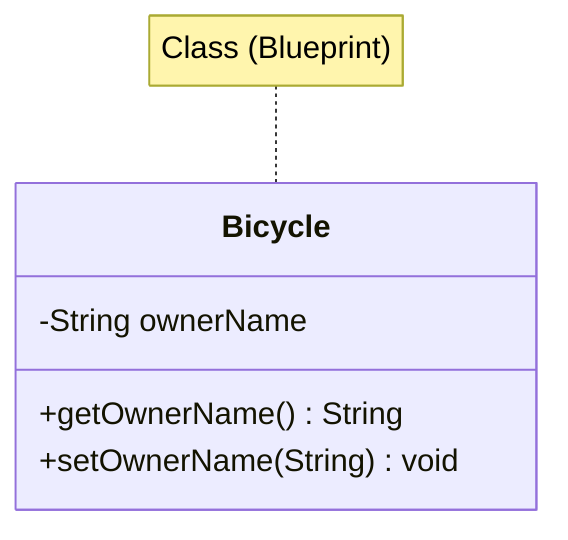
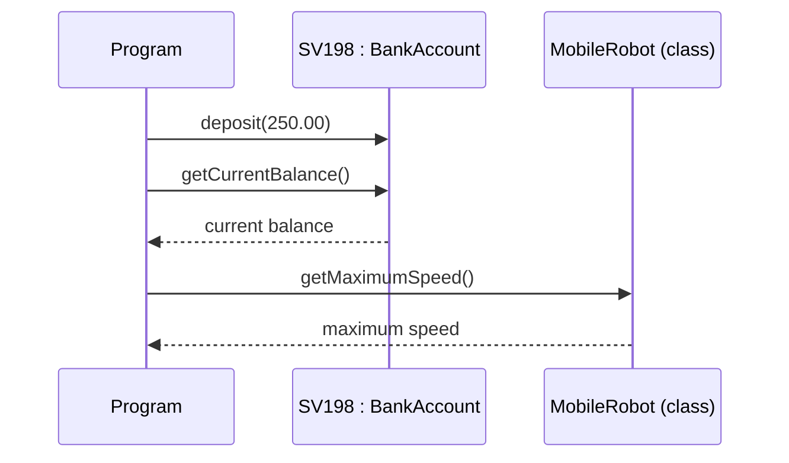
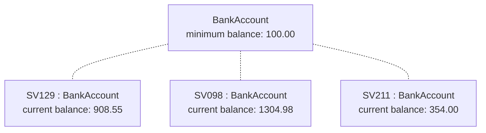
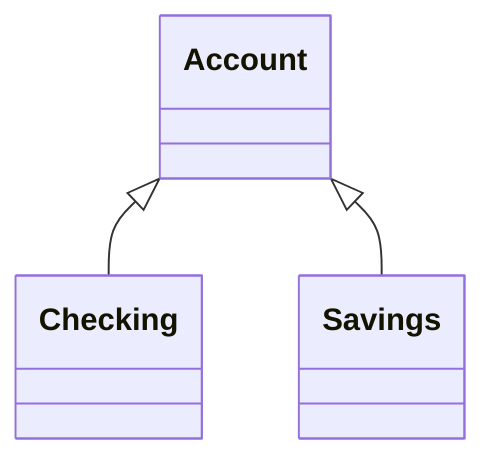
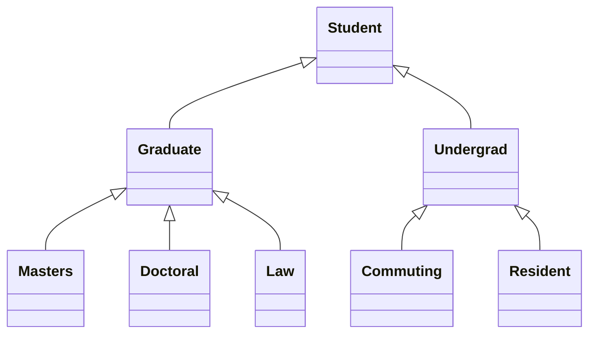
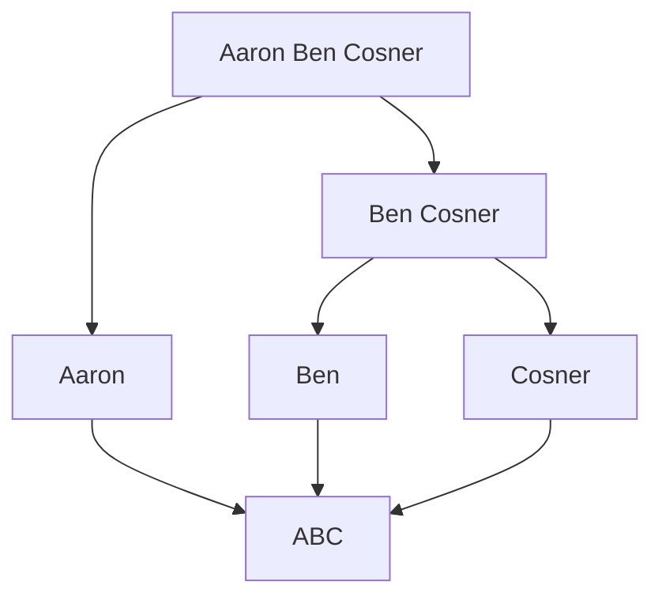

# Lecture 2 — Objects and Classes

[Repository Guide](../../README.md) | [English](Concepts_Lecture.md) | [한국어](Concepts_Lecture.ko.md)

> **Last Updated:** 2026-11-19

> **Learning Objectives:**
> 1. Distinguish classes and objects, messages and methods, and class data values and instance data values
> 2. Read a class with fields and methods and draw it in UML notation
> 3. Declare and create objects and call their methods, and explain the difference between declaration and creation and the sharing of references with stack and heap memory diagrams
> 4. Identify the components of a Java program (comments, import statements, class declarations, method declarations)
> 5. Use the JOptionPane, String, StringBuilder, Date, and SimpleDateFormat standard classes, and explain the difference between == and equals and the immutability of String
> 6. Write simple Java programs with the incremental development approach

---

## Table of Contents

- [1. Objects and Classes in Java](#1-objects-and-classes-in-java)
  - [1.1 The Concept of an Object](#11-the-concept-of-an-object)
  - [1.2 The Concept of a Class](#12-the-concept-of-a-class)
  - [1.3 Relationship Between Objects and Classes](#13-relationship-between-objects-and-classes)
  - [1.4 UML Notation](#14-uml-notation)
  - [1.5 Messages and Methods](#15-messages-and-methods)
  - [1.6 Class Data Values and Instance Data Values](#16-class-data-values-and-instance-data-values)
  - [1.7 Inheritance](#17-inheritance)
  - [1.8 Software Engineering and the Software Life Cycle](#18-software-engineering-and-the-software-life-cycle)
  - [1.9 Class and Instance Data Values in Java Code](#19-class-and-instance-data-values-in-java-code)
- [2. Creating Objects](#2-creating-objects)
  - [2.1 Declaration and Instantiation](#21-declaration-and-instantiation)
  - [2.2 Memory States of Declaration and Creation](#22-memory-states-of-declaration-and-creation)
  - [2.3 Reference Variables](#23-reference-variables)
  - [2.4 Sending Messages to Objects](#24-sending-messages-to-objects)
  - [2.5 The Stack and Heap Memory Model](#25-the-stack-and-heap-memory-model)
  - [2.6 null and NullPointerException](#26-null-and-nullpointerexception)
  - [2.7 == and equals: Identity and Equality](#27--and-equals-identity-and-equality)
- [3. Program Structure and Comments](#3-program-structure-and-comments)
  - [3.1 Sample Program](#31-sample-program)
  - [3.2 Comments](#32-comments)
  - [3.3 Import Statements](#33-import-statements)
  - [3.4 Class and Method Declarations](#34-class-and-method-declarations)
- [4. Java Standard Library Classes](#4-java-standard-library-classes)
  - [4.1 JFrame for GUI Windows](#41-jframe-for-gui-windows)
  - [4.2 JOptionPane for Dialogs](#42-joptionpane-for-dialogs)
  - [4.3 String Manipulation](#43-string-manipulation)
  - [4.4 Date and SimpleDateFormat](#44-date-and-simpledateformat)
  - [4.5 Immutability of String and the String Pool](#45-immutability-of-string-and-the-string-pool)
  - [4.6 Building Strings with StringBuilder](#46-building-strings-with-stringbuilder)
  - [4.7 Other Common String Methods](#47-other-common-string-methods)
  - [4.8 Handling Dates with java.time](#48-handling-dates-with-javatime)
- [5. Incremental Development: The Monogram Program](#5-incremental-development-the-monogram-program)
  - [5.1 Problem and Overall Plan](#51-problem-and-overall-plan)
  - [5.2 Step 1: Input the Name](#52-step-1-input-the-name)
  - [5.3 Step 2: Output the Monogram and Date](#53-step-2-output-the-monogram-and-date)
  - [5.4 Testing and Program Review](#54-testing-and-program-review)
  - [5.5 Generalizing with split](#55-generalizing-with-split)
- [6. Common Mistakes](#6-common-mistakes)
- [Concept Applications](#concept-applications)
- [Summary](#summary)
- [Self-Check Questions](#self-check-questions)
- [References](#references)

---

<br>

## 1. Objects and Classes in Java

### 1.1 The Concept of an Object

Object-oriented programs use objects. An object represents anything, tangible or intangible, such as an account, a vehicle, or an employee.

An **object** is a runtime entity that has the following.
- **State** (fields/attributes): the data it holds.
- **Behavior** (methods): the operations it can perform.
- **Identity**: a unique reference distinguishing it from other objects.

As a real-world example, a `Car` object might have state (color, speed), behavior (accelerate, brake), and identity (license plate).

### 1.2 The Concept of a Class

A **class** is a blueprint or template for creating objects. To create an object in a program, we must first define how the object behaves and what information it maintains, and this definition is a class. It defines the following.
- What data members (fields) an object will have
- What methods an object can perform

```java
public class Bicycle {
    private String ownerName;  // field (state)

    public String getOwnerName() {   // method (behavior)
        return ownerName;
    }

    public void setOwnerName(String name) {
        ownerName = name;
    }
}
```

The `private` field `ownerName` cannot be accessed directly from outside the class; it can be read and changed only through the `public` methods `getOwnerName` and `setOwnerName`. This is the encapsulation of Lecture 1.

### 1.3 Relationship Between Objects and Classes



*Figure 1. Class diagram of the Bicycle class*

- A **class** defines the structure; an **object** is a concrete instance.
- Multiple objects can be created from the same class, each with its own state.
- An object created from a class is called an **instance** of that class. For example, creating 100 bank account objects needs only one class (blueprint), and each object stamped out from that class is an instance.

### 1.4 UML Notation

Classes and objects are drawn in **UML** (Unified Modeling Language), an industry-standard notation.

- **Class:** The class name is written inside a rectangle (e.g., `Account`, `Motorcycle`, `HelloWorld`).
- **Object:** The underlined object name is written inside a rectangle (e.g., `SV198`).
- **Object with its class:** `<Object Name> : <Class Name>` is written underlined, indicating which class the object is an instance of (e.g., `SV198 : BankAccount`).

```text
   Class            Object          Object with its class
┌───────────┐   ┌───────────┐   ┌─────────────────────┐
│  Account  │   │   SV198   │   │ SV198 : BankAccount │
│           │   │   ‾‾‾‾‾   │   │ ‾‾‾‾‾‾‾‾‾‾‾‾‾‾‾‾‾‾‾ │
└───────────┘   └───────────┘   └─────────────────────┘
```

*Figure 2. UML notation for a class, an object, and an object with its class*

Given a UML class diagram, you should be able to write the matching Java code.

### 1.5 Messages and Methods

- To instruct a class or an object to perform a task, we send a **message** to it.
- A message can be sent only to classes and objects that understand it. To handle a message, the receiver must have a **method** that matches the message.
- A method defined for a class is called a **class method**, and a method defined for an object is called an **instance method**.
- A value passed along with a message is called an **argument** of the message.



*Figure 3. Sending messages to an object and a class and receiving results*

- Sending the message `deposit` with the argument 250.00 to the `BankAccount` object `SV198` deposits 250.00 into that account.
- Sending the message `getCurrentBalance()` to `SV198` returns the current balance of that account.
- Sending the message `getMaximumSpeed()` to the `MobileRobot` class returns the maximum speed common to all `MobileRobot` objects. Because the message goes to the class rather than to a particular object, a class method handles it.

### 1.6 Class Data Values and Instance Data Values

An object is comprised of data values and methods.

- **Instance data value:** Maintains information specific to an individual instance. For example, each `BankAccount` object maintains its own current balance.
- **Class data value:** Maintains information shared by all instances or aggregate information about the instances. For example, the minimum balance is information shared by all accounts, whereas the average balance of all `BankAccount` objects is aggregate information.



*Figure 4. One class data value and a per-object instance data value*

All three `BankAccount` objects possess the instance data value current balance, but the actual amounts differ. In contrast, there is only one copy of minimum balance for the whole class, shared by all instances. The dotted lines show the instance-of relationship: each object is an instance of the `BankAccount` class.

### 1.7 Inheritance

**Inheritance** is an OOP mechanism for designing two or more entities that are different but share many common features.

- Features common to all classes are defined in the **superclass**.
- The classes that inherit common features from the superclass are called **subclasses**.
- We also call the superclass an ancestor and the subclass a descendant.



*Figure 5. The superclass Account and its subclasses Checking and Savings*

When subclasses have subclasses of their own, they form an **inheritance hierarchy**. The following is an inheritance hierarchy among different types of students.



*Figure 6. Inheritance hierarchy of student types*

In this hierarchy, each class has only one superclass. This differs from multiple inheritance, in which one class inherits from several superclasses at once, and Java does not allow multiple inheritance of classes (Lecture 1).

### 1.8 Software Engineering and the Software Life Cycle

Much like building a skyscraper, developing complex software needs a disciplined approach. **Software engineering** is the application of a systematic and disciplined approach to the development, testing, and maintenance of a program, and the sample program of Section 5 is also developed by its principles.

The sequence of stages from conception to operation of a program is called the **software life cycle**, and it consists of the following five stages.

1. Analysis
2. Design
3. Coding
4. Testing
5. Operation and Maintenance

> **[Software Engineering]** Software engineering studies software processes, which decide in what order the stages of the life cycle are carried out, such as the waterfall model that goes through the stages once in sequence, iterative models that repeat them in short cycles, and agile methods. The incremental development of Section 5 divides a program into small steps and repeats design, coding, and testing in each step, so it is close to an iterative model.

### 1.9 Class and Instance Data Values in Java Code

In Java the concepts of Sections 1.5 and 1.6 are distinguished by the keyword `static`. Fields and methods declared with `static` belong to the class and are class data values and class methods; those without it exist separately in each object and are instance data values and instance methods. The following `BankAccount` turns the picture of Section 1.6 into code, with the balance of `SV211` changed to 54.00 so that it can be compared with the minimum balance.

```java
public class BankAccount {
    static double minimumBalance = 100.00;
    static int accountCount = 0;

    double currentBalance;

    BankAccount(double initial) {
        currentBalance = initial;
        accountCount++;
    }

    static int getAccountCount() {
        return accountCount;
    }

    boolean isBelowMinimum() {
        return currentBalance < minimumBalance;
    }
}
```

```java
public class DataValueDemo {
    public static void main(String[] args) {
        BankAccount sv129 = new BankAccount(908.55);
        BankAccount sv098 = new BankAccount(1304.98);
        BankAccount sv211 = new BankAccount(54.00);

        System.out.println(BankAccount.getAccountCount());
        System.out.println(sv211.isBelowMinimum());

        BankAccount.minimumBalance = 50.00;
        System.out.println(sv211.isBelowMinimum());
        System.out.println(sv129.currentBalance + " " + sv098.currentBalance);
        System.out.println(Math.max(3, 7) + " " + "hello".length());
    }
}
```

```text
3
true
false
908.55 1304.98
7 5
```

- `minimumBalance` and `accountCount` exist only once in the class and are shared by the three objects. Each of the three constructor runs increases the same `accountCount` by 1, so `getAccountCount()` returns 3. This value is aggregate information about all instances.
- `currentBalance` exists separately in each object, so the three accounts have different balances.
- Changing the class data value once with `BankAccount.minimumBalance = 50.00;` makes every object see the new value. That is why `sv211`, with a balance of 54.00, gives `true` while the minimum balance is 100.00 and `false` after it becomes 50.00.
- A class method is called by a message sent through the class name, as in `BankAccount.getAccountCount()` and `Math.max(3, 7)`, and an instance method by a message sent to a particular object, as in `sv211.isBelowMinimum()` and `"hello".length()`.

This example leaves the fields public to show the concepts. A real class hides its fields as `private` and lets them be changed only through methods (Lecture 7, Section 5). The detailed rules of `static` are covered in Lecture 7, Section 8.

---

<br>

## 2. Creating Objects

### 2.1 Declaration and Instantiation

Creating an object in Java involves two steps.

```java
// Step 1: Declare a reference variable
JFrame myWindow;

// Step 2: Instantiate (create) the object
myWindow = new JFrame();

// Combined in one line:
JFrame myWindow = new JFrame();
```

The `new` keyword allocates memory on the heap and calls the constructor.

An object declaration has the form `<class name> <object name>;`, and the class must be defined before the declaration. An object creation has the form `<object name> = new <class name>(<arguments>);`, and the parentheses stay empty when there are no arguments. In the following code, the first three lines are examples of declarations and the last three are examples of creations; they illustrate each form separately rather than forming one program.

```java
Account customer;
Student jan, jim, jon;
Vehicle car1, car2;

customer = new Customer();
minseok = new Student("Minseok Seo");
car1 = new Vehicle();
```

Declaring a primitive variable such as `int a;` stores the value directly in that space, whereas declaring an object such as `JFrame myWindow;` creates only space for a reference, and the object itself is created dynamically with `new` at run time.

### 2.2 Memory States of Declaration and Creation

```java
Customer customer;           // 1. declaration
customer = new Customer();   // 2. creation
```

1. The identifier `customer` is declared and space is allocated for it in memory. It does not refer to any object yet.
2. A `Customer` object is created, and the identifier `customer` is set to refer to it.

```text
1. After declaration       2. After creation

customer                  customer
┌───────┐                 ┌───────┐
│       │                 │   ●───┼──┐
└───────┘                 └───────┘  │
                                     ▼
                              ┌────────────┐
                              │ : Customer │
                              └────────────┘
```

*Figure 7. Memory states after object declaration and creation*

Drawing the variable and the object separately with an arrow for the reference is called state-of-memory notation. Program diagram notation shows the same situation more simply as a single `customer : Customer` rectangle.

### 2.3 Reference Variables

Reference variables store the **memory address** of an object, not the object itself.

```java
JFrame window1 = new JFrame();
JFrame window2 = window1;  // Both point to the same object
```

> **Key Point:** Assigning one reference to another does not copy the object; both variables refer to the same instance in memory.

Conversely, assigning a new object to a variable breaks the link to the object it referred to before.

```java
Customer customer;
customer = new Customer();
customer = new Customer();
```

```text
customer
┌───────┐
│   ●───┼─────────────────────┐
└───────┘                     ▼
┌────────────┐         ┌────────────┐
│ : Customer │         │ : Customer │
└────────────┘         └────────────┘
 created by first new   created by second new
 (reference lost)
```

*Figure 8. The first object losing its reference after the second new*

No reference to the first `Customer` object remains, so the program can no longer access it, and the object becomes eligible for garbage collection (Lecture 1; Lecture 8, Section 5).

### 2.4 Sending Messages to Objects

A message is sent to an object in the form `<object name>.<method name>(<arguments>);`.

```java
myWindow.setVisible(true);
account.deposit(200.0);
student.setName("john");
car1.startEngine();
```

`myWindow.setVisible(true)` sends the message `setVisible` with the argument `true` to the object `myWindow`.

### 2.5 The Stack and Heap Memory Model

The memory pictures of Sections 2.2 and 2.3 can be explained more precisely with two memory areas of the JVM (Lecture 1, Section 3.9). A variable declared inside a method (a local variable) lives in a frame on the **stack** while the method runs, and an object created with `new` lives on the **heap**. If a local variable is of a primitive type, it holds the value itself; if it is of a reference type, it holds a reference that tells where the object is on the heap. The following program shows this.

```java
public class Customer {
    private String name;

    public Customer(String name) {
        this.name = name;
    }

    public String getName() {
        return name;
    }

    public void setName(String name) {
        this.name = name;
    }
}
```

```java
public class AliasDemo {
    public static void main(String[] args) {
        int x = 10;
        int y = x;
        y = 20;
        System.out.println("x = " + x + ", y = " + y);

        Customer c1 = new Customer("Kim");
        Customer c2 = c1;
        c2.setName("Lee");
        System.out.println("c1: " + c1.getName() + ", c2: " + c2.getName());
        System.out.println(c1 == c2);
    }
}
```

```text
x = 10, y = 20
c1: Lee, c2: Lee
true
```

`int y = x;` copies the value 10 of `x` into `y`. The two variables are separate slots, so `y = 20;` does not affect `x`. In contrast, `Customer c2 = c1;` copies a reference, not an object, so both variables point to the same object on the heap. That is why the name changed with `c2.setName("Lee")` is also read through `c1.getName()`. Two names that refer to the same object are called **aliases**.

```text
 Stack (frame of main)                Heap
┌────────────────────┐
│ args   ●───────────┼──▶ String[] (length 0)
│ x      10          │
│ y      20          │      ┌──────────────────┐
│ c1     ●───────────┼────▶ │ Customer         │
│ c2     ●───────────┼────▶ │  name ●──────────┼──▶ "Lee"
└────────────────────┘      └──────────────────┘
```

*Figure 9. Stack and heap of AliasDemo just before the last println*

The field `name` inside the `Customer` object is also of a reference type, so the object holds not the string itself but a reference to the `String` object `"Lee"`. In this way an object can have fields that refer to other objects, and the data of a program forms a graph on the heap connected by references. When `main` ends, its frame disappears together with the local variables `c1` and `c2`, and any object that no reference points to any longer becomes eligible for garbage collection.

> **Key Point:** The assignment operator `=` always copies the value held in a variable. For a primitive variable that value is the number itself, and for a reference variable it is a reference. To copy an object, a new object must be created separately with a constructor or a copying method.

### 2.6 null and NullPointerException

A reference variable can hold the special value **null**, which means that it refers to no object. The default value of reference-type fields and array elements is also `null`. Calling a method or accessing a field through a `null` reference throws a `NullPointerException` (NPE) at run time, because there is no object to receive the message.

```java
public class NullDemo {
    public static void main(String[] args) {
        Customer customer = null;
        System.out.println(customer == null);
        System.out.println(customer.getName());
    }
}
```

```text
true
Exception in thread "main" java.lang.NullPointerException: Cannot invoke "Customer.getName()" because "customer" is null
	at NullDemo.main(NullDemo.java:5)
```

`customer == null` compares references, so it yields `true` without an exception. The exception occurs at `customer.getName()` on the next line, and the message tells what was being invoked and which variable was `null`. This output was obtained by compiling with `javac --release 21 -g` and running on JDK 24. Without `-g` the class file contains no names of local variables, so the number of the local variable, as in `"<local1>"`, appears in place of `"customer"`.

The basic ways to avoid an NPE are the following.

- When declaring a reference variable, initialize it with an object right away if possible.
- If a method can return `null` (for example, `JOptionPane.showInputDialog` when Cancel is pressed), check it with `if (input != null)` before using it.
- When comparing with a string constant, calling `equals` on the constant, as in `"yes".equals(answer)`, yields `false` without an exception even if `answer` is `null` (Section 2.7).

### 2.7 == and equals: Identity and Equality

Saying that two objects are "the same" can mean two things.

> **Definition:** **Identity** is the property that two references point to one and the same object on the heap. In Java it is tested with the `==` operator.

> **Definition:** **Equality** is the property that objects, even different ones, represent the same content. In Java it is tested with the `equals` method, and each class decides what counts as the same content.

```java
public class EqualsDemo {
    public static void main(String[] args) {
        String a = "Java";
        String b = "Java";
        String c = new String("Java");
        String d = c.intern();
        System.out.println(a == b);
        System.out.println(a == c);
        System.out.println(a.equals(c));
        System.out.println(a == d);

        Customer k1 = new Customer("Kim");
        Customer k2 = new Customer("Kim");
        System.out.println(k1 == k2);
        System.out.println(k1.equals(k2));

        String s = null;
        System.out.println("Java".equals(s));
        System.out.println(java.util.Objects.equals(s, null));
    }
}
```

```text
true
false
true
true
false
false
false
true
```

- `a == b` is `true` because string literals with the same content always refer to the same `String` object (Section 4.5).
- `c` is a separate object created with `new`, so `a == c` is `false`, but the `equals` of `String` compares the sequences of characters, so `a.equals(c)` is `true`.
- `intern()` returns the same object as the string literal with the same content, so `a == d` is `true`.
- `Customer` does not define `equals` itself, so it inherits the `equals` of `Object`, the superclass of every class. The `equals` of `Object` compares identity just like `==`, so `k1.equals(k2)` is `false` even though the names are the same. To compare by content, the class must define `equals` again, as covered in Lecture 11.
- `"Java".equals(s)` is `false` without an exception even if `s` is `null`, and `java.util.Objects.equals(x, y)` returns `true` if both arguments are `null`, `false` if only one is `null`, and the result of `x.equals(y)` if both are objects.

> **Caution:** Never use `==` to compare the contents of strings. It sometimes yields `true` by coincidence, as with `a == b` above, which delays the discovery of the error. A string read with `next()` of `Scanner` is a new object created during execution, so even if the user types `yes`, `input == "yes"` is `false` and only `input.equals("yes")` is `true`. Always use `equals` to compare contents.

---

<br>

## 3. Program Structure and Comments

### 3.1 Sample Program

The following program displays a window. `main()` declares and creates the `JFrame` object `myWindow` and then sends it the messages `setSize`, `setTitle`, and `setVisible` (lab code: [DisplayWindow.java](../../Coursework/Lab02_Objects-and-Classes/DisplayWindow.java)).

```java
/*
 *  Chap2Program1 Sample Program: Displaying a Window
 *  File: Chap2Program1.java
 */

import javax.swing.*;

public class Chap2Program1 {

    public static void main(String[] args) {

        JFrame myWindow;                         // declare an object

        myWindow = new JFrame();                 // create the object

        myWindow.setSize(300, 200);              // use the object
        myWindow.setTitle("My First Java Program");
        myWindow.setVisible(true);
    }
}
```

A Java program is composed of (1) comments, (2) import statements, and (3) class declarations. Every Java source file follows this structure.

```java
// 1. Package declaration (optional)
// 2. Import statements
import javax.swing.*;

// 3. Class definition
public class MyProgram {

    // 4. main method (entry point)
    public static void main(String[] args) {
        // Program logic here
    }
}
```

### 3.2 Comments

Comment styles are as follows.
- `//`: a single-line comment.
- `/* ... */`: a multi-line comment.
- `/** ... */`: a Javadoc comment (for API documentation).

```java
/*
   This is a comment with
   three lines of
   text.
*/

// This is a comment
// This is another comment
// This is a third comment

/**
 * This class provides basic clock functions. In addition
 * to reading the current time and today's date, you can
 * use this class for stopwatch functions.
 */
```

### 3.3 Import Statements

An import statement lets a class from another package be used by its simple name. The form is `import <package name>.<class name>;`. In `import javax.swing.JFrame;`, `javax.swing` is the name of the package containing the class to use, and `JFrame`, which starts with an uppercase letter, is the class name. Writing `*` in place of the class name imports all classes of the package.

```java
import javax.swing.JFrame;
import java.util.*;
import com.drcaffeine.simplegui.*;
```

### 3.4 Class and Method Declarations

A class declaration runs from `public class Chap2Program1 {` to the matching `}`, and method declarations go inside it. A method declaration consists of the following elements.

| Element | Example in the `main` method |
|:-----|:-----|
| Modifier | `public` |
| Modifier | `static` |
| Return type | `void` |
| Method name | `main` |
| Parameter | `String[] args` |
| Method body | The statements between `{` and `}` |

*Table 1. Elements of a method declaration*

A simple Java program is therefore completed by filling in four parts of a template: the comment at the top, the import statements, the class name after `class`, and the method body of `public static void main(String[] args)`.

---

<br>

## 4. Java Standard Library Classes

Do not reinvent the wheel: when existing classes satisfy our needs, use them. Learning how to use standard Java classes is the first step toward mastering OOP, and before defining our own classes, we learn how to use existing ones. This section covers `JFrame` and four standard classes, `JOptionPane`, `String`, `Date`, and `SimpleDateFormat`, followed by the immutability of `String`, `StringBuilder`, and the `java.time` package.

### 4.1 JFrame for GUI Windows

`javax.swing.JFrame` represents a window with a title bar, borders, and a content area.

```java
JFrame myWindow = new JFrame();
myWindow.setSize(300, 200);
myWindow.setTitle("My First Java Program");
myWindow.setVisible(true);
```

Key methods are as follows.

| Method | Description |
|:-------|:-----------|
| `setSize(width, height)` | Set window dimensions in pixels |
| `setTitle(String)` | Set the title bar text |
| `setVisible(boolean)` | Show or hide the window |
| `setDefaultCloseOperation(int)` | Define behavior on window close |

*Table 2. Key methods of JFrame*

Without a call to `setDefaultCloseOperation`, the default is `HIDE_ON_CLOSE`, so clicking the close button only hides the window and the program keeps running. To end the program when the window closes, call `setDefaultCloseOperation(JFrame.EXIT_ON_CLOSE)`.

### 4.2 JOptionPane for Dialogs

`javax.swing.JOptionPane` provides simple dialog boxes for input and output.

```java
// Input dialog
String name = JOptionPane.showInputDialog(null, "Enter your name:");

// Message dialog
JOptionPane.showMessageDialog(null, "Hello, " + name + "!");
```

- `showMessageDialog` is a simple way to display a result of a computation to the user. With `null` as the first argument, the dialog appears at the center of the screen. `JOptionPane.showMessageDialog(null, "I Love Java");` opens a message window that displays "I Love Java".
- Putting the new line marker `\n` in a string displays multiple lines. `JOptionPane.showMessageDialog(null, "one\ntwo\nthree");` displays one, two, and three on three lines.
- `showInputDialog` is a simple way to input a string. `name = JOptionPane.showInputDialog(null, "What is your name?");` opens an input window at the center of the screen and returns the string the user typed.

### 4.3 String Manipulation

The textual values passed to `showMessageDialog` are all instances of the `String` class. A sequence of characters enclosed in double quotes is a `String` constant. Because a `String` is an object, it can be declared and created like any other object.

```java
String name;                   // 1. declare the identifier name and allocate space
name = new String("Jon Java"); // 2. create a String object and make name refer to it
```

Java `String` is immutable. All the methods below leave the original string unchanged and return a newly created result. Common operations are as follows.

```java
String fullName = "John Doe Smith";
String first = fullName.substring(0, fullName.indexOf(" "));
int length = fullName.length();
String upper = fullName.toUpperCase();
```

Each character of a string is identified by its position (index), starting from 0.

```text
String text = "Espresso";

  0   1   2   3   4   5   6   7
┌───┬───┬───┬───┬───┬───┬───┬───┐
│ E │ s │ p │ r │ e │ s │ s │ o │
└───┴───┴───┴───┴───┴───┴───┴───┘
```

*Figure 10. Character indices of the string "Espresso"*

The `String` class defines close to 50 methods. We look at `substring`, `length`, and `indexOf`, and the concatenation operation. Let `str` be a properly initialized `String` object.

- **substring:** `str.substring(i, j)` returns a new string made of the characters of `str` from position `i` to `j-1`. It requires $0 \le i \le j \le$ `str.length()`, and violating this throws `StringIndexOutOfBoundsException`. If `str` is "programming", `str.substring(3, 7)` is "gram", from g at position 3 to m at position 6.
- **length:** `str.length()` returns the number of characters in `str`. For "programming" it is 11.
- **indexOf:** `str.indexOf(substr)` returns the first position at which `substr` occurs in `str`. The position of "gram" in "programming" is 3. If `substr` does not occur, it returns -1, and the search is case-sensitive.
- **Concatenation:** `str1 + str2` returns a new string that joins the two strings. "pro" + "gram" is "program". `+` is an operator, not a method of the `String` class.

```java
String text = "Espresso";
text.substring(6, 8);   // "so"
text.substring(0, 8);   // "Espresso"
text.substring(1, 5);   // "spre"
text.substring(3, 3);   // "" (empty string)
text.substring(4, 2);   // error: StringIndexOutOfBoundsException

String str1 = "Hello", str2 = "Java", str3 = "", str4 = " ";
str1.length();          // 5
str2.length();          // 4
str3.length();          // 0 (empty string)
str4.length();          // 1 (one space)

String str = "I Love Java and Java loves me.";
str.indexOf("J");       // 7
str.indexOf("love");    // 21
str.indexOf("ove");     // 3
str.indexOf("Me");      // -1

String s1 = "Jon", s2 = "Java";
String r1 = s1 + s2;               // "JonJava"
String r2 = s1 + " " + s2;         // "Jon Java"
String r3 = s2 + ", " + s1;        // "Java, Jon"
String r4 = "Are you " + s1 + "?"; // "Are you Jon?"
```

`indexOf("love")` is 21, not 2, because "Love" at position 2 starts with an uppercase L. None of these operations changes the original strings `text`, `str`, `s1`, and `s2`.

### 4.4 Date and SimpleDateFormat

The `Date` class of the `java.util` package represents a date and time. A newly created `Date` object is set to the current date and time of the computer, and its `toString` method converts the internal format to a string such as `"Fri Oct 31 10:05:18 PST 2003"`. The `SimpleDateFormat` class displays the date information in a desired format.

```java
import java.util.Date;
import java.text.SimpleDateFormat;

Date today = new Date();
SimpleDateFormat sdf = new SimpleDateFormat("MM/dd/yy");
String formatted = sdf.format(today);
```

| Pattern | Sample output (Monday 2025-03-10 14:05:09, English locale) |
|:-----|:-----|
| `"MM/dd/yy"` | `03/10/25` |
| `"yyyy-MM-dd"` | `2025-03-10` |
| `"HH:mm:ss"` | `14:05:09` |
| `"HH:mm:ss a"` | `14:05:09 PM` |
| `"HH:mm:ss a, E"` | `14:05:09 PM, Mon` |

*Table 3. SimpleDateFormat patterns and sample outputs*

`MM` is the month, `dd` the day, `yy` and `yyyy` the two-digit and four-digit year, `HH` the hour 0-23, `mm` the minute, `ss` the second, `a` the AM/PM marker, and `E` the day of the week. The minute `mm` and the month `MM` are distinguished by case. The output of `a` and `E` depends on the locale; a Korean locale shows `오후` and `월`.

> **Note:** `Date` and `SimpleDateFormat` are legacy APIs. Since Java 8, `LocalDate`, `LocalDateTime`, and `DateTimeFormatter` of the `java.time` package are recommended.

### 4.5 Immutability of String and the String Pool

Once a `String` object is created, its content cannot be changed [1]. This is called being **immutable**. Methods that seem to change a string, such as `toUpperCase`, `substring`, and `replace`, all leave the original object untouched and return a new `String` object holding the result.

```java
public class ImmutableDemo {
    public static void main(String[] args) {
        String s = "java";
        s.toUpperCase();
        System.out.println(s);
        s = s.toUpperCase();
        System.out.println(s);

        String t = "Hello";
        String u = t;
        t = t + " World";
        System.out.println(t);
        System.out.println(u);
    }
}
```

```text
java
JAVA
Hello World
Hello
```

The first `s.toUpperCase();` creates a new object `"JAVA"` but stores its reference nowhere, so `s` still refers to `"java"`. To use the result, the return value must be assigned to a variable, as in `s = s.toUpperCase();`. What changes then is the object that `s` refers to, not the original `"java"` object. Likewise, `t = t + " World";` only creates a new object `"Hello World"` and assigns it to `t`, so `u`, which refers to the old object, still holds `"Hello"`.

```text
 before t = t + " World";           after

 t ●──┐                             t ●──────▶ "Hello World"
      ├──▶ "Hello"
 u ●──┘                             u ●──────▶ "Hello"
```

*Figure 11. Concatenation creating a new object while the old object stays unchanged*

Because they are immutable, `String` objects can be shared safely by many variables. Since nobody can change the content, a change made through one side never shows up on the other, unlike `Customer` in Section 2.5. Java uses this property to share string literals. String literals with the same content always refer to the same `String` object throughout the program, which is described as being **interned** [2]. The place where interned strings are kept is commonly called the string pool. `new String("Java")` creates a new object on the heap regardless of the pool, which is why `a == c` was `false` in Section 2.7.

> **Caution:** Immutable means that the content of the object does not change, not that a variable cannot be assigned another string. What makes the variable itself unchangeable is `final` (Lecture 3, Section 3).

### 4.6 Building Strings with StringBuilder

Because `String` is immutable, appending to a string with `+=` inside a loop creates a new object each time and copies the entire content so far. Appending a one-character string n times copies the following number of characters.

```math
1 + 2 + \cdots + n = \frac{n(n+1)}{2}
```

For n = 10,000 this copies 50,005,000 characters, and the amount of copying grows in proportion to the square of n. **`StringBuilder`** is a mutable sequence of characters [3]; it appends characters to an internal buffer and moves to a larger buffer when the buffer is full. Doing the same work with it therefore reduces the copying to a level proportional to n. When a string is built up piece by piece, use `StringBuilder` and obtain the `String` with `toString()` at the end.

```java
public class BuilderDemo {
    public static void main(String[] args) {
        StringBuilder sb = new StringBuilder();
        for (int i = 1; i <= 5; i++) {
            sb.append(i);
            if (i < 5) {
                sb.append(", ");
            }
        }
        System.out.println(sb.toString());
        System.out.println(sb.length());

        sb.insert(0, "[").append("]");
        System.out.println(sb);
        System.out.println(new StringBuilder("stressed").reverse());
        sb.setLength(0);
        System.out.println("empty: '" + sb + "'");
    }
}
```

```text
1, 2, 3, 4, 5
13
[1, 2, 3, 4, 5]
desserts
empty: ''
```

- `append(x)` converts `x` to a string, adds it at the end, and returns the same `StringBuilder` object. This is why calls can be chained, as in `sb.insert(0, "[").append("]")` (Lecture 8, Section 1.1).
- `1, 2, 3, 4, 5` consists of five digits and four `", "`, so it has 5 + 4 × 2 = 13 characters.
- `insert(position, x)` inserts at that position, `reverse()` reverses the order, and `setLength(0)` clears the content. These methods do not create new objects but change `sb` itself.
- `println(sb)` and `+ sb` in a concatenation call `toString()` internally.

`StringBuilder` is not safe for use by multiple threads; in that case use `StringBuffer`, which adds synchronization to the same functionality [3]. Threads are covered in Lecture 13. Concatenating in a single expression outside a loop, as in `"a" + b + "c"`, is handled efficiently by the compiler, so `+` is fine there.

### 4.7 Other Common String Methods

Besides the methods of Section 4.3, `String` has many methods in frequent use. The following program shows their results all at once.

```java
public class MoreString {
    public static void main(String[] args) {
        String s = "  Object-Oriented Java  ";
        String t = s.strip();
        System.out.println("[" + t + "]");
        System.out.println(t.charAt(0) + " " + t.charAt(t.length() - 1));
        System.out.println(t.toLowerCase());
        System.out.println(t.replace('-', ' '));
        System.out.println(t.contains("Java") + " " + t.startsWith("Object") + " " + t.endsWith("java"));
        System.out.println(t.lastIndexOf("e"));
        System.out.println("apple".compareTo("banana"));
        System.out.println("banana".compareTo("apple"));
        System.out.println("apple".compareTo("apple"));
        System.out.println("Apple".compareTo("apple"));
        System.out.println("app".compareTo("apple"));
        System.out.println("JAVA".equalsIgnoreCase("java"));
        String[] parts = "Min Seok Seo".split(" ");
        System.out.println(parts.length + " " + parts[2]);
        System.out.println(String.join("-", parts));
        System.out.println(String.valueOf(3.5) + String.valueOf(true));
        System.out.println("".isEmpty() + " " + "   ".isBlank() + " " + "   ".isEmpty());
        System.out.println("ab".repeat(3));
    }
}
```

```text
[Object-Oriented Java]
O a
object-oriented java
Object Oriented Java
true true false
13
-1
1
0
-32
-2
true
3 Seo
Min-Seok-Seo
3.5true
true true false
ababab
```

- `strip()` returns the string with leading and trailing white space removed, and `charAt(i)` returns the character (`char`) at position `i`. The position of the last character is `length() - 1`.
- `replace(old, new)` returns a new string with every `old` replaced by `new`, and `contains`, `startsWith`, and `endsWith` return the containment result as a `boolean`. `endsWith("java")` is `false` because the case differs.
- `lastIndexOf("e")` is the position of the last occurrence. In `"Object-Oriented Java"` the last `e` is the second `e` of `Oriented`, at position 13.
- `compareTo` compares two strings in lexicographic order and returns a negative number if the first string comes first, 0 if they are equal, and a positive number if it comes later. If the characters at the first differing position differ, it returns the difference of their character codes, so `"apple".compareTo("banana")` is `'a' - 'b'` = -1 and `"Apple".compareTo("apple")` is the difference -32 between `'A'` (65) and `'a'` (97). If one string is a prefix of the other, it returns the difference of the lengths, so `"app".compareTo("apple")` is 3 - 5 = -2.
- `equalsIgnoreCase` compares contents ignoring case.
- `split(delimiter)` cuts a string at the delimiter into a `String` array, and `String.join(delimiter, array)` joins them back. The argument of `split` is interpreted as a regular expression.
- `String.valueOf(x)` converts a primitive value into a string. `isEmpty()` checks whether the length is 0 and `isBlank()` whether there are only white-space characters, so `"   "` is not empty but contains only white space.
- `repeat(n)` returns a new string that repeats the string n times.

### 4.8 Handling Dates with java.time

The classes of the `java.time` package mentioned in the note of Section 4.4 make date calculations possible with a single method call. `LocalDate` represents a date with only a year, month, and day, without a time or time zone, and like `String` it is immutable. So even the methods that add to a date leave the original object unchanged and return a new `LocalDate`.

```java
import java.time.DayOfWeek;
import java.time.LocalDate;
import java.time.format.DateTimeFormatter;
import java.time.temporal.ChronoUnit;
import java.util.Locale;

public class TimeDemo {
    public static void main(String[] args) {
        LocalDate start = LocalDate.of(2025, 3, 10);
        LocalDate later = start.plusDays(30);
        System.out.println(start + " " + later);
        System.out.println(start.getDayOfWeek() + " " + (start.getDayOfWeek() == DayOfWeek.MONDAY));
        System.out.println(ChronoUnit.DAYS.between(start, LocalDate.of(2025, 6, 18)));
        DateTimeFormatter f = DateTimeFormatter.ofPattern("yyyy/MM/dd (E)", Locale.ENGLISH);
        System.out.println(start.format(f));
        System.out.println(start.isLeapYear() + " " + LocalDate.of(2024, 2, 28).plusDays(1));
        System.out.println(start);
    }
}
```

```text
2025-03-10 2025-04-09
MONDAY true
100
2025/03/10 (Mon)
false 2024-02-29
2025-03-10
```

- `LocalDate.of(2025, 3, 10)` creates a particular date, and `LocalDate.now()` creates today. `toString()` returns the ISO form such as `2025-03-10`.
- `plusDays(30)` computes April 9, thirty days after March 10. It is the remaining 21 days of March plus 9 days of April.
- `ChronoUnit.DAYS.between(a, b)` is the number of days between two dates. From March 10 to June 18 there are 21 + 30 + 31 + 18 = 100 days.
- The pattern string of `DateTimeFormatter` uses letters similar to those of `SimpleDateFormat` in Section 4.4. Parts that depend on the language, such as the day of the week (`E`), give a fixed result only when a locale is specified.
- 2025 is not a leap year, and the day after February 28, 2024 is February 29 because 2024 is a leap year. The last line shows that `start` did not change after `plusDays` was called.

Computing the number of days by subtracting the milliseconds of `getTime()` of `Date` can be off on days that are not 24 hours long (such as daylight-saving transitions), but `LocalDate` handles only dates without times, so it has no such problem.

---

<br>

## 5. Incremental Development: The Monogram Program

### 5.1 Problem and Overall Plan

**Problem:** Write a program that asks for the user's first, middle, and last names and replies with the monogram made of their initials and the current date (e.g., input Min Seok Seo, output MSS and the date).

We need to know what to develop before we develop, so we first identify the major tasks the program has to perform.
- Get the user's first, middle, and last names.
- Extract the initials and create the monogram.
- Output the monogram and the date.

We develop this program incrementally in two steps: (1) start with the program template and add code to get input, and (2) add code to compute and display the monogram and the date.

### 5.2 Step 1: Input the Name

The specification only says to get the user's name and does not say how, so the input method is decided in the Step 1 design. We use `JOptionPane` for input. Of the two input styles, entering the first, middle, and last names separately or entering the full name at once, we choose the second because it is easier and quicker for the user.

```java
import javax.swing.*;

public class Chap2Program2 {

    public static void main(String[] args) {

        String name;

        name = JOptionPane.showInputDialog(null, "Enter your full name (first, middle, last):");

        JOptionPane.showMessageDialog(null, name);
    }
}
```

In the Step 1 test, we run the program and verify that we can enter the name and that the entered name is displayed correctly.

### 5.3 Step 2: Output the Monogram and Date

Because our programming skills are still limited, we make the following assumptions.
- The input string contains the first, middle, and last names.
- The first, middle, and last names are separated by single blank spaces.

For example, "John Quincy Adams" is valid input, but "John Kennedy" (no middle name) and "Harrison, William Henry" (a comma) are not.

Given valid input, the monogram is computed as follows: break the input name into first, middle, and last; extract the first character of each; and concatenate the three characters.



*Figure 12. Splitting a full name to build the monogram*

```java
import java.text.SimpleDateFormat;
import java.util.Date;
import javax.swing.*;

public class Chap2Program2 {

    public static void main(String[] args) {

        String name, first, middle, last, space, monogram;

        space = " ";

        // Input the full name
        name = JOptionPane.showInputDialog(null, "Enter your full name (first, middle, last):");

        // Extract first, middle, and last names
        first = name.substring(0, name.indexOf(space));
        name = name.substring(name.indexOf(space) + 1, name.length());

        middle = name.substring(0, name.indexOf(space));
        last = name.substring(name.indexOf(space) + 1, name.length());

        // Compute the monogram
        monogram = first.substring(0, 1) + middle.substring(0, 1) + last.substring(0, 1);

        // Get date information
        Date today = new Date();
        SimpleDateFormat dateFormat = new SimpleDateFormat("MM/dd/yy");

        // Output the result
        JOptionPane.showMessageDialog(null, "Your monogram is " + monogram + "\n"
                + "Today is " + dateFormat.format(today));
    }
}
```

`first` is the substring before the first space. Next, `name` is replaced by the rest after the first space ("Ben Cosner"), and `middle` and `last` are obtained the same way. `substring(0, 1)` of each string is its first character, and the three first characters are concatenated with `+` to form the monogram. The lab code with the same function is [MonogramDateDisplay.java](../../Coursework/Lab02_Objects-and-Classes/MonogramDateDisplay.java).

### 5.4 Testing and Program Review

In the testing phase, we run the program and verify that correct monograms are displayed for all valid input values. Seeing one correct answer is not enough, so we run the program many times with many different types of valid input.

Even after a working program is developed, we review it critically to see if there are any missing features or possible improvements. For example, the initial prompt can be improved so the user knows that the valid input format requires single spaces between the first, middle, and last names.

### 5.5 Generalizing with split

The program of Section 5.3 assumed exactly three names separated by single spaces. The tools of Sections 4.6 and 4.7 make a monogram without this assumption. The following method removes leading and trailing white space, splits the names with the regular expression `"\\s+"`, which means one or more white-space characters, and collects the first letter of each name in upper case in a `StringBuilder`.

```java
public class Monogram2 {
    static String monogram(String fullName) {
        String[] names = fullName.strip().split("\\s+");
        StringBuilder sb = new StringBuilder();
        for (String name : names) {
            sb.append(Character.toUpperCase(name.charAt(0)));
        }
        return sb.toString();
    }

    public static void main(String[] args) {
        System.out.println(monogram("Aaron Ben Cosner"));
        System.out.println(monogram("John Kennedy"));
        System.out.println(monogram("  min   seok seo "));
        System.out.println(monogram("Harrison William Henry Smith"));
    }
}
```

```text
ABC
JK
MSS
HWHS
```

It handles `"John Kennedy"`, on which the program of Section 5.3 stopped with an exception, as `JK`, and it also handles several spaces, names typed in lowercase, and four names. However, an empty string or a string of only spaces makes `split` return `{""}` of length 1, and `charAt(0)` throws a `StringIndexOutOfBoundsException`. A finished program should check with `isBlank()` first and ask again; trying new inputs each time one problem is fixed in this way is the testing of Section 5.4.

---

<br>

## 6. Common Mistakes

| Mistake | Result | Fix |
|:-----|:-----|:-----|
| Thinking that assigning one reference variable to another copies the object | A change through one variable shows up through the other | Create a separate object with `new` when a new one is needed |
| Calling a method through a reference variable that was only declared or is `null` | `NullPointerException` at run time | Assign an object or check for `null` first |
| Comparing string contents with `==` | `false` even when the input strings are the same | Use `equals` or `equalsIgnoreCase` |
| Discarding the return value, as in `s.toUpperCase();` | `s` does not change | Assign the result, as in `s = s.toUpperCase();` |
| Building a long string with `+=` inside a loop | Slow, because copying grows with the square of the number of iterations | Use `append` of `StringBuilder` |
| Taking `j` of `substring(i, j)` as the position of the last character | One character is missing | `j` is the exclusive end position, so use the last position + 1 |
| Forgetting that `indexOf` and `compareTo` are case-sensitive | Not found (-1) or an unexpected order | Normalize with `toLowerCase` before comparing when needed |

*Table 4. Common mistakes when handling objects and strings*

---

<br>

## Concept Applications

**True/False Check:**

| Statement | Judgment and Reason |
|:-----|:-----|
| Executing `Customer c2 = c1;` creates one more `Customer` object. | **F.** Only the reference is copied, so there is one object, which `c1` and `c2` both refer to. |
| An `int` value held in a local variable is on the heap. | **F.** The value of a primitive local variable is in the variable inside the stack frame of the method. The heap holds objects and arrays. |
| `"Java" == "Java"` is `true`. | **T.** String literals with the same content are interned and refer to the same object. For comparing contents, however, `equals` must be used. |
| For two objects of a class that does not define `equals`, `a.equals(b)` is `true` if all fields are the same. | **F.** The `equals` of `Object` compares identity, so it is `false` for two different objects. |
| After `String s = "abc"; s.replace('a', 'z');`, `s` is `"zbc"`. | **F.** `String` is immutable and `replace` only returns a new string, so without an assignment `s` is `"abc"`. |
| `append` of `StringBuilder` creates and returns a new `StringBuilder` object. | **F.** It changes its own content and returns the same object, which is why calls can be chained. |
| `"app".compareTo("apple")` is negative. | **T.** The beginnings are the same and `"app"` is shorter, so it returns the length difference -2. |

---

<br>

## Summary

| Concept | Key Summary |
|:--------|:----------|
| Object | An object is an instance of a class with state, behavior, and identity. |
| Class | A class is a blueprint defining fields and methods. |
| UML notation | A class is drawn as a name in a rectangle, and an object as an underlined name (`SV198`, `SV198 : BankAccount`). |
| Messages and methods | A message sent to an object or a class is handled by a matching instance method or class method. |
| Class and instance data | Each object has its own instance data values, whereas a class data value is shared by all instances. |
| Inheritance | A subclass inherits the common features defined in its superclass. |
| `new` keyword | `new` allocates memory and calls the constructor. |
| Reference variable | A reference variable stores the address of an object, not the object itself. |
| Program components | A Java program is composed of comments, import statements, and class declarations. |
| JFrame | JFrame is a Swing class for creating GUI windows. |
| JOptionPane | JOptionPane provides input/output dialog boxes. |
| String | String is an immutable character sequence with rich manipulation methods such as `substring`, `length`, and `indexOf`. |
| Date and SimpleDateFormat | Date represents the current date and time, and SimpleDateFormat turns it into a string of the desired format. |
| Incremental development | A program is completed in several steps, repeating design, coding, and testing in each step. |
| Stack and heap | Local variables are in stack frames and objects on the heap, and a reference variable holds a reference to an object on the heap. |
| Alias | Assigning a reference makes two variables aliases of the same object, so a change through one is visible through the other. |
| null | A reference to no object; accessing a member through `null` throws a `NullPointerException`. |
| Identity and equality | `==` tests whether two references are the same object and `equals` whether the contents are the same; the `equals` of `Object` tests identity. |
| Immutability of String | The content of a `String` never changes, methods that seem to change it return new objects, and equal literals are interned and shared. |
| StringBuilder | A mutable sequence of characters that reduces copying when strings are appended repeatedly. |
| compareTo | Compares in lexicographic order and returns a negative number, 0, or a positive number given by the code difference of the first differing characters or the length difference. |
| static and instance | `static` fields and methods exist once per class and are shared by all objects, while other fields and methods exist per object. |
| java.time | `LocalDate` is an immutable date, and `plusDays`, `ChronoUnit.DAYS.between`, and `DateTimeFormatter` calculate and display dates. |

---

<br>

## Self-Check Questions

1. **String methods:** Given `String str = "programming";`, write the values of `str.substring(3, 7)`, `str.length()`, `str.indexOf("gram")`, and `str.indexOf("Gram")`.

   <details>
   <summary>Answer</summary>

   `str.substring(3, 7)` is "gram", the characters at positions 3-6. `str.length()` is 11. `str.indexOf("gram")` is 3. Because `indexOf` is case-sensitive, `str.indexOf("Gram")` is -1.

   </details>

2. **Object with a lost reference:** How many `Customer` objects does the following code create? What happens to the first object?

   ```java
   Customer customer;
   customer = new Customer();
   customer = new Customer();
   ```

   <details>
   <summary>Answer</summary>

   `new` runs twice, so two objects are created. After the second assignment, `customer` refers to the second object, and no reference to the first object remains. The program therefore cannot access the first object again, and it becomes eligible for garbage collection.

   </details>

3. **Class data and instance data:** In the `BankAccount` class, classify each of the following as a class data value or an instance data value: (a) the current balance of an account, (b) the minimum balance common to all accounts, (c) the name of the account owner, (d) the average balance of all accounts.

   <details>
   <summary>Answer</summary>

   (a) and (c) differ from account to account, so they are instance data values. (b) is information shared by all instances and (d) is aggregate information about the instances, so both are class data values.

   </details>

4. **Assumption of the monogram program:** What happens if "John Kennedy" is entered into the program of Section 5.3? Explain why.

   <details>
   <summary>Answer</summary>

   `first` becomes "John" and `name` becomes "Kennedy". "Kennedy" contains no space, so `name.indexOf(space)` returns -1, and the call `name.substring(0, -1)` throws `StringIndexOutOfBoundsException`, terminating the program abnormally. This happens because the program assumes the input contains first, middle, and last names.

   </details>

5. **Shared references:** Write the output of the following code and the number of `Customer` objects on the heap when it finishes.

   ```java
   Customer p = new Customer("A");
   Customer q = p;
   Customer r = new Customer("A");
   q.setName("B");
   System.out.println(p.getName() + r.getName() + (p == q) + (p == r));
   ```

   <details>
   <summary>Answer</summary>

   It prints `BAtruefalse`. `q` refers to the same object as `p`, so `q.setName("B")` also changes the name seen through `p`. `r` is a separate object created with `new`, so its name is `"A"`, and `p == r` is `false` because they are different objects. `new` was executed twice, so there are two `Customer` objects.

   </details>

6. **Immutability:** Write the output of the following code.

   ```java
   String s = "Hello";
   String t = s;
   s.concat(" Java");
   s = s + "!";
   System.out.println(s + " " + t);
   ```

   <details>
   <summary>Answer</summary>

   It prints `Hello! Hello`. `concat` returns a new string, but it is discarded because it is not assigned. `s = s + "!";` creates a new object `"Hello!"` and assigns it to `s`, while `t` keeps referring to the original `"Hello"`.

   </details>

7. **Comparing strings:** When the user types `quit` through `next()` of `Scanner`, explain why the body of `if (cmd == "quit")` does not run and write the corrected condition. How should it be written if `cmd` may be `null`?

   <details>
   <summary>Answer</summary>

   The string returned by `next()` is a new object created during execution, a different object from the literal `"quit"`, so `==` is `false`. Correct it to `cmd.equals("quit")`, which compares contents. If `cmd` may be `null`, writing `"quit".equals(cmd)` yields `false` without an exception even when it is `null`.

   </details>

8. **Tracing StringBuilder:** Write the output after the following code runs.

   ```java
   StringBuilder sb = new StringBuilder("abc");
   sb.append("de").insert(2, "X").reverse();
   System.out.println(sb + " " + sb.length());
   ```

   <details>
   <summary>Answer</summary>

   `append("de")` gives `"abcde"`, `insert(2, "X")` inserts at position 2 to give `"abXcde"`, and `reverse()` gives `"edcXba"`. The length is 6, so it prints `edcXba 6`.

   </details>

---

<br>

## References

1. Oracle, "String (Java SE 21 & JDK 21)," *Java SE 21 API Specification*. [Online]. Available: https://docs.oracle.com/en/java/javase/21/docs/api/java.base/java/lang/String.html
2. J. Gosling, B. Joy, G. Steele, G. Bracha, A. Buckley, D. Smith, and G. Bierman, *The Java Language Specification, Java SE 21 Edition*, Sec. 3.10.5. Oracle, 2023. [Online]. Available: https://docs.oracle.com/javase/specs/jls/se21/html/jls-3.html#jls-3.10.5
3. Oracle, "StringBuilder (Java SE 21 & JDK 21)," *Java SE 21 API Specification*. [Online]. Available: https://docs.oracle.com/en/java/javase/21/docs/api/java.base/java/lang/StringBuilder.html
