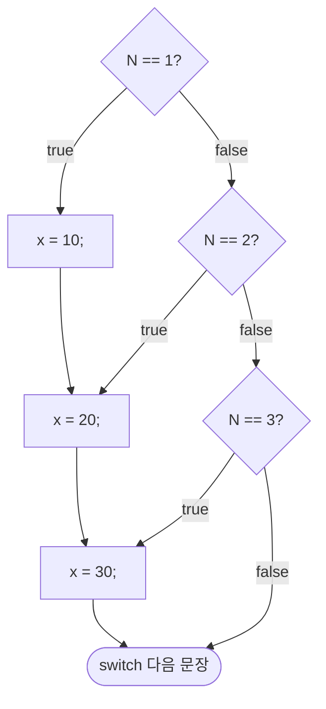
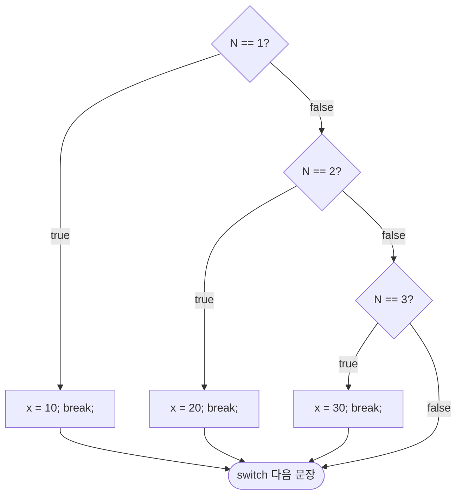
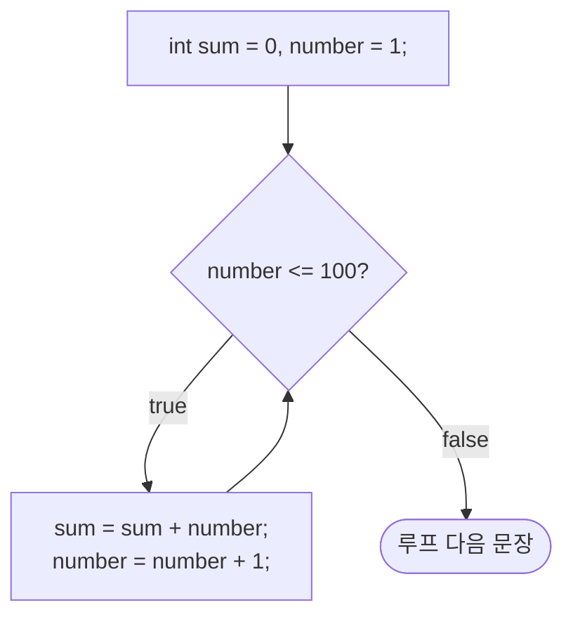
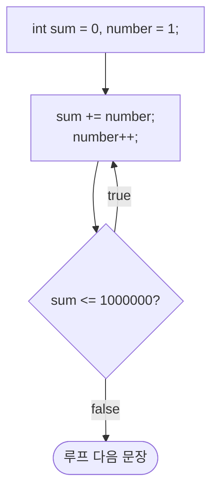
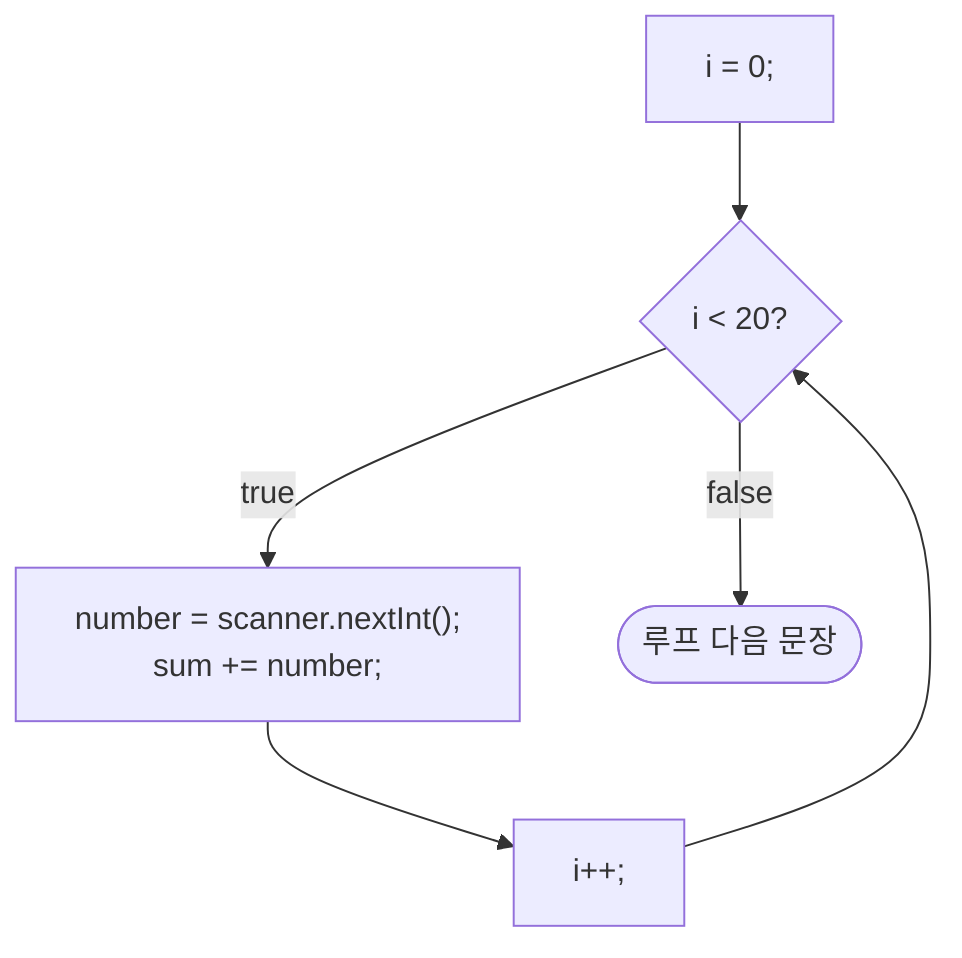

# 4강 — 제어 구조

[레포지토리 안내](../../README.ko.md) | [English](Concepts_Lecture.md) | [한국어](Concepts_Lecture.ko.md)

> **최종 수정일:** 2026-10-19

> **학습 목표:**
> 1. 조건문(if/else, switch)을 적용할 수 있다
> 2. 반복문(for, while, do-while)을 효과적으로 사용할 수 있다
> 3. 중첩 제어 구조와 break/continue를 구현할 수 있다
> 4. 무한 루프, off-by-one 오류, 오버플로 같은 반복문의 함정을 찾아 고칠 수 있다
> 5. Formatter와 System.out.format으로 출력 서식을 지정하고 실행 시간을 측정할 수 있다

---

## 목차

- [1. 조건 연산자](#1-조건-연산자)
  - [1.1 삼항 연산자](#11-삼항-연산자)
  - [1.2 관계 및 논리 연산자](#12-관계-및-논리-연산자)
- [2. 선택문](#2-선택문)
  - [2.1 if-else 문](#21-if-else-문)
  - [2.2 중첩 if-else](#22-중첩-if-else)
  - [2.3 switch 문](#23-switch-문)
- [3. 반복문](#3-반복문)
  - [3.1 while 루프](#31-while-루프)
  - [3.2 반복문의 함정](#32-반복문의-함정)
  - [3.3 do-while 루프](#33-do-while-루프)
  - [3.4 루프 중간에서 끝내기](#34-루프-중간에서-끝내기)
  - [3.5 for 루프](#35-for-루프)
  - [3.6 향상된 for 루프 (for-each)](#36-향상된-for-루프-for-each)
- [4. 루프 제어문](#4-루프-제어문)
- [5. 출력 서식 지정](#5-출력-서식-지정)
- [6. 실행 시간 측정](#6-실행-시간-측정)
- [7. JOptionPane을 활용한 GUI 입력](#7-joptionpane을-활용한-gui-입력)
- [요약](#요약)
- [점검 문제](#점검-문제)

---

<br>

## 1. 조건 연산자

### 1.1 삼항 연산자

삼항 연산자 `? :`는 단순한 조건 논리를 하나의 표현식으로 간결하게 표현하는 방법을 제공한다.

```java
// 구문: condition ? valueIfTrue : valueIfFalse
int diff = (a > b) ? (a - b) : (b - a);
```

전체 `if-else` 블록이 불필요하게 장황해질 수 있는 인라인 대입에 특히 유용하다. 예를 들어 다음 두 코드는 같은 일을 한다(실습 코드: [ConditionalOperatorDemo.java](../../Coursework/Lab04_Control-Structures/ConditionalOperatorDemo.java)).

```java
int x = 5;
int y = 3;
int s;
if (x > y)
    s = 1;
else
    s = -1;

s = (x > y) ? 1 : -1;       // 위의 if-else와 같다
```

> **핵심:** 삼항 연산자는 단순한 조건에만 사용해야 한다. 복잡한 논리는 가독성을 위해 `if-else`로 표현하는 것이 좋다.

### 1.2 관계 및 논리 연산자

| 연산자 | 설명 | 예시 |
|:-------|:-----|:-----|
| `==` | 같음 | `a == b` |
| `!=` | 같지 않음 | `a != b` |
| `>` | 보다 큼 | `a > b` |
| `<` | 보다 작음 | `a < b` |
| `>=` | 크거나 같음 | `a >= b` |
| `<=` | 작거나 같음 | `a <= b` |
| `&&` | 논리 AND (단축 평가) | `a > 0 && b > 0` |
| `\|\|` | 논리 OR (단축 평가) | `a > 0 \|\| b > 0` |
| `!` | 논리 NOT | `!flag` |

*표 1. 관계 연산자와 논리 연산자*

단축 평가(short-circuit evaluation)는 왼쪽 피연산자만으로 결과가 정해지면 오른쪽 피연산자를 계산하지 않는다는 뜻이다. `&&`는 왼쪽이 `false`이면, `||`는 왼쪽이 `true`이면 오른쪽을 계산하지 않는다.

---

<br>

## 2. 선택문

### 2.1 if-else 문

`if-else` 문은 부울 표현식을 평가하고 두 분기 중 하나를 실행한다.

```java
if (score >= 90) {
    grade = 'A';
} else if (score >= 80) {
    grade = 'B';
} else {
    grade = 'F';
}
```

### 2.2 중첩 if-else

`if` 문 안에 다른 `if` 문을 넣은 것을 중첩 `if`라 한다. 2.1절처럼 `else` 부분에 다시 `if`를 이어 쓰는 `else if` 사슬도 그 한 형태이며, `else if`를 사용하여 여러 조건을 연결할 수 있다. 그러나 깊은 중첩은 가독성을 저하시키므로, `switch`나 다형성 활용을 고려해야 한다.

```java
if (x > 0)
    if (y > 0)
        System.out.println("both positive");
    else
        System.out.println("x positive, y not positive");
```

중괄호가 없으면 `else`는 들여쓰기와 상관없이 짝이 없는 가장 가까운 `if`와 짝을 이룬다. 위 코드의 `else`는 안쪽 `if (y > 0)`의 것이므로, x가 0 이하이면 아무것도 출력하지 않는다. 의도를 분명히 하려면 중괄호를 쓴다.

### 2.3 switch 문

`switch` 문은 표현식을 평가하여 상수 case 레이블과 비교한다. 식의 타입으로는 `byte`, `short`, `char`, `int`와 그 래퍼 클래스, `String`, `enum`을 지원하며, `long`, `float`, `double`, `boolean`은 쓸 수 없다.

```text
switch ( <arithmetic expression> ) {
    <case label 1> : <case body 1>
    ...
    <case label n> : <case body n>
}
```

```java
int gradeLevel;
gradeLevel = Integer.parseInt(JOptionPane.showInputDialog("Grade (Frosh-1,Soph-2,...):"));

switch (gradeLevel) {
    case 1: System.out.print("Go to the Gymnasium");
            break;
    case 2: System.out.print("Go to the Science Auditorium");
            break;
    case 3: System.out.print("Go to Harris Hall Rm A3");
            break;
    case 4: System.out.print("Go to Bolt Hall Rm 101");
            break;
}
```

`gradeLevel`이 1이면 첫 번째 case의 문장이, 4이면 네 번째 case의 문장이 실행된다. `case 1:` 같은 부분을 case 레이블, 그 뒤의 문장들을 case 본문이라 한다.

**break가 없는 switch:** case 본문 끝에 `break`가 없으면, 일치한 case의 본문을 실행한 뒤 다음 case의 본문을 계속 실행한다. 이를 fall-through라 한다.

```java
switch (N) {
    case 1: x = 10;
    case 2: x = 20;
    case 3: x = 30;
}
```



*그림 1. break가 없는 switch의 제어 흐름*

N이 1, 2, 3 중 무엇이든 마지막에는 `x = 30;`까지 실행되므로 x는 30이 된다.

**break가 있는 switch:** 각 case 본문 끝에 `break`를 두면 그 case만 실행하고 `switch`를 빠져나간다.

```java
switch (N) {
    case 1: x = 10;
            break;
    case 2: x = 20;
            break;
    case 3: x = 30;
            break;
}
```



*그림 2. break가 있는 switch의 제어 흐름*

**default 블록:** 어느 case와도 일치하지 않으면 `default` 블록이 실행된다. 여러 case 레이블을 연달아 쓰면 그 값들이 같은 본문을 공유한다.

```java
switch (ranking) {
    case 10:
    case 9:
    case 8: System.out.print("Master");
            break;
    case 7:
    case 6: System.out.print("Journeyman");
            break;
    case 5:
    case 4: System.out.print("Apprentice");
            break;
    default: System.out.print("Input error: Invalid Data");
            break;
}
```

`ranking`이 8\~10이면 "Master", 6\~7이면 "Journeyman", 4\~5이면 "Apprentice"를 출력하고, 그 밖의 값이면 "Input error: Invalid Data"를 출력한다.

**case 레이블에 쓸 수 있는 것:** case 레이블은 컴파일할 때 값이 정해지는 상수 식이어야 한다. 정수 리터럴, 문자 리터럴, 문자열 리터럴(그리고 `final` 상수)은 쓸 수 있지만, 변수나 조건식은 쓸 수 없다.

```java
int b;
switch (b % 2) {
    case 1: ...; break;          // 정수 리터럴
    case 2: ...; break;
}

char c;
switch (c) {
    case '+': ...; break;        // 문자 리터럴
    case '-': ...; break;
}

String s = "yes";
switch (s) {
    case "yes": ...; break;      // 문자열 리터럴
    case "No": ...; break;
}

switch (a) {
    case a:       // 오류: a는 변수이다
    case a > 3:   // 오류: 조건식은 쓸 수 없다
    case a == 1:  // 오류
}
```

다음은 0\~100점 점수를 학점으로 바꾸는 예이다. `score / 10`은 정수 나눗셈이므로 90\~99점은 모두 9가 된다.

```java
switch (score / 10) {
    case 10:
    case 9:
        grade = 'A';
        break;
    case 8:
        grade = 'B';
        break;
    case 7:
        grade = 'C';
        break;
    default:
        grade = 'F';
}
```

> **핵심:** fall-through를 방지하기 위해 각 case에 `break` 문을 항상 포함해야 한다. 단, case 10과 9를 묶는 것처럼 의도적인 fall-through는 예외이다.

같은 방식으로 60점대에 D를 주는 `case 6`을 더한 실습 코드는 [SwitchGradingSystem.java](../../Coursework/Lab04_Control-Structures/SwitchGradingSystem.java)이다.

---

<br>

## 3. 반복문

### 3.1 while 루프

`while` 루프는 조건이 `true`인 동안 실행된다. 조건은 각 반복 **이전에** 검사된다. 형식은 `while ( <boolean expression> ) <statement>`이며, 반복되는 문장을 루프 본문(loop body)이라 한다.

```java
int sum = 0, number = 1;
while (number <= 100) {
    sum = sum + number;
    number = number + 1;
}
```



*그림 3. while 문의 제어 흐름*

위 루프는 number가 100 이하인 동안 반복하여 1부터 100까지의 합 5050을 구한다. 다음도 `while` 문의 예이다.

```java
// 1, 2, 3, ...을 차례로 더하다가 합이 1,000,000을 넘으면 멈춘다
int sum = 0, number = 1;
while (sum <= 1000000) {
    sum = sum + number;
    number = number + 1;
}

// 처음 20개 홀수의 곱을 구한다
int product = 1, number = 1,
    count = 20, lastNumber;
lastNumber = 2 * count - 1;
while (number <= lastNumber) {
    product = product * number;
    number = number + 2;
}
```

> **참고:** 두 번째 예의 의도는 1 × 3 × 5 × ... × 39를 구하는 것이지만, 이 값은 약 $3.2 \times 10^{23}$으로 `int`는 물론 `long`의 최댓값(약 $9.2 \times 10^{18}$)도 넘는다. 따라서 이 코드는 3.2절의 오버플로 때문에 올바른 값을 내지 못하며, 정확한 값이 필요하면 `BigInteger`를 써야 한다.

`sum = sum + number;`는 `sum += number;`로 줄여 쓸 수 있다. 3강 4.3절의 복합 대입 연산자 `+=`, `-=`, `*=`, `/=`, `%=`는 각각 `a = a + b`, `a = a - b`, `a = a * b`, `a = a / b`, `a = a % b`를 뜻한다.

`while` 문은 입력값 검사에 자주 쓴다. 루프에 들어가기 전에 먼저 한 번 입력받는 것을 priming read라 하며, 루프 안에서는 잘못된 값이 들어오는 동안 다시 입력받는다.

```java
while (age < 0 || age > 130) {
    // 유효한 입력 요청
    age = Integer.parseInt(inputStr);
}
```

위 코드를 완성하면 다음과 같다(실습 코드: [WhileLoopValidation.java](../../Coursework/Lab04_Control-Structures/WhileLoopValidation.java)).

```java
String inputStr;
int age;

inputStr = JOptionPane.showInputDialog(null, "Your Age (between 0 and 130):");   // priming read
age = Integer.parseInt(inputStr);

while (age < 0 || age > 130) {
    JOptionPane.showMessageDialog(null, "An invalid age was entered. Please try again.");

    inputStr = JOptionPane.showInputDialog(null, "Your Age (between 0 and 130):");
    age = Integer.parseInt(inputStr);
}
```

### 3.2 반복문의 함정

반복문을 작성할 때는 다음을 주의한다.

1. 반복 횟수가 하나 많거나 적은 off-by-one 오류(OBOE)를 조심한다.
2. 루프 본문에 결국 루프를 끝나게 하는 문장이 있어야 한다.
3. 루프가 정확히 필요한 횟수만큼 반복되는지 확인한다.
4. 루프 본문을 N번 실행하려면 카운터를 0으로 초기화하고 조건을 `counter < N`으로 쓰거나, 1로 초기화하고 `counter <= N`으로 쓴다.

**무한 루프:** 다음 두 루프는 부울 식이 결코 `false`가 되지 않으므로 끝나지 않는다.

```java
int product = 0;
while (product < 500000) {
    product = product * 5;     // 0에 5를 곱해도 계속 0이다
}

int count = 1;
while (count != 10) {
    count = count + 2;         // count는 홀수만 거치므로 10이 되지 않는다
}
```

**오버플로:** 무한 루프는 흔히 오버플로를 일으킨다. 오버플로(overflow)는 변수가 담을 수 있는 최댓값보다 큰 값을 대입하려 할 때 일어난다. Java에서 오버플로는 프로그램을 종료시키지 않는다. `float`과 `double`에는 무한대를 나타내는 값(`Infinity`)이 대입되고, `int`는 값이 한 바퀴 돌아 음수가 된다(예: `Integer.MAX_VALUE + 1`은 -2147483648). 각 수치 자료형의 범위는 3강 2.1절의 표와 같다.

**off-by-one 오류:** 루프 본문을 10번 실행하는 것이 목표일 때, 다음 네 루프 중 1과 3은 off-by-one 오류가 있다.

```java
count = 1;                     // 1: 9번 실행
while (count < 10) {
    . . .
    count++;
}

count = 1;                     // 2: 10번 실행
while (count <= 10) {
    . . .
    count++;
}

count = 0;                     // 3: 11번 실행
while (count <= 10) {
    . . .
    count++;
}

count = 0;                     // 4: 10번 실행
while (count < 10) {
    . . .
    count++;
}
```

### 3.3 do-while 루프

`do-while` 루프는 최소 한 번의 실행을 보장하며, 조건은 각 반복 **이후에** 검사된다. 형식은 `do <statement> while ( <boolean expression> ) ;`이며 끝에 세미콜론이 붙는다.

```java
do {
    input = scanner.nextInt();
} while (input < 0);
```

```java
int sum = 0, number = 1;
do {
    sum += number;
    number++;
} while (sum <= 1000000);
```



*그림 4. do-while 문의 제어 흐름*

위 루프는 sum이 1,000,000 이하인 동안 본문을 반복하며, 본문을 먼저 실행한 뒤 조건을 검사한다.

### 3.4 루프 중간에서 끝내기

루프 본문의 중간에서 종료 조건을 검사하는 방식을 loop-and-a-half 반복 제어라 한다. 예약어 `while`, `if`, `break`로 구현한다.

```java
String name;
while (true) {
    name = JOptionPane.showInputDialog(null, "Your name");
    if (name.length() > 0) break;
    JOptionPane.showMessageDialog(null, "Invalid Entry." +
            "You must enter at least one character.");
}
```

이름을 입력받아 한 글자 이상이면 `break`로 루프를 빠져나가고, 빈 문자열이면 오류 메시지를 보여 준 뒤 다시 입력받는다. 이 방식에는 두 가지 주의점이 있다.
- **무한 루프의 위험:** `while`의 부울 식이 항상 `true`이므로, 루프를 빠져나가는 `if` 문을 빠뜨리면 무한 루프가 된다.
- **여러 출구:** `break`가 여럿인 루프도 올바르게 작성할 수는 있지만 복잡해진다. 입구 하나, 출구 하나(one-entry one-exit)의 제어 흐름을 지키는 것이 좋다.

반복을 계속할지 사용자에게 묻는 확인 대화 상자를 쓰는 방법은 7절에서 다룬다.

### 3.5 for 루프

`for` 루프는 초기화, 조건, 갱신을 하나의 헤더에 결합한다. 형식은 `for ( <initialization>; <boolean expression>; <increment> ) <statement>`이다.

```java
for (int i = 0; i < 10; i++) {
    System.out.println("Iteration: " + i);
}
```

```java
int i, sum = 0, number;
for (i = 0; i < 20; i++) {
    number = scanner.nextInt();
    sum += number;
}
```



*그림 5. for 문의 제어 흐름*

위 루프는 i = 0, 1, 2, ..., 19에 대해 20번 실행되어 정수 20개를 입력받아 더한다. 초기화는 처음 한 번만 실행되고, 조건 검사, 본문, 갱신이 차례로 반복된다. 다음도 `for` 루프의 예이다.

```java
for (int i = 0; i < 100; i += 5)     // i = 0, 5, 10, ..., 95
for (int j = 2; j < 40; j *= 2)      // j = 2, 4, 8, 16, 32
for (int k = 100; k > 0; k--)        // k = 100, 99, 98, 97, ..., 1
```

**중첩 for 문:** `for` 문 안에 다른 `for` 문을 넣는 것은 흔히 쓰는 기법이다. 다음은 폭(width) 11~20과 길이(length) 5, 10, ..., 25의 모든 조합에 대해 제곱피트당 19달러인 가격표를 만든다. 바깥 루프가 한 행을, 안쪽 루프가 그 행의 각 칸을 담당한다.

```java
int price;
for (int width = 11; width <= 20; width++) {
    for (int length = 5; length <= 25; length += 5) {
        price = width * length * 19; //$19 per sq. ft.
        System.out.print(" " + price);
    }
    //finished one row; move on to next row
    System.out.println("");
}
```

```text
 1045 2090 3135 4180 5225
 1140 2280 3420 4560 5700
 1235 2470 3705 4940 6175
 1330 2660 3990 5320 6650
 1425 2850 4275 5700 7125
 1520 3040 4560 6080 7600
 1615 3230 4845 6460 8075
 1710 3420 5130 6840 8550
 1805 3610 5415 7220 9025
 1900 3800 5700 7600 9500
```

### 3.6 향상된 for 루프 (for-each)

Java는 배열과 `Iterable` 컬렉션을 순회하기 위한 향상된 `for` 루프를 제공한다.

```java
int[] numbers = {1, 2, 3, 4, 5};
for (int n : numbers) {
    System.out.println(n);
}
```

---

<br>

## 4. 루프 제어문

| 제어문 | 설명 |
|:-------|:-----|
| `break` | 가장 안쪽의 루프 또는 switch를 즉시 종료 |
| `continue` | 현재 반복의 나머지를 건너뛰고 다음 반복으로 진행 |
| `return` | 현재 메서드를 완전히 종료 |

*표 2. 루프 제어문*

```java
for (int i = 0; i < 10; i++) {
    if (i == 5) break;      // i == 5일 때 루프 종료
    if (i % 2 == 0) continue; // 짝수를 건너뜀
    System.out.println(i);   // 1, 3 출력
}
```

---

<br>

## 5. 출력 서식 지정

출력값 하나가 차지하는 공간을 필드(field), 필드에 할당한 문자 수를 필드 폭(field width)이라 한다. 다음은 필드 폭 6으로 정수를 출력한 모습이다. 값이 세 자리이면 앞에 공백 세 칸, 네 자리이면 공백 두 칸을 채워 오른쪽으로 맞춘다.

```text
     3    34  5684    98   231
   445   339   234   453  3444
```

Java 5.0부터는 `java.util.Formatter` 클래스로 출력 서식을 지정할 수 있다. 먼저 출력 대상을 정해 인스턴스를 만들고, `format` 메서드를 호출한다.

```java
Formatter formatter = new Formatter(System.out);
int num = 467;
formatter.format("%6d", num);   // "   467": 필드 폭 6
```

`format` 메서드의 일반 형식은 `format(<control string>, <expr1>, <expr2>, . . . )`이다. 제어 문자열 안의 서식 지정자가 뒤의 식들과 차례로 짝을 이룬다.

```java
int num1 = 34, num2 = 9;
int num3 = num1 + num2;
formatter.format("%3d + %3d = %5d", num1, num2, num3);   // " 34 +   9 =    43"
```

`System.out`(`PrintStream`)에도 `format` 메서드가 있으므로 `Formatter`를 직접 만들지 않아도 같은 결과를 얻는다. `new Formatter(System.out).format("%6d", 498);`은 `System.out.format("%6d", 498);`과 같다.

| 서식 지정자 | 대상 | 예 |
|:-----|:-----|:-----|
| `%<field width>d` | 정수 | `%6d` |
| `%<field width>.<decimal places>f` | 실수 | `%8.2f`는 3.14159를 `    3.14`로 출력 |
| `%s` | 문자열 | `%s` |

*표 3. 제어 문자열의 주요 서식 지정자*

다른 자료형과 서식 옵션은 Java API 문서의 `Formatter` 클래스를 참고한다.

---

<br>

## 6. 실행 시간 측정

두 큰 수의 최대공약수를 구하는 루프나 1부터 1억 사이의 모든 소수를 출력하는 루프처럼, 코드 조각을 실행하는 데 걸린 시간을 알고 싶을 때가 많다. Java는 경과 시간을 측정하는 여러 방법을 제공한다.

```java
// Date 클래스 사용
Date startTime = new Date();
// ... 측정할 코드 ...
Date endTime = new Date();
long elapsedMs = endTime.getTime() - startTime.getTime();

// System.currentTimeMillis() 사용 (권장)
long start = System.currentTimeMillis();
// ... 측정할 코드 ...
long end = System.currentTimeMillis();
System.out.println("Elapsed: " + (end - start) + " ms");

// System.nanoTime() 사용 (최고 정밀도)
long startNano = System.nanoTime();
// ... 측정할 코드 ...
long endNano = System.nanoTime();
double seconds = (endNano - startNano) / 1_000_000_000.0;
```

`Date`의 `getTime()`은 1970-01-01 00:00:00 UTC부터 지난 시간을 밀리초로 반환하므로, 두 시점의 차가 경과 시간이다. 다음은 삼중 `for` 루프의 실행 시간을 `Date`로 측정하는 예이다(실습 코드: [ExecutionTimeMeasurement.java](../../Coursework/Lab04_Control-Structures/ExecutionTimeMeasurement.java)).

```java
import java.util.Date;

public class Chap4Program4 {

    public static void main(String[] args) {

        Date startTime = new Date();

        for (int i = 0; i <= 1000; i++) {
            for (int j = 0; j <= 1000; j++) {
                for (int k = 0; k <= 1000; k++) {

                }
            }
        }

        Date endTime = new Date();

        long elapsedTimeInMilliSec =
                endTime.getTime() - startTime.getTime();

        System.out.println("ElapsedTime: " + elapsedTimeInMilliSec + " ms");
    }
}
```

안쪽 루프의 반복 횟수는 $1001^3 \approx 10^9$이다. 상한을 i는 100000, j와 k는 10000으로 키우면 반복 횟수가 약 $10^{13}$이 되어 실행이 매우 오래 걸린다.

> **핵심:** 성능 벤치마킹에는 `System.nanoTime()`을 사용하는 것이 좋다. 시스템 시계 조정의 영향을 받지 않기 때문이다.

> **주의:** JIT 컴파일러는 본문이 빈 루프처럼 결과에 영향을 주지 않는 코드를 최적화하여 없앨 수 있다. 이런 코드로 잰 시간은 실제 작업량을 반영하지 않을 수 있다.

---

<br>

## 7. JOptionPane을 활용한 GUI 입력

`javax.swing.JOptionPane` 클래스는 사용자 상호작용을 위한 간단한 대화 상자를 제공한다.

```java
// 입력 대화 상자
String input = JOptionPane.showInputDialog(null, "Enter your age:");

// 메시지 대화 상자
JOptionPane.showMessageDialog(null, "Hello, World!");

// 확인 대화 상자
int choice = JOptionPane.showConfirmDialog(null, "Continue?");
```

> **핵심:** `JOptionPane.showInputDialog()`는 사용자가 취소를 클릭하면 `null`을 반환한다. 처리 전에 항상 `null` 여부를 확인해야 한다.

확인 대화 상자는 반복을 계속할지 사용자에게 물을 때 쓸 수 있다. 다음 호출은 질문, 대화 상자 제목, 버튼 구성을 차례로 지정한다.

```java
JOptionPane.showConfirmDialog(null,
        /*prompt*/ "Play Another Game?",
        /*dialog title*/ "Confirmation",
        /*button options*/ JOptionPane.YES_NO_OPTION);
```

`showConfirmDialog`는 사용자가 누른 버튼을 `int`로 반환하며, 예(Yes)를 누르면 `JOptionPane.YES_OPTION`이다. 다음 루프는 사용자가 예를 누르는 동안 게임을 반복한다.

```java
boolean keepPlaying = true;
int selection;

while (keepPlaying) {
    //code to play one game comes here
    // . . .

    selection = JOptionPane.showConfirmDialog(null,
            "Play Another Game?",
            "Confirmation",
            JOptionPane.YES_NO_OPTION);

    keepPlaying = (selection == JOptionPane.YES_OPTION);
}
```

---

<br>

## 요약

| 개념 | 핵심 요약 |
|:-----|:-----------|
| 삼항 연산자 | `condition ? a : b`는 간결한 조건식이다. |
| if-else | 표준 분기문이며, 깊은 중첩은 피하고 `else`는 가장 가까운 `if`와 짝을 이룬다. |
| switch | 상수 case 레이블에 대한 다중 분기이며, fall-through를 막으려면 `break`가 필요하다. |
| while | 사전 조건 루프이며, 0번 실행될 수 있다. |
| 반복문의 함정 | 무한 루프, off-by-one 오류, 오버플로를 조심하고, N번 반복은 0부터 `< N` 또는 1부터 `<= N`으로 쓴다. |
| do-while | 사후 조건 루프이며, 최소 1번 실행을 보장한다. |
| loop-and-a-half | `while (true)`와 `if`, `break`로 루프 본문 중간에서 종료 조건을 검사한다. |
| for | 초기화, 조건, 갱신을 포함한 카운터 기반 반복이다. |
| for-each | 배열과 컬렉션을 간편하게 순회한다. |
| break / continue | `break`는 루프를 종료하고, `continue`는 남은 본문을 건너뛰고 다음 반복으로 간다. |
| 출력 서식 | `Formatter`나 `System.out.format`의 `%6d`, `%8.2f`, `%s` 같은 서식 지정자로 필드 폭을 맞춘다. |
| 실행 시간 측정 | 측정 전후 시각의 차로 경과 시간을 구하며, 벤치마킹에는 `System.nanoTime()`이 좋다. |
| JOptionPane | 입력, 메시지, 확인을 위한 간편한 GUI 대화 상자를 제공한다. |

---

<br>

## 점검 문제

1. **fall-through:** 그림 1의 `break`가 없는 `switch`에서 N이 2이면 x는 얼마인가? 그림 2처럼 `break`를 넣으면 어떻게 되는가?

   <details>
   <summary>정답</summary>

   `break`가 없으면 `case 2`의 `x = 20;`을 실행한 뒤 `case 3`의 `x = 30;`까지 이어서 실행하므로 x는 30이다. `break`를 넣으면 `x = 20;` 다음의 `break`에서 `switch`를 빠져나가므로 x는 20이다.

   </details>

2. **반복 횟수:** 다음 루프의 본문은 각각 몇 번 실행되는가? (a) `for (int c = 1; c < 10; c++)` (b) `for (int c = 1; c <= 10; c++)` (c) `for (int c = 0; c <= 10; c++)` (d) `for (int c = 0; c < 10; c++)`

   <details>
   <summary>정답</summary>

   (a) 1\~9이므로 9번, (b) 1\~10이므로 10번, (c) 0\~10이므로 11번, (d) 0\~9이므로 10번이다. 10번 반복이 목표라면 (a)와 (c)는 off-by-one 오류이다.

   </details>

3. **for 루프 추적:** `for (int j = 2; j < 40; j *= 2)`의 본문이 실행될 때 j의 값을 모두 쓰고, `for (int i = 0; i < 100; i += 5)`의 본문은 몇 번 실행되는지 쓰라.

   <details>
   <summary>정답</summary>

   j는 2, 4, 8, 16, 32이다. 다음 값 64는 40보다 크므로 루프가 끝난다. 두 번째 루프는 i = 0, 5, ..., 95에서 실행되므로 100 / 5 = 20번 실행된다.

   </details>

4. **무한 루프:** `int count = 1; while (count != 10) { count = count + 2; }`가 끝나지 않는 이유를 설명하고, 루프가 끝나도록 조건을 고치라.

   <details>
   <summary>정답</summary>

   count는 1, 3, 5, ...처럼 홀수만 거치므로 짝수 10과 같아지지 않는다. `int`가 오버플로되어 음수로 돌아가도 값은 계속 홀수이므로 조건 `count != 10`은 항상 참이다. 조건을 `count < 10`으로 바꾸면 count가 11이 될 때 루프가 끝난다.

   </details>

5. **출력 서식:** `System.out.format("%3d + %3d = %5d", 34, 9, 43);`의 출력을 공백까지 정확히 쓰라.

   <details>
   <summary>정답</summary>

   `" 34 +   9 =    43"`이다. 34는 폭 3에 맞춰 앞에 공백 한 칸, 9는 공백 두 칸, 43은 폭 5에 맞춰 공백 세 칸이 붙는다.

   </details>
