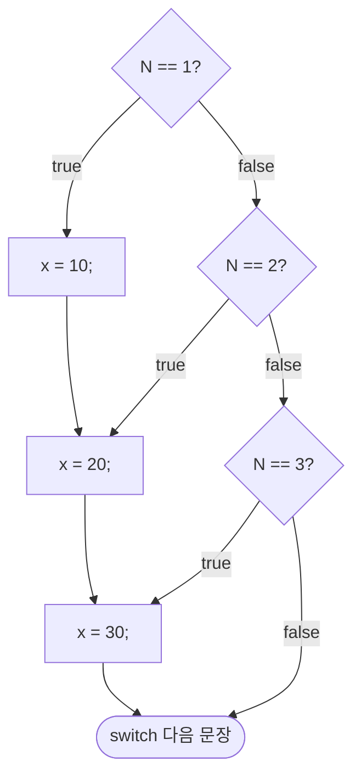
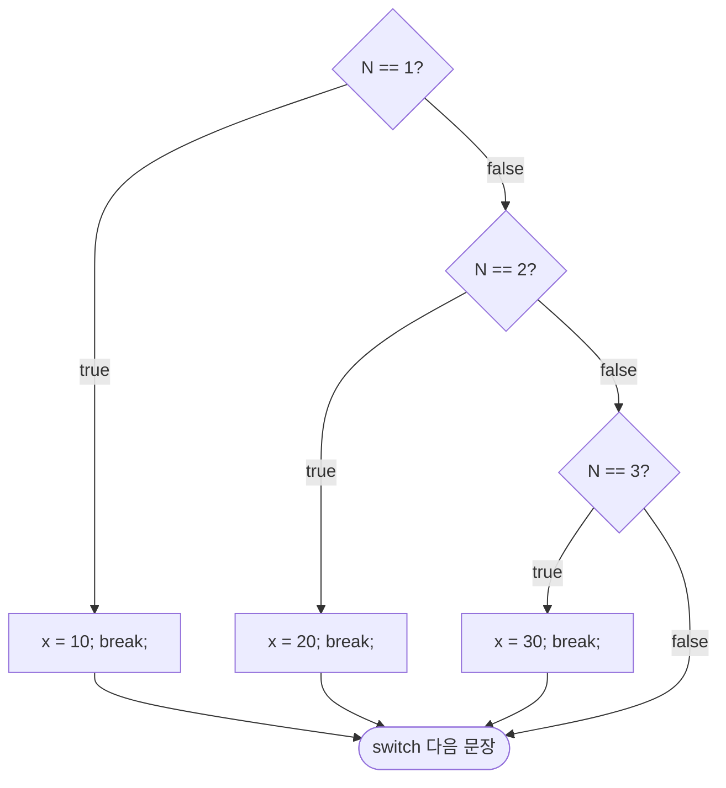
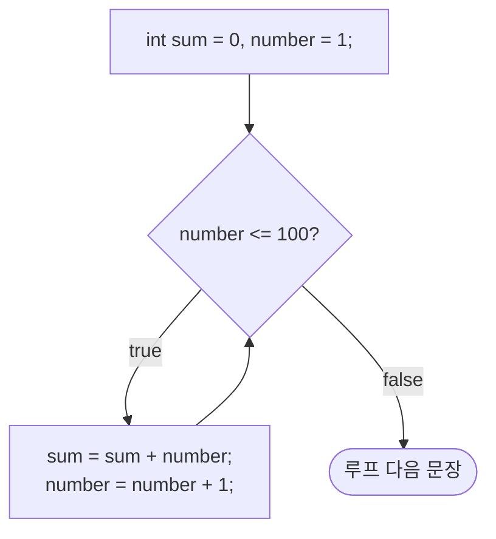
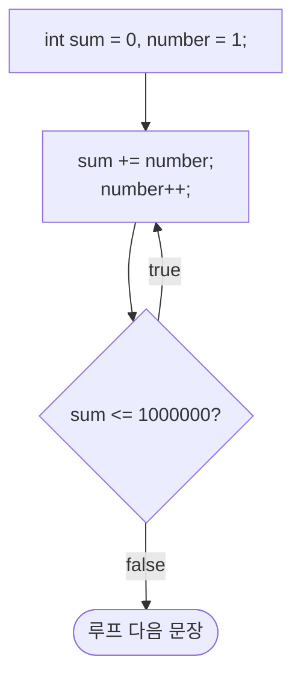
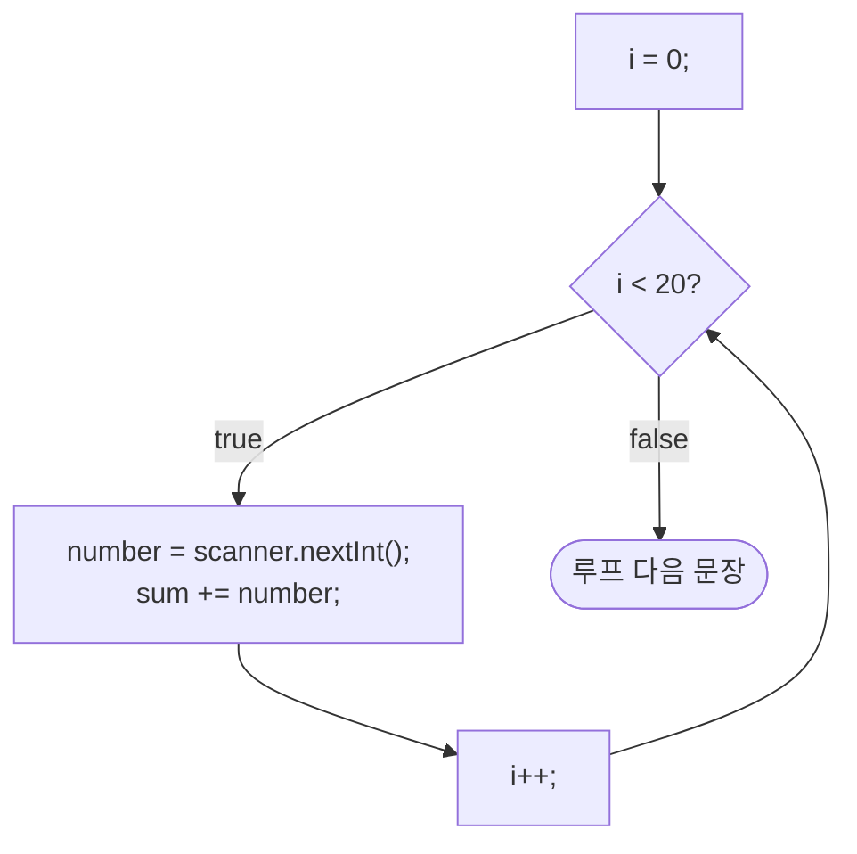

# 4강 — 제어 구조

[레포지토리 안내](../../README.ko.md) | [English](Concepts_Lecture.md) | [한국어](Concepts_Lecture.ko.md)

> **최종 수정일:** 2026-11-19

> **학습 목표:**
> 1. 조건문(if/else, switch)을 적용할 수 있다
> 2. 반복문(for, while, do-while)을 효과적으로 사용할 수 있다
> 3. 중첩 제어 구조와 break/continue를 구현할 수 있다
> 4. 무한 루프, off-by-one 오류, 오버플로 같은 반복문의 함정을 찾아 고칠 수 있다
> 5. Formatter와 System.out.format으로 출력 서식을 지정하고 실행 시간을 측정할 수 있다
> 6. 추적표로 반복문의 실행을 따라가고, 중첩 루프의 실행 횟수와 레이블이 있는 break의 동작을 설명할 수 있다

---

## 목차

- [1. 조건 연산자](#1-조건-연산자)
  - [1.1 삼항 연산자](#11-삼항-연산자)
  - [1.2 관계 및 논리 연산자](#12-관계-및-논리-연산자)
  - [1.3 부울 식의 작성과 드모르간 법칙](#13-부울-식의-작성과-드모르간-법칙)
- [2. 선택문](#2-선택문)
  - [2.1 if-else 문](#21-if-else-문)
  - [2.2 중첩 if-else](#22-중첩-if-else)
  - [2.3 switch 문](#23-switch-문)
  - [2.4 if 문의 흔한 실수](#24-if-문의-흔한-실수)
- [3. 반복문](#3-반복문)
  - [3.1 while 루프](#31-while-루프)
  - [3.2 반복문의 함정](#32-반복문의-함정)
  - [3.3 do-while 루프](#33-do-while-루프)
  - [3.4 루프 중간에서 끝내기](#34-루프-중간에서-끝내기)
  - [3.5 for 루프](#35-for-루프)
  - [3.6 향상된 for 루프 (for-each)](#36-향상된-for-루프-for-each)
  - [3.7 추적표와 루프 불변식](#37-추적표와-루프-불변식)
  - [3.8 반복문의 선택과 상호 변환](#38-반복문의-선택과-상호-변환)
  - [3.9 중첩 루프의 실행 횟수](#39-중첩-루프의-실행-횟수)
  - [3.10 반복문으로 구현하는 알고리즘: 유클리드 호제법](#310-반복문으로-구현하는-알고리즘-유클리드-호제법)
- [4. 루프 제어문](#4-루프-제어문)
  - [4.1 레이블이 있는 break와 continue](#41-레이블이-있는-break와-continue)
- [5. 출력 서식 지정](#5-출력-서식-지정)
  - [5.1 서식 지정자의 플래그와 변환 문자](#51-서식-지정자의-플래그와-변환-문자)
- [6. 실행 시간 측정](#6-실행-시간-측정)
  - [6.1 측정값을 해석할 때의 주의](#61-측정값을-해석할-때의-주의)
- [7. JOptionPane을 활용한 GUI 입력](#7-joptionpane을-활용한-gui-입력)
- [8. 흔한 실수](#8-흔한-실수)
- [개념 적용](#개념-적용)
- [요약](#요약)
- [점검 문제](#점검-문제)
- [참고 문헌](#참고-문헌)

---

<br>

## 1. 조건 연산자

### 1.1 삼항 연산자

삼항 연산자 `? :`는 단순한 조건 논리를 하나의 표현식으로 간결하게 표현하는 방법을 제공한다.

```java
// 구문: condition ? valueIfTrue : valueIfFalse
int diff = (a > b) ? (a - b) : (b - a);
```

전체 `if-else` 블록이 불필요하게 장황해질 수 있는 인라인 대입에 특히 유용하다. 예를 들어 다음 두 코드는 같은 일을 한다(실습 코드: [ConditionalOperatorDemo.java](../../Coursework/Lab04_Control-Structures/ConditionalOperatorDemo.java)).

```java
int x = 5;
int y = 3;
int s;
if (x > y)
    s = 1;
else
    s = -1;

s = (x > y) ? 1 : -1;       // 위의 if-else와 같다
```

> **핵심:** 삼항 연산자는 단순한 조건에만 사용해야 한다. 복잡한 논리는 가독성을 위해 `if-else`로 표현하는 것이 좋다.

### 1.2 관계 및 논리 연산자

| 연산자 | 설명 | 예시 |
|:-------|:-----|:-----|
| `==` | 같음 | `a == b` |
| `!=` | 같지 않음 | `a != b` |
| `>` | 보다 큼 | `a > b` |
| `<` | 보다 작음 | `a < b` |
| `>=` | 크거나 같음 | `a >= b` |
| `<=` | 작거나 같음 | `a <= b` |
| `&&` | 논리 AND (단축 평가) | `a > 0 && b > 0` |
| `\|\|` | 논리 OR (단축 평가) | `a > 0 \|\| b > 0` |
| `!` | 논리 NOT | `!flag` |

*표 1. 관계 연산자와 논리 연산자*

단축 평가(short-circuit evaluation)는 왼쪽 피연산자만으로 결과가 정해지면 오른쪽 피연산자를 계산하지 않는다는 뜻이다. `&&`는 왼쪽이 `false`이면, `||`는 왼쪽이 `true`이면 오른쪽을 계산하지 않는다.

### 1.3 부울 식의 작성과 드모르간 법칙

조건문과 반복문의 조건은 `boolean` 값을 내는 **부울 식**(boolean expression)이다. 수학에서 쓰는 $`0 \le x \le 100`$을 Java로 그대로 쓰면 컴파일되지 않는다. `0 <= x`가 먼저 `boolean`이 되고, 그 `boolean`을 다시 `100`과 비교하려 하기 때문이다.

```text
RangeErr.java:4: error: bad operand types for binary operator '<='
        System.out.println(0 <= x <= 100);
                                  ^
  first type:  boolean
  second type: int
1 error
```

범위 검사는 두 비교를 `&&`로 잇는 `0 <= x && x <= 100`으로 쓴다. 반대로 범위 밖인지 검사하는 조건은 **드모르간 법칙**(De Morgan's laws)으로 만들 수 있다.

```math
\lnot (A \land B) = \lnot A \lor \lnot B, \qquad \lnot (A \lor B) = \lnot A \land \lnot B
```

Java로 쓰면 `!(a && b)`는 `!a || !b`와 같고, `!(a || b)`는 `!a && !b`와 같다. 3.1절의 입력 검사 조건 `age < 0 || age > 130`은 "나이가 0 이상 130 이하이다", 즉 `age >= 0 && age <= 130`을 부정한 것이다. 부정하면서 `&&`가 `||`로 바뀌고 각 비교가 반대 방향(`>=`는 `<`, `<=`는 `>`)으로 바뀐다. 이 변환을 잘못하여 `age < 0 && age > 130`으로 쓰면 어떤 값도 동시에 만족할 수 없으므로 잘못된 입력을 하나도 걸러 내지 못한다.

> **주의:** 부울 변수를 `if (flag == true)`처럼 비교할 필요는 없다. `if (flag)`와 `if (!flag)`로 쓰는 편이 짧고, 2.4절의 `=` 오타에서 생기는 오류도 피할 수 있다.

---

<br>

## 2. 선택문

### 2.1 if-else 문

`if-else` 문은 부울 표현식을 평가하고 두 분기 중 하나를 실행한다.

```java
if (score >= 90) {
    grade = 'A';
} else if (score >= 80) {
    grade = 'B';
} else {
    grade = 'F';
}
```

### 2.2 중첩 if-else

`if` 문 안에 다른 `if` 문을 넣은 것을 중첩 `if`라 한다. 2.1절처럼 `else` 부분에 다시 `if`를 이어 쓰는 `else if` 사슬도 그 한 형태이며, `else if`를 사용하여 여러 조건을 연결할 수 있다. 그러나 깊은 중첩은 가독성을 저하시키므로, `switch`나 다형성 활용을 고려해야 한다.

```java
if (x > 0)
    if (y > 0)
        System.out.println("both positive");
    else
        System.out.println("x positive, y not positive");
```

중괄호가 없으면 `else`는 들여쓰기와 상관없이 짝이 없는 가장 가까운 `if`와 짝을 이룬다. 위 코드의 `else`는 안쪽 `if (y > 0)`의 것이므로, x가 0 이하이면 아무것도 출력하지 않는다. 의도를 분명히 하려면 중괄호를 쓴다.

### 2.3 switch 문

`switch` 문은 표현식을 평가하여 상수 case 레이블과 비교한다. 식의 타입으로는 `byte`, `short`, `char`, `int`와 그 래퍼 클래스, `String`, `enum`을 지원하며, `long`, `float`, `double`, `boolean`은 쓸 수 없다.

```text
switch ( <arithmetic expression> ) {
    <case label 1> : <case body 1>
    ...
    <case label n> : <case body n>
}
```

```java
int gradeLevel;
gradeLevel = Integer.parseInt(JOptionPane.showInputDialog("Grade (Frosh-1,Soph-2,...):"));

switch (gradeLevel) {
    case 1: System.out.print("Go to the Gymnasium");
            break;
    case 2: System.out.print("Go to the Science Auditorium");
            break;
    case 3: System.out.print("Go to Harris Hall Rm A3");
            break;
    case 4: System.out.print("Go to Bolt Hall Rm 101");
            break;
}
```

`gradeLevel`이 1이면 첫 번째 case의 문장이, 4이면 네 번째 case의 문장이 실행된다. `case 1:` 같은 부분을 case 레이블, 그 뒤의 문장들을 case 본문이라 한다.

**break가 없는 switch:** case 본문 끝에 `break`가 없으면, 일치한 case의 본문을 실행한 뒤 다음 case의 본문을 계속 실행한다. 이를 fall-through라 한다.

```java
switch (N) {
    case 1: x = 10;
    case 2: x = 20;
    case 3: x = 30;
}
```



*그림 1. break가 없는 switch의 제어 흐름*

N이 1, 2, 3 중 무엇이든 마지막에는 `x = 30;`까지 실행되므로 x는 30이 된다.

**break가 있는 switch:** 각 case 본문 끝에 `break`를 두면 그 case만 실행하고 `switch`를 빠져나간다.

```java
switch (N) {
    case 1: x = 10;
            break;
    case 2: x = 20;
            break;
    case 3: x = 30;
            break;
}
```



*그림 2. break가 있는 switch의 제어 흐름*

**default 블록:** 어느 case와도 일치하지 않으면 `default` 블록이 실행된다. 여러 case 레이블을 연달아 쓰면 그 값들이 같은 본문을 공유한다.

```java
switch (ranking) {
    case 10:
    case 9:
    case 8: System.out.print("Master");
            break;
    case 7:
    case 6: System.out.print("Journeyman");
            break;
    case 5:
    case 4: System.out.print("Apprentice");
            break;
    default: System.out.print("Input error: Invalid Data");
            break;
}
```

`ranking`이 8\~10이면 `Master`, 6\~7이면 `Journeyman`, 4\~5이면 `Apprentice`를 출력하고, 그 밖의 값이면 `Input error: Invalid Data`를 출력한다.

**case 레이블에 쓸 수 있는 것:** case 레이블은 컴파일할 때 값이 정해지는 상수 식이어야 한다. 정수 리터럴, 문자 리터럴, 문자열 리터럴(그리고 `final` 상수)은 쓸 수 있지만, 변수나 조건식은 쓸 수 없다.

```java
int b;
switch (b % 2) {
    case 1: ...; break;          // 정수 리터럴
    case 2: ...; break;
}

char c;
switch (c) {
    case '+': ...; break;        // 문자 리터럴
    case '-': ...; break;
}

String s = "yes";
switch (s) {
    case "yes": ...; break;      // 문자열 리터럴
    case "No": ...; break;
}

switch (a) {
    case a:       // 오류: a는 변수이다
    case a > 3:   // 오류: 조건식은 쓸 수 없다
    case a == 1:  // 오류
}
```

다음은 0\~100점 점수를 학점으로 바꾸는 예이다. `score / 10`은 정수 나눗셈이므로 90\~99점은 모두 9가 된다.

```java
switch (score / 10) {
    case 10:
    case 9:
        grade = 'A';
        break;
    case 8:
        grade = 'B';
        break;
    case 7:
        grade = 'C';
        break;
    default:
        grade = 'F';
}
```

> **핵심:** fall-through를 방지하기 위해 각 case에 `break` 문을 항상 포함해야 한다. 단, case 10과 9를 묶는 것처럼 의도적인 fall-through는 예외이다.

같은 방식으로 60점대에 D를 주는 `case 6`을 더한 실습 코드는 [SwitchGradingSystem.java](../../Coursework/Lab04_Control-Structures/SwitchGradingSystem.java)이다.

> **참고:** **화살표 레이블과 switch 식.** Java 14부터는 `case 1, 2 ->`처럼 화살표 레이블을 쓰는 `switch`가 정식 기능이다 [1]. 화살표 레이블은 일치한 case의 오른쪽만 실행하고 다음 case로 넘어가지 않으므로 `break`가 필요 없고, 쉼표로 여러 값을 한 레이블에 묶을 수 있다. 또 `switch`를 값을 내는 식으로 쓸 수 있어 `char grade = switch (score / 10) { case 10, 9 -> 'A'; case 8 -> 'B'; case 7 -> 'C'; case 6 -> 'D'; default -> 'F'; };`처럼 위의 학점 예를 대입문 하나로 쓸 수 있으며, 95, 83, 61, 40에 대해 차례로 `A`, `B`, `D`, `F`를 낸다. 오른쪽에 여러 문장이 필요하면 블록 `{ ... }` 안에서 `yield 값;`으로 결과를 정한다. `switch` 식은 모든 가능한 값에 대응하는 레이블이 있어야 하므로 보통 `default`가 필요하다 [2].

### 2.4 if 문의 흔한 실수

`if` 문은 문법이 단순하지만, 컴파일러가 잡아 주지 않는 실수가 몇 가지 있다. 다음 프로그램은 세 가지 실수를 한꺼번에 보여 준다.

```java
public class IfPitfall {
    public static void main(String[] args) {
        int x = -5;
        if (x > 0);
        {
            System.out.println("positive?");
        }
        boolean done = false;
        if (done = true) {
            System.out.println("assignment, not comparison");
        }
        int score = 95;
        String g;
        if (score >= 60) g = "D";
        else if (score >= 90) g = "A";
        else g = "F";
        System.out.println(g);
    }
}
```

```text
positive?
assignment, not comparison
D
```

- **조건 뒤의 세미콜론:** `if (x > 0);`의 `;`는 아무 일도 하지 않는 빈 문장이며, 그것이 `if`의 본문이 된다. 그 뒤의 블록 `{ ... }`은 `if`와 상관없는 독립된 블록이므로 x가 -5인데도 항상 실행된다.
- **`==` 대신 `=`:** `done = true`는 비교가 아니라 대입이며, 대입식의 값 `true`가 조건이 된다. 피연산자가 `boolean`이면 이 실수가 컴파일되어 조건이 항상 참이 된다. `int`에서는 같은 실수가 다음처럼 컴파일 오류가 된다.

```text
IfErr.java:4: error: incompatible types: int cannot be converted to boolean
        if (x = 5) {
              ^
1 error
```

- **`else if` 사슬의 순서:** 조건은 위에서부터 검사하고 처음 참인 분기만 실행한다. 95점은 첫 조건 `score >= 60`에서 이미 참이 되어 `"D"`를 받고, 아래의 `score >= 90`은 검사되지 않는다. 범위가 겹치는 조건은 좁은 범위(높은 점수)부터 쓴다. 2.1절의 순서 `>= 90`, `>= 80`, 그다음 `else`가 올바른 순서이다.

---

<br>

## 3. 반복문

### 3.1 while 루프

`while` 루프는 조건이 `true`인 동안 실행된다. 조건은 각 반복 **이전에** 검사된다. 형식은 `while ( <boolean expression> ) <statement>`이며, 반복되는 문장을 루프 본문(loop body)이라 한다.

```java
int sum = 0, number = 1;
while (number <= 100) {
    sum = sum + number;
    number = number + 1;
}
```



*그림 3. while 문의 제어 흐름*

위 루프는 number가 100 이하인 동안 반복하여 1부터 100까지의 합 5050을 구한다. 다음도 `while` 문의 예이다.

```java
// 1, 2, 3, ...을 차례로 더하다가 합이 1,000,000을 넘으면 멈춘다
int sum = 0, number = 1;
while (sum <= 1000000) {
    sum = sum + number;
    number = number + 1;
}

// 처음 20개 홀수의 곱을 구한다
int product = 1, number = 1,
    count = 20, lastNumber;
lastNumber = 2 * count - 1;
while (number <= lastNumber) {
    product = product * number;
    number = number + 2;
}
```

> **참고:** 두 번째 예의 의도는 1 × 3 × 5 × ... × 39를 구하는 것이지만, 이 값은 약 $3.2 \times 10^{23}$으로 `int`는 물론 `long`의 최댓값(약 $9.2 \times 10^{18}$)도 넘는다. 따라서 이 코드는 3.2절의 오버플로 때문에 올바른 값을 내지 못하며, 정확한 값이 필요하면 `BigInteger`를 써야 한다.

`sum = sum + number;`는 `sum += number;`로 줄여 쓸 수 있다. 3강 4.3절의 복합 대입 연산자 `+=`, `-=`, `*=`, `/=`, `%=`는 각각 `a = a + b`, `a = a - b`, `a = a * b`, `a = a / b`, `a = a % b`를 뜻한다.

`while` 문은 입력값 검사에 자주 쓴다. 루프에 들어가기 전에 먼저 한 번 입력받는 것을 priming read라 하며, 루프 안에서는 잘못된 값이 들어오는 동안 다시 입력받는다.

```java
while (age < 0 || age > 130) {
    // 유효한 입력 요청
    age = Integer.parseInt(inputStr);
}
```

위 코드를 완성하면 다음과 같다(실습 코드: [WhileLoopValidation.java](../../Coursework/Lab04_Control-Structures/WhileLoopValidation.java)).

```java
String inputStr;
int age;

inputStr = JOptionPane.showInputDialog(null, "Your Age (between 0 and 130):");   // priming read
age = Integer.parseInt(inputStr);

while (age < 0 || age > 130) {
    JOptionPane.showMessageDialog(null, "An invalid age was entered. Please try again.");

    inputStr = JOptionPane.showInputDialog(null, "Your Age (between 0 and 130):");
    age = Integer.parseInt(inputStr);
}
```

### 3.2 반복문의 함정

반복문을 작성할 때는 다음을 주의한다.

1. 반복 횟수가 하나 많거나 적은 off-by-one 오류(OBOE)를 조심한다.
2. 루프 본문에 결국 루프를 끝나게 하는 문장이 있어야 한다.
3. 루프가 정확히 필요한 횟수만큼 반복되는지 확인한다.
4. 루프 본문을 N번 실행하려면 카운터를 0으로 초기화하고 조건을 `counter < N`으로 쓰거나, 1로 초기화하고 `counter <= N`으로 쓴다.

**무한 루프:** 다음 두 루프는 부울 식이 결코 `false`가 되지 않으므로 끝나지 않는다.

```java
int product = 0;
while (product < 500000) {
    product = product * 5;     // 0에 5를 곱해도 계속 0이다
}

int count = 1;
while (count != 10) {
    count = count + 2;         // count는 홀수만 거치므로 10이 되지 않는다
}
```

**오버플로:** 무한 루프는 흔히 오버플로를 일으킨다. 오버플로(overflow)는 변수가 담을 수 있는 최댓값보다 큰 값을 대입하려 할 때 일어난다. Java에서 오버플로는 프로그램을 종료시키지 않는다. `float`과 `double`에는 무한대를 나타내는 값(`Infinity`)이 대입되고, `int`는 값이 한 바퀴 돌아 음수가 된다(예: `Integer.MAX_VALUE + 1`은 -2147483648). 각 수치 자료형의 범위는 3강 2.1절의 표와 같다.

**off-by-one 오류:** 루프 본문을 10번 실행하는 것이 목표일 때, 다음 네 루프 중 1과 3은 off-by-one 오류가 있다.

```java
count = 1;                     // 1: 9번 실행
while (count < 10) {
    . . .
    count++;
}

count = 1;                     // 2: 10번 실행
while (count <= 10) {
    . . .
    count++;
}

count = 0;                     // 3: 11번 실행
while (count <= 10) {
    . . .
    count++;
}

count = 0;                     // 4: 10번 실행
while (count < 10) {
    . . .
    count++;
}
```

### 3.3 do-while 루프

`do-while` 루프는 최소 한 번의 실행을 보장하며, 조건은 각 반복 **이후에** 검사된다. 형식은 `do <statement> while ( <boolean expression> ) ;`이며 끝에 세미콜론이 붙는다.

```java
do {
    input = scanner.nextInt();
} while (input < 0);
```

```java
int sum = 0, number = 1;
do {
    sum += number;
    number++;
} while (sum <= 1000000);
```



*그림 4. do-while 문의 제어 흐름*

위 루프는 sum이 1,000,000 이하인 동안 본문을 반복하며, 본문을 먼저 실행한 뒤 조건을 검사한다.

### 3.4 루프 중간에서 끝내기

루프 본문의 중간에서 종료 조건을 검사하는 방식을 loop-and-a-half 반복 제어라 한다. 예약어 `while`, `if`, `break`로 구현한다.

```java
String name;
while (true) {
    name = JOptionPane.showInputDialog(null, "Your name");
    if (name.length() > 0) break;
    JOptionPane.showMessageDialog(null, "Invalid Entry." +
            "You must enter at least one character.");
}
```

이름을 입력받아 한 글자 이상이면 `break`로 루프를 빠져나가고, 빈 문자열이면 오류 메시지를 보여 준 뒤 다시 입력받는다. 이 방식에는 두 가지 주의점이 있다.
- **무한 루프의 위험:** `while`의 부울 식이 항상 `true`이므로, 루프를 빠져나가는 `if` 문을 빠뜨리면 무한 루프가 된다.
- **여러 출구:** `break`가 여럿인 루프도 올바르게 작성할 수는 있지만 복잡해진다. 입구 하나, 출구 하나(one-entry one-exit)의 제어 흐름을 지키는 것이 좋다.

반복을 계속할지 사용자에게 묻는 확인 대화 상자를 쓰는 방법은 7절에서 다룬다.

### 3.5 for 루프

`for` 루프는 초기화, 조건, 갱신을 하나의 헤더에 결합한다. 형식은 `for ( <initialization>; <boolean expression>; <increment> ) <statement>`이다.

```java
for (int i = 0; i < 10; i++) {
    System.out.println("Iteration: " + i);
}
```

```java
int i, sum = 0, number;
for (i = 0; i < 20; i++) {
    number = scanner.nextInt();
    sum += number;
}
```



*그림 5. for 문의 제어 흐름*

위 루프는 i = 0, 1, 2, ..., 19에 대해 20번 실행되어 정수 20개를 입력받아 더한다. 초기화는 처음 한 번만 실행되고, 조건 검사, 본문, 갱신이 차례로 반복된다. 다음도 `for` 루프의 예이다.

```java
for (int i = 0; i < 100; i += 5)     // i = 0, 5, 10, ..., 95
for (int j = 2; j < 40; j *= 2)      // j = 2, 4, 8, 16, 32
for (int k = 100; k > 0; k--)        // k = 100, 99, 98, 97, ..., 1
```

**중첩 for 문:** `for` 문 안에 다른 `for` 문을 넣는 것은 흔히 쓰는 기법이다. 다음은 폭(width) 11~20과 길이(length) 5, 10, ..., 25의 모든 조합에 대해 제곱피트당 19달러인 가격표를 만든다. 바깥 루프가 한 행을, 안쪽 루프가 그 행의 각 칸을 담당한다.

```java
int price;
for (int width = 11; width <= 20; width++) {
    for (int length = 5; length <= 25; length += 5) {
        price = width * length * 19; //$19 per sq. ft.
        System.out.print(" " + price);
    }
    //finished one row; move on to next row
    System.out.println("");
}
```

```text
 1045 2090 3135 4180 5225
 1140 2280 3420 4560 5700
 1235 2470 3705 4940 6175
 1330 2660 3990 5320 6650
 1425 2850 4275 5700 7125
 1520 3040 4560 6080 7600
 1615 3230 4845 6460 8075
 1710 3420 5130 6840 8550
 1805 3610 5415 7220 9025
 1900 3800 5700 7600 9500
```

### 3.6 향상된 for 루프 (for-each)

Java는 배열과 `Iterable` 컬렉션을 순회하기 위한 향상된 `for` 루프를 제공한다.

```java
int[] numbers = {1, 2, 3, 4, 5};
for (int n : numbers) {
    System.out.println(n);
}
```

### 3.7 추적표와 루프 불변식

반복문이 올바른지 확인하는 가장 확실한 방법은 변수의 값이 반복마다 어떻게 바뀌는지 표로 적어 보는 것이다. 이런 표를 **추적표**(trace table)라 한다. 3.1절의 합 계산을 1부터 5까지로 줄이고 반복마다 값을 출력하면 다음과 같다.

```java
public class TraceSum {
    public static void main(String[] args) {
        int sum = 0, number = 1;
        while (number <= 5) {
            sum = sum + number;
            number = number + 1;
            System.out.println("number=" + number + " sum=" + sum);
        }
    }
}
```

```text
number=2 sum=1
number=3 sum=3
number=4 sum=6
number=5 sum=10
number=6 sum=15
```

| 반복 | 검사 `number <= 5` | 실행 뒤 `sum` | 실행 뒤 `number` |
|-----:|:-----|-----:|-----:|
| 1 | 1 <= 5 참 | 1 | 2 |
| 2 | 2 <= 5 참 | 3 | 3 |
| 3 | 3 <= 5 참 | 6 | 4 |
| 4 | 4 <= 5 참 | 10 | 5 |
| 5 | 5 <= 5 참 | 15 | 6 |
| - | 6 <= 5 거짓, 종료 | 15 | 6 |

*표 2. TraceSum의 while 루프 추적표*

추적표의 모든 행에서 `sum`은 1부터 `number - 1`까지의 합이다. 이처럼 루프 본문이 한 번 실행될 때마다 참으로 유지되는 성질을 **루프 불변식**(loop invariant)이라 한다.

```math
\text{sum} = 1 + 2 + \cdots + (\text{number} - 1)
```

이 불변식은 루프에 들어가기 전(`sum` = 0, `number` = 1, 빈 합)에 참이고, 본문이 `sum`에 `number`를 더한 뒤 `number`를 1 늘리므로 본문을 실행한 뒤에도 참이다. 루프가 끝날 때 조건이 거짓이므로 `number`는 6이고, 불변식에 대입하면 `sum` = 1 + 2 + 3 + 4 + 5 = 15이다. 불변식은 루프가 무엇을 계산하는지 한 문장으로 말해 주므로, 루프를 설계할 때 먼저 불변식을 정하면 초기값과 종료 조건을 정하기 쉽고 off-by-one 오류도 줄어든다.

루프가 반드시 끝나는지는 반복마다 일정량 이상 줄어드는 양이 있는지로 확인한다. 이 루프에서는 `6 - number`가 반복마다 1씩 줄어 0이 되면 끝난다. 3.2절의 무한 루프 `count != 10`은 이런 양을 찾을 수 없는 예이다.

### 3.8 반복문의 선택과 상호 변환

세 반복문은 서로 바꾸어 쓸 수 있다. `for (초기화; 조건; 갱신) 본문`은 다음 `while` 문과 같다. 다만 `for`의 초기화에서 선언한 변수는 루프 안에서만 쓸 수 있고, 본문의 `continue`가 `for`에서는 갱신으로 넘어가지만 아래 `while`에서는 갱신까지 건너뛴다는 차이가 있다.

```text
초기화;
while (조건) {
    본문
    갱신;
}
```

어느 반복문을 쓸지는 반복을 무엇이 제어하는지로 정한다.

| 상황 | 알맞은 반복문 | 예 |
|:-----|:-----|:-----|
| 반복 횟수를 미리 안다 (계수 제어 반복) | `for` | 정수 20개 입력, 배열의 모든 원소 |
| 어떤 조건이 될 때까지 반복하며 0번일 수도 있다 | `while` | 합이 기준을 넘을 때까지, 특수값을 만날 때까지 |
| 본문을 적어도 한 번 실행한 뒤 계속할지 정한다 | `do-while` | 메뉴를 보여 주고 선택받기, 올바른 값을 받을 때까지 입력 |

*표 3. 반복을 제어하는 방식에 따른 반복문의 선택*

반복 횟수를 모르고 입력의 끝을 특별한 값으로 알리는 방식을 **감시값 제어 반복**(sentinel-controlled loop)이라 한다. 다음 프로그램은 -1이 나올 때까지 정수를 읽어 개수와 합을 구한다. 감시값 -1은 합에 넣지 않아야 하므로, 루프 앞에서 첫 값을 읽고(priming read) 본문의 마지막에서 다음 값을 읽는다.

```java
import java.util.Scanner;

public class Sentinel {
    public static void main(String[] args) {
        Scanner scanner = new Scanner(System.in);
        int sum = 0, count = 0;
        int value = scanner.nextInt();
        while (value != -1) {
            sum += value;
            count++;
            value = scanner.nextInt();
        }
        System.out.println(count + " values, sum " + sum);
    }
}
```

```text
$ echo "5 8 -2 10 -1" | java Sentinel
4 values, sum 21
```

5, 8, -2, 10의 네 값을 더해 21이 된다. -2처럼 감시값이 아닌 음수는 정상적인 값으로 처리된다. 감시값은 실제 데이터에 나타날 수 없는 값으로 골라야 한다.

### 3.9 중첩 루프의 실행 횟수

중첩 루프에서 안쪽 본문이 실행되는 횟수는 바깥 루프의 반복마다 안쪽 루프가 몇 번 도는지를 모두 더한 값이다. 바깥 루프가 n번, 안쪽 루프가 매번 m번 돌면 n × m번이다. 3.5절의 가격표는 폭 10가지와 길이 5가지로 50칸을 출력한다. 안쪽 루프의 횟수가 바깥 변수에 따라 달라지면 합을 직접 계산한다.

```java
public class Nested {
    public static void main(String[] args) {
        int count = 0;
        for (int i = 0; i < 6; i++) {
            for (int j = 0; j < i; j++) {
                count++;
            }
        }
        System.out.println("count=" + count);

        for (int row = 1; row <= 4; row++) {
            for (int k = 0; k < row; k++) {
                System.out.print("*");
            }
            System.out.println();
        }

        for (int a = 2; a <= 3; a++) {
            for (int b = 1; b <= 3; b++) {
                if (b > 1) {
                    System.out.print("  ");
                }
                System.out.printf("%d x %d = %2d", a, b, a * b);
            }
            System.out.println();
        }
    }
}
```

```text
count=15
*
**
***
****
2 x 1 =  2  2 x 2 =  4  2 x 3 =  6
3 x 1 =  3  3 x 2 =  6  3 x 3 =  9
```

첫 번째 중첩 루프에서 i가 0, 1, 2, 3, 4, 5일 때 안쪽 루프는 차례로 0, 1, 2, 3, 4, 5번 돈다. 일반적으로 바깥 루프가 n번 돌면 안쪽 본문의 실행 횟수는 다음과 같다.

```math
0 + 1 + \cdots + (n - 1) = \frac{n(n-1)}{2}
```

n = 6이면 6 × 5 / 2 = 15이다. 두 번째 루프는 행 번호만큼 `*`를 찍어 삼각형을 만들고, 세 번째 루프는 바깥 변수 `a`가 행을, 안쪽 변수 `b`가 열을 맡아 곱셈표를 만든다. 안쪽 루프가 끝날 때마다 `println()`으로 줄을 바꾸는 위치가 행의 경계이다. 이처럼 이중 루프의 실행 횟수는 n이 커질 때 n의 제곱에 비례하여 늘어나고, 루프를 하나 더 겹칠 때마다 차수가 하나씩 올라간다. 6절의 실행 시간 측정에서 삼중 루프의 반복 횟수가 n의 세제곱으로 빠르게 커지는 이유도 이것이다.

### 3.10 반복문으로 구현하는 알고리즘: 유클리드 호제법

6절에서 실행 시간을 재는 예로 든 최대공약수 계산은 반복문으로 구현하는 대표적인 알고리즘이다. **유클리드 호제법**(Euclidean algorithm)은 두 양의 정수 a, b(a ≥ b)의 최대공약수가 b와 a % b의 최대공약수와 같다는 성질을 되풀이하여 쓴다. a % b가 0이 되면 그때의 b가 최대공약수이다.

```java
public class Gcd {
    public static void main(String[] args) {
        int a = 1071, b = 462;
        while (b != 0) {
            int r = a % b;
            System.out.println(a + " % " + b + " = " + r);
            a = b;
            b = r;
        }
        System.out.println("gcd = " + a);
    }
}
```

```text
1071 % 462 = 147
462 % 147 = 21
147 % 21 = 0
gcd = 21
```

반복마다 `a`는 이전의 `b`가 되고 `b`는 나머지가 된다. 나머지는 항상 나누는 수보다 작으므로 `b`는 반복마다 줄어드는 0 이상의 정수이고, 따라서 루프는 반드시 끝난다(3.7절의 종료 조건). 루프 불변식은 "현재의 a와 b의 최대공약수는 처음의 1071과 462의 최대공약수와 같다"이다. 마지막에 `b`가 0이 되면 a와 0의 최대공약수는 a 자신이므로 21이 답이다. 1071 = 3 × 3 × 7 × 17, 462 = 2 × 3 × 7 × 11이므로 공통 인수 3 × 7 = 21과 일치한다. 이 알고리즘은 두 수를 1부터 차례로 나누어 보는 방법보다 훨씬 적은 반복으로 끝나므로, 6절처럼 큰 수에서 실행 시간을 비교하면 차이가 크게 드러난다.

---

<br>

## 4. 루프 제어문

| 제어문 | 설명 |
|:-------|:-----|
| `break` | 가장 안쪽의 루프 또는 switch를 즉시 종료 |
| `continue` | 현재 반복의 나머지를 건너뛰고 다음 반복으로 진행 |
| `return` | 현재 메서드를 완전히 종료 |

*표 4. 루프 제어문*

```java
for (int i = 0; i < 10; i++) {
    if (i == 5) break;      // i == 5일 때 루프 종료
    if (i % 2 == 0) continue; // 짝수를 건너뜀
    System.out.println(i);   // 1, 3 출력
}
```

### 4.1 레이블이 있는 break와 continue

`break`와 `continue`는 가장 안쪽의 루프에만 작용한다. 중첩 루프의 안쪽에서 바깥 루프까지 한 번에 끝내려면 바깥 루프 앞에 `이름:` 형태의 **레이블**(label)을 붙이고 `break 이름;`을 쓴다. `continue 이름;`은 그 레이블이 붙은 루프의 다음 반복으로 넘어간다.

```java
public class Labeled {
    public static void main(String[] args) {
        int[][] grid = {{3, 8, 1}, {9, 4, 7}, {2, 6, 5}};
        int target = 7;
        int foundRow = -1, foundCol = -1;
        search:
        for (int r = 0; r < grid.length; r++) {
            for (int c = 0; c < grid[r].length; c++) {
                if (grid[r][c] == target) {
                    foundRow = r;
                    foundCol = c;
                    break search;
                }
            }
        }
        System.out.println(foundRow + ", " + foundCol);
        outer:
        for (int i = 1; i <= 3; i++) {
            for (int j = 1; j <= 3; j++) {
                if (j == 2) {
                    continue outer;
                }
                System.out.print(i + "" + j + " ");
            }
        }
        System.out.println();
    }
}
```

```text
1, 2
11 21 31
```

- 첫 번째 루프는 2차원 배열(6강 1절)에서 7을 찾는다. 7은 1행 2열에 있으므로 그 위치에서 `break search;`가 바깥 루프까지 끝내고, 나머지 원소는 검사하지 않는다. 레이블 없이 `break;`만 쓰면 안쪽 루프만 끝나고 바깥 루프가 2행을 계속 검사한다.
- 두 번째 루프에서 `j == 2`가 되면 `continue outer;`가 안쪽 루프의 나머지를 건너뛰고 바깥 루프의 다음 `i`로 넘어간다. 그래서 각 `i`에 대해 `j = 1`일 때만 출력되어 `11 21 31`이 나온다.

레이블은 3.4절에서 말한 출구가 여러 개인 루프를 만들기 쉬우므로 실제로 필요한 곳에만 쓴다. 검색처럼 찾자마자 끝내야 하는 경우에는 중첩 루프를 메서드로 분리하고 `return`으로 빠져나오는 방법(6강 2절)도 자주 쓴다.

---

<br>

## 5. 출력 서식 지정

출력값 하나가 차지하는 공간을 필드(field), 필드에 할당한 문자 수를 필드 폭(field width)이라 한다. 다음은 필드 폭 6으로 정수를 출력한 모습이다. 값이 세 자리이면 앞에 공백 세 칸, 네 자리이면 공백 두 칸을 채워 오른쪽으로 맞춘다.

```text
     3    34  5684    98   231
   445   339   234   453  3444
```

Java 5.0부터는 `java.util.Formatter` 클래스로 출력 서식을 지정할 수 있다. 먼저 출력 대상을 정해 인스턴스를 만들고, `format` 메서드를 호출한다.

```java
Formatter formatter = new Formatter(System.out);
int num = 467;
formatter.format("%6d", num);   // "   467": 필드 폭 6
```

`format` 메서드의 일반 형식은 `format(<control string>, <expr1>, <expr2>, . . . )`이다. 제어 문자열 안의 서식 지정자가 뒤의 식들과 차례로 짝을 이룬다.

```java
int num1 = 34, num2 = 9;
int num3 = num1 + num2;
formatter.format("%3d + %3d = %5d", num1, num2, num3);   // " 34 +   9 =    43"
```

`System.out`(`PrintStream`)에도 `format` 메서드가 있으므로 `Formatter`를 직접 만들지 않아도 같은 결과를 얻는다. `new Formatter(System.out).format("%6d", 498);`은 `System.out.format("%6d", 498);`과 같다.

| 서식 지정자 | 대상 | 예 |
|:-----|:-----|:-----|
| `%<field width>d` | 정수 | `%6d` |
| `%<field width>.<decimal places>f` | 실수 | `%8.2f`는 3.14159를 `    3.14`로 출력 |
| `%s` | 문자열 | `%s` |

*표 5. 제어 문자열의 주요 서식 지정자*

다른 자료형과 서식 옵션은 Java API 문서의 `Formatter` 클래스를 참고한다.

### 5.1 서식 지정자의 플래그와 변환 문자

서식 지정자의 일반 형식은 `%[플래그][폭][.정밀도]변환`이다. 변환 문자는 값을 어떤 형태로 바꿀지 정하고, 플래그는 정렬과 채움 방식을 바꾼다. `printf`는 `format`과 같은 메서드이며, `%n`은 운영체제에 맞는 줄 바꿈을 출력한다.

```java
public class FormatFlags {
    public static void main(String[] args) {
        System.out.printf("[%5d][%-5d][%05d][%,d]%n", 42, 42, 42, 1234567);
        System.out.printf("[%8.3f][%-8.1f][%.2e]%n", Math.PI, Math.PI, 123456.789);
        System.out.printf("[%s][%10s][%-10s]%n", "Java", "Java", "Java");
        System.out.printf("[%c][%b][%x][%X][%o]%n", 'J', true, 255, 255, 8);
        System.out.printf("100%% done%n");
        String s = String.format("%03d-%s", 7, "OOP");
        System.out.println(s);
    }
}
```

```text
[   42][42   ][00042][1,234,567]
[   3.142][3.1     ][1.23e+05]
[Java][      Java][Java      ]
[J][true][ff][FF][10]
100% done
007-OOP
```

| 지정자 | 뜻 | 위 출력의 예 |
|:-----|:-----|:-----|
| `%5d` | 폭 5, 오른쪽 정렬 | `[   42]` |
| `%-5d` | `-` 플래그: 왼쪽 정렬 | `[42   ]` |
| `%05d` | `0` 플래그: 빈자리를 0으로 채움 | `[00042]` |
| `%,d` | `,` 플래그: 세 자리마다 구분 기호 | `[1,234,567]` |
| `%8.3f` | 폭 8, 소수점 아래 3자리(반올림) | `[   3.142]` |
| `%.2e` | 지수 표기, 가수의 소수점 아래 2자리 | `[1.23e+05]` |
| `%10s` | 문자열을 폭 10에 오른쪽 정렬 | `[      Java]` |
| `%c`, `%b` | 문자, `boolean` | `[J]`, `[true]` |
| `%x`, `%X`, `%o` | 16진수(소문자, 대문자), 8진수 | `[ff]`, `[FF]`, `[10]` |
| `%%` | `%` 문자 자체 | `100%` |

*표 6. 서식 지정자의 플래그와 변환 문자*

값이 폭보다 길면 잘리지 않고 필요한 만큼 늘어난다. 구분 기호와 소수점의 모양은 실행하는 컴퓨터의 로캘에 따라 달라질 수 있으며, 위 출력은 구분 기호가 쉼표인 로캘에서 얻었다. `String.format`은 출력하지 않고 서식을 적용한 문자열을 돌려주므로 결과를 변수에 담거나 `JOptionPane`에 넘길 때 쓴다. 지정자의 개수나 자료형이 인자와 맞지 않으면, 예를 들어 `%d`에 실수를 넘기면, 실행 중에 `IllegalFormatConversionException`이 던져진다.

---

<br>

## 6. 실행 시간 측정

두 큰 수의 최대공약수를 구하는 루프나 1부터 1억 사이의 모든 소수를 출력하는 루프처럼, 코드 조각을 실행하는 데 걸린 시간을 알고 싶을 때가 많다. Java는 경과 시간을 측정하는 여러 방법을 제공한다.

```java
// Date 클래스 사용
Date startTime = new Date();
// ... 측정할 코드 ...
Date endTime = new Date();
long elapsedMs = endTime.getTime() - startTime.getTime();

// System.currentTimeMillis() 사용 (권장)
long start = System.currentTimeMillis();
// ... 측정할 코드 ...
long end = System.currentTimeMillis();
System.out.println("Elapsed: " + (end - start) + " ms");

// System.nanoTime() 사용 (최고 정밀도)
long startNano = System.nanoTime();
// ... 측정할 코드 ...
long endNano = System.nanoTime();
double seconds = (endNano - startNano) / 1_000_000_000.0;
```

`Date`의 `getTime()`은 1970-01-01 00:00:00 UTC부터 지난 시간을 밀리초로 반환하므로, 두 시점의 차가 경과 시간이다. 다음은 삼중 `for` 루프의 실행 시간을 `Date`로 측정하는 예이다(같은 루프를 `System.nanoTime()`으로 재는 실습 코드: [ExecutionTimeMeasurement.java](../../Coursework/Lab04_Control-Structures/ExecutionTimeMeasurement.java)).

```java
import java.util.Date;

public class Chap4Program4 {

    public static void main(String[] args) {

        Date startTime = new Date();

        for (int i = 0; i <= 1000; i++) {
            for (int j = 0; j <= 1000; j++) {
                for (int k = 0; k <= 1000; k++) {

                }
            }
        }

        Date endTime = new Date();

        long elapsedTimeInMilliSec =
                endTime.getTime() - startTime.getTime();

        System.out.println("ElapsedTime: " + elapsedTimeInMilliSec + " ms");
    }
}
```

안쪽 루프의 반복 횟수는 $1001^3 \approx 10^9$이다. 상한을 i는 100000, j와 k는 10000으로 키우면 반복 횟수가 약 $10^{13}$이 되어 실행이 매우 오래 걸린다.

> **핵심:** 성능 벤치마킹에는 `System.nanoTime()`을 사용하는 것이 좋다. 시스템 시계 조정의 영향을 받지 않기 때문이다.

> **주의:** JIT 컴파일러는 본문이 빈 루프처럼 결과에 영향을 주지 않는 코드를 최적화하여 없앨 수 있다. 이런 코드로 잰 시간은 실제 작업량을 반영하지 않을 수 있다.

### 6.1 측정값을 해석할 때의 주의

실행 시간은 같은 프로그램을 같은 컴퓨터에서 실행해도 매번 조금씩 다르게 나온다. 운영체제가 다른 프로그램에 CPU를 나누어 주고, JVM이 실행 도중 가비지 컬렉션과 JIT 컴파일(1강 3.10절)을 하기 때문이다. 측정값을 의미 있게 쓰려면 다음을 지킨다.

- **시계의 종류를 고른다.** `System.currentTimeMillis()`와 `Date`의 `getTime()`은 실제 날짜와 시각을 나타내는 시계이므로, 측정 중에 시스템 시각이 조정되면 경과 시간이 틀어질 수 있다. `System.nanoTime()`은 시각과 상관없이 경과 시간을 재기 위한 값이므로 두 값의 차만 의미가 있고, 그 값 자체를 날짜로 해석할 수는 없다.
- **여러 번 재서 대표값을 쓴다.** 한 번의 측정은 우연한 방해의 영향을 크게 받는다. 같은 코드를 여러 번 실행하여 평균이나 중앙값을 쓰고, 가장 큰 값과 가장 작은 값의 차이도 함께 본다.
- **준비 실행을 둔다.** 처음 몇 번의 실행은 클래스 적재와 인터프리터 실행이 섞여 느리다. 자주 실행되는 코드가 JIT 컴파일된 뒤의 성능을 알고 싶으면, 측정 전에 같은 코드를 충분히 실행해 둔다.
- **절댓값보다 증가 추세를 본다.** 실행 시간의 절댓값은 컴퓨터마다 다르지만, 입력 크기를 바꿀 때 시간이 늘어나는 비율은 알고리즘의 성질을 드러낸다. 3.9절의 중첩 루프처럼 실행 횟수가 n의 제곱에 비례하는 코드는 n을 두 배로 하면 시간이 약 네 배가 되어야 하며, 측정이 이 비율에서 크게 벗어나면 측정 방법을 다시 확인한다.

측정한 시간이 짧을수록 시계의 해상도와 측정 자체의 비용이 차지하는 비율이 커지므로, 너무 짧은 코드는 여러 번 반복한 전체 시간을 재고 반복 횟수로 나눈다.

---

<br>

## 7. JOptionPane을 활용한 GUI 입력

`javax.swing.JOptionPane` 클래스는 사용자 상호작용을 위한 간단한 대화 상자를 제공한다.

```java
// 입력 대화 상자
String input = JOptionPane.showInputDialog(null, "Enter your age:");

// 메시지 대화 상자
JOptionPane.showMessageDialog(null, "Hello, World!");

// 확인 대화 상자
int choice = JOptionPane.showConfirmDialog(null, "Continue?");
```

> **핵심:** `JOptionPane.showInputDialog()`는 사용자가 취소를 클릭하면 `null`을 반환한다. 처리 전에 항상 `null` 여부를 확인해야 한다.

확인 대화 상자는 반복을 계속할지 사용자에게 물을 때 쓸 수 있다. 다음 호출은 질문, 대화 상자 제목, 버튼 구성을 차례로 지정한다.

```java
JOptionPane.showConfirmDialog(null,
        /*prompt*/ "Play Another Game?",
        /*dialog title*/ "Confirmation",
        /*button options*/ JOptionPane.YES_NO_OPTION);
```

`showConfirmDialog`는 사용자가 누른 버튼을 `int`로 반환하며, 예(Yes)를 누르면 `JOptionPane.YES_OPTION`이다. 다음 루프는 사용자가 예를 누르는 동안 게임을 반복한다.

```java
boolean keepPlaying = true;
int selection;

while (keepPlaying) {
    //code to play one game comes here
    // . . .

    selection = JOptionPane.showConfirmDialog(null,
            "Play Another Game?",
            "Confirmation",
            JOptionPane.YES_NO_OPTION);

    keepPlaying = (selection == JOptionPane.YES_OPTION);
}
```

---

<br>

## 8. 흔한 실수

| 실수 | 나타나는 결과 | 바로잡는 방법 |
|:-----|:-----|:-----|
| `if (x > 0);`처럼 조건 뒤에 세미콜론을 쓴다 | 뒤의 블록이 조건과 상관없이 항상 실행된다 | 조건 뒤의 `;`를 지운다 |
| `boolean` 조건에 `==` 대신 `=`를 쓴다 | 대입이 일어나 조건이 항상 그 값이 된다 | `if (flag)`처럼 비교 없이 쓴다 |
| `0 <= x <= 100`처럼 쓴다 | `bad operand types` 컴파일 오류 | `0 <= x && x <= 100`으로 쓴다 |
| 범위가 겹치는 `else if`를 넓은 범위부터 쓴다 | 좁은 범위의 분기가 실행되지 않는다 | 좁은 범위부터 검사한다 |
| `switch`의 `case`에 `break`를 빠뜨린다 | 다음 `case`까지 실행된다(fall-through) | `break`를 쓰거나 화살표 레이블을 쓴다 |
| 반복 횟수를 정하는 조건에서 `<`와 `<=`를 헷갈린다 | off-by-one 오류 | 추적표로 첫 반복과 마지막 반복을 확인한다 |
| `for (double d = 0.0; d != 1.0; d += 0.1)`처럼 실수를 `!=`로 끝낸다 | 0.1의 반올림 오차로 1.0과 같아지지 않아 끝나지 않는다 | 정수 카운터를 쓰거나 `<` 비교를 쓴다 |
| 감시값까지 합에 더한다 | 합이 감시값만큼 틀린다 | 루프 앞에서 먼저 읽고 본문 끝에서 다음 값을 읽는다 |
| 중첩 루프에서 `break`가 바깥 루프도 끝낸다고 생각한다 | 바깥 루프가 계속 돈다 | 레이블이 있는 `break`나 `return`을 쓴다 |

*표 7. 제어 구조에서 흔한 실수*

---

<br>

## 개념 적용

**T/F 점검:**

| 문장 | 판단과 근거 |
|:-----|:-----|
| `!(a > 0 && b > 0)`은 `a <= 0 \|\| b <= 0`과 같다. | **T.** 드모르간 법칙에 따라 `&&`가 `\|\|`로 바뀌고 각 비교가 반대 방향이 된다. |
| `while` 루프의 본문은 적어도 한 번 실행된다. | **F.** 조건을 먼저 검사하므로 처음부터 거짓이면 한 번도 실행되지 않는다. 적어도 한 번 실행되는 것은 `do-while`이다. |
| `for (int i = 0; i < n; i++)`과 `for (int j = 0; j < i; j++)`의 중첩에서 안쪽 본문은 n(n - 1) / 2번 실행된다. | **T.** i가 0부터 n - 1까지일 때 안쪽 루프가 0, 1, ..., n - 1번 돌므로 그 합이다. |
| 레이블 없는 `break`는 자신을 둘러싼 모든 루프를 끝낸다. | **F.** 가장 안쪽의 루프나 `switch` 하나만 끝낸다. 바깥 루프까지 끝내려면 레이블을 쓴다. |
| 화살표 레이블(`case 1 ->`)을 쓴 `switch`에서도 `break`가 없으면 다음 case로 넘어간다. | **F.** 화살표 레이블은 오른쪽만 실행하고 넘어가지 않는다. fall-through는 콜론 레이블에서만 일어난다. |
| `System.out.printf("%5.1f", 2.345)`의 출력은 `  2.3`이다. | **T.** 소수점 아래 1자리로 반올림한 `2.3`이 세 글자이므로 폭 5에 맞춰 앞에 공백 두 칸이 붙는다. |
| 유클리드 호제법의 루프는 b가 반복마다 줄어드는 0 이상의 정수이므로 반드시 끝난다. | **T.** 나머지 a % b는 b보다 작으므로 b는 줄어들기만 하며, 0 이상의 정수가 끝없이 줄어들 수는 없다. |

---

<br>

## 요약

| 개념 | 핵심 요약 |
|:-----|:-----------|
| 삼항 연산자 | `condition ? a : b`는 간결한 조건식이다. |
| if-else | 표준 분기문이며, 깊은 중첩은 피하고 `else`는 가장 가까운 `if`와 짝을 이룬다. |
| switch | 상수 case 레이블에 대한 다중 분기이며, fall-through를 막으려면 `break`가 필요하다. |
| while | 사전 조건 루프이며, 0번 실행될 수 있다. |
| 반복문의 함정 | 무한 루프, off-by-one 오류, 오버플로를 조심하고, N번 반복은 0부터 `< N` 또는 1부터 `<= N`으로 쓴다. |
| do-while | 사후 조건 루프이며, 최소 1번 실행을 보장한다. |
| loop-and-a-half | `while (true)`와 `if`, `break`로 루프 본문 중간에서 종료 조건을 검사한다. |
| for | 초기화, 조건, 갱신을 포함한 카운터 기반 반복이다. |
| for-each | 배열과 컬렉션을 간편하게 순회한다. |
| break / continue | `break`는 루프를 종료하고, `continue`는 남은 본문을 건너뛰고 다음 반복으로 간다. |
| 출력 서식 | `Formatter`나 `System.out.format`의 `%6d`, `%8.2f`, `%s` 같은 서식 지정자로 필드 폭을 맞춘다. |
| 실행 시간 측정 | 측정 전후 시각의 차로 경과 시간을 구하며, 벤치마킹에는 `System.nanoTime()`이 좋다. |
| JOptionPane | 입력, 메시지, 확인을 위한 간편한 GUI 대화 상자를 제공한다. |
| 부울 식 | 범위 검사는 `0 <= x && x <= 100`으로 쓰고, 부정은 드모르간 법칙으로 `&&`와 `\|\|`를 바꾸고 비교를 뒤집는다. |
| if의 함정 | 조건 뒤의 세미콜론, `boolean`에서의 `=`, 겹치는 `else if`의 순서는 컴파일러가 잡지 못하는 실수이다. |
| 추적표와 불변식 | 반복마다 변수의 값을 표로 적어 루프를 검증하며, 반복마다 참으로 유지되는 루프 불변식이 루프의 목적을 나타낸다. |
| 감시값 제어 반복 | 입력의 끝을 특수값으로 알리고, 루프 앞에서 먼저 읽은 뒤 본문 끝에서 다음 값을 읽는다. |
| 중첩 루프의 횟수 | 안쪽 루프가 바깥 변수에 따라 0, 1, ..., n - 1번 돌면 전체 실행 횟수는 n(n - 1) / 2이다. |
| 유클리드 호제법 | gcd(a, b) = gcd(b, a % b)를 b가 0이 될 때까지 되풀이하여 최대공약수를 구한다. |
| 레이블 | `break 이름;`과 `continue 이름;`은 레이블이 붙은 바깥 루프를 끝내거나 그 다음 반복으로 넘어간다. |
| 서식 플래그 | `%-5d`는 왼쪽 정렬, `%05d`는 0 채움, `%,d`는 구분 기호, `%.2e`는 지수 표기, `%%`는 `%` 문자이다. |
| 실행 시간 해석 | 경과 시간은 `System.nanoTime()`으로 여러 번 재고 준비 실행을 둔 뒤, 절댓값보다 입력 크기에 따른 증가 비율로 해석한다. |

---

<br>

## 점검 문제

1. **fall-through:** 그림 1의 `break`가 없는 `switch`에서 N이 2이면 x는 얼마인가? 그림 2처럼 `break`를 넣으면 어떻게 되는가?

   <details>
   <summary>정답</summary>

   `break`가 없으면 `case 2`의 `x = 20;`을 실행한 뒤 `case 3`의 `x = 30;`까지 이어서 실행하므로 x는 30이다. `break`를 넣으면 `x = 20;` 다음의 `break`에서 `switch`를 빠져나가므로 x는 20이다.

   </details>

2. **반복 횟수:** 다음 루프의 본문은 각각 몇 번 실행되는가? (a) `for (int c = 1; c < 10; c++)` (b) `for (int c = 1; c <= 10; c++)` (c) `for (int c = 0; c <= 10; c++)` (d) `for (int c = 0; c < 10; c++)`

   <details>
   <summary>정답</summary>

   (a) 1\~9이므로 9번, (b) 1\~10이므로 10번, (c) 0\~10이므로 11번, (d) 0\~9이므로 10번이다. 10번 반복이 목표라면 (a)와 (c)는 off-by-one 오류이다.

   </details>

3. **for 루프 추적:** `for (int j = 2; j < 40; j *= 2)`의 본문이 실행될 때 j의 값을 모두 쓰고, `for (int i = 0; i < 100; i += 5)`의 본문은 몇 번 실행되는지 쓰라.

   <details>
   <summary>정답</summary>

   j는 2, 4, 8, 16, 32이다. 다음 값 64는 40보다 크므로 루프가 끝난다. 두 번째 루프는 i = 0, 5, ..., 95에서 실행되므로 100 / 5 = 20번 실행된다.

   </details>

4. **무한 루프:** `int count = 1; while (count != 10) { count = count + 2; }`가 끝나지 않는 이유를 설명하고, 루프가 끝나도록 조건을 고치라.

   <details>
   <summary>정답</summary>

   count는 1, 3, 5, ...처럼 홀수만 거치므로 짝수 10과 같아지지 않는다. `int`가 오버플로되어 음수로 돌아가도 값은 계속 홀수이므로 조건 `count != 10`은 항상 참이다. 조건을 `count < 10`으로 바꾸면 count가 11이 될 때 루프가 끝난다.

   </details>

5. **출력 서식:** `System.out.format("%3d + %3d = %5d", 34, 9, 43);`의 출력을 공백까지 정확히 쓰라.

   <details>
   <summary>정답</summary>

   `" 34 +   9 =    43"`이다. 34는 폭 3에 맞춰 앞에 공백 한 칸, 9는 공백 두 칸, 43은 폭 5에 맞춰 공백 세 칸이 붙는다.

   </details>

6. **추적표 작성:** 다음 코드의 추적표를 작성하고 출력을 쓰라.

   ```java
   int n = 13, steps = 0;
   while (n != 1) {
       if (n % 2 == 0) n = n / 2;
       else n = 3 * n + 1;
       steps++;
   }
   System.out.println(steps);
   ```

   <details>
   <summary>정답</summary>

   n은 13 → 40 → 20 → 10 → 5 → 16 → 8 → 4 → 2 → 1로 바뀐다. 홀수일 때는 3n + 1, 짝수일 때는 n / 2이다. 화살표 하나가 반복 한 번이므로 `steps`는 9이고, 출력은 `9`이다.

   </details>

7. **드모르간 법칙:** 사용자에게 `'y'`나 `'n'`을 입력받을 때 잘못된 입력이 들어오는 동안 반복하는 조건을 쓰라. 다음 조건 `while (c != 'y' || c != 'n')`의 문제점도 설명하라.

   <details>
   <summary>정답</summary>

   올바른 입력은 `c == 'y' || c == 'n'`이므로 잘못된 입력은 그 부정인 `!(c == 'y' || c == 'n')`, 드모르간 법칙으로 `c != 'y' && c != 'n'`이다. 주어진 조건은 `||`를 썼으므로, `'y'`를 입력하면 `c != 'n'`이 참이고 `'n'`을 입력하면 `c != 'y'`가 참이 되어 어떤 입력에서도 참이다. 따라서 루프가 끝나지 않는다.

   </details>

8. **중첩 루프와 레이블:** 다음 코드의 출력을 쓰라.

   ```java
   int count = 0;
   outer:
   for (int i = 0; i < 4; i++) {
       for (int j = 0; j < 4; j++) {
           if (i + j == 4) break outer;
           count++;
       }
   }
   System.out.println(count);
   ```

   <details>
   <summary>정답</summary>

   i = 0일 때 j = 0\~3에서 i + j는 최대 3이므로 4번 센다. i = 1일 때 j = 0, 1, 2에서 3번 센 뒤 j = 3에서 i + j = 4가 되어 `break outer;`가 두 루프를 모두 끝낸다. 따라서 count는 4 + 3 = 7이고 출력은 `7`이다.

   </details>

---

<br>

## 참고 문헌

1. G. Bierman, "JEP 361: Switch Expressions," OpenJDK, 2019. [Online]. Available: https://openjdk.org/jeps/361
2. Oracle, "Switch Expressions," in *Java Language Updates*, JDK 21. [Online]. Available: https://docs.oracle.com/en/java/javase/21/language/switch-expressions-and-statements.html
