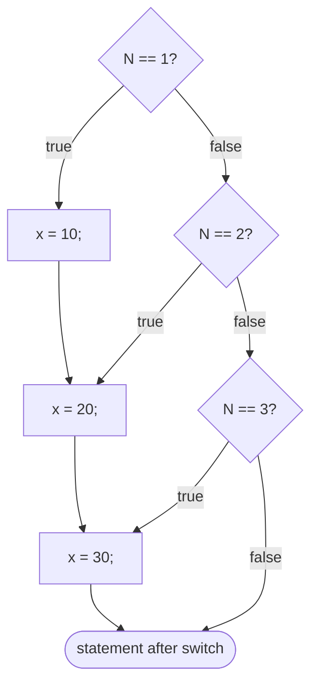
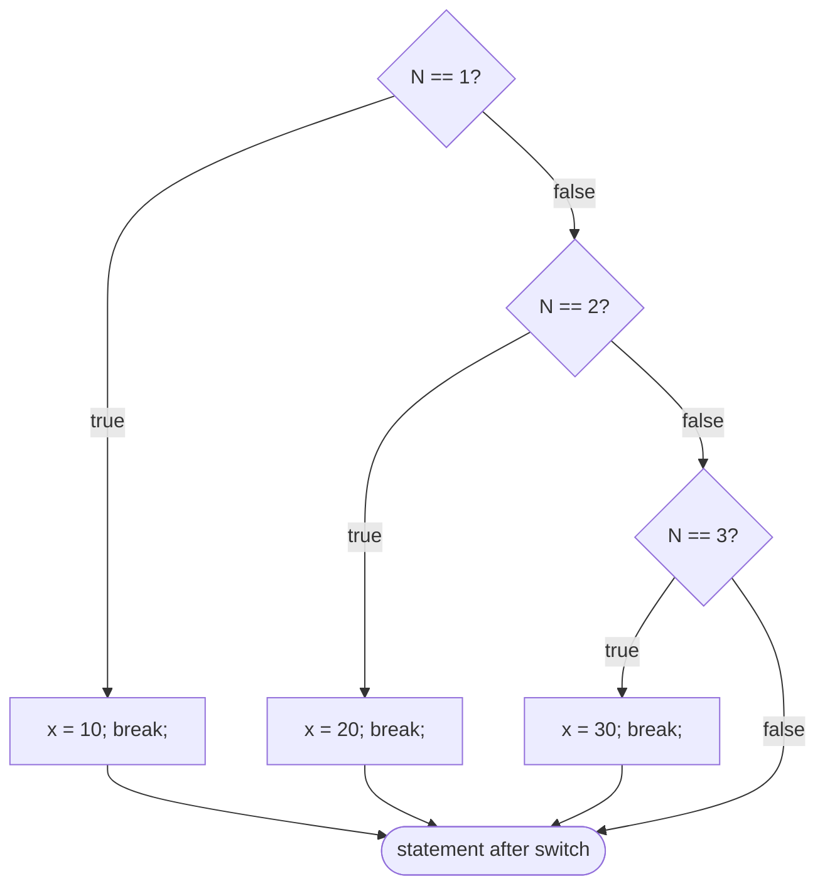
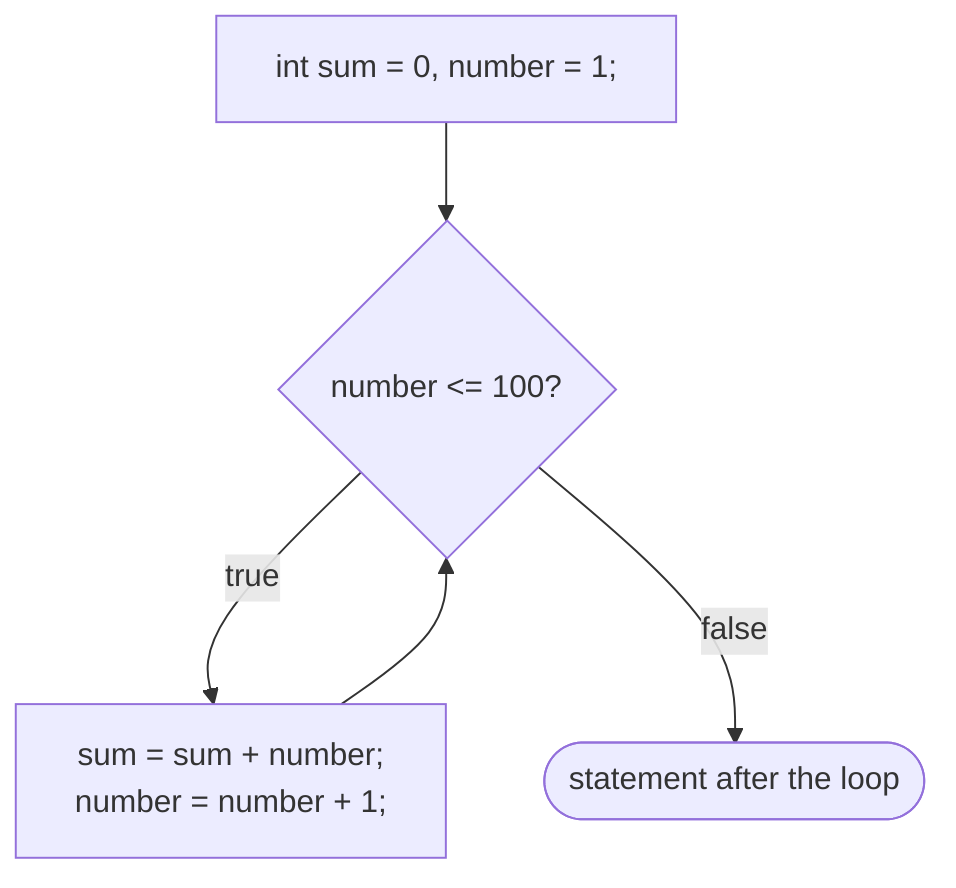
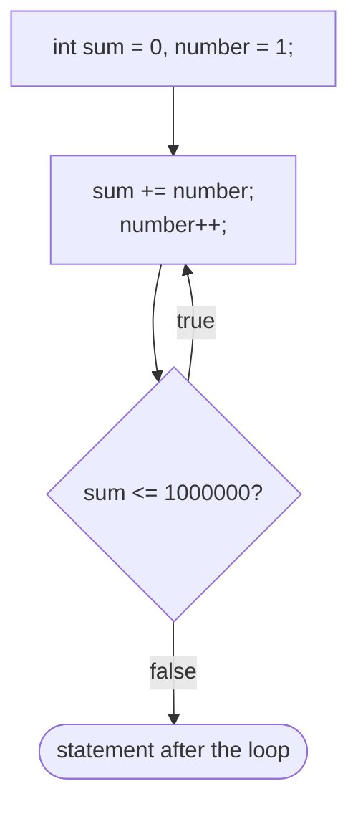
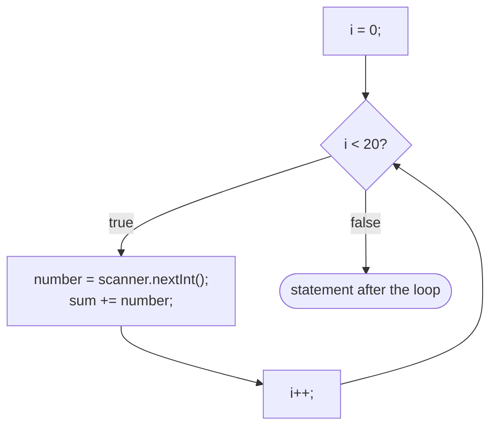

# Lecture 4 — Control Structures

[Repository Guide](../../README.md) | [English](Concepts_Lecture.md) | [한국어](Concepts_Lecture.ko.md)

> **Last Updated:** 2026-11-19

> **Learning Objectives:**
> 1. Apply conditional statements (if/else, switch)
> 2. Use loops (for, while, do-while) effectively
> 3. Implement nested control structures and break/continue
> 4. Find and fix loop pitfalls such as infinite loops, off-by-one errors, and overflow
> 5. Format output with Formatter and System.out.format and measure execution time
> 6. Follow the execution of loops with trace tables, and explain the number of iterations of nested loops and the behavior of labeled break

---

## Table of Contents

- [1. Conditional Operators](#1-conditional-operators)
  - [1.1 The Ternary Operator](#11-the-ternary-operator)
  - [1.2 Relational and Logical Operators](#12-relational-and-logical-operators)
  - [1.3 Writing Boolean Expressions and De Morgan's Laws](#13-writing-boolean-expressions-and-de-morgans-laws)
- [2. Selection Statements](#2-selection-statements)
  - [2.1 if-else Statements](#21-if-else-statements)
  - [2.2 Nested if-else](#22-nested-if-else)
  - [2.3 switch Statement](#23-switch-statement)
  - [2.4 Common Mistakes with if Statements](#24-common-mistakes-with-if-statements)
- [3. Iteration Statements](#3-iteration-statements)
  - [3.1 while Loop](#31-while-loop)
  - [3.2 Loop Pitfalls](#32-loop-pitfalls)
  - [3.3 do-while Loop](#33-do-while-loop)
  - [3.4 Exiting in the Middle of a Loop](#34-exiting-in-the-middle-of-a-loop)
  - [3.5 for Loop](#35-for-loop)
  - [3.6 Enhanced for Loop (for-each)](#36-enhanced-for-loop-for-each)
  - [3.7 Trace Tables and Loop Invariants](#37-trace-tables-and-loop-invariants)
  - [3.8 Choosing and Converting Between Loops](#38-choosing-and-converting-between-loops)
  - [3.9 Number of Iterations of Nested Loops](#39-number-of-iterations-of-nested-loops)
  - [3.10 An Algorithm Built with a Loop: the Euclidean Algorithm](#310-an-algorithm-built-with-a-loop-the-euclidean-algorithm)
- [4. Loop Control Statements](#4-loop-control-statements)
  - [4.1 Labeled break and continue](#41-labeled-break-and-continue)
- [5. Formatting Output](#5-formatting-output)
  - [5.1 Flags and Conversions of Format Specifiers](#51-flags-and-conversions-of-format-specifiers)
- [6. Measuring Execution Time](#6-measuring-execution-time)
  - [6.1 Cautions When Interpreting Measurements](#61-cautions-when-interpreting-measurements)
- [7. GUI Input with JOptionPane](#7-gui-input-with-joptionpane)
- [8. Common Mistakes](#8-common-mistakes)
- [Concept Applications](#concept-applications)
- [Summary](#summary)
- [Self-Check Questions](#self-check-questions)
- [References](#references)

---

<br>

## 1. Conditional Operators

### 1.1 The Ternary Operator

The ternary operator `? :` provides a compact way to express simple conditional logic in a single expression.

```java
// Syntax: condition ? valueIfTrue : valueIfFalse
int diff = (a > b) ? (a - b) : (b - a);
```

It is particularly useful for inline assignments where a full `if-else` block would be unnecessarily verbose. For example, the following two pieces of code do the same thing (lab code: [ConditionalOperatorDemo.java](../../Coursework/Lab04_Control-Structures/ConditionalOperatorDemo.java)).

```java
int x = 5;
int y = 3;
int s;
if (x > y)
    s = 1;
else
    s = -1;

s = (x > y) ? 1 : -1;       // same as the if-else above
```

> **Key Point:** The ternary operator should only be used for simple conditions. Complex logic is better expressed with `if-else` for readability.

### 1.2 Relational and Logical Operators

| Operator | Description | Example |
|:---------|:------------|:--------|
| `==` | Equal to | `a == b` |
| `!=` | Not equal to | `a != b` |
| `>` | Greater than | `a > b` |
| `<` | Less than | `a < b` |
| `>=` | Greater than or equal | `a >= b` |
| `<=` | Less than or equal | `a <= b` |
| `&&` | Logical AND (short-circuit) | `a > 0 && b > 0` |
| `\|\|` | Logical OR (short-circuit) | `a > 0 \|\| b > 0` |
| `!` | Logical NOT | `!flag` |

*Table 1. Relational and logical operators*

Short-circuit evaluation means that the right operand is not evaluated when the left operand alone determines the result. `&&` skips the right operand when the left is `false`, and `||` skips it when the left is `true`.

### 1.3 Writing Boolean Expressions and De Morgan's Laws

The condition of a conditional statement or loop is a **boolean expression**, which yields a `boolean` value. Writing the mathematical $`0 \le x \le 100`$ directly in Java does not compile. `0 <= x` first becomes a `boolean`, and then that `boolean` would have to be compared with `100`.

```text
RangeErr.java:4: error: bad operand types for binary operator '<='
        System.out.println(0 <= x <= 100);
                                  ^
  first type:  boolean
  second type: int
1 error
```

A range check is written by joining two comparisons with `&&`, as in `0 <= x && x <= 100`. Conversely, the condition that a value is outside the range can be built with **De Morgan's laws**.

```math
\lnot (A \land B) = \lnot A \lor \lnot B, \qquad \lnot (A \lor B) = \lnot A \land \lnot B
```

In Java, `!(a && b)` is equivalent to `!a || !b`, and `!(a || b)` to `!a && !b`. The input-checking condition `age < 0 || age > 130` of Section 3.1 is the negation of "the age is at least 0 and at most 130", that is, of `age >= 0 && age <= 130`. Negation turns `&&` into `||` and reverses each comparison (`>=` becomes `<`, and `<=` becomes `>`). Getting this conversion wrong and writing `age < 0 && age > 130` gives a condition no value can satisfy at once, so it filters out no invalid input at all.

> **Caution:** There is no need to compare a boolean variable as in `if (flag == true)`. Writing `if (flag)` and `if (!flag)` is shorter and also avoids the errors that come from the `=` typo of Section 2.4.

---

<br>

## 2. Selection Statements

### 2.1 if-else Statements

The `if-else` statement evaluates a boolean expression and executes one of two branches.

```java
if (score >= 90) {
    grade = 'A';
} else if (score >= 80) {
    grade = 'B';
} else {
    grade = 'F';
}
```

### 2.2 Nested if-else

Putting an `if` statement inside another `if` statement is called a nested `if`. An `else if` chain, which places another `if` in the `else` part as in Section 2.1, is one form of it, and multiple conditions can be chained with `else if`. However, deeply nested structures reduce readability, so consider using `switch` or polymorphism instead.

```java
if (x > 0)
    if (y > 0)
        System.out.println("both positive");
    else
        System.out.println("x positive, y not positive");
```

Without braces, an `else` pairs with the nearest unmatched `if`, regardless of indentation. The `else` above belongs to the inner `if (y > 0)`, so nothing is printed when x is 0 or less. Use braces to make the intent clear.

### 2.3 switch Statement

The `switch` statement evaluates an expression and matches it against constant case labels. The expression may be of type `byte`, `short`, `char`, `int` and their wrapper classes, `String`, or an `enum`; `long`, `float`, `double`, and `boolean` are not allowed.

```text
switch ( <arithmetic expression> ) {
    <case label 1> : <case body 1>
    ...
    <case label n> : <case body n>
}
```

```java
int gradeLevel;
gradeLevel = Integer.parseInt(JOptionPane.showInputDialog("Grade (Frosh-1,Soph-2,...):"));

switch (gradeLevel) {
    case 1: System.out.print("Go to the Gymnasium");
            break;
    case 2: System.out.print("Go to the Science Auditorium");
            break;
    case 3: System.out.print("Go to Harris Hall Rm A3");
            break;
    case 4: System.out.print("Go to Bolt Hall Rm 101");
            break;
}
```

If `gradeLevel` is 1, the statement of the first case runs; if it is 4, the statement of the fourth case runs. A part such as `case 1:` is a case label, and the statements after it are the case body.

**switch with no break statements:** Without a `break` at the end of a case body, execution continues into the next case body after running the body of the matched case. This is called fall-through.

```java
switch (N) {
    case 1: x = 10;
    case 2: x = 20;
    case 3: x = 30;
}
```



*Figure 1. Control flow of a switch without break*

Whether N is 1, 2, or 3, execution runs through `x = 30;` at the end, so x becomes 30.

**switch with break statements:** Putting a `break` at the end of each case body runs only that case and exits the `switch`.

```java
switch (N) {
    case 1: x = 10;
            break;
    case 2: x = 20;
            break;
    case 3: x = 30;
            break;
}
```



*Figure 2. Control flow of a switch with break*

**The default block:** If no case matches, the `default` block runs. Writing several case labels in a row makes those values share one body.

```java
switch (ranking) {
    case 10:
    case 9:
    case 8: System.out.print("Master");
            break;
    case 7:
    case 6: System.out.print("Journeyman");
            break;
    case 5:
    case 4: System.out.print("Apprentice");
            break;
    default: System.out.print("Input error: Invalid Data");
            break;
}
```

It prints `Master` when `ranking` is 8-10, `Journeyman` when it is 6-7, `Apprentice` when it is 4-5, and `Input error: Invalid Data` for any other value.

**What a case label can be:** A case label must be a constant expression whose value is fixed at compile time. Integer literals, character literals, and string literals (and `final` constants) are allowed, but variables and conditions are not.

```java
int b;
switch (b % 2) {
    case 1: ...; break;          // integer literal
    case 2: ...; break;
}

char c;
switch (c) {
    case '+': ...; break;        // character literal
    case '-': ...; break;
}

String s = "yes";
switch (s) {
    case "yes": ...; break;      // string literal
    case "No": ...; break;
}

switch (a) {
    case a:       // Error! 'a' is a variable
    case a > 3:   // Error! a condition is not allowed
    case a == 1:  // Error!
}
```

The following converts a score of 0-100 to a letter grade. Because `score / 10` is an integer division, every score from 90 to 99 becomes 9.

```java
switch (score / 10) {
    case 10:
    case 9:
        grade = 'A';
        break;
    case 8:
        grade = 'B';
        break;
    case 7:
        grade = 'C';
        break;
    default:
        grade = 'F';
}
```

> **Key Point:** Always include a `break` statement for each case to prevent fall-through, unless fall-through is intentional (e.g., grouping cases 10 and 9 together).

The lab code that adds `case 6` for a D in the 60s in the same way is [SwitchGradingSystem.java](../../Coursework/Lab04_Control-Structures/SwitchGradingSystem.java).

> **Note:** **Arrow labels and switch expressions.** Since Java 14, a `switch` with arrow labels such as `case 1, 2 ->` has been a standard feature [1]. An arrow label executes only the right side of the matching case and does not continue into the next case, so no `break` is needed, and several values can be grouped in one label with commas. A `switch` can also be used as an expression that yields a value, so the grading example above can be written as a single assignment, `char grade = switch (score / 10) { case 10, 9 -> 'A'; case 8 -> 'B'; case 7 -> 'C'; case 6 -> 'D'; default -> 'F'; };`, which yields `A`, `B`, `D`, and `F` for 95, 83, 61, and 40 in turn. If the right side needs several statements, the result is given with `yield value;` inside a block `{ ... }`. A `switch` expression must have a label matching every possible value, so it usually needs `default` [2].

### 2.4 Common Mistakes with if Statements

The `if` statement has a simple syntax, but there are a few mistakes the compiler does not catch. The following program shows three of them at once.

```java
public class IfPitfall {
    public static void main(String[] args) {
        int x = -5;
        if (x > 0);
        {
            System.out.println("positive?");
        }
        boolean done = false;
        if (done = true) {
            System.out.println("assignment, not comparison");
        }
        int score = 95;
        String g;
        if (score >= 60) g = "D";
        else if (score >= 90) g = "A";
        else g = "F";
        System.out.println(g);
    }
}
```

```text
positive?
assignment, not comparison
D
```

- **Semicolon after the condition:** The `;` in `if (x > 0);` is an empty statement that does nothing, and it becomes the body of the `if`. The following block `{ ... }` is an independent block unrelated to the `if`, so it always runs even though x is -5.
- **`=` instead of `==`:** `done = true` is an assignment, not a comparison, and the value `true` of the assignment expression becomes the condition. When the operands are `boolean`, this mistake compiles and the condition is always true. With `int`, the same mistake is a compile error, as follows.

```text
IfErr.java:4: error: incompatible types: int cannot be converted to boolean
        if (x = 5) {
              ^
1 error
```

- **Order of an `else if` chain:** Conditions are checked from the top, and only the first true branch runs. A score of 95 is already true at the first condition `score >= 60` and receives `"D"`, and the lower `score >= 90` is never checked. Overlapping conditions must be written from the narrowest range (the highest score). The order of Section 2.1, `>= 90`, `>= 80`, and then `else`, is the correct one.

---

<br>

## 3. Iteration Statements

### 3.1 while Loop

The `while` loop executes as long as the condition remains `true`. The condition is checked **before** each iteration. The form is `while ( <boolean expression> ) <statement>`, and the repeated statement is called the loop body.

```java
int sum = 0, number = 1;
while (number <= 100) {
    sum = sum + number;
    number = number + 1;
}
```



*Figure 3. Control flow of the while statement*

The loop repeats while number is at most 100 and computes 5050, the sum from 1 to 100. The following are also examples of the `while` statement.

```java
// Keeps adding 1, 2, 3, ... until the sum becomes larger than 1,000,000
int sum = 0, number = 1;
while (sum <= 1000000) {
    sum = sum + number;
    number = number + 1;
}

// Computes the product of the first 20 odd integers
int product = 1, number = 1,
    count = 20, lastNumber;
lastNumber = 2 * count - 1;
while (number <= lastNumber) {
    product = product * number;
    number = number + 2;
}
```

> **Note:** The second example intends to compute 1 × 3 × 5 × ... × 39, but this value is about $3.2 \times 10^{23}$, exceeding not only `int` but also the maximum of `long` (about $9.2 \times 10^{18}$). The code therefore does not produce the correct value because of the overflow of Section 3.2; an exact value requires `BigInteger`.

`sum = sum + number;` can be shortened to `sum += number;`. The compound assignment operators `+=`, `-=`, `*=`, `/=`, and `%=` of Lecture 3 Section 4.3 mean `a = a + b`, `a = a - b`, `a = a * b`, `a = a / b`, and `a = a % b`, respectively.

The `while` statement is often used to test input data. Reading the input once before entering the loop is called a priming read, and inside the loop the input is read again as long as an invalid value is entered.

```java
while (age < 0 || age > 130) {
    // prompt for valid input
    age = Integer.parseInt(inputStr);
}
```

The complete code is as follows (lab code: [WhileLoopValidation.java](../../Coursework/Lab04_Control-Structures/WhileLoopValidation.java)).

```java
String inputStr;
int age;

inputStr = JOptionPane.showInputDialog(null, "Your Age (between 0 and 130):");   // priming read
age = Integer.parseInt(inputStr);

while (age < 0 || age > 130) {
    JOptionPane.showMessageDialog(null, "An invalid age was entered. Please try again.");

    inputStr = JOptionPane.showInputDialog(null, "Your Age (between 0 and 130):");
    age = Integer.parseInt(inputStr);
}
```

### 3.2 Loop Pitfalls

Watch out for the following when writing loops.

1. Watch out for the off-by-one error (OBOE), which repeats one time too many or too few.
2. Make sure the loop body contains a statement that will eventually cause the loop to terminate.
3. Make sure the loop repeats exactly the correct number of times.
4. To execute the loop body N times, initialize the counter to 0 and use the test condition `counter < N`, or initialize it to 1 and use `counter <= N`.

**Infinite loops:** The following two loops do not terminate because their boolean expressions never become `false`.

```java
int product = 0;
while (product < 500000) {
    product = product * 5;     // 0 times 5 is still 0
}

int count = 1;
while (count != 10) {
    count = count + 2;         // count takes only odd values, so it never becomes 10
}
```

**Overflow:** An infinite loop often results in an overflow. An overflow occurs when you attempt to assign a value larger than the maximum value the variable can hold. In Java, an overflow does not terminate the program. With types `float` and `double`, a value that represents infinity (`Infinity`) is assigned, and with type `int`, the value wraps around and becomes negative (e.g., `Integer.MAX_VALUE + 1` is -2147483648). The range of each numerical type is in the table of Lecture 3 Section 2.1.

**Off-by-one errors:** When the goal is to execute the loop body 10 times, loops 1 and 3 of the following four exhibit an off-by-one error.

```java
count = 1;                     // 1: runs 9 times
while (count < 10) {
    . . .
    count++;
}

count = 1;                     // 2: runs 10 times
while (count <= 10) {
    . . .
    count++;
}

count = 0;                     // 3: runs 11 times
while (count <= 10) {
    . . .
    count++;
}

count = 0;                     // 4: runs 10 times
while (count < 10) {
    . . .
    count++;
}
```

### 3.3 do-while Loop

The `do-while` loop guarantees at least one execution, then checks the condition **after** each iteration. The form is `do <statement> while ( <boolean expression> ) ;`, ending with a semicolon.

```java
do {
    input = scanner.nextInt();
} while (input < 0);
```

```java
int sum = 0, number = 1;
do {
    sum += number;
    number++;
} while (sum <= 1000000);
```



*Figure 4. Control flow of the do-while statement*

The loop repeats its body as long as sum is at most 1,000,000, running the body first and checking the condition afterward.

### 3.4 Exiting in the Middle of a Loop

Testing a loop's terminating condition in the middle of the loop body is called loop-and-a-half repetition control. It is implemented with the reserved words `while`, `if`, and `break`.

```java
String name;
while (true) {
    name = JOptionPane.showInputDialog(null, "Your name");
    if (name.length() > 0) break;
    JOptionPane.showMessageDialog(null, "Invalid Entry." +
            "You must enter at least one character.");
}
```

The loop reads a name and exits with `break` if it has at least one character; for an empty string it shows an error message and reads again. Be aware of two concerns with this control.
- **The danger of an infinite loop:** The boolean expression of the `while` is always `true`, so forgetting the `if` statement that breaks out of the loop results in an infinite loop.
- **Multiple exit points:** A loop with several `break`s can be written correctly, but it becomes complex. It is good practice to enforce the one-entry one-exit control flow.

Section 7 covers a confirmation dialog that asks the user whether to continue a repetition.

### 3.5 for Loop

The `for` loop combines initialization, condition, and update in a single header. The form is `for ( <initialization>; <boolean expression>; <increment> ) <statement>`.

```java
for (int i = 0; i < 10; i++) {
    System.out.println("Iteration: " + i);
}
```

```java
int i, sum = 0, number;
for (i = 0; i < 20; i++) {
    number = scanner.nextInt();
    sum += number;
}
```



*Figure 5. Control flow of the for statement*

The loop runs 20 times for i = 0, 1, 2, ..., 19, reading and adding 20 integers. The initialization runs only once at the start, and then the condition test, the body, and the update repeat in turn. The following are also `for` loop examples.

```java
for (int i = 0; i < 100; i += 5)     // i = 0, 5, 10, ..., 95
for (int j = 2; j < 40; j *= 2)      // j = 2, 4, 8, 16, 32
for (int k = 100; k > 0; k--)        // k = 100, 99, 98, 97, ..., 1
```

**Nested-for statements:** Nesting a `for` statement inside another `for` statement is a commonly used technique. The following generates a price table at $19 per square foot for every combination of width 11-20 and length 5, 10, ..., 25. The outer loop handles one row, and the inner loop each column of that row.

```java
int price;
for (int width = 11; width <= 20; width++) {
    for (int length = 5; length <= 25; length += 5) {
        price = width * length * 19; //$19 per sq. ft.
        System.out.print(" " + price);
    }
    //finished one row; move on to next row
    System.out.println("");
}
```

```text
 1045 2090 3135 4180 5225
 1140 2280 3420 4560 5700
 1235 2470 3705 4940 6175
 1330 2660 3990 5320 6650
 1425 2850 4275 5700 7125
 1520 3040 4560 6080 7600
 1615 3230 4845 6460 8075
 1710 3420 5130 6840 8550
 1805 3610 5415 7220 9025
 1900 3800 5700 7600 9500
```

### 3.6 Enhanced for Loop (for-each)

Java provides the enhanced `for` loop for iterating over arrays and `Iterable` collections.

```java
int[] numbers = {1, 2, 3, 4, 5};
for (int n : numbers) {
    System.out.println(n);
}
```

### 3.7 Trace Tables and Loop Invariants

The surest way to check that a loop is correct is to write down in a table how the values of the variables change in each iteration. Such a table is called a **trace table**. Reducing the sum of Section 3.1 to 1 through 5 and printing the values in each iteration gives the following.

```java
public class TraceSum {
    public static void main(String[] args) {
        int sum = 0, number = 1;
        while (number <= 5) {
            sum = sum + number;
            number = number + 1;
            System.out.println("number=" + number + " sum=" + sum);
        }
    }
}
```

```text
number=2 sum=1
number=3 sum=3
number=4 sum=6
number=5 sum=10
number=6 sum=15
```

| Iteration | Test `number <= 5` | `sum` after | `number` after |
|-----:|:-----|-----:|-----:|
| 1 | 1 <= 5 true | 1 | 2 |
| 2 | 2 <= 5 true | 3 | 3 |
| 3 | 3 <= 5 true | 6 | 4 |
| 4 | 4 <= 5 true | 10 | 5 |
| 5 | 5 <= 5 true | 15 | 6 |
| - | 6 <= 5 false, ends | 15 | 6 |

*Table 2. Trace table of the while loop of TraceSum*

In every row of the trace table, `sum` is the sum from 1 to `number - 1`. A property that stays true each time the loop body executes in this way is called a **loop invariant**.

```math
\text{sum} = 1 + 2 + \cdots + (\text{number} - 1)
```

This invariant is true before the loop (`sum` = 0, `number` = 1, an empty sum), and it is still true after the body runs, because the body adds `number` to `sum` and then increases `number` by 1. When the loop ends, the condition is false, so `number` is 6, and substituting into the invariant gives `sum` = 1 + 2 + 3 + 4 + 5 = 15. An invariant states in one sentence what a loop computes, so fixing the invariant first when designing a loop makes it easy to choose the initial values and the termination condition and reduces off-by-one errors.

Whether a loop always terminates is checked by finding a quantity that decreases by at least a fixed amount in each iteration. In this loop `6 - number` decreases by 1 in each iteration, and the loop ends when it reaches 0. The infinite loop `count != 10` of Section 3.2 is an example for which no such quantity can be found.

### 3.8 Choosing and Converting Between Loops

The three loops can be converted into one another. `for (initialization; condition; update) body` is equivalent to the following `while` statement. The differences are that a variable declared in the initialization of `for` can be used only inside the loop, and that a `continue` in the body goes to the update in `for` but skips the update as well in the `while` below.

```text
initialization;
while (condition) {
    body
    update;
}
```

Which loop to use depends on what controls the repetition.

| Situation | Suitable loop | Example |
|:-----|:-----|:-----|
| The number of iterations is known in advance (counter-controlled repetition) | `for` | Reading 20 integers, every element of an array |
| Repeat until some condition holds, possibly zero times | `while` | Until the sum exceeds a limit, until a special value appears |
| Run the body at least once and then decide whether to continue | `do-while` | Showing a menu and reading a choice, reading input until a valid value arrives |

*Table 3. Choosing a loop by how the repetition is controlled*

A loop in which the number of iterations is unknown and the end of the input is signaled by a special value is called a **sentinel-controlled loop**. The following program reads integers until -1 appears and computes their count and sum. The sentinel -1 must not be added to the sum, so the first value is read before the loop (priming read) and the next value is read at the end of the body.

```java
import java.util.Scanner;

public class Sentinel {
    public static void main(String[] args) {
        Scanner scanner = new Scanner(System.in);
        int sum = 0, count = 0;
        int value = scanner.nextInt();
        while (value != -1) {
            sum += value;
            count++;
            value = scanner.nextInt();
        }
        System.out.println(count + " values, sum " + sum);
    }
}
```

```text
$ echo "5 8 -2 10 -1" | java Sentinel
4 values, sum 21
```

The four values 5, 8, -2, and 10 add up to 21. A negative number that is not the sentinel, such as -2, is treated as a normal value. The sentinel must be chosen as a value that cannot appear in the actual data.

### 3.9 Number of Iterations of Nested Loops

The number of times the inner body of a nested loop runs is the sum, over the iterations of the outer loop, of how many times the inner loop runs. If the outer loop runs n times and the inner loop m times each time, it is n × m. The price table of Section 3.5 prints 50 cells, for 10 widths and 5 lengths. When the number of inner iterations depends on the outer variable, the sum must be computed directly.

```java
public class Nested {
    public static void main(String[] args) {
        int count = 0;
        for (int i = 0; i < 6; i++) {
            for (int j = 0; j < i; j++) {
                count++;
            }
        }
        System.out.println("count=" + count);

        for (int row = 1; row <= 4; row++) {
            for (int k = 0; k < row; k++) {
                System.out.print("*");
            }
            System.out.println();
        }

        for (int a = 2; a <= 3; a++) {
            for (int b = 1; b <= 3; b++) {
                if (b > 1) {
                    System.out.print("  ");
                }
                System.out.printf("%d x %d = %2d", a, b, a * b);
            }
            System.out.println();
        }
    }
}
```

```text
count=15
*
**
***
****
2 x 1 =  2  2 x 2 =  4  2 x 3 =  6
3 x 1 =  3  3 x 2 =  6  3 x 3 =  9
```

In the first nested loop, when i is 0, 1, 2, 3, 4, and 5, the inner loop runs 0, 1, 2, 3, 4, and 5 times in turn. In general, if the outer loop runs n times, the inner body runs the following number of times.

```math
0 + 1 + \cdots + (n - 1) = \frac{n(n-1)}{2}
```

For n = 6 this is 6 × 5 / 2 = 15. The second loop prints as many `*` as the row number to build a triangle, and in the third loop the outer variable `a` handles the rows and the inner variable `b` the columns of a multiplication table. The place where `println()` ends the line after each inner loop is the boundary of a row. The number of iterations of such a double loop grows in proportion to the square of n as n grows, and each additional level of nesting raises the degree by one. This is also why the iteration count of the triple loop in the measurement of Section 6 grows quickly, as the cube of n.

### 3.10 An Algorithm Built with a Loop: the Euclidean Algorithm

The greatest common divisor, used in Section 6 as an example of measuring execution time, is a classic algorithm built with a loop. The **Euclidean algorithm** repeatedly uses the property that the greatest common divisor of two positive integers a and b (a ≥ b) equals the greatest common divisor of b and a % b. When a % b becomes 0, the b at that moment is the greatest common divisor.

```java
public class Gcd {
    public static void main(String[] args) {
        int a = 1071, b = 462;
        while (b != 0) {
            int r = a % b;
            System.out.println(a + " % " + b + " = " + r);
            a = b;
            b = r;
        }
        System.out.println("gcd = " + a);
    }
}
```

```text
1071 % 462 = 147
462 % 147 = 21
147 % 21 = 0
gcd = 21
```

In each iteration `a` becomes the previous `b`, and `b` becomes the remainder. A remainder is always smaller than the divisor, so `b` is a non-negative integer that decreases in every iteration, and the loop is therefore guaranteed to end (the termination condition of Section 3.7). The loop invariant is "the greatest common divisor of the current a and b equals that of the original 1071 and 462". When `b` finally becomes 0, the greatest common divisor of a and 0 is a itself, so the answer is 21. Since 1071 = 3 × 3 × 7 × 17 and 462 = 2 × 3 × 7 × 11, this agrees with the common factor 3 × 7 = 21. The algorithm finishes in far fewer iterations than trying divisors from 1 upward, so the difference shows clearly when the execution times are compared for large numbers as in Section 6.

---

<br>

## 4. Loop Control Statements

| Statement | Description |
|:----------|:------------|
| `break` | Exits the innermost enclosing loop or switch immediately |
| `continue` | Skips the rest of the current iteration and proceeds to the next |
| `return` | Exits the current method entirely |

*Table 4. Loop control statements*

```java
for (int i = 0; i < 10; i++) {
    if (i == 5) break;      // exits the loop when i == 5
    if (i % 2 == 0) continue; // skips even numbers
    System.out.println(i);   // prints 1, 3
}
```

### 4.1 Labeled break and continue

`break` and `continue` act only on the innermost loop. To end even the outer loop at once from inside a nested loop, put a **label** of the form `name:` in front of the outer loop and write `break name;`. `continue name;` moves on to the next iteration of the loop with that label.

```java
public class Labeled {
    public static void main(String[] args) {
        int[][] grid = {{3, 8, 1}, {9, 4, 7}, {2, 6, 5}};
        int target = 7;
        int foundRow = -1, foundCol = -1;
        search:
        for (int r = 0; r < grid.length; r++) {
            for (int c = 0; c < grid[r].length; c++) {
                if (grid[r][c] == target) {
                    foundRow = r;
                    foundCol = c;
                    break search;
                }
            }
        }
        System.out.println(foundRow + ", " + foundCol);
        outer:
        for (int i = 1; i <= 3; i++) {
            for (int j = 1; j <= 3; j++) {
                if (j == 2) {
                    continue outer;
                }
                System.out.print(i + "" + j + " ");
            }
        }
        System.out.println();
    }
}
```

```text
1, 2
11 21 31
```

- The first loop searches a two-dimensional array (Lecture 6, Section 1) for 7. 7 is in row 1, column 2, so at that position `break search;` ends the outer loop as well, and the remaining elements are not examined. With a plain `break;` without a label, only the inner loop would end and the outer loop would go on to examine row 2.
- In the second loop, when `j == 2` holds, `continue outer;` skips the rest of the inner loop and moves on to the next `i` of the outer loop. So output occurs only for `j = 1` for each `i`, giving `11 21 31`.

Labels make it easy to build loops with several exits, as mentioned in Section 3.4, so use them only where they are needed. When a search must end as soon as it finds the target, another common approach is to move the nested loop into a method and leave it with `return` (Lecture 6, Section 2).

---

<br>

## 5. Formatting Output

The space occupied by an output value is called the field, and the number of characters allocated to a field is the field width. The following shows integers printed with a field width of 6. A three-digit value gets three blank spaces in front and a four-digit value two, aligning the values to the right.

```text
     3    34  5684    98   231
   445   339   234   453  3444
```

From Java 5.0, the `java.util.Formatter` class can format output. First create an instance for an output destination, and then call its `format` method.

```java
Formatter formatter = new Formatter(System.out);
int num = 467;
formatter.format("%6d", num);   // "   467": field width 6
```

The general syntax of the `format` method is `format(<control string>, <expr1>, <expr2>, . . . )`. The format specifiers in the control string pair with the following expressions in order.

```java
int num1 = 34, num2 = 9;
int num3 = num1 + num2;
formatter.format("%3d + %3d = %5d", num1, num2, num3);   // " 34 +   9 =    43"
```

`System.out` (a `PrintStream`) also has a `format` method, so the same result is obtained without creating a `Formatter`. `new Formatter(System.out).format("%6d", 498);` is equivalent to `System.out.format("%6d", 498);`.

| Format specifier | Target | Example |
|:-----|:-----|:-----|
| `%<field width>d` | Integers | `%6d` |
| `%<field width>.<decimal places>f` | Real numbers | `%8.2f` prints 3.14159 as `    3.14` |
| `%s` | Strings | `%s` |

*Table 5. Main format specifiers of control strings*

For other data types and more formatting options, consult the Java API documentation of the `Formatter` class.

### 5.1 Flags and Conversions of Format Specifiers

The general form of a format specifier is `%[flags][width][.precision]conversion`. The conversion character decides into what form the value is converted, and flags change the alignment and padding. `printf` is the same method as `format`, and `%n` prints the line separator of the operating system.

```java
public class FormatFlags {
    public static void main(String[] args) {
        System.out.printf("[%5d][%-5d][%05d][%,d]%n", 42, 42, 42, 1234567);
        System.out.printf("[%8.3f][%-8.1f][%.2e]%n", Math.PI, Math.PI, 123456.789);
        System.out.printf("[%s][%10s][%-10s]%n", "Java", "Java", "Java");
        System.out.printf("[%c][%b][%x][%X][%o]%n", 'J', true, 255, 255, 8);
        System.out.printf("100%% done%n");
        String s = String.format("%03d-%s", 7, "OOP");
        System.out.println(s);
    }
}
```

```text
[   42][42   ][00042][1,234,567]
[   3.142][3.1     ][1.23e+05]
[Java][      Java][Java      ]
[J][true][ff][FF][10]
100% done
007-OOP
```

| Specifier | Meaning | Example in the output above |
|:-----|:-----|:-----|
| `%5d` | Width 5, right-aligned | `[   42]` |
| `%-5d` | `-` flag: left-aligned | `[42   ]` |
| `%05d` | `0` flag: pads with zeros | `[00042]` |
| `%,d` | `,` flag: grouping separator every three digits | `[1,234,567]` |
| `%8.3f` | Width 8, 3 digits after the decimal point (rounded) | `[   3.142]` |
| `%.2e` | Scientific notation, 2 digits after the point of the mantissa | `[1.23e+05]` |
| `%10s` | String right-aligned in width 10 | `[      Java]` |
| `%c`, `%b` | Character, `boolean` | `[J]`, `[true]` |
| `%x`, `%X`, `%o` | Hexadecimal (lowercase, uppercase), octal | `[ff]`, `[FF]`, `[10]` |
| `%%` | The `%` character itself | `100%` |

*Table 6. Flags and conversion characters of format specifiers*

A value longer than the width is not truncated; the field grows as needed. The form of the grouping separator and the decimal point can depend on the locale of the computer, and the output above was obtained in a locale whose grouping separator is a comma. `String.format` does not print but returns the formatted string, so it is used to store the result in a variable or to pass it to `JOptionPane`. If the number or type of the specifiers does not match the arguments, for example when a real number is passed to `%d`, an `IllegalFormatConversionException` is thrown at run time.

---

<br>

## 6. Measuring Execution Time

We often want to know how long a piece of code took to execute, for example a loop that finds the greatest common divisor of two very large numbers or a loop that displays all prime numbers between 1 and 100 million. Java provides several ways to measure elapsed time.

```java
// Using Date class
Date startTime = new Date();
// ... code to measure ...
Date endTime = new Date();
long elapsedMs = endTime.getTime() - startTime.getTime();

// Using System.currentTimeMillis() (preferred)
long start = System.currentTimeMillis();
// ... code to measure ...
long end = System.currentTimeMillis();
System.out.println("Elapsed: " + (end - start) + " ms");

// Using System.nanoTime() (highest precision)
long startNano = System.nanoTime();
// ... code to measure ...
long endNano = System.nanoTime();
double seconds = (endNano - startNano) / 1_000_000_000.0;
```

`getTime()` of `Date` returns the milliseconds elapsed since 1970-01-01 00:00:00 UTC, so the difference between two moments is the elapsed time. The following measures the execution time of a triple `for` loop with `Date` (lab code that times the same loop with `System.nanoTime()`: [ExecutionTimeMeasurement.java](../../Coursework/Lab04_Control-Structures/ExecutionTimeMeasurement.java)).

```java
import java.util.Date;

public class Chap4Program4 {

    public static void main(String[] args) {

        Date startTime = new Date();

        for (int i = 0; i <= 1000; i++) {
            for (int j = 0; j <= 1000; j++) {
                for (int k = 0; k <= 1000; k++) {

                }
            }
        }

        Date endTime = new Date();

        long elapsedTimeInMilliSec =
                endTime.getTime() - startTime.getTime();

        System.out.println("ElapsedTime: " + elapsedTimeInMilliSec + " ms");
    }
}
```

The innermost loop runs $1001^3 \approx 10^9$ times. Raising the bounds to 100000 for i and 10000 for j and k makes about $10^{13}$ iterations, which takes a very long time.

> **Key Point:** Prefer `System.nanoTime()` for performance benchmarking as it is not affected by system clock adjustments.

> **Caution:** The JIT compiler can optimize away code that does not affect the result, such as a loop with an empty body. Times measured on such code may not reflect the real amount of work.

### 6.1 Cautions When Interpreting Measurements

Execution time comes out slightly different every run, even for the same program on the same computer. The operating system shares the CPU with other programs, and the JVM performs garbage collection and JIT compilation (Lecture 1, Section 3.10) during execution. To make measurements meaningful, observe the following.

- **Choose the kind of clock.** `System.currentTimeMillis()` and `getTime()` of `Date` are clocks that represent the actual date and time, so the elapsed time can be distorted if the system time is adjusted during the measurement. `System.nanoTime()` is a value meant for measuring elapsed time independently of the time of day, so only the difference between two values is meaningful, and the value itself cannot be interpreted as a date.
- **Measure several times and use a representative value.** A single measurement is strongly affected by chance interference. Run the same code several times, use the mean or the median, and also look at the gap between the largest and smallest values.
- **Include warm-up runs.** The first few runs are slow because class loading and interpreted execution are mixed in. To know the performance after frequently executed code has been JIT-compiled, run the same code enough times before measuring.
- **Look at the growth trend rather than absolute values.** The absolute execution time differs from computer to computer, but the rate at which the time grows as the input size changes reveals the nature of the algorithm. Code whose number of executions is proportional to the square of n, like the nested loops of Section 3.9, should take about four times as long when n doubles, and if a measurement departs far from this ratio, recheck the measurement method.

The shorter the measured time, the larger the share of the clock resolution and the cost of measuring itself, so for very short code, measure the total time of many repetitions and divide by the number of repetitions.

---

<br>

## 7. GUI Input with JOptionPane

The `javax.swing.JOptionPane` class provides simple dialog boxes for user interaction.

```java
// Input dialog
String input = JOptionPane.showInputDialog(null, "Enter your age:");

// Message dialog
JOptionPane.showMessageDialog(null, "Hello, World!");

// Confirm dialog
int choice = JOptionPane.showConfirmDialog(null, "Continue?");
```

> **Key Point:** `JOptionPane.showInputDialog()` returns `null` when the user clicks Cancel; always check for `null` before processing.

A confirmation dialog can be used to ask the user whether to continue a repetition. The following call specifies the prompt, the dialog title, and the button options in order.

```java
JOptionPane.showConfirmDialog(null,
        /*prompt*/ "Play Another Game?",
        /*dialog title*/ "Confirmation",
        /*button options*/ JOptionPane.YES_NO_OPTION);
```

`showConfirmDialog` returns the button the user pressed as an `int`, which is `JOptionPane.YES_OPTION` for Yes. The following loop repeats the game as long as the user presses Yes.

```java
boolean keepPlaying = true;
int selection;

while (keepPlaying) {
    //code to play one game comes here
    // . . .

    selection = JOptionPane.showConfirmDialog(null,
            "Play Another Game?",
            "Confirmation",
            JOptionPane.YES_NO_OPTION);

    keepPlaying = (selection == JOptionPane.YES_OPTION);
}
```

---

<br>

## 8. Common Mistakes

| Mistake | Result | Fix |
|:-----|:-----|:-----|
| Writing a semicolon after the condition, as in `if (x > 0);` | The following block always runs regardless of the condition | Remove the `;` after the condition |
| Writing `=` instead of `==` in a `boolean` condition | An assignment occurs and the condition is always that value | Write it without a comparison, as in `if (flag)` |
| Writing `0 <= x <= 100` | Compile error `bad operand types` | Write `0 <= x && x <= 100` |
| Writing overlapping `else if` branches from the widest range | The branch for the narrow range never runs | Check the narrowest range first |
| Omitting `break` in a `case` of a `switch` | Execution continues into the next `case` (fall-through) | Write `break` or use arrow labels |
| Confusing `<` and `<=` in the condition that fixes the number of iterations | Off-by-one error | Check the first and last iterations with a trace table |
| Ending a real-valued loop with `!=`, as in `for (double d = 0.0; d != 1.0; d += 0.1)` | The rounding error of 0.1 keeps it from ever equaling 1.0, so it never ends | Use an integer counter or a `<` comparison |
| Adding the sentinel to the sum | The sum is off by the sentinel | Read the first value before the loop and the next value at the end of the body |
| Thinking that `break` in a nested loop also ends the outer loop | The outer loop keeps running | Use a labeled `break` or `return` |

*Table 7. Common mistakes with control structures*

---

<br>

## Concept Applications

**True/False Check:**

| Statement | Judgment and Reason |
|:-----|:-----|
| `!(a > 0 && b > 0)` is equivalent to `a <= 0 \|\| b <= 0`. | **T.** By De Morgan's laws, `&&` becomes `\|\|` and each comparison is reversed. |
| The body of a `while` loop runs at least once. | **F.** The condition is checked first, so if it is false from the start the body never runs. The loop that runs at least once is `do-while`. |
| In the nesting of `for (int i = 0; i < n; i++)` and `for (int j = 0; j < i; j++)`, the inner body runs n(n - 1) / 2 times. | **T.** As i goes from 0 to n - 1, the inner loop runs 0, 1, ..., n - 1 times, and this is their sum. |
| A `break` without a label ends all the loops that enclose it. | **F.** It ends only the innermost loop or `switch`. To end an outer loop too, use a label. |
| In a `switch` with arrow labels (`case 1 ->`), execution continues into the next case if there is no `break`. | **F.** An arrow label executes only its right side and does not fall through. Fall-through happens only with colon labels. |
| The output of `System.out.printf("%5.1f", 2.345)` is `  2.3`. | **T.** Rounded to one digit after the decimal point, `2.3` has three characters, so two spaces are added in front to fill width 5. |
| The loop of the Euclidean algorithm always ends because b is a non-negative integer that decreases in every iteration. | **T.** The remainder a % b is smaller than b, so b only decreases, and a non-negative integer cannot decrease forever. |

---

<br>

## Summary

| Concept | Key Summary |
|:--------|:----------|
| Ternary Operator | `condition ? a : b` is a compact conditional expression. |
| if-else | It is the standard branching statement; avoid deep nesting, and note that an `else` pairs with the nearest `if`. |
| switch | It is multi-way branching on constant case labels, and `break` is needed to prevent fall-through. |
| while | It is a pre-condition loop that may execute zero times. |
| Loop pitfalls | Watch out for infinite loops, off-by-one errors, and overflow, and write N repetitions as from 0 with `< N` or from 1 with `<= N`. |
| do-while | It is a post-condition loop that always executes at least once. |
| loop-and-a-half | `while (true)` with `if` and `break` tests the terminating condition in the middle of the loop body. |
| for | It is counter-controlled iteration with initialization, condition, and update. |
| for-each | It iterates over arrays and collections in a simplified way. |
| break / continue | `break` exits the loop, and `continue` skips the rest of the body and moves to the next iteration. |
| Formatting output | Format specifiers such as `%6d`, `%8.2f`, and `%s` of `Formatter` or `System.out.format` set the field width. |
| Measuring execution time | The elapsed time is the difference between the times before and after, and `System.nanoTime()` is preferred for benchmarking. |
| JOptionPane | It provides quick GUI dialogs for input, messages, and confirmations. |
| Boolean expressions | A range check is written `0 <= x && x <= 100`, and a negation swaps `&&` and `\|\|` and reverses the comparisons by De Morgan's laws. |
| Pitfalls of if | A semicolon after the condition, `=` in a `boolean` condition, and the order of overlapping `else if` branches are mistakes the compiler cannot catch. |
| Trace tables and invariants | A loop is verified by tabulating the values of its variables in each iteration, and a loop invariant that stays true in every iteration states the purpose of the loop. |
| Sentinel-controlled loops | The end of the input is signaled by a special value; the first value is read before the loop and the next value at the end of the body. |
| Iterations of nested loops | If the inner loop runs 0, 1, ..., n - 1 times depending on the outer variable, the total number of executions is n(n - 1) / 2. |
| Euclidean algorithm | Repeats gcd(a, b) = gcd(b, a % b) until b becomes 0 to find the greatest common divisor. |
| Labels | `break name;` and `continue name;` end the labeled outer loop or move on to its next iteration. |
| Format flags | `%-5d` is left alignment, `%05d` zero padding, `%,d` a grouping separator, `%.2e` scientific notation, and `%%` the `%` character. |
| Interpreting execution time | Elapsed time is measured several times with `System.nanoTime()` after warm-up runs and interpreted by its growth rate with the input size rather than by absolute values. |

---

<br>

## Self-Check Questions

1. **Fall-through:** In the `switch` without `break` of Figure 1, what is x when N is 2? What happens with `break` as in Figure 2?

   <details>
   <summary>Answer</summary>

   Without `break`, execution runs `x = 20;` of `case 2` and continues through `x = 30;` of `case 3`, so x is 30. With `break`, the `break` after `x = 20;` exits the `switch`, so x is 20.

   </details>

2. **Iteration counts:** How many times does the body of each loop run? (a) `for (int c = 1; c < 10; c++)` (b) `for (int c = 1; c <= 10; c++)` (c) `for (int c = 0; c <= 10; c++)` (d) `for (int c = 0; c < 10; c++)`

   <details>
   <summary>Answer</summary>

   (a) 1-9, so 9 times; (b) 1-10, so 10 times; (c) 0-10, so 11 times; (d) 0-9, so 10 times. If the goal is 10 repetitions, (a) and (c) are off-by-one errors.

   </details>

3. **Tracing for loops:** Write all values of j for which the body of `for (int j = 2; j < 40; j *= 2)` runs, and how many times the body of `for (int i = 0; i < 100; i += 5)` runs.

   <details>
   <summary>Answer</summary>

   j is 2, 4, 8, 16, and 32. The next value, 64, is greater than 40, so the loop ends. The second loop runs for i = 0, 5, ..., 95, so it runs 100 / 5 = 20 times.

   </details>

4. **Infinite loop:** Explain why `int count = 1; while (count != 10) { count = count + 2; }` does not terminate, and fix the condition so that the loop terminates.

   <details>
   <summary>Answer</summary>

   count takes only odd values such as 1, 3, 5, ..., so it never equals the even number 10. Even when the `int` overflows and wraps to negative values, the value stays odd, so the condition `count != 10` is always true. Changing the condition to `count < 10` ends the loop when count reaches 11.

   </details>

5. **Output formatting:** Write the output of `System.out.format("%3d + %3d = %5d", 34, 9, 43);` exactly, including spaces.

   <details>
   <summary>Answer</summary>

   It is `" 34 +   9 =    43"`. 34 gets one leading space to fit width 3, 9 gets two spaces, and 43 gets three spaces to fit width 5.

   </details>

6. **Building a trace table:** Build the trace table of the following code and write its output.

   ```java
   int n = 13, steps = 0;
   while (n != 1) {
       if (n % 2 == 0) n = n / 2;
       else n = 3 * n + 1;
       steps++;
   }
   System.out.println(steps);
   ```

   <details>
   <summary>Answer</summary>

   n changes as 13 → 40 → 20 → 10 → 5 → 16 → 8 → 4 → 2 → 1. For an odd n it becomes 3n + 1, and for an even n it becomes n / 2. Each arrow is one iteration, so `steps` is 9 and the output is `9`.

   </details>

7. **De Morgan's laws:** Write the condition that repeats while an invalid input is entered when reading `'y'` or `'n'` from the user. Also explain the problem with the condition `while (c != 'y' || c != 'n')`.

   <details>
   <summary>Answer</summary>

   A valid input is `c == 'y' || c == 'n'`, so an invalid input is its negation `!(c == 'y' || c == 'n')`, which by De Morgan's laws is `c != 'y' && c != 'n'`. The given condition uses `||`, so for `'y'` the part `c != 'n'` is true and for `'n'` the part `c != 'y'` is true, making it true for every input. The loop therefore never ends.

   </details>

8. **Nested loops and labels:** Write the output of the following code.

   ```java
   int count = 0;
   outer:
   for (int i = 0; i < 4; i++) {
       for (int j = 0; j < 4; j++) {
           if (i + j == 4) break outer;
           count++;
       }
   }
   System.out.println(count);
   ```

   <details>
   <summary>Answer</summary>

   For i = 0, i + j is at most 3 for j = 0-3, so it counts 4 times. For i = 1 it counts 3 times for j = 0, 1, 2, and at j = 3 i + j becomes 4, so `break outer;` ends both loops. The count is therefore 4 + 3 = 7, and the output is `7`.

   </details>

---

<br>

## References

1. G. Bierman, "JEP 361: Switch Expressions," OpenJDK, 2019. [Online]. Available: https://openjdk.org/jeps/361
2. Oracle, "Switch Expressions," in *Java Language Updates*, JDK 21. [Online]. Available: https://docs.oracle.com/en/java/javase/21/language/switch-expressions-and-statements.html
