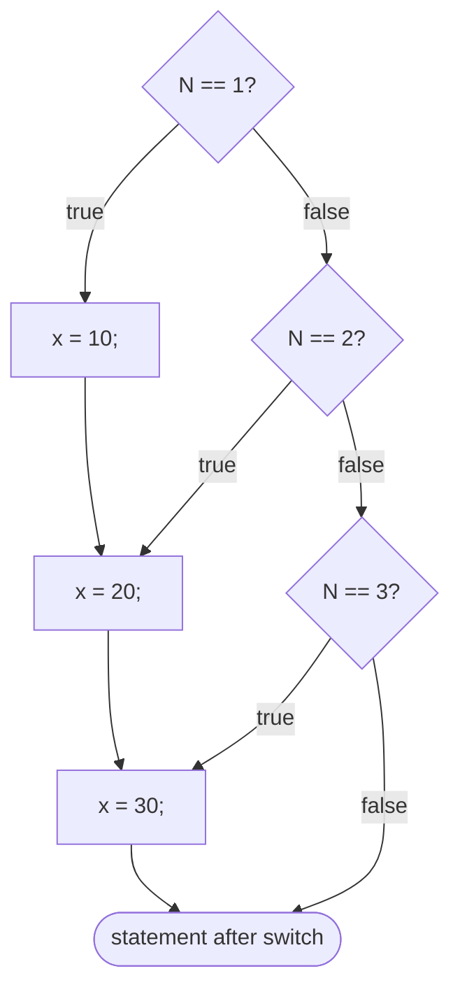
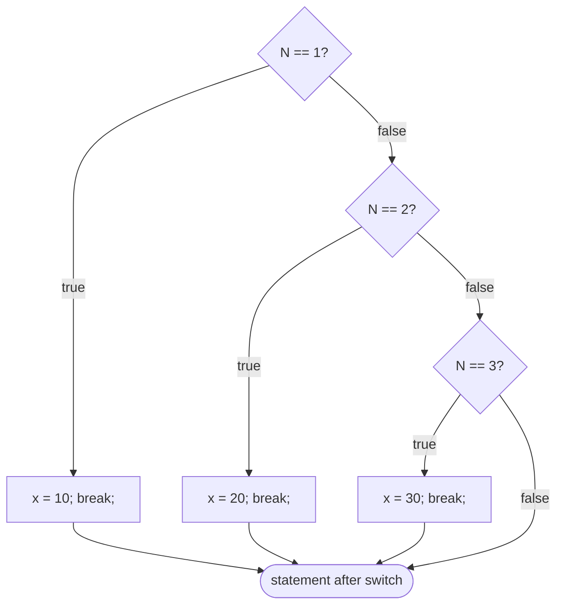
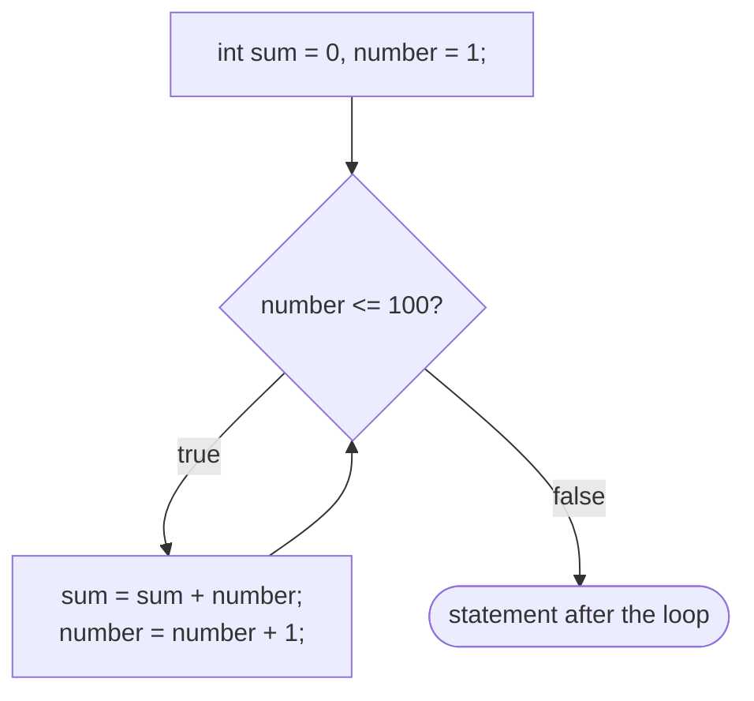
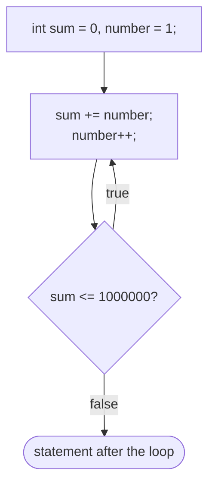
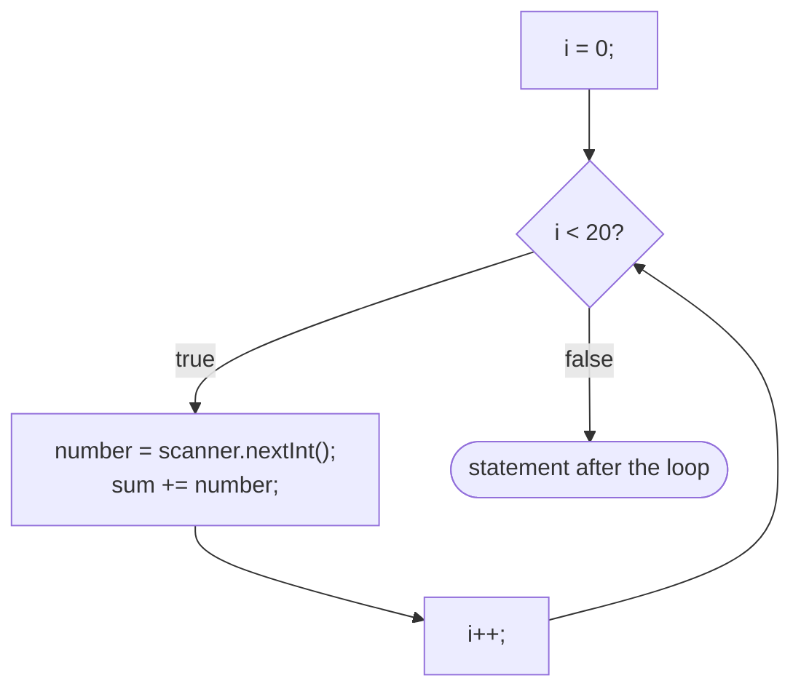

# Lecture 4 — Control Structures

[Repository Guide](../../README.md) | [English](Concepts_Lecture.md) | [한국어](Concepts_Lecture.ko.md)

> **Last Updated:** 2026-10-26

> **Learning Objectives:**
> 1. Apply conditional statements (if/else, switch)
> 2. Use loops (for, while, do-while) effectively
> 3. Implement nested control structures and break/continue
> 4. Find and fix loop pitfalls such as infinite loops, off-by-one errors, and overflow
> 5. Format output with Formatter and System.out.format and measure execution time

---

## Table of Contents

- [1. Conditional Operators](#1-conditional-operators)
  - [1.1 The Ternary Operator](#11-the-ternary-operator)
  - [1.2 Relational and Logical Operators](#12-relational-and-logical-operators)
- [2. Selection Statements](#2-selection-statements)
  - [2.1 if-else Statements](#21-if-else-statements)
  - [2.2 Nested if-else](#22-nested-if-else)
  - [2.3 switch Statement](#23-switch-statement)
- [3. Iteration Statements](#3-iteration-statements)
  - [3.1 while Loop](#31-while-loop)
  - [3.2 Loop Pitfalls](#32-loop-pitfalls)
  - [3.3 do-while Loop](#33-do-while-loop)
  - [3.4 Exiting in the Middle of a Loop](#34-exiting-in-the-middle-of-a-loop)
  - [3.5 for Loop](#35-for-loop)
  - [3.6 Enhanced for Loop (for-each)](#36-enhanced-for-loop-for-each)
- [4. Loop Control Statements](#4-loop-control-statements)
- [5. Formatting Output](#5-formatting-output)
- [6. Measuring Execution Time](#6-measuring-execution-time)
- [7. GUI Input with JOptionPane](#7-gui-input-with-joptionpane)
- [Summary](#summary)
- [Self-Check Questions](#self-check-questions)

---

<br>

## 1. Conditional Operators

### 1.1 The Ternary Operator

The ternary operator `? :` provides a compact way to express simple conditional logic in a single expression.

```java
// Syntax: condition ? valueIfTrue : valueIfFalse
int diff = (a > b) ? (a - b) : (b - a);
```

It is particularly useful for inline assignments where a full `if-else` block would be unnecessarily verbose. For example, the following two pieces of code do the same thing (lab code: [ConditionalOperatorDemo.java](../../Coursework/Lab04_Control-Structures/ConditionalOperatorDemo.java)).

```java
int x = 5;
int y = 3;
int s;
if (x > y)
    s = 1;
else
    s = -1;

s = (x > y) ? 1 : -1;       // same as the if-else above
```

> **Key Point:** The ternary operator should only be used for simple conditions. Complex logic is better expressed with `if-else` for readability.

### 1.2 Relational and Logical Operators

| Operator | Description | Example |
|:---------|:------------|:--------|
| `==` | Equal to | `a == b` |
| `!=` | Not equal to | `a != b` |
| `>` | Greater than | `a > b` |
| `<` | Less than | `a < b` |
| `>=` | Greater than or equal | `a >= b` |
| `<=` | Less than or equal | `a <= b` |
| `&&` | Logical AND (short-circuit) | `a > 0 && b > 0` |
| `\|\|` | Logical OR (short-circuit) | `a > 0 \|\| b > 0` |
| `!` | Logical NOT | `!flag` |

*Table 1. Relational and logical operators*

Short-circuit evaluation means that the right operand is not evaluated when the left operand alone determines the result. `&&` skips the right operand when the left is `false`, and `||` skips it when the left is `true`.

---

<br>

## 2. Selection Statements

### 2.1 if-else Statements

The `if-else` statement evaluates a boolean expression and executes one of two branches.

```java
if (score >= 90) {
    grade = 'A';
} else if (score >= 80) {
    grade = 'B';
} else {
    grade = 'F';
}
```

### 2.2 Nested if-else

Putting an `if` statement inside another `if` statement is called a nested `if`. An `else if` chain, which places another `if` in the `else` part as in Section 2.1, is one form of it, and multiple conditions can be chained with `else if`. However, deeply nested structures reduce readability, so consider using `switch` or polymorphism instead.

```java
if (x > 0)
    if (y > 0)
        System.out.println("both positive");
    else
        System.out.println("x positive, y not positive");
```

Without braces, an `else` pairs with the nearest unmatched `if`, regardless of indentation. The `else` above belongs to the inner `if (y > 0)`, so nothing is printed when x is 0 or less. Use braces to make the intent clear.

### 2.3 switch Statement

The `switch` statement evaluates an expression and matches it against constant case labels. The expression may be of type `byte`, `short`, `char`, `int` and their wrapper classes, `String`, or an `enum`; `long`, `float`, `double`, and `boolean` are not allowed.

```text
switch ( <arithmetic expression> ) {
    <case label 1> : <case body 1>
    ...
    <case label n> : <case body n>
}
```

```java
int gradeLevel;
gradeLevel = Integer.parseInt(JOptionPane.showInputDialog("Grade (Frosh-1,Soph-2,...):"));

switch (gradeLevel) {
    case 1: System.out.print("Go to the Gymnasium");
            break;
    case 2: System.out.print("Go to the Science Auditorium");
            break;
    case 3: System.out.print("Go to Harris Hall Rm A3");
            break;
    case 4: System.out.print("Go to Bolt Hall Rm 101");
            break;
}
```

If `gradeLevel` is 1, the statement of the first case runs; if it is 4, the statement of the fourth case runs. A part such as `case 1:` is a case label, and the statements after it are the case body.

**switch with no break statements:** Without a `break` at the end of a case body, execution continues into the next case body after running the body of the matched case. This is called fall-through.

```java
switch (N) {
    case 1: x = 10;
    case 2: x = 20;
    case 3: x = 30;
}
```



*Figure 1. Control flow of a switch without break*

Whether N is 1, 2, or 3, execution runs through `x = 30;` at the end, so x becomes 30.

**switch with break statements:** Putting a `break` at the end of each case body runs only that case and exits the `switch`.

```java
switch (N) {
    case 1: x = 10;
            break;
    case 2: x = 20;
            break;
    case 3: x = 30;
            break;
}
```



*Figure 2. Control flow of a switch with break*

**The default block:** If no case matches, the `default` block runs. Writing several case labels in a row makes those values share one body.

```java
switch (ranking) {
    case 10:
    case 9:
    case 8: System.out.print("Master");
            break;
    case 7:
    case 6: System.out.print("Journeyman");
            break;
    case 5:
    case 4: System.out.print("Apprentice");
            break;
    default: System.out.print("Input error: Invalid Data");
            break;
}
```

It prints `Master` when `ranking` is 8-10, `Journeyman` when it is 6-7, `Apprentice` when it is 4-5, and `Input error: Invalid Data` for any other value.

**What a case label can be:** A case label must be a constant expression whose value is fixed at compile time. Integer literals, character literals, and string literals (and `final` constants) are allowed, but variables and conditions are not.

```java
int b;
switch (b % 2) {
    case 1: ...; break;          // integer literal
    case 2: ...; break;
}

char c;
switch (c) {
    case '+': ...; break;        // character literal
    case '-': ...; break;
}

String s = "yes";
switch (s) {
    case "yes": ...; break;      // string literal
    case "No": ...; break;
}

switch (a) {
    case a:       // Error! 'a' is a variable
    case a > 3:   // Error! a condition is not allowed
    case a == 1:  // Error!
}
```

The following converts a score of 0-100 to a letter grade. Because `score / 10` is an integer division, every score from 90 to 99 becomes 9.

```java
switch (score / 10) {
    case 10:
    case 9:
        grade = 'A';
        break;
    case 8:
        grade = 'B';
        break;
    case 7:
        grade = 'C';
        break;
    default:
        grade = 'F';
}
```

> **Key Point:** Always include a `break` statement for each case to prevent fall-through, unless fall-through is intentional (e.g., grouping cases 10 and 9 together).

The lab code that adds `case 6` for a D in the 60s in the same way is [SwitchGradingSystem.java](../../Coursework/Lab04_Control-Structures/SwitchGradingSystem.java).

---

<br>

## 3. Iteration Statements

### 3.1 while Loop

The `while` loop executes as long as the condition remains `true`. The condition is checked **before** each iteration. The form is `while ( <boolean expression> ) <statement>`, and the repeated statement is called the loop body.

```java
int sum = 0, number = 1;
while (number <= 100) {
    sum = sum + number;
    number = number + 1;
}
```



*Figure 3. Control flow of the while statement*

The loop repeats while number is at most 100 and computes 5050, the sum from 1 to 100. The following are also examples of the `while` statement.

```java
// Keeps adding 1, 2, 3, ... until the sum becomes larger than 1,000,000
int sum = 0, number = 1;
while (sum <= 1000000) {
    sum = sum + number;
    number = number + 1;
}

// Computes the product of the first 20 odd integers
int product = 1, number = 1,
    count = 20, lastNumber;
lastNumber = 2 * count - 1;
while (number <= lastNumber) {
    product = product * number;
    number = number + 2;
}
```

> **Note:** The second example intends to compute 1 × 3 × 5 × ... × 39, but this value is about $3.2 \times 10^{23}$, exceeding not only `int` but also the maximum of `long` (about $9.2 \times 10^{18}$). The code therefore does not produce the correct value because of the overflow of Section 3.2; an exact value requires `BigInteger`.

`sum = sum + number;` can be shortened to `sum += number;`. The compound assignment operators `+=`, `-=`, `*=`, `/=`, and `%=` of Lecture 3 Section 4.3 mean `a = a + b`, `a = a - b`, `a = a * b`, `a = a / b`, and `a = a % b`, respectively.

The `while` statement is often used to test input data. Reading the input once before entering the loop is called a priming read, and inside the loop the input is read again as long as an invalid value is entered.

```java
while (age < 0 || age > 130) {
    // prompt for valid input
    age = Integer.parseInt(inputStr);
}
```

The complete code is as follows (lab code: [WhileLoopValidation.java](../../Coursework/Lab04_Control-Structures/WhileLoopValidation.java)).

```java
String inputStr;
int age;

inputStr = JOptionPane.showInputDialog(null, "Your Age (between 0 and 130):");   // priming read
age = Integer.parseInt(inputStr);

while (age < 0 || age > 130) {
    JOptionPane.showMessageDialog(null, "An invalid age was entered. Please try again.");

    inputStr = JOptionPane.showInputDialog(null, "Your Age (between 0 and 130):");
    age = Integer.parseInt(inputStr);
}
```

### 3.2 Loop Pitfalls

Watch out for the following when writing loops.

1. Watch out for the off-by-one error (OBOE), which repeats one time too many or too few.
2. Make sure the loop body contains a statement that will eventually cause the loop to terminate.
3. Make sure the loop repeats exactly the correct number of times.
4. To execute the loop body N times, initialize the counter to 0 and use the test condition `counter < N`, or initialize it to 1 and use `counter <= N`.

**Infinite loops:** The following two loops do not terminate because their boolean expressions never become `false`.

```java
int product = 0;
while (product < 500000) {
    product = product * 5;     // 0 times 5 is still 0
}

int count = 1;
while (count != 10) {
    count = count + 2;         // count takes only odd values, so it never becomes 10
}
```

**Overflow:** An infinite loop often results in an overflow. An overflow occurs when you attempt to assign a value larger than the maximum value the variable can hold. In Java, an overflow does not terminate the program. With types `float` and `double`, a value that represents infinity (`Infinity`) is assigned, and with type `int`, the value wraps around and becomes negative (e.g., `Integer.MAX_VALUE + 1` is -2147483648). The range of each numerical type is in the table of Lecture 3 Section 2.1.

**Off-by-one errors:** When the goal is to execute the loop body 10 times, loops 1 and 3 of the following four exhibit an off-by-one error.

```java
count = 1;                     // 1: runs 9 times
while (count < 10) {
    . . .
    count++;
}

count = 1;                     // 2: runs 10 times
while (count <= 10) {
    . . .
    count++;
}

count = 0;                     // 3: runs 11 times
while (count <= 10) {
    . . .
    count++;
}

count = 0;                     // 4: runs 10 times
while (count < 10) {
    . . .
    count++;
}
```

### 3.3 do-while Loop

The `do-while` loop guarantees at least one execution, then checks the condition **after** each iteration. The form is `do <statement> while ( <boolean expression> ) ;`, ending with a semicolon.

```java
do {
    input = scanner.nextInt();
} while (input < 0);
```

```java
int sum = 0, number = 1;
do {
    sum += number;
    number++;
} while (sum <= 1000000);
```



*Figure 4. Control flow of the do-while statement*

The loop repeats its body as long as sum is at most 1,000,000, running the body first and checking the condition afterward.

### 3.4 Exiting in the Middle of a Loop

Testing a loop's terminating condition in the middle of the loop body is called loop-and-a-half repetition control. It is implemented with the reserved words `while`, `if`, and `break`.

```java
String name;
while (true) {
    name = JOptionPane.showInputDialog(null, "Your name");
    if (name.length() > 0) break;
    JOptionPane.showMessageDialog(null, "Invalid Entry." +
            "You must enter at least one character.");
}
```

The loop reads a name and exits with `break` if it has at least one character; for an empty string it shows an error message and reads again. Be aware of two concerns with this control.
- **The danger of an infinite loop:** The boolean expression of the `while` is always `true`, so forgetting the `if` statement that breaks out of the loop results in an infinite loop.
- **Multiple exit points:** A loop with several `break`s can be written correctly, but it becomes complex. It is good practice to enforce the one-entry one-exit control flow.

Section 7 covers a confirmation dialog that asks the user whether to continue a repetition.

### 3.5 for Loop

The `for` loop combines initialization, condition, and update in a single header. The form is `for ( <initialization>; <boolean expression>; <increment> ) <statement>`.

```java
for (int i = 0; i < 10; i++) {
    System.out.println("Iteration: " + i);
}
```

```java
int i, sum = 0, number;
for (i = 0; i < 20; i++) {
    number = scanner.nextInt();
    sum += number;
}
```



*Figure 5. Control flow of the for statement*

The loop runs 20 times for i = 0, 1, 2, ..., 19, reading and adding 20 integers. The initialization runs only once at the start, and then the condition test, the body, and the update repeat in turn. The following are also `for` loop examples.

```java
for (int i = 0; i < 100; i += 5)     // i = 0, 5, 10, ..., 95
for (int j = 2; j < 40; j *= 2)      // j = 2, 4, 8, 16, 32
for (int k = 100; k > 0; k--)        // k = 100, 99, 98, 97, ..., 1
```

**Nested-for statements:** Nesting a `for` statement inside another `for` statement is a commonly used technique. The following generates a price table at $19 per square foot for every combination of width 11-20 and length 5, 10, ..., 25. The outer loop handles one row, and the inner loop each column of that row.

```java
int price;
for (int width = 11; width <= 20; width++) {
    for (int length = 5; length <= 25; length += 5) {
        price = width * length * 19; //$19 per sq. ft.
        System.out.print(" " + price);
    }
    //finished one row; move on to next row
    System.out.println("");
}
```

```text
 1045 2090 3135 4180 5225
 1140 2280 3420 4560 5700
 1235 2470 3705 4940 6175
 1330 2660 3990 5320 6650
 1425 2850 4275 5700 7125
 1520 3040 4560 6080 7600
 1615 3230 4845 6460 8075
 1710 3420 5130 6840 8550
 1805 3610 5415 7220 9025
 1900 3800 5700 7600 9500
```

### 3.6 Enhanced for Loop (for-each)

Java provides the enhanced `for` loop for iterating over arrays and `Iterable` collections.

```java
int[] numbers = {1, 2, 3, 4, 5};
for (int n : numbers) {
    System.out.println(n);
}
```

---

<br>

## 4. Loop Control Statements

| Statement | Description |
|:----------|:------------|
| `break` | Exits the innermost enclosing loop or switch immediately |
| `continue` | Skips the rest of the current iteration and proceeds to the next |
| `return` | Exits the current method entirely |

*Table 2. Loop control statements*

```java
for (int i = 0; i < 10; i++) {
    if (i == 5) break;      // exits the loop when i == 5
    if (i % 2 == 0) continue; // skips even numbers
    System.out.println(i);   // prints 1, 3
}
```

---

<br>

## 5. Formatting Output

The space occupied by an output value is called the field, and the number of characters allocated to a field is the field width. The following shows integers printed with a field width of 6. A three-digit value gets three blank spaces in front and a four-digit value two, aligning the values to the right.

```text
     3    34  5684    98   231
   445   339   234   453  3444
```

From Java 5.0, the `java.util.Formatter` class can format output. First create an instance for an output destination, and then call its `format` method.

```java
Formatter formatter = new Formatter(System.out);
int num = 467;
formatter.format("%6d", num);   // "   467": field width 6
```

The general syntax of the `format` method is `format(<control string>, <expr1>, <expr2>, . . . )`. The format specifiers in the control string pair with the following expressions in order.

```java
int num1 = 34, num2 = 9;
int num3 = num1 + num2;
formatter.format("%3d + %3d = %5d", num1, num2, num3);   // " 34 +   9 =    43"
```

`System.out` (a `PrintStream`) also has a `format` method, so the same result is obtained without creating a `Formatter`. `new Formatter(System.out).format("%6d", 498);` is equivalent to `System.out.format("%6d", 498);`.

| Format specifier | Target | Example |
|:-----|:-----|:-----|
| `%<field width>d` | Integers | `%6d` |
| `%<field width>.<decimal places>f` | Real numbers | `%8.2f` prints 3.14159 as `    3.14` |
| `%s` | Strings | `%s` |

*Table 3. Main format specifiers of control strings*

For other data types and more formatting options, consult the Java API documentation of the `Formatter` class.

---

<br>

## 6. Measuring Execution Time

We often want to know how long a piece of code took to execute, for example a loop that finds the greatest common divisor of two very large numbers or a loop that displays all prime numbers between 1 and 100 million. Java provides several ways to measure elapsed time.

```java
// Using Date class
Date startTime = new Date();
// ... code to measure ...
Date endTime = new Date();
long elapsedMs = endTime.getTime() - startTime.getTime();

// Using System.currentTimeMillis() (preferred)
long start = System.currentTimeMillis();
// ... code to measure ...
long end = System.currentTimeMillis();
System.out.println("Elapsed: " + (end - start) + " ms");

// Using System.nanoTime() (highest precision)
long startNano = System.nanoTime();
// ... code to measure ...
long endNano = System.nanoTime();
double seconds = (endNano - startNano) / 1_000_000_000.0;
```

`getTime()` of `Date` returns the milliseconds elapsed since 1970-01-01 00:00:00 UTC, so the difference between two moments is the elapsed time. The following measures the execution time of a triple `for` loop with `Date` (lab code: [ExecutionTimeMeasurement.java](../../Coursework/Lab04_Control-Structures/ExecutionTimeMeasurement.java)).

```java
import java.util.Date;

public class Chap4Program4 {

    public static void main(String[] args) {

        Date startTime = new Date();

        for (int i = 0; i <= 1000; i++) {
            for (int j = 0; j <= 1000; j++) {
                for (int k = 0; k <= 1000; k++) {

                }
            }
        }

        Date endTime = new Date();

        long elapsedTimeInMilliSec =
                endTime.getTime() - startTime.getTime();

        System.out.println("ElapsedTime: " + elapsedTimeInMilliSec + " ms");
    }
}
```

The innermost loop runs $1001^3 \approx 10^9$ times. Raising the bounds to 100000 for i and 10000 for j and k makes about $10^{13}$ iterations, which takes a very long time.

> **Key Point:** Prefer `System.nanoTime()` for performance benchmarking as it is not affected by system clock adjustments.

> **Caution:** The JIT compiler can optimize away code that does not affect the result, such as a loop with an empty body. Times measured on such code may not reflect the real amount of work.

---

<br>

## 7. GUI Input with JOptionPane

The `javax.swing.JOptionPane` class provides simple dialog boxes for user interaction.

```java
// Input dialog
String input = JOptionPane.showInputDialog(null, "Enter your age:");

// Message dialog
JOptionPane.showMessageDialog(null, "Hello, World!");

// Confirm dialog
int choice = JOptionPane.showConfirmDialog(null, "Continue?");
```

> **Key Point:** `JOptionPane.showInputDialog()` returns `null` when the user clicks Cancel; always check for `null` before processing.

A confirmation dialog can be used to ask the user whether to continue a repetition. The following call specifies the prompt, the dialog title, and the button options in order.

```java
JOptionPane.showConfirmDialog(null,
        /*prompt*/ "Play Another Game?",
        /*dialog title*/ "Confirmation",
        /*button options*/ JOptionPane.YES_NO_OPTION);
```

`showConfirmDialog` returns the button the user pressed as an `int`, which is `JOptionPane.YES_OPTION` for Yes. The following loop repeats the game as long as the user presses Yes.

```java
boolean keepPlaying = true;
int selection;

while (keepPlaying) {
    //code to play one game comes here
    // . . .

    selection = JOptionPane.showConfirmDialog(null,
            "Play Another Game?",
            "Confirmation",
            JOptionPane.YES_NO_OPTION);

    keepPlaying = (selection == JOptionPane.YES_OPTION);
}
```

---

<br>

## Summary

| Concept | Key Summary |
|:--------|:----------|
| Ternary Operator | `condition ? a : b` is a compact conditional expression. |
| if-else | It is the standard branching statement; avoid deep nesting, and note that an `else` pairs with the nearest `if`. |
| switch | It is multi-way branching on constant case labels, and `break` is needed to prevent fall-through. |
| while | It is a pre-condition loop that may execute zero times. |
| Loop pitfalls | Watch out for infinite loops, off-by-one errors, and overflow, and write N repetitions as from 0 with `< N` or from 1 with `<= N`. |
| do-while | It is a post-condition loop that always executes at least once. |
| loop-and-a-half | `while (true)` with `if` and `break` tests the terminating condition in the middle of the loop body. |
| for | It is counter-controlled iteration with initialization, condition, and update. |
| for-each | It iterates over arrays and collections in a simplified way. |
| break / continue | `break` exits the loop, and `continue` skips the rest of the body and moves to the next iteration. |
| Formatting output | Format specifiers such as `%6d`, `%8.2f`, and `%s` of `Formatter` or `System.out.format` set the field width. |
| Measuring execution time | The elapsed time is the difference between the times before and after, and `System.nanoTime()` is preferred for benchmarking. |
| JOptionPane | It provides quick GUI dialogs for input, messages, and confirmations. |

---

<br>

## Self-Check Questions

1. **Fall-through:** In the `switch` without `break` of Figure 1, what is x when N is 2? What happens with `break` as in Figure 2?

   <details>
   <summary>Answer</summary>

   Without `break`, execution runs `x = 20;` of `case 2` and continues through `x = 30;` of `case 3`, so x is 30. With `break`, the `break` after `x = 20;` exits the `switch`, so x is 20.

   </details>

2. **Iteration counts:** How many times does the body of each loop run? (a) `for (int c = 1; c < 10; c++)` (b) `for (int c = 1; c <= 10; c++)` (c) `for (int c = 0; c <= 10; c++)` (d) `for (int c = 0; c < 10; c++)`

   <details>
   <summary>Answer</summary>

   (a) 1-9, so 9 times; (b) 1-10, so 10 times; (c) 0-10, so 11 times; (d) 0-9, so 10 times. If the goal is 10 repetitions, (a) and (c) are off-by-one errors.

   </details>

3. **Tracing for loops:** Write all values of j for which the body of `for (int j = 2; j < 40; j *= 2)` runs, and how many times the body of `for (int i = 0; i < 100; i += 5)` runs.

   <details>
   <summary>Answer</summary>

   j is 2, 4, 8, 16, and 32. The next value, 64, is greater than 40, so the loop ends. The second loop runs for i = 0, 5, ..., 95, so it runs 100 / 5 = 20 times.

   </details>

4. **Infinite loop:** Explain why `int count = 1; while (count != 10) { count = count + 2; }` does not terminate, and fix the condition so that the loop terminates.

   <details>
   <summary>Answer</summary>

   count takes only odd values such as 1, 3, 5, ..., so it never equals the even number 10. Even when the `int` overflows and wraps to negative values, the value stays odd, so the condition `count != 10` is always true. Changing the condition to `count < 10` ends the loop when count reaches 11.

   </details>

5. **Output formatting:** Write the output of `System.out.format("%3d + %3d = %5d", 34, 9, 43);` exactly, including spaces.

   <details>
   <summary>Answer</summary>

   It is `" 34 +   9 =    43"`. 34 gets one leading space to fit width 3, 9 gets two spaces, and 43 gets three spaces to fit width 5.

   </details>
