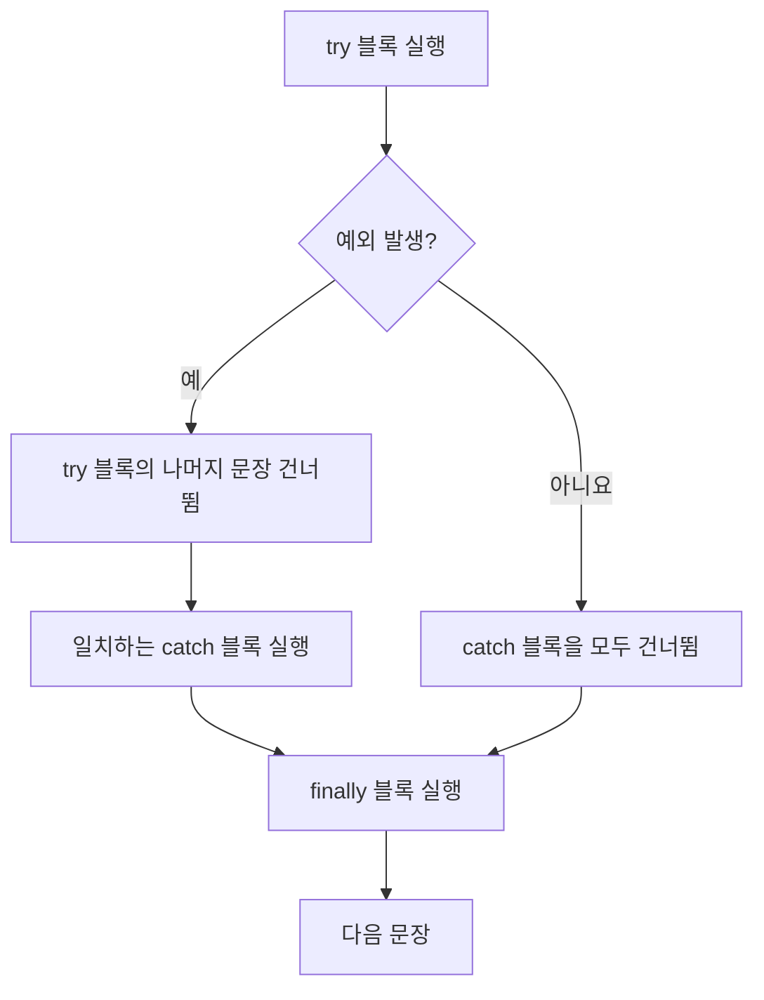
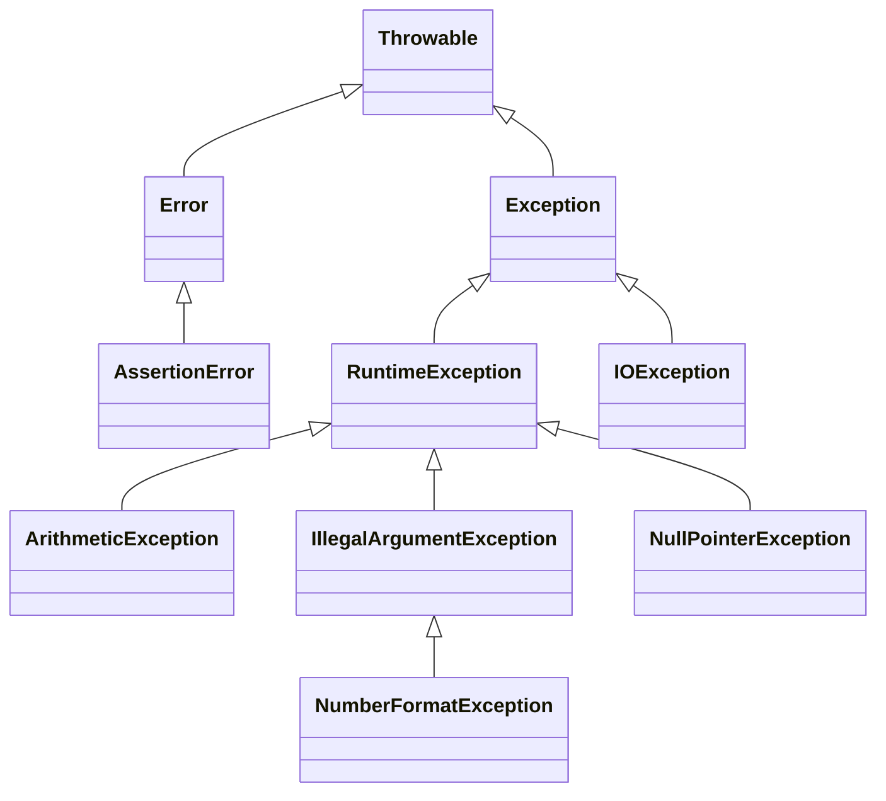

# 6강 — 2차원 배열, 함수, 예외 처리

[레포지토리 안내](../../README.ko.md) | [English](Concepts_Lecture.md) | [한국어](Concepts_Lecture.ko.md)

> **최종 수정일:** 2026-11-27

> **학습 목표:**
> 1. 2차원 배열을 생성하고 처리할 수 있다
> 2. 매개변수와 반환값을 가진 메서드를 정의할 수 있다
> 3. 배열을 반환하는 메서드와 main 메서드의 명령줄 인자를 사용할 수 있다
> 4. try-catch로 예외 처리를 적용할 수 있다
> 5. 예외를 호출자에게 전파하고 검사 예외와 비검사 예외를 구분할 수 있다
> 6. 호출 스택과 인자 전달을 단계별로 추적하고, 사용자 정의 예외와 try-with-resources를 사용할 수 있다

---

## 목차

- [1. 2차원 배열](#1-2차원-배열)
  - [1.1 선언과 초기화](#11-선언과-초기화)
  - [1.2 원소 접근과 length 필드](#12-원소-접근과-length-필드)
  - [1.3 2차원 배열의 순회](#13-2차원-배열의-순회)
  - [1.4 가변 길이 배열 (Ragged Array)](#14-가변-길이-배열-ragged-array)
  - [1.5 행 배열의 공유와 null 행](#15-행-배열의-공유와-null-행)
  - [1.6 행렬의 전치와 곱](#16-행렬의-전치와-곱)
- [2. 사용자 정의 함수 (메서드)](#2-사용자-정의-함수-메서드)
  - [2.1 메서드 정의](#21-메서드-정의)
  - [2.2 메서드 오버로딩](#22-메서드-오버로딩)
  - [2.3 배열을 반환하는 메서드](#23-배열을-반환하는-메서드)
  - [2.4 값에 의한 전달 vs. 참조에 의한 전달](#24-값에-의한-전달-vs-참조에-의한-전달)
  - [2.5 main 메서드와 명령줄 인자](#25-main-메서드와-명령줄-인자)
  - [2.6 호출 스택과 재귀 호출](#26-호출-스택과-재귀-호출)
  - [2.7 인자 전달의 단계별 추적](#27-인자-전달의-단계별-추적)
  - [2.8 오버로딩된 메서드를 고르는 규칙](#28-오버로딩된-메서드를-고르는-규칙)
- [3. 예외 처리](#3-예외-처리)
  - [3.1 예외의 정의](#31-예외의-정의)
  - [3.2 try-catch-finally](#32-try-catch-finally)
  - [3.3 예외 정보와 여러 catch 블록](#33-예외-정보와-여러-catch-블록)
  - [3.4 예외 전파 (throws)](#34-예외-전파-throws)
  - [3.5 Throwable 계층 구조](#35-throwable-계층-구조)
  - [3.6 주요 예외 유형](#36-주요-예외-유형)
  - [3.7 예외를 활용한 입력 검증](#37-예외를-활용한-입력-검증)
  - [3.8 스택 추적 읽기](#38-스택-추적-읽기)
  - [3.9 throw와 사용자 정의 예외](#39-throw와-사용자-정의-예외)
  - [3.10 finally의 실행 순서와 return](#310-finally의-실행-순서와-return)
  - [3.11 다중 catch와 try-with-resources](#311-다중-catch와-try-with-resources)
- [4. 흔한 실수](#4-흔한-실수)
- [개념 적용](#개념-적용)
- [요약](#요약)
- [점검 문제](#점검-문제)
- [참고 문헌](#참고-문헌)

---

<br>

## 1. 2차원 배열

### 1.1 선언과 초기화

2차원 배열은 배열의 배열로, 행렬, 격자, 표 등을 표현하는 데 주로 사용된다.

선언은 두 가지 형식으로 쓸 수 있고, 생성할 때는 행 수와 열 수를 차례로 지정한다.

```text
<data type>[][] <variable>;                       // form 1
<data type> <variable>[][];                       // form 2
<variable> = new <data type>[<rows>][<columns>];  // creation
```

```java
// Static initialization
double[][] scores = {
    {3.3, 3.4},
    {3.5, 3.6},
    {3.7, 4.0},
    {4.1, 4.2}
};

// Dynamic allocation
int[][] matrix = new int[3][4]; // 3 rows, 4 columns
```

정적 초기화에서는 바깥 중괄호 안에 행마다 중괄호를 하나씩 쓰며, 행 수와 열 수가 초기값의 개수로 정해진다. 위의 `scores`는 4년 동안의 학기별 학점을 담은 4행 2열 배열이다. `new`로 동적 할당한 배열의 원소는 자료형의 기본값(`int`는 0, `double`은 0.0)으로 초기화된다.

### 1.2 원소 접근과 length 필드

2차원 배열의 원소는 행 인덱스와 열 인덱스로 접근한다. 두 인덱스 모두 0부터 시작하므로 `payScaleTable[2][1]`은 세 번째 행, 두 번째 열의 원소이다.

```java
double[][] payScaleTable = new double[4][5]; // 4 rows, 5 columns
payScaleTable[2][1] = 36.50;                 // store into row 2, column 1
double pay = payScaleTable[2][1];            // read from row 2, column 1
```

Java의 2차원 배열은 행 배열에 대한 참조를 원소로 갖는 1차원 배열이다. 그래서 `length` 필드가 두 단계로 존재한다.

```text
int[][] i = new int[2][5];

          ┌──────┐
 i ─────▶ │ i[0] │ ──▶ [ i[0][0] | i[0][1] | i[0][2] | i[0][3] | i[0][4] ]   length 5
          ├──────┤
          │ i[1] │ ──▶ [ i[1][0] | i[1][1] | i[1][2] | i[1][3] | i[1][4] ]   length 5
          └──────┘
          length 2
```

*그림 1. new int[2][5]로 만든 2차원 배열의 메모리 구조*

- `array.length`는 행의 수이다. 위 예에서 `i.length`는 2이다.
- `array[r].length`는 r번째 행 배열의 원소 수, 즉 그 행의 열 수이다. 위 예에서 `i[0].length`와 `i[1].length`는 모두 5이다.

### 1.3 2차원 배열의 순회

```java
// Row-major traversal
for (int row = 0; row < scores.length; row++) {
    for (int col = 0; col < scores[row].length; col++) {
        sum += scores[row][col];
    }
}

// Enhanced for loop
for (double[] row : scores) {
    for (double value : row) {
        sum += value;
    }
}
```

바깥 루프는 행 인덱스를, 안쪽 루프는 그 행의 열 인덱스를 바꾸며 모든 원소를 방문한다. 향상된 for 루프에서는 바깥 루프 변수 `row`가 행 배열(`double[]`) 하나를 가리키고, 안쪽 루프 변수 `value`가 그 행의 원소를 차례로 받는다. 두 코드 모두 `sum`이 미리 `double sum = 0;`으로 선언되어 있다고 가정한다.

전체 평균을 `sum / (scores.length * scores[0].length)`로 구하는 방법은 모든 행의 길이가 같을 때만 맞다. 행 길이가 다를 수 있으면 원소를 방문할 때마다 개수를 세어 그 개수로 나누어야 한다(2.1절의 `computeAverage`).

2차원 배열은 그래픽 프로그램에서도 기본 자료 구조로 쓰인다. 다음 코드는 10×10 격자의 꼭짓점 11×11개의 화면 좌표를 `Point` 2차원 배열에 저장한다. 그 뒤 같은 행에서 이웃한 점끼리, 같은 열에서 이웃한 점끼리 선분으로 이으면 격자가 그려진다.

```java
graphPoints = new Point[NUM_SQUARES + 1][NUM_SQUARES + 1]; // NUM_SQUARES = 10
for (int r = 0; r < graphPoints.length; r++)
    for (int c = 0; c < graphPoints[r].length; c++)
        graphPoints[r][c] = new Point(c * SQUARE_SIZE, r * SQUARE_SIZE);
```

### 1.4 가변 길이 배열 (Ragged Array)

Java에서는 각 행의 길이가 서로 다를 수 있다:

```java
int[][] ragged = new int[3][];
ragged[0] = new int[2];
ragged[1] = new int[5];
ragged[2] = new int[3];
```

`new int[3][]`는 행 배열에 대한 참조 3개만 만들고(처음에는 모두 `null`이다), 각 행 배열은 따로 생성한다.

```text
ragged ──▶ [0] ──▶ [ 0 | 0 ]
           [1] ──▶ [ 0 | 0 | 0 | 0 | 0 ]
           [2] ──▶ [ 0 | 0 | 0 ]
```

*그림 2. 행 길이가 2, 5, 3인 가변 길이 배열*

> **핵심:** 가변 길이 배열을 올바르게 처리하려면 고정된 열 수 대신 항상 `array[row].length`를 사용해야 한다.

### 1.5 행 배열의 공유와 null 행

2차원 배열의 행은 각각 독립된 1차원 배열 객체이고, 바깥 배열의 원소는 그 행을 가리키는 참조이다(그림 1). 그래서 행 전체를 바꾸는 일은 원소를 하나씩 옮기지 않고 참조를 바꾸는 것만으로 된다. 반대로 같은 행을 두 칸이 함께 가리키게 되면 한쪽의 변경이 다른 쪽에 보인다(5강 1.5절).

```java
import java.util.Arrays;

public class Rows {
    public static void main(String[] args) {
        int[][] m = {{1, 2, 3}, {4, 5, 6}};
        int[] tmp = m[0];
        m[0] = m[1];
        m[1] = tmp;
        System.out.println(Arrays.deepToString(m));
        m[1] = m[0];
        m[1][0] = 99;
        System.out.println(Arrays.deepToString(m));

        int[][] pascal = new int[5][];
        for (int r = 0; r < pascal.length; r++) {
            pascal[r] = new int[r + 1];
            pascal[r][0] = 1;
            pascal[r][r] = 1;
            for (int c = 1; c < r; c++) {
                pascal[r][c] = pascal[r - 1][c - 1] + pascal[r - 1][c];
            }
        }
        for (int[] row : pascal) {
            System.out.println(Arrays.toString(row));
        }
        int[][] empty = new int[2][];
        System.out.println(empty[0]);
        System.out.println(empty[0].length);
    }
}
```

```text
[[4, 5, 6], [1, 2, 3]]
[[99, 5, 6], [99, 5, 6]]
[1]
[1, 1]
[1, 2, 1]
[1, 3, 3, 1]
[1, 4, 6, 4, 1]
null
Exception in thread "main" java.lang.NullPointerException: Cannot read the array length because "empty[0]" is null
	at Rows.main(Rows.java:28)
```

- 처음 세 줄은 두 행의 참조만 맞바꾸어 행의 순서를 바꾼다. 원소 여섯 개를 옮기지 않는다.
- `m[1] = m[0];` 뒤에는 두 칸이 같은 행 배열을 가리키므로 `m[1][0] = 99`가 `m[0][0]`도 바꾼다. 원래의 `{1, 2, 3}` 행은 더 이상 아무도 가리키지 않아 가비지가 된다.
- 파스칼의 삼각형은 r행의 길이가 r + 1인 가변 길이 배열이다. 양 끝은 1이고, 안쪽 원소는 바로 위 행의 두 원소 `pascal[r - 1][c - 1]`과 `pascal[r - 1][c]`의 합이다. 예를 들어 4행의 6은 3행의 3 + 3이다.
- `new int[2][]`는 행 참조 두 칸만 만들며 각 칸은 `null`이다. 행을 만들기 전에 `empty[0].length`를 읽으면 `NullPointerException`이 난다. 메시지에 `"empty[0]"`처럼 변수 이름이 나오는 것은 `-g`로 컴파일했을 때이다(2강 2.6절).
- 2차원 배열을 출력할 때는 5강 4.2절의 `Arrays.deepToString`을 쓴다.

### 1.6 행렬의 전치와 곱

수학의 행렬은 2차원 배열로 나타낸다. m × n 행렬 A의 **전치**(transpose) $`A^{T}`$는 n × m 행렬로 $`A^{T}_{cr} = A_{rc}`$이고, n × m 행렬 A와 m × p 행렬 B의 **곱** C = AB는 n × p 행렬로 다음과 같다.

```math
C_{ij} = \sum_{k=0}^{m-1} A_{ik} B_{kj}
```

```java
import java.util.Arrays;

public class Matrix {
    static int[][] transpose(int[][] a) {
        int[][] t = new int[a[0].length][a.length];
        for (int r = 0; r < a.length; r++) {
            for (int c = 0; c < a[r].length; c++) {
                t[c][r] = a[r][c];
            }
        }
        return t;
    }

    static int[][] multiply(int[][] a, int[][] b) {
        int n = a.length, m = b.length, p = b[0].length;
        int[][] result = new int[n][p];
        for (int i = 0; i < n; i++) {
            for (int j = 0; j < p; j++) {
                for (int k = 0; k < m; k++) {
                    result[i][j] += a[i][k] * b[k][j];
                }
            }
        }
        return result;
    }

    public static void main(String[] args) {
        int[][] a = {{1, 2, 3}, {4, 5, 6}};
        int[][] b = {{7, 8}, {9, 10}, {11, 12}};
        System.out.println(Arrays.deepToString(transpose(a)));
        System.out.println(Arrays.deepToString(multiply(a, b)));
    }
}
```

```text
[[1, 4], [2, 5], [3, 6]]
[[58, 64], [139, 154]]
```

`transpose`는 2 × 3 배열에서 3 × 2 배열을 만들어 원소의 행과 열 인덱스를 바꾸어 넣는다. `multiply`의 결과 첫 원소는 A의 0행 (1, 2, 3)과 B의 0열 (7, 9, 11)의 곱의 합 1 × 7 + 2 × 9 + 3 × 11 = 58이고, 마지막 원소는 4 × 8 + 5 × 10 + 6 × 12 = 154이다. `new int[n][p]`로 만든 `result`의 원소는 기본값 0에서 시작하므로 `+=`로 바로 누적할 수 있다. 세 겹의 루프가 각각 n, p, m번 돌므로 곱셈은 n × p × m번, 이 예에서는 2 × 2 × 3 = 12번이다. 두 행렬의 크기가 맞지 않으면(A의 열 수가 B의 행 수와 다르면) 곱을 정의할 수 없으므로, 실제로는 메서드 첫머리에서 `a[0].length == b.length`를 검사해야 한다.

---

<br>

## 2. 사용자 정의 함수 (메서드)

### 2.1 메서드 정의

```java
public static returnType methodName(parameterList) {
    // method body
    return value;
}
```

`returnType`은 반환값의 자료형이며, 반환값이 없으면 `void`를 쓴다. 괄호 안의 매개변수 목록은 호출할 때 받을 값의 자료형과 이름을 나열하고, `return` 문은 값을 호출자에게 돌려주며 메서드를 끝낸다. `public`과 `static`의 뜻은 2.5절에서 설명한다.

예시:

```java
public static double computeAverage(double[][] scores) {
    double sum = 0;
    int count = 0;
    for (double[] row : scores) {
        for (double val : row) {
            sum += val;
            count++;
        }
    }
    return sum / count;
}
```

`computeAverage`는 원소를 더하면서 개수도 세므로 가변 길이 배열에서도 올바른 평균을 반환한다. 원소가 하나도 없으면 `0.0 / 0`을 계산하게 되어 `NaN`을 반환한다.

### 2.2 메서드 오버로딩

매개변수의 타입이나 개수가 다르면 같은 이름의 메서드를 여러 개 정의할 수 있다:

```java
public static int max(int a, int b) { return a > b ? a : b; }
public static double max(double a, double b) { return a > b ? a : b; }
```

컴파일러는 호출에 쓴 인자의 타입과 개수를 보고 어느 메서드를 부를지 정한다. `max(3, 5)`는 `int` 버전을, `max(2.5, 1.0)`은 `double` 버전을 호출한다.

> **주의:** 반환 타입만 다른 두 메서드는 오버로딩이 아니다. `int f(int x)`와 `double f(int x)`를 함께 정의하면 같은 메서드를 두 번 정의한 것이 되어 컴파일 오류(`method f(int) is already defined`)가 난다.

### 2.3 배열을 반환하는 메서드

메서드는 배열을 반환할 수 있다. 반환 타입에 배열 타입(`int[]`)을 쓰고, `return` 문에서 배열의 참조를 돌려준다.

```java
public static int[] makeArray() {         // return type int[]
    int temp[] = new int[4];
    for (int i = 0; i < temp.length; i++)
        temp[i] = i;
    return temp;                           // return the reference to the array object
}

public static void main(String[] args) {
    int intArray[];
    intArray = makeArray();
    for (int i = 0; i < intArray.length; i++)
        System.out.print(intArray[i] + " "); // 0 1 2 3
}
```

`makeArray`가 끝나면 지역 변수 `temp`는 사라지지만, `new`로 만든 배열은 힙에 남아 있다. 반환된 참조가 `intArray`에 저장되므로 호출자는 메서드 안에서 만든 배열을 그대로 사용한다. 이때 배열 자체는 복사되지 않는다.

```text
while makeArray() runs:  temp ─────┐
                                   ▼
                   new int[4]    [ 0 | 1 | 2 | 3 ]
                                   ▲
after return:        intArray ─────┘   (temp is gone)
```

*그림 3. makeArray가 반환한 배열 참조를 intArray가 받는 과정*

### 2.4 값에 의한 전달 vs. 참조에 의한 전달

- **기본형(primitive)** 은 값에 의한 전달로 복사본이 전달된다.
- **객체와 배열**은 참조가 값으로 전달된다. 즉, 메서드 내에서 객체의 내용은 수정할 수 있지만 호출자의 변수 자체를 재할당할 수는 없다.

Java는 항상 값에 의한 전달(pass-by-value)만 한다. 객체와 배열의 경우에는 복사되는 값이 참조이다.

```java
static void modify(int[] arr)   { arr[0] = 99; }             // the caller's array contents change
static void reassign(int[] arr) { arr = new int[]{7, 7, 7}; } // only the parameter points to a new array
```

`modify(data)`를 호출하면 `arr`와 `data`가 같은 배열을 가리키므로 `data[0]`이 99가 된다. `reassign(data)`는 매개변수 `arr`에 새 배열을 대입할 뿐이므로 호출자의 `data`는 원래 배열을 계속 가리킨다.

### 2.5 main 메서드와 명령줄 인자

Java 프로그램은 `main` 메서드에서 실행을 시작한다. 머리의 각 부분은 다음 뜻을 갖는다.

```java
public static void main(String[] args) {
}
```

| 부분 | 뜻 |
|:-----|:-----|
| `public` | 다른 클래스(JVM 포함)에서 접근할 수 있다 |
| `static` | 객체를 생성하기 전에 호출할 수 있다 |
| `void` | 반환값이 없다 |
| `String[]` | 입력 인자를 문자열 배열로 받는다 |
| `args` | 인자 배열의 이름이다 |

*표 1. main 메서드 머리의 구성 요소*

프로그램을 실행할 때 클래스 이름 뒤에 쓴 단어들은 공백으로 나뉘어 `args` 배열에 문자열로 들어간다.

```text
C:\> java Hello abc 3 5.7

args.length => 3
args[0] => "abc"
args[1] => "3"
args[2] => "5.7"
```

숫자처럼 보이는 인자도 문자열이므로 계산에 쓰려면 `Integer.parseInt` 같은 메서드로 변환해야 한다. 다음 프로그램은 명령줄 인자로 받은 정수를 모두 더한다.

```java
public class Chap6Program4 {

    public static void main(String[] args) {

        int[] inputNum = new int[args.length];
        int sum = 0;

        for (int i = 0; i < inputNum.length; i++) {
            inputNum[i] = Integer.parseInt(args[i]);
            sum += inputNum[i];
        }

        System.out.println("Sum of all input values: " + sum);
    }
}
```

`java Chap6Program4 1 2 3`으로 실행하면 `Sum of all input values: 6`을 출력한다. 정수가 아닌 인자가 있으면 `Integer.parseInt`가 `NumberFormatException`을 던진다(3.1절). Eclipse 같은 IDE에서는 실행 구성(Run Configurations)의 Arguments 탭에 있는 Program arguments 칸에 인자를 입력한다.

### 2.6 호출 스택과 재귀 호출

메서드를 호출하면 JVM은 그 호출을 위한 **프레임**(frame)을 스레드의 스택에 쌓고, 메서드가 끝나면 그 프레임을 없앤다(1강 3.9절). 프레임에는 그 호출의 매개변수와 지역 변수, 그리고 돌아갈 위치가 들어 있다. 이렇게 호출 순서대로 쌓인 프레임의 더미를 **호출 스택**(call stack)이라 한다. 메서드의 지역 변수는 그 메서드의 프레임에 있으므로 호출이 끝나면 사라지며, 같은 메서드를 두 번 호출하면 지역 변수도 두 벌 생긴다.

메서드가 자기 자신을 호출하는 것을 **재귀 호출**(recursion)이라 한다. 재귀 메서드는 더 이상 자기를 호출하지 않는 기저 사례(base case)와, 더 작은 문제로 자기를 호출하는 재귀 사례로 이루어진다.

```java
public class Recursion {
    static int factorial(int n) {
        if (n <= 1) {
            return 1;
        }
        return n * factorial(n - 1);
    }

    static int depth = 0;

    static void forever() {
        depth++;
        forever();
    }

    public static void main(String[] args) {
        System.out.println(factorial(4));
        try {
            forever();
        } catch (StackOverflowError e) {
            System.out.println("StackOverflowError after " + (depth > 1000 ? "more than 1000" : "few") + " calls");
        }
    }
}
```

```text
24
StackOverflowError after more than 1000 calls
```

`factorial(4)`를 호출하면 프레임이 다음처럼 쌓였다가, 기저 사례 `factorial(1)`이 1을 돌려준 뒤부터 위에서부터 하나씩 없어진다.

```text
 call factorial(4)                       returns
┌──────────────────────┐
│ factorial  n = 1     │  ── return 1
├──────────────────────┤
│ factorial  n = 2     │  ── return 2 * 1 = 2
├──────────────────────┤
│ factorial  n = 3     │  ── return 3 * 2 = 6
├──────────────────────┤
│ factorial  n = 4     │  ── return 4 * 6 = 24
├──────────────────────┤
│ main                 │  ── prints 24
└──────────────────────┘
```

*그림 4. factorial(4)를 실행하는 동안의 호출 스택*

각 프레임의 `n`은 서로 다른 변수이므로 안쪽 호출이 `n`을 바꾸어도 바깥 호출의 `n`은 그대로이다. 기저 사례가 없는 `forever`는 끝없이 프레임을 쌓다가 스택의 크기를 넘으면 `StackOverflowError`를 던진다. 몇 번째 호출에서 넘는지는 JVM의 스택 크기 설정에 따라 다르므로 위 프로그램은 1000번보다 많은지만 출력한다. `StackOverflowError`는 `Error`의 하위 클래스로(3.5절), 보통은 잡지 않고 재귀의 기저 사례를 고쳐서 없앤다.

### 2.7 인자 전달의 단계별 추적

2.4절의 규칙을 객체 인자로 단계별로 따라가 본다. Java는 메서드를 호출할 때 인자 식의 값으로 새 매개변수 변수를 초기화한다 [1]. 매개변수는 호출 쪽 변수와 다른 변수이며, 그 안에 복사된 값이 참조이면 같은 객체를 가리킬 뿐이다.

```java
public class PassDemo {
    static void change(Point p) {
        p.x = 100;
    }

    static void reassign(Point p) {
        p = new Point(7, 7);
        p.x = 200;
    }

    static void increment(int n) {
        n++;
    }

    public static void main(String[] args) {
        Point pt = new Point(1, 2);
        int count = 5;
        increment(count);
        change(pt);
        reassign(pt);
        System.out.println(count + " " + pt.x + " " + pt.y);
    }
}

class Point {
    int x, y;

    Point(int x, int y) {
        this.x = x;
        this.y = y;
    }
}
```

```text
5 100 2
```

| 단계 | 일어나는 일 | main의 상태 |
|:-----|:-----|:-----|
| `increment(count)` | 매개변수 `n`에 5가 복사되고 `n`만 6이 된다 | `count` = 5 |
| `change(pt)` | `p`에 `pt`의 참조가 복사되어 같은 `Point`를 가리키며, `p.x = 100`이 그 객체를 바꾼다 | `pt`의 객체는 (100, 2) |
| `reassign(pt)` 첫 문장 | `p`에 새 `Point(7, 7)`의 참조가 대입된다. `pt`는 그대로이다 | `pt`의 객체는 (100, 2) |
| `reassign(pt)` 둘째 문장 | `p.x = 200`은 새 객체를 바꾸며, 메서드가 끝나면 새 객체는 가비지가 된다 | `pt`의 객체는 (100, 2) |

*표 2. PassDemo의 인자 전달 추적*

```text
 during reassign(pt), after p = new Point(7, 7); p.x = 200;

 main frame:      pt ●──────▶ Point(x = 100, y = 2)
 reassign frame:  p  ●──────▶ Point(x = 200, y = 7)
```

*그림 5. reassign 안에서 매개변수만 새 객체를 가리키는 상태*

이 추적에서 보듯이 메서드는 매개변수를 통해 호출 쪽의 객체 내용을 바꿀 수 있지만, 호출 쪽의 변수가 어느 객체를 가리킬지는 바꿀 수 없다. C++의 참조 매개변수(`int&`)처럼 호출 쪽 변수 자체를 넘기는 참조에 의한 전달은 Java에 없다. 메서드가 새 객체를 만들어 호출 쪽에 넘기고 싶으면 2.3절처럼 반환값으로 돌려준다.

### 2.8 오버로딩된 메서드를 고르는 규칙

2.2절의 오버로딩에서 인자의 자료형이 어느 메서드와도 정확히 같지 않으면, 컴파일러는 다음 세 단계를 차례로 시도하여 처음으로 적용할 수 있는 메서드가 나온 단계에서 고른다 [1].

1. 박싱, 언박싱, 가변 인자를 허용하지 않고, 확대 변환(3강 5.1절)만 허용하여 찾는다.
2. 박싱과 언박싱(3강 2.7절)을 허용하여 찾는다. 가변 인자는 아직 허용하지 않는다.
3. 가변 인자(5강 3.2절)까지 허용하여 찾는다.

한 단계에서 적용할 수 있는 메서드가 여럿이면 매개변수의 자료형이 가장 구체적인 것을 고른다.

```java
public class Overload {
    static void f(long x) { System.out.println("f(long)"); }
    static void f(Integer x) { System.out.println("f(Integer)"); }
    static void f(int... x) { System.out.println("f(int...)"); }

    static void g(double x) { System.out.println("g(double)"); }
    static void g(Object x) { System.out.println("g(Object)"); }

    static void h(int... x) { System.out.println("h(int...)"); }
    static void h(Integer x) { System.out.println("h(Integer)"); }

    public static void main(String[] args) {
        f(5);
        g(5);
        g("five");
        h(5);
        char c = 'A';
        g(c);
    }
}
```

```text
f(long)
g(double)
g(Object)
h(Integer)
g(double)
```

- `f(5)`: 1단계에서 `int`를 `long`으로 넓히는 `f(long)`이 적용되므로, 박싱이 필요한 `f(Integer)`나 가변 인자 `f(int...)`까지 가지 않는다.
- `g(5)`: 1단계에서 `g(double)`이 적용된다. `g(Object)`는 5를 `Integer`로 박싱해야 하므로 2단계에서야 후보가 된다.
- `g("five")`: `String`은 `double`로 바꿀 수 없고, `Object`의 하위 클래스이므로 1단계에서 `g(Object)`가 적용된다.
- `h(5)`: 1단계에는 후보가 없고, 2단계에서 박싱한 `h(Integer)`가 적용된다. 가변 인자는 박싱보다 늦게 고려된다.
- `g(c)`: `char`는 `double`로 넓힐 수 있으므로 `g(double)`이 적용된다.

같은 단계에서 두 메서드가 모두 적용되고 어느 쪽도 더 구체적이지 않으면 컴파일 오류가 난다.

```text
Ambiguous.java:6: error: reference to k is ambiguous
        k(1, 1);
        ^
  both method k(int,double) in Ambiguous and method k(double,int) in Ambiguous match
1 error
```

`k(int, double)`과 `k(double, int)`는 각각 인자 하나를 넓혀야 적용되므로 둘 다 1단계의 후보이고, 서로 더 구체적이지 않다. `k(1, 1.0)`처럼 인자를 명확히 쓰면 해결된다.

---

<br>

## 3. 예외 처리

### 3.1 예외의 정의

> **용어 정의:** **예외(exception)** 는 프로그램이 정상적으로 실행되는 도중에 발생할 수 있는 오류 상황을 나타낸다. 예외가 발생하면, 즉 던져지면(thrown) 정상적인 실행 흐름이 중단되고 예외 처리 루틴이 실행된다. 이때 던져진 예외가 잡혔다(caught)고 한다.

예외를 잡지 않으면 프로그램은 예외 메시지와 스택 추적(stack trace)을 출력하고 비정상 종료한다. 예를 들어 다음 코드에서 사용자가 나이로 `ten`을 입력하면 `Integer.parseInt`가 `NumberFormatException`을 던진다.

```java
String inputStr;
int age;

inputStr = JOptionPane.showInputDialog(null, "Age:");
age = Integer.parseInt(inputStr);
```

```text
Exception in thread "main" java.lang.NumberFormatException: For input string: "ten"
    at java.base/java.lang.NumberFormatException.forInputString(NumberFormatException.java:67)
    at java.base/java.lang.Integer.parseInt(Integer.java:564)
    at java.base/java.lang.Integer.parseInt(Integer.java:661)
    ...
```

메시지의 세부 형식은 JDK 버전에 따라 조금씩 다르다.

### 3.2 try-catch-finally

예외가 발생할 수 있는 문장을 `try` 블록에 넣고, 그 예외를 처리할 코드를 `catch` 블록에 쓴다. 앞의 나이 입력은 다음처럼 처리한다.

```java
inputStr = JOptionPane.showInputDialog(null, "Age:");
try {
    age = Integer.parseInt(inputStr);
} catch (NumberFormatException e) {
    JOptionPane.showMessageDialog(null, "'" + inputStr
            + "' is invalid\n"
            + "Please enter digits only");
}
```

`finally` 블록에는 예외 발생 여부와 관계없이 반드시 실행해야 하는 문장(파일 닫기 같은 정리 작업)을 넣는다.

```java
try {
    int result = 10 / 0;
} catch (ArithmeticException e) {
    System.out.println("Cannot divide by zero: " + e.getMessage());
} finally {
    // Always executed, even if an exception occurs
    System.out.println("Cleanup complete.");
}
```

`10 / 0`에서 `ArithmeticException`이 발생하므로 이 코드는 `Cannot divide by zero: / by zero`와 `Cleanup complete.`를 차례로 출력한다. 제어 흐름은 다음과 같다.

- `try` 블록의 어떤 문장에서 예외가 발생하면 그 뒤에 남은 `try` 블록의 문장은 건너뛰고, 예외 타입이 일치하는 `catch` 블록을 실행한다.
- 예외가 발생하지 않으면 `try` 블록을 끝까지 실행하고 `catch` 블록은 모두 건너뛴다.
- `finally` 블록은 두 경우 모두 실행되며, 그 뒤 try 문 다음의 문장으로 넘어간다. 일치하는 `catch` 블록이 없을 때도 `finally`는 실행되고, 그 뒤 예외가 호출자에게 전파된다(3.4절).



*그림 6. try-catch-finally의 제어 흐름*

### 3.3 예외 정보와 여러 catch 블록

`catch` 블록의 매개변수 `e`는 던져진 예외 객체이며, 다음 두 메서드로 예외의 정보를 얻는다.

- `getMessage()`는 예외의 설명 메시지를 문자열로 반환한다.
- `printStackTrace()`는 예외 타입, 메시지, 예외가 발생하기까지 호출된 메서드의 목록(스택 추적)을 표준 오류로 출력한다. 반환값이 없으므로(`void`) `println`의 인자로 쓸 수 없다.

```java
try {
    . . .
} catch (NumberFormatException e) {
    System.out.println(e.getMessage());
    e.printStackTrace();
}
```

try 문 하나에 예외 타입마다 `catch` 블록을 하나씩, 여러 개 둘 수 있다.

```java
try {
    . . .
    age = Integer.parseInt(inputStr);
    . . .
    val = cal.get(id); // cal is a GregorianCalendar
    . . .
} catch (NumberFormatException e) {
    . . .
} catch (ArrayIndexOutOfBoundsException e) {
    . . .
}
```

예외가 발생하면 `catch` 블록을 위에서부터 차례로 검사하여, 던져진 예외와 같은 클래스이거나 그 상위 클래스를 잡는 첫 번째 블록 하나만 실행하고 나머지는 건너뛴다. 위 코드에서 `Calendar.get`은 잘못된 필드 번호를 받으면 `ArrayIndexOutOfBoundsException`을 던진다.

> **주의:** 상위 클래스 예외를 잡는 `catch`를 하위 클래스 예외의 `catch`보다 앞에 두면 뒤의 블록에 도달할 수 없으므로 컴파일 오류가 난다. 예를 들어 `catch (Exception e)` 뒤에 `catch (ArithmeticException e)`를 쓰면 `exception ArithmeticException has already been caught` 오류가 난다. 하위 클래스의 `catch`를 먼저 쓴다.

### 3.4 예외 전파 (throws)

메서드 안에서 `try-catch`로 예외를 잡는 대신, 예외를 그 메서드를 호출한 쪽으로 **전파**(propagate)할 수 있다. 이때 메서드 머리에 예약어 `throws`와 예외 타입을 쓴다.

```java
public int getAge() throws NumberFormatException {
    . . .
    int age = Integer.parseInt(inputStr);
    . . .
    return age;
}
```

`getAge`에서 `NumberFormatException`이 발생하면 `getAge`는 즉시 끝나고 예외는 호출자에게 넘어간다. 호출자는 그 예외를 `try-catch`로 잡거나 다시 전파한다. `main`까지 전파되어도 잡히지 않으면 3.1절처럼 프로그램이 비정상 종료한다.

### 3.5 Throwable 계층 구조

Java의 예외 클래스는 `Throwable`을 루트로 하는 상속 계층을 이루며, 이 계층에는 60개가 넘는 클래스가 있다. 주요 클래스는 다음과 같다.



*그림 7. Throwable 클래스 계층 구조의 일부*

- `Error`는 메모리 부족처럼 프로그램이 복구하기 어려운 심각한 오류를 나타낸다. 9강의 `AssertionError`도 여기에 속한다.
- `Exception`은 프로그램이 잡아서 처리할 수 있는 예외 상황을 나타낸다.

> **용어 정의:** **비검사 예외(unchecked exception)** 는 `RuntimeException`과 `Error`, 그리고 그 하위 클래스이다. 컴파일러가 처리 여부를 검사하지 않으므로 잡거나 선언하지 않아도 컴파일된다.

> **용어 정의:** **검사 예외(checked exception)** 는 그 밖의 `Exception` 하위 클래스(`IOException` 등)이며, 이를 던질 수 있는 코드는 `try-catch`로 잡거나 메서드 머리에 `throws`로 선언해야 한다. 그렇지 않으면 `unreported exception IOException; must be caught or declared to be thrown` 같은 컴파일 오류가 난다.

`ArithmeticException`, `NumberFormatException`, `NullPointerException`은 모두 `RuntimeException`의 하위 클래스이므로 비검사 예외이다. 그래서 3.4절의 `throws NumberFormatException`은 생략해도 컴파일되며, 이 예외가 날 수 있음을 호출자에게 알리는 문서 역할을 한다. 파일 입출력의 `IOException`은 검사 예외이다(10강).

### 3.6 주요 예외 유형

| 예외 | 원인 | 종류 |
|:-----|:-----|:-----|
| `ArithmeticException` | 0으로 나누기 | 비검사 |
| `ArrayIndexOutOfBoundsException` | 잘못된 배열 인덱스 | 비검사 |
| `NullPointerException` | null 참조에 대한 멤버 접근 | 비검사 |
| `NumberFormatException` | 잘못된 문자열-숫자 변환 | 비검사 |
| `InputMismatchException` | Scanner에 예상과 다른 입력 타입 전달 | 비검사 |
| `IOException` | 입출력 작업 실패 | 검사 |

*표 3. 자주 발생하는 예외와 원인*

`ArithmeticException`은 정수를 0으로 나눌 때만 발생한다. 실수(`double`)를 0으로 나누면 예외 없이 `Infinity`나 `NaN`이 된다. 예외를 잡으려면 예외가 발생할 수 있는 연산 자체를 `try` 블록 안에 넣어야 한다. 같은 나눗셈을 `try` 블록 앞에서 먼저 실행하면 예외가 그 자리에서 던져지므로 `catch` 블록에 도달하지 못한다.

```java
try {
    System.out.println(dividend + "/" + divisor + " = " + dividend / divisor);
} catch (ArithmeticException e) {
    System.out.println("Cannot divide by 0! Please input non-zero value...");
}
```

### 3.7 예외를 활용한 입력 검증

```java
Scanner scanner = new Scanner(System.in);
int sum = 0;
for (int i = 0; i < 3; i++) {
    System.out.print((i + 1) + "th value >> ");
    try {
        sum += scanner.nextInt();
    } catch (InputMismatchException e) {
        System.out.println("Not an integer. Try again.");
        scanner.next(); // consume invalid token
        i--;            // retry the same iteration
    }
}
```

`nextInt()`는 다음 토큰이 정수가 아니면 `InputMismatchException`을 던지고, 그 토큰을 입력에 그대로 남긴다. `catch` 블록은 `scanner.next()`로 그 토큰을 읽어 버리고 `i--`로 반복 변수를 되돌려, 같은 순서의 값을 다시 입력받는다. 이 코드는 `java.util.Scanner`와 `java.util.InputMismatchException`을 import해야 한다. 같은 방식의 전체 프로그램은 [InputValidationWithException.java](../../Coursework/Lab06_2D-Arrays-Functions-and-Exception-Handling/InputValidationWithException.java)에 있다.

> **핵심:** `Scanner`에서 `InputMismatchException`을 잡을 때는 `scanner.next()`를 호출하여 잘못된 토큰을 소비해야 한다. 그렇지 않으면 루프가 무한히 반복된다.

### 3.8 스택 추적 읽기

예외를 잡지 않으면 JVM은 예외의 종류와 메시지, 그리고 예외가 던져진 순간의 호출 스택(2.6절)을 출력한다. 이것이 **스택 추적**(stack trace)이다. 다음은 두 정수를 입력받아 나누는 `Chap6Program5`에 나누는 수로 0을 넣었을 때의 출력이다.

```java
/*
 *  Chap6Program5
 *  Resolve ArithmeticException
 *  File: Chap6Program5.java
 */

import java.util.Scanner;

public class Chap6Program5 {

	public static void main(String[] args) {

		Scanner scanner = new Scanner(System.in);
		int dividend;
		int divisor;

		System.out.print("Dividend:");
		dividend = scanner.nextInt();

		System.out.print("Divisor:");
		divisor = scanner.nextInt();

		System.out.println(dividend + "/" + divisor + " =  " + dividend / divisor);
		scanner.close();

	}

}
```

```text
Dividend:20
Divisor:0
Exception in thread "main" java.lang.ArithmeticException: / by zero
	at Chap6Program5.main(Chap6Program5.java:23)
```

첫 줄은 `main` 스레드에서 `java.lang.ArithmeticException`이 났고 그 메시지가 `/ by zero`임을 알린다. 둘째 줄의 `at`은 예외가 던져진 위치로, `Chap6Program5` 클래스의 `main` 메서드 안, 소스 파일의 23번째 줄인 나눗셈 문장이다. 호출이 여러 단계이면 `at` 줄이 여러 개 나오며, 맨 위가 예외가 처음 던져진 곳이고 아래로 갈수록 그 메서드를 호출한 쪽이다.

```java
public class Chain {
    static int parse(String s) {
        return Integer.parseInt(s);
    }

    static int readAge(String s) {
        return parse(s);
    }

    public static void main(String[] args) {
        System.out.println(readAge("ten"));
    }
}
```

```text
Exception in thread "main" java.lang.NumberFormatException: For input string: "ten"
	at java.base/java.lang.NumberFormatException.forInputString(NumberFormatException.java:67)
	at java.base/java.lang.Integer.parseInt(Integer.java:564)
	at java.base/java.lang.Integer.parseInt(Integer.java:661)
	at Chain.parse(Chain.java:3)
	at Chain.readAge(Chain.java:7)
	at Chain.main(Chain.java:11)
```

위의 세 줄은 표준 라이브러리 안의 위치이고, 직접 작성한 코드에서 처음 나오는 줄 `Chain.parse(Chain.java:3)`이 고쳐야 할 곳을 찾는 출발점이다. 아래로 읽으면 `main`의 11번째 줄이 `readAge`를, `readAge`의 7번째 줄이 `parse`를 호출했다는 호출 경로를 알 수 있다. 예외는 이 경로를 거꾸로 거슬러 올라가며(3.4절의 전파) 각 메서드에서 잡히는지 검사되고, 아무 곳에서도 잡히지 않아 `main`을 벗어나면 이 출력과 함께 프로그램이 끝난다. `java.base` 안의 줄 번호(`Integer.java:564` 등)는 JDK 버전에 따라 다르며, 위 출력은 JDK 24에서 얻은 것이다.

배열 인덱스의 예외도 같은 방식으로 추적한다. 다음 `Chap6Program7`은 각 원소에 인덱스를 더해 다음 원소를 만들며, 예외를 잡아 메시지를 출력한다.

```java
public class Chap6Program7 {

	public static void main(String[] args) {

		int[] intArray = new int[5];
		intArray[0] = 0;
		try {
			for (int i = 0; i < 5; i++) {
				intArray[i + 1] = i + 1 + intArray[i];
				System.out.println("intArray[" + i + "]" + "=" + intArray[i]);
			}
		} catch (ArrayIndexOutOfBoundsException e) {
			System.out.println("Out of index for intArray");
		}

	}
}
```

```text
intArray[0]=0
intArray[1]=1
intArray[2]=3
intArray[3]=6
Out of index for intArray
```

i가 0\~3일 때 `intArray[i + 1]`은 위치 1\~4이므로 원소가 차례로 1, 3, 6, 10이 되고, 각 반복에서 `intArray[i]`를 출력한다. i가 4가 되면 `intArray[5]`에 대입하려는 순간 예외가 던져지므로, 같은 반복의 `println`은 실행되지 않고 `catch` 블록으로 넘어간다. 그래서 `intArray[4]`의 값 10은 출력되지 않는다. 반복 조건을 `i < intArray.length - 1`로 고치면 예외 없이 끝난다.

### 3.9 throw와 사용자 정의 예외

지금까지의 예외는 라이브러리나 JVM이 던졌다. 프로그램도 `throw` 문으로 직접 예외를 던질 수 있다. 형식은 `throw 예외객체;`이며, 보통 `throw new 예외클래스("메시지");`처럼 그 자리에서 예외 객체를 만든다. 메서드가 받은 인자가 잘못되었을 때 `IllegalArgumentException`을 던지는 것이 대표적인 쓰임이다.

표준 예외로 상황을 정확히 나타낼 수 없으면 `Exception`이나 `RuntimeException`을 상속하는 **사용자 정의 예외**(programmer-defined exception) 클래스를 만든다. `Exception`을 상속하면 검사 예외, `RuntimeException`을 상속하면 비검사 예외가 된다(3.5절). 다음 `InsufficientFundsException`은 잔액이 모자랄 때 모자란 금액을 함께 전달하는 검사 예외이다.

```java
public class InsufficientFundsException extends Exception {
    private final double shortage;

    public InsufficientFundsException(String message, double shortage) {
        super(message);
        this.shortage = shortage;
    }

    public double getShortage() {
        return shortage;
    }
}
```

```java
public class Wallet {
    private double balance;

    public Wallet(double balance) {
        if (balance < 0) {
            throw new IllegalArgumentException("negative balance: " + balance);
        }
        this.balance = balance;
    }

    public void pay(double amount) throws InsufficientFundsException {
        if (amount > balance) {
            throw new InsufficientFundsException("not enough money", amount - balance);
        }
        balance -= amount;
    }

    public double getBalance() {
        return balance;
    }
}
```

```java
public class WalletDemo {
    public static void main(String[] args) {
        Wallet w = new Wallet(50.0);
        try {
            w.pay(30.0);
            w.pay(30.0);
            System.out.println("not reached");
        } catch (InsufficientFundsException e) {
            System.out.println(e.getMessage() + ", short by " + e.getShortage());
        }
        System.out.println("balance " + w.getBalance());
        try {
            new Wallet(-1);
        } catch (IllegalArgumentException e) {
            System.out.println(e.getMessage());
        }
    }
}
```

```text
not enough money, short by 10.0
balance 20.0
negative balance: -1.0
```

- `super(message)`는 상위 클래스 `Exception`의 생성자에 메시지를 넘기며, 이 메시지를 `getMessage()`가 돌려준다. `super`의 세부는 8강 9절에서 다룬다.
- 첫 `pay(30.0)`은 잔액을 20.0으로 줄이고, 둘째 `pay(30.0)`은 10.0이 모자라 예외를 던진다. 예외가 던져지면 `balance -= amount;`는 실행되지 않으므로 잔액은 20.0으로 남는다. 예외를 던지기 전에 상태를 바꾸지 않으면 실패한 연산이 객체를 어중간한 상태로 남기지 않는다.
- `pay`는 검사 예외를 던지므로 머리에 `throws InsufficientFundsException`을 써야 하고, 호출하는 쪽은 이를 잡거나 다시 선언해야 한다. 잡지도 선언하지도 않으면 다음 컴파일 오류가 난다.

```text
Unhandled.java:4: error: unreported exception InsufficientFundsException; must be caught or declared to be thrown
        w.pay(20.0);
             ^
1 error
```

검사 예외와 비검사 예외 중 무엇을 쓸지는 호출하는 쪽이 그 상황에 대처할 수 있는지로 정한다. 잔액 부족처럼 올바른 프로그램에서도 일어날 수 있고 호출하는 쪽이 대처해야 하는 상황은 검사 예외로, 음수 잔액으로 객체를 만드는 것처럼 호출하는 쪽의 프로그래밍 오류는 `IllegalArgumentException` 같은 비검사 예외로 알린다. 검사 예외와 비검사 예외의 구분은 언어 명세가 정한다 [1].

### 3.10 finally의 실행 순서와 return

`finally` 블록은 `try`나 `catch` 블록이 `return`으로 끝나도 실행된다. 다음 프로그램으로 실행 순서를 확인한다.

```java
public class FinallyDemo {
    static int test(int x) {
        try {
            System.out.println("try " + x);
            if (x == 0) {
                throw new IllegalStateException("zero");
            }
            return 10 / x;
        } catch (IllegalStateException e) {
            System.out.println("catch " + e.getMessage());
            return -1;
        } finally {
            System.out.println("finally " + x);
        }
    }

    @SuppressWarnings("finally")
    static int override() {
        try {
            return 1;
        } finally {
            return 2;
        }
    }

    public static void main(String[] args) {
        System.out.println("result " + test(5));
        System.out.println("result " + test(0));
        System.out.println("override " + override());
    }
}
```

```text
try 5
finally 5
result 2
try 0
catch zero
finally 0
result -1
override 2
```

- `test(5)`는 `return 10 / x;`에서 반환값 2를 계산하지만, 메서드를 실제로 떠나기 전에 `finally`를 실행한다. 그래서 `finally 5`가 `result 2`보다 먼저 출력된다.
- `test(0)`은 `try`에서 예외가 나 `catch`가 -1을 반환하려 하고, 이때도 `finally`가 먼저 실행된다.
- `override()`처럼 `finally` 안에서 `return`하면 `try`의 `return 1`이 버려지고 2가 반환된다. 예외가 났을 때도 `finally`의 `return`이 그 예외를 없애 버리므로, `finally`에는 자원 정리만 두고 `return`이나 `throw`를 쓰지 않는다. `javac -Xlint:finally`로 컴파일하면 `finally clause cannot complete normally` 경고가 나며, 위 코드의 `@SuppressWarnings("finally")`는 그 경고를 끄는 표시이다.

### 3.11 다중 catch와 try-with-resources

여러 종류의 예외를 같은 방법으로 처리할 때는 `catch (A | B e)`처럼 하나의 `catch`에 `|`로 예외 타입을 나열하는 **다중 catch**를 쓴다. 파일이나 네트워크 연결처럼 다 쓴 뒤 반드시 닫아야 하는 자원은 **try-with-resources** 문으로 다룬다. `try` 뒤의 괄호에서 만든 자원은 `try` 블록이 정상적으로 끝나든 예외로 끝나든 자동으로 닫히며, 여러 자원은 만든 순서의 반대로 닫힌다 [1]. 자원이 될 수 있는 객체는 `close()` 메서드 하나를 가진 `AutoCloseable` 인터페이스를 구현한 클래스의 객체이다 [2].

```java
public class Resource implements AutoCloseable {
    private final String name;

    public Resource(String name) {
        this.name = name;
        System.out.println("open " + name);
    }

    public void use(boolean fail) {
        System.out.println("use " + name);
        if (fail) {
            throw new IllegalStateException("failure in " + name);
        }
    }

    @Override
    public void close() {
        System.out.println("close " + name);
    }
}
```

```java
public class TwrDemo {
    public static void main(String[] args) {
        try (Resource a = new Resource("A"); Resource b = new Resource("B")) {
            a.use(false);
            b.use(true);
            System.out.println("not reached");
        } catch (IllegalStateException e) {
            System.out.println("caught " + e.getMessage());
        } finally {
            System.out.println("finally");
        }

        String[] inputs = {"12", "x", null};
        for (String s : inputs) {
            try {
                System.out.println(Integer.parseInt(s.trim()) * 2);
            } catch (NumberFormatException | NullPointerException e) {
                System.out.println(e.getClass().getSimpleName());
            }
        }
    }
}
```

```text
open A
open B
use A
use B
close B
close A
caught failure in B
finally
24
NumberFormatException
NullPointerException
```

`b.use(true)`가 예외를 던지면 `try` 블록이 끝나면서 B, A의 순서로 `close()`가 호출된 뒤 `catch`가 실행되고, 마지막으로 `finally`가 실행된다. 즉 `catch`가 실행되는 시점에는 자원이 이미 닫혀 있다. 같은 일을 `finally`로 하려면 자원마다 `null` 검사와 `close()` 호출을 직접 써야 하며, `close()` 자체가 예외를 던지는 경우까지 처리하기 어렵다. try-with-resources에서 `try` 블록과 `close()`가 모두 예외를 던지면 `try` 블록의 예외가 던져지고 `close()`의 예외는 억제된 예외(suppressed exception)로 그 안에 붙는다 [2]. 파일 입출력에서의 쓰임은 10강에서 다룬다.

다중 catch에서 `"12"`는 24를 출력하고, `"x"`는 `NumberFormatException`, `null`은 `s.trim()`에서 `NullPointerException`을 내지만 같은 `catch`가 처리한다. 다중 catch에 나열하는 예외끼리는 상속 관계가 없어야 한다. 하나가 다른 하나의 하위 클래스이면 상위 클래스 하나만 쓰면 되므로 컴파일 오류가 난다.

---

<br>

## 4. 흔한 실수

| 실수 | 나타나는 결과 | 바로잡는 방법 |
|:-----|:-----|:-----|
| 가변 길이 배열에서 열 수를 `array[0].length`로 고정한다 | 행마다 원소를 빠뜨리거나 `ArrayIndexOutOfBoundsException` | 행마다 `array[r].length`를 쓴다 |
| `new int[3][]`의 행을 만들기 전에 원소에 접근한다 | `NullPointerException` | 행마다 `new int[길이]`를 대입한다 |
| `arr = new int[5];`처럼 매개변수에 대입하여 호출한 쪽 배열을 바꾸려 한다 | 호출한 쪽 변수는 원래 배열을 가리킨다 | 새 배열을 반환값으로 돌려준다 |
| 반환 타입만 다른 메서드를 오버로딩으로 정의한다 | `method ... is already defined` 컴파일 오류 | 매개변수 목록을 다르게 한다 |
| 기저 사례가 없거나 도달하지 않는 재귀를 쓴다 | `StackOverflowError` | 기저 사례와 문제가 줄어드는 재귀 호출을 확인한다 |
| `catch (Exception e)`를 하위 클래스의 `catch`보다 앞에 둔다 | `has already been caught` 컴파일 오류 | 하위 클래스의 `catch`를 먼저 쓴다 |
| 빈 `catch` 블록으로 예외를 삼킨다 | 오류가 조용히 사라져 원인을 찾기 어렵다 | 메시지를 출력하거나 다시 던진다 |
| `finally` 안에서 `return`한다 | 원래의 반환값이나 예외가 사라진다 | `finally`에는 정리 작업만 둔다 |
| 자원을 `finally` 없이 닫는다 | 예외가 나면 `close()`가 호출되지 않는다 | try-with-resources를 쓴다 |

*표 4. 2차원 배열, 메서드, 예외 처리에서 흔한 실수*

---

<br>

## 개념 적용

**T/F 점검:**

| 문장 | 판단과 근거 |
|:-----|:-----|
| `int[][] m = new int[3][4];`의 `m[1]`은 `int[]` 배열을 가리키는 참조이다. | **T.** 2차원 배열은 행 배열의 참조를 원소로 갖는 배열이다. |
| 재귀 메서드가 자기를 호출할 때 지역 변수는 이전 호출과 같은 변수를 함께 쓴다. | **F.** 호출마다 새 프레임이 만들어지므로 각 호출은 자기 지역 변수를 따로 가진다. |
| `void reset(int[] a) { a = new int[a.length]; }`를 호출하면 호출한 쪽 배열의 원소가 모두 0이 된다. | **F.** 매개변수에 새 배열의 참조를 대입할 뿐이므로 호출한 쪽 배열은 그대로이다. |
| `f(long)`과 `f(Integer)`가 있을 때 `f(5)`는 `f(Integer)`를 호출한다. | **F.** 1단계에서 확대 변환으로 적용되는 `f(long)`이 박싱이 필요한 `f(Integer)`보다 먼저 선택된다. |
| `RuntimeException`을 상속한 사용자 정의 예외는 `throws`로 선언하지 않아도 던질 수 있다. | **T.** 비검사 예외이므로 잡거나 선언할 의무가 없다. |
| `try` 블록에서 `return`하면 `finally` 블록은 실행되지 않는다. | **F.** `finally`는 메서드가 실제로 끝나기 전에 실행된다. |
| try-with-resources의 자원은 만든 순서대로 닫힌다. | **F.** 만든 순서의 반대로 닫힌다. 3.11절의 출력에서 B가 A보다 먼저 닫혔다. |
| 스택 추적의 맨 아래 `at` 줄이 예외가 처음 던져진 위치이다. | **F.** 맨 위가 예외가 던져진 위치이고, 아래로 갈수록 그 메서드를 호출한 쪽이다. |

---

<br>

## 요약

| 개념 | 핵심 요약 |
|:-----|:-----|
| 2차원 배열 | 배열의 배열이며, 행마다 길이가 다를 수 있다(가변 길이 배열). |
| 순회 | 행 수에는 `array.length`를, 열 수에는 `array[i].length`를 사용한다. |
| 메서드 | 반환 타입과 매개변수를 갖는 재사용 가능한 코드 블록이다. |
| 오버로딩 | 이름이 같고 매개변수 시그니처가 다른 메서드를 여러 개 정의하는 것이며, 반환 타입만 달라서는 안 된다. |
| 배열 반환 | 메서드는 배열의 참조를 반환할 수 있고, 호출자는 메서드 안에서 만든 배열을 그대로 사용한다. |
| 값에 의한 전달 | Java는 항상 값을 복사해 전달하며, 객체와 배열은 참조가 복사되므로 내용은 바꿀 수 있지만 호출자의 변수는 바꿀 수 없다. |
| main 메서드 | 명령줄 인자를 `String[] args`로 받으며, 숫자로 쓰려면 `Integer.parseInt` 등으로 변환한다. |
| try-catch | 프로그램을 중단하지 않고 런타임 오류를 처리한다. |
| finally | 예외 발생 여부와 관계없이 정리 작업을 위해 항상 실행되는 코드이다. |
| 여러 catch 블록 | 위에서부터 일치하는 첫 블록만 실행되므로 하위 클래스 예외를 먼저 잡는다. |
| throws | 예외를 잡지 않고 호출자에게 전파함을 메서드 머리에 선언한다. |
| 검사 예외와 비검사 예외 | 검사 예외는 잡거나 선언해야 하고, `RuntimeException`과 `Error` 계열의 비검사 예외는 그렇지 않아도 된다. |
| InputMismatchException | 재시도하기 전에 `scanner.next()`로 잘못된 토큰을 소비해야 한다. |
| 행 배열의 공유 | 2차원 배열의 행은 참조로 연결된 독립 배열이므로 행을 참조만으로 맞바꿀 수 있고, `new int[n][]`의 행은 처음에 `null`이다. |
| 행렬 연산 | 전치는 행과 열 인덱스를 바꾸고, n × m과 m × p 행렬의 곱은 세 겹 루프로 n × p × m번 곱한다. |
| 호출 스택 | 메서드 호출마다 매개변수와 지역 변수를 담은 프레임이 쌓이고, 끝나면 없어지며, 기저 사례 없는 재귀는 `StackOverflowError`를 낸다. |
| 인자 전달 추적 | 매개변수는 인자 값으로 초기화되는 새 변수이므로, 참조를 통해 객체 내용은 바꿀 수 있지만 호출한 쪽 변수가 가리키는 객체는 바꿀 수 없다. |
| 오버로딩 해석 | 확대 변환만, 박싱 허용, 가변 인자 허용의 세 단계로 찾고, 같은 단계에서 우열이 없으면 모호성 오류이다. |
| 스택 추적 | 맨 위 `at` 줄이 예외가 던져진 곳이고 아래로 호출 경로가 이어지며, 직접 작성한 코드의 첫 줄부터 살펴본다. |
| 사용자 정의 예외 | `Exception`을 상속하면 검사 예외, `RuntimeException`을 상속하면 비검사 예외이며, `throw new ...`로 던진다. |
| finally와 return | `finally`는 `return` 전에 실행되며, `finally` 안의 `return`은 원래의 결과와 예외를 없애므로 쓰지 않는다. |
| try-with-resources | `AutoCloseable` 자원을 블록이 끝날 때 만든 순서의 반대로 자동으로 닫으며, 다중 catch는 `\|`로 예외 타입을 나열한다. |

---

<br>

## 점검 문제

1. **가변 길이 배열:** 1.4절의 `ragged` 배열에서 `ragged.length`, `ragged[1].length`, 전체 원소 수를 각각 구하라.

   <details>
   <summary>정답</summary>

   `ragged.length`는 행의 수인 3이고, `ragged[1].length`는 두 번째 행의 길이인 5이다. 전체 원소 수는 각 행의 길이를 더한 2 + 5 + 3 = 10이다. 행 길이가 다르므로 `ragged.length * ragged[0].length` = 6으로 구하면 틀린다.

   </details>

2. **예외와 출력 추적:** 다음 코드의 출력을 쓰라.

   ```java
   int[] intArray = new int[5];
   intArray[0] = 0;
   try {
       for (int i = 0; i < 5; i++) {
           intArray[i + 1] = i + 1 + intArray[i];
           System.out.println("intArray[" + i + "]" + "=" + intArray[i]);
       }
   } catch (ArrayIndexOutOfBoundsException e) {
       System.out.println("Out of index for intArray");
   }
   ```

   <details>
   <summary>정답</summary>

   ```text
   intArray[0]=0
   intArray[1]=1
   intArray[2]=3
   intArray[3]=6
   Out of index for intArray
   ```

   i가 0~3일 때 `intArray[i + 1]`에 값을 저장한 뒤 `intArray[i]`를 출력한다. i = 4이면 존재하지 않는 `intArray[5]`에 저장하려다 `ArrayIndexOutOfBoundsException`이 발생하므로 그 반복의 출력문은 실행되지 않고 `catch` 블록으로 넘어간다.

   </details>

3. **값에 의한 전달:** 2.4절의 `modify`, `reassign`과 `static void inc(int x) { x++; }`가 정의되어 있을 때 다음 코드의 출력을 쓰라.

   ```java
   int[] data = {1, 2, 3};
   int n = 5;
   reassign(data);
   modify(data);
   inc(n);
   System.out.println(data[0] + " " + data.length + " " + n);
   ```

   <details>
   <summary>정답</summary>

   `99 3 5`이다. `reassign`은 매개변수만 새 배열을 가리키게 하므로 `data`는 원래 길이 3인 배열을 그대로 가리킨다. `modify`는 같은 배열의 내용을 바꾸므로 `data[0]`이 99가 된다. `inc`는 `n`의 복사본만 증가시키므로 `n`은 5로 남는다.

   </details>

4. **오버로딩:** 다음 두 쌍의 메서드를 한 클래스에 함께 정의할 수 있는지 판단하고 이유를 쓰라. (a) `int f(int x)`와 `int f(double x)` (b) `int g(int x)`와 `double g(int x)`

   <details>
   <summary>정답</summary>

   (a)는 매개변수 타입이 다르므로 오버로딩으로 함께 정의할 수 있다. (b)는 매개변수 목록이 같고 반환 타입만 다르므로 오버로딩이 아니며, `method g(int) is already defined` 컴파일 오류가 난다.

   </details>

5. **catch 순서와 검사 예외:** (a) `catch (Exception e)` 블록 뒤에 `catch (ArithmeticException e)` 블록을 두면 어떻게 되는가? (b) 메서드 `void read() { throw new IOException("x"); }`가 컴파일되지 않는 이유와 고치는 방법 두 가지를 쓰라.

   <details>
   <summary>정답</summary>

   (a) `ArithmeticException`은 `Exception`의 하위 클래스라서 앞의 블록이 먼저 잡으므로 뒤의 블록에 도달할 수 없고, 컴파일 오류가 난다. 하위 클래스인 `ArithmeticException`의 `catch`를 먼저 써야 한다. (b) `IOException`은 검사 예외이므로 잡거나 선언해야 한다. 메서드 머리를 `void read() throws IOException`으로 바꾸거나, `throw` 문을 `try-catch (IOException e)`로 감싼다.

   </details>

6. **재귀 추적:** 다음 메서드에서 `sumDigits(4031)`의 반환값과, 가장 많이 쌓였을 때 `sumDigits`의 프레임 수를 쓰라.

   ```java
   static int sumDigits(int n) {
       if (n < 10) return n;
       return n % 10 + sumDigits(n / 10);
   }
   ```

   <details>
   <summary>정답</summary>

   `sumDigits(4031)`은 1 + `sumDigits(403)`, `sumDigits(403)`은 3 + `sumDigits(40)`, `sumDigits(40)`은 0 + `sumDigits(4)`이고, `sumDigits(4)`는 기저 사례로 4를 반환한다. 거슬러 올라가면 0 + 4 = 4, 3 + 4 = 7, 1 + 7 = 8이므로 반환값은 8이다. 4031, 403, 40, 4에 대한 네 프레임이 동시에 쌓인다.

   </details>

7. **finally의 순서:** 다음 메서드를 `run()`으로 호출할 때의 출력을 순서대로 쓰라.

   ```java
   static void run() {
       try {
           System.out.println("A");
           int[] a = new int[2];
           a[2] = 1;
           System.out.println("B");
       } catch (ArrayIndexOutOfBoundsException e) {
           System.out.println("C");
           return;
       } finally {
           System.out.println("D");
       }
       System.out.println("E");
   }
   ```

   <details>
   <summary>정답</summary>

   `A`, `C`, `D`의 순서이다. `a[2] = 1`에서 예외가 나므로 `B`는 건너뛰고 `catch`가 `C`를 출력한다. `catch`의 `return`이 메서드를 끝내기 전에 `finally`가 `D`를 출력하고, `return` 때문에 `E`는 출력되지 않는다.

   </details>

8. **오버로딩 해석:** `static void p(double d)`, `static void p(Object o)`, `static void p(int... a)`가 있을 때 (a) `p(3)`, (b) `p('x')`, (c) `p("x")`, (d) `p()`가 각각 호출하는 메서드를 쓰라.

   <details>
   <summary>정답</summary>

   (a) 1단계에서 `int`를 `double`로 넓히는 `p(double)`이다. (b) `char`도 `double`로 넓혀지므로 `p(double)`이다. (c) `String`은 `Object`의 하위 클래스이므로 1단계에서 `p(Object)`이다. (d) 인자가 없으므로 1, 2단계에서는 적용되는 메서드가 없고, 3단계에서 가변 인자 `p(int...)`가 길이 0인 배열로 호출된다.

   </details>

---

<br>

## 참고 문헌

1. J. Gosling, B. Joy, G. Steele, G. Bracha, A. Buckley, D. Smith, and G. Bierman, *The Java Language Specification, Java SE 21 Edition*. Oracle, 2023. [Online]. Available: https://docs.oracle.com/javase/specs/jls/se21/html/index.html
2. Oracle, "The try-with-resources Statement," *The Java Tutorials*. [Online]. Available: https://docs.oracle.com/javase/tutorial/essential/exceptions/tryResourceClose.html
