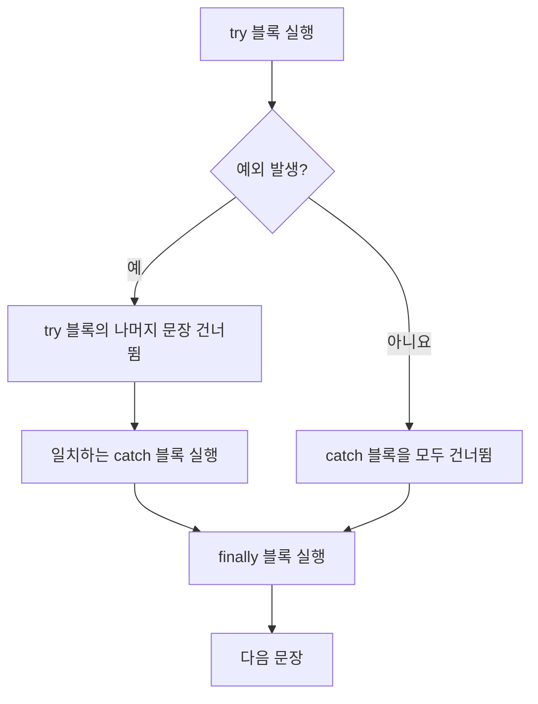
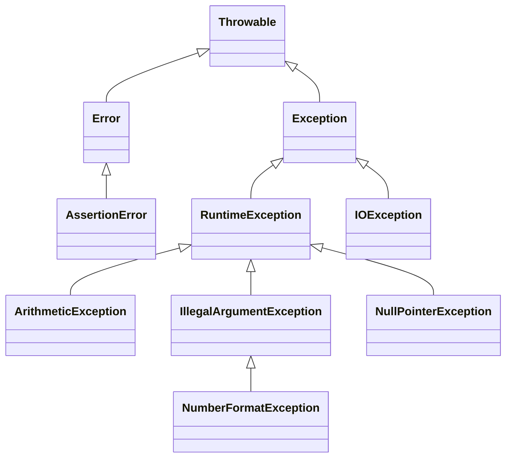

# 6강 — 2차원 배열, 함수, 예외 처리

[레포지토리 안내](../../README.ko.md) | [English](Concepts_Lecture.md) | [한국어](Concepts_Lecture.ko.md)

> **최종 수정일:** 2026-10-26

> **학습 목표:**
> 1. 2차원 배열을 생성하고 처리할 수 있다
> 2. 매개변수와 반환값을 가진 메서드를 정의할 수 있다
> 3. 배열을 반환하는 메서드와 main 메서드의 명령줄 인자를 사용할 수 있다
> 4. try-catch로 예외 처리를 적용할 수 있다
> 5. 예외를 호출자에게 전파하고 검사 예외와 비검사 예외를 구분할 수 있다

---

## 목차

- [1. 2차원 배열](#1-2차원-배열)
  - [1.1 선언과 초기화](#11-선언과-초기화)
  - [1.2 원소 접근과 length 필드](#12-원소-접근과-length-필드)
  - [1.3 2차원 배열의 순회](#13-2차원-배열의-순회)
  - [1.4 가변 길이 배열 (Ragged Array)](#14-가변-길이-배열-ragged-array)
- [2. 사용자 정의 함수 (메서드)](#2-사용자-정의-함수-메서드)
  - [2.1 메서드 정의](#21-메서드-정의)
  - [2.2 메서드 오버로딩](#22-메서드-오버로딩)
  - [2.3 배열을 반환하는 메서드](#23-배열을-반환하는-메서드)
  - [2.4 값에 의한 전달 vs. 참조에 의한 전달](#24-값에-의한-전달-vs-참조에-의한-전달)
  - [2.5 main 메서드와 명령줄 인자](#25-main-메서드와-명령줄-인자)
- [3. 예외 처리](#3-예외-처리)
  - [3.1 예외의 정의](#31-예외의-정의)
  - [3.2 try-catch-finally](#32-try-catch-finally)
  - [3.3 예외 정보와 여러 catch 블록](#33-예외-정보와-여러-catch-블록)
  - [3.4 예외 전파 (throws)](#34-예외-전파-throws)
  - [3.5 Throwable 계층 구조](#35-throwable-계층-구조)
  - [3.6 주요 예외 유형](#36-주요-예외-유형)
  - [3.7 예외를 활용한 입력 검증](#37-예외를-활용한-입력-검증)
- [요약](#요약)
- [점검 문제](#점검-문제)

---

<br>

## 1. 2차원 배열

### 1.1 선언과 초기화

2차원 배열은 배열의 배열로, 행렬, 격자, 표 등을 표현하는 데 주로 사용된다.

선언은 두 가지 형식으로 쓸 수 있고, 생성할 때는 행 수와 열 수를 차례로 지정한다.

```text
<자료형>[][] <변수>;                       // 형식 1
<자료형> <변수>[][];                       // 형식 2
<변수> = new <자료형>[<행 수>][<열 수>];   // 생성
```

```java
// 정적 초기화
double[][] scores = {
    {3.3, 3.4},
    {3.5, 3.6},
    {3.7, 4.0},
    {4.1, 4.2}
};

// 동적 할당
int[][] matrix = new int[3][4]; // 3행, 4열
```

정적 초기화에서는 바깥 중괄호 안에 행마다 중괄호를 하나씩 쓰며, 행 수와 열 수가 초기값의 개수로 정해진다. 위의 `scores`는 4년 동안의 학기별 학점을 담은 4행 2열 배열이다. `new`로 동적 할당한 배열의 원소는 자료형의 기본값(`int`는 0, `double`은 0.0)으로 초기화된다.

### 1.2 원소 접근과 length 필드

2차원 배열의 원소는 행 인덱스와 열 인덱스로 접근한다. 두 인덱스 모두 0부터 시작하므로 `payScaleTable[2][1]`은 세 번째 행, 두 번째 열의 원소이다.

```java
double[][] payScaleTable = new double[4][5]; // 4행, 5열
payScaleTable[2][1] = 36.50;                 // 2행 1열에 저장
double pay = payScaleTable[2][1];            // 2행 1열에서 읽기
```

Java의 2차원 배열은 행 배열에 대한 참조를 원소로 갖는 1차원 배열이다. 그래서 `length` 필드가 두 단계로 존재한다.

```text
int[][] i = new int[2][5];

          ┌──────┐
 i ─────▶ │ i[0] │ ──▶ [ i[0][0] | i[0][1] | i[0][2] | i[0][3] | i[0][4] ]   length 5
          ├──────┤
          │ i[1] │ ──▶ [ i[1][0] | i[1][1] | i[1][2] | i[1][3] | i[1][4] ]   length 5
          └──────┘
          length 2
```

*그림 1. new int[2][5]로 만든 2차원 배열의 메모리 구조*

- `array.length`는 행의 수이다. 위 예에서 `i.length`는 2이다.
- `array[r].length`는 r번째 행 배열의 원소 수, 즉 그 행의 열 수이다. 위 예에서 `i[0].length`와 `i[1].length`는 모두 5이다.

### 1.3 2차원 배열의 순회

```java
// 행 우선 순회
for (int row = 0; row < scores.length; row++) {
    for (int col = 0; col < scores[row].length; col++) {
        sum += scores[row][col];
    }
}

// 향상된 for 루프
for (double[] row : scores) {
    for (double value : row) {
        sum += value;
    }
}
```

바깥 루프는 행 인덱스를, 안쪽 루프는 그 행의 열 인덱스를 바꾸며 모든 원소를 방문한다. 향상된 for 루프에서는 바깥 루프 변수 `row`가 행 배열(`double[]`) 하나를 가리키고, 안쪽 루프 변수 `value`가 그 행의 원소를 차례로 받는다. 두 코드 모두 `sum`이 미리 `double sum = 0;`으로 선언되어 있다고 가정한다.

전체 평균을 `sum / (scores.length * scores[0].length)`로 구하는 방법은 모든 행의 길이가 같을 때만 맞다. 행 길이가 다를 수 있으면 원소를 방문할 때마다 개수를 세어 그 개수로 나누어야 한다(2.1절의 `computeAverage`).

2차원 배열은 그래픽 프로그램에서도 기본 자료 구조로 쓰인다. 다음 코드는 10×10 격자의 꼭짓점 11×11개의 화면 좌표를 `Point` 2차원 배열에 저장한다. 그 뒤 같은 행에서 이웃한 점끼리, 같은 열에서 이웃한 점끼리 선분으로 이으면 격자가 그려진다.

```java
graphPoints = new Point[NUM_SQUARES + 1][NUM_SQUARES + 1]; // NUM_SQUARES = 10
for (int r = 0; r < graphPoints.length; r++)
    for (int c = 0; c < graphPoints[r].length; c++)
        graphPoints[r][c] = new Point(c * SQUARE_SIZE, r * SQUARE_SIZE);
```

### 1.4 가변 길이 배열 (Ragged Array)

Java에서는 각 행의 길이가 서로 다를 수 있다:

```java
int[][] ragged = new int[3][];
ragged[0] = new int[2];
ragged[1] = new int[5];
ragged[2] = new int[3];
```

`new int[3][]`는 행 배열에 대한 참조 3개만 만들고(처음에는 모두 `null`이다), 각 행 배열은 따로 생성한다.

```text
ragged ──▶ [0] ──▶ [ 0 | 0 ]
           [1] ──▶ [ 0 | 0 | 0 | 0 | 0 ]
           [2] ──▶ [ 0 | 0 | 0 ]
```

*그림 2. 행 길이가 2, 5, 3인 가변 길이 배열*

> **핵심:** 가변 길이 배열을 올바르게 처리하려면 고정된 열 수 대신 항상 `array[row].length`를 사용해야 한다.

---

<br>

## 2. 사용자 정의 함수 (메서드)

### 2.1 메서드 정의

```java
public static returnType methodName(parameterList) {
    // 메서드 본문
    return value;
}
```

`returnType`은 반환값의 자료형이며, 반환값이 없으면 `void`를 쓴다. 괄호 안의 매개변수 목록은 호출할 때 받을 값의 자료형과 이름을 나열하고, `return` 문은 값을 호출자에게 돌려주며 메서드를 끝낸다. `public`과 `static`의 뜻은 2.5절에서 설명한다.

예시:

```java
public static double computeAverage(double[][] scores) {
    double sum = 0;
    int count = 0;
    for (double[] row : scores) {
        for (double val : row) {
            sum += val;
            count++;
        }
    }
    return sum / count;
}
```

`computeAverage`는 원소를 더하면서 개수도 세므로 가변 길이 배열에서도 올바른 평균을 반환한다. 원소가 하나도 없으면 `0.0 / 0`을 계산하게 되어 `NaN`을 반환한다.

### 2.2 메서드 오버로딩

매개변수의 타입이나 개수가 다르면 같은 이름의 메서드를 여러 개 정의할 수 있다:

```java
public static int max(int a, int b) { return a > b ? a : b; }
public static double max(double a, double b) { return a > b ? a : b; }
```

컴파일러는 호출에 쓴 인자의 타입과 개수를 보고 어느 메서드를 부를지 정한다. `max(3, 5)`는 `int` 버전을, `max(2.5, 1.0)`은 `double` 버전을 호출한다.

> **주의:** 반환 타입만 다른 두 메서드는 오버로딩이 아니다. `int f(int x)`와 `double f(int x)`를 함께 정의하면 같은 메서드를 두 번 정의한 것이 되어 컴파일 오류(`method f(int) is already defined`)가 난다.

### 2.3 배열을 반환하는 메서드

메서드는 배열을 반환할 수 있다. 반환 타입에 배열 타입(`int[]`)을 쓰고, `return` 문에서 배열의 참조를 돌려준다.

```java
public static int[] makeArray() {         // 반환 타입 int[]
    int temp[] = new int[4];
    for (int i = 0; i < temp.length; i++)
        temp[i] = i;
    return temp;                           // 배열 객체의 참조를 반환
}

public static void main(String[] args) {
    int intArray[];
    intArray = makeArray();
    for (int i = 0; i < intArray.length; i++)
        System.out.print(intArray[i] + " "); // 0 1 2 3
}
```

`makeArray`가 끝나면 지역 변수 `temp`는 사라지지만, `new`로 만든 배열은 힙에 남아 있다. 반환된 참조가 `intArray`에 저장되므로 호출자는 메서드 안에서 만든 배열을 그대로 사용한다. 이때 배열 자체는 복사되지 않는다.

```text
makeArray() 실행 중:    temp ─────┐
                                  ▼
                   new int[4]   [ 0 | 1 | 2 | 3 ]
                                  ▲
반환 후:            intArray ─────┘   (temp는 사라짐)
```

*그림 3. makeArray가 반환한 배열 참조를 intArray가 받는 과정*

### 2.4 값에 의한 전달 vs. 참조에 의한 전달

- **기본형(primitive)** 은 값에 의한 전달로 복사본이 전달된다.
- **객체와 배열**은 참조가 값으로 전달된다. 즉, 메서드 내에서 객체의 내용은 수정할 수 있지만 호출자의 변수 자체를 재할당할 수는 없다.

Java는 항상 값에 의한 전달(pass-by-value)만 한다. 객체와 배열의 경우에는 복사되는 값이 참조이다.

```java
static void modify(int[] arr)   { arr[0] = 99; }             // 호출자의 배열 내용이 바뀐다
static void reassign(int[] arr) { arr = new int[]{7, 7, 7}; } // 매개변수만 새 배열을 가리킨다
```

`modify(data)`를 호출하면 `arr`와 `data`가 같은 배열을 가리키므로 `data[0]`이 99가 된다. `reassign(data)`는 매개변수 `arr`에 새 배열을 대입할 뿐이므로 호출자의 `data`는 원래 배열을 계속 가리킨다.

### 2.5 main 메서드와 명령줄 인자

Java 프로그램은 `main` 메서드에서 실행을 시작한다. 머리의 각 부분은 다음 뜻을 갖는다.

```java
public static void main(String[] args) {
}
```

| 부분 | 뜻 |
|:-----|:-----|
| `public` | 다른 클래스(JVM 포함)에서 접근할 수 있다 |
| `static` | 객체를 생성하기 전에 호출할 수 있다 |
| `void` | 반환값이 없다 |
| `String[]` | 입력 인자를 문자열 배열로 받는다 |
| `args` | 인자 배열의 이름이다 |

*표 1. main 메서드 머리의 구성 요소*

프로그램을 실행할 때 클래스 이름 뒤에 쓴 단어들은 공백으로 나뉘어 `args` 배열에 문자열로 들어간다.

```text
C:\> java Hello abc 3 5.7

args.length => 3
args[0] => "abc"
args[1] => "3"
args[2] => "5.7"
```

숫자처럼 보이는 인자도 문자열이므로 계산에 쓰려면 `Integer.parseInt` 같은 메서드로 변환해야 한다. 다음 프로그램은 명령줄 인자로 받은 정수를 모두 더한다.

```java
public class Chap6Program4 {

    public static void main(String[] args) {

        int[] inputNum = new int[args.length];
        int sum = 0;

        for (int i = 0; i < inputNum.length; i++) {
            inputNum[i] = Integer.parseInt(args[i]);
            sum += inputNum[i];
        }

        System.out.println("Sum of all input values: " + sum);
    }
}
```

`java Chap6Program4 1 2 3`으로 실행하면 `Sum of all input values: 6`을 출력한다. 정수가 아닌 인자가 있으면 `Integer.parseInt`가 `NumberFormatException`을 던진다(3.1절). Eclipse 같은 IDE에서는 실행 구성(Run Configurations)의 Arguments 탭에 있는 Program arguments 칸에 인자를 입력한다.

---

<br>

## 3. 예외 처리

### 3.1 예외의 정의

> **용어 정의:** **예외(exception)** 는 프로그램이 정상적으로 실행되는 도중에 발생할 수 있는 오류 상황을 나타낸다. 예외가 발생하면, 즉 **던져지면**(thrown) 정상적인 실행 흐름이 중단되고 예외 처리 루틴이 실행된다. 이때 던져진 예외가 **잡혔다**(caught)고 한다.

예외를 잡지 않으면 프로그램은 예외 메시지와 스택 추적(stack trace)을 출력하고 비정상 종료한다. 예를 들어 다음 코드에서 사용자가 나이로 `ten`을 입력하면 `Integer.parseInt`가 `NumberFormatException`을 던진다.

```java
String inputStr;
int age;

inputStr = JOptionPane.showInputDialog(null, "Age:");
age = Integer.parseInt(inputStr);
```

```text
Exception in thread "main" java.lang.NumberFormatException: For input string: "ten"
    at java.base/java.lang.NumberFormatException.forInputString(NumberFormatException.java:67)
    at java.base/java.lang.Integer.parseInt(Integer.java:564)
    at java.base/java.lang.Integer.parseInt(Integer.java:661)
    ...
```

메시지의 세부 형식은 JDK 버전에 따라 조금씩 다르다.

### 3.2 try-catch-finally

예외가 발생할 수 있는 문장을 `try` 블록에 넣고, 그 예외를 처리할 코드를 `catch` 블록에 쓴다. 앞의 나이 입력은 다음처럼 처리한다.

```java
inputStr = JOptionPane.showInputDialog(null, "Age:");
try {
    age = Integer.parseInt(inputStr);
} catch (NumberFormatException e) {
    JOptionPane.showMessageDialog(null, "'" + inputStr
            + "' is invalid\n"
            + "Please enter digits only");
}
```

`finally` 블록에는 예외 발생 여부와 관계없이 반드시 실행해야 하는 문장(파일 닫기 같은 정리 작업)을 넣는다.

```java
try {
    int result = 10 / 0;
} catch (ArithmeticException e) {
    System.out.println("Cannot divide by zero: " + e.getMessage());
} finally {
    // 예외 발생 여부와 관계없이 항상 실행됨
    System.out.println("Cleanup complete.");
}
```

`10 / 0`에서 `ArithmeticException`이 발생하므로 이 코드는 `Cannot divide by zero: / by zero`와 `Cleanup complete.`를 차례로 출력한다. 제어 흐름은 다음과 같다.

- `try` 블록의 어떤 문장에서 예외가 발생하면 그 뒤에 남은 `try` 블록의 문장은 건너뛰고, 예외 타입이 일치하는 `catch` 블록을 실행한다.
- 예외가 발생하지 않으면 `try` 블록을 끝까지 실행하고 `catch` 블록은 모두 건너뛴다.
- `finally` 블록은 두 경우 모두 실행되며, 그 뒤 try 문 다음의 문장으로 넘어간다. 일치하는 `catch` 블록이 없을 때도 `finally`는 실행되고, 그 뒤 예외가 호출자에게 전파된다(3.4절).



*그림 4. try-catch-finally의 제어 흐름*

### 3.3 예외 정보와 여러 catch 블록

`catch` 블록의 매개변수 `e`는 던져진 예외 객체이며, 다음 두 메서드로 예외의 정보를 얻는다.

- `getMessage()`는 예외의 설명 메시지를 문자열로 반환한다.
- `printStackTrace()`는 예외 타입, 메시지, 예외가 발생하기까지 호출된 메서드의 목록(스택 추적)을 표준 오류로 출력한다. 반환값이 없으므로(`void`) `println`의 인자로 쓸 수 없다.

```java
try {
    . . .
} catch (NumberFormatException e) {
    System.out.println(e.getMessage());
    e.printStackTrace();
}
```

try 문 하나에 예외 타입마다 `catch` 블록을 하나씩, 여러 개 둘 수 있다.

```java
try {
    . . .
    age = Integer.parseInt(inputStr);
    . . .
    val = cal.get(id); // cal is a GregorianCalendar
    . . .
} catch (NumberFormatException e) {
    . . .
} catch (ArrayIndexOutOfBoundsException e) {
    . . .
}
```

예외가 발생하면 `catch` 블록을 위에서부터 차례로 검사하여, 던져진 예외와 같은 클래스이거나 그 상위 클래스를 잡는 첫 번째 블록 하나만 실행하고 나머지는 건너뛴다. 위 코드에서 `Calendar.get`은 잘못된 필드 번호를 받으면 `ArrayIndexOutOfBoundsException`을 던진다.

> **주의:** 상위 클래스 예외를 잡는 `catch`를 하위 클래스 예외의 `catch`보다 앞에 두면 뒤의 블록에 도달할 수 없으므로 컴파일 오류가 난다. 예를 들어 `catch (Exception e)` 뒤에 `catch (ArithmeticException e)`를 쓰면 `exception ArithmeticException has already been caught` 오류가 난다. 하위 클래스의 `catch`를 먼저 쓴다.

### 3.4 예외 전파 (throws)

메서드 안에서 `try-catch`로 예외를 잡는 대신, 예외를 그 메서드를 호출한 쪽으로 **전파**(propagate)할 수 있다. 이때 메서드 머리에 예약어 `throws`와 예외 타입을 쓴다.

```java
public int getAge() throws NumberFormatException {
    . . .
    int age = Integer.parseInt(inputStr);
    . . .
    return age;
}
```

`getAge`에서 `NumberFormatException`이 발생하면 `getAge`는 즉시 끝나고 예외는 호출자에게 넘어간다. 호출자는 그 예외를 `try-catch`로 잡거나 다시 전파한다. `main`까지 전파되어도 잡히지 않으면 3.1절처럼 프로그램이 비정상 종료한다.

### 3.5 Throwable 계층 구조

Java의 예외 클래스는 `Throwable`을 루트로 하는 상속 계층을 이루며, 이 계층에는 60개가 넘는 클래스가 있다. 주요 클래스는 다음과 같다.



*그림 5. Throwable 클래스 계층 구조의 일부*

- `Error`는 메모리 부족처럼 프로그램이 복구하기 어려운 심각한 오류를 나타낸다. 9강의 `AssertionError`도 여기에 속한다.
- `Exception`은 프로그램이 잡아서 처리할 수 있는 예외 상황을 나타낸다.

> **용어 정의:** **비검사 예외(unchecked exception)** 는 `RuntimeException`과 `Error`, 그리고 그 하위 클래스이다. 컴파일러가 처리 여부를 검사하지 않으므로 잡거나 선언하지 않아도 컴파일된다. **검사 예외(checked exception)** 는 그 밖의 `Exception` 하위 클래스(`IOException` 등)이며, 이를 던질 수 있는 코드는 `try-catch`로 잡거나 메서드 머리에 `throws`로 선언해야 한다. 그렇지 않으면 `unreported exception IOException; must be caught or declared to be thrown` 같은 컴파일 오류가 난다.

`ArithmeticException`, `NumberFormatException`, `NullPointerException`은 모두 `RuntimeException`의 하위 클래스이므로 비검사 예외이다. 그래서 3.4절의 `throws NumberFormatException`은 생략해도 컴파일되며, 이 예외가 날 수 있음을 호출자에게 알리는 문서 역할을 한다. 파일 입출력의 `IOException`은 검사 예외이다(10강).

### 3.6 주요 예외 유형

| 예외 | 원인 | 종류 |
|:-----|:-----|:-----|
| `ArithmeticException` | 0으로 나누기 | 비검사 |
| `ArrayIndexOutOfBoundsException` | 잘못된 배열 인덱스 | 비검사 |
| `NullPointerException` | null 참조에 대한 멤버 접근 | 비검사 |
| `NumberFormatException` | 잘못된 문자열-숫자 변환 | 비검사 |
| `InputMismatchException` | Scanner에 예상과 다른 입력 타입 전달 | 비검사 |
| `IOException` | 입출력 작업 실패 | 검사 |

*표 2. 자주 발생하는 예외와 원인*

`ArithmeticException`은 정수를 0으로 나눌 때만 발생한다. 실수(`double`)를 0으로 나누면 예외 없이 `Infinity`나 `NaN`이 된다. 예외를 잡으려면 예외가 발생할 수 있는 연산 자체를 `try` 블록 안에 넣어야 한다. 같은 나눗셈을 `try` 블록 앞에서 먼저 실행하면 예외가 그 자리에서 던져지므로 `catch` 블록에 도달하지 못한다.

```java
try {
    System.out.println(dividend + "/" + divisor + " = " + dividend / divisor);
} catch (ArithmeticException e) {
    System.out.println("Cannot divide by 0! Please input non-zero value...");
}
```

### 3.7 예외를 활용한 입력 검증

```java
Scanner scanner = new Scanner(System.in);
int sum = 0;
for (int i = 0; i < 3; i++) {
    System.out.print((i + 1) + "th value >> ");
    try {
        sum += scanner.nextInt();
    } catch (InputMismatchException e) {
        System.out.println("Not an integer. Try again.");
        scanner.next(); // 잘못된 토큰 소비
        i--;            // 같은 반복을 재시도
    }
}
```

`nextInt()`는 다음 토큰이 정수가 아니면 `InputMismatchException`을 던지고, 그 토큰을 입력에 그대로 남긴다. `catch` 블록은 `scanner.next()`로 그 토큰을 읽어 버리고 `i--`로 반복 변수를 되돌려, 같은 순서의 값을 다시 입력받는다. 이 코드는 `java.util.Scanner`와 `java.util.InputMismatchException`을 import해야 한다. 같은 방식의 전체 프로그램은 [InputValidationWithException.java](../../Coursework/Lab06_2D-Arrays-Functions-and-Exception-Handling/InputValidationWithException.java)에 있다.

> **핵심:** `Scanner`에서 `InputMismatchException`을 잡을 때는 `scanner.next()`를 호출하여 잘못된 토큰을 소비해야 한다. 그렇지 않으면 루프가 무한히 반복된다.

---

<br>

## 요약

| 개념 | 핵심 요약 |
|:-----|:-----|
| 2차원 배열 | 배열의 배열이며, 행마다 길이가 다를 수 있다(가변 길이 배열). |
| 순회 | 행 수에는 `array.length`를, 열 수에는 `array[i].length`를 사용한다. |
| 메서드 | 반환 타입과 매개변수를 갖는 재사용 가능한 코드 블록이다. |
| 오버로딩 | 이름이 같고 매개변수 시그니처가 다른 메서드를 여러 개 정의하는 것이며, 반환 타입만 달라서는 안 된다. |
| 배열 반환 | 메서드는 배열의 참조를 반환할 수 있고, 호출자는 메서드 안에서 만든 배열을 그대로 사용한다. |
| 값에 의한 전달 | Java는 항상 값을 복사해 전달하며, 객체와 배열은 참조가 복사되므로 내용은 바꿀 수 있지만 호출자의 변수는 바꿀 수 없다. |
| main 메서드 | 명령줄 인자를 `String[] args`로 받으며, 숫자로 쓰려면 `Integer.parseInt` 등으로 변환한다. |
| try-catch | 프로그램을 중단하지 않고 런타임 오류를 처리한다. |
| finally | 예외 발생 여부와 관계없이 정리 작업을 위해 항상 실행되는 코드이다. |
| 여러 catch 블록 | 위에서부터 일치하는 첫 블록만 실행되므로 하위 클래스 예외를 먼저 잡는다. |
| throws | 예외를 잡지 않고 호출자에게 전파함을 메서드 머리에 선언한다. |
| 검사 예외와 비검사 예외 | 검사 예외는 잡거나 선언해야 하고, `RuntimeException`과 `Error` 계열의 비검사 예외는 그렇지 않아도 된다. |
| InputMismatchException | 재시도하기 전에 `scanner.next()`로 잘못된 토큰을 소비해야 한다. |

---

<br>

## 점검 문제

1. **가변 길이 배열:** 1.4절의 `ragged` 배열에서 `ragged.length`, `ragged[1].length`, 전체 원소 수를 각각 구하라.

   <details>
   <summary>정답</summary>

   `ragged.length`는 행의 수인 3이고, `ragged[1].length`는 두 번째 행의 길이인 5이다. 전체 원소 수는 각 행의 길이를 더한 2 + 5 + 3 = 10이다. 행 길이가 다르므로 `ragged.length * ragged[0].length` = 6으로 구하면 틀린다.

   </details>

2. **예외와 출력 추적:** 다음 코드의 출력을 쓰라.

   ```java
   int[] intArray = new int[5];
   intArray[0] = 0;
   try {
       for (int i = 0; i < 5; i++) {
           intArray[i + 1] = i + 1 + intArray[i];
           System.out.println("intArray[" + i + "]" + "=" + intArray[i]);
       }
   } catch (ArrayIndexOutOfBoundsException e) {
       System.out.println("Out of index for intArray");
   }
   ```

   <details>
   <summary>정답</summary>

   ```text
   intArray[0]=0
   intArray[1]=1
   intArray[2]=3
   intArray[3]=6
   Out of index for intArray
   ```

   i가 0~3일 때 `intArray[i + 1]`에 값을 저장한 뒤 `intArray[i]`를 출력한다. i = 4이면 존재하지 않는 `intArray[5]`에 저장하려다 `ArrayIndexOutOfBoundsException`이 발생하므로 그 반복의 출력문은 실행되지 않고 `catch` 블록으로 넘어간다.

   </details>

3. **값에 의한 전달:** 2.4절의 `modify`, `reassign`과 `static void inc(int x) { x++; }`가 정의되어 있을 때 다음 코드의 출력을 쓰라.

   ```java
   int[] data = {1, 2, 3};
   int n = 5;
   reassign(data);
   modify(data);
   inc(n);
   System.out.println(data[0] + " " + data.length + " " + n);
   ```

   <details>
   <summary>정답</summary>

   `99 3 5`이다. `reassign`은 매개변수만 새 배열을 가리키게 하므로 `data`는 원래 길이 3인 배열을 그대로 가리킨다. `modify`는 같은 배열의 내용을 바꾸므로 `data[0]`이 99가 된다. `inc`는 `n`의 복사본만 증가시키므로 `n`은 5로 남는다.

   </details>

4. **오버로딩:** 다음 두 쌍의 메서드를 한 클래스에 함께 정의할 수 있는지 판단하고 이유를 쓰라. (a) `int f(int x)`와 `int f(double x)` (b) `int g(int x)`와 `double g(int x)`

   <details>
   <summary>정답</summary>

   (a)는 매개변수 타입이 다르므로 오버로딩으로 함께 정의할 수 있다. (b)는 매개변수 목록이 같고 반환 타입만 다르므로 오버로딩이 아니며, `method g(int) is already defined` 컴파일 오류가 난다.

   </details>

5. **catch 순서와 검사 예외:** (a) `catch (Exception e)` 블록 뒤에 `catch (ArithmeticException e)` 블록을 두면 어떻게 되는가? (b) 메서드 `void read() { throw new IOException("x"); }`가 컴파일되지 않는 이유와 고치는 방법 두 가지를 쓰라.

   <details>
   <summary>정답</summary>

   (a) `ArithmeticException`은 `Exception`의 하위 클래스라서 앞의 블록이 먼저 잡으므로 뒤의 블록에 도달할 수 없고, 컴파일 오류가 난다. 하위 클래스인 `ArithmeticException`의 `catch`를 먼저 써야 한다. (b) `IOException`은 검사 예외이므로 잡거나 선언해야 한다. 메서드 머리를 `void read() throws IOException`으로 바꾸거나, `throw` 문을 `try-catch (IOException e)`로 감싼다.

   </details>
