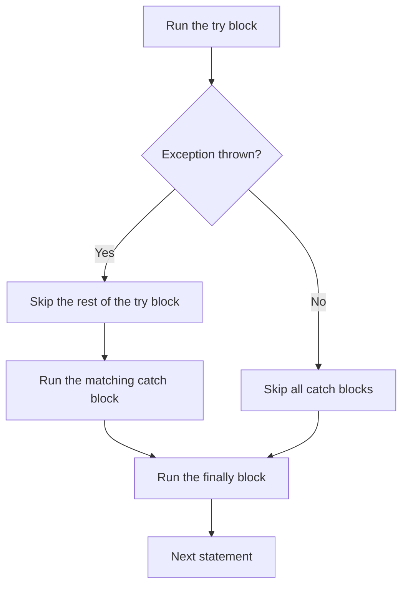
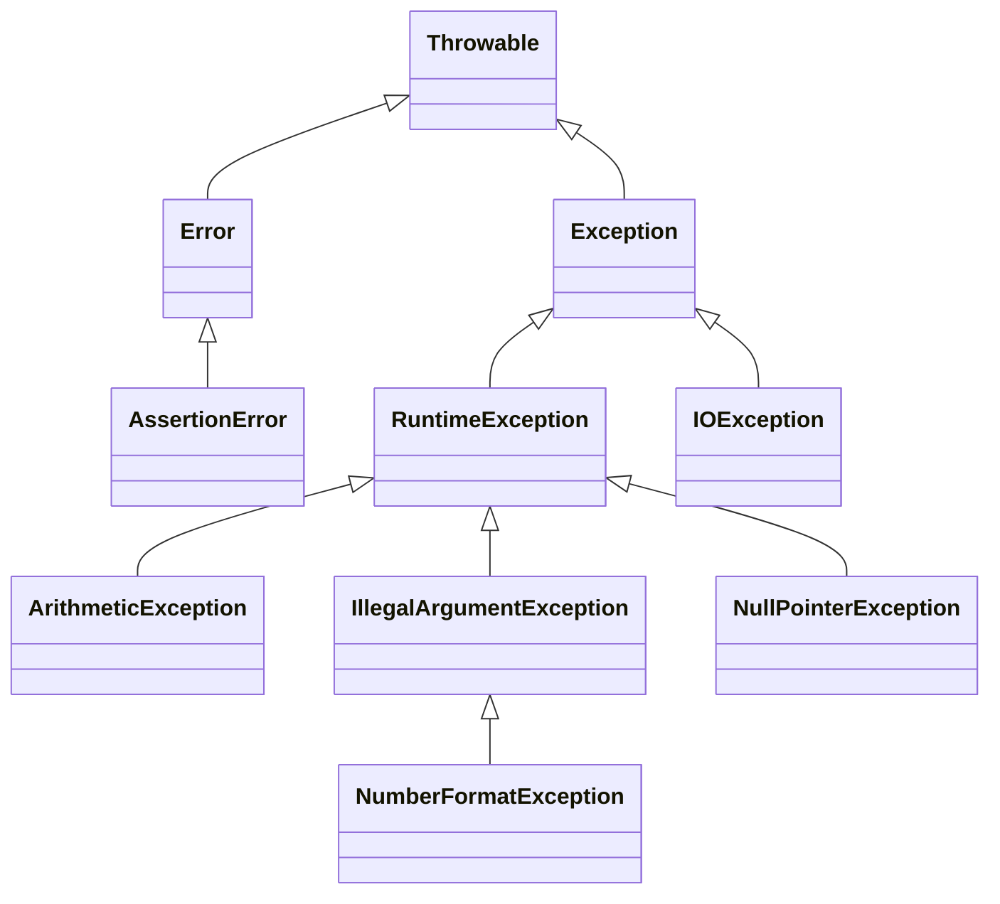

# Lecture 6 — 2D Arrays, Functions, and Exception Handling

[Repository Guide](../../README.md) | [English](Concepts_Lecture.md) | [한국어](Concepts_Lecture.ko.md)

> **Last Updated:** 2026-11-19

> **Learning Objectives:**
> 1. Create and process two-dimensional arrays
> 2. Define methods with parameters and return values
> 3. Use methods that return arrays and the command-line arguments of the main method
> 4. Apply try-catch for exception handling
> 5. Propagate exceptions to the caller and distinguish checked from unchecked exceptions
> 6. Trace the call stack and argument passing step by step, and use programmer-defined exceptions and try-with-resources

---

## Table of Contents

- [1. Two-Dimensional Arrays](#1-two-dimensional-arrays)
  - [1.1 Declaration and Initialization](#11-declaration-and-initialization)
  - [1.2 Element Access and the length Field](#12-element-access-and-the-length-field)
  - [1.3 Iterating Over 2D Arrays](#13-iterating-over-2d-arrays)
  - [1.4 Ragged Arrays](#14-ragged-arrays)
  - [1.5 Shared Rows and null Rows](#15-shared-rows-and-null-rows)
  - [1.6 Transposing and Multiplying Matrices](#16-transposing-and-multiplying-matrices)
- [2. Custom Functions (Methods)](#2-custom-functions-methods)
  - [2.1 Defining Methods](#21-defining-methods)
  - [2.2 Method Overloading](#22-method-overloading)
  - [2.3 Methods That Return Arrays](#23-methods-that-return-arrays)
  - [2.4 Pass-by-Value vs. Pass-by-Reference Semantics](#24-pass-by-value-vs-pass-by-reference-semantics)
  - [2.5 The main Method and Command-Line Arguments](#25-the-main-method-and-command-line-arguments)
  - [2.6 The Call Stack and Recursion](#26-the-call-stack-and-recursion)
  - [2.7 Tracing Argument Passing Step by Step](#27-tracing-argument-passing-step-by-step)
  - [2.8 Rules for Choosing an Overloaded Method](#28-rules-for-choosing-an-overloaded-method)
- [3. Exception Handling](#3-exception-handling)
  - [3.1 Definition of an Exception](#31-definition-of-an-exception)
  - [3.2 try-catch-finally](#32-try-catch-finally)
  - [3.3 Exception Information and Multiple catch Blocks](#33-exception-information-and-multiple-catch-blocks)
  - [3.4 Propagating Exceptions (throws)](#34-propagating-exceptions-throws)
  - [3.5 The Throwable Hierarchy](#35-the-throwable-hierarchy)
  - [3.6 Common Exception Types](#36-common-exception-types)
  - [3.7 Input Validation with Exceptions](#37-input-validation-with-exceptions)
  - [3.8 Reading a Stack Trace](#38-reading-a-stack-trace)
  - [3.9 throw and Programmer-Defined Exceptions](#39-throw-and-programmer-defined-exceptions)
  - [3.10 Execution Order of finally and return](#310-execution-order-of-finally-and-return)
  - [3.11 Multi-catch and try-with-resources](#311-multi-catch-and-try-with-resources)
- [4. Common Mistakes](#4-common-mistakes)
- [Concept Applications](#concept-applications)
- [Summary](#summary)
- [Self-Check Questions](#self-check-questions)
- [References](#references)

---

<br>

## 1. Two-Dimensional Arrays

### 1.1 Declaration and Initialization

A 2D array is an array of arrays, commonly used to represent matrices, grids, and tables.

A declaration can take either of two forms, and creation specifies the number of rows and then the number of columns.

```text
<data type>[][] <variable>;                       // form 1
<data type> <variable>[][];                       // form 2
<variable> = new <data type>[<rows>][<columns>];  // creation
```

```java
// Static initialization
double[][] scores = {
    {3.3, 3.4},
    {3.5, 3.6},
    {3.7, 4.0},
    {4.1, 4.2}
};

// Dynamic allocation
int[][] matrix = new int[3][4]; // 3 rows, 4 columns
```

In static initialization, each row gets its own pair of braces inside the outer braces, and the numbers of rows and columns follow from the initial values. The `scores` array above is a 4-row, 2-column array holding the grade of each semester over four years. The elements of an array allocated dynamically with `new` are initialized to the default value of the type (0 for `int`, 0.0 for `double`).

### 1.2 Element Access and the length Field

An element of a 2D array is accessed by its row index and column index. Both indices start at 0, so `payScaleTable[2][1]` is the element in the third row and second column.

```java
double[][] payScaleTable = new double[4][5]; // 4 rows, 5 columns
payScaleTable[2][1] = 36.50;                 // store into row 2, column 1
double pay = payScaleTable[2][1];            // read from row 2, column 1
```

A Java 2D array is a 1D array whose elements are references to row arrays. The `length` field therefore exists at two levels.

```text
int[][] i = new int[2][5];

          ┌──────┐
 i ─────▶ │ i[0] │ ──▶ [ i[0][0] | i[0][1] | i[0][2] | i[0][3] | i[0][4] ]   length 5
          ├──────┤
          │ i[1] │ ──▶ [ i[1][0] | i[1][1] | i[1][2] | i[1][3] | i[1][4] ]   length 5
          └──────┘
          length 2
```

*Figure 1. Memory structure of a 2D array created with new int[2][5]*

- `array.length` is the number of rows. In the example, `i.length` is 2.
- `array[r].length` is the number of elements in row array r, that is, the number of columns in that row. In the example, `i[0].length` and `i[1].length` are both 5.

### 1.3 Iterating Over 2D Arrays

```java
// Row-major traversal
for (int row = 0; row < scores.length; row++) {
    for (int col = 0; col < scores[row].length; col++) {
        sum += scores[row][col];
    }
}

// Enhanced for loop
for (double[] row : scores) {
    for (double value : row) {
        sum += value;
    }
}
```

The outer loop varies the row index and the inner loop varies the column index within that row, so every element is visited. In the enhanced for loop, the outer loop variable `row` refers to one row array (`double[]`), and the inner loop variable `value` receives the elements of that row in turn. Both snippets assume that `sum` has already been declared as `double sum = 0;`.

Computing the overall average as `sum / (scores.length * scores[0].length)` is correct only when all rows have the same length. If row lengths may differ, count the elements while visiting them and divide by that count (`computeAverage` in Section 2.1).

2D arrays are also a basic data structure in graphics programs. The following code stores the screen coordinates of the 11×11 corner points of a 10×10 grid in a 2D array of `Point`. Connecting neighboring points in the same row and neighboring points in the same column with line segments then draws the grid.

```java
graphPoints = new Point[NUM_SQUARES + 1][NUM_SQUARES + 1]; // NUM_SQUARES = 10
for (int r = 0; r < graphPoints.length; r++)
    for (int c = 0; c < graphPoints[r].length; c++)
        graphPoints[r][c] = new Point(c * SQUARE_SIZE, r * SQUARE_SIZE);
```

### 1.4 Ragged Arrays

Java allows each row to have a different length:

```java
int[][] ragged = new int[3][];
ragged[0] = new int[2];
ragged[1] = new int[5];
ragged[2] = new int[3];
```

`new int[3][]` creates only three references to row arrays (all `null` at first), and each row array is created separately.

```text
ragged ──▶ [0] ──▶ [ 0 | 0 ]
           [1] ──▶ [ 0 | 0 | 0 | 0 | 0 ]
           [2] ──▶ [ 0 | 0 | 0 ]
```

*Figure 2. Ragged array with row lengths 2, 5, and 3*

> **Key Point:** Always use `array[row].length` (not a fixed column count) to handle ragged arrays correctly.

### 1.5 Shared Rows and null Rows

Each row of a two-dimensional array is an independent one-dimensional array object, and the elements of the outer array are references to those rows (Figure 1). So an entire row can be changed by changing a reference, without moving its elements one by one. Conversely, when two slots come to refer to the same row, a change through one is visible through the other (Lecture 5, Section 1.5).

```java
import java.util.Arrays;

public class Rows {
    public static void main(String[] args) {
        int[][] m = {{1, 2, 3}, {4, 5, 6}};
        int[] tmp = m[0];
        m[0] = m[1];
        m[1] = tmp;
        System.out.println(Arrays.deepToString(m));
        m[1] = m[0];
        m[1][0] = 99;
        System.out.println(Arrays.deepToString(m));

        int[][] pascal = new int[5][];
        for (int r = 0; r < pascal.length; r++) {
            pascal[r] = new int[r + 1];
            pascal[r][0] = 1;
            pascal[r][r] = 1;
            for (int c = 1; c < r; c++) {
                pascal[r][c] = pascal[r - 1][c - 1] + pascal[r - 1][c];
            }
        }
        for (int[] row : pascal) {
            System.out.println(Arrays.toString(row));
        }
        int[][] empty = new int[2][];
        System.out.println(empty[0]);
        System.out.println(empty[0].length);
    }
}
```

```text
[[4, 5, 6], [1, 2, 3]]
[[99, 5, 6], [99, 5, 6]]
[1]
[1, 1]
[1, 2, 1]
[1, 3, 3, 1]
[1, 4, 6, 4, 1]
null
Exception in thread "main" java.lang.NullPointerException: Cannot read the array length because "empty[0]" is null
	at Rows.main(Rows.java:28)
```

- The first three lines swap only the references of the two rows, changing the order of the rows without moving the six elements.
- After `m[1] = m[0];` both slots refer to the same row array, so `m[1][0] = 99` also changes `m[0][0]`. The original row `{1, 2, 3}` is no longer referred to by anything and becomes garbage.
- Pascal's triangle is a ragged array whose row r has length r + 1. Both ends are 1, and each inner element is the sum of the two elements just above it, `pascal[r - 1][c - 1]` and `pascal[r - 1][c]`. For example, the 6 in row 4 is 3 + 3 from row 3.
- `new int[2][]` creates only two row-reference slots, each `null`. Reading `empty[0].length` before creating the row throws a `NullPointerException`. The variable name in the message, as in `"empty[0]"`, appears when the class is compiled with `-g` (Lecture 2, Section 2.6).
- To print a two-dimensional array, use `Arrays.deepToString` of Lecture 5, Section 4.2.

### 1.6 Transposing and Multiplying Matrices

A matrix of mathematics is represented by a two-dimensional array. The **transpose** $`A^{T}`$ of an m × n matrix A is the n × m matrix with $`A^{T}_{cr} = A_{rc}`$, and the **product** C = AB of an n × m matrix A and an m × p matrix B is the n × p matrix given by the following.

```math
C_{ij} = \sum_{k=0}^{m-1} A_{ik} B_{kj}
```

```java
import java.util.Arrays;

public class Matrix {
    static int[][] transpose(int[][] a) {
        int[][] t = new int[a[0].length][a.length];
        for (int r = 0; r < a.length; r++) {
            for (int c = 0; c < a[r].length; c++) {
                t[c][r] = a[r][c];
            }
        }
        return t;
    }

    static int[][] multiply(int[][] a, int[][] b) {
        int n = a.length, m = b.length, p = b[0].length;
        int[][] result = new int[n][p];
        for (int i = 0; i < n; i++) {
            for (int j = 0; j < p; j++) {
                for (int k = 0; k < m; k++) {
                    result[i][j] += a[i][k] * b[k][j];
                }
            }
        }
        return result;
    }

    public static void main(String[] args) {
        int[][] a = {{1, 2, 3}, {4, 5, 6}};
        int[][] b = {{7, 8}, {9, 10}, {11, 12}};
        System.out.println(Arrays.deepToString(transpose(a)));
        System.out.println(Arrays.deepToString(multiply(a, b)));
    }
}
```

```text
[[1, 4], [2, 5], [3, 6]]
[[58, 64], [139, 154]]
```

`transpose` creates a 3 × 2 array from the 2 × 3 array and stores each element with its row and column indices exchanged. The first element of the result of `multiply` is the sum of the products of row 0 of A, (1, 2, 3), and column 0 of B, (7, 9, 11): 1 × 7 + 2 × 9 + 3 × 11 = 58, and the last element is 4 × 8 + 5 × 10 + 6 × 12 = 154. The elements of `result`, created with `new int[n][p]`, start at the default value 0, so they can be accumulated directly with `+=`. The three nested loops run n, p, and m times, so there are n × p × m multiplications, 2 × 2 × 3 = 12 in this example. If the sizes of the two matrices do not match (the number of columns of A differs from the number of rows of B), the product is undefined, so a real method should check `a[0].length == b.length` at its start.

---

<br>

## 2. Custom Functions (Methods)

### 2.1 Defining Methods

```java
public static returnType methodName(parameterList) {
    // method body
    return value;
}
```

`returnType` is the type of the return value, and `void` is used when there is no return value. The parameter list in parentheses gives the types and names of the values received at the call, and the `return` statement passes a value back to the caller and ends the method. Section 2.5 explains the meaning of `public` and `static`.

Example:

```java
public static double computeAverage(double[][] scores) {
    double sum = 0;
    int count = 0;
    for (double[] row : scores) {
        for (double val : row) {
            sum += val;
            count++;
        }
    }
    return sum / count;
}
```

`computeAverage` counts the elements while adding them, so it returns the correct average for ragged arrays as well. If there are no elements at all, it computes `0.0 / 0` and returns `NaN`.

### 2.2 Method Overloading

Multiple methods can share the same name if they differ in parameter types or count:

```java
public static int max(int a, int b) { return a > b ? a : b; }
public static double max(double a, double b) { return a > b ? a : b; }
```

The compiler chooses which method to call from the types and number of the arguments in the call. `max(3, 5)` calls the `int` version, and `max(2.5, 1.0)` calls the `double` version.

> **Caution:** Two methods that differ only in return type are not overloads. Defining both `int f(int x)` and `double f(int x)` defines the same method twice and causes a compile error (`method f(int) is already defined`).

### 2.3 Methods That Return Arrays

A method can return an array. The return type is an array type (`int[]`), and the `return` statement passes back a reference to the array.

```java
public static int[] makeArray() {         // return type int[]
    int temp[] = new int[4];
    for (int i = 0; i < temp.length; i++)
        temp[i] = i;
    return temp;                           // return the reference to the array object
}

public static void main(String[] args) {
    int intArray[];
    intArray = makeArray();
    for (int i = 0; i < intArray.length; i++)
        System.out.print(intArray[i] + " "); // 0 1 2 3
}
```

When `makeArray` ends, the local variable `temp` disappears, but the array created with `new` remains on the heap. The returned reference is stored in `intArray`, so the caller uses the array created inside the method as it is. The array itself is not copied.

```text
while makeArray() runs:  temp ─────┐
                                   ▼
                   new int[4]    [ 0 | 1 | 2 | 3 ]
                                   ▲
after return:        intArray ─────┘   (temp is gone)
```

*Figure 3. intArray receiving the array reference returned by makeArray*

### 2.4 Pass-by-Value vs. Pass-by-Reference Semantics

- **Primitives** are passed by value, so a copy is made.
- **Objects and arrays** pass the reference by value: the method can modify the object's contents but cannot reassign the caller's variable.

Java always passes by value. For objects and arrays, the value that is copied is the reference.

```java
static void modify(int[] arr)   { arr[0] = 99; }             // the caller's array contents change
static void reassign(int[] arr) { arr = new int[]{7, 7, 7}; } // only the parameter points to a new array
```

Calling `modify(data)` makes `arr` and `data` point to the same array, so `data[0]` becomes 99. `reassign(data)` only assigns a new array to the parameter `arr`, so the caller's `data` keeps pointing to the original array.

### 2.5 The main Method and Command-Line Arguments

A Java program starts running at the `main` method. Each part of its header has the following meaning.

```java
public static void main(String[] args) {
}
```

| Part | Meaning |
|:-----|:-----|
| `public` | Accessible from other classes (including the JVM) |
| `static` | Can be called before any object is created |
| `void` | No return value |
| `String[]` | Receives the input arguments as an array of strings |
| `args` | Name of the argument array |

*Table 1. Parts of the main method header*

When a program is run, the words written after the class name are split at spaces and stored in the `args` array as strings.

```text
C:\> java Hello abc 3 5.7

args.length => 3
args[0] => "abc"
args[1] => "3"
args[2] => "5.7"
```

Arguments that look like numbers are still strings, so they must be converted with a method such as `Integer.parseInt` before being used in calculations. The following program adds all integers given as command-line arguments.

```java
public class Chap6Program4 {

    public static void main(String[] args) {

        int[] inputNum = new int[args.length];
        int sum = 0;

        for (int i = 0; i < inputNum.length; i++) {
            inputNum[i] = Integer.parseInt(args[i]);
            sum += inputNum[i];
        }

        System.out.println("Sum of all input values: " + sum);
    }
}
```

Running `java Chap6Program4 1 2 3` prints `Sum of all input values: 6`. If an argument is not an integer, `Integer.parseInt` throws `NumberFormatException` (Section 3.1). In an IDE such as Eclipse, the arguments are entered in the Program arguments box on the Arguments tab of the Run Configurations dialog.

### 2.6 The Call Stack and Recursion

When a method is called, the JVM pushes a **frame** for that call onto the stack of the thread and removes the frame when the method ends (Lecture 1, Section 3.9). A frame holds the parameters and local variables of the call and the place to return to. The pile of frames stacked in calling order is called the **call stack**. The local variables of a method are in its frame, so they disappear when the call ends, and calling the same method twice creates two sets of local variables.

A method that calls itself is called **recursive**. A recursive method consists of a base case, which does not call itself any further, and a recursive case, which calls itself on a smaller problem.

```java
public class Recursion {
    static int factorial(int n) {
        if (n <= 1) {
            return 1;
        }
        return n * factorial(n - 1);
    }

    static int depth = 0;

    static void forever() {
        depth++;
        forever();
    }

    public static void main(String[] args) {
        System.out.println(factorial(4));
        try {
            forever();
        } catch (StackOverflowError e) {
            System.out.println("StackOverflowError after " + (depth > 1000 ? "more than 1000" : "few") + " calls");
        }
    }
}
```

```text
24
StackOverflowError after more than 1000 calls
```

Calling `factorial(4)` stacks frames as follows, and once the base case `factorial(1)` returns 1, they are removed one at a time from the top.

```text
 call factorial(4)                       returns
┌──────────────────────┐
│ factorial  n = 1     │  ── return 1
├──────────────────────┤
│ factorial  n = 2     │  ── return 2 * 1 = 2
├──────────────────────┤
│ factorial  n = 3     │  ── return 3 * 2 = 6
├──────────────────────┤
│ factorial  n = 4     │  ── return 4 * 6 = 24
├──────────────────────┤
│ main                 │  ── prints 24
└──────────────────────┘
```

*Figure 4. The call stack while factorial(4) runs*

The `n` of each frame is a different variable, so even if an inner call changed `n`, the `n` of an outer call would stay the same. `forever`, which has no base case, keeps stacking frames and throws a `StackOverflowError` when it exceeds the size of the stack. At which call this happens depends on the stack size setting of the JVM, so the program above prints only whether it was more than 1000 calls. `StackOverflowError` is a subclass of `Error` (Section 3.5) and is usually not caught but removed by fixing the base case of the recursion.

### 2.7 Tracing Argument Passing Step by Step

Let us follow the rule of Section 2.4 step by step with object arguments. When a method is invoked, Java initializes newly created parameter variables with the values of the argument expressions [1]. A parameter is a variable different from the caller's variable, and if the value copied into it is a reference, it merely points to the same object.

```java
public class PassDemo {
    static void change(Point p) {
        p.x = 100;
    }

    static void reassign(Point p) {
        p = new Point(7, 7);
        p.x = 200;
    }

    static void increment(int n) {
        n++;
    }

    public static void main(String[] args) {
        Point pt = new Point(1, 2);
        int count = 5;
        increment(count);
        change(pt);
        reassign(pt);
        System.out.println(count + " " + pt.x + " " + pt.y);
    }
}

class Point {
    int x, y;

    Point(int x, int y) {
        this.x = x;
        this.y = y;
    }
}
```

```text
5 100 2
```

| Step | What happens | State in main |
|:-----|:-----|:-----|
| `increment(count)` | 5 is copied into the parameter `n`, and only `n` becomes 6 | `count` = 5 |
| `change(pt)` | The reference of `pt` is copied into `p`, which points to the same `Point`, and `p.x = 100` changes that object | The object of `pt` is (100, 2) |
| First statement of `reassign(pt)` | The reference of a new `Point(7, 7)` is assigned to `p`; `pt` is unchanged | The object of `pt` is (100, 2) |
| Second statement of `reassign(pt)` | `p.x = 200` changes the new object, which becomes garbage when the method ends | The object of `pt` is (100, 2) |

*Table 2. Trace of argument passing in PassDemo*

```text
 during reassign(pt), after p = new Point(7, 7); p.x = 200;

 main frame:      pt ●──────▶ Point(x = 100, y = 2)
 reassign frame:  p  ●──────▶ Point(x = 200, y = 7)
```

*Figure 5. Inside reassign, only the parameter refers to the new object*

As this trace shows, a method can change the contents of the caller's object through a parameter, but it cannot change which object the caller's variable refers to. Pass-by-reference, which passes the caller's variable itself as the reference parameters of C++ (`int&`) do, does not exist in Java. If a method wants to hand a new object to the caller, it returns it as a return value, as in Section 2.3.

### 2.8 Rules for Choosing an Overloaded Method

When the types of the arguments do not exactly match any method of the overloads of Section 2.2, the compiler tries the following three phases in order and chooses in the first phase that finds an applicable method [1].

1. Search allowing only widening conversions (Lecture 3, Section 5.1), without boxing, unboxing, or variable arity.
2. Search allowing boxing and unboxing (Lecture 3, Section 2.7), still without variable arity.
3. Search allowing variable arity (Lecture 5, Section 3.2) as well.

If several methods are applicable in one phase, the one with the most specific parameter types is chosen.

```java
public class Overload {
    static void f(long x) { System.out.println("f(long)"); }
    static void f(Integer x) { System.out.println("f(Integer)"); }
    static void f(int... x) { System.out.println("f(int...)"); }

    static void g(double x) { System.out.println("g(double)"); }
    static void g(Object x) { System.out.println("g(Object)"); }

    static void h(int... x) { System.out.println("h(int...)"); }
    static void h(Integer x) { System.out.println("h(Integer)"); }

    public static void main(String[] args) {
        f(5);
        g(5);
        g("five");
        h(5);
        char c = 'A';
        g(c);
    }
}
```

```text
f(long)
g(double)
g(Object)
h(Integer)
g(double)
```

- `f(5)`: In phase 1, `f(long)`, which widens `int` to `long`, is applicable, so the compiler never reaches `f(Integer)`, which needs boxing, or the variable-arity `f(int...)`.
- `g(5)`: `g(double)` is applicable in phase 1. `g(Object)` needs 5 to be boxed into an `Integer`, so it becomes a candidate only in phase 2.
- `g("five")`: `String` cannot be converted to `double` and is a subclass of `Object`, so `g(Object)` is applicable in phase 1.
- `h(5)`: There is no candidate in phase 1, and the boxed `h(Integer)` is applicable in phase 2. Variable arity is considered later than boxing.
- `g(c)`: `char` can be widened to `double`, so `g(double)` is applicable.

If two methods are applicable in the same phase and neither is more specific, a compile error occurs.

```text
Ambiguous.java:6: error: reference to k is ambiguous
        k(1, 1);
        ^
  both method k(int,double) in Ambiguous and method k(double,int) in Ambiguous match
1 error
```

`k(int, double)` and `k(double, int)` each become applicable by widening one argument, so both are candidates in phase 1, and neither is more specific than the other. Writing the arguments unambiguously, as in `k(1, 1.0)`, solves the problem.

---

<br>

## 3. Exception Handling

### 3.1 Definition of an Exception

> **Definition:** An **exception** represents an error condition that can occur during the normal course of program execution. When an exception occurs, or is thrown, the normal sequence of flow is terminated and the exception-handling routine is executed. We then say the thrown exception is caught.

If an exception is not caught, the program prints the exception message and a stack trace and terminates abnormally. For example, if the user enters `ten` as the age in the following code, `Integer.parseInt` throws `NumberFormatException`.

```java
String inputStr;
int age;

inputStr = JOptionPane.showInputDialog(null, "Age:");
age = Integer.parseInt(inputStr);
```

```text
Exception in thread "main" java.lang.NumberFormatException: For input string: "ten"
    at java.base/java.lang.NumberFormatException.forInputString(NumberFormatException.java:67)
    at java.base/java.lang.Integer.parseInt(Integer.java:564)
    at java.base/java.lang.Integer.parseInt(Integer.java:661)
    ...
```

The exact format of the message varies slightly between JDK versions.

### 3.2 try-catch-finally

Statements that may throw an exception go in a `try` block, and the code that handles the exception goes in a `catch` block. The age input above is handled as follows.

```java
inputStr = JOptionPane.showInputDialog(null, "Age:");
try {
    age = Integer.parseInt(inputStr);
} catch (NumberFormatException e) {
    JOptionPane.showMessageDialog(null, "'" + inputStr
            + "' is invalid\n"
            + "Please enter digits only");
}
```

The `finally` block holds statements that must run regardless of whether an exception occurs (cleanup work such as closing a file).

```java
try {
    int result = 10 / 0;
} catch (ArithmeticException e) {
    System.out.println("Cannot divide by zero: " + e.getMessage());
} finally {
    // Always executed, even if an exception occurs
    System.out.println("Cleanup complete.");
}
```

`10 / 0` throws `ArithmeticException`, so this code prints two lines, `Cannot divide by zero: / by zero` and `Cleanup complete.`, in that order. The control flow is as follows.

- If a statement in the `try` block throws an exception, the remaining statements of the `try` block are skipped and the `catch` block whose exception type matches is executed.
- If no exception occurs, the `try` block runs to the end and all `catch` blocks are skipped.
- The `finally` block runs in both cases, and control then moves to the statement after the try statement. Even when no `catch` block matches, `finally` runs, and the exception then propagates to the caller (Section 3.4).



*Figure 6. Control flow of try-catch-finally*

### 3.3 Exception Information and Multiple catch Blocks

The `catch` parameter `e` is the thrown exception object, and two methods give information about it.

- `getMessage()` returns the description message of the exception as a string.
- `printStackTrace()` prints the exception type, the message, and the list of method calls that led to the exception (the stack trace) to standard error. It returns nothing (`void`), so it cannot be an argument of `println`.

```java
try {
    . . .
} catch (NumberFormatException e) {
    System.out.println(e.getMessage());
    e.printStackTrace();
}
```

A single try statement can include multiple `catch` blocks, one for each type of exception.

```java
try {
    . . .
    age = Integer.parseInt(inputStr);
    . . .
    val = cal.get(id); // cal is a GregorianCalendar
    . . .
} catch (NumberFormatException e) {
    . . .
} catch (ArrayIndexOutOfBoundsException e) {
    . . .
}
```

When an exception is thrown, the `catch` blocks are checked from the top, and only the first block that catches the same class as the thrown exception or one of its superclasses runs; the rest are skipped. In the code above, `Calendar.get` throws `ArrayIndexOutOfBoundsException` when it receives an invalid field number.

> **Caution:** Placing a `catch` for a superclass exception before the `catch` for a subclass exception makes the later block unreachable, which is a compile error. For example, writing `catch (ArithmeticException e)` after `catch (Exception e)` gives the error `exception ArithmeticException has already been caught`. Write the subclass `catch` first.

### 3.4 Propagating Exceptions (throws)

Instead of catching a thrown exception with `try-catch` inside the method, the method can **propagate** the exception back to its caller. The method header then includes the reserved word `throws` and the exception type.

```java
public int getAge() throws NumberFormatException {
    . . .
    int age = Integer.parseInt(inputStr);
    . . .
    return age;
}
```

If `NumberFormatException` occurs in `getAge`, `getAge` ends immediately and the exception passes to the caller. The caller either catches it with `try-catch` or propagates it further. If it reaches `main` and is still not caught, the program terminates abnormally as in Section 3.1.

### 3.5 The Throwable Hierarchy

Java exception classes form an inheritance hierarchy rooted at `Throwable`, and the hierarchy contains over 60 classes. The main classes are shown below.



*Figure 7. Part of the Throwable class hierarchy*

- `Error` represents a serious problem that a program can hardly recover from, such as running out of memory. The `AssertionError` of Lecture 9 also belongs here.
- `Exception` represents an exceptional condition that a program can catch and handle.

> **Definition:** **Unchecked exceptions** are `RuntimeException`, `Error`, and their subclasses. The compiler does not check whether they are handled, so code compiles without catching or declaring them.

> **Definition:** **Checked exceptions** are the other subclasses of `Exception` (such as `IOException`); code that can throw one must catch it with `try-catch` or declare it with `throws` in the method header. Otherwise the compiler reports an error such as `unreported exception IOException; must be caught or declared to be thrown`.

`ArithmeticException`, `NumberFormatException`, and `NullPointerException` are all subclasses of `RuntimeException`, so they are unchecked. This is why `throws NumberFormatException` in Section 3.4 can be omitted and still compile; it serves as documentation telling the caller that the exception may occur. The `IOException` of file I/O is a checked exception (Lecture 10).

### 3.6 Common Exception Types

| Exception | Cause | Kind |
|:----------|:------|:-----|
| `ArithmeticException` | Division by zero | Unchecked |
| `ArrayIndexOutOfBoundsException` | Invalid array index | Unchecked |
| `NullPointerException` | Accessing a member on a null reference | Unchecked |
| `NumberFormatException` | Invalid string-to-number conversion | Unchecked |
| `InputMismatchException` | Scanner receives unexpected input type | Unchecked |
| `IOException` | I/O operation failure | Checked |

*Table 3. Common exceptions and their causes*

`ArithmeticException` occurs only when an integer is divided by zero. Dividing a floating-point value (`double`) by zero gives `Infinity` or `NaN` without an exception. To catch the exception, the operation that may throw it must itself be inside the `try` block. If the same division runs first before the `try` block, the exception is thrown on the spot and never reaches the `catch` block.

```java
try {
    System.out.println(dividend + "/" + divisor + " = " + dividend / divisor);
} catch (ArithmeticException e) {
    System.out.println("Cannot divide by 0! Please input non-zero value...");
}
```

### 3.7 Input Validation with Exceptions

```java
Scanner scanner = new Scanner(System.in);
int sum = 0;
for (int i = 0; i < 3; i++) {
    System.out.print((i + 1) + "th value >> ");
    try {
        sum += scanner.nextInt();
    } catch (InputMismatchException e) {
        System.out.println("Not an integer. Try again.");
        scanner.next(); // consume invalid token
        i--;            // retry the same iteration
    }
}
```

`nextInt()` throws `InputMismatchException` when the next token is not an integer and leaves that token in the input. The `catch` block reads the token away with `scanner.next()` and moves the loop variable back with `i--`, so the value for the same position is read again. This code needs to import `java.util.Scanner` and `java.util.InputMismatchException`. A complete program in the same style is in [InputValidationWithException.java](../../Coursework/Lab06_2D-Arrays-Functions-and-Exception-Handling/InputValidationWithException.java).

> **Key Point:** When catching `InputMismatchException` from a `Scanner`, call `scanner.next()` to consume the invalid token; otherwise the loop will spin infinitely.

### 3.8 Reading a Stack Trace

If an exception is not caught, the JVM prints the kind and message of the exception and the call stack (Section 2.6) at the moment the exception was thrown. This is the **stack trace**. The following is the output of `Chap6Program5`, which reads two integers and divides them, when 0 is entered as the divisor.

```java
/*
 *  Chap6Program5
 *  Resolve ArithmeticException
 *  File: Chap6Program5.java
 */

import java.util.Scanner;

public class Chap6Program5 {

	public static void main(String[] args) {

		Scanner scanner = new Scanner(System.in);
		int dividend;
		int divisor;

		System.out.print("Dividend:");
		dividend = scanner.nextInt();

		System.out.print("Divisor:");
		divisor = scanner.nextInt();

		System.out.println(dividend + "/" + divisor + " =  " + dividend / divisor);
		scanner.close();

	}

}
```

```text
Dividend:20
Divisor:0
Exception in thread "main" java.lang.ArithmeticException: / by zero
	at Chap6Program5.main(Chap6Program5.java:23)
```

The first line says that a `java.lang.ArithmeticException` occurred in the `main` thread and that its message is `/ by zero`. The `at` of the second line is where the exception was thrown: inside the method `main` of the class `Chap6Program5`, on line 23 of the source file, the division statement. If the call has several levels, several `at` lines appear; the top one is where the exception was first thrown, and the lines further down are the callers of that method.

```java
public class Chain {
    static int parse(String s) {
        return Integer.parseInt(s);
    }

    static int readAge(String s) {
        return parse(s);
    }

    public static void main(String[] args) {
        System.out.println(readAge("ten"));
    }
}
```

```text
Exception in thread "main" java.lang.NumberFormatException: For input string: "ten"
	at java.base/java.lang.NumberFormatException.forInputString(NumberFormatException.java:67)
	at java.base/java.lang.Integer.parseInt(Integer.java:564)
	at java.base/java.lang.Integer.parseInt(Integer.java:661)
	at Chain.parse(Chain.java:3)
	at Chain.readAge(Chain.java:7)
	at Chain.main(Chain.java:11)
```

The top three lines are locations inside the standard library, and the first line in code written by the programmer, `Chain.parse(Chain.java:3)`, is the starting point for finding what to fix. Reading downward reveals the call path: line 11 of `main` called `readAge`, and line 7 of `readAge` called `parse`. The exception travels back up this path (the propagation of Section 3.4) and is checked for a handler in each method, and if it is caught nowhere and leaves `main`, the program ends with this output. The line numbers inside `java.base` (such as `Integer.java:564`) differ between JDK versions; the output above comes from JDK 24.

Exceptions from array indices are traced in the same way. The following `Chap6Program7` builds each next element by adding the index to the current element, and it catches the exception and prints a message.

```java
public class Chap6Program7 {

	public static void main(String[] args) {

		int[] intArray = new int[5];
		intArray[0] = 0;
		try {
			for (int i = 0; i < 5; i++) {
				intArray[i + 1] = i + 1 + intArray[i];
				System.out.println("intArray[" + i + "]" + "=" + intArray[i]);
			}
		} catch (ArrayIndexOutOfBoundsException e) {
			System.out.println("Out of index for intArray");
		}

	}
}
```

```text
intArray[0]=0
intArray[1]=1
intArray[2]=3
intArray[3]=6
Out of index for intArray
```

For i from 0 to 3, `intArray[i + 1]` is at positions 1-4, so the elements become 1, 3, 6, and 10 in turn, and each iteration prints `intArray[i]`. When i becomes 4, the exception is thrown the moment the assignment to `intArray[5]` is attempted, so the `println` of that iteration does not run and control passes to the `catch` block. That is why the value 10 of `intArray[4]` is never printed. Changing the loop condition to `i < intArray.length - 1` makes the program end without an exception.

### 3.9 throw and Programmer-Defined Exceptions

The exceptions so far were thrown by the library or the JVM. A program can also throw an exception directly with the `throw` statement. Its form is `throw exceptionObject;`, and the exception object is usually created on the spot, as in `throw new ExceptionClass("message");`. A typical use is throwing an `IllegalArgumentException` when a method receives an invalid argument.

When no standard exception describes the situation precisely, create a **programmer-defined exception** class that extends `Exception` or `RuntimeException`. Extending `Exception` makes a checked exception, and extending `RuntimeException` an unchecked exception (Section 3.5). The following `InsufficientFundsException` is a checked exception that also carries the amount of the shortage when the balance is not enough.

```java
public class InsufficientFundsException extends Exception {
    private final double shortage;

    public InsufficientFundsException(String message, double shortage) {
        super(message);
        this.shortage = shortage;
    }

    public double getShortage() {
        return shortage;
    }
}
```

```java
public class Wallet {
    private double balance;

    public Wallet(double balance) {
        if (balance < 0) {
            throw new IllegalArgumentException("negative balance: " + balance);
        }
        this.balance = balance;
    }

    public void pay(double amount) throws InsufficientFundsException {
        if (amount > balance) {
            throw new InsufficientFundsException("not enough money", amount - balance);
        }
        balance -= amount;
    }

    public double getBalance() {
        return balance;
    }
}
```

```java
public class WalletDemo {
    public static void main(String[] args) {
        Wallet w = new Wallet(50.0);
        try {
            w.pay(30.0);
            w.pay(30.0);
            System.out.println("not reached");
        } catch (InsufficientFundsException e) {
            System.out.println(e.getMessage() + ", short by " + e.getShortage());
        }
        System.out.println("balance " + w.getBalance());
        try {
            new Wallet(-1);
        } catch (IllegalArgumentException e) {
            System.out.println(e.getMessage());
        }
    }
}
```

```text
not enough money, short by 10.0
balance 20.0
negative balance: -1.0
```

- `super(message)` passes the message to the constructor of the superclass `Exception`, and `getMessage()` returns this message. The details of `super` are covered in Lecture 8, Section 9.
- The first `pay(30.0)` reduces the balance to 20.0, and the second `pay(30.0)` is short by 10.0 and throws the exception. When the exception is thrown, `balance -= amount;` does not run, so the balance remains 20.0. If the state is not changed before the exception is thrown, a failed operation does not leave the object in a half-changed state.
- `pay` throws a checked exception, so its header must declare `throws InsufficientFundsException`, and the caller must catch it or declare it again. Neither catching nor declaring it gives the following compile error.

```text
Unhandled.java:4: error: unreported exception InsufficientFundsException; must be caught or declared to be thrown
        w.pay(20.0);
             ^
1 error
```

Whether to use a checked or an unchecked exception depends on whether the caller can deal with the situation. A situation that can occur even in a correct program and that the caller should handle, such as an insufficient balance, is reported with a checked exception, while a programming error by the caller, such as creating an object with a negative balance, is reported with an unchecked exception such as `IllegalArgumentException`. The distinction between checked and unchecked exceptions is defined by the language specification [1].

### 3.10 Execution Order of finally and return

A `finally` block runs even when the `try` or `catch` block ends with `return`. The following program shows the order of execution.

```java
public class FinallyDemo {
    static int test(int x) {
        try {
            System.out.println("try " + x);
            if (x == 0) {
                throw new IllegalStateException("zero");
            }
            return 10 / x;
        } catch (IllegalStateException e) {
            System.out.println("catch " + e.getMessage());
            return -1;
        } finally {
            System.out.println("finally " + x);
        }
    }

    @SuppressWarnings("finally")
    static int override() {
        try {
            return 1;
        } finally {
            return 2;
        }
    }

    public static void main(String[] args) {
        System.out.println("result " + test(5));
        System.out.println("result " + test(0));
        System.out.println("override " + override());
    }
}
```

```text
try 5
finally 5
result 2
try 0
catch zero
finally 0
result -1
override 2
```

- `test(5)` computes the return value 2 at `return 10 / x;`, but it runs `finally` before actually leaving the method. That is why `finally 5` is printed before `result 2`.
- In `test(0)` an exception occurs in `try`, `catch` tries to return -1, and again `finally` runs first.
- Returning inside `finally`, as in `override()`, discards the `return 1` of `try` and returns 2. Even when an exception occurs, a `return` in `finally` makes the exception disappear, so `finally` should hold only resource cleanup and no `return` or `throw`. Compiling with `javac -Xlint:finally` gives the warning `finally clause cannot complete normally`, and the `@SuppressWarnings("finally")` in the code above is a marker that turns that warning off.

### 3.11 Multi-catch and try-with-resources

To handle several kinds of exceptions in the same way, use a **multi-catch**, which lists exception types separated by `|` in one `catch`, as in `catch (A | B e)`. Resources that must be closed after use, such as files and network connections, are handled with the **try-with-resources** statement. Resources created in the parentheses after `try` are closed automatically whether the `try` block ends normally or with an exception, and several resources are closed in the reverse order of their creation [1]. An object can be a resource if its class implements the `AutoCloseable` interface, which has a single method `close()` [2].

```java
public class Resource implements AutoCloseable {
    private final String name;

    public Resource(String name) {
        this.name = name;
        System.out.println("open " + name);
    }

    public void use(boolean fail) {
        System.out.println("use " + name);
        if (fail) {
            throw new IllegalStateException("failure in " + name);
        }
    }

    @Override
    public void close() {
        System.out.println("close " + name);
    }
}
```

```java
public class TwrDemo {
    public static void main(String[] args) {
        try (Resource a = new Resource("A"); Resource b = new Resource("B")) {
            a.use(false);
            b.use(true);
            System.out.println("not reached");
        } catch (IllegalStateException e) {
            System.out.println("caught " + e.getMessage());
        } finally {
            System.out.println("finally");
        }

        String[] inputs = {"12", "x", null};
        for (String s : inputs) {
            try {
                System.out.println(Integer.parseInt(s.trim()) * 2);
            } catch (NumberFormatException | NullPointerException e) {
                System.out.println(e.getClass().getSimpleName());
            }
        }
    }
}
```

```text
open A
open B
use A
use B
close B
close A
caught failure in B
finally
24
NumberFormatException
NullPointerException
```

When `b.use(true)` throws an exception, the `try` block ends, `close()` is called for B and then A, then `catch` runs, and finally `finally` runs. In other words, by the time `catch` runs, the resources are already closed. Doing the same with `finally` would require writing a `null` check and a `close()` call for each resource, and it is hard to handle the case in which `close()` itself throws an exception. In try-with-resources, if both the `try` block and `close()` throw exceptions, the exception of the `try` block is thrown and that of `close()` is attached to it as a suppressed exception [2]. Its use in file input and output is covered in Lecture 10.

In the multi-catch, `"12"` prints 24, `"x"` causes a `NumberFormatException`, and `null` causes a `NullPointerException` at `s.trim()`, but the same `catch` handles both. The exception types listed in a multi-catch must not be related by inheritance. If one is a subclass of the other, writing only the superclass suffices, so it is a compile error.

---

<br>

## 4. Common Mistakes

| Mistake | Result | Fix |
|:-----|:-----|:-----|
| Fixing the number of columns of a ragged array as `array[0].length` | Elements are skipped in some rows or `ArrayIndexOutOfBoundsException` | Use `array[r].length` for each row |
| Accessing elements of `new int[3][]` before creating its rows | `NullPointerException` | Assign `new int[length]` to each row |
| Trying to change the caller's array by assigning to the parameter, as in `arr = new int[5];` | The caller's variable still refers to the original array | Return the new array as the return value |
| Defining methods that differ only in return type as overloads | Compile error `method ... is already defined` | Make the parameter lists differ |
| Writing a recursion without a base case or one that never reaches it | `StackOverflowError` | Check the base case and that the recursive call makes the problem smaller |
| Putting `catch (Exception e)` before the `catch` of a subclass | Compile error `has already been caught` | Write the `catch` of the subclass first |
| Swallowing exceptions with an empty `catch` block | The error disappears silently and its cause is hard to find | Print a message or rethrow |
| Returning inside `finally` | The original return value or exception is lost | Keep only cleanup in `finally` |
| Closing a resource without `finally` | `close()` is not called when an exception occurs | Use try-with-resources |

*Table 4. Common mistakes with two-dimensional arrays, methods, and exception handling*

---

<br>

## Concept Applications

**True/False Check:**

| Statement | Judgment and Reason |
|:-----|:-----|
| `m[1]` of `int[][] m = new int[3][4];` is a reference to an `int[]` array. | **T.** A two-dimensional array is an array whose elements are references to row arrays. |
| When a recursive method calls itself, its local variables are shared with the previous call. | **F.** Each call creates a new frame, so each call has its own local variables. |
| Calling `void reset(int[] a) { a = new int[a.length]; }` sets all elements of the caller's array to 0. | **F.** It only assigns a reference to a new array to the parameter, so the caller's array is unchanged. |
| With `f(long)` and `f(Integer)`, `f(5)` calls `f(Integer)`. | **F.** `f(long)`, applicable by widening in phase 1, is chosen before `f(Integer)`, which needs boxing. |
| A programmer-defined exception that extends `RuntimeException` can be thrown without a `throws` declaration. | **T.** It is unchecked, so there is no obligation to catch or declare it. |
| If the `try` block returns, the `finally` block does not run. | **F.** `finally` runs before the method actually ends. |
| The resources of try-with-resources are closed in the order they were created. | **F.** They are closed in the reverse order. In the output of Section 3.11, B was closed before A. |
| The bottom `at` line of a stack trace is where the exception was first thrown. | **F.** The top line is where the exception was thrown, and the lines below are its callers. |

---

<br>

## Summary

| Concept | Key Summary |
|:--------|:----------|
| 2D Arrays | A 2D array is an array of arrays, and its rows may have different lengths (ragged). |
| Iteration | Use `array.length` for rows and `array[i].length` for columns. |
| Methods | A method is a reusable code block with a return type and parameters. |
| Overloading | Overloading defines several methods with the same name and different parameter signatures; a different return type alone is not enough. |
| Array return | A method can return a reference to an array, and the caller uses the array created inside the method as it is. |
| Pass-by-value | Java always passes copies of values; for objects and arrays the reference is copied, so the contents can change but the caller's variable cannot. |
| main method | The main method receives command-line arguments as `String[] args`, which must be converted with `Integer.parseInt` or similar to be used as numbers. |
| try-catch | It gracefully handles runtime errors without crashing the program. |
| finally | It is code that always executes for cleanup, whether or not an exception occurs. |
| Multiple catch blocks | Only the first matching block from the top runs, so subclass exceptions are caught first. |
| throws | It declares in the method header that an exception is propagated to the caller instead of being caught. |
| Checked and unchecked exceptions | Checked exceptions must be caught or declared, while unchecked exceptions of the `RuntimeException` and `Error` families need not be. |
| InputMismatchException | Consume the invalid token with `scanner.next()` before retrying. |
| Shared rows | The rows of a two-dimensional array are independent arrays connected by references, so rows can be swapped by references alone, and the rows of `new int[n][]` are initially `null`. |
| Matrix operations | Transposition exchanges the row and column indices, and the product of n × m and m × p matrices takes n × p × m multiplications in a triple loop. |
| Call stack | Each method call pushes a frame holding its parameters and local variables, which is removed when the call ends, and recursion without a base case causes a `StackOverflowError`. |
| Tracing argument passing | A parameter is a new variable initialized with the argument value, so it can change an object's contents through a reference but not which object the caller's variable refers to. |
| Overload resolution | Methods are searched in three phases, widening only, boxing allowed, and variable arity allowed, and two equally specific candidates in one phase cause an ambiguity error. |
| Stack trace | The top `at` line is where the exception was thrown, the call path continues downward, and examination starts from the first line in the programmer's own code. |
| Programmer-defined exceptions | Extending `Exception` gives a checked exception and extending `RuntimeException` an unchecked one, thrown with `throw new ...`. |
| finally and return | `finally` runs before `return`, and a `return` inside `finally` discards the original result and exception, so it is not used. |
| try-with-resources | Closes `AutoCloseable` resources automatically in the reverse order of creation when the block ends, and multi-catch lists exception types with `\|`. |

---

<br>

## Self-Check Questions

1. **Ragged array:** For the `ragged` array in Section 1.4, find `ragged.length`, `ragged[1].length`, and the total number of elements.

   <details>
   <summary>Answer</summary>

   `ragged.length` is the number of rows, 3, and `ragged[1].length` is the length of the second row, 5. The total number of elements is the sum of the row lengths, 2 + 5 + 3 = 10. Because the row lengths differ, computing `ragged.length * ragged[0].length` = 6 is wrong.

   </details>

2. **Exceptions and output tracing:** Write the output of the following code.

   ```java
   int[] intArray = new int[5];
   intArray[0] = 0;
   try {
       for (int i = 0; i < 5; i++) {
           intArray[i + 1] = i + 1 + intArray[i];
           System.out.println("intArray[" + i + "]" + "=" + intArray[i]);
       }
   } catch (ArrayIndexOutOfBoundsException e) {
       System.out.println("Out of index for intArray");
   }
   ```

   <details>
   <summary>Answer</summary>

   ```text
   intArray[0]=0
   intArray[1]=1
   intArray[2]=3
   intArray[3]=6
   Out of index for intArray
   ```

   For i from 0 to 3, the loop stores a value into `intArray[i + 1]` and then prints `intArray[i]`. At i = 4 it tries to store into the nonexistent `intArray[5]`, which throws `ArrayIndexOutOfBoundsException`, so the print statement of that iteration does not run and control moves to the `catch` block.

   </details>

3. **Pass-by-value:** Given `modify` and `reassign` from Section 2.4 and `static void inc(int x) { x++; }`, write the output of the following code.

   ```java
   int[] data = {1, 2, 3};
   int n = 5;
   reassign(data);
   modify(data);
   inc(n);
   System.out.println(data[0] + " " + data.length + " " + n);
   ```

   <details>
   <summary>Answer</summary>

   The output is `99 3 5`. `reassign` only makes its parameter point to a new array, so `data` still points to the original array of length 3. `modify` changes the contents of that same array, so `data[0]` becomes 99. `inc` increments only a copy of `n`, so `n` stays 5.

   </details>

4. **Overloading:** Decide whether each pair of methods can be defined together in one class, and explain why. (a) `int f(int x)` and `int f(double x)` (b) `int g(int x)` and `double g(int x)`

   <details>
   <summary>Answer</summary>

   (a) The parameter types differ, so they can coexist as overloads. (b) The parameter lists are the same and only the return types differ, so they are not overloads, and the compiler reports `method g(int) is already defined`.

   </details>

5. **catch order and checked exceptions:** (a) What happens if a `catch (ArithmeticException e)` block follows a `catch (Exception e)` block? (b) Explain why the method `void read() { throw new IOException("x"); }` does not compile, and give two ways to fix it.

   <details>
   <summary>Answer</summary>

   (a) `ArithmeticException` is a subclass of `Exception`, so the earlier block always catches it first and the later block is unreachable, which is a compile error. The `catch` for the subclass `ArithmeticException` must come first. (b) `IOException` is a checked exception, so it must be caught or declared. Change the header to `void read() throws IOException`, or wrap the `throw` statement in a `try-catch (IOException e)`.

   </details>

6. **Tracing recursion:** For the following method, write the return value of `sumDigits(4031)` and the largest number of `sumDigits` frames stacked at once.

   ```java
   static int sumDigits(int n) {
       if (n < 10) return n;
       return n % 10 + sumDigits(n / 10);
   }
   ```

   <details>
   <summary>Answer</summary>

   `sumDigits(4031)` is 1 + `sumDigits(403)`, `sumDigits(403)` is 3 + `sumDigits(40)`, `sumDigits(40)` is 0 + `sumDigits(4)`, and `sumDigits(4)` returns 4 as the base case. Going back up gives 0 + 4 = 4, 3 + 4 = 7, and 1 + 7 = 8, so the return value is 8. Four frames, for 4031, 403, 40, and 4, are stacked at the same time.

   </details>

7. **Order of finally:** Write the output in order when the following method is called as `run()`.

   ```java
   static void run() {
       try {
           System.out.println("A");
           int[] a = new int[2];
           a[2] = 1;
           System.out.println("B");
       } catch (ArrayIndexOutOfBoundsException e) {
           System.out.println("C");
           return;
       } finally {
           System.out.println("D");
       }
       System.out.println("E");
   }
   ```

   <details>
   <summary>Answer</summary>

   The order is `A`, `C`, `D`. An exception occurs at `a[2] = 1`, so `B` is skipped and `catch` prints `C`. Before the `return` of `catch` ends the method, `finally` prints `D`, and because of the `return`, `E` is not printed.

   </details>

8. **Overload resolution:** With `static void p(double d)`, `static void p(Object o)`, and `static void p(int... a)`, write which method each of (a) `p(3)`, (b) `p('x')`, (c) `p("x")`, and (d) `p()` calls.

   <details>
   <summary>Answer</summary>

   (a) `p(double)`, which widens `int` to `double` in phase 1. (b) `char` also widens to `double`, so `p(double)`. (c) `String` is a subclass of `Object`, so `p(Object)` in phase 1. (d) With no arguments, no method is applicable in phases 1 and 2, and in phase 3 the variable-arity `p(int...)` is called with an array of length 0.

   </details>

---

<br>

## References

1. J. Gosling, B. Joy, G. Steele, G. Bracha, A. Buckley, D. Smith, and G. Bierman, *The Java Language Specification, Java SE 21 Edition*. Oracle, 2023. [Online]. Available: https://docs.oracle.com/javase/specs/jls/se21/html/index.html
2. Oracle, "The try-with-resources Statement," *The Java Tutorials*. [Online]. Available: https://docs.oracle.com/javase/tutorial/essential/exceptions/tryResourceClose.html
