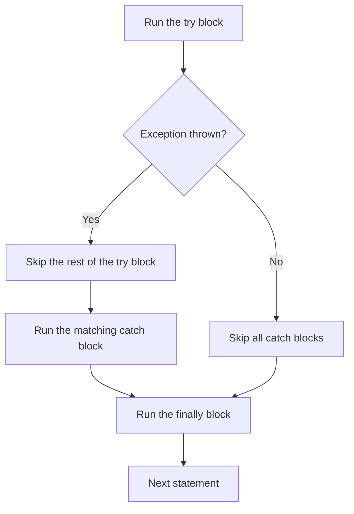
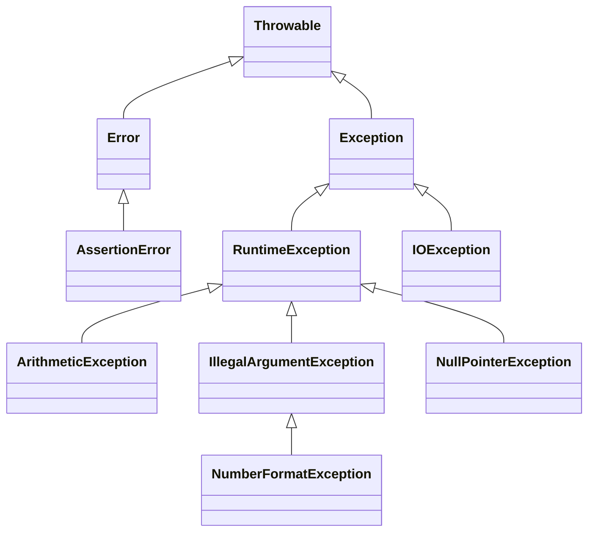

# Lecture 6 — 2D Arrays, Functions, and Exception Handling

[Repository Guide](../../README.md) | [English](Concepts_Lecture.md) | [한국어](Concepts_Lecture.ko.md)

> **Last Updated:** 2026-10-26

> **Learning Objectives:**
> 1. Create and process two-dimensional arrays
> 2. Define methods with parameters and return values
> 3. Use methods that return arrays and the command-line arguments of the main method
> 4. Apply try-catch for exception handling
> 5. Propagate exceptions to the caller and distinguish checked from unchecked exceptions

---

## Table of Contents

- [1. Two-Dimensional Arrays](#1-two-dimensional-arrays)
  - [1.1 Declaration and Initialization](#11-declaration-and-initialization)
  - [1.2 Element Access and the length Field](#12-element-access-and-the-length-field)
  - [1.3 Iterating Over 2D Arrays](#13-iterating-over-2d-arrays)
  - [1.4 Ragged Arrays](#14-ragged-arrays)
- [2. Custom Functions (Methods)](#2-custom-functions-methods)
  - [2.1 Defining Methods](#21-defining-methods)
  - [2.2 Method Overloading](#22-method-overloading)
  - [2.3 Methods That Return Arrays](#23-methods-that-return-arrays)
  - [2.4 Pass-by-Value vs. Pass-by-Reference Semantics](#24-pass-by-value-vs-pass-by-reference-semantics)
  - [2.5 The main Method and Command-Line Arguments](#25-the-main-method-and-command-line-arguments)
- [3. Exception Handling](#3-exception-handling)
  - [3.1 Definition of an Exception](#31-definition-of-an-exception)
  - [3.2 try-catch-finally](#32-try-catch-finally)
  - [3.3 Exception Information and Multiple catch Blocks](#33-exception-information-and-multiple-catch-blocks)
  - [3.4 Propagating Exceptions (throws)](#34-propagating-exceptions-throws)
  - [3.5 The Throwable Hierarchy](#35-the-throwable-hierarchy)
  - [3.6 Common Exception Types](#36-common-exception-types)
  - [3.7 Input Validation with Exceptions](#37-input-validation-with-exceptions)
- [Summary](#summary)
- [Self-Check Questions](#self-check-questions)

---

<br>

## 1. Two-Dimensional Arrays

### 1.1 Declaration and Initialization

A 2D array is an array of arrays, commonly used to represent matrices, grids, and tables.

A declaration can take either of two forms, and creation specifies the number of rows and then the number of columns.

```text
<data type>[][] <variable>;                       // form 1
<data type> <variable>[][];                       // form 2
<variable> = new <data type>[<rows>][<columns>];  // creation
```

```java
// Static initialization
double[][] scores = {
    {3.3, 3.4},
    {3.5, 3.6},
    {3.7, 4.0},
    {4.1, 4.2}
};

// Dynamic allocation
int[][] matrix = new int[3][4]; // 3 rows, 4 columns
```

In static initialization, each row gets its own pair of braces inside the outer braces, and the numbers of rows and columns follow from the initial values. The `scores` array above is a 4-row, 2-column array holding the grade of each semester over four years. The elements of an array allocated dynamically with `new` are initialized to the default value of the type (0 for `int`, 0.0 for `double`).

### 1.2 Element Access and the length Field

An element of a 2D array is accessed by its row index and column index. Both indices start at 0, so `payScaleTable[2][1]` is the element in the third row and second column.

```java
double[][] payScaleTable = new double[4][5]; // 4 rows, 5 columns
payScaleTable[2][1] = 36.50;                 // store into row 2, column 1
double pay = payScaleTable[2][1];            // read from row 2, column 1
```

A Java 2D array is a 1D array whose elements are references to row arrays. The `length` field therefore exists at two levels.

```text
int[][] i = new int[2][5];

          ┌──────┐
 i ─────▶ │ i[0] │ ──▶ [ i[0][0] | i[0][1] | i[0][2] | i[0][3] | i[0][4] ]   length 5
          ├──────┤
          │ i[1] │ ──▶ [ i[1][0] | i[1][1] | i[1][2] | i[1][3] | i[1][4] ]   length 5
          └──────┘
          length 2
```

*Figure 1. Memory structure of a 2D array created with new int[2][5]*

- `array.length` is the number of rows. In the example, `i.length` is 2.
- `array[r].length` is the number of elements in row array r, that is, the number of columns in that row. In the example, `i[0].length` and `i[1].length` are both 5.

### 1.3 Iterating Over 2D Arrays

```java
// Row-major traversal
for (int row = 0; row < scores.length; row++) {
    for (int col = 0; col < scores[row].length; col++) {
        sum += scores[row][col];
    }
}

// Enhanced for loop
for (double[] row : scores) {
    for (double value : row) {
        sum += value;
    }
}
```

The outer loop varies the row index and the inner loop varies the column index within that row, so every element is visited. In the enhanced for loop, the outer loop variable `row` refers to one row array (`double[]`), and the inner loop variable `value` receives the elements of that row in turn. Both snippets assume that `sum` has already been declared as `double sum = 0;`.

Computing the overall average as `sum / (scores.length * scores[0].length)` is correct only when all rows have the same length. If row lengths may differ, count the elements while visiting them and divide by that count (`computeAverage` in Section 2.1).

2D arrays are also a basic data structure in graphics programs. The following code stores the screen coordinates of the 11×11 corner points of a 10×10 grid in a 2D array of `Point`. Connecting neighboring points in the same row and neighboring points in the same column with line segments then draws the grid.

```java
graphPoints = new Point[NUM_SQUARES + 1][NUM_SQUARES + 1]; // NUM_SQUARES = 10
for (int r = 0; r < graphPoints.length; r++)
    for (int c = 0; c < graphPoints[r].length; c++)
        graphPoints[r][c] = new Point(c * SQUARE_SIZE, r * SQUARE_SIZE);
```

### 1.4 Ragged Arrays

Java allows each row to have a different length:

```java
int[][] ragged = new int[3][];
ragged[0] = new int[2];
ragged[1] = new int[5];
ragged[2] = new int[3];
```

`new int[3][]` creates only three references to row arrays (all `null` at first), and each row array is created separately.

```text
ragged ──▶ [0] ──▶ [ 0 | 0 ]
           [1] ──▶ [ 0 | 0 | 0 | 0 | 0 ]
           [2] ──▶ [ 0 | 0 | 0 ]
```

*Figure 2. Ragged array with row lengths 2, 5, and 3*

> **Key Point:** Always use `array[row].length` (not a fixed column count) to handle ragged arrays correctly.

---

<br>

## 2. Custom Functions (Methods)

### 2.1 Defining Methods

```java
public static returnType methodName(parameterList) {
    // method body
    return value;
}
```

`returnType` is the type of the return value, and `void` is used when there is no return value. The parameter list in parentheses gives the types and names of the values received at the call, and the `return` statement passes a value back to the caller and ends the method. Section 2.5 explains the meaning of `public` and `static`.

Example:

```java
public static double computeAverage(double[][] scores) {
    double sum = 0;
    int count = 0;
    for (double[] row : scores) {
        for (double val : row) {
            sum += val;
            count++;
        }
    }
    return sum / count;
}
```

`computeAverage` counts the elements while adding them, so it returns the correct average for ragged arrays as well. If there are no elements at all, it computes `0.0 / 0` and returns `NaN`.

### 2.2 Method Overloading

Multiple methods can share the same name if they differ in parameter types or count:

```java
public static int max(int a, int b) { return a > b ? a : b; }
public static double max(double a, double b) { return a > b ? a : b; }
```

The compiler chooses which method to call from the types and number of the arguments in the call. `max(3, 5)` calls the `int` version, and `max(2.5, 1.0)` calls the `double` version.

> **Caution:** Two methods that differ only in return type are not overloads. Defining both `int f(int x)` and `double f(int x)` defines the same method twice and causes a compile error (`method f(int) is already defined`).

### 2.3 Methods That Return Arrays

A method can return an array. The return type is an array type (`int[]`), and the `return` statement passes back a reference to the array.

```java
public static int[] makeArray() {         // return type int[]
    int temp[] = new int[4];
    for (int i = 0; i < temp.length; i++)
        temp[i] = i;
    return temp;                           // return the reference to the array object
}

public static void main(String[] args) {
    int intArray[];
    intArray = makeArray();
    for (int i = 0; i < intArray.length; i++)
        System.out.print(intArray[i] + " "); // 0 1 2 3
}
```

When `makeArray` ends, the local variable `temp` disappears, but the array created with `new` remains on the heap. The returned reference is stored in `intArray`, so the caller uses the array created inside the method as it is. The array itself is not copied.

```text
while makeArray() runs:  temp ─────┐
                                   ▼
                   new int[4]    [ 0 | 1 | 2 | 3 ]
                                   ▲
after return:        intArray ─────┘   (temp is gone)
```

*Figure 3. intArray receiving the array reference returned by makeArray*

### 2.4 Pass-by-Value vs. Pass-by-Reference Semantics

- **Primitives** are passed by value, so a copy is made.
- **Objects and arrays** pass the reference by value: the method can modify the object's contents but cannot reassign the caller's variable.

Java always passes by value. For objects and arrays, the value that is copied is the reference.

```java
static void modify(int[] arr)   { arr[0] = 99; }             // the caller's array contents change
static void reassign(int[] arr) { arr = new int[]{7, 7, 7}; } // only the parameter points to a new array
```

Calling `modify(data)` makes `arr` and `data` point to the same array, so `data[0]` becomes 99. `reassign(data)` only assigns a new array to the parameter `arr`, so the caller's `data` keeps pointing to the original array.

### 2.5 The main Method and Command-Line Arguments

A Java program starts running at the `main` method. Each part of its header has the following meaning.

```java
public static void main(String[] args) {
}
```

| Part | Meaning |
|:-----|:-----|
| `public` | Accessible from other classes (including the JVM) |
| `static` | Can be called before any object is created |
| `void` | No return value |
| `String[]` | Receives the input arguments as an array of strings |
| `args` | Name of the argument array |

*Table 1. Parts of the main method header*

When a program is run, the words written after the class name are split at spaces and stored in the `args` array as strings.

```text
C:\> java Hello abc 3 5.7

args.length => 3
args[0] => "abc"
args[1] => "3"
args[2] => "5.7"
```

Arguments that look like numbers are still strings, so they must be converted with a method such as `Integer.parseInt` before being used in calculations. The following program adds all integers given as command-line arguments.

```java
public class Chap6Program4 {

    public static void main(String[] args) {

        int[] inputNum = new int[args.length];
        int sum = 0;

        for (int i = 0; i < inputNum.length; i++) {
            inputNum[i] = Integer.parseInt(args[i]);
            sum += inputNum[i];
        }

        System.out.println("Sum of all input values: " + sum);
    }
}
```

Running `java Chap6Program4 1 2 3` prints `Sum of all input values: 6`. If an argument is not an integer, `Integer.parseInt` throws `NumberFormatException` (Section 3.1). In an IDE such as Eclipse, the arguments are entered in the Program arguments box on the Arguments tab of the Run Configurations dialog.

---

<br>

## 3. Exception Handling

### 3.1 Definition of an Exception

> **Definition:** An **exception** represents an error condition that can occur during the normal course of program execution. When an exception occurs, or is **thrown**, the normal sequence of flow is terminated and the exception-handling routine is executed. We then say the thrown exception is **caught**.

If an exception is not caught, the program prints the exception message and a stack trace and terminates abnormally. For example, if the user enters `ten` as the age in the following code, `Integer.parseInt` throws `NumberFormatException`.

```java
String inputStr;
int age;

inputStr = JOptionPane.showInputDialog(null, "Age:");
age = Integer.parseInt(inputStr);
```

```text
Exception in thread "main" java.lang.NumberFormatException: For input string: "ten"
    at java.base/java.lang.NumberFormatException.forInputString(NumberFormatException.java:67)
    at java.base/java.lang.Integer.parseInt(Integer.java:564)
    at java.base/java.lang.Integer.parseInt(Integer.java:661)
    ...
```

The exact format of the message varies slightly between JDK versions.

### 3.2 try-catch-finally

Statements that may throw an exception go in a `try` block, and the code that handles the exception goes in a `catch` block. The age input above is handled as follows.

```java
inputStr = JOptionPane.showInputDialog(null, "Age:");
try {
    age = Integer.parseInt(inputStr);
} catch (NumberFormatException e) {
    JOptionPane.showMessageDialog(null, "'" + inputStr
            + "' is invalid\n"
            + "Please enter digits only");
}
```

The `finally` block holds statements that must run regardless of whether an exception occurs (cleanup work such as closing a file).

```java
try {
    int result = 10 / 0;
} catch (ArithmeticException e) {
    System.out.println("Cannot divide by zero: " + e.getMessage());
} finally {
    // Always executed, even if an exception occurs
    System.out.println("Cleanup complete.");
}
```

`10 / 0` throws `ArithmeticException`, so this code prints two lines, `Cannot divide by zero: / by zero` and `Cleanup complete.`, in that order. The control flow is as follows.

- If a statement in the `try` block throws an exception, the remaining statements of the `try` block are skipped and the `catch` block whose exception type matches is executed.
- If no exception occurs, the `try` block runs to the end and all `catch` blocks are skipped.
- The `finally` block runs in both cases, and control then moves to the statement after the try statement. Even when no `catch` block matches, `finally` runs, and the exception then propagates to the caller (Section 3.4).



*Figure 4. Control flow of try-catch-finally*

### 3.3 Exception Information and Multiple catch Blocks

The `catch` parameter `e` is the thrown exception object, and two methods give information about it.

- `getMessage()` returns the description message of the exception as a string.
- `printStackTrace()` prints the exception type, the message, and the list of method calls that led to the exception (the stack trace) to standard error. It returns nothing (`void`), so it cannot be an argument of `println`.

```java
try {
    . . .
} catch (NumberFormatException e) {
    System.out.println(e.getMessage());
    e.printStackTrace();
}
```

A single try statement can include multiple `catch` blocks, one for each type of exception.

```java
try {
    . . .
    age = Integer.parseInt(inputStr);
    . . .
    val = cal.get(id); // cal is a GregorianCalendar
    . . .
} catch (NumberFormatException e) {
    . . .
} catch (ArrayIndexOutOfBoundsException e) {
    . . .
}
```

When an exception is thrown, the `catch` blocks are checked from the top, and only the first block that catches the same class as the thrown exception or one of its superclasses runs; the rest are skipped. In the code above, `Calendar.get` throws `ArrayIndexOutOfBoundsException` when it receives an invalid field number.

> **Caution:** Placing a `catch` for a superclass exception before the `catch` for a subclass exception makes the later block unreachable, which is a compile error. For example, writing `catch (ArithmeticException e)` after `catch (Exception e)` gives the error `exception ArithmeticException has already been caught`. Write the subclass `catch` first.

### 3.4 Propagating Exceptions (throws)

Instead of catching a thrown exception with `try-catch` inside the method, the method can **propagate** the exception back to its caller. The method header then includes the reserved word `throws` and the exception type.

```java
public int getAge() throws NumberFormatException {
    . . .
    int age = Integer.parseInt(inputStr);
    . . .
    return age;
}
```

If `NumberFormatException` occurs in `getAge`, `getAge` ends immediately and the exception passes to the caller. The caller either catches it with `try-catch` or propagates it further. If it reaches `main` and is still not caught, the program terminates abnormally as in Section 3.1.

### 3.5 The Throwable Hierarchy

Java exception classes form an inheritance hierarchy rooted at `Throwable`, and the hierarchy contains over 60 classes. The main classes are shown below.



*Figure 5. Part of the Throwable class hierarchy*

- `Error` represents a serious problem that a program can hardly recover from, such as running out of memory. The `AssertionError` of Lecture 9 also belongs here.
- `Exception` represents an exceptional condition that a program can catch and handle.

> **Definition:** **Unchecked exceptions** are `RuntimeException`, `Error`, and their subclasses. The compiler does not check whether they are handled, so code compiles without catching or declaring them. **Checked exceptions** are the other subclasses of `Exception` (such as `IOException`); code that can throw one must catch it with `try-catch` or declare it with `throws` in the method header. Otherwise the compiler reports an error such as `unreported exception IOException; must be caught or declared to be thrown`.

`ArithmeticException`, `NumberFormatException`, and `NullPointerException` are all subclasses of `RuntimeException`, so they are unchecked. This is why `throws NumberFormatException` in Section 3.4 can be omitted and still compile; it serves as documentation telling the caller that the exception may occur. The `IOException` of file I/O is a checked exception (Lecture 10).

### 3.6 Common Exception Types

| Exception | Cause | Kind |
|:----------|:------|:-----|
| `ArithmeticException` | Division by zero | Unchecked |
| `ArrayIndexOutOfBoundsException` | Invalid array index | Unchecked |
| `NullPointerException` | Accessing a member on a null reference | Unchecked |
| `NumberFormatException` | Invalid string-to-number conversion | Unchecked |
| `InputMismatchException` | Scanner receives unexpected input type | Unchecked |
| `IOException` | I/O operation failure | Checked |

*Table 2. Common exceptions and their causes*

`ArithmeticException` occurs only when an integer is divided by zero. Dividing a floating-point value (`double`) by zero gives `Infinity` or `NaN` without an exception. To catch the exception, the operation that may throw it must itself be inside the `try` block. If the same division runs first before the `try` block, the exception is thrown on the spot and never reaches the `catch` block.

```java
try {
    System.out.println(dividend + "/" + divisor + " = " + dividend / divisor);
} catch (ArithmeticException e) {
    System.out.println("Cannot divide by 0! Please input non-zero value...");
}
```

### 3.7 Input Validation with Exceptions

```java
Scanner scanner = new Scanner(System.in);
int sum = 0;
for (int i = 0; i < 3; i++) {
    System.out.print((i + 1) + "th value >> ");
    try {
        sum += scanner.nextInt();
    } catch (InputMismatchException e) {
        System.out.println("Not an integer. Try again.");
        scanner.next(); // consume invalid token
        i--;            // retry the same iteration
    }
}
```

`nextInt()` throws `InputMismatchException` when the next token is not an integer and leaves that token in the input. The `catch` block reads the token away with `scanner.next()` and moves the loop variable back with `i--`, so the value for the same position is read again. This code needs to import `java.util.Scanner` and `java.util.InputMismatchException`. A complete program in the same style is in [InputValidationWithException.java](../../Coursework/Lab06_2D-Arrays-Functions-and-Exception-Handling/InputValidationWithException.java).

> **Key Point:** When catching `InputMismatchException` from a `Scanner`, call `scanner.next()` to consume the invalid token; otherwise the loop will spin infinitely.

---

<br>

## Summary

| Concept | Key Summary |
|:--------|:----------|
| 2D Arrays | A 2D array is an array of arrays, and its rows may have different lengths (ragged). |
| Iteration | Use `array.length` for rows and `array[i].length` for columns. |
| Methods | A method is a reusable code block with a return type and parameters. |
| Overloading | Overloading defines several methods with the same name and different parameter signatures; a different return type alone is not enough. |
| Array return | A method can return a reference to an array, and the caller uses the array created inside the method as it is. |
| Pass-by-value | Java always passes copies of values; for objects and arrays the reference is copied, so the contents can change but the caller's variable cannot. |
| main method | The main method receives command-line arguments as `String[] args`, which must be converted with `Integer.parseInt` or similar to be used as numbers. |
| try-catch | It gracefully handles runtime errors without crashing the program. |
| finally | It is code that always executes for cleanup, whether or not an exception occurs. |
| Multiple catch blocks | Only the first matching block from the top runs, so subclass exceptions are caught first. |
| throws | It declares in the method header that an exception is propagated to the caller instead of being caught. |
| Checked and unchecked exceptions | Checked exceptions must be caught or declared, while unchecked exceptions of the `RuntimeException` and `Error` families need not be. |
| InputMismatchException | Consume the invalid token with `scanner.next()` before retrying. |

---

<br>

## Self-Check Questions

1. **Ragged array:** For the `ragged` array in Section 1.4, find `ragged.length`, `ragged[1].length`, and the total number of elements.

   <details>
   <summary>Answer</summary>

   `ragged.length` is the number of rows, 3, and `ragged[1].length` is the length of the second row, 5. The total number of elements is the sum of the row lengths, 2 + 5 + 3 = 10. Because the row lengths differ, computing `ragged.length * ragged[0].length` = 6 is wrong.

   </details>

2. **Exceptions and output tracing:** Write the output of the following code.

   ```java
   int[] intArray = new int[5];
   intArray[0] = 0;
   try {
       for (int i = 0; i < 5; i++) {
           intArray[i + 1] = i + 1 + intArray[i];
           System.out.println("intArray[" + i + "]" + "=" + intArray[i]);
       }
   } catch (ArrayIndexOutOfBoundsException e) {
       System.out.println("Out of index for intArray");
   }
   ```

   <details>
   <summary>Answer</summary>

   ```text
   intArray[0]=0
   intArray[1]=1
   intArray[2]=3
   intArray[3]=6
   Out of index for intArray
   ```

   For i from 0 to 3, the loop stores a value into `intArray[i + 1]` and then prints `intArray[i]`. At i = 4 it tries to store into the nonexistent `intArray[5]`, which throws `ArrayIndexOutOfBoundsException`, so the print statement of that iteration does not run and control moves to the `catch` block.

   </details>

3. **Pass-by-value:** Given `modify` and `reassign` from Section 2.4 and `static void inc(int x) { x++; }`, write the output of the following code.

   ```java
   int[] data = {1, 2, 3};
   int n = 5;
   reassign(data);
   modify(data);
   inc(n);
   System.out.println(data[0] + " " + data.length + " " + n);
   ```

   <details>
   <summary>Answer</summary>

   The output is `99 3 5`. `reassign` only makes its parameter point to a new array, so `data` still points to the original array of length 3. `modify` changes the contents of that same array, so `data[0]` becomes 99. `inc` increments only a copy of `n`, so `n` stays 5.

   </details>

4. **Overloading:** Decide whether each pair of methods can be defined together in one class, and explain why. (a) `int f(int x)` and `int f(double x)` (b) `int g(int x)` and `double g(int x)`

   <details>
   <summary>Answer</summary>

   (a) The parameter types differ, so they can coexist as overloads. (b) The parameter lists are the same and only the return types differ, so they are not overloads, and the compiler reports `method g(int) is already defined`.

   </details>

5. **catch order and checked exceptions:** (a) What happens if a `catch (ArithmeticException e)` block follows a `catch (Exception e)` block? (b) Explain why the method `void read() { throw new IOException("x"); }` does not compile, and give two ways to fix it.

   <details>
   <summary>Answer</summary>

   (a) `ArithmeticException` is a subclass of `Exception`, so the earlier block always catches it first and the later block is unreachable, which is a compile error. The `catch` for the subclass `ArithmeticException` must come first. (b) `IOException` is a checked exception, so it must be caught or declared. Change the header to `void read() throws IOException`, or wrap the `throw` statement in a `try-catch (IOException e)`.

   </details>
