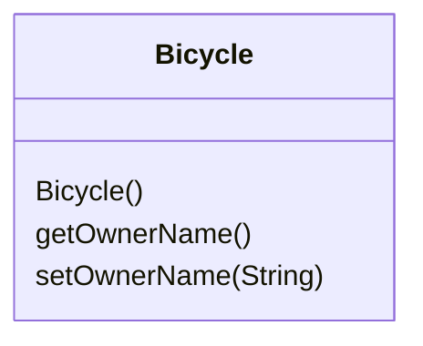
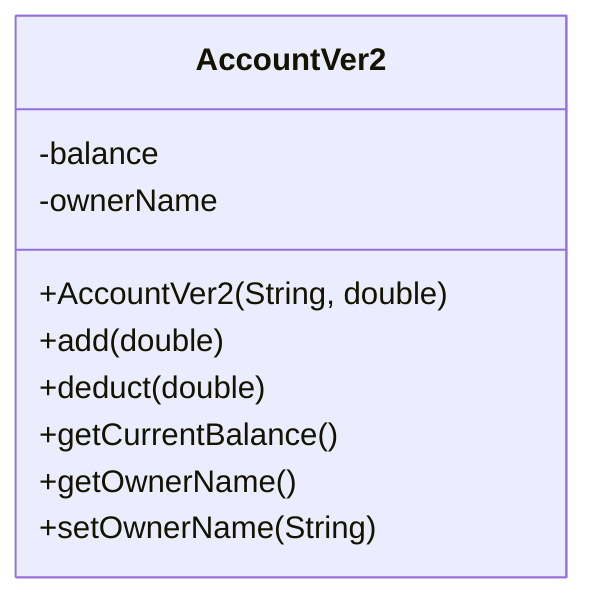

# 7강 — 고급 클래스 I

[레포지토리 안내](../../README.ko.md) | [English](Concepts_Lecture.md) | [한국어](Concepts_Lecture.ko.md)

> **최종 수정일:** 2026-10-26

> **학습 목표:**
> 1. 데이터 멤버, 메서드, 생성자를 가진 클래스를 정의하고 여러 클래스로 프로그램을 구성할 수 있다
> 2. 지역 변수, 매개변수, 데이터 멤버를 구분하고 기본형 데이터와 객체를 메서드에 전달할 수 있다
> 3. public과 private으로 정보 은닉과 캡슐화를 적용할 수 있다
> 4. this 키워드와 생성자 체이닝을 적용할 수 있다
> 5. static 필드와 메서드로 클래스 수준 동작을 구현하고 final 키워드로 불변 클래스를 설계할 수 있다

---

## 목차

- [1. 객체와 클래스 복습](#1-객체와-클래스-복습)
  - [1.1 클래스 구조](#11-클래스-구조)
  - [1.2 객체 생성](#12-객체-생성)
  - [1.3 소스 파일과 프로그램 구성](#13-소스-파일과-프로그램-구성)
  - [1.4 클래스 다이어그램](#14-클래스-다이어그램)
- [2. 생성자](#2-생성자)
  - [2.1 기본 생성자](#21-기본-생성자)
  - [2.2 매개변수가 있는 생성자](#22-매개변수가-있는-생성자)
  - [2.3 생성자 오버로딩](#23-생성자-오버로딩)
- [3. 인자와 매개변수](#3-인자와-매개변수)
  - [3.1 인자와 매개변수의 대응](#31-인자와-매개변수의-대응)
  - [3.2 객체 전달과 공유](#32-객체-전달과-공유)
- [4. 지역 변수와 식별자](#4-지역-변수와-식별자)
  - [4.1 지역 변수](#41-지역-변수)
  - [4.2 식별자 결정 규칙](#42-식별자-결정-규칙)
  - [4.3 같은 클래스의 메서드 호출](#43-같은-클래스의-메서드-호출)
- [5. 접근 제어자](#5-접근-제어자)
  - [5.1 정보 은닉과 가시성](#51-정보-은닉과-가시성)
  - [5.2 접근 제어자 비교](#52-접근-제어자-비교)
  - [5.3 가시성 지정 지침](#53-가시성-지정-지침)
- [6. 캡슐화 (Getter와 Setter)](#6-캡슐화-getter와-setter)
- [7. this 키워드](#7-this-키워드)
- [8. 클래스 변수, 클래스 메서드, 상수](#8-클래스-변수-클래스-메서드-상수)
  - [8.1 static 필드와 메서드](#81-static-필드와-메서드)
  - [8.2 final과 불변 클래스](#82-final과-불변-클래스)
- [9. 여러 클래스의 협력](#9-여러-클래스의-협력)
- [요약](#요약)
- [점검 문제](#점검-문제)

---

<br>

## 1. 객체와 클래스 복습

`String`, `GregorianCalendar`, `JFrame` 같은 표준 클래스만으로는 모든 요구를 충족할 수 없으므로, 응용에 맞춘 클래스를 직접 정의할 수 있어야 한다. 이렇게 직접 정의한 클래스를 **프로그래머 정의 클래스**(programmer-defined class)라고 하며, 클래스를 정의하는 방법을 익히는 것이 큰 프로그램을 만드는 기술의 첫걸음이다.

### 1.1 클래스 구조

클래스는 객체의 필드(데이터)와 메서드(동작)를 정의하는 설계도이다.

```java
public class Bicycle {
    // 필드 (인스턴스 변수)
    private String ownerName;

    // 메서드
    public String getOwnerName() {
        return ownerName;
    }

    public void setOwnerName(String name) {
        this.ownerName = name;
    }
}
```

클래스 정의는 다음 순서로 구성된다.

```text
import 문
클래스 주석
class 클래스이름 {
    데이터 멤버
    메서드 (생성자 포함)
}
```

**데이터 멤버**(data member)는 `<제어자> <자료형> <이름>;` 형식으로 선언한다. 예를 들어 `private String ownerName;`에서 `private`은 제어자, `String`은 자료형, `ownerName`은 이름이다. 제어자는 여러 개 쓸 수 있으며, 이 예에는 하나만 있다.

**메서드**는 다음 형식으로 선언한다.

```text
<제어자> <반환 타입> <메서드 이름> ( <매개변수> ) {
    <문장>
}
```

예를 들어 `public void setOwnerName(String name) { ownerName = name; }`에서 `public`은 제어자, `void`는 반환 타입, `setOwnerName`은 메서드 이름, `String name`은 매개변수, `ownerName = name;`은 본문의 문장이다.

### 1.2 객체 생성

```java
Bicycle bike = new Bicycle();       // 인스턴스 생성
bike.setOwnerName("Alice");          // 메서드를 사용하여 상태 변경
System.out.println(bike.getOwnerName()); // 상태 조회
```

클래스를 한 번 정의하면 인스턴스를 여러 개 만들 수 있다. 각 인스턴스는 자기만의 `ownerName`을 갖는다.

```java
Bicycle bike1, bike2;

bike1 = new Bicycle();
bike1.setOwnerName("Adam Smith");

bike2 = new Bicycle();
bike2.setOwnerName("Ben Jones");
```

### 1.3 소스 파일과 프로그램 구성

`Bicycle`을 사용하는 프로그램은 `main` 메서드를 가진 클래스(예: `Chap7Program1`)와 `Bicycle` 클래스로 이루어진다. 클래스 정의는 각각 별도의 파일(`Chap7Program1.java`, `Bicycle.java`)에 저장하며, 다음 순서로 컴파일하고 실행한다.

```text
javac Bicycle.java          (컴파일)
javac Chap7Program1.java    (컴파일)
java Chap7Program1          (실행)
```

클래스가 셋 이상이어도 같다. 예를 들어 `Chap7Program2`가 `Bicycle`과 `Account`를 사용하면 `Bicycle.java`, `Account.java`, `Chap7Program2.java`를 컴파일한 뒤 `java Chap7Program2`로 실행한다. 클래스는 한 번만 컴파일하면 되고, 코드를 바꾸었을 때만 다시 컴파일한다.

### 1.4 클래스 다이어그램

클래스 다이어그램은 클래스 이름 아래에 메서드 목록을 적으며, 메서드마다 이름과 매개변수의 자료형을 쓴다.



*그림 1. Bicycle 클래스의 클래스 다이어그램*

---

<br>

## 2. 생성자

**생성자**(constructor)는 클래스의 새 인스턴스가 생성될 때 실행되는 특별한 메서드이다. 이름은 클래스 이름과 같고 반환 타입을 쓰지 않는다.

```text
public <클래스 이름> ( <매개변수> ) {
    <문장>
}
```

```java
public Bicycle() {
    ownerName = "Unassigned";
}
```

> **주의:** 생성자 앞에 `void` 같은 반환 타입을 쓰면 생성자가 아니라 클래스 이름과 같은 이름의 일반 메서드가 된다. 예를 들어 `public void Bicycle() { ownerName = "Unknown"; }`은 `new Bicycle()`을 실행해도 호출되지 않으므로, 클래스에 다른 생성자가 없으면 `ownerName`은 기본값 `null`로 남는다.

### 2.1 기본 생성자

클래스에 생성자를 하나도 정의하지 않으면 Java 컴파일러가 매개변수가 없는 기본 생성자를 자동으로 제공하며, 이때 초기값을 지정하지 않은 필드는 기본값(숫자는 0, `boolean`은 `false`, 참조는 `null`)으로 초기화된다. 생성자를 하나라도 정의하면 기본 생성자는 제공되지 않으므로, 매개변수가 있는 생성자만 있는 클래스에서 `new Account()`를 쓰면 컴파일 오류가 난다.

### 2.2 매개변수가 있는 생성자

```java
public class Account {
    private String ownerName;
    private double balance;

    public Account(String name, double initialBalance) {
        this.ownerName = name;
        this.balance = initialBalance;
    }
}
```

### 2.3 생성자 오버로딩

클래스는 매개변수 목록이 다른 여러 생성자를 가질 수 있다.

```java
public Account() {
    this("Unassigned", 0.0);
}

public Account(String name, double balance) {
    this.ownerName = name;
    this.balance = balance;
}
```

> **핵심:** `this()`를 사용하여 생성자 내에서 다른 생성자를 호출할 수 있다. 이를 통해 코드 중복을 방지할 수 있다. `this()` 호출은 생성자의 첫 문장에 둔다(8강 2.2절).

---

<br>

## 3. 인자와 매개변수

### 3.1 인자와 매개변수의 대응

> **용어 정의:** **인자**(argument)는 메서드를 호출할 때 넘기는 값이다. **매개변수**(parameter)는 호출된 메서드 안에서 넘어온 인자의 값을 담는 자리이다.

```java
class Sample {
    public static void main(String[] arg) {
        Account acct = new Account();
        . . .
        acct.add(400);              // 400이 인자
        . . .
    }
}

class Account {
    . . .
    public void add(double amt) {   // amt가 매개변수
        balance = balance + amt;
    }
    . . .
}
```

인자와 매개변수는 다음 규칙으로 대응한다.

- 인자의 수와 매개변수의 수가 같아야 한다.
- 인자와 매개변수는 왼쪽부터 차례로 짝지어진다.
- 짝지어진 인자와 매개변수는 대입 호환이어야 한다. 예를 들어 `double` 인자를 `int` 매개변수에 넘길 수 없다. 반대로 위의 `add(400)`처럼 `int` 인자를 `double` 매개변수에 넘기는 것은 가능하다.

### 3.2 객체 전달과 공유

`int`나 `double` 값을 넘기듯 객체도 메서드에 넘길 수 있다. 객체를 넘기면 실제로는 객체의 참조(주소)가 전달되므로, 호출된 메서드 안에 객체의 복사본이 만들어지지 않는다.

```java
Student student;
LibraryCard card1, card2;

student = new Student();
student.setName("Jon Java");
student.setEmail("jj@javauniv.edu");

card1 = new LibraryCard();
card1.setOwner(student);
card1.checkOut(3);

card2 = new LibraryCard();
card2.setOwner(student); // the same student is the owner of the second card, too
```

`LibraryCard`의 `setOwner(Student student)`는 `owner = student;`로 받은 참조를 데이터 멤버에 저장한다. 같은 `Student` 객체를 `card1`과 `card2`에 넘겼으므로 두 `LibraryCard` 객체의 `owner`는 같은 `Student` 객체 하나를 가리킨다.

```text
  card1                       card2
    │                           │
    ▼                           ▼
┌───────────────┐           ┌───────────────┐
│ :LibraryCard  │           │ :LibraryCard  │
│ owner     ●   │           │ owner     ●   │
│ borrowCnt 3   │           │ borrowCnt 0   │
└───────────┼───┘           └───────────┼───┘
            │                           │
            ▼                           │
student ─▶ ┌────────────────────────┐   │
           │ :Student               │◀──┘
           │ name  "Jon Java"       │
           │ email "jj@javauniv.edu"│
           └────────────────────────┘
```

*그림 2. 두 LibraryCard 객체가 같은 Student 객체를 공유하는 구조*

따라서 `student.setName("Kim")`으로 이름을 바꾸면 `card1.getOwner()`와 `card2.getOwner()`로 얻는 이름도 모두 바뀐다.

---

<br>

## 4. 지역 변수와 식별자

### 4.1 지역 변수

**지역 변수**(local variable)는 메서드 안에서 선언되어 중간 계산 결과를 저장하는 것처럼 임시로 쓰이는 변수이다. 메서드가 끝나면 사라진다.

```java
public double convert(int num) {
    double result;                  // 지역 변수
    result = Math.sqrt(num * num);
    return result;
}
```

### 4.2 식별자 결정 규칙

메서드 안에 나오는 식별자는 지역 변수, 매개변수, 데이터 멤버 중 하나이다. 컴파일러는 다음 순서로 식별자가 무엇을 가리키는지 정한다.

1. 같은 이름의 지역 변수나 매개변수 선언이 있으면 그것을 가리킨다.
2. 그렇지 않고 같은 이름의 데이터 멤버 선언이 있으면 데이터 멤버를 가리킨다.
3. 둘 다 없으면 대응하는 선언이 없으므로 오류이다.

```java
class MusicCD {

    private String artist;
    private String title;
    private String id;

    public MusicCD(String name1, String name2) {

        String ident;

        artist = name1;
        title  = name2;

        ident  = artist.substring(0, 2) + "-" +
                 title.substring(0, 9);

        id     = ident;
    }
    ...
}
```

위 생성자에서 `name1`, `name2`는 매개변수, `ident`는 지역 변수, `artist`, `title`, `id`는 데이터 멤버를 가리킨다. 매개변수나 지역 변수가 데이터 멤버와 이름이 같으면 규칙 1에 따라 데이터 멤버가 가려지므로, 데이터 멤버를 가리키려면 `this.`를 붙여야 한다(7절).

### 4.3 같은 클래스의 메서드 호출

다른 객체의 메서드를 호출할 때는 `obj.doWork()`처럼 점 표기법이 필요하다. 같은 클래스의 다른 메서드를 호출할 때는 점 표기법 없이 `doWork()`처럼 메서드 이름만 쓰면 된다(`this.doWork()`로 써도 된다).

```java
class AClass {
    public void myMethod() {
        BClass obj = new BClass();
        obj.doWork();       // 다른 객체의 메서드: 점 표기법 필요
    }
}

class BClass {
    public void doWork() {
        ...
    }

    public void myMethod() {
        doWork();           // 같은 객체의 메서드: 점 표기법 생략 가능
    }
}
```

---

<br>

## 5. 접근 제어자

### 5.1 정보 은닉과 가시성

제어자 `public`과 `private`은 데이터 멤버와 메서드의 접근 가능 범위를 정한다.

- 클래스 구성 요소(데이터 멤버나 메서드)를 `private`으로 선언하면 클라이언트 클래스가 접근할 수 없다.
- `public`으로 선언하면 클라이언트 클래스가 접근할 수 있다.
- 클래스의 내부 세부 사항을 `private`으로 선언하여 클라이언트에게서 숨기는 것을 **정보 은닉**(information hiding)이라고 한다.

```java
class Service {
    public  int memberOne;
    private int memberTwo;

    public void doOne() {
        ...
    }

    private void doTwo() {
        ...
    }
}
```

클라이언트 클래스에서 `Service obj = new Service();`로 객체를 만들었을 때 `obj.memberOne = 10;`과 `obj.doOne();`은 허용되지만, `obj.memberTwo = 20;`과 `obj.doTwo();`는 컴파일 오류이다.

### 5.2 접근 제어자 비교

| 제어자 | 클래스 | 패키지 | 하위 클래스 (다른 패키지) | 외부 |
|:-------|:-----:|:------:|:---------:|:----:|
| `public` | Yes | Yes | Yes | Yes |
| `protected` | Yes | Yes | Yes | No |
| (default) | Yes | Yes | No | No |
| `private` | Yes | No | No | No |

*표 1. 접근 제어자별 접근 가능 범위*

하위 클래스 열은 다른 패키지에 있는 하위 클래스를 뜻한다. 같은 패키지의 하위 클래스는 패키지 열을 따르므로 (default) 멤버에도 접근할 수 있다.

> **핵심:** 필드는 `private`으로 선언하고 `public` getter/setter 메서드를 통해 접근하는 것이 바람직하다. 이것이 캡슐화의 핵심이다.

### 5.3 가시성 지정 지침

데이터 멤버는 클래스의 구현 세부 사항이므로 클라이언트에게 보이지 않아야 한다. 데이터 멤버와 메서드의 가시성은 다음 지침으로 정한다.

- 클래스 변수와 인스턴스 변수는 `private`으로 선언한다.
- 같은 클래스의 다른 메서드만 사용하는 클래스 메서드와 인스턴스 메서드는 `private`으로 선언한다.
- 클래스 상수는 클라이언트 프로그램이 값을 직접 읽게 하려면 `public`으로 선언하고, 내부에서만 쓰면 `private`으로 선언한다. 상수는 바꿀 수 없으므로 `public`으로 공개해도 캡슐화를 해치지 않는다.

클래스 다이어그램에서는 `public` 구성 요소를 `+`로, `private` 구성 요소를 `-`로 표시한다.



*그림 3. 가시성을 표시한 AccountVer2 클래스 다이어그램*

---

<br>

## 6. 캡슐화 (Getter와 Setter)

캡슐화는 내부 상태를 숨기고 메서드를 통해서만 상호작용하도록 요구하는 것이다.

```java
public class Account {
    private double balance;

    public double getBalance() {
        return balance;
    }

    public void deposit(double amount) {
        if (amount > 0) {
            balance += amount;
        }
    }

    public void withdraw(double amount) {
        if (amount > 0 && amount <= balance) {
            balance -= amount;
        }
    }
}
```

`balance`가 `private`이므로 클라이언트는 `deposit`과 `withdraw`를 거쳐야만 잔액을 바꿀 수 있다. 두 메서드가 음수 금액과 잔액을 넘는 출금을 거부하므로 잔액이 잘못된 값이 되는 일을 막을 수 있다.

---

<br>

## 7. this 키워드

`this`는 현재 객체 인스턴스를 참조한다. 주요 용도는 다음과 같다.

1. **필드와 매개변수의 이름 충돌 해소:** `this.name = name;`
2. **다른 생성자 호출:** `this(defaultValue);`
3. **현재 객체 전달:** `someMethod(this);`

첫 번째 용도는 4.2절의 규칙 때문에 필요하다. 매개변수 이름이 필드와 같으면 `name = name;`은 매개변수를 자기 자신에게 대입할 뿐 필드를 바꾸지 않는다. `this`의 세 가지 용도는 8강에서 더 자세히 다룬다.

---

<br>

## 8. 클래스 변수, 클래스 메서드, 상수

### 8.1 static 필드와 메서드

`static`이 붙지 않은 데이터 멤버는 **인스턴스 변수**로, 객체마다 따로 존재한다. `static`을 붙이면 **클래스 변수**가 되어 그 클래스의 모든 객체가 하나를 공유한다. 마찬가지로 `static` 메서드는 **클래스 메서드**로, 객체를 만들지 않고 `클래스이름.메서드()`로 호출한다. `Math.sqrt`, `Integer.parseInt`, `main`이 클래스 메서드이다.

```java
public class Account {
    private static int count = 0;   // 클래스 변수: 모든 Account 객체가 공유
    private String ownerName;       // 인스턴스 변수: 객체마다 따로 존재

    public Account(String name) {
        ownerName = name;
        count++;
    }

    public static int getCount() {  // 클래스 메서드
        return count;
    }
}
```

`Account` 객체를 세 개 만든 뒤 `Account.getCount()`를 호출하면 3을 반환한다. 클래스 메서드는 특정 객체 없이 실행되므로 그 안에서 인스턴스 변수(`ownerName`)나 `this`를 쓸 수 없다. 쓰면 `non-static variable ownerName cannot be referenced from a static context` 컴파일 오류가 난다.

### 8.2 final과 불변 클래스

`final`을 붙인 변수는 한 번만 값을 대입할 수 있다. `static final` 데이터 멤버는 **클래스 상수**이며, 이름은 관례상 대문자와 밑줄로 쓴다.

```java
public class Dice {

    public static final int MAX_NUMBER = 6;
    private static final int MIN_NUMBER = 1;
    private static final int NO_NUMBER = 0;

    private int number;

    public Dice() {
        number = NO_NUMBER;
    }

    // Rolls the dice
    public void roll() {
        number = (int) (Math.floor(Math.random() * (MAX_NUMBER - MIN_NUMBER + 1)) + MIN_NUMBER);
    }

    // Returns the number on this dice
    public int getNumber() {
        return number;
    }
}
```

`Dice`는 5.3절의 지침을 따른다. 클라이언트가 읽을 수 있어야 하는 `MAX_NUMBER`는 `public`, 내부에서만 쓰는 `MIN_NUMBER`와 `NO_NUMBER`는 `private`이고, 인스턴스 변수 `number`는 `private`이다. `roll()`은 `Math.random()`이 반환하는 0 이상 1 미만의 실수에 6을 곱하고 내림한 뒤 1을 더하여 1~6의 정수를 만든다.

```java
Dice diceOne = new Dice(), diceTwo = new Dice();

diceOne.roll();
System.out.println(diceOne.getNumber());

diceTwo.roll();
System.out.println(diceTwo.getNumber());
```

인스턴스 변수에 `final`을 붙이면 선언에서나 생성자에서 정확히 한 번 대입해야 한다. 모든 필드를 `private final`로 두고 setter를 제공하지 않으면 생성 뒤에 상태가 바뀌지 않는 **불변 클래스**(immutable class)가 된다. `String`이 대표적인 불변 클래스이다. 다만 필드가 배열처럼 내용을 바꿀 수 있는 객체를 가리키면 참조는 바뀌지 않아도 그 객체의 내용은 바뀔 수 있으므로, 불변 클래스의 필드는 기본형 값이나 불변 객체를 담아야 한다.

```java
public final class Point2D {
    private final int x;
    private final int y;

    public Point2D(int x, int y) {
        this.x = x;
        this.y = y;
    }

    public int getX() { return x; }
    public int getY() { return y; }
}
```

클래스 선언의 `final`은 하위 클래스를 만들 수 없게 하여, 하위 클래스가 상태를 바꾸는 메서드를 추가하는 일을 막는다.

---

<br>

## 9. 여러 클래스의 협력

객체 지향 설계에서는 여러 클래스가 서로 협력한다.

```java
// 메인 프로그램에서 Account 객체를 생성하고 사용
Account savings = new Account("Alice", 1000.0);
savings.deposit(500.0);
System.out.println("Balance: " + savings.getBalance());
```

다음 프로그램은 `Bicycle`과 `Account`를 함께 사용한다. 이 `Account`는 매개변수 없는 생성자에서 `ownerName`을 `"Unassigned"`, `balance`를 0.0으로 초기화하고, `add`, `deduct`, `getCurrentBalance`, `setInitialBalance`, `getOwnerName`, `setOwnerName` 메서드를 제공한다.

```java
public class Chap7Program2 {

    public static void main(String[] args) {

        Bicycle bike;
        Account acctMinseok;

        String myName = "Minseok Seo";

        bike = new Bicycle();
        bike.setOwnerName(myName);

        acctMinseok = new Account();
        acctMinseok.setOwnerName(myName);
        acctMinseok.setInitialBalance(250.00);

        acctMinseok.add(25.00);
        acctMinseok.deduct(50);

        // Output some information
        System.out.println(bike.getOwnerName() + " owns a bicycle and");
        System.out.println("has $ " + acctMinseok.getCurrentBalance() + " left in the bank");
    }
}
```

잔액은 250 + 25 - 50 = 225이므로 출력은 다음과 같다.

```text
Minseok Seo owns a bicycle and
has $ 225.0 left in the bank
```

어떤 클래스든 `main` 메서드를 넣으면 메인 클래스가 될 수 있다. 예를 들어 `Bicycle` 클래스 안에 `Bicycle`의 사용 예를 보이는 `main`을 두고 `java Bicycle`로 실행할 수 있다.

```java
class Bicycle {

    // definition of the class as shown before comes here

    // The main method that shows a sample
    // use of the Bicycle class
    public static void main(String[] args) {

        Bicycle myBike;

        myBike = new Bicycle();
        myBike.setOwnerName("Jon Java");

        System.out.println(myBike.getOwnerName() + " owns a bicycle");
    }
}
```

> **핵심:** 각 클래스는 단일 책임을 가져야 한다. 데이터(모델), 로직(서비스), 표현(UI)을 서로 다른 클래스로 분리한다.

---

<br>

## 요약

| 개념 | 핵심 요약 |
|:-----|:-----|
| 클래스 | 필드와 메서드를 정의하는 설계도이며, 클래스마다 별도의 소스 파일에 저장한다. |
| 객체 | `new` 키워드로 생성하는 클래스의 인스턴스이다. |
| 생성자 | 객체 상태를 초기화하는 반환 타입 없는 특별한 메서드이며, 오버로딩이 가능하다. |
| 기본 생성자 | 생성자를 하나도 정의하지 않았을 때만 컴파일러가 자동으로 제공한다. |
| 인자와 매개변수 | 수가 같아야 하고 왼쪽부터 짝지어지며, 짝마다 대입 호환이어야 한다. |
| 객체 전달 | 참조가 전달되므로 복사본이 생기지 않고, 여러 객체가 같은 객체를 공유할 수 있다. |
| 식별자 결정 | 지역 변수와 매개변수가 데이터 멤버보다 우선한다. |
| 접근 제어자 | 가시성을 `private` < default < `protected` < `public` 순으로 넓게 제어한다. |
| 캡슐화 | 필드를 `private`으로 숨기고 getter/setter를 통해 노출한다. |
| this | 현재 객체 인스턴스에 대한 참조이다. |
| static | 클래스 변수와 클래스 메서드는 객체가 아니라 클래스에 속하며 모든 객체가 공유한다. |
| final과 불변 클래스 | `final` 변수는 한 번만 대입할 수 있고, 모든 필드가 기본형 값이나 불변 객체를 담는 `private final` 필드이고 setter가 없는 클래스는 불변이다. |

---

<br>

## 점검 문제

1. **생성자와 반환 타입:** 다음 클래스로 `new Bike().getOwnerName()`을 출력하면 무엇이 나오는가? 이유를 쓰라.

   ```java
   class Bike {
       private String ownerName;
       public void Bike() { ownerName = "Unknown"; }
       public String getOwnerName() { return ownerName; }
   }
   ```

   <details>
   <summary>정답</summary>

   `null`이 출력된다. `public void Bike()`는 반환 타입 `void`가 있으므로 생성자가 아니라 이름이 `Bike`인 일반 메서드이다. 클래스에 생성자가 없으므로 컴파일러가 기본 생성자를 제공하고, `ownerName`은 참조형의 기본값인 `null`로 남는다.

   </details>

2. **식별자 결정:** 필드 `private String name = "init";`을 가진 클래스에 `public void setName(String name) { name = name; }`을 정의했다. `setName("Kim")`을 호출한 뒤 필드 `name`의 값은 무엇이고, 어떻게 고쳐야 하는가?

   <details>
   <summary>정답</summary>

   필드 값은 `"init"` 그대로이다. 메서드 안의 `name`은 4.2절의 규칙에 따라 두 번 모두 매개변수를 가리키므로, 매개변수를 자기 자신에게 대입할 뿐이다. `this.name = name;`으로 고치면 필드에 대입된다.

   </details>

3. **객체 공유:** 3.2절의 코드 뒤에 `student.setName("Kim");`을 실행하고 `card2.getOwner().getName()`을 출력하면 무엇이 나오는가? 이 코드에서 만들어진 `Student` 객체는 몇 개인가?

   <details>
   <summary>정답</summary>

   `Kim`이 출력된다. `Student` 객체는 `new Student()`로 한 번만 만들어졌고, `card1`과 `card2`의 `owner`는 모두 그 객체의 참조를 저장하고 있으므로 이름을 바꾸면 두 카드에서 모두 바뀐 이름이 보인다.

   </details>

4. **접근 제어:** 5.1절의 `Service` 클래스를 다른 클래스에서 사용할 때 `obj.memberOne = 10;`, `obj.memberTwo = 20;`, `obj.doOne();`, `obj.doTwo();` 중 컴파일되는 것을 고르라.

   <details>
   <summary>정답</summary>

   `obj.memberOne = 10;`과 `obj.doOne();`만 컴파일된다. `memberTwo`와 `doTwo()`는 `private`이므로 `Service` 클래스 밖에서 접근할 수 없다.

   </details>

5. **클래스 변수:** 8.1절의 `Account`로 `new Account("a")`, `new Account("b")`, `new Account("c")`를 실행한 뒤 `Account.getCount()`의 값은 무엇인가? 또 `getCount()` 안에서 `return ownerName;`을 쓸 수 없는 이유는 무엇인가?

   <details>
   <summary>정답</summary>

   값은 3이다. `count`는 클래스 변수라서 세 객체가 하나를 공유하고, 생성자가 호출될 때마다 1씩 증가한다. `getCount()`는 클래스 메서드라서 특정 객체 없이 호출되므로, 객체마다 존재하는 인스턴스 변수 `ownerName`을 가리킬 수 없다.

   </details>
