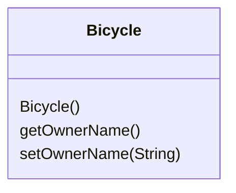
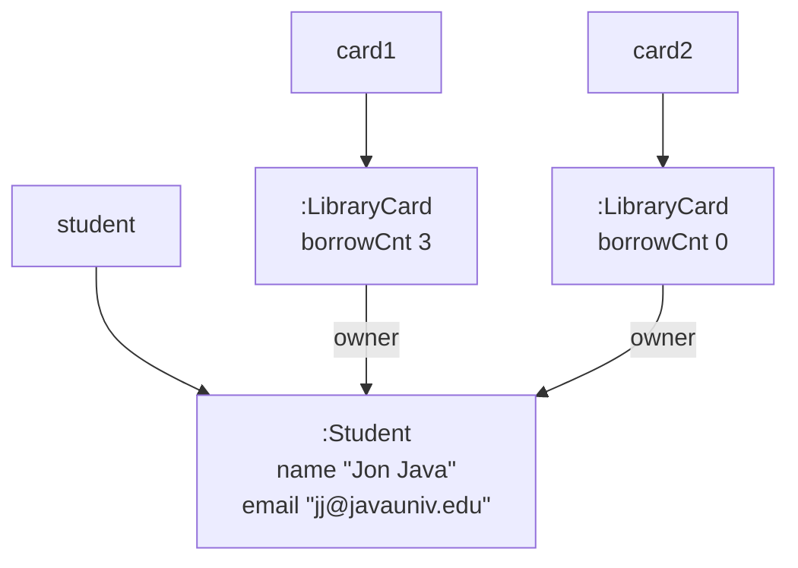
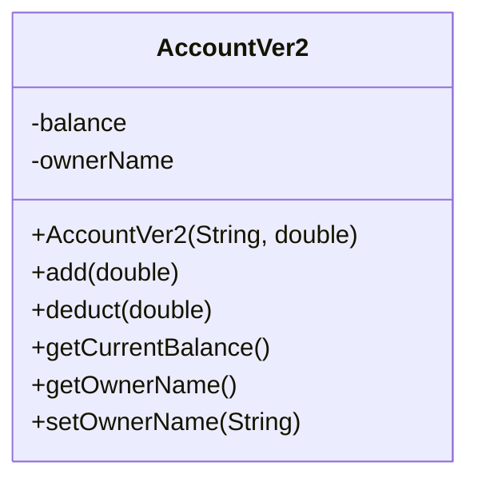

# 7강 — 고급 클래스 I

[레포지토리 안내](../../README.ko.md) | [English](Concepts_Lecture.md) | [한국어](Concepts_Lecture.ko.md)

> **최종 수정일:** 2026-11-27

> **학습 목표:**
> 1. 데이터 멤버, 메서드, 생성자를 가진 클래스를 정의하고 여러 클래스로 프로그램을 구성할 수 있다
> 2. 지역 변수, 매개변수, 데이터 멤버를 구분하고 기본형 데이터와 객체를 메서드에 전달할 수 있다
> 3. public과 private으로 정보 은닉과 캡슐화를 적용할 수 있다
> 4. this 키워드와 생성자 체이닝을 적용할 수 있다
> 5. static 필드와 메서드로 클래스 수준 동작을 구현하고 final 키워드로 불변 클래스를 설계할 수 있다
> 6. 객체와 클래스의 초기화 순서를 추적하고, 생성자 검사와 방어적 복사로 클래스 불변식을 지킬 수 있다

---

## 목차

- [1. 객체와 클래스 복습](#1-객체와-클래스-복습)
  - [1.1 클래스 구조](#11-클래스-구조)
  - [1.2 객체 생성](#12-객체-생성)
  - [1.3 소스 파일과 프로그램 구성](#13-소스-파일과-프로그램-구성)
  - [1.4 클래스 다이어그램](#14-클래스-다이어그램)
- [2. 생성자](#2-생성자)
  - [2.1 기본 생성자](#21-기본-생성자)
  - [2.2 매개변수가 있는 생성자](#22-매개변수가-있는-생성자)
  - [2.3 생성자 오버로딩](#23-생성자-오버로딩)
  - [2.4 객체가 초기화되는 순서](#24-객체가-초기화되는-순서)
  - [2.5 생성자에서의 유효성 검사](#25-생성자에서의-유효성-검사)
- [3. 인자와 매개변수](#3-인자와-매개변수)
  - [3.1 인자와 매개변수의 대응](#31-인자와-매개변수의-대응)
  - [3.2 객체 전달과 공유](#32-객체-전달과-공유)
  - [3.3 방어적 복사](#33-방어적-복사)
- [4. 지역 변수와 식별자](#4-지역-변수와-식별자)
  - [4.1 지역 변수](#41-지역-변수)
  - [4.2 식별자 결정 규칙](#42-식별자-결정-규칙)
  - [4.3 같은 클래스의 메서드 호출](#43-같은-클래스의-메서드-호출)
  - [4.4 변수의 유효 범위와 수명](#44-변수의-유효-범위와-수명)
- [5. 접근 제어자](#5-접근-제어자)
  - [5.1 정보 은닉과 가시성](#51-정보-은닉과-가시성)
  - [5.2 접근 제어자 비교](#52-접근-제어자-비교)
  - [5.3 가시성 지정 지침](#53-가시성-지정-지침)
- [6. 캡슐화 (Getter와 Setter)](#6-캡슐화-getter와-setter)
  - [6.1 클래스 불변식과 내부 표현의 교체](#61-클래스-불변식과-내부-표현의-교체)
  - [6.2 toString으로 객체 표현하기](#62-tostring으로-객체-표현하기)
- [7. this 키워드](#7-this-키워드)
- [8. 클래스 변수, 클래스 메서드, 상수](#8-클래스-변수-클래스-메서드-상수)
  - [8.1 static 필드와 메서드](#81-static-필드와-메서드)
  - [8.2 final과 불변 클래스](#82-final과-불변-클래스)
  - [8.3 static 초기화와 유틸리티 클래스](#83-static-초기화와-유틸리티-클래스)
  - [8.4 final의 여러 쓰임](#84-final의-여러-쓰임)
- [9. 여러 클래스의 협력](#9-여러-클래스의-협력)
- [10. 흔한 실수](#10-흔한-실수)
- [개념 적용](#개념-적용)
- [요약](#요약)
- [점검 문제](#점검-문제)
- [참고 문헌](#참고-문헌)

---

<br>

## 1. 객체와 클래스 복습

`String`, `GregorianCalendar`, `JFrame` 같은 표준 클래스만으로는 모든 요구를 충족할 수 없으므로, 응용에 맞춘 클래스를 직접 정의할 수 있어야 한다. 이렇게 직접 정의한 클래스를 **프로그래머 정의 클래스**(programmer-defined class)라고 하며, 클래스를 정의하는 방법을 익히는 것이 큰 프로그램을 만드는 기술의 첫걸음이다.

### 1.1 클래스 구조

클래스는 객체의 필드(데이터)와 메서드(동작)를 정의하는 설계도이다.

```java
public class Bicycle {
    // Fields (instance variables)
    private String ownerName;

    // Methods
    public String getOwnerName() {
        return ownerName;
    }

    public void setOwnerName(String name) {
        this.ownerName = name;
    }
}
```

클래스 정의는 다음 순서로 구성된다.

```text
import statements
class comment
class ClassName {
    data members
    methods (including constructors)
}
```

**데이터 멤버**(data member)는 `<제어자> <자료형> <이름>;` 형식으로 선언한다. 예를 들어 `private String ownerName;`에서 `private`은 제어자, `String`은 자료형, `ownerName`은 이름이다. 제어자는 여러 개 쓸 수 있으며, 이 예에는 하나만 있다.

**메서드**는 다음 형식으로 선언한다.

```text
<modifier> <return type> <method name> ( <parameters> ) {
    <statements>
}
```

예를 들어 `public void setOwnerName(String name) { ownerName = name; }`에서 `public`은 제어자, `void`는 반환 타입, `setOwnerName`은 메서드 이름, `String name`은 매개변수, `ownerName = name;`은 본문의 문장이다.

### 1.2 객체 생성

```java
Bicycle bike = new Bicycle();       // create an instance
bike.setOwnerName("Alice");          // use methods to modify state
System.out.println(bike.getOwnerName()); // retrieve state
```

클래스를 한 번 정의하면 인스턴스를 여러 개 만들 수 있다. 각 인스턴스는 자기만의 `ownerName`을 갖는다.

```java
Bicycle bike1, bike2;

bike1 = new Bicycle();
bike1.setOwnerName("Adam Smith");

bike2 = new Bicycle();
bike2.setOwnerName("Ben Jones");
```

### 1.3 소스 파일과 프로그램 구성

`Bicycle`을 사용하는 프로그램은 `main` 메서드를 가진 클래스(예: `Chap7Program1`)와 `Bicycle` 클래스로 이루어진다. 클래스 정의는 각각 별도의 파일(`Chap7Program1.java`, `Bicycle.java`)에 저장하며, 다음 순서로 컴파일하고 실행한다.

```text
javac Bicycle.java          (compile)
javac Chap7Program1.java    (compile)
java Chap7Program1          (run)
```

클래스가 셋 이상이어도 같다. 예를 들어 `Chap7Program2`가 `Bicycle`과 `Account`를 사용하면 `Bicycle.java`, `Account.java`, `Chap7Program2.java`를 컴파일한 뒤 `java Chap7Program2`로 실행한다. 클래스는 한 번만 컴파일하면 되고, 코드를 바꾸었을 때만 다시 컴파일한다.

### 1.4 클래스 다이어그램

클래스 다이어그램은 클래스 이름 아래에 메서드 목록을 적으며, 메서드마다 이름과 매개변수의 자료형을 쓴다.



*그림 1. Bicycle 클래스의 클래스 다이어그램*

---

<br>

## 2. 생성자

**생성자**(constructor)는 클래스의 새 인스턴스가 생성될 때 실행되는 특별한 메서드이다. 이름은 클래스 이름과 같고 반환 타입을 쓰지 않는다.

```text
public <class name> ( <parameters> ) {
    <statements>
}
```

```java
public Bicycle() {
    ownerName = "Unassigned";
}
```

> **주의:** 생성자 앞에 `void` 같은 반환 타입을 쓰면 생성자가 아니라 클래스 이름과 같은 이름의 일반 메서드가 된다. 예를 들어 `public void Bicycle() { ownerName = "Unknown"; }`은 `new Bicycle()`을 실행해도 호출되지 않으므로, 클래스에 다른 생성자가 없으면 `ownerName`은 기본값 `null`로 남는다.

### 2.1 기본 생성자

클래스에 생성자를 하나도 정의하지 않으면 Java 컴파일러가 매개변수가 없는 기본 생성자를 자동으로 제공하며, 이때 초기값을 지정하지 않은 필드는 기본값(숫자는 0, `boolean`은 `false`, 참조는 `null`)으로 초기화된다. 생성자를 하나라도 정의하면 기본 생성자는 제공되지 않으므로, 매개변수가 있는 생성자만 있는 클래스에서 `new Account()`를 쓰면 컴파일 오류가 난다.

### 2.2 매개변수가 있는 생성자

```java
public class Account {
    private String ownerName;
    private double balance;

    public Account(String name, double initialBalance) {
        this.ownerName = name;
        this.balance = initialBalance;
    }
}
```

### 2.3 생성자 오버로딩

클래스는 매개변수 목록이 다른 여러 생성자를 가질 수 있다.

```java
public Account() {
    this("Unassigned", 0.0);
}

public Account(String name, double balance) {
    this.ownerName = name;
    this.balance = balance;
}
```

> **핵심:** `this()`를 사용하여 생성자 내에서 다른 생성자를 호출할 수 있다. 이를 통해 코드 중복을 방지할 수 있다. `this()` 호출은 생성자의 첫 문장에 둔다(8강 2.2절).

### 2.4 객체가 초기화되는 순서

`new`로 객체를 만들 때 생성자의 본문만 실행되는 것은 아니다. 한 클래스 안에서 객체와 클래스는 다음 순서로 초기화된다.

1. 클래스가 처음 쓰일 때 한 번, `static` 필드의 초기값 대입과 `static` 블록이 소스에 쓴 순서대로 실행된다(1강 3.8절, 8.3절).
2. `new`가 실행될 때마다 객체의 메모리가 할당되고, 모든 인스턴스 필드가 기본값(0, `false`, `null`)으로 채워진다.
3. 상위 클래스 생성자의 호출(11강)이 끝나면, 인스턴스 필드의 초기값 대입과 인스턴스 초기화 블록 `{ ... }`이 소스에 쓴 순서대로 실행된다.
4. 생성자 본문의 나머지가 실행된다.

언어 명세는 3과 4의 순서를 객체 생성 절차의 일부로 정한다 [1]. 다음 프로그램은 각 단계에서 메시지를 출력한다.

```java
public class InitOrder {
    static int created = log("static field");

    static {
        log("static block");
    }

    private int a = log("field a");

    {
        log("instance block");
    }

    private int b;

    public InitOrder() {
        log("constructor, a=" + a + " b=" + b);
        b = 5;
    }

    static int log(String msg) {
        System.out.println(msg);
        return 1;
    }

    public static void main(String[] args) {
        System.out.println("main starts");
        new InitOrder();
        System.out.println("--- second object");
        new InitOrder();
    }
}
```

```text
static field
static block
main starts
field a
instance block
constructor, a=1 b=0
--- second object
field a
instance block
constructor, a=1 b=0
```

- `static` 부분은 `main`이 실행되기 전, 클래스 `InitOrder`가 초기화될 때 한 번만 실행된다. 두 번째 객체를 만들 때는 다시 실행되지 않는다.
- 객체를 만들 때마다 `field a`, `instance block`, 생성자의 순서가 되풀이된다.
- 생성자 안에서 `a`는 이미 초기값 1을 받았고, 초기값이 없는 `b`는 기본값 0이다. 생성자 본문이 끝난 뒤에야 `b`가 5가 된다.

필드의 초기값은 모든 생성자에 공통이고, 생성자마다 다른 값은 생성자에서 대입한다. 인스턴스 초기화 블록은 거의 쓰지 않으며, 공통 초기화는 2.3절처럼 `this(...)`로 한 생성자에 모으는 편이 읽기 쉽다.

### 2.5 생성자에서의 유효성 검사

객체가 항상 만족해야 하는 조건, 예를 들어 "시각의 시는 0\~23이다"를 그 클래스의 **불변식**(class invariant)이라 한다(6.1절). 생성자는 객체가 처음 만들어지는 유일한 통로이므로, 생성자에서 인자를 검사하면 잘못된 상태의 객체가 아예 만들어지지 않는다. 인자가 잘못되었을 때는 6강 3.9절처럼 `IllegalArgumentException`을 던진다.

```java
public class Time {
    private int secondsOfDay;

    public Time(int hour, int minute, int second) {
        if (hour < 0 || hour > 23 || minute < 0 || minute > 59 || second < 0 || second > 59) {
            throw new IllegalArgumentException("invalid time: " + hour + ":" + minute + ":" + second);
        }
        secondsOfDay = hour * 3600 + minute * 60 + second;
    }

    public int getHour() {
        return secondsOfDay / 3600;
    }

    public int getMinute() {
        return secondsOfDay / 60 % 60;
    }

    public int getSecond() {
        return secondsOfDay % 60;
    }

    public void addSeconds(int s) {
        secondsOfDay = Math.floorMod(secondsOfDay + s, 24 * 3600);
    }

    @Override
    public String toString() {
        return String.format("%02d:%02d:%02d", getHour(), getMinute(), getSecond());
    }
}
```

생성자는 시, 분, 초가 범위 안에 있을 때만 객체를 만든다. 검사를 통과하지 못하면 예외가 던져지고 `new`의 결과로 아무 객체도 얻지 못한다. 그래서 `Time` 객체를 받은 코드는 그 객체가 올바른 시각을 나타낸다고 믿고 쓸 수 있다. 상태를 바꾸는 메서드 `addSeconds`도 불변식을 지킨다. `Math.floorMod`(3강 4.7절)로 하루의 초 수 86,400으로 나눈 나머지를 구하므로, 더하거나 빼도 결과는 항상 0 이상 86,399 이하이다. 이 클래스의 사용 예와 출력은 6.1절에 있다.

---

<br>

## 3. 인자와 매개변수

### 3.1 인자와 매개변수의 대응

> **용어 정의:** **인자**(argument)는 메서드를 호출할 때 넘기는 값이다.

> **용어 정의:** **매개변수**(parameter)는 호출된 메서드 안에서 넘어온 인자의 값을 담는 자리이다.

```java
class Sample {
    public static void main(String[] arg) {
        Account acct = new Account();
        . . .
        acct.add(400);              // 400 is the argument
        . . .
    }
}

class Account {
    . . .
    public void add(double amt) {   // amt is the parameter
        balance = balance + amt;
    }
    . . .
}
```

인자와 매개변수는 다음 규칙으로 대응한다.

- 인자의 수와 매개변수의 수가 같아야 한다.
- 인자와 매개변수는 왼쪽부터 차례로 짝지어진다.
- 짝지어진 인자와 매개변수는 대입 호환이어야 한다. 예를 들어 `double` 인자를 `int` 매개변수에 넘길 수 없다. 반대로 위의 `add(400)`처럼 `int` 인자를 `double` 매개변수에 넘기는 것은 가능하다.

### 3.2 객체 전달과 공유

`int`나 `double` 값을 넘기듯 객체도 메서드에 넘길 수 있다. 객체를 넘기면 실제로는 객체의 참조(주소)가 전달되므로, 호출된 메서드 안에 객체의 복사본이 만들어지지 않는다.

```java
Student student;
LibraryCard card1, card2;

student = new Student();
student.setName("Jon Java");
student.setEmail("jj@javauniv.edu");

card1 = new LibraryCard();
card1.setOwner(student);
card1.checkOut(3);

card2 = new LibraryCard();
card2.setOwner(student); // the same student is the owner of the second card, too
```

`LibraryCard`의 `setOwner(Student student)`는 `owner = student;`로 받은 참조를 데이터 멤버에 저장한다. 같은 `Student` 객체를 `card1`과 `card2`에 넘겼으므로 두 `LibraryCard` 객체의 `owner`는 같은 `Student` 객체 하나를 가리킨다.



*그림 2. 두 LibraryCard 객체가 같은 Student 객체를 공유하는 구조*

따라서 `student.setName("Kim")`으로 이름을 바꾸면 `card1.getOwner()`와 `card2.getOwner()`로 얻는 이름도 모두 바뀐다.

### 3.3 방어적 복사

3.2절의 공유는 의도한 것이지만, 의도하지 않은 공유는 캡슐화를 깨뜨린다. 필드가 `private`이어도 그 필드가 가리키는 객체를 바깥에서도 가리키고 있으면, 바깥 코드가 그 객체를 통해 내부 상태를 바꿀 수 있기 때문이다. 다음 클래스는 생성자에서 받은 배열의 참조를 그대로 저장하고, getter도 그 참조를 그대로 돌려준다.

```java
public class LeakyScores {
    private final int[] values;

    public LeakyScores(int[] values) {
        this.values = values;
    }

    public int[] getValues() {
        return values;
    }

    public static void main(String[] args) {
        int[] input = {80, 90, 100};
        LeakyScores s = new LeakyScores(input);
        input[0] = 0;
        s.getValues()[1] = 0;
        System.out.println(java.util.Arrays.toString(s.getValues()));
    }
}
```

```text
[0, 0, 100]
```

`input`과 필드 `values`가 같은 배열을 가리키므로 `input[0] = 0`이 객체의 내용을 바꾸고, getter가 돌려준 참조로 `s.getValues()[1] = 0`을 실행해도 바뀐다. 필드가 `final`이어도 막을 수 없다. `final`은 참조를 바꾸지 못하게 할 뿐 배열의 내용은 지켜 주지 않는다(8.4절).

해결책은 **방어적 복사**(defensive copy)이다. 바깥에서 받은 변경 가능한 객체는 복사본을 저장하고, 바깥으로 내줄 때도 복사본을 돌려준다.

```java
import java.util.Arrays;

public class Scores {
    private final int[] values;

    public Scores(int[] values) {
        this.values = values.clone();
    }

    public int[] getValues() {
        return values.clone();
    }

    public double average() {
        int sum = 0;
        for (int v : values) {
            sum += v;
        }
        return (double) sum / values.length;
    }

    public static void main(String[] args) {
        int[] input = {80, 90, 100};
        Scores s = new Scores(input);
        input[0] = 0;
        s.getValues()[1] = 0;
        System.out.println(Arrays.toString(s.getValues()) + " " + s.average());
    }
}
```

```text
[80, 90, 100] 90.0
```

생성자의 `values.clone()`이 받은 배열과 다른 배열을 만들고(5강 4.1절), getter도 매번 새 사본을 돌려주므로 바깥의 어떤 변경도 객체 안의 배열에 닿지 않는다. 복사에는 비용이 들므로, 원소가 `String`처럼 불변인 객체이거나 공유가 설계의 일부일 때는 복사하지 않는다. 8.2절의 불변 클래스가 배열 같은 필드를 가지면 방어적 복사가 반드시 필요하다.

---

<br>

## 4. 지역 변수와 식별자

### 4.1 지역 변수

**지역 변수**(local variable)는 메서드 안에서 선언되어 중간 계산 결과를 저장하는 것처럼 임시로 쓰이는 변수이다. 메서드가 끝나면 사라진다.

```java
public double convert(int num) {
    double result;                  // local variable
    result = Math.sqrt(num * num);
    return result;
}
```

### 4.2 식별자 결정 규칙

메서드 안에 나오는 식별자는 지역 변수, 매개변수, 데이터 멤버 중 하나이다. 컴파일러는 다음 순서로 식별자가 무엇을 가리키는지 정한다.

1. 같은 이름의 지역 변수나 매개변수 선언이 있으면 그것을 가리킨다.
2. 그렇지 않고 같은 이름의 데이터 멤버 선언이 있으면 데이터 멤버를 가리킨다.
3. 둘 다 없으면 대응하는 선언이 없으므로 오류이다.

```java
class MusicCD {

    private String artist;
    private String title;
    private String id;

    public MusicCD(String name1, String name2) {

        String ident;

        artist = name1;
        title  = name2;

        ident  = artist.substring(0, 2) + "-" +
                 title.substring(0, 9);

        id     = ident;
    }
    ...
}
```

위 생성자에서 `name1`, `name2`는 매개변수, `ident`는 지역 변수, `artist`, `title`, `id`는 데이터 멤버를 가리킨다. 매개변수나 지역 변수가 데이터 멤버와 이름이 같으면 규칙 1에 따라 데이터 멤버가 가려지므로, 데이터 멤버를 가리키려면 `this.`를 붙여야 한다(7절).

### 4.3 같은 클래스의 메서드 호출

다른 객체의 메서드를 호출할 때는 `obj.doWork()`처럼 점 표기법이 필요하다. 같은 클래스의 다른 메서드를 호출할 때는 점 표기법 없이 `doWork()`처럼 메서드 이름만 쓰면 된다(`this.doWork()`로 써도 된다).

```java
class AClass {
    public void myMethod() {
        BClass obj = new BClass();
        obj.doWork();       // method of another object: dot notation required
    }
}

class BClass {
    public void doWork() {
        ...
    }

    public void myMethod() {
        doWork();           // method of the same object: dot notation optional
    }
}
```

### 4.4 변수의 유효 범위와 수명

변수를 쓸 수 있는 소스 코드의 범위를 **유효 범위**(scope)라 하고, 변수가 메모리에 존재하는 기간을 **수명**(lifetime)이라 한다. 세 종류의 변수는 둘 다 다르다.

| 변수 | 유효 범위 | 수명 | 초기값 |
|:-----|:-----|:-----|:-----|
| 지역 변수, 매개변수 | 선언한 곳부터 그것을 둘러싼 블록 `{ }`의 끝까지 | 그 메서드 호출의 프레임이 있는 동안 | 대입해야 쓸 수 있다 |
| 인스턴스 변수 | 클래스 전체(인스턴스 메서드와 생성자) | 객체가 힙에 있는 동안 | 기본값 |
| 클래스 변수 | 클래스 전체 | 클래스가 적재되어 있는 동안 | 기본값 |

*표 1. 변수의 종류에 따른 유효 범위와 수명*

블록 안에서 선언한 변수는 블록 밖에서 쓸 수 없고, 지역 변수와 같은 이름의 지역 변수를 그 유효 범위 안의 안쪽 블록에서 다시 선언할 수 없다. 다음 코드는 두 규칙을 모두 어긴다.

```java
public class ScopeErr {
    public static void main(String[] args) {
        int x = 1;
        for (int i = 0; i < 3; i++) {
            int x = i;
        }
        System.out.println(i);
    }
}
```

```text
ScopeErr.java:5: error: variable x is already defined in method main(String[])
            int x = i;
                ^
ScopeErr.java:7: error: cannot find symbol
        System.out.println(i);
                           ^
  symbol:   variable i
  location: class ScopeErr
2 errors
```

`for`의 초기화에서 선언한 `i`의 유효 범위는 그 `for` 문 안이므로 루프 뒤에서는 찾을 수 없다. 반면 지역 변수가 필드와 같은 이름을 갖는 것은 허용되며, 이때 4.2절의 규칙에 따라 지역 변수가 필드를 가린다. 유효 범위는 가능한 한 좁게 잡는 것이 좋다. 변수를 처음 쓰는 곳 가까이에서 선언하면 그 변수를 바꿀 수 있는 코드가 줄어들어 오류를 찾기 쉽다.

---

<br>

## 5. 접근 제어자

### 5.1 정보 은닉과 가시성

제어자 `public`과 `private`은 데이터 멤버와 메서드의 접근 가능 범위를 정한다.

- 클래스 구성 요소(데이터 멤버나 메서드)를 `private`으로 선언하면 클라이언트 클래스가 접근할 수 없다.
- `public`으로 선언하면 클라이언트 클래스가 접근할 수 있다.
- 클래스의 내부 세부 사항을 `private`으로 선언하여 클라이언트에게서 숨기는 것을 **정보 은닉**(information hiding)이라고 한다.

```java
class Service {
    public  int memberOne;
    private int memberTwo;

    public void doOne() {
        ...
    }

    private void doTwo() {
        ...
    }
}
```

클라이언트 클래스에서 `Service obj = new Service();`로 객체를 만들었을 때 `obj.memberOne = 10;`과 `obj.doOne();`은 허용되지만, `obj.memberTwo = 20;`과 `obj.doTwo();`는 컴파일 오류이다.

### 5.2 접근 제어자 비교

| 제어자 | 클래스 | 패키지 | 하위 클래스 (다른 패키지) | 외부 |
|:-------|:-----:|:------:|:---------:|:----:|
| `public` | Yes | Yes | Yes | Yes |
| `protected` | Yes | Yes | Yes | No |
| (default) | Yes | Yes | No | No |
| `private` | Yes | No | No | No |

*표 2. 접근 제어자별 접근 가능 범위*

하위 클래스 열은 다른 패키지에 있는 하위 클래스를 뜻한다. 같은 패키지의 하위 클래스는 패키지 열을 따르므로 (default) 멤버에도 접근할 수 있다.

> **핵심:** 필드는 `private`으로 선언하고 `public` getter/setter 메서드를 통해 접근하는 것이 바람직하다. 이것이 캡슐화의 핵심이다.

### 5.3 가시성 지정 지침

데이터 멤버는 클래스의 구현 세부 사항이므로 클라이언트에게 보이지 않아야 한다. 데이터 멤버와 메서드의 가시성은 다음 지침으로 정한다.

- 클래스 변수와 인스턴스 변수는 `private`으로 선언한다.
- 같은 클래스의 다른 메서드만 사용하는 클래스 메서드와 인스턴스 메서드는 `private`으로 선언한다.
- 클래스 상수는 클라이언트 프로그램이 값을 직접 읽게 하려면 `public`으로 선언하고, 내부에서만 쓰면 `private`으로 선언한다. 상수는 바꿀 수 없으므로 `public`으로 공개해도 캡슐화를 해치지 않는다.

클래스 다이어그램에서는 `public` 구성 요소를 `+`로, `private` 구성 요소를 `-`로 표시한다.



*그림 3. 가시성을 표시한 AccountVer2 클래스 다이어그램*

---

<br>

## 6. 캡슐화 (Getter와 Setter)

캡슐화는 내부 상태를 숨기고 메서드를 통해서만 상호작용하도록 요구하는 것이다.

```java
public class Account {
    private double balance;

    public double getBalance() {
        return balance;
    }

    public void deposit(double amount) {
        if (amount > 0) {
            balance += amount;
        }
    }

    public void withdraw(double amount) {
        if (amount > 0 && amount <= balance) {
            balance -= amount;
        }
    }
}
```

`balance`가 `private`이므로 클라이언트는 `deposit`과 `withdraw`를 거쳐야만 잔액을 바꿀 수 있다. 두 메서드가 음수 금액과 잔액을 넘는 출금을 거부하므로 잔액이 잘못된 값이 되는 일을 막을 수 있다. 이 `Account`에 오버로딩된 생성자와 계좌주 이름의 getter, setter를 더한 실습 코드는 [Account.java](../../Coursework/Lab07_Advanced-Classes-I/Account.java), private 필드와 getter, setter로 캡슐화한 `Bicycle`의 실습 코드는 [Bicycle.java](../../Coursework/Lab07_Advanced-Classes-I/Bicycle.java)이다.

### 6.1 클래스 불변식과 내부 표현의 교체

캡슐화의 첫째 효과는 불변식을 지키는 것이다. 2.5절의 `Time`은 필드 `secondsOfDay`를 `private`으로 숨기고, 그 값을 바꾸는 길을 생성자와 `addSeconds`로 제한했다. 두 곳이 모두 범위를 검사하거나 나머지 연산으로 범위를 맞추므로, 클래스 밖의 어떤 코드도 25시 같은 시각을 만들 수 없다.

```java
public class TimeDemo {
    public static void main(String[] args) {
        Time t = new Time(23, 59, 30);
        System.out.println(t);
        t.addSeconds(45);
        System.out.println(t + " " + t.getHour());
        t.addSeconds(-3600);
        System.out.println(t);
        Object plain = new Object();
        System.out.println(plain.toString().startsWith("java.lang.Object@"));
        try {
            new Time(24, 0, 0);
        } catch (IllegalArgumentException e) {
            System.out.println(e.getMessage());
        }
    }
}
```

```text
23:59:30
00:00:15 0
23:00:15
true
invalid time: 24:0:0
```

23:59:30에 45초를 더하면 다음 날 0시 0분 15초가 되고, 다시 1시간을 빼면 전날 23시 0분 15초가 된다. `Math.floorMod`가 음수에도 0 이상의 나머지를 주므로 15 - 3600 = -3585초가 86,400 - 3585 = 82,815초, 즉 23:00:15로 바뀐다.

캡슐화의 둘째 효과는 **내부 표현**(internal representation)을 클라이언트와 상관없이 바꿀 수 있다는 것이다. `Time`은 시, 분, 초를 필드 세 개로 둘 수도 있지만, 위 구현은 하루 시작부터의 초 수 하나로 저장한다. 덕분에 `addSeconds`는 덧셈 한 번과 나머지 한 번으로 끝나고, 59초에 1초를 더할 때 분과 시로 올림하는 복잡한 처리가 필요 없다. 클라이언트는 `getHour`, `getMinute`, `getSecond`만 쓰므로, 나중에 표현을 필드 세 개로 바꾸어도 메서드의 결과가 같으면 클라이언트의 코드는 한 줄도 고칠 필요가 없다. 필드를 `public`으로 공개했다면 표현을 바꾸는 순간 그 필드를 쓰는 모든 코드를 고쳐야 한다.

### 6.2 toString으로 객체 표현하기

`println`에 객체를 넘기거나 문자열에 `+`로 연결하면 그 객체의 `toString()` 메서드가 호출된다. `toString()`은 모든 클래스의 상위 클래스인 `Object`에 정의되어 있으며, 기본 구현은 `java.lang.Object@` 뒤에 16진수가 붙은 문자열처럼 클래스 이름과 `@`, 16진수를 돌려준다. 위 출력의 `true`는 그 형식을 확인한 것이다(5강 1.6절의 `[I@...`도 같은 형식이다). 이 문자열은 사람이 읽기에 쓸모가 없으므로, 클래스에서 `toString()`을 다시 정의하여 객체의 상태를 읽기 좋은 문자열로 돌려주게 한다. `Time`의 `toString()`은 `String.format("%02d:%02d:%02d", ...)`(4강 5.1절)으로 `23:59:30` 같은 형식을 만든다.

메서드 앞의 `@Override`는 상위 클래스의 메서드를 같은 이름과 매개변수로 다시 정의한다는 표시이다. 철자를 틀려 `tostring()`처럼 쓰면 다시 정의한 것이 아니라 새 메서드가 되는데, `@Override`가 있으면 컴파일러가 이 실수를 오류로 알려 준다. 상위 클래스의 메서드를 다시 정의하는 오버라이딩의 규칙은 11강에서 다룬다.

---

<br>

## 7. this 키워드

`this`는 현재 객체 인스턴스를 참조한다. 주요 용도는 다음과 같다.

1. **필드와 매개변수의 이름 충돌 해소:** `this.name = name;`
2. **다른 생성자 호출:** `this(defaultValue);`
3. **현재 객체 전달:** `someMethod(this);`

첫 번째 용도는 4.2절의 규칙 때문에 필요하다. 매개변수 이름이 필드와 같으면 `name = name;`은 매개변수를 자기 자신에게 대입할 뿐 필드를 바꾸지 않는다. `this`의 세 가지 용도는 8강에서 더 자세히 다룬다.

---

<br>

## 8. 클래스 변수, 클래스 메서드, 상수

### 8.1 static 필드와 메서드

`static`이 붙지 않은 데이터 멤버는 **인스턴스 변수**로, 객체마다 따로 존재한다. `static`을 붙이면 **클래스 변수**가 되어 그 클래스의 모든 객체가 하나를 공유한다. 마찬가지로 `static` 메서드는 **클래스 메서드**로, 객체를 만들지 않고 `클래스이름.메서드()`로 호출한다. `Math.sqrt`, `Integer.parseInt`, `main`이 클래스 메서드이다.

```java
public class Account {
    private static int count = 0;   // class variable: shared by all Account objects
    private String ownerName;       // instance variable: one per object

    public Account(String name) {
        ownerName = name;
        count++;
    }

    public static int getCount() {  // class method
        return count;
    }
}
```

`Account` 객체를 세 개 만든 뒤 `Account.getCount()`를 호출하면 3을 반환한다. 클래스 메서드는 특정 객체 없이 실행되므로 그 안에서 인스턴스 변수(`ownerName`)나 `this`를 쓸 수 없다. 쓰면 `non-static variable ownerName cannot be referenced from a static context` 컴파일 오류가 난다.

### 8.2 final과 불변 클래스

`final`을 붙인 변수는 한 번만 값을 대입할 수 있다. `static final` 데이터 멤버는 **클래스 상수**이며, 이름은 관례상 대문자와 밑줄로 쓴다.

```java
public class Dice {

    public static final int MAX_NUMBER = 6;
    private static final int MIN_NUMBER = 1;
    private static final int NO_NUMBER = 0;

    private int number;

    public Dice() {
        number = NO_NUMBER;
    }

    // Rolls the dice
    public void roll() {
        number = (int) (Math.floor(Math.random() * (MAX_NUMBER - MIN_NUMBER + 1)) + MIN_NUMBER);
    }

    // Returns the number on this dice
    public int getNumber() {
        return number;
    }
}
```

`Dice`는 5.3절의 지침을 따른다. 클라이언트가 읽을 수 있어야 하는 `MAX_NUMBER`는 `public`, 내부에서만 쓰는 `MIN_NUMBER`와 `NO_NUMBER`는 `private`이고, 인스턴스 변수 `number`는 `private`이다. `roll()`은 `Math.random()`이 반환하는 0 이상 1 미만의 실수에 6을 곱하고 내림한 뒤 1을 더하여 1~6의 정수를 만든다.

```java
Dice diceOne = new Dice(), diceTwo = new Dice();

diceOne.roll();
System.out.println(diceOne.getNumber());

diceTwo.roll();
System.out.println(diceTwo.getNumber());
```

인스턴스 변수에 `final`을 붙이면 선언에서나 생성자에서 정확히 한 번 대입해야 한다. 모든 필드를 `private final`로 두고 setter를 제공하지 않으면 생성 뒤에 상태가 바뀌지 않는 **불변 클래스**(immutable class)가 된다. `String`이 대표적인 불변 클래스이다. 다만 필드가 배열처럼 내용을 바꿀 수 있는 객체를 가리키면 참조는 바뀌지 않아도 그 객체의 내용은 바뀔 수 있으므로, 불변 클래스의 필드는 기본형 값이나 불변 객체를 담아야 한다.

```java
public final class Point2D {
    private final int x;
    private final int y;

    public Point2D(int x, int y) {
        this.x = x;
        this.y = y;
    }

    public int getX() { return x; }
    public int getY() { return y; }
}
```

클래스 선언의 `final`은 하위 클래스를 만들 수 없게 하여, 하위 클래스가 상태를 바꾸는 메서드를 추가하는 일을 막는다.

### 8.3 static 초기화와 유틸리티 클래스

클래스 변수는 객체가 아니라 클래스에 속하므로, 객체를 만들 때가 아니라 클래스가 초기화될 때 한 번 초기값을 받는다(2.4절, 1강 3.8절). 초기값을 식 하나로 쓸 수 없으면 `static { ... }` 블록에서 계산한다. `static` 블록은 클래스가 초기화될 때 소스에 쓴 순서대로 한 번 실행되며, 초기화는 클래스가 처음 실제로 쓰일 때(첫 객체 생성, 첫 `static` 메서드 호출, 상수가 아닌 `static` 필드의 첫 사용 등) 일어난다 [1].

`Math`처럼 `static` 메서드와 상수만 모아 둔 클래스를 **유틸리티 클래스**(utility class)라 한다. 유틸리티 클래스는 상태가 없으므로 객체를 만들 이유가 없다. 생성자를 `private`으로 선언하면 클래스 밖에서 객체를 만들 수 없게 된다.

```java
public final class MathUtil {
    public static final double TAX_RATE = 0.1;

    private MathUtil() {
    }

    public static int clamp(int value, int low, int high) {
        return Math.max(low, Math.min(high, value));
    }

    public static double withTax(double price) {
        return price * (1 + TAX_RATE);
    }
}
```

```java
public class UtilDemo {
    public static void main(String[] args) {
        System.out.println(MathUtil.clamp(150, 0, 100) + " " + MathUtil.clamp(-5, 0, 100) + " " + MathUtil.withTax(2000));
    }
}
```

```text
100 0 2200.0
```

`clamp`는 값을 `[low, high]` 범위로 잘라 150은 100, -5는 0으로 만든다. `new MathUtil()`을 쓰면 다음 오류가 난다.

```text
UtilErr.java:3: error: MathUtil() has private access in MathUtil
        MathUtil m = new MathUtil();
                     ^
1 error
```

생성자를 하나라도 정의했으므로 컴파일러는 기본 생성자를 만들지 않으며(2.1절), 정의한 생성자는 `private`이므로 바깥에서는 객체를 만들 방법이 없다. `static` 메서드는 이처럼 상태가 필요 없는 계산에 알맞다. 반대로 객체마다 다른 상태를 써야 하는 동작을 `static` 메서드로 만들면 그 상태를 모두 매개변수로 넘겨야 하므로, 1강 1.4절의 절차적 설계로 돌아가게 된다.

### 8.4 final의 여러 쓰임

`final`은 붙는 곳에 따라 뜻이 조금씩 다르다.

| 위치 | 뜻 | 예 |
|:-----|:-----|:-----|
| 지역 변수 | 한 번만 대입할 수 있다. 선언과 대입을 나누어도 된다 | `final int limit; limit = 10;` |
| 매개변수 | 메서드 안에서 매개변수에 다시 대입할 수 없다 | `void f(final int n)` |
| 인스턴스 변수 | 선언이나 모든 생성자에서 정확히 한 번 대입해야 한다 | `private final int id;` |
| 클래스 변수 | `static final`로 쓰며, 보통 이름 있는 상수이다 | `public static final int MAX = 6;` |
| 메서드 | 하위 클래스가 다시 정의할 수 없다 | `public final void lock()` |
| 클래스 | 하위 클래스를 만들 수 없다 | `public final class String` |

*표 3. final이 붙는 위치에 따른 뜻*

선언에서 초기값을 주지 않은 `final` 인스턴스 변수를 생성자에서 대입하지 않으면 컴파일 오류가 난다.

```text
BlankFinal.java:5: error: variable id might not have been initialized
    }
    ^
1 error
```

`final`이 참조형 변수에 붙으면 변수가 다른 객체를 가리키지 못하게 할 뿐, 가리키는 객체의 내용은 그대로 바꿀 수 있다.

```java
public class FinalDemo {
    public static void main(String[] args) {
        final int[] data = {1, 2, 3};
        data[0] = 100;
        System.out.println(data[0]);
        final int limit;
        limit = 10;
        System.out.println(limit);
    }
}
```

```text
100
10
```

`data[0] = 100;`은 배열의 내용을 바꾸므로 허용되지만, `data = new int[2];`처럼 다른 배열을 대입하면 `cannot assign a value to final variable data` 컴파일 오류가 난다. 8.2절에서 불변 클래스의 필드가 기본형이나 불변 객체를 담아야 한다고 한 이유, 그리고 3.3절에서 `final` 배열 필드에도 방어적 복사가 필요했던 이유가 이것이다.

---

<br>

## 9. 여러 클래스의 협력

객체 지향 설계에서는 여러 클래스가 서로 협력한다.

```java
// Main program creates and uses Account objects
Account savings = new Account("Alice", 1000.0);
savings.deposit(500.0);
System.out.println("Balance: " + savings.getBalance());
```

다음 프로그램은 `Bicycle`과 `Account`를 함께 사용한다. 이 `Account`는 매개변수 없는 생성자에서 `ownerName`을 `"Unassigned"`, `balance`를 0.0으로 초기화하고, `add`, `deduct`, `getCurrentBalance`, `setInitialBalance`, `getOwnerName`, `setOwnerName` 메서드를 제공한다.

```java
public class Chap7Program2 {

    public static void main(String[] args) {

        Bicycle bike;
        Account acctMinseok;

        String myName = "Minseok Seo";

        bike = new Bicycle();
        bike.setOwnerName(myName);

        acctMinseok = new Account();
        acctMinseok.setOwnerName(myName);
        acctMinseok.setInitialBalance(250.00);

        acctMinseok.add(25.00);
        acctMinseok.deduct(50);

        // Output some information
        System.out.println(bike.getOwnerName() + " owns a bicycle and");
        System.out.println("has $ " + acctMinseok.getCurrentBalance() + " left in the bank");
    }
}
```

잔액은 250 + 25 - 50 = 225이므로 출력은 다음과 같다.

```text
Minseok Seo owns a bicycle and
has $ 225.0 left in the bank
```

실습 코드 [MultipleClassesDemo.java](../../Coursework/Lab07_Advanced-Classes-I/MultipleClassesDemo.java)도 두 클래스를 함께 쓴다. 계좌주 이름을 정한 `Bicycle` 두 개를 만들어 이름을 출력하고, 잔액 1000.0으로 만든 `Account`에 500.0을 입금하고 200.0을 출금한 뒤 잔액 1500.0과 1300.0을 차례로 출력한다.

어떤 클래스든 `main` 메서드를 넣으면 메인 클래스가 될 수 있다. 예를 들어 `Bicycle` 클래스 안에 `Bicycle`의 사용 예를 보이는 `main`을 두고 `java Bicycle`로 실행할 수 있다.

```java
class Bicycle {

    // definition of the class as shown before comes here

    // The main method that shows a sample
    // use of the Bicycle class
    public static void main(String[] args) {

        Bicycle myBike;

        myBike = new Bicycle();
        myBike.setOwnerName("Jon Java");

        System.out.println(myBike.getOwnerName() + " owns a bicycle");
    }
}
```

> **핵심:** 각 클래스는 단일 책임을 가져야 한다. 데이터(모델), 로직(서비스), 표현(UI)을 서로 다른 클래스로 분리한다.

---

<br>

## 10. 흔한 실수

| 실수 | 나타나는 결과 | 바로잡는 방법 |
|:-----|:-----|:-----|
| 생성자 앞에 `void`를 쓴다 | 일반 메서드가 되어 `new`에서 호출되지 않는다 | 반환 타입을 쓰지 않는다 |
| 매개변수 있는 생성자만 정의하고 `new Account()`를 쓴다 | 기본 생성자가 없어 컴파일 오류 | 매개변수 없는 생성자를 따로 정의한다 |
| 필드와 같은 이름의 매개변수에 `this.` 없이 대입한다 | 필드가 바뀌지 않는다 | `this.name = name;`으로 쓴다 |
| 생성자에서 인자를 검사하지 않는다 | 불변식을 어긴 객체가 만들어진다 | 잘못된 인자에 `IllegalArgumentException`을 던진다 |
| 받은 배열이나 변경 가능한 객체의 참조를 그대로 저장하거나 돌려준다 | 바깥 코드가 `private` 필드의 내용을 바꾼다 | 방어적 복사를 한다 |
| `final` 배열 필드면 내용도 바뀌지 않는다고 생각한다 | 원소가 바뀐다 | `final`은 참조만 고정함을 기억하고 필요하면 복사한다 |
| `static` 메서드에서 인스턴스 변수나 `this`를 쓴다 | `non-static variable ... cannot be referenced from a static context` | 인스턴스 메서드로 바꾸거나 객체를 통해 접근한다 |
| 모든 필드에 무조건 setter를 만든다 | 불변식을 지킬 수 없고 캡슐화가 약해진다 | 필요한 변경만 검사하는 메서드로 제공한다 |
| `toString()`을 정의하지 않은 객체를 출력한다 | `클래스이름@16진수`가 출력된다 | `toString()`을 다시 정의한다 |

*표 4. 클래스를 정의할 때의 흔한 실수*

---

<br>

## 개념 적용

**T/F 점검:**

| 문장 | 판단과 근거 |
|:-----|:-----|
| 인스턴스 필드의 초기값 대입은 생성자 본문보다 먼저 실행된다. | **T.** 2.4절의 출력처럼 `field a`가 생성자보다 먼저 출력된다. |
| `static` 블록은 객체를 만들 때마다 실행된다. | **F.** 클래스가 초기화될 때 한 번만 실행된다. |
| 생성자에서 예외를 던지면 `new`는 필드가 기본값인 객체를 돌려준다. | **F.** 예외가 던져지면 `new` 식은 값을 내지 못하므로 호출한 쪽은 객체를 얻지 못한다. |
| `private final int[] data;` 필드는 바깥에서 원소를 바꿀 수 없다. | **F.** 같은 배열의 참조가 바깥에 있으면 원소를 바꿀 수 있다. 방어적 복사가 필요하다. |
| `for (int i = 0; ...)` 루프가 끝난 뒤에도 `i`를 쓸 수 있다. | **F.** `i`의 유효 범위는 `for` 문 안이므로 `cannot find symbol` 오류가 난다. |
| 생성자를 `private`으로 선언하면 그 클래스의 객체를 클래스 밖에서 `new`로 만들 수 없다. | **T.** 8.3절의 `MathUtil`처럼 `has private access` 오류가 난다. |
| 필드를 `private`으로 숨기면 클라이언트 코드를 고치지 않고 내부 표현을 바꿀 수 있다. | **T.** 클라이언트는 공개된 메서드에만 기대므로 메서드의 동작이 같으면 표현을 바꾸어도 된다. |
| `@Override`를 붙이지 않으면 메서드를 다시 정의할 수 없다. | **F.** `@Override` 없이도 다시 정의되지만, 붙이면 철자나 매개변수를 틀렸을 때 컴파일러가 알려 준다. |

---

<br>

## 요약

| 개념 | 핵심 요약 |
|:-----|:-----|
| 클래스 | 필드와 메서드를 정의하는 설계도이며, 클래스마다 별도의 소스 파일에 저장한다. |
| 객체 | `new` 키워드로 생성하는 클래스의 인스턴스이다. |
| 생성자 | 객체 상태를 초기화하는 반환 타입 없는 특별한 메서드이며, 오버로딩이 가능하다. |
| 기본 생성자 | 생성자를 하나도 정의하지 않았을 때만 컴파일러가 자동으로 제공한다. |
| 인자와 매개변수 | 수가 같아야 하고 왼쪽부터 짝지어지며, 짝마다 대입 호환이어야 한다. |
| 객체 전달 | 참조가 전달되므로 복사본이 생기지 않고, 여러 객체가 같은 객체를 공유할 수 있다. |
| 식별자 결정 | 지역 변수와 매개변수가 데이터 멤버보다 우선한다. |
| 접근 제어자 | 가시성을 `private` < default < `protected` < `public` 순으로 넓게 제어한다. |
| 캡슐화 | 필드를 `private`으로 숨기고 getter/setter를 통해 노출한다. |
| this | 현재 객체 인스턴스에 대한 참조이다. |
| static | 클래스 변수와 클래스 메서드는 객체가 아니라 클래스에 속하며 모든 객체가 공유한다. |
| final과 불변 클래스 | `final` 변수는 한 번만 대입할 수 있고, 모든 필드가 기본형 값이나 불변 객체를 담는 `private final` 필드이고 setter가 없는 클래스는 불변이다. |
| 초기화 순서 | `static` 초기화는 클래스마다 한 번, 객체마다 기본값, 필드 초기값과 초기화 블록, 생성자 본문의 순서로 초기화된다. |
| 생성자 검사 | 생성자에서 인자를 검사하고 잘못되면 예외를 던져 불변식을 어긴 객체가 만들어지지 않게 한다. |
| 방어적 복사 | 바깥에서 받거나 바깥으로 내주는 변경 가능한 객체는 복사본을 써서 내부 상태가 공유되지 않게 한다. |
| 유효 범위와 수명 | 지역 변수는 블록 안에서만 쓰이고 호출이 끝나면 사라지며, 인스턴스 변수는 객체와, 클래스 변수는 클래스와 수명을 같이한다. |
| 내부 표현 | 캡슐화된 클래스는 공개 메서드의 동작만 유지하면 필드의 구성을 바꾸어도 클라이언트를 고칠 필요가 없다. |
| toString | `Object`의 `toString()`은 `클래스이름@16진수`이며, 다시 정의하여 객체 상태를 읽기 좋은 문자열로 돌려준다. |
| 유틸리티 클래스 | `static` 메서드와 상수만 두고 생성자를 `private`으로 막아 객체를 만들지 못하게 한다. |
| final의 쓰임 | 변수에는 한 번 대입, 메서드에는 재정의 금지, 클래스에는 상속 금지를 뜻하며, 참조형 `final`은 가리키는 객체의 내용을 지키지 않는다. |

---

<br>

## 점검 문제

1. **생성자와 반환 타입:** 다음 클래스로 `new Bike().getOwnerName()`을 출력하면 무엇이 나오는가? 이유를 쓰라.

   ```java
   class Bike {
       private String ownerName;
       public void Bike() { ownerName = "Unknown"; }
       public String getOwnerName() { return ownerName; }
   }
   ```

   <details>
   <summary>정답</summary>

   `null`이 출력된다. `public void Bike()`는 반환 타입 `void`가 있으므로 생성자가 아니라 이름이 `Bike`인 일반 메서드이다. 클래스에 생성자가 없으므로 컴파일러가 기본 생성자를 제공하고, `ownerName`은 참조형의 기본값인 `null`로 남는다.

   </details>

2. **식별자 결정:** 필드 `private String name = "init";`을 가진 클래스에 `public void setName(String name) { name = name; }`을 정의했다. `setName("Kim")`을 호출한 뒤 필드 `name`의 값은 무엇이고, 어떻게 고쳐야 하는가?

   <details>
   <summary>정답</summary>

   필드 값은 `"init"` 그대로이다. 메서드 안의 `name`은 4.2절의 규칙에 따라 두 번 모두 매개변수를 가리키므로, 매개변수를 자기 자신에게 대입할 뿐이다. `this.name = name;`으로 고치면 필드에 대입된다.

   </details>

3. **객체 공유:** 3.2절의 코드 뒤에 `student.setName("Kim");`을 실행하고 `card2.getOwner().getName()`을 출력하면 무엇이 나오는가? 이 코드에서 만들어진 `Student` 객체는 몇 개인가?

   <details>
   <summary>정답</summary>

   `Kim`이 출력된다. `Student` 객체는 `new Student()`로 한 번만 만들어졌고, `card1`과 `card2`의 `owner`는 모두 그 객체의 참조를 저장하고 있으므로 이름을 바꾸면 두 카드에서 모두 바뀐 이름이 보인다.

   </details>

4. **접근 제어:** 5.1절의 `Service` 클래스를 다른 클래스에서 사용할 때 `obj.memberOne = 10;`, `obj.memberTwo = 20;`, `obj.doOne();`, `obj.doTwo();` 중 컴파일되는 것을 고르라.

   <details>
   <summary>정답</summary>

   `obj.memberOne = 10;`과 `obj.doOne();`만 컴파일된다. `memberTwo`와 `doTwo()`는 `private`이므로 `Service` 클래스 밖에서 접근할 수 없다.

   </details>

5. **클래스 변수:** 8.1절의 `Account`로 `new Account("a")`, `new Account("b")`, `new Account("c")`를 실행한 뒤 `Account.getCount()`의 값은 무엇인가? 또 `getCount()` 안에서 `return ownerName;`을 쓸 수 없는 이유는 무엇인가?

   <details>
   <summary>정답</summary>

   값은 3이다. `count`는 클래스 변수라서 세 객체가 하나를 공유하고, 생성자가 호출될 때마다 1씩 증가한다. `getCount()`는 클래스 메서드라서 특정 객체 없이 호출되므로, 객체마다 존재하는 인스턴스 변수 `ownerName`을 가리킬 수 없다.

   </details>

6. **초기화 순서:** 다음 클래스로 `new Box(7)`을 실행했을 때의 출력을 순서대로 쓰라. `Box`는 이 실행에서 처음 쓰인다.

   ```java
   class Box {
       static { System.out.println("S"); }
       int size = init("F");
       Box(int size) {
           System.out.println("C " + this.size);
           this.size = size;
       }
       static int init(String s) { System.out.println(s); return 1; }
   }
   ```

   <details>
   <summary>정답</summary>

   `S`, `F`, `C 1`의 순서이다. 클래스가 처음 쓰이므로 `static` 블록이 먼저 실행되고, 객체를 만들 때 필드 초기값 대입이 `init("F")`를 호출하여 `F`를 출력하고 `size`를 1로 만든다. 그다음 생성자 본문이 `C 1`을 출력한 뒤 `size`를 7로 바꾼다.

   </details>

7. **방어적 복사:** `public Course(String[] students) { this.students = students; }`와 `public String[] getStudents() { return students; }`를 가진 `Course`에서 캡슐화가 깨지는 경로 두 가지를 쓰고, 고치는 방법을 쓰라.

   <details>
   <summary>정답</summary>

   첫째, 생성자에 넘긴 배열을 호출한 쪽이 계속 가지고 있다가 원소를 바꾸면 `Course` 안의 배열도 바뀐다. 둘째, `getStudents()`가 돌려준 참조로 원소를 바꾸어도 내부 배열이 바뀐다. 생성자에서 `this.students = students.clone();`으로, getter에서 `return students.clone();`으로 복사본을 쓰면 된다. 원소가 불변인 `String`이므로 배열의 얕은 복사로 충분하다.

   </details>

8. **내부 표현:** 2.5절의 `Time`을 시, 분, 초 필드 세 개로 다시 구현하려고 한다. 클라이언트 코드를 고치지 않으려면 무엇을 지켜야 하는가? `addSeconds(90)`을 새 표현으로 구현할 때 고려해야 할 경계 경우를 하나 쓰라.

   <details>
   <summary>정답</summary>

   `public` 생성자와 메서드(`getHour`, `getMinute`, `getSecond`, `addSeconds`, `toString`)의 이름, 매개변수, 결과를 그대로 유지해야 한다. 필드는 `private`이므로 바뀌어도 클라이언트는 알 수 없다. 새 표현에서는 초가 60 이상이 되면 분으로, 분이 60 이상이 되면 시로 올리고, 시가 24 이상이 되면 0시 쪽으로 돌아가야 한다. 예를 들어 23:59:30에 90초를 더하면 초 120을 2분 0초로, 분 61을 1시간 1분으로 올려 시 24가 되므로 다시 0시가 되어 00:01:00이어야 한다.

   </details>

---

<br>

## 참고 문헌

1. J. Gosling, B. Joy, G. Steele, G. Bracha, A. Buckley, D. Smith, and G. Bierman, *The Java Language Specification, Java SE 21 Edition*. Oracle, 2023. [Online]. Available: https://docs.oracle.com/javase/specs/jls/se21/html/index.html
