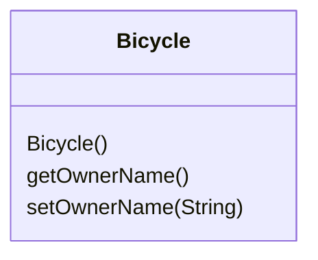
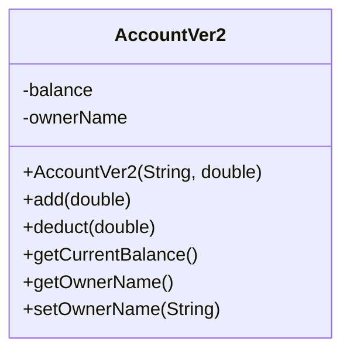

# Lecture 7 — Advanced Classes I

[Repository Guide](../../README.md) | [English](Concepts_Lecture.md) | [한국어](Concepts_Lecture.ko.md)

> **Last Updated:** 2026-10-19

> **Learning Objectives:**
> 1. Define a class with data members, methods, and constructors, and organize a program into multiple classes
> 2. Distinguish local variables, parameters, and data members, and pass both primitive data and objects to a method
> 3. Apply information hiding and encapsulation with public and private
> 4. Apply the this keyword and constructor chaining
> 5. Implement class-level behavior with static fields and methods, and design immutable classes with the final keyword

---

## Table of Contents

- [1. Objects and Classes Review](#1-objects-and-classes-review)
  - [1.1 Class Structure](#11-class-structure)
  - [1.2 Creating Objects](#12-creating-objects)
  - [1.3 Source Files and Program Structure](#13-source-files-and-program-structure)
  - [1.4 Class Diagrams](#14-class-diagrams)
- [2. Constructors](#2-constructors)
  - [2.1 Default Constructor](#21-default-constructor)
  - [2.2 Parameterized Constructor](#22-parameterized-constructor)
  - [2.3 Constructor Overloading](#23-constructor-overloading)
- [3. Arguments and Parameters](#3-arguments-and-parameters)
  - [3.1 Matching Arguments and Parameters](#31-matching-arguments-and-parameters)
  - [3.2 Passing and Sharing Objects](#32-passing-and-sharing-objects)
- [4. Local Variables and Identifiers](#4-local-variables-and-identifiers)
  - [4.1 Local Variables](#41-local-variables)
  - [4.2 Identifier Resolution Rules](#42-identifier-resolution-rules)
  - [4.3 Calling Methods of the Same Class](#43-calling-methods-of-the-same-class)
- [5. Access Modifiers](#5-access-modifiers)
  - [5.1 Information Hiding and Visibility](#51-information-hiding-and-visibility)
  - [5.2 Comparison of Access Modifiers](#52-comparison-of-access-modifiers)
  - [5.3 Guidelines for Visibility](#53-guidelines-for-visibility)
- [6. Encapsulation (Getters and Setters)](#6-encapsulation-getters-and-setters)
- [7. The this Keyword](#7-the-this-keyword)
- [8. Class Variables, Class Methods, and Constants](#8-class-variables-class-methods-and-constants)
  - [8.1 static Fields and Methods](#81-static-fields-and-methods)
  - [8.2 final and Immutable Classes](#82-final-and-immutable-classes)
- [9. Multiple Classes Working Together](#9-multiple-classes-working-together)
- [Summary](#summary)
- [Self-Check Questions](#self-check-questions)

---

<br>

## 1. Objects and Classes Review

Standard classes such as `String`, `GregorianCalendar`, and `JFrame` alone cannot meet all of our needs, so we must be able to define our own classes customized for our applications. Classes we define ourselves are called **programmer-defined classes**, and learning how to define them is the first step toward mastering the skills needed to build large programs.

### 1.1 Class Structure

A class is a blueprint that defines an object's fields (data) and methods (behavior).

```java
public class Bicycle {
    // Fields (instance variables)
    private String ownerName;

    // Methods
    public String getOwnerName() {
        return ownerName;
    }

    public void setOwnerName(String name) {
        this.ownerName = name;
    }
}
```

A class definition is organized in the following order.

```text
import statements
class comment
class ClassName {
    data members
    methods (including constructors)
}
```

A **data member** is declared in the form `<modifiers> <data type> <name>;`. For example, in `private String ownerName;`, `private` is the modifier, `String` is the data type, and `ownerName` is the name. Several modifiers may appear, and this example has only one.

A **method** is declared in the following form.

```text
<modifier> <return type> <method name> ( <parameters> ) {
    <statements>
}
```

For example, in `public void setOwnerName(String name) { ownerName = name; }`, `public` is the modifier, `void` is the return type, `setOwnerName` is the method name, `String name` is the parameter, and `ownerName = name;` is the statement in the body.

### 1.2 Creating Objects

```java
Bicycle bike = new Bicycle();       // create an instance
bike.setOwnerName("Alice");          // use methods to modify state
System.out.println(bike.getOwnerName()); // retrieve state
```

Once a class is defined, we can create multiple instances of it. Each instance has its own `ownerName`.

```java
Bicycle bike1, bike2;

bike1 = new Bicycle();
bike1.setOwnerName("Adam Smith");

bike2 = new Bicycle();
bike2.setOwnerName("Ben Jones");
```

### 1.3 Source Files and Program Structure

A program that uses `Bicycle` consists of a class with the `main` method (for example, `Chap7Program1`) and the `Bicycle` class. Each class definition is stored in a separate file (`Chap7Program1.java` and `Bicycle.java`), and the program is compiled and run in the following order.

```text
javac Bicycle.java          (compile)
javac Chap7Program1.java    (compile)
java Chap7Program1          (run)
```

The same holds for three or more classes. For example, if `Chap7Program2` uses `Bicycle` and `Account`, compile `Bicycle.java`, `Account.java`, and `Chap7Program2.java`, and then run `java Chap7Program2`. A class needs to be compiled only once and is recompiled only when its code changes.

### 1.4 Class Diagrams

A class diagram lists the methods below the class name, giving the name of each method and the data types of its parameters.



*Figure 1. Class diagram of the Bicycle class*

---

<br>

## 2. Constructors

A **constructor** is a special method that is executed when a new instance of the class is created. Its name is the class name, and it has no return type.

```text
public <class name> ( <parameters> ) {
    <statements>
}
```

```java
public Bicycle() {
    ownerName = "Unassigned";
}
```

> **Caution:** Writing a return type such as `void` before a constructor turns it into an ordinary method that merely has the same name as the class. For example, `public void Bicycle() { ownerName = "Unknown"; }` is not called by `new Bicycle()`, so `ownerName` stays `null`.

### 2.1 Default Constructor

If a class defines no constructor at all, the Java compiler provides a default no-argument constructor, and the fields are initialized to their default values (0 for numbers, `false` for `boolean`, `null` for references). Once any constructor is defined, the default constructor is no longer provided, so `new Account()` is a compile error in a class that has only a parameterized constructor.

### 2.2 Parameterized Constructor

```java
public class Account {
    private String ownerName;
    private double balance;

    public Account(String name, double initialBalance) {
        this.ownerName = name;
        this.balance = initialBalance;
    }
}
```

### 2.3 Constructor Overloading

A class can have multiple constructors with different parameter lists:

```java
public Account() {
    this("Unassigned", 0.0);
}

public Account(String name, double balance) {
    this.ownerName = name;
    this.balance = balance;
}
```

> **Key Point:** Use `this()` to call another constructor from within a constructor. This avoids code duplication. The `this()` call goes on the first line of the constructor (Lecture 8, Section 2.2).

---

<br>

## 3. Arguments and Parameters

### 3.1 Matching Arguments and Parameters

> **Definition:** An **argument** is a value we pass to a method when calling it. A **parameter** is a placeholder in the called method that holds the value of the passed argument.

```java
class Sample {
    public static void main(String[] arg) {
        Account acct = new Account();
        . . .
        acct.add(400);              // 400 is the argument
        . . .
    }
}

class Account {
    . . .
    public void add(double amt) {   // amt is the parameter
        balance = balance + amt;
    }
    . . .
}
```

Arguments and parameters are matched by the following rules.

- The number of arguments and the number of parameters must be the same.
- Arguments and parameters are paired from left to right.
- Each matched pair must be assignment-compatible. For example, a `double` argument cannot be passed to an `int` parameter. Conversely, passing an `int` argument to a `double` parameter, as in `add(400)` above, is allowed.

### 3.2 Passing and Sharing Objects

Just as we pass `int` and `double` values, we can pass an object to a method. Passing an object actually passes the reference (address) of the object, so no copy of the object is created in the called method.

```java
Student student;
LibraryCard card1, card2;

student = new Student();
student.setName("Jon Java");
student.setEmail("jj@javauniv.edu");

card1 = new LibraryCard();
card1.setOwner(student);
card1.checkOut(3);

card2 = new LibraryCard();
card2.setOwner(student); // the same student is the owner of the second card, too
```

`setOwner(Student student)` of `LibraryCard` stores the received reference in a data member with `owner = student;`. Because the same `Student` object is passed to `card1` and `card2`, the `owner` of both `LibraryCard` objects points to one and the same `Student` object.

```text
  card1                       card2
    │                           │
    ▼                           ▼
┌───────────────┐           ┌───────────────┐
│ :LibraryCard  │           │ :LibraryCard  │
│ owner     ●   │           │ owner     ●   │
│ borrowCnt 3   │           │ borrowCnt 0   │
└───────────┼───┘           └───────────┼───┘
            │                           │
            ▼                           │
student ─▶ ┌────────────────────────┐   │
           │ :Student               │◀──┘
           │ name  "Jon Java"       │
           │ email "jj@javauniv.edu"│
           └────────────────────────┘
```

*Figure 2. Two LibraryCard objects sharing the same Student object*

Therefore, changing the name with `student.setName("Kim")` also changes the name obtained through both `card1.getOwner()` and `card2.getOwner()`.

---

<br>

## 4. Local Variables and Identifiers

### 4.1 Local Variables

A **local variable** is declared inside a method and used for temporary purposes, such as storing intermediate computation results. It disappears when the method ends.

```java
public double convert(int num) {
    double result;                  // local variable
    result = Math.sqrt(num * num);
    return result;
}
```

### 4.2 Identifier Resolution Rules

An identifier appearing inside a method is a local variable, a parameter, or a data member. The compiler decides what an identifier refers to in the following order.

1. If there is a matching local variable or parameter declaration, the identifier refers to it.
2. Otherwise, if there is a matching data member declaration, the identifier refers to the data member.
3. Otherwise, it is an error because there is no matching declaration.

```java
class MusicCD {

    private String artist;
    private String title;
    private String id;

    public MusicCD(String name1, String name2) {

        String ident;

        artist = name1;
        title  = name2;

        ident  = artist.substring(0, 2) + "-" +
                 title.substring(0, 9);

        id     = ident;
    }
    ...
}
```

In this constructor, `name1` and `name2` refer to parameters, `ident` to a local variable, and `artist`, `title`, and `id` to data members. When a parameter or local variable has the same name as a data member, rule 1 hides the data member, so `this.` must be added to refer to the data member (Section 7).

### 4.3 Calling Methods of the Same Class

Calling a method of another object requires dot notation, as in `obj.doWork()`. Calling another method of the same class needs only the method name, as in `doWork()`, without dot notation (`this.doWork()` also works).

```java
class AClass {
    public void myMethod() {
        BClass obj = new BClass();
        obj.doWork();       // method of another object: dot notation required
    }
}

class BClass {
    public void doWork() {
        ...
    }

    public void myMethod() {
        doWork();           // method of the same object: dot notation optional
    }
}
```

---

<br>

## 5. Access Modifiers

### 5.1 Information Hiding and Visibility

The modifiers `public` and `private` designate the accessibility of data members and methods.

- If a class component (data member or method) is declared `private`, client classes cannot access it.
- If it is declared `public`, client classes can access it.
- Declaring the internal details of a class `private` and hiding them from clients is called **information hiding**.

```java
class Service {
    public  int memberOne;
    private int memberTwo;

    public void doOne() {
        ...
    }

    private void doTwo() {
        ...
    }
}
```

When a client class creates an object with `Service obj = new Service();`, `obj.memberOne = 10;` and `obj.doOne();` are allowed, but `obj.memberTwo = 20;` and `obj.doTwo();` are compile errors.

### 5.2 Comparison of Access Modifiers

| Modifier | Class | Package | Subclass (other package) | World |
|:---------|:-----:|:-------:|:--------:|:-----:|
| `public` | Yes | Yes | Yes | Yes |
| `protected` | Yes | Yes | Yes | No |
| (default) | Yes | Yes | No | No |
| `private` | Yes | No | No | No |

*Table 1. Accessibility by access modifier*

The Subclass column means a subclass in a different package. A subclass in the same package follows the Package column, so it can access (default) members as well.

> **Key Point:** Prefer `private` for fields and expose access through `public` getter/setter methods. This is the essence of encapsulation.

### 5.3 Guidelines for Visibility

Data members are implementation details of the class, so they should be invisible to clients. The visibility of data members and methods is decided by the following guidelines.

- Declare class variables and instance variables `private`.
- Declare class methods and instance methods `private` if they are used only by the other methods in the same class.
- Declare class constants `public` if client programs should read their values directly, and `private` if they are used only internally. Constants cannot change, so making them `public` does not break encapsulation.

In a class diagram, `public` components are marked with `+` and `private` components with `-`.



*Figure 3. Class diagram of AccountVer2 with visibility marks*

---

<br>

## 6. Encapsulation (Getters and Setters)

Encapsulation hides internal state and requires interaction through methods:

```java
public class Account {
    private double balance;

    public double getBalance() {
        return balance;
    }

    public void deposit(double amount) {
        if (amount > 0) {
            balance += amount;
        }
    }

    public void withdraw(double amount) {
        if (amount > 0 && amount <= balance) {
            balance -= amount;
        }
    }
}
```

Because `balance` is `private`, clients can change the balance only through `deposit` and `withdraw`. The two methods reject negative amounts and withdrawals larger than the balance, which keeps the balance from becoming invalid.

---

<br>

## 7. The this Keyword

`this` refers to the current object instance. Common uses:

1. **Disambiguate fields from parameters:** `this.name = name;`
2. **Call another constructor:** `this(defaultValue);`
3. **Pass the current object:** `someMethod(this);`

The first use is needed because of the rules in Section 4.2. When a parameter has the same name as a field, `name = name;` only assigns the parameter to itself and leaves the field unchanged. Lecture 8 covers the three uses of `this` in more detail.

---

<br>

## 8. Class Variables, Class Methods, and Constants

### 8.1 static Fields and Methods

A data member without `static` is an **instance variable**, and each object has its own copy. Adding `static` makes it a **class variable**, one copy of which is shared by all objects of the class. Likewise, a `static` method is a **class method** and is called as `ClassName.method()` without creating an object. `Math.sqrt`, `Integer.parseInt`, and `main` are class methods.

```java
public class Account {
    private static int count = 0;   // class variable: shared by all Account objects
    private String ownerName;       // instance variable: one per object

    public Account(String name) {
        ownerName = name;
        count++;
    }

    public static int getCount() {  // class method
        return count;
    }
}
```

After three `Account` objects are created, `Account.getCount()` returns 3. A class method runs without a particular object, so it cannot use an instance variable (`ownerName`) or `this`. Doing so gives the compile error `non-static variable ownerName cannot be referenced from a static context`.

### 8.2 final and Immutable Classes

A variable marked `final` can be assigned only once. A `static final` data member is a **class constant**, and by convention its name is written in uppercase letters and underscores.

```java
public class Dice {

    public static final int MAX_NUMBER = 6;
    private static final int MIN_NUMBER = 1;
    private static final int NO_NUMBER = 0;

    private int number;

    public Dice() {
        number = NO_NUMBER;
    }

    // Rolls the dice
    public void roll() {
        number = (int) (Math.floor(Math.random() * (MAX_NUMBER - MIN_NUMBER + 1)) + MIN_NUMBER);
    }

    // Returns the number on this dice
    public int getNumber() {
        return number;
    }
}
```

`Dice` follows the guidelines of Section 5.3. `MAX_NUMBER`, which clients should be able to read, is `public`; `MIN_NUMBER` and `NO_NUMBER`, used only internally, are `private`; and the instance variable `number` is `private`. `roll()` multiplies the value in [0, 1) returned by `Math.random()` by 6, rounds it down, and adds 1 to produce an integer from 1 to 6.

```java
Dice diceOne = new Dice(), diceTwo = new Dice();

diceOne.roll();
System.out.println(diceOne.getNumber());

diceTwo.roll();
System.out.println(diceTwo.getNumber());
```

An instance variable marked `final` must be assigned exactly once, either in its declaration or in the constructor. A class whose fields are all `private final` and that provides no setters is an **immutable class**, whose state never changes after construction. `String` is a typical immutable class.

```java
public final class Point2D {
    private final int x;
    private final int y;

    public Point2D(int x, int y) {
        this.x = x;
        this.y = y;
    }

    public int getX() { return x; }
    public int getY() { return y; }
}
```

The `final` in the class declaration prevents subclasses, so no subclass can add methods that change the state.

---

<br>

## 9. Multiple Classes Working Together

Object-oriented design involves multiple classes collaborating:

```java
// Main program creates and uses Account objects
Account savings = new Account("Alice", 1000.0);
savings.deposit(500.0);
System.out.println("Balance: " + savings.getBalance());
```

The following program uses `Bicycle` and `Account` together. This `Account` initializes `ownerName` to `"Unassigned"` and `balance` to 0.0 in its no-argument constructor and provides the methods `add`, `deduct`, `getCurrentBalance`, `setInitialBalance`, `getOwnerName`, and `setOwnerName`.

```java
public class Chap7Program2 {

    public static void main(String[] args) {

        Bicycle bike;
        Account acctMinseok;

        String myName = "Minseok Seo";

        bike = new Bicycle();
        bike.setOwnerName(myName);

        acctMinseok = new Account();
        acctMinseok.setOwnerName(myName);
        acctMinseok.setInitialBalance(250.00);

        acctMinseok.add(25.00);
        acctMinseok.deduct(50);

        // Output some information
        System.out.println(bike.getOwnerName() + " owns a bicycle and");
        System.out.println("has $ " + acctMinseok.getCurrentBalance() + " left in the bank");
    }
}
```

The balance is 250 + 25 - 50 = 225, so the output is as follows.

```text
Minseok Seo owns a bicycle and
has $ 225.0 left in the bank
```

Any class can become a main class by including a `main` method. For example, the `Bicycle` class can contain a `main` that shows a sample use of `Bicycle` and be run with `java Bicycle`.

```java
class Bicycle {

    // definition of the class as shown before comes here

    // The main method that shows a sample
    // use of the Bicycle class
    public static void main(String[] args) {

        Bicycle myBike;

        myBike = new Bicycle();
        myBike.setOwnerName("Jon Java");

        System.out.println(myBike.getOwnerName() + " owns a bicycle");
    }
}
```

> **Key Point:** Each class should have a single responsibility. Separate data (model), logic (service), and presentation (UI) into different classes.

---

<br>

## Summary

| Concept | Key Summary |
|:--------|:----------|
| Class | A class is a blueprint defining fields and methods, and each class is stored in its own source file. |
| Object | An object is an instance of a class created with `new`. |
| Constructor | A constructor is a special method without a return type that initializes object state, and it can be overloaded. |
| Default constructor | The compiler provides it automatically only when no constructor is defined. |
| Arguments and parameters | Their numbers must match, they are paired from left to right, and each pair must be assignment-compatible. |
| Passing objects | The reference is passed, so no copy is made and several objects can share the same object. |
| Identifier resolution | Local variables and parameters take precedence over data members. |
| Access Modifiers | They control visibility, from narrowest to widest: `private` < default < `protected` < `public`. |
| Encapsulation | Fields are hidden with `private` and exposed via getters/setters. |
| this | It is a reference to the current object instance. |
| static | Class variables and class methods belong to the class rather than to objects and are shared by all objects. |
| final and immutable classes | A `final` variable can be assigned only once, and a class whose fields are all `private final` with no setters is immutable. |

---

<br>

## Self-Check Questions

1. **Constructors and return types:** What does printing `new Bike().getOwnerName()` show for the following class? Explain why.

   ```java
   class Bike {
       private String ownerName;
       public void Bike() { ownerName = "Unknown"; }
       public String getOwnerName() { return ownerName; }
   }
   ```

   <details>
   <summary>Answer</summary>

   It prints `null`. `public void Bike()` has the return type `void`, so it is not a constructor but an ordinary method named `Bike`. The class has no constructor, so the compiler provides the default constructor, and `ownerName` keeps the default value of a reference type, `null`.

   </details>

2. **Identifier resolution:** A class with the field `private String name = "init";` defines `public void setName(String name) { name = name; }`. After calling `setName("Kim")`, what is the value of the field `name`, and how should the method be fixed?

   <details>
   <summary>Answer</summary>

   The field is still `"init"`. By the rules in Section 4.2, both occurrences of `name` in the method refer to the parameter, so the parameter is merely assigned to itself. Changing the statement to `this.name = name;` assigns to the field.

   </details>

3. **Sharing objects:** After the code in Section 3.2, `student.setName("Kim");` runs and `card2.getOwner().getName()` is printed. What is printed? How many `Student` objects does this code create?

   <details>
   <summary>Answer</summary>

   It prints `Kim`. Only one `Student` object is created, by the single `new Student()`, and the `owner` of both `card1` and `card2` stores a reference to that object, so the new name is visible through both cards.

   </details>

4. **Access control:** When the `Service` class of Section 5.1 is used from another class, which of `obj.memberOne = 10;`, `obj.memberTwo = 20;`, `obj.doOne();`, and `obj.doTwo();` compile?

   <details>
   <summary>Answer</summary>

   Only `obj.memberOne = 10;` and `obj.doOne();` compile. `memberTwo` and `doTwo()` are `private`, so they cannot be accessed outside the `Service` class.

   </details>

5. **Class variables:** Using the `Account` of Section 8.1, what is the value of `Account.getCount()` after `new Account("a")`, `new Account("b")`, and `new Account("c")` run? Why can `getCount()` not contain `return ownerName;`?

   <details>
   <summary>Answer</summary>

   The value is 3. `count` is a class variable shared by the three objects, and it increases by 1 each time the constructor is called. `getCount()` is a class method called without a particular object, so it cannot refer to the instance variable `ownerName`, which exists separately in each object.

   </details>
