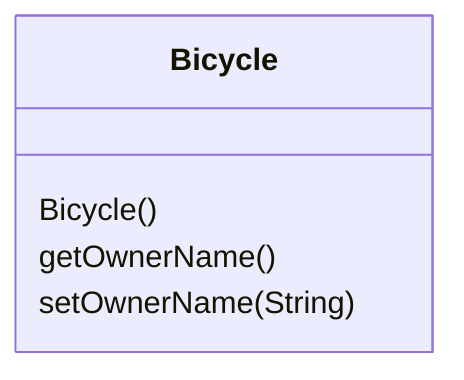
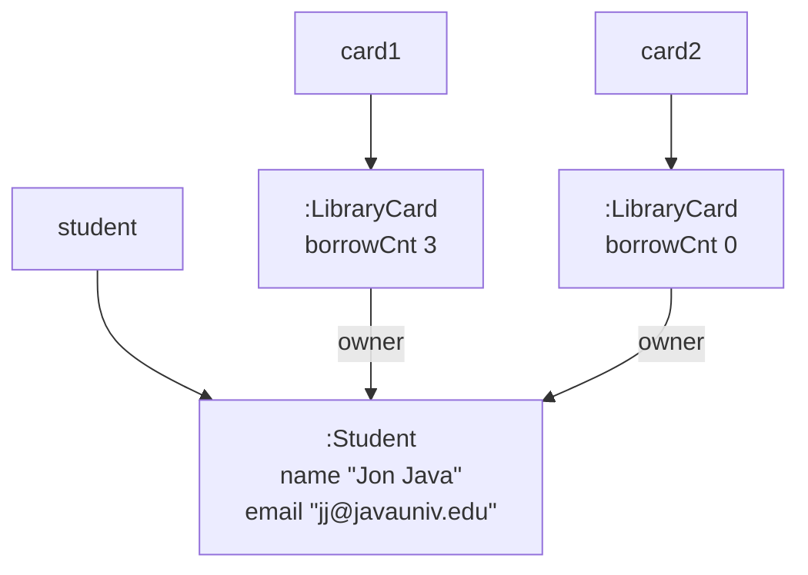
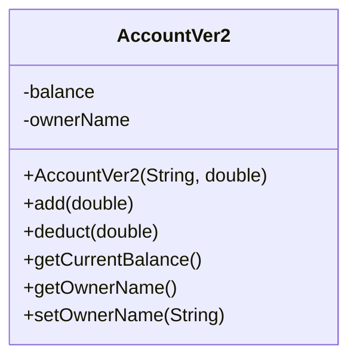

# Lecture 7 — Advanced Classes I

[Repository Guide](../../README.md) | [English](Concepts_Lecture.md) | [한국어](Concepts_Lecture.ko.md)

> **Last Updated:** 2026-11-19

> **Learning Objectives:**
> 1. Define a class with data members, methods, and constructors, and organize a program into multiple classes
> 2. Distinguish local variables, parameters, and data members, and pass both primitive data and objects to a method
> 3. Apply information hiding and encapsulation with public and private
> 4. Apply the this keyword and constructor chaining
> 5. Implement class-level behavior with static fields and methods, and design immutable classes with the final keyword
> 6. Trace the initialization order of objects and classes, and keep class invariants with constructor checks and defensive copies

---

## Table of Contents

- [1. Objects and Classes Review](#1-objects-and-classes-review)
  - [1.1 Class Structure](#11-class-structure)
  - [1.2 Creating Objects](#12-creating-objects)
  - [1.3 Source Files and Program Structure](#13-source-files-and-program-structure)
  - [1.4 Class Diagrams](#14-class-diagrams)
- [2. Constructors](#2-constructors)
  - [2.1 Default Constructor](#21-default-constructor)
  - [2.2 Parameterized Constructor](#22-parameterized-constructor)
  - [2.3 Constructor Overloading](#23-constructor-overloading)
  - [2.4 Order of Object Initialization](#24-order-of-object-initialization)
  - [2.5 Validation in Constructors](#25-validation-in-constructors)
- [3. Arguments and Parameters](#3-arguments-and-parameters)
  - [3.1 Matching Arguments and Parameters](#31-matching-arguments-and-parameters)
  - [3.2 Passing and Sharing Objects](#32-passing-and-sharing-objects)
  - [3.3 Defensive Copies](#33-defensive-copies)
- [4. Local Variables and Identifiers](#4-local-variables-and-identifiers)
  - [4.1 Local Variables](#41-local-variables)
  - [4.2 Identifier Resolution Rules](#42-identifier-resolution-rules)
  - [4.3 Calling Methods of the Same Class](#43-calling-methods-of-the-same-class)
  - [4.4 Scope and Lifetime of Variables](#44-scope-and-lifetime-of-variables)
- [5. Access Modifiers](#5-access-modifiers)
  - [5.1 Information Hiding and Visibility](#51-information-hiding-and-visibility)
  - [5.2 Comparison of Access Modifiers](#52-comparison-of-access-modifiers)
  - [5.3 Guidelines for Visibility](#53-guidelines-for-visibility)
- [6. Encapsulation (Getters and Setters)](#6-encapsulation-getters-and-setters)
  - [6.1 Class Invariants and Replacing the Internal Representation](#61-class-invariants-and-replacing-the-internal-representation)
  - [6.2 Representing Objects with toString](#62-representing-objects-with-tostring)
- [7. The this Keyword](#7-the-this-keyword)
- [8. Class Variables, Class Methods, and Constants](#8-class-variables-class-methods-and-constants)
  - [8.1 static Fields and Methods](#81-static-fields-and-methods)
  - [8.2 final and Immutable Classes](#82-final-and-immutable-classes)
  - [8.3 Static Initialization and Utility Classes](#83-static-initialization-and-utility-classes)
  - [8.4 Uses of final](#84-uses-of-final)
- [9. Multiple Classes Working Together](#9-multiple-classes-working-together)
- [10. Common Mistakes](#10-common-mistakes)
- [Concept Applications](#concept-applications)
- [Summary](#summary)
- [Self-Check Questions](#self-check-questions)
- [References](#references)

---

<br>

## 1. Objects and Classes Review

Standard classes such as `String`, `GregorianCalendar`, and `JFrame` alone cannot meet all of our needs, so we must be able to define our own classes customized for our applications. Classes we define ourselves are called **programmer-defined classes**, and learning how to define them is the first step toward mastering the skills needed to build large programs.

### 1.1 Class Structure

A class is a blueprint that defines an object's fields (data) and methods (behavior).

```java
public class Bicycle {
    // Fields (instance variables)
    private String ownerName;

    // Methods
    public String getOwnerName() {
        return ownerName;
    }

    public void setOwnerName(String name) {
        this.ownerName = name;
    }
}
```

A class definition is organized in the following order.

```text
import statements
class comment
class ClassName {
    data members
    methods (including constructors)
}
```

A **data member** is declared in the form `<modifiers> <data type> <name>;`. For example, in `private String ownerName;`, `private` is the modifier, `String` is the data type, and `ownerName` is the name. Several modifiers may appear, and this example has only one.

A **method** is declared in the following form.

```text
<modifier> <return type> <method name> ( <parameters> ) {
    <statements>
}
```

For example, in `public void setOwnerName(String name) { ownerName = name; }`, `public` is the modifier, `void` is the return type, `setOwnerName` is the method name, `String name` is the parameter, and `ownerName = name;` is the statement in the body.

### 1.2 Creating Objects

```java
Bicycle bike = new Bicycle();       // create an instance
bike.setOwnerName("Alice");          // use methods to modify state
System.out.println(bike.getOwnerName()); // retrieve state
```

Once a class is defined, we can create multiple instances of it. Each instance has its own `ownerName`.

```java
Bicycle bike1, bike2;

bike1 = new Bicycle();
bike1.setOwnerName("Adam Smith");

bike2 = new Bicycle();
bike2.setOwnerName("Ben Jones");
```

### 1.3 Source Files and Program Structure

A program that uses `Bicycle` consists of a class with the `main` method (for example, `Chap7Program1`) and the `Bicycle` class. Each class definition is stored in a separate file (`Chap7Program1.java` and `Bicycle.java`), and the program is compiled and run in the following order.

```text
javac Bicycle.java          (compile)
javac Chap7Program1.java    (compile)
java Chap7Program1          (run)
```

The same holds for three or more classes. For example, if `Chap7Program2` uses `Bicycle` and `Account`, compile `Bicycle.java`, `Account.java`, and `Chap7Program2.java`, and then run `java Chap7Program2`. A class needs to be compiled only once and is recompiled only when its code changes.

### 1.4 Class Diagrams

A class diagram lists the methods below the class name, giving the name of each method and the data types of its parameters.



*Figure 1. Class diagram of the Bicycle class*

---

<br>

## 2. Constructors

A **constructor** is a special method that is executed when a new instance of the class is created. Its name is the class name, and it has no return type.

```text
public <class name> ( <parameters> ) {
    <statements>
}
```

```java
public Bicycle() {
    ownerName = "Unassigned";
}
```

> **Caution:** Writing a return type such as `void` before a constructor turns it into an ordinary method that merely has the same name as the class. For example, `public void Bicycle() { ownerName = "Unknown"; }` is not called by `new Bicycle()`, so if the class has no other constructor, `ownerName` stays at its default value `null`.

### 2.1 Default Constructor

If a class defines no constructor at all, the Java compiler provides a default no-argument constructor, and fields without an initial value are initialized to their default values (0 for numbers, `false` for `boolean`, `null` for references). Once any constructor is defined, the default constructor is no longer provided, so `new Account()` is a compile error in a class that has only a parameterized constructor.

### 2.2 Parameterized Constructor

```java
public class Account {
    private String ownerName;
    private double balance;

    public Account(String name, double initialBalance) {
        this.ownerName = name;
        this.balance = initialBalance;
    }
}
```

### 2.3 Constructor Overloading

A class can have multiple constructors with different parameter lists:

```java
public Account() {
    this("Unassigned", 0.0);
}

public Account(String name, double balance) {
    this.ownerName = name;
    this.balance = balance;
}
```

> **Key Point:** Use `this()` to call another constructor from within a constructor. This avoids code duplication. The `this()` call goes on the first line of the constructor (Lecture 8, Section 2.2).

### 2.4 Order of Object Initialization

Creating an object with `new` runs more than the body of the constructor. Within one class, objects and the class are initialized in the following order.

1. Once, when the class is first used, the initial-value assignments of `static` fields and the `static` blocks run in the order written in the source (Lecture 1, Section 3.8, and Section 8.3).
2. Each time `new` runs, memory for the object is allocated and every instance field is filled with its default value (0, `false`, `null`).
3. After the call of the superclass constructor (Lecture 11) completes, the initial-value assignments of instance fields and the instance initializer blocks `{ ... }` run in the order written in the source.
4. The rest of the constructor body runs.

The language specification defines the order of steps 3 and 4 as part of the procedure for creating an object [1]. The following program prints a message at each step.

```java
public class InitOrder {
    static int created = log("static field");

    static {
        log("static block");
    }

    private int a = log("field a");

    {
        log("instance block");
    }

    private int b;

    public InitOrder() {
        log("constructor, a=" + a + " b=" + b);
        b = 5;
    }

    static int log(String msg) {
        System.out.println(msg);
        return 1;
    }

    public static void main(String[] args) {
        System.out.println("main starts");
        new InitOrder();
        System.out.println("--- second object");
        new InitOrder();
    }
}
```

```text
static field
static block
main starts
field a
instance block
constructor, a=1 b=0
--- second object
field a
instance block
constructor, a=1 b=0
```

- The `static` part runs only once, before `main` runs, when the class `InitOrder` is initialized. It does not run again when the second object is created.
- Each time an object is created, the order `field a`, `instance block`, constructor repeats.
- Inside the constructor, `a` has already received its initial value 1, and `b`, which has no initial value, has the default value 0. Only after the constructor body runs does `b` become 5.

Initial values of fields are common to all constructors, and values that differ per constructor are assigned in the constructors. Instance initializer blocks are rarely used; common initialization is easier to read when gathered into one constructor with `this(...)`, as in Section 2.3.

### 2.5 Validation in Constructors

A condition that an object must always satisfy, such as "the hour of a time is 0-23", is called a **class invariant** of that class (Section 6.1). The constructor is the only path through which an object first comes into existence, so checking the arguments in the constructor prevents objects in an invalid state from being created at all. When an argument is invalid, throw an `IllegalArgumentException` as in Lecture 6, Section 3.9.

```java
public class Time {
    private int secondsOfDay;

    public Time(int hour, int minute, int second) {
        if (hour < 0 || hour > 23 || minute < 0 || minute > 59 || second < 0 || second > 59) {
            throw new IllegalArgumentException("invalid time: " + hour + ":" + minute + ":" + second);
        }
        secondsOfDay = hour * 3600 + minute * 60 + second;
    }

    public int getHour() {
        return secondsOfDay / 3600;
    }

    public int getMinute() {
        return secondsOfDay / 60 % 60;
    }

    public int getSecond() {
        return secondsOfDay % 60;
    }

    public void addSeconds(int s) {
        secondsOfDay = Math.floorMod(secondsOfDay + s, 24 * 3600);
    }

    @Override
    public String toString() {
        return String.format("%02d:%02d:%02d", getHour(), getMinute(), getSecond());
    }
}
```

The constructor creates the object only when the hour, minute, and second are within range. If the check fails, an exception is thrown and `new` yields no object. Code that receives a `Time` object can therefore trust that the object represents a valid time. The method `addSeconds`, which changes the state, also keeps the invariant. It takes the remainder modulo 86,400, the number of seconds in a day, with `Math.floorMod` (Lecture 3, Section 4.7), so the result is always between 0 and 86,399 whether seconds are added or subtracted. An example of using this class and its output are in Section 6.1.

---

<br>

## 3. Arguments and Parameters

### 3.1 Matching Arguments and Parameters

> **Definition:** An **argument** is a value we pass to a method when calling it.

> **Definition:** A **parameter** is a placeholder in the called method that holds the value of the passed argument.

```java
class Sample {
    public static void main(String[] arg) {
        Account acct = new Account();
        . . .
        acct.add(400);              // 400 is the argument
        . . .
    }
}

class Account {
    . . .
    public void add(double amt) {   // amt is the parameter
        balance = balance + amt;
    }
    . . .
}
```

Arguments and parameters are matched by the following rules.

- The number of arguments and the number of parameters must be the same.
- Arguments and parameters are paired from left to right.
- Each matched pair must be assignment-compatible. For example, a `double` argument cannot be passed to an `int` parameter. Conversely, passing an `int` argument to a `double` parameter, as in `add(400)` above, is allowed.

### 3.2 Passing and Sharing Objects

Just as we pass `int` and `double` values, we can pass an object to a method. Passing an object actually passes the reference (address) of the object, so no copy of the object is created in the called method.

```java
Student student;
LibraryCard card1, card2;

student = new Student();
student.setName("Jon Java");
student.setEmail("jj@javauniv.edu");

card1 = new LibraryCard();
card1.setOwner(student);
card1.checkOut(3);

card2 = new LibraryCard();
card2.setOwner(student); // the same student is the owner of the second card, too
```

`setOwner(Student student)` of `LibraryCard` stores the received reference in a data member with `owner = student;`. Because the same `Student` object is passed to `card1` and `card2`, the `owner` of both `LibraryCard` objects points to one and the same `Student` object.



*Figure 2. Two LibraryCard objects sharing the same Student object*

Therefore, changing the name with `student.setName("Kim")` also changes the name obtained through both `card1.getOwner()` and `card2.getOwner()`.

### 3.3 Defensive Copies

The sharing of Section 3.2 was intended, but unintended sharing breaks encapsulation. Even if a field is `private`, if outside code also refers to the object the field refers to, the outside code can change the internal state through that object. The following class stores the reference of the array received in its constructor as is, and its getter also returns that reference as is.

```java
public class LeakyScores {
    private final int[] values;

    public LeakyScores(int[] values) {
        this.values = values;
    }

    public int[] getValues() {
        return values;
    }

    public static void main(String[] args) {
        int[] input = {80, 90, 100};
        LeakyScores s = new LeakyScores(input);
        input[0] = 0;
        s.getValues()[1] = 0;
        System.out.println(java.util.Arrays.toString(s.getValues()));
    }
}
```

```text
[0, 0, 100]
```

`input` and the field `values` refer to the same array, so `input[0] = 0` changes the contents of the object, and so does `s.getValues()[1] = 0` through the reference returned by the getter. Making the field `final` does not prevent this. `final` only keeps the reference from changing and does not protect the contents of the array (Section 8.4).

The solution is the **defensive copy**. Store a copy of any mutable object received from outside, and return a copy when handing it out as well.

```java
import java.util.Arrays;

public class Scores {
    private final int[] values;

    public Scores(int[] values) {
        this.values = values.clone();
    }

    public int[] getValues() {
        return values.clone();
    }

    public double average() {
        int sum = 0;
        for (int v : values) {
            sum += v;
        }
        return (double) sum / values.length;
    }

    public static void main(String[] args) {
        int[] input = {80, 90, 100};
        Scores s = new Scores(input);
        input[0] = 0;
        s.getValues()[1] = 0;
        System.out.println(Arrays.toString(s.getValues()) + " " + s.average());
    }
}
```

```text
[80, 90, 100] 90.0
```

`values.clone()` in the constructor creates an array different from the one received (Lecture 5, Section 4.1), and the getter returns a new copy each time, so no outside change reaches the array inside the object. Copying has a cost, so do not copy when the elements are immutable objects such as `String` or when sharing is part of the design. When an immutable class of Section 8.2 has a field such as an array, defensive copies are indispensable.

---

<br>

## 4. Local Variables and Identifiers

### 4.1 Local Variables

A **local variable** is declared inside a method and used for temporary purposes, such as storing intermediate computation results. It disappears when the method ends.

```java
public double convert(int num) {
    double result;                  // local variable
    result = Math.sqrt(num * num);
    return result;
}
```

### 4.2 Identifier Resolution Rules

An identifier appearing inside a method is a local variable, a parameter, or a data member. The compiler decides what an identifier refers to in the following order.

1. If there is a matching local variable or parameter declaration, the identifier refers to it.
2. Otherwise, if there is a matching data member declaration, the identifier refers to the data member.
3. Otherwise, it is an error because there is no matching declaration.

```java
class MusicCD {

    private String artist;
    private String title;
    private String id;

    public MusicCD(String name1, String name2) {

        String ident;

        artist = name1;
        title  = name2;

        ident  = artist.substring(0, 2) + "-" +
                 title.substring(0, 9);

        id     = ident;
    }
    ...
}
```

In this constructor, `name1` and `name2` refer to parameters, `ident` to a local variable, and `artist`, `title`, and `id` to data members. When a parameter or local variable has the same name as a data member, rule 1 hides the data member, so `this.` must be added to refer to the data member (Section 7).

### 4.3 Calling Methods of the Same Class

Calling a method of another object requires dot notation, as in `obj.doWork()`. Calling another method of the same class needs only the method name, as in `doWork()`, without dot notation (`this.doWork()` also works).

```java
class AClass {
    public void myMethod() {
        BClass obj = new BClass();
        obj.doWork();       // method of another object: dot notation required
    }
}

class BClass {
    public void doWork() {
        ...
    }

    public void myMethod() {
        doWork();           // method of the same object: dot notation optional
    }
}
```

### 4.4 Scope and Lifetime of Variables

The region of source code in which a variable can be used is its **scope**, and the period during which the variable exists in memory is its **lifetime**. The three kinds of variables differ in both.

| Variable | Scope | Lifetime | Initial value |
|:-----|:-----|:-----|:-----|
| Local variable, parameter | From the declaration to the end of the enclosing block `{ }` | While the frame of that method call exists | Must be assigned before use |
| Instance variable | The whole class (instance methods and constructors) | While the object is on the heap | Default value |
| Class variable | The whole class | While the class is loaded | Default value |

*Table 1. Scope and lifetime by kind of variable*

A variable declared inside a block cannot be used outside the block, and a local variable with the same name as a local variable cannot be declared again in an inner block within its scope. The following code breaks both rules.

```java
public class ScopeErr {
    public static void main(String[] args) {
        int x = 1;
        for (int i = 0; i < 3; i++) {
            int x = i;
        }
        System.out.println(i);
    }
}
```

```text
ScopeErr.java:5: error: variable x is already defined in method main(String[])
            int x = i;
                ^
ScopeErr.java:7: error: cannot find symbol
        System.out.println(i);
                           ^
  symbol:   variable i
  location: class ScopeErr
2 errors
```

The scope of `i`, declared in the initialization of `for`, is inside that `for` statement, so it cannot be found after the loop. A local variable with the same name as a field, on the other hand, is allowed, and in that case the local variable hides the field by the rule of Section 4.2. Scopes should be kept as narrow as possible. Declaring a variable close to where it is first used reduces the code that can change it and makes errors easier to find.

---

<br>

## 5. Access Modifiers

### 5.1 Information Hiding and Visibility

The modifiers `public` and `private` designate the accessibility of data members and methods.

- If a class component (data member or method) is declared `private`, client classes cannot access it.
- If it is declared `public`, client classes can access it.
- Declaring the internal details of a class `private` and hiding them from clients is called **information hiding**.

```java
class Service {
    public  int memberOne;
    private int memberTwo;

    public void doOne() {
        ...
    }

    private void doTwo() {
        ...
    }
}
```

When a client class creates an object with `Service obj = new Service();`, `obj.memberOne = 10;` and `obj.doOne();` are allowed, but `obj.memberTwo = 20;` and `obj.doTwo();` are compile errors.

### 5.2 Comparison of Access Modifiers

| Modifier | Class | Package | Subclass (other package) | World |
|:---------|:-----:|:-------:|:--------:|:-----:|
| `public` | Yes | Yes | Yes | Yes |
| `protected` | Yes | Yes | Yes | No |
| (default) | Yes | Yes | No | No |
| `private` | Yes | No | No | No |

*Table 2. Accessibility by access modifier*

The Subclass column means a subclass in a different package. A subclass in the same package follows the Package column, so it can access (default) members as well.

> **Key Point:** Prefer `private` for fields and expose access through `public` getter/setter methods. This is the essence of encapsulation.

### 5.3 Guidelines for Visibility

Data members are implementation details of the class, so they should be invisible to clients. The visibility of data members and methods is decided by the following guidelines.

- Declare class variables and instance variables `private`.
- Declare class methods and instance methods `private` if they are used only by the other methods in the same class.
- Declare class constants `public` if client programs should read their values directly, and `private` if they are used only internally. Constants cannot change, so making them `public` does not break encapsulation.

In a class diagram, `public` components are marked with `+` and `private` components with `-`.



*Figure 3. Class diagram of AccountVer2 with visibility marks*

---

<br>

## 6. Encapsulation (Getters and Setters)

Encapsulation hides internal state and requires interaction through methods:

```java
public class Account {
    private double balance;

    public double getBalance() {
        return balance;
    }

    public void deposit(double amount) {
        if (amount > 0) {
            balance += amount;
        }
    }

    public void withdraw(double amount) {
        if (amount > 0 && amount <= balance) {
            balance -= amount;
        }
    }
}
```

Because `balance` is `private`, clients can change the balance only through `deposit` and `withdraw`. The two methods reject negative amounts and withdrawals larger than the balance, which keeps the balance from becoming invalid. The lab code that adds overloaded constructors and a getter and setter for the owner name to this `Account` is [Account.java](../../Coursework/Lab07_Advanced-Classes-I/Account.java), and the lab code for a `Bicycle` encapsulated with private fields, getters, and setters is [Bicycle.java](../../Coursework/Lab07_Advanced-Classes-I/Bicycle.java).

### 6.1 Class Invariants and Replacing the Internal Representation

The first effect of encapsulation is keeping invariants. `Time` of Section 2.5 hides the field `secondsOfDay` as `private` and restricts the ways to change its value to the constructor and `addSeconds`. Both places either check the range or bring the value into range with a remainder, so no code outside the class can create a time such as 25 o'clock.

```java
public class TimeDemo {
    public static void main(String[] args) {
        Time t = new Time(23, 59, 30);
        System.out.println(t);
        t.addSeconds(45);
        System.out.println(t + " " + t.getHour());
        t.addSeconds(-3600);
        System.out.println(t);
        Object plain = new Object();
        System.out.println(plain.toString().startsWith("java.lang.Object@"));
        try {
            new Time(24, 0, 0);
        } catch (IllegalArgumentException e) {
            System.out.println(e.getMessage());
        }
    }
}
```

```text
23:59:30
00:00:15 0
23:00:15
true
invalid time: 24:0:0
```

Adding 45 seconds to 23:59:30 gives 0 hours 0 minutes 15 seconds of the next day, and subtracting an hour again gives 23 hours 0 minutes 15 seconds of the previous day. `Math.floorMod` gives a non-negative remainder even for negative numbers, so 15 - 3600 = -3585 seconds becomes 86,400 - 3585 = 82,815 seconds, that is, 23:00:15.

The second effect of encapsulation is that the **internal representation** can be changed independently of the clients. `Time` could keep the hour, minute, and second in three fields, but the implementation above stores a single number of seconds since the start of the day. Thanks to this, `addSeconds` needs only one addition and one remainder, with none of the complicated carrying into minutes and hours when 1 second is added to 59 seconds. Clients use only `getHour`, `getMinute`, and `getSecond`, so even if the representation is later changed to three fields, not a single line of client code needs to change as long as the methods give the same results. If the fields were exposed as `public`, every piece of code using them would have to change the moment the representation changed.

### 6.2 Representing Objects with toString

Passing an object to `println` or concatenating it to a string with `+` calls the object's `toString()` method. `toString()` is defined in `Object`, the superclass of every class, and its default implementation returns the class name, `@`, and a hexadecimal number, as in a string of `java.lang.Object@` followed by hexadecimal digits. The `true` in the output above checks that form (the `[I@...` of Lecture 5, Section 1.6 has the same form). This string is of no use to a human reader, so a class defines `toString()` again to return the state of the object as a readable string. The `toString()` of `Time` builds a form such as `23:59:30` with `String.format("%02d:%02d:%02d", ...)` (Lecture 4, Section 5.1).

`@Override` before a method marks that it defines a method of the superclass again with the same name and parameters. Misspelling it, as in `tostring()`, creates a new method instead of redefining the old one, and with `@Override` the compiler reports this mistake as an error. The rules of overriding, which redefines methods of a superclass, are covered in Lecture 11.

---

<br>

## 7. The this Keyword

`this` refers to the current object instance. Common uses:

1. **Disambiguate fields from parameters:** `this.name = name;`
2. **Call another constructor:** `this(defaultValue);`
3. **Pass the current object:** `someMethod(this);`

The first use is needed because of the rules in Section 4.2. When a parameter has the same name as a field, `name = name;` only assigns the parameter to itself and leaves the field unchanged. Lecture 8 covers the three uses of `this` in more detail.

---

<br>

## 8. Class Variables, Class Methods, and Constants

### 8.1 static Fields and Methods

A data member without `static` is an **instance variable**, and each object has its own copy. Adding `static` makes it a **class variable**, one copy of which is shared by all objects of the class. Likewise, a `static` method is a **class method** and is called as `ClassName.method()` without creating an object. `Math.sqrt`, `Integer.parseInt`, and `main` are class methods.

```java
public class Account {
    private static int count = 0;   // class variable: shared by all Account objects
    private String ownerName;       // instance variable: one per object

    public Account(String name) {
        ownerName = name;
        count++;
    }

    public static int getCount() {  // class method
        return count;
    }
}
```

After three `Account` objects are created, `Account.getCount()` returns 3. A class method runs without a particular object, so it cannot use an instance variable (`ownerName`) or `this`. Doing so gives the compile error `non-static variable ownerName cannot be referenced from a static context`.

### 8.2 final and Immutable Classes

A variable marked `final` can be assigned only once. A `static final` data member is a **class constant**, and by convention its name is written in uppercase letters and underscores.

```java
public class Dice {

    public static final int MAX_NUMBER = 6;
    private static final int MIN_NUMBER = 1;
    private static final int NO_NUMBER = 0;

    private int number;

    public Dice() {
        number = NO_NUMBER;
    }

    // Rolls the dice
    public void roll() {
        number = (int) (Math.floor(Math.random() * (MAX_NUMBER - MIN_NUMBER + 1)) + MIN_NUMBER);
    }

    // Returns the number on this dice
    public int getNumber() {
        return number;
    }
}
```

`Dice` follows the guidelines of Section 5.3. `MAX_NUMBER`, which clients should be able to read, is `public`; `MIN_NUMBER` and `NO_NUMBER`, used only internally, are `private`; and the instance variable `number` is `private`. `roll()` multiplies the value in [0, 1) returned by `Math.random()` by 6, rounds it down, and adds 1 to produce an integer from 1 to 6.

```java
Dice diceOne = new Dice(), diceTwo = new Dice();

diceOne.roll();
System.out.println(diceOne.getNumber());

diceTwo.roll();
System.out.println(diceTwo.getNumber());
```

An instance variable marked `final` must be assigned exactly once, either in its declaration or in the constructor. A class whose fields are all `private final` and that provides no setters is an **immutable class**, whose state never changes after construction. `String` is a typical immutable class. However, if a field refers to an object whose contents can change, such as an array, the contents of that object can still change even though the reference does not, so the fields of an immutable class must hold primitive values or immutable objects.

```java
public final class Point2D {
    private final int x;
    private final int y;

    public Point2D(int x, int y) {
        this.x = x;
        this.y = y;
    }

    public int getX() { return x; }
    public int getY() { return y; }
}
```

The `final` in the class declaration prevents subclasses, so no subclass can add methods that change the state.

### 8.3 Static Initialization and Utility Classes

Class variables belong to the class, not to objects, so they receive their initial values once when the class is initialized, not when objects are created (Section 2.4, Lecture 1, Section 3.8). When an initial value cannot be written as one expression, it is computed in a `static { ... }` block. `static` blocks run once, in the order written in the source, when the class is initialized, and initialization happens when the class is first actually used (the first object creation, the first call of a `static` method, the first use of a `static` field that is not a constant, and so on) [1].

A class that gathers only `static` methods and constants, such as `Math`, is called a **utility class**. A utility class has no state, so there is no reason to create its objects. Declaring the constructor `private` makes it impossible to create objects outside the class.

```java
public final class MathUtil {
    public static final double TAX_RATE = 0.1;

    private MathUtil() {
    }

    public static int clamp(int value, int low, int high) {
        return Math.max(low, Math.min(high, value));
    }

    public static double withTax(double price) {
        return price * (1 + TAX_RATE);
    }
}
```

```java
public class UtilDemo {
    public static void main(String[] args) {
        System.out.println(MathUtil.clamp(150, 0, 100) + " " + MathUtil.clamp(-5, 0, 100) + " " + MathUtil.withTax(2000));
    }
}
```

```text
100 0 2200.0
```

`clamp` cuts a value to the range `[low, high]`, making 150 into 100 and -5 into 0. Writing `new MathUtil()` gives the following error.

```text
UtilErr.java:3: error: MathUtil() has private access in MathUtil
        MathUtil m = new MathUtil();
                     ^
1 error
```

Because a constructor was defined, the compiler does not create a default constructor (Section 2.1), and the defined constructor is `private`, so there is no way to create an object from outside. `static` methods suit calculations that need no state, as here. Conversely, writing behavior that needs per-object state as a `static` method requires passing all that state as parameters, which leads back to the procedural design of Lecture 1, Section 1.4.

### 8.4 Uses of final

The meaning of `final` differs slightly depending on where it appears.

| Position | Meaning | Example |
|:-----|:-----|:-----|
| Local variable | Can be assigned only once; declaration and assignment may be separate | `final int limit; limit = 10;` |
| Parameter | The parameter cannot be reassigned inside the method | `void f(final int n)` |
| Instance variable | Must be assigned exactly once, in the declaration or in every constructor | `private final int id;` |
| Class variable | Written `static final`, usually a named constant | `public static final int MAX = 6;` |
| Method | Subclasses cannot redefine it | `public final void lock()` |
| Class | No subclass can be created | `public final class String` |

*Table 3. Meaning of final by position*

A `final` instance variable with no initial value in its declaration that is not assigned in the constructor causes a compile error.

```text
BlankFinal.java:5: error: variable id might not have been initialized
    }
    ^
1 error
```

When `final` is attached to a reference variable, it only keeps the variable from referring to another object; the contents of the object it refers to can still be changed.

```java
public class FinalDemo {
    public static void main(String[] args) {
        final int[] data = {1, 2, 3};
        data[0] = 100;
        System.out.println(data[0]);
        final int limit;
        limit = 10;
        System.out.println(limit);
    }
}
```

```text
100
10
```

`data[0] = 100;` changes the contents of the array and is allowed, but assigning another array, as in `data = new int[2];`, causes the compile error `cannot assign a value to final variable data`. This is why Section 8.2 said that the fields of an immutable class must hold primitive values or immutable objects, and why the `final` array field of Section 3.3 still needed defensive copies.

---

<br>

## 9. Multiple Classes Working Together

Object-oriented design involves multiple classes collaborating:

```java
// Main program creates and uses Account objects
Account savings = new Account("Alice", 1000.0);
savings.deposit(500.0);
System.out.println("Balance: " + savings.getBalance());
```

The following program uses `Bicycle` and `Account` together. This `Account` initializes `ownerName` to `"Unassigned"` and `balance` to 0.0 in its no-argument constructor and provides the methods `add`, `deduct`, `getCurrentBalance`, `setInitialBalance`, `getOwnerName`, and `setOwnerName`.

```java
public class Chap7Program2 {

    public static void main(String[] args) {

        Bicycle bike;
        Account acctMinseok;

        String myName = "Minseok Seo";

        bike = new Bicycle();
        bike.setOwnerName(myName);

        acctMinseok = new Account();
        acctMinseok.setOwnerName(myName);
        acctMinseok.setInitialBalance(250.00);

        acctMinseok.add(25.00);
        acctMinseok.deduct(50);

        // Output some information
        System.out.println(bike.getOwnerName() + " owns a bicycle and");
        System.out.println("has $ " + acctMinseok.getCurrentBalance() + " left in the bank");
    }
}
```

The balance is 250 + 25 - 50 = 225, so the output is as follows.

```text
Minseok Seo owns a bicycle and
has $ 225.0 left in the bank
```

The lab code [MultipleClassesDemo.java](../../Coursework/Lab07_Advanced-Classes-I/MultipleClassesDemo.java) also uses the two classes together. It creates two `Bicycle` objects with owner names and prints the names, then creates an `Account` with a balance of 1000.0, deposits 500.0, withdraws 200.0, and prints the balances 1500.0 and 1300.0 in turn.

Any class can become a main class by including a `main` method. For example, the `Bicycle` class can contain a `main` that shows a sample use of `Bicycle` and be run with `java Bicycle`.

```java
class Bicycle {

    // definition of the class as shown before comes here

    // The main method that shows a sample
    // use of the Bicycle class
    public static void main(String[] args) {

        Bicycle myBike;

        myBike = new Bicycle();
        myBike.setOwnerName("Jon Java");

        System.out.println(myBike.getOwnerName() + " owns a bicycle");
    }
}
```

> **Key Point:** Each class should have a single responsibility. Separate data (model), logic (service), and presentation (UI) into different classes.

---

<br>

## 10. Common Mistakes

| Mistake | Result | Fix |
|:-----|:-----|:-----|
| Writing `void` before a constructor | It becomes an ordinary method and is not called by `new` | Write no return type |
| Defining only constructors with parameters and writing `new Account()` | Compile error because there is no default constructor | Define a constructor without parameters separately |
| Assigning to a parameter with the same name as a field without `this.` | The field does not change | Write `this.name = name;` |
| Not checking arguments in the constructor | Objects that break the invariant are created | Throw `IllegalArgumentException` for invalid arguments |
| Storing or returning the reference of a received array or mutable object as is | Outside code changes the contents of a `private` field | Make defensive copies |
| Thinking that a `final` array field also has unchangeable contents | The elements change | Remember that `final` fixes only the reference, and copy when needed |
| Using an instance variable or `this` in a `static` method | `non-static variable ... cannot be referenced from a static context` | Make it an instance method or access through an object |
| Writing a setter for every field without thought | Invariants cannot be kept and encapsulation weakens | Provide methods that check only the needed changes |
| Printing an object that does not define `toString()` | `ClassName@hexadecimal` is printed | Define `toString()` again |

*Table 4. Common mistakes when defining classes*

---

<br>

## Concept Applications

**True/False Check:**

| Statement | Judgment and Reason |
|:-----|:-----|
| The initial-value assignments of instance fields run before the constructor body. | **T.** As in the output of Section 2.4, `field a` is printed before the constructor. |
| A `static` block runs each time an object is created. | **F.** It runs only once, when the class is initialized. |
| If a constructor throws an exception, `new` returns an object whose fields have default values. | **F.** When an exception is thrown, the `new` expression yields no value, so the caller gets no object. |
| The elements of a field `private final int[] data;` cannot be changed from outside. | **F.** If a reference to the same array exists outside, the elements can be changed. Defensive copies are needed. |
| `i` can still be used after a `for (int i = 0; ...)` loop ends. | **F.** The scope of `i` is inside the `for` statement, so a `cannot find symbol` error occurs. |
| If a constructor is declared `private`, objects of the class cannot be created with `new` outside the class. | **T.** As with `MathUtil` of Section 8.3, a `has private access` error occurs. |
| Hiding fields as `private` makes it possible to change the internal representation without changing client code. | **T.** Clients rely only on the public methods, so the representation can change as long as the methods behave the same. |
| A method cannot be redefined without `@Override`. | **F.** It is redefined even without `@Override`, but with it the compiler reports misspelled names or parameters. |

---

<br>

## Summary

| Concept | Key Summary |
|:--------|:----------|
| Class | A class is a blueprint defining fields and methods, and each class is stored in its own source file. |
| Object | An object is an instance of a class created with `new`. |
| Constructor | A constructor is a special method without a return type that initializes object state, and it can be overloaded. |
| Default constructor | The compiler provides it automatically only when no constructor is defined. |
| Arguments and parameters | Their numbers must match, they are paired from left to right, and each pair must be assignment-compatible. |
| Passing objects | The reference is passed, so no copy is made and several objects can share the same object. |
| Identifier resolution | Local variables and parameters take precedence over data members. |
| Access modifiers | They control visibility, from narrowest to widest: `private` < default < `protected` < `public`. |
| Encapsulation | Fields are hidden with `private` and exposed via getters/setters. |
| this | It is a reference to the current object instance. |
| static | Class variables and class methods belong to the class rather than to objects and are shared by all objects. |
| final and immutable classes | A `final` variable can be assigned only once, and a class whose fields are all `private final` fields holding primitive values or immutable objects, with no setters, is immutable. |
| Initialization order | Initialization proceeds as `static` initialization once per class, then per object default values, field initial values and initializer blocks, and the constructor body. |
| Constructor checks | Checking arguments in the constructor and throwing an exception when they are invalid keeps objects that break the invariant from being created. |
| Defensive copies | Mutable objects received from or handed to the outside are copied so that the internal state is not shared. |
| Scope and lifetime | A local variable is used only inside its block and disappears when the call ends, an instance variable lives with its object, and a class variable with its class. |
| Internal representation | An encapsulated class can change the composition of its fields without changing its clients as long as its public methods keep their behavior. |
| toString | The `toString()` of `Object` gives `ClassName@hexadecimal`, and it is redefined to return the object's state as a readable string. |
| Utility classes | They hold only `static` methods and constants and block object creation with a `private` constructor. |
| Uses of final | It means assignment only once for variables, no redefinition for methods, and no inheritance for classes, and a `final` reference does not protect the contents of its object. |

---

<br>

## Self-Check Questions

1. **Constructors and return types:** What does printing `new Bike().getOwnerName()` show for the following class? Explain why.

   ```java
   class Bike {
       private String ownerName;
       public void Bike() { ownerName = "Unknown"; }
       public String getOwnerName() { return ownerName; }
   }
   ```

   <details>
   <summary>Answer</summary>

   It prints `null`. `public void Bike()` has the return type `void`, so it is not a constructor but an ordinary method named `Bike`. The class has no constructor, so the compiler provides the default constructor, and `ownerName` keeps the default value of a reference type, `null`.

   </details>

2. **Identifier resolution:** A class with the field `private String name = "init";` defines `public void setName(String name) { name = name; }`. After calling `setName("Kim")`, what is the value of the field `name`, and how should the method be fixed?

   <details>
   <summary>Answer</summary>

   The field is still `"init"`. By the rules in Section 4.2, both occurrences of `name` in the method refer to the parameter, so the parameter is merely assigned to itself. Changing the statement to `this.name = name;` assigns to the field.

   </details>

3. **Sharing objects:** After the code in Section 3.2, `student.setName("Kim");` runs and `card2.getOwner().getName()` is printed. What is printed? How many `Student` objects does this code create?

   <details>
   <summary>Answer</summary>

   It prints `Kim`. Only one `Student` object is created, by the single `new Student()`, and the `owner` of both `card1` and `card2` stores a reference to that object, so the new name is visible through both cards.

   </details>

4. **Access control:** When the `Service` class of Section 5.1 is used from another class, which of `obj.memberOne = 10;`, `obj.memberTwo = 20;`, `obj.doOne();`, and `obj.doTwo();` compile?

   <details>
   <summary>Answer</summary>

   Only `obj.memberOne = 10;` and `obj.doOne();` compile. `memberTwo` and `doTwo()` are `private`, so they cannot be accessed outside the `Service` class.

   </details>

5. **Class variables:** Using the `Account` of Section 8.1, what is the value of `Account.getCount()` after `new Account("a")`, `new Account("b")`, and `new Account("c")` run? Why can `getCount()` not contain `return ownerName;`?

   <details>
   <summary>Answer</summary>

   The value is 3. `count` is a class variable shared by the three objects, and it increases by 1 each time the constructor is called. `getCount()` is a class method called without a particular object, so it cannot refer to the instance variable `ownerName`, which exists separately in each object.

   </details>

6. **Initialization order:** Write the output in order when `new Box(7)` is executed with the following class. `Box` is used for the first time in this run.

   ```java
   class Box {
       static { System.out.println("S"); }
       int size = init("F");
       Box(int size) {
           System.out.println("C " + this.size);
           this.size = size;
       }
       static int init(String s) { System.out.println(s); return 1; }
   }
   ```

   <details>
   <summary>Answer</summary>

   The order is `S`, `F`, `C 1`. The class is used for the first time, so the `static` block runs first, and when the object is created, the initial-value assignment of the field calls `init("F")`, which prints `F` and sets `size` to 1. Then the constructor body prints `C 1` and changes `size` to 7.

   </details>

7. **Defensive copies:** For a `Course` with `public Course(String[] students) { this.students = students; }` and `public String[] getStudents() { return students; }`, write two ways in which encapsulation breaks and how to fix them.

   <details>
   <summary>Answer</summary>

   First, if the caller keeps the array passed to the constructor and changes its elements, the array inside `Course` changes too. Second, changing elements through the reference returned by `getStudents()` also changes the internal array. Using copies, `this.students = students.clone();` in the constructor and `return students.clone();` in the getter, fixes both. Since the elements are immutable `String` objects, a shallow copy of the array is enough.

   </details>

8. **Internal representation:** `Time` of Section 2.5 is to be reimplemented with three fields for the hour, minute, and second. What must be kept so that client code need not change? Write one edge case to consider when implementing `addSeconds(90)` with the new representation.

   <details>
   <summary>Answer</summary>

   The names, parameters, and results of the `public` constructor and methods (`getHour`, `getMinute`, `getSecond`, `addSeconds`, `toString`) must stay the same. The fields are `private`, so clients cannot notice their change. In the new representation, seconds reaching 60 must carry into minutes, minutes reaching 60 into hours, and hours reaching 24 must wrap around toward 0. For example, adding 90 seconds to 23:59:30 must carry 120 seconds into 2 minutes 0 seconds and 61 minutes into 1 hour 1 minute, giving hour 24, which wraps to 0, so the result must be 00:01:00.

   </details>

---

<br>

## References

1. J. Gosling, B. Joy, G. Steele, G. Bracha, A. Buckley, D. Smith, and G. Bierman, *The Java Language Specification, Java SE 21 Edition*. Oracle, 2023. [Online]. Available: https://docs.oracle.com/javase/specs/jls/se21/html/index.html
