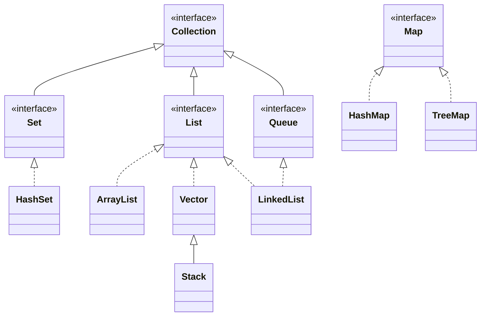

# 9강 — 단언문, 제네릭, 컬렉션

[레포지토리 안내](../../README.ko.md) | [English](Concepts_Lecture.md) | [한국어](Concepts_Lecture.ko.md)

> **최종 수정일:** 2026-11-19

> **학습 목표:**
> 1. 디버깅과 계약에 의한 설계를 위해 단언문을 사용할 수 있다
> 2. 제네릭 타입과 한정적 타입 매개변수를 적용할 수 있다
> 3. Java 컬렉션 프레임워크(List, Set, Map)를 활용할 수 있다
> 4. Iterator로 컬렉션의 원소를 차례로 방문할 수 있다
> 5. 와일드카드와 타입 소거를 이해하고 제네릭 코드의 컴파일 오류를 해석할 수 있다
> 6. equals와 hashCode의 계약을 지키는 클래스를 작성하고 용도에 맞는 컬렉션 구현 클래스를 고를 수 있다

---

## 목차

- [1. 단언문 (Assertion)](#1-단언문-assertion)
  - [1.1 문법과 사용법](#11-문법과-사용법)
  - [1.2 단언문 활성화](#12-단언문-활성화)
  - [1.3 단언문으로 검사하는 조건](#13-단언문으로-검사하는-조건)
  - [1.4 단언문과 예외 처리의 구분](#14-단언문과-예외-처리의-구분)
- [2. 제네릭](#2-제네릭)
  - [2.1 제네릭의 개념](#21-제네릭의-개념)
  - [2.2 제네릭 클래스](#22-제네릭-클래스)
  - [2.3 제네릭 메서드](#23-제네릭-메서드)
  - [2.4 한정적 타입 매개변수](#24-한정적-타입-매개변수)
  - [2.5 원시 타입과 비검사 경고](#25-원시-타입과-비검사-경고)
  - [2.6 제네릭과 상속 관계](#26-제네릭과-상속-관계)
  - [2.7 와일드카드](#27-와일드카드)
  - [2.8 타입 소거](#28-타입-소거)
- [3. 컬렉션 프레임워크](#3-컬렉션-프레임워크)
  - [3.1 Java 인터페이스와 컬렉션 계층 구조](#31-java-인터페이스와-컬렉션-계층-구조)
  - [3.2 List 인터페이스](#32-list-인터페이스)
  - [3.3 ArrayList](#33-arraylist)
  - [3.4 Vector](#34-vector)
  - [3.5 Map 인터페이스](#35-map-인터페이스)
  - [3.6 HashMap](#36-hashmap)
  - [3.7 컬렉션 순회](#37-컬렉션-순회)
  - [3.8 Vector의 용량이 늘어나는 과정](#38-vector의-용량이-늘어나는-과정)
  - [3.9 Set 인터페이스와 구현 클래스](#39-set-인터페이스와-구현-클래스)
  - [3.10 equals와 hashCode의 계약](#310-equals와-hashcode의-계약)
  - [3.11 Comparable과 Comparator를 이용한 정렬](#311-comparable과-comparator를-이용한-정렬)
  - [3.12 맵의 순회와 빈도 세기](#312-맵의-순회와-빈도-세기)
  - [3.13 Queue와 Deque](#313-queue와-deque)
  - [3.14 구현 클래스의 선택과 시간 복잡도](#314-구현-클래스의-선택과-시간-복잡도)
  - [3.15 순회 중 수정과 ConcurrentModificationException](#315-순회-중-수정과-concurrentmodificationexception)
- [4. 흔한 실수](#4-흔한-실수)
- [요약](#요약)
- [점검 문제](#점검-문제)
- [참고 문헌](#참고-문헌)

---

<br>

## 1. 단언문 (Assertion)

### 1.1 문법과 사용법

**단언문(assertion)** 은 개발 중 프로그램의 어느 지점에서 항상 참이어야 하는 조건을 실행 중에 검사하는 문장이다. 조건이 참이면 아무 일도 일어나지 않고, 거짓이면 그 앞의 코드에 오류가 있다는 뜻이므로 실행을 멈춘다. 다음 문장은 입금 뒤 잔액이 늘었는지 검사한다.

```java
assert balance > oldBalance :
    "Error: balance did not increase after deposit";
```

조건이 `false`이면 제공된 메시지와 함께 `AssertionError`가 발생한다.

단언문은 두 가지 형식으로 쓴다.

```text
assert <boolean 식>;
assert <boolean 식> : <식>;
```

`<boolean 식>`은 코드가 올바르게 동작한다면 참이어야 하는 조건이다. 이 식이 `false`가 되면 `AssertionError`가 던져진다. `AssertionError`는 `Exception`이 아니라 `Error`의 하위 클래스이다(6강 3.5절). 두 번째 형식의 `<식>`은 `AssertionError` 생성자에 인자로 전달되어, 던져진 예외의 상세 메시지가 된다.

다음은 입금과 출금 뒤 잔액이 기대한 방향으로 바뀌었는지 단언문으로 확인하는 예이다.

```java
public class Chap9Program1 {

    static double balance;

    public static void main(String[] args) {
        balance = 100;

        deposit(20);
        System.out.println("Balance:" + balance);

        withdraw(20);
        System.out.println("Balance:" + balance);
    }

    private static double deposit(double amount) {
        double oldBalance = balance;
        balance += amount;
        assert balance > oldBalance :
            "Serious Error - balance did not increase after deposit";

        return balance;
    }

    private static double withdraw(double amount) {
        double oldBalance = balance;
        balance -= amount;
        assert balance < oldBalance :
            "Serious Error - balance did not decrease after withdrawal";

        return balance;
    }
}
```

정상적인 금액에서는 단언문이 모두 참이므로 `Balance:120.0`과 `Balance:100.0`을 출력한다. `withdraw(-20)`처럼 음수를 출금하면 잔액이 오히려 늘어나므로, 단언문을 활성화하고 실행했을 때 `AssertionError: Serious Error - balance did not decrease after withdrawal`이 발생한다. 같은 예제의 실습 코드는 [AssertionDemo.java](../../Coursework/Lab09_Assertions-Generics-and-Collections/AssertionDemo.java)이며, `java -ea AssertionDemo`로 실행한다.

### 1.2 단언문 활성화

단언문은 기본적으로 비활성화되어 있다. `-ea` JVM 플래그로 활성화한다:

```bash
java -ea MyProgram
```

`-ea`(enable assertions) 옵션 없이 실행하면 단언문을 검사하지 않고 프로그램을 실행한다. 이때는 `assert` 문의 식 자체가 평가되지 않으므로, 단언문의 식에 프로그램 동작에 필요한 부수 효과(변수 변경, 상태를 바꾸는 메서드 호출)를 넣으면 안 된다.

`assert`는 JDK 1.4에서 도입되었다. 그 전에는 `assert`가 일반 식별자였으므로, JDK 1.4는 호환성을 위해 기본적으로 `assert`를 식별자로 취급했고 단언문을 쓰려면 `javac -source 1.4 <소스 파일>`로 컴파일해야 했다. Java 5부터는 `assert`가 예약어이므로 별도의 컴파일 옵션 없이 `javac`로 컴파일하고, 실행할 때 `-ea`만 지정하면 된다.

단언문은 프로그램 불변 조건을 검사하는 데 사용해야 하며, 사용자 입력 검증에는 사용하지 않아야 한다. 사용자 입력에는 예외 처리나 조건문을 사용한다.

### 1.3 단언문으로 검사하는 조건

단언문은 어느 지점에서 어떤 조건이 반드시 참이라는 프로그래머의 가정을 코드로 적어 둔 것이다. 가정이 깨지면 그 지점 앞의 코드에 오류가 있다는 뜻이므로, 단언문은 오류가 생긴 곳 가까이에서 실행을 멈추게 하여 원인을 찾기 쉽게 한다. 검사하는 조건은 위치와 대상에 따라 표 1의 네 가지로 나눈다.

| 종류 | 뜻 | 예 |
|:-----|:-----|:-----|
| 사전 조건(precondition) | 메서드가 실행을 시작할 때 참이어야 하는 조건 | private 메서드 `deposit(amount)`의 `amount`가 0보다 크다 |
| 사후 조건(postcondition) | 메서드가 끝날 때 참이어야 하는 조건 | 입금 뒤 잔액이 입금 전 잔액보다 크다 |
| 클래스 불변 조건(class invariant) | 객체가 외부에 보이는 모든 시점, 즉 public 메서드 호출의 앞뒤에서 참이어야 하는 조건 | 계좌의 잔액이 음수가 아니다 |
| 제어 흐름 불변 조건(control-flow invariant) | 실행이 도달하지 않아야 하는 지점에 관한 조건 | `switch`의 `default`에 도달하지 않는다 |

*표 1. 단언문으로 검사하는 조건의 종류*

1.1절의 `Chap9Program1`에서 `deposit()`과 `withdraw()`의 단언문은 사후 조건이다. 사후 조건은 메서드가 약속한 결과를 만들었는지 확인하므로 메서드의 끝, 값을 반환하기 직전에 둔다. 제어 흐름 불변 조건은 `switch`에서 가능한 모든 경우를 처리했다고 믿을 때 `default`에 `assert false`를 두는 형태로 쓴다. 다음 프로그램은 단언문의 활성화 여부에 따라 실행 결과가 어떻게 달라지는지 보여 준다.

```java
public class AssertModes {
    static int checks = 0;

    static boolean countCheck() {
        checks++;                       // 부수 효과: 호출 횟수를 센다
        return true;
    }

    public static void main(String[] args) {
        boolean enabled = false;
        assert enabled = true;          // -ea일 때만 대입이 실행된다
        System.out.println("assertions enabled: " + enabled);

        assert countCheck();
        System.out.println("checks = " + checks);

        System.out.println(season(4));
        System.out.println(season(13));
    }

    static String season(int month) {
        switch ((month - 1) / 3) {
            case 0: return "Q1";
            case 1: return "Q2";
            case 2: return "Q3";
            case 3: return "Q4";
            default:
                assert false : "month out of range: " + month;
                return "unknown";
        }
    }
}
```

`main()`의 첫 단언문 `assert enabled = true;`는 비교 연산자 `==`가 아니라 대입 연산자 `=`을 쓴다. 대입식의 값은 대입한 값 `true`이므로 이 단언문은 실패하지 않으며, 단언문이 활성화되어 식이 평가될 때만 `enabled`가 `true`가 된다. 프로그램은 이 관용구로 자신이 `-ea`로 실행되었는지 알 수 있다. 두 번째 단언문은 호출될 때마다 `checks`를 1 늘리는 메서드를 부른다. `season()`은 월을 분기 문자열로 바꾸며, `(month - 1) / 3`이 0부터 3까지의 범위 밖이면 `default`에 도달한다. `java AssertModes`로 실행한 결과는 다음과 같다.

```text
assertions enabled: false
checks = 0
Q2
unknown
```

`java -ea AssertModes`로 실행하면 다음과 같다.

```text
assertions enabled: true
checks = 1
Q2
Exception in thread "main" java.lang.AssertionError: month out of range: 13
	at AssertModes.season(AssertModes.java:28)
	at AssertModes.main(AssertModes.java:18)
```

두 실행을 비교하면 단언문의 성질 세 가지가 드러난다. 첫째, 비활성화된 단언문의 식은 평가되지 않으므로 `enabled`는 `false`로, `checks`는 0으로 남는다. 둘째, 같은 프로그램이 활성화 여부에 따라 다른 값을 출력했다는 것은, 단언문에 부수 효과를 넣으면 프로그램의 동작이 실행 옵션에 좌우된다는 뜻이다. `assert enabled = true;`는 그 성질을 일부러 이용한 예외적인 관용구이며, 일반 코드에서는 단언문의 식에 부수 효과를 넣지 않는다. 셋째, 13월처럼 범위 밖의 값이 들어오면 `-ea` 없이는 `unknown`이 조용히 반환되지만, `-ea`를 붙이면 `AssertionError`가 오류가 난 메서드(`season`)와 줄 번호(28)를 담은 스택 추적과 함께 발생한다.

> **참고:** **활성화 범위의 지정.** `-ea`는 시스템 클래스를 뺀 모든 클래스의 단언문을 켠다. `-ea:BankAccount`처럼 클래스 이름을, `-ea:com.example...`처럼 패키지 이름 뒤에 점 세 개를 붙여 범위를 좁힐 수 있고, `-da`(disable assertions)로 일부를 다시 끌 수 있다. 예를 들어 `java -ea -da:Logger Main`은 `Logger` 클래스만 빼고 단언문을 켠다. 개발과 테스트에서는 단언문을 켜고, 배포한 프로그램은 기본값대로 끈 채 실행하는 것이 일반적이다.

### 1.4 단언문과 예외 처리의 구분

단언문과 예외 처리는 모두 잘못된 상황을 알리지만 다루는 대상이 다르다. 예외는 올바른 프로그램에서도 일어날 수 있는 상황, 예를 들어 사용자가 숫자 대신 글자를 입력하거나 파일이 없거나 네트워크가 끊어지는 상황을 다룬다. 이런 상황은 프로그램이 복구하거나 사용자에게 알려야 하므로, 꺼질 수 있는 단언문에 맡겨서는 안 된다. 단언문은 프로그램이 올바르다면 결코 일어나지 않을 상황, 즉 프로그래머의 실수를 잡는다.

| 항목 | 단언문 | 예외 처리 |
|:-----|:-----|:-----|
| 다루는 상황 | 프로그램 내부의 논리 오류 | 외부 입력, 자원, 실행 환경에서 오는 정상적인 실패 |
| 실행 여부 | 기본적으로 꺼져 있고 `-ea`로 켠다 | 항상 실행된다 |
| 실패했을 때 | `AssertionError`(`Error`의 하위 클래스)로 프로그램을 멈춘다 | 예외를 잡아 복구하거나 호출한 쪽에 알린다 |
| 대표적인 위치 | private 메서드의 사전 조건, 사후 조건, 불변 조건 | public 메서드의 인자 검사, 입출력, 사용자 입력 |
| 예 | `assert balance >= 0;` | `throw new IllegalArgumentException("amount must be positive");` |

*표 2. 단언문과 예외 처리의 비교*

public 메서드의 인자 검사에 단언문을 쓰지 않는 이유는 두 가지이다. 첫째, 다른 코드가 public 메서드를 잘못된 인자로 호출하는 것은 그 메서드의 오류가 아니라 호출하는 쪽의 오류이며, 메서드는 그 사실을 항상 알려야 한다. 단언문은 `-ea` 없이 실행하면 사라지므로 이 약속을 지키지 못한다. 둘째, 인자가 잘못되었을 때 던질 예외의 종류(`IllegalArgumentException`, `NullPointerException`, `IndexOutOfBoundsException`)는 메서드 명세의 일부인데, `AssertionError`로는 이 명세를 나타낼 수 없다. 반면 같은 클래스 안에서만 호출되는 private 메서드의 인자는 클래스 작성자가 책임지므로 단언문으로 검사할 수 있다.

다음 `WithdrawCheck`는 `Chap9Program1`과 같은 구조에서 `withdraw(-20)`을 호출한다.

```java
public class WithdrawCheck {
    static double balance = 100;

    public static void main(String[] args) {
        deposit(20);
        System.out.println("Balance:" + balance);
        withdraw(-20);
        System.out.println("Balance:" + balance);
    }

    private static void deposit(double amount) {
        double oldBalance = balance;
        balance += amount;
        assert balance > oldBalance : "balance did not increase after deposit";
    }

    private static void withdraw(double amount) {
        double oldBalance = balance;
        balance -= amount;
        assert balance < oldBalance : "balance did not decrease after withdrawal";
    }
}
```

`java WithdrawCheck`로 실행하면 단언문이 검사되지 않아 잘못된 잔액이 그대로 출력된다.

```text
Balance:120.0
Balance:140.0
```

`java -ea WithdrawCheck`로 실행하면 출금 뒤 `balance < oldBalance`가 거짓이므로 두 번째 출력 전에 프로그램이 멈춘다.

```text
Balance:120.0
Exception in thread "main" java.lang.AssertionError: balance did not decrease after withdrawal
	at WithdrawCheck.withdraw(WithdrawCheck.java:20)
	at WithdrawCheck.main(WithdrawCheck.java:7)
```

스택 추적의 첫 줄 `at WithdrawCheck.withdraw(WithdrawCheck.java:20)`은 단언문이 있는 20번 줄을, 둘째 줄은 그 메서드를 호출한 `main()`의 7번 줄을 가리킨다. 단언문은 이렇게 오류를 개발 중에 드러내지만, `-ea` 없이 실행되는 프로그램에서는 140.0이라는 잘못된 잔액이 계속 쓰인다. 금액이 사용자에게서 온다면 `withdraw()`의 첫 문장에서 `amount`가 양수인지 확인하고, 아니면 `IllegalArgumentException`을 던져야 한다.

---

<br>

## 2. 제네릭

### 2.1 제네릭의 개념

> **용어 정의:** **제네릭**(generic)은 클래스나 메서드를 특정 타입에 묶지 않고 일반화하여, 사용할 때 여러 타입으로 바꿀 수 있게 하는 기법이다.

> **용어 정의:** `<E>`, `<K>`, `<V>`처럼 꺾쇠 안에 쓴 이름을 **타입 매개변수**(type parameter)라고 한다. 관례상 E는 원소(element), K는 키(key), V는 값(value), T는 타입(type)을 뜻한다.

예를 들어 제네릭 스택 `Stack<E>`를 한 번 정의하면, `E`를 `Integer`로 지정하여 정수만 담는 스택으로, `String`으로 지정하여 문자열만 담는 스택으로 쓸 수 있다.

```java
class Stack<E> {
    ...
    void push(E element) { ... }
    E pop() { ... }
    ...
}
```

`Stack<Integer>`에서는 `push(Integer element)`와 `Integer pop()`이, `Stack<String>`에서는 `push(String element)`와 `String pop()`이 된다. 3절의 컬렉션 클래스는 모두 이 제네릭 기법으로 구현되어 있다. C++의 템플릿과 같은 목적의 기능이다.

타입 인자에는 참조 타입만 쓸 수 있다. `Vector<int>`는 컴파일 오류(`unexpected type`)이며, 기본형 값을 담으려면 `Vector<Integer>`처럼 래퍼 클래스를 쓴다. 이때 `v.add(5)`의 `int` 값 5는 `Integer` 객체로 자동 변환(오토박싱)되고, `int n = v.get(i);`에서는 `int`로 자동 변환(언박싱)된다.

### 2.2 제네릭 클래스

제네릭은 타입을 매개변수화하여 타입 안전하고 재사용 가능한 코드를 작성할 수 있게 한다. 다음 `Box<T>`는 어떤 타입이든 객체 하나를 담는 상자이며, 담을 객체의 타입 `T`는 상자를 만들 때 정한다.

```java
public class Box<T> {
    private T item;

    public void set(T item) { this.item = item; }
    public T get() { return item; }
}

// 사용 예
Box<String> stringBox = new Box<>();
stringBox.set("Hello");
String value = stringBox.get(); // 캐스팅 불필요
```

`new Box<>()`의 빈 꺾쇠(다이아몬드 연산자, Java 7부터)는 타입 인자를 변수 선언에서 추론하게 한다. 같은 방식의 `Locker<T>` 클래스는 선언, 생성, 사용 단계에서 각각 타입 인자를 지정한다.

```java
class Locker<T> {
    private T content;

    public Locker() {
        store(null);
    }

    public T retrieve() {
        return content;
    }

    public void store(T item) {
        content = item;
    }
}

// Declaration
Locker<String>  lockerOne;
Locker<Integer> lockerTwo;

// Creation
lockerOne = new Locker<String>();
lockerTwo = new Locker<Integer>();

// Usage
lockerOne.store("Hello");
lockerTwo.store(Integer.valueOf(10));
```

`lockerOne`에는 `String`만, `lockerTwo`에는 `Integer`만 저장할 수 있으며, 다른 타입을 넣으면 컴파일 오류가 난다.

### 2.3 제네릭 메서드

```java
public static <T> void printArray(T[] array) {
    for (T element : array) {
        System.out.print(element + " ");
    }
    System.out.println();
}
```

반환 타입 앞의 `<T>`가 이 메서드만의 타입 매개변수를 선언한다. `printArray(new Integer[]{1, 2, 3})`처럼 호출하면 컴파일러가 인자로부터 `T`를 `Integer`로 추론한다.

### 2.4 한정적 타입 매개변수

```java
// T는 Comparable의 하위 타입이어야 함
public static <T extends Comparable<T>> T findMax(T[] array) {
    T max = array[0];
    for (int i = 1; i < array.length; i++) {
        if (array[i].compareTo(max) > 0) {
            max = array[i];
        }
    }
    return max;
}
```

`<T extends SomeType>`을 사용하여 특정 인터페이스를 구현하거나 특정 클래스를 확장하는 타입으로 제네릭을 제한할 수 있다.

`T`가 `Comparable<T>`를 구현한다고 보장되므로 메서드 안에서 `compareTo`를 호출할 수 있다. `Integer`와 `String`은 `Comparable`을 구현하므로 `findMax(new Integer[]{3, 9, 2})`는 9를 반환한다. `Comparable`을 구현하지 않는 `Object[]`를 넘기면 컴파일 오류가 난다. 이 메서드는 배열이 비어 있지 않다고 가정한다.

### 2.5 원시 타입과 비검사 경고

제네릭이 도입되기 전의 컬렉션은 모든 원소를 `Object`로 다루었다. 지금도 타입 인자를 생략하고 `List`, `ArrayList`처럼 제네릭 타입의 이름만 쓰면 그때와 같은 방식으로 동작하며, 이렇게 타입 인자 없이 쓴 제네릭 타입을 **원시 타입(raw type)** 이라고 한다(3.5절의 `Map catalog`). 원시 타입의 컬렉션에는 아무 객체나 넣을 수 있으므로, 타입이 맞지 않는 원소가 들어가도 컴파일러가 막지 못한다.

```java
import java.util.ArrayList;
import java.util.List;

public class RawList {
    public static void main(String[] args) {
        List names = new ArrayList();
        names.add("Alice");
        names.add(42);

        for (int i = 0; i < names.size(); i++) {
            String s = (String) names.get(i);
            System.out.println(s.toUpperCase());
        }
    }
}
```

`names`에는 문자열 `"Alice"`와 정수 42가 함께 들어간다. 꺼낼 때는 `get()`이 `Object`를 반환하므로 `(String)`으로 캐스트해야 한다. 이 파일을 `javac RawList.java`로 컴파일하면 오류 없이 두 줄의 안내만 나온다.

```text
Note: RawList.java uses unchecked or unsafe operations.
Note: Recompile with -Xlint:unchecked for details.
```

안내가 권하는 대로 `javac -Xlint:unchecked RawList.java`로 다시 컴파일하면 경고의 위치가 나타난다.

```text
RawList.java:7: warning: [unchecked] unchecked call to add(E) as a member of the raw type List
        names.add("Alice");
                 ^
  where E is a type-variable:
    E extends Object declared in interface List
RawList.java:8: warning: [unchecked] unchecked call to add(E) as a member of the raw type List
        names.add(42);
                 ^
  where E is a type-variable:
    E extends Object declared in interface List
2 warnings
```

**비검사 경고(unchecked warning)** 는 컴파일러가 타입의 안전성을 확인할 수 없는 연산이 있다는 뜻이다. 컴파일러가 확인하지 못한 오류는 실행 중에 드러난다.

```text
ALICE
Exception in thread "main" java.lang.ClassCastException: class java.lang.Integer cannot be cast to class java.lang.String (java.lang.Integer and java.lang.String are in module java.base of loader 'bootstrap')
	at RawList.main(RawList.java:11)
```

첫 원소는 `ALICE`로 출력되지만, 두 번째 원소를 `String`으로 캐스트하는 11번 줄에서 `ClassCastException`이 발생한다. 오류의 원인은 정수를 넣은 8번 줄에 있지만 예외는 원소를 꺼내 쓰는 곳에서 나므로, 큰 프로그램에서는 원인을 찾기 어렵다. `List<String> names`로 선언하면 `names.add(42)`가 컴파일 오류가 되어 원인이 있는 줄에서 바로 잡히고, 꺼낼 때의 캐스트도 필요 없다. 제네릭의 가치는 이처럼 실행 중 오류를 컴파일 오류로 바꾸는 데 있다.

### 2.6 제네릭과 상속 관계

`Integer`는 `Number`의 하위 클래스이다. 그러나 `List<Integer>`는 `List<Number>`의 하위 타입이 아니다. 만약 하위 타입이라면 다음 코드가 허용되어야 한다.

```java
List<Integer> ints = new ArrayList<>();
List<Number> nums = ints;        // 허용된다고 가정한다
nums.add(3.14);                  // Double은 Number이므로 nums에 넣을 수 있다
Integer first = ints.get(0);     // 같은 리스트에서 Double이 나온다
```

`nums`와 `ints`는 같은 리스트 객체를 가리키므로, `nums`로 넣은 `Double`을 `ints`로 꺼내면 `Integer`가 있어야 할 자리에서 `Double`이 나온다. 컴파일러는 이런 상황을 막기 위해 둘째 줄을 거부한다. 같은 제네릭 클래스에서 타입 인자만 다른 두 타입 사이에는 상속 관계가 없으며, 이 성질을 **무공변(invariant)** 이라고 한다.

배열은 다르게 동작한다. `String`이 `Object`의 하위 타입이면 `String[]`도 `Object[]`의 하위 타입이며, 이 성질을 **공변(covariant)** 이라고 한다. 그 대가로 배열은 잘못된 저장을 실행 중에 검사한다.

```java
import java.util.ArrayList;
import java.util.List;

public class Variance {
    public static void main(String[] args) {
        Object[] objects = new String[2];  // 배열은 공변이므로 허용된다
        objects[0] = "ok";
        try {
            objects[1] = Integer.valueOf(7);
        } catch (ArrayStoreException e) {
            System.out.println("ArrayStoreException: " + e.getMessage());
        }

        List<Integer> ints = new ArrayList<>();
        // List<Number> nums = ints;        // compile error
        List<? extends Number> view = ints;
        ints.add(3);
        System.out.println(view.get(0).doubleValue());
    }
}
```

```text
ArrayStoreException: java.lang.Integer
3.0
```

`objects`의 선언 타입은 `Object[]`이지만 실제 배열은 `String[]`이므로, `Integer`를 저장하는 순간 JVM이 `ArrayStoreException`을 던진다. 배열은 원소 타입을 실행 중에도 기억하므로 이 검사가 가능하다. 제네릭은 2.8절에서 보듯 실행 중에 원소 타입을 기억하지 않으므로 같은 방식으로 검사할 수 없고, 대신 컴파일 시간에 대입 자체를 막는다. 마지막 두 줄처럼 `? extends Number`로 받은 `view`에서는 원소를 읽을 수 있다. 주석으로 막아 둔 대입과, 와일드카드 타입에 원소를 넣는 문장을 함께 컴파일하면 다음 오류가 난다.

```java
import java.util.ArrayList;
import java.util.List;

public class VarianceError {
    public static void main(String[] args) {
        List<Integer> ints = new ArrayList<>();
        List<Number> nums = ints;
        List<? extends Number> view = ints;
        view.add(Integer.valueOf(1));
    }
}
```

```text
VarianceError.java:7: error: incompatible types: List<Integer> cannot be converted to List<Number>
        List<Number> nums = ints;
                            ^
VarianceError.java:9: error: incompatible types: Integer cannot be converted to CAP#1
        view.add(Integer.valueOf(1));
                                ^
  where CAP#1 is a fresh type-variable:
    CAP#1 extends Number from capture of ? extends Number
Note: Some messages have been simplified; recompile with -Xdiags:verbose to get full output
2 errors
```

첫 오류는 무공변 규칙 때문이다. 두 번째 오류에 나오는 `CAP#1`은 컴파일러가 `? extends Number`를 구체적인 미지 타입 하나로 바꾸어 붙인 이름이다(포획 변환, capture conversion). `view`가 가리키는 리스트가 `List<Integer>`인지 `List<Double>`인지 컴파일러는 알 수 없으므로, 어떤 `Number`를 넣어도 안전하다고 보장할 수 없어 `add()`를 거부한다. 이 규칙은 2.7절의 와일드카드로 이어진다.

### 2.7 와일드카드

`List<Integer>`를 `List<Number>`에 넘길 수 없으므로, 정수 리스트와 실수 리스트의 합을 하나의 메서드로 구하려면 타입 인자의 자리에 와일드카드를 쓴다.

> **용어 정의:** **와일드카드(wildcard)** 는 제네릭 타입의 타입 인자 자리에 쓰는 `?`로, 알 수 없는 어떤 타입을 뜻한다. `<? extends T>`는 T 또는 T의 하위 타입 가운데 하나를, `<? super T>`는 T 또는 T의 상위 타입 가운데 하나를, 한정이 없는 `<?>`는 아무 타입이나 뜻한다.

| 형태 | 받을 수 있는 인자의 예 | 원소 읽기 | 원소 넣기 |
|:-----|:-----|:-----|:-----|
| `List<?>` | `List<String>`, `List<Integer>` 등 모든 리스트 | `Object`로 읽는다 | `null`만 넣을 수 있다 |
| `List<? extends Number>` | `List<Number>`, `List<Integer>`, `List<Double>` | `Number`로 읽는다 | `null`만 넣을 수 있다 |
| `List<? super Integer>` | `List<Integer>`, `List<Number>`, `List<Object>` | `Object`로만 읽는다 | `Integer`를 넣을 수 있다 |

*표 3. 세 가지 와일드카드와 원소의 읽기와 넣기*

```java
import java.util.ArrayList;
import java.util.List;

public class Wildcards {
    static double sum(List<? extends Number> src) {      // 읽기 전용 생산자
        double total = 0;
        for (Number n : src) total += n.doubleValue();
        return total;
    }

    static void fillOneToThree(List<? super Integer> dst) { // 쓰기 전용 소비자
        for (int i = 1; i <= 3; i++) dst.add(i);
    }

    static int countAll(List<?> any) {                   // 원소 타입을 쓰지 않는다
        return any.size();
    }

    static <T> void copy(List<? super T> dst, List<? extends T> src) {
        for (T item : src) dst.add(item);
    }

    public static void main(String[] args) {
        List<Integer> ints = List.of(1, 2, 3);
        List<Double> doubles = List.of(0.5, 1.5);
        System.out.println(sum(ints) + " " + sum(doubles));

        List<Number> numbers = new ArrayList<>();
        List<Object> objects = new ArrayList<>();
        fillOneToThree(numbers);
        fillOneToThree(objects);
        System.out.println(numbers + " " + objects);

        System.out.println(countAll(List.of("a", "b")) + " " + countAll(doubles));

        copy(objects, doubles);
        System.out.println(objects);
    }
}
```

```text
6.0 2.0
[1, 2, 3] [1, 2, 3]
2 2
[1, 2, 3, 0.5, 1.5]
```

`sum()`은 리스트에서 원소를 꺼내 읽기만 하므로 `? extends Number`를 쓴다. 원소가 무엇이든 `Number`이므로 `doubleValue()`를 호출할 수 있고, `List<Integer>`의 합 6.0과 `List<Double>`의 합 2.0을 같은 메서드로 구한다. `fillOneToThree()`는 리스트에 정수를 넣기만 하므로 `? super Integer`를 쓴다. 리스트의 원소 타입이 `Integer`의 상위 타입이면 어떤 `Integer`도 넣을 수 있으므로 `List<Number>`와 `List<Object>`에 모두 1, 2, 3을 채운다. `countAll()`은 원소를 읽지도 넣지도 않고 크기만 알면 되므로 한정이 없는 `?`로 충분하다.

`copy()`는 두 와일드카드를 함께 쓴다. `src`에서는 `T`를 꺼내고(`? extends T`), `dst`에는 `T`를 넣는다(`? super T`). `copy(objects, doubles)`에서 컴파일러는 `T`를 `Double`로 추론한다. `List<Object>`는 `List<? super Double>`에, `List<Double>`은 `List<? extends Double>`에 맞으므로 호출이 컴파일되고, 이미 1, 2, 3이 든 `objects` 뒤에 0.5와 1.5가 붙는다.

이 규칙은 원소를 꺼내 주는 매개변수(생산자, producer)에는 `extends`를, 원소를 받아들이는 매개변수(소비자, consumer)에는 `super`를 쓴다는 원칙으로 요약되며, 머리글자를 따서 PECS(Producer Extends, Consumer Super)라고 부른다. 원소를 읽기도 하고 넣기도 하는 매개변수에는 와일드카드를 쓰지 않고 `List<T>`처럼 정확한 타입을 쓴다. 반환 타입에도 와일드카드를 쓰지 않는다. 반환 타입이 `List<? extends Number>`이면 호출한 쪽이 그 리스트에 원소를 넣을 수 없어 불편하기 때문이다.

### 2.8 타입 소거

Java 컴파일러는 제네릭 코드의 타입 검사를 마친 뒤, 바이트코드를 만들 때 타입 인자를 지운다. 이 과정을 **타입 소거(type erasure)** 라고 하며, 다음 규칙을 따른다.

- 한정이 없는 타입 매개변수 `T`는 `Object`로 바뀐다.
- 한정된 타입 매개변수 `T extends Comparable<T>`는 첫 번째 한정 타입인 `Comparable`로 바뀐다.
- `List<String>` 같은 매개변수화된 타입은 원시 타입 `List`로 바뀌고, 원소를 꺼내는 곳에는 컴파일러가 캐스트를 넣는다.

Java가 이 방식을 택한 것은 제네릭 이전에 컴파일된 코드와 이후의 코드가 같은 JVM에서 함께 동작하게 하기 위해서이다. JVM이 보기에 `ArrayList<String>`과 `ArrayList<Integer>`는 같은 `ArrayList` 클래스이다.

```java
import java.util.ArrayList;
import java.util.List;

public class Erasure {
    static class Box<T extends Comparable<T>> {
        private T item;
        void set(T item) { this.item = item; }
        T get() { return item; }
        boolean isBiggerThan(T other) { return item.compareTo(other) > 0; }
    }

    public static void main(String[] args) throws Exception {
        List<String> a = new ArrayList<>();
        List<Integer> b = new ArrayList<>();
        System.out.println(a.getClass() == b.getClass());
        System.out.println(a.getClass().getName());

        System.out.println(Box.class.getDeclaredMethod("set", Comparable.class));
        System.out.println(Box.class.getDeclaredMethod("get").getReturnType());

        Box<Integer> box = new Box<>();
        box.set(9);
        System.out.println(box.isBiggerThan(4));
    }
}
```

```text
true
java.util.ArrayList
void Erasure$Box.set(java.lang.Comparable)
interface java.lang.Comparable
true
```

첫 줄의 `true`는 `List<String>` 객체와 `List<Integer>` 객체의 실행 시간 클래스가 같다는 뜻이고, 둘째 줄은 그 클래스의 이름에 타입 인자가 없음을 보여 준다. 셋째 줄은 리플렉션으로 `Box`의 `set` 메서드를 찾은 결과이다. 소스에서 `set(T item)`으로 선언한 메서드가 바이트코드에서는 `set(Comparable)`이 되었는데, `T`의 한정이 `Comparable<T>`이므로 `T`가 그 소거인 `Comparable`로 바뀐 것이다. `get()`의 반환 타입도 같은 이유로 `Comparable`이다. 그래도 `box.isBiggerThan(4)`가 정상적으로 `true`를 반환하는 것은 타입 검사가 컴파일 시간에 이미 끝났기 때문이다.

실행 시간에는 `T`가 무엇인지 알 수 없으므로, `T`의 실제 타입이 필요한 연산은 컴파일되지 않는다.

```java
import java.util.List;

public class ErasureError<T> {
    T make() { return new T(); }
    boolean test(Object o) { return o instanceof List<String>; }
    T[] array() { return new T[10]; }
}
```

```text
ErasureError.java:4: error: unexpected type
    T make() { return new T(); }
                          ^
  required: class
  found:    type parameter T
  where T is a type-variable:
    T extends Object declared in class ErasureError
ErasureError.java:5: error: Object cannot be safely cast to List<String>
    boolean test(Object o) { return o instanceof List<String>; }
                                    ^
ErasureError.java:6: error: generic array creation
    T[] array() { return new T[10]; }
                         ^
3 errors
```

- `new T()`: 실행 시간에 `T`가 어떤 클래스인지 모르므로 객체를 만들 수 없다. 객체가 필요하면 `Supplier<T>`나 `Class<T>`를 인자로 받아 만든다.
- `o instanceof List<String>`: 실행 시간의 객체에는 `String`이라는 타입 인자가 남아 있지 않으므로 검사할 수 없다. `o instanceof List<?>`는 허용된다.
- `new T[10]`: 배열은 원소 타입을 실행 시간에 기억해야 하는데(2.6절) 소거된 `T`는 기억할 수 없다. 그래서 제네릭 컬렉션의 구현은 내부에 `Object[]`를 두고 원소를 꺼낼 때 캐스트한다.

기본형을 타입 인자로 쓸 수 없는 것(2.1절의 `Vector<int>`)도, 소거 뒤의 `Object` 자리에 기본형 값을 둘 수 없기 때문이다.

> **참고:** **소거가 같은 메서드의 오버로딩.** `void print(List<String> a)`와 `void print(List<Integer> a)`를 한 클래스에 함께 선언하면, 두 메서드가 소거 뒤 모두 `print(List)`가 되어 "name clash: print(List<Integer>) and print(List<String>) have the same erasure" 컴파일 오류가 난다. 매개변수의 타입 인자만 다른 메서드는 오버로딩할 수 없다.

---

<br>

## 3. 컬렉션 프레임워크

### 3.1 Java 인터페이스와 컬렉션 계층 구조

표준 패키지 `java.util`에는 객체의 모음(컬렉션)을 관리하는 여러 클래스가 있으며, 이들을 통틀어 **Java 컬렉션 프레임워크**(Java Collection Framework, JCF)라고 한다. JCF는 객체를 집합(set), 리스트(list), 맵(map)으로 관리하는 클래스를 제공한다.

JCF는 Java 인터페이스로 각 컬렉션의 동작을 정의하고, 클래스가 그 인터페이스를 구현한다.

> **용어 정의:** **Java 인터페이스**(interface)는 객체의 동작만 정의한다. 몸체가 없는 `public` 메서드만 포함하고, `public` 상수 외의 데이터 멤버를 갖지 않으며, 인터페이스 자체의 인스턴스는 만들 수 없다.

**Java 8 이후의 인터페이스:** Java 8부터는 인터페이스에 몸체가 있는 `default` 메서드와 `static` 메서드를, Java 9부터는 `private` 메서드를 둘 수 있다. 위 정의는 이 기능을 제외한 전통적인 인터페이스의 정의이다.



*그림 1. 컬렉션 프레임워크의 주요 인터페이스와 클래스*

실선 화살표는 인터페이스 사이 또는 클래스 사이의 상속을, 점선 화살표는 클래스가 인터페이스를 구현함을 나타낸다. `Collection<E>`, `Set<E>`, `List<E>`, `Queue<E>`와 그 구현 클래스는 원소 타입 `E` 하나를, `Map<K, V>`와 그 구현 클래스는 키 타입 `K`와 값 타입 `V`를 타입 매개변수로 갖는다. `Map`은 `Collection`을 상속하지 않는 별도의 계층이다.

### 3.2 List 인터페이스

`List` 인터페이스는 객체의 모음을 선형 리스트 $L = (l_0, l_1, l_2, \ldots, l_N)$으로 관리하는 메서드를 제공한다. 리스트에 객체를 추가, 제거, 조회할 수 있으며, 추가할 수 있는 객체 수에 정해진 한계가 없다.

| 메서드 | 설명 |
|:-----|:-----|
| `boolean add(E o)` | 객체 `o`를 리스트 끝에 추가한다 |
| `void clear()` | 리스트를 비운다 |
| `E get(int idx)` | 위치 `idx`의 원소를 반환한다 |
| `E remove(int idx)` | 위치 `idx`의 원소를 제거하고 반환한다 |
| `int size()` | 리스트의 원소 수를 반환한다 |

*표 4. List 인터페이스의 주요 메서드*

리스트를 사용하려면 `List` 인터페이스를 구현한 클래스의 인스턴스를 만들어야 한다. 대표적인 구현 클래스는 배열로 데이터를 관리하는 `ArrayList`와 연결 노드 표현(linked-node representation)을 쓰는 `LinkedList`이다. 변수는 인터페이스 타입으로 선언하고 객체는 구현 클래스로 만들면, 나중에 구현 클래스만 바꾸어도 나머지 코드는 그대로 쓸 수 있다.

```java
/**
 * Maintains a list of library books
 */
private List<Book> books;

/**
 * Constructor
 */
public BookTracker() {
    books = new LinkedList<>();
}
```

`List<Integer>`에서 `remove(1)`은 `remove(int idx)`로 해석되어 위치 1의 원소를 제거한다. 값이 1인 원소를 제거하려면 `remove(Integer.valueOf(1))`처럼 `remove(Object o)`를 호출해야 한다.

### 3.3 ArrayList

`ArrayList`는 `List` 인터페이스를 구현한 가변 크기 배열이다. 원소를 내부 배열에 차례로 저장하므로 위치로 원소를 바로 찾을 수 있다.

```java
ArrayList<String> names = new ArrayList<>();
names.add("Alice");
names.add("Bob");
names.get(0);       // "Alice"
names.size();       // 2
names.remove(0);    // "Alice" 제거
```

내부 배열이 가득 차면 더 큰 배열을 만들어 원소를 옮기므로 크기를 미리 정하지 않아도 된다. 인덱스로 원소에 접근하는 데는 O(1) 시간이 걸린다. 중간에 원소를 넣거나 빼면 뒤의 원소를 한 칸씩 옮겨야 하므로 O(n) 시간이 걸린다.

> **[자료구조]** `ArrayList`와 3.4절의 `Vector`는 자료구조에서 배우는 동적 배열(dynamic array)로, 용량이 찰 때마다 일정 비율로 더 큰 배열을 만들어 원소를 옮기므로 끝에 원소를 추가하는 연산은 분할 상환(amortized) O(1) 시간이 걸린다. 3.2절의 `LinkedList`는 이중 연결 리스트(doubly linked list)로, 위치 i의 원소에 가려면 노드를 차례로 따라가야 하므로 인덱스 접근에 O(n) 시간이 걸리지만, 삽입과 삭제 때 뒤의 원소를 옮기지 않는다.

### 3.4 Vector

`Vector<E>`도 `List<E>`를 구현한 가변 크기 배열이다. `ArrayList`와 사용법이 거의 같지만 메서드가 동기화되어 있어 여러 스레드가 함께 써도 안전하다(15강 4절). 대신 단일 스레드에서는 `ArrayList`보다 약간 느리다.

```java
Vector<Integer> v = new Vector<Integer>();

v.add(5);
v.add(4);
v.add(-1);

v.add(2, 100);

System.out.println("# of elements : " + v.size());
System.out.println("Capacity of the vector : " + v.capacity());

for (int i = 0; i < v.size(); i++) {
    int n = v.get(i);
    System.out.println(n);
}
```

`add(e)`는 끝에, `add(index, e)`는 지정한 위치에 원소를 넣고 그 뒤의 원소를 한 칸씩 민다. 따라서 `v.add(2, 100)` 뒤의 원소는 5, 4, 100, -1이다. `size()`는 원소 수 4를, `capacity()`는 내부 배열의 크기를 반환한다. 기본 생성자로 만든 `Vector`의 용량은 10이며, 원소가 용량을 넘으면 용량이 두 배로 늘어난다.

```text
         0     1     2     3     4    ...    9
v ──▶ ┌─────┬─────┬─────┬─────┬─────┬─────┬─────┐
      │  ●  │  ●  │  ●  │  ●  │     │ ... │     │  size 4, capacity 10
      └──┼──┴──┼──┴──┼──┴──┼──┴─────┴─────┴─────┘
         ▼     ▼     ▼     ▼
        [5]   [4]  [100]  [-1]
```

*그림 2. 원소 4개를 담은 `Vector<Integer>`의 내부 배열*

각 칸은 `Integer` 객체의 참조를 저장한다. 출력은 다음과 같다.

```text
# of elements : 4
Capacity of the vector : 10
5
4
100
-1
```

### 3.5 Map 인터페이스

`Map` 인터페이스는 (키, 값) 쌍인 **맵 항목**(map entry)의 모음을 관리하는 메서드를 제공한다. 키는 맵 안에서 중복될 수 없고, 키로 값을 찾는다.

| 메서드 | 설명 |
|:-----|:-----|
| `void clear()` | 맵을 비운다 |
| `boolean containsKey(Object key)` | 주어진 키의 항목이 있으면 `true`를 반환한다 |
| `V put(K key, V value)` | (key, value) 항목을 추가하고, 같은 키의 항목이 있었으면 값을 바꾼 뒤 이전 값을 반환한다 |
| `V get(Object key)` | 주어진 키의 값을 반환하고, 없으면 `null`을 반환한다 |
| `V remove(Object key)` | 주어진 키의 항목을 제거하고 그 값을 반환한다 |
| `int size()` | 맵의 항목 수를 반환한다 |

*표 5. Map 인터페이스의 주요 메서드*

맵을 사용하려면 `Map` 인터페이스를 구현한 클래스의 인스턴스를 만들어야 하며, 대표적인 구현 클래스는 `HashMap`과 `TreeMap`이다. `TreeMap`은 항목을 키의 순서로 정렬하여 유지한다.

```java
Map<String, String> catalog = new TreeMap<>();

catalog.put("CS101", "Intro Java Programming");
catalog.put("CS301", "Database Design");
catalog.put("CS413", "Software Design for Mobile Devices");

if (catalog.containsKey("CS101")) {
    System.out.println("We teach Java this semester");
} else {
    System.out.println("No Java courses this semester");
}
```

키 `"CS101"`이 있으므로 `We teach Java this semester`를 출력한다. 타입 인자 없이 `Map catalog = new TreeMap();`처럼 원시 타입(raw type)으로 쓰면 컴파일되기는 하지만 unchecked 경고가 나고 타입 검사의 이점을 잃는다.

### 3.6 HashMap

`HashMap`은 평균 O(1) 시간에 항목에 접근할 수 있는 키-값 맵이다. 다음 코드는 이름을 키로, 점수를 값으로 저장한다.

```java
HashMap<String, Integer> scores = new HashMap<>();
scores.put("Alice", 95);
scores.put("Bob", 87);
int aliceScore = scores.get("Alice"); // 95
```

`HashMap`은 키의 해시 값으로 항목의 위치를 정하므로 평균 O(1) 시간에 조회하지만, 항목의 순서는 보장하지 않는다.

> **주의:** 없는 키로 `get`을 호출하면 `null`이 반환된다. `int x = scores.get("Carol");`처럼 결과를 `int`에 대입하면 `null`을 언박싱하면서 `NullPointerException`이 발생한다. 키가 없을 수 있으면 `containsKey`로 먼저 확인하거나 `scores.getOrDefault("Carol", 0)`을 쓴다.

### 3.7 컬렉션 순회

```java
// 향상된 for 루프
for (String name : names) {
    System.out.println(name);
}

// Iterator
Iterator<String> it = names.iterator();
while (it.hasNext()) {
    System.out.println(it.next());
}

// forEach와 람다 (Java 8+)
names.forEach(name -> System.out.println(name));
```

`Iterator<E>` 인터페이스는 `Vector<E>`, `ArrayList<E>`, `LinkedList<E>` 같은 컬렉션의 원소를 인덱스 없이 차례로 방문하게 한다. 컬렉션의 `iterator()` 메서드가 `Iterator` 객체를 반환하며, `hasNext()`는 남은 원소가 있는지를, `next()`는 다음 원소를 반환한다. 3.4절의 인덱스 반복문은 다음처럼 바꿀 수 있다.

```java
Iterator<Integer> it = v.iterator();

while (it.hasNext()) {
    int n = it.next();
    System.out.println(n);
}
```

인덱스가 없는 `Set`에서도, 인덱스 접근이 느린 `LinkedList`에서도 같은 코드로 원소를 차례로 방문할 수 있다는 것이 `Iterator`의 장점이다.

> **주의:** 향상된 for 루프로 순회하는 도중에 컬렉션의 `remove`를 호출하면 `ConcurrentModificationException`이 발생할 수 있다. 순회하면서 원소를 제거하려면 `Iterator`의 `remove()`를 쓴다.

### 3.8 Vector의 용량이 늘어나는 과정

3.4절에서 기본 생성자로 만든 `Vector`의 용량은 10이고 원소가 용량을 넘으면 두 배가 된다고 했다. 다음 프로그램은 원소를 하나씩 넣으면서 용량이 바뀌는 순간을 출력한다.

```java
import java.util.ArrayList;
import java.util.Vector;

public class Capacity {
    public static void main(String[] args) {
        Vector<Integer> v = new Vector<>();
        int last = v.capacity();
        System.out.println("size 0, capacity " + last);
        for (int i = 1; i <= 41; i++) {
            v.add(i);
            if (v.capacity() != last) {
                last = v.capacity();
                System.out.println("size " + v.size() + ", capacity " + last);
            }
        }
        Vector<Integer> w = new Vector<>(4, 3);   // 초기 용량 4, 증가량 3
        for (int i = 0; i < 8; i++) w.add(i);
        System.out.println("w: size " + w.size() + ", capacity " + w.capacity());
    }
}
```

```text
size 0, capacity 10
size 11, capacity 20
size 21, capacity 40
size 41, capacity 80
w: size 8, capacity 10
```

원소가 10개일 때까지 용량은 10이고, 11번째 원소를 넣는 순간 내부 배열이 크기 20의 새 배열로 바뀐다. 이때 기존 원소 10개를 새 배열로 복사한다. 같은 방식으로 21번째 원소에서 40, 41번째 원소에서 80이 된다. 생성자 `Vector(int initialCapacity, int capacityIncrement)`로 증가량을 정하면 두 배가 아니라 그 양만큼 늘어나므로, 초기 용량 4, 증가량 3인 `w`의 용량은 4, 7, 10으로 바뀐다.

용량을 두 배씩 늘리면 원소 n개를 끝에 추가하는 동안 복사하는 원소의 총수가 n의 상수배로 묶인다. 41개를 넣는 동안 복사가 일어난 것은 용량 10, 20, 40이 가득 찼을 때뿐이므로 복사한 원소는 모두 10 + 20 + 40 = 70개이고, 넣은 원소 하나당 2개가 되지 않는다(70 / 41 ≈ 1.71). 그래서 끝에 추가하는 연산 하나는 평균적으로 O(1) 시간이 걸린다(3.3절의 분할 상환 시간). `ArrayList`의 용량도 자동으로 늘어나지만, 그 증가 정책은 끝에 추가하는 연산이 분할 상환 상수 시간이라는 것 외에는 명세에 정해져 있지 않다 [1].

### 3.9 Set 인터페이스와 구현 클래스

> **용어 정의:** **집합(set)** 은 같은 원소를 두 번 담지 않는 컬렉션이다. `Set<E>`의 `add(e)`는 같은 원소가 이미 있으면 집합을 바꾸지 않고 `false`를 반환한다.

`Set`의 대표적인 구현 클래스는 세 가지이며, 원소를 순회하는 순서가 서로 다르다.

- `HashSet`은 원소의 해시 값으로 저장 위치를 정한다. `add`, `remove`, `contains`는 평균 O(1) 시간이지만 순회 순서는 정해져 있지 않다.
- `LinkedHashSet`은 `HashSet`에 원소를 넣은 순서를 기억하는 연결 리스트를 더한 것이다. 순회하면 넣은 순서대로 나온다.
- `TreeSet`은 `TreeMap`을 바탕으로 원소를 정렬된 상태로 유지하며, `TreeMap`은 레드-블랙 트리로 구현된다 [2]. 기본 연산은 O(log n) 시간이고, 순회하면 오름차순으로 나온다. 원소는 `Comparable`을 구현하거나, 생성자에 `Comparator`를 넘겨야 한다(3.11절).

```java
import java.util.*;

public class Sets {
    public static void main(String[] args) {
        String[] words = {"pear", "apple", "fig", "apple", "kiwi", "fig"};
        Set<String> hash = new HashSet<>();
        Set<String> linked = new LinkedHashSet<>();
        Set<String> tree = new TreeSet<>();
        for (String w : words) {
            boolean added = hash.add(w);
            linked.add(w);
            tree.add(w);
            if (!added) System.out.println("duplicate rejected: " + w);
        }
        System.out.println("HashSet       " + hash);
        System.out.println("LinkedHashSet " + linked);
        System.out.println("TreeSet       " + tree);
        System.out.println(tree.contains("kiwi") + " " + tree.size());

        Set<String> a = new TreeSet<>(List.of("a", "b", "c"));
        Set<String> b = new TreeSet<>(List.of("b", "c", "d"));
        Set<String> union = new TreeSet<>(a);        union.addAll(b);
        Set<String> inter = new TreeSet<>(a);        inter.retainAll(b);
        Set<String> diff  = new TreeSet<>(a);        diff.removeAll(b);
        System.out.println(union + " " + inter + " " + diff);
    }
}
```

```text
duplicate rejected: apple
duplicate rejected: fig
HashSet       [apple, pear, kiwi, fig]
LinkedHashSet [pear, apple, fig, kiwi]
TreeSet       [apple, fig, kiwi, pear]
true 4
[a, b, c, d] [b, c] [a]
```

단어 여섯 개 가운데 `apple`과 `fig`가 두 번씩 나오므로 두 번째 `add`는 `false`를 반환하고, 세 집합 모두 원소 4개를 갖는다. 출력 순서를 보면 `LinkedHashSet`은 처음 넣은 순서(`pear`, `apple`, `fig`, `kiwi`)를, `TreeSet`은 사전 순서를 지킨다. `HashSet`의 순서는 해시 값과 내부 배열의 크기로 정해지므로, 같은 원소라도 JDK 버전이나 원소를 넣은 과정에 따라 달라질 수 있다. 순서에 의존하는 코드에는 `HashSet`을 쓰지 않는다.

마지막 줄은 집합 연산이다. `addAll`은 합집합, `retainAll`은 교집합, `removeAll`은 차집합을 만든다. 세 메서드 모두 호출한 집합 자체를 바꾸므로, 원래 집합을 보존하려면 위처럼 복사본에서 호출한다.

### 3.10 equals와 hashCode의 계약

`HashSet`과 `HashMap`은 두 원소가 같은지를 `equals()`로 판정하고, 원소를 저장할 칸을 `hashCode()`로 정한다. 두 메서드는 `Object`에 정의되어 있으며, `Object`의 기본 `equals()`는 두 참조가 같은 객체를 가리킬 때만 같다고 본다. 좌표, 날짜, 학번처럼 내용이 같으면 같은 값으로 보아야 하는 클래스는 `equals()`를 재정의하는데, 이때 `hashCode()`도 함께 재정의해야 한다. `Object.hashCode()`의 명세가 정한 계약은 다음과 같다 [3].

1. 객체의 `equals` 비교에 쓰는 정보가 바뀌지 않는 한, 한 번의 실행 동안 `hashCode()`는 같은 정수를 반환해야 한다. 실행이 바뀌면 값이 달라도 된다.
2. `a.equals(b)`가 `true`이면 `a.hashCode()`와 `b.hashCode()`는 같은 정수여야 한다.
3. `a.equals(b)`가 `false`일 때 두 해시 값이 달라야 할 필요는 없다. 다만 같지 않은 객체의 해시 값이 다를수록 해시 테이블의 성능이 좋아진다.

`equals()` 자체도 반사성, 대칭성, 추이성, 일관성을 갖추고 `x.equals(null)`이 `false`여야 한다는 규칙을 지켜야 한다(11강 6절). 다음 프로그램의 `PointA`는 `equals()`만, `PointB`는 두 메서드를 모두 재정의한다.

```java
import java.util.HashSet;
import java.util.Objects;
import java.util.Set;

public class HashContract {
    static class PointA {                  // equals만 재정의
        final int x, y;
        PointA(int x, int y) { this.x = x; this.y = y; }
        @Override public boolean equals(Object o) {
            if (this == o) return true;
            if (!(o instanceof PointA p)) return false;
            return x == p.x && y == p.y;
        }
    }

    static class PointB {                  // equals와 hashCode를 함께 재정의
        final int x, y;
        PointB(int x, int y) { this.x = x; this.y = y; }
        @Override public boolean equals(Object o) {
            return o instanceof PointB p && x == p.x && y == p.y;
        }
        @Override public int hashCode() { return Objects.hash(x, y); }
    }

    public static void main(String[] args) {
        PointA a1 = new PointA(1, 2), a2 = new PointA(1, 2);
        System.out.println("A equals: " + a1.equals(a2)
                + ", same hash: " + (a1.hashCode() == a2.hashCode()));
        Set<PointA> setA = new HashSet<>();
        setA.add(a1);
        setA.add(a2);
        System.out.println("A set size " + setA.size()
                + ", contains (1,2): " + setA.contains(new PointA(1, 2)));

        PointB b1 = new PointB(1, 2), b2 = new PointB(1, 2);
        System.out.println("B equals: " + b1.equals(b2) + ", hash " + b1.hashCode()
                + " and " + b2.hashCode());
        Set<PointB> setB = new HashSet<>();
        setB.add(b1);
        setB.add(b2);
        System.out.println("B set size " + setB.size()
                + ", contains (1,2): " + setB.contains(new PointB(1, 2)));
    }
}
```

```text
A equals: true, same hash: false
A set size 2, contains (1,2): false
B equals: true, hash 994 and 994
B set size 1, contains (1,2): true
```

`PointA`의 두 객체는 `equals()`로는 같지만 해시 값이 다르다. `PointA`가 물려받은 `Object.hashCode()`는 일반적으로 객체마다 다른 값을 주기 때문이다. `HashSet`은 원소를 넣을 때 먼저 해시 값으로 칸을 찾고 그 칸 안의 원소와만 `equals()`로 비교하므로, 해시 값이 다른 `a2`는 `a1`과 다른 칸에 들어가 같은 점이 두 번 저장된다. 새로 만든 `new PointA(1, 2)`로 찾을 때도 다른 칸을 찾아보므로 `contains`가 `false`이다.

`PointB`의 `hashCode()`는 `Objects.hash(x, y)`로 두 필드에서 해시 값을 계산한다. 이 메서드는 1에서 시작해 필드마다 31을 곱하고 그 필드의 해시 값을 더하므로, (1, 2)에 대해 31 × (31 × 1 + 1) + 2 = 994를 반환한다. 같은 좌표의 두 객체가 같은 해시 값을 가지므로 같은 칸에 들어가고, 그 칸에서 `equals()`가 `true`를 반환하여 두 번째 `add`가 거부된다.

> **주의:** `HashSet`의 원소나 `HashMap`의 키로 넣은 객체의 필드를 넣은 뒤에 바꾸면 해시 값이 바뀌어, 객체가 원래 칸에 남은 채 찾을 수 없게 된다. 키로 쓰는 클래스는 위의 두 클래스처럼 필드를 `final`로 두어 불변으로 만드는 것이 안전하다.

### 3.11 Comparable과 Comparator를 이용한 정렬

`TreeSet`, `TreeMap`, `Collections.sort()`는 원소의 대소를 알아야 한다. 대소를 정하는 방법은 두 가지이다.

- **자연 순서(natural ordering):** 클래스가 `Comparable<T>`를 구현하여 `compareTo(T other)`를 제공한다. `compareTo`는 자신이 `other`보다 작으면 음수, 같으면 0, 크면 양수를 반환한다. `Integer`, `String`, `LocalDate`가 자연 순서를 갖는다.
- **비교자(comparator):** 클래스 밖에서 `Comparator<T>` 객체를 만들어 `compare(T a, T b)`로 두 객체를 비교한다. 같은 클래스를 상황에 따라 다른 기준으로 정렬할 때 쓴다.

```java
import java.util.*;

public class Sorting {
    record Student(int id, String name, double gpa) implements Comparable<Student> {
        @Override
        public int compareTo(Student other) {        // 자연 순서: 학번 오름차순
            return Integer.compare(id, other.id);
        }
    }

    public static void main(String[] args) {
        List<Student> list = new ArrayList<>(List.of(
            new Student(3, "Choi", 3.9),
            new Student(1, "Park", 3.5),
            new Student(2, "Kim", 3.9),
            new Student(4, "Lee", 2.8)));

        Collections.sort(list);
        System.out.println(names(list));

        list.sort(Comparator.comparing(Student::name));
        System.out.println(names(list));

        list.sort(Comparator.comparingDouble(Student::gpa).reversed()
                            .thenComparing(Student::name));
        System.out.println(names(list));
    }

    static List<String> names(List<Student> list) {
        List<String> out = new ArrayList<>();
        for (Student s : list) out.add(s.id() + ":" + s.name());
        return out;
    }
}
```

```text
[1:Park, 2:Kim, 3:Choi, 4:Lee]
[3:Choi, 2:Kim, 4:Lee, 1:Park]
[3:Choi, 2:Kim, 1:Park, 4:Lee]
```

`Student`는 레코드(record)로 선언했다. 레코드는 Java 16에서 정식 기능이 되었으며 [4], 컴포넌트로 선언한 필드와 생성자, 접근자 `id()`, `name()`, `gpa()`, 그리고 `equals()`, `hashCode()`, `toString()`을 컴파일러가 만들어 준다. `compareTo`는 `Integer.compare(id, other.id)`로 학번을 비교한다. `id - other.id`처럼 뺄셈으로 비교하면 두 값의 차가 `int` 범위를 넘을 때 부호가 뒤집힐 수 있으므로 `Integer.compare`를 쓴다.

첫 정렬 `Collections.sort(list)`는 자연 순서인 학번 순으로 1, 2, 3, 4가 된다. 둘째 정렬은 `Comparator.comparing(Student::name)`으로 이름의 사전 순서(Choi, Kim, Lee, Park)를 쓴다. 셋째 정렬은 `comparingDouble(Student::gpa).reversed()`로 평점의 내림차순으로 정렬하고, 평점이 3.9로 같은 Choi와 Kim의 순서는 `thenComparing(Student::name)`으로 이름 순서로 정한다. 그 결과 3.9인 Choi와 Kim, 3.5인 Park, 2.8인 Lee의 순서가 된다. `Collections.sort`와 `List.sort`는 **안정 정렬(stable sort)** 이므로 비교 결과가 같은 원소는 정렬 전의 순서를 유지한다.

### 3.12 맵의 순회와 빈도 세기

`Map`은 `Collection`을 상속하지 않으므로(3.1절) 향상된 for 루프로 직접 순회할 수 없고, 다음 세 가지 뷰(view) 가운데 하나를 순회한다.

- `keySet()`은 키의 `Set<K>`를 반환한다.
- `values()`는 값의 `Collection<V>`를 반환한다. 값은 중복될 수 있으므로 `Set`이 아니다.
- `entrySet()`은 (키, 값) 항목의 `Set<Map.Entry<K, V>>`를 반환한다. 항목의 `getKey()`와 `getValue()`로 키와 값을 함께 얻으므로, 키와 값이 모두 필요할 때 `keySet()`을 순회하며 `get()`을 다시 호출하는 것보다 효율적이다.

뷰는 복사본이 아니라 맵을 들여다보는 창이므로, 뷰에서 원소를 지우면 맵의 항목도 지워진다. 맵의 대표적인 쓰임은 빈도 세기이다.

```java
import java.util.*;

public class WordCount {
    public static void main(String[] args) {
        String text = "to be or not to be that is the question to ask";
        Map<String, Integer> counts = new TreeMap<>();
        for (String w : text.split(" ")) {
            counts.put(w, counts.getOrDefault(w, 0) + 1);
        }
        System.out.println(counts);

        for (Map.Entry<String, Integer> e : counts.entrySet()) {
            if (e.getValue() > 1) System.out.println(e.getKey() + " -> " + e.getValue());
        }

        Map<String, Integer> merged = new HashMap<>();
        for (String w : text.split(" ")) merged.merge(w, 1, Integer::sum);
        System.out.println(merged.get("to") + " " + merged.get("be") + " " + merged.get("xyz"));
        System.out.println(counts.keySet().size() + " keys, " + counts.values().stream().mapToInt(i -> i).sum() + " words");
    }
}
```

```text
{ask=1, be=2, is=1, not=1, or=1, question=1, that=1, the=1, to=3}
be -> 2
to -> 3
3 2 null
9 keys, 12 words
```

`counts.getOrDefault(w, 0) + 1`은 단어가 처음 나오면 0에 1을 더하고, 이미 있으면 기존 개수에 1을 더한다. 첫 단어 `to`를 처리한 뒤 맵은 `{to=1}`이고, 두 번째 단어 `be`에서 `{be=1, to=1}`이 되며, 다섯 번째 단어 `to`에서 `to`의 값이 2가 된다. `TreeMap`이므로 출력은 키의 사전 순서이다. `entrySet()` 순회는 두 번 이상 나온 단어만 골라 `be -> 2`, `to -> 3`을 출력한다.

`merge(w, 1, Integer::sum)`은 같은 일을 한 줄로 한다. 키가 없으면 1을 넣고, 있으면 기존 값과 1에 `Integer::sum`을 적용한 결과를 넣는다. 없는 키 `xyz`의 `get`은 `null`이다. 마지막 줄의 키 9개와 단어 12개는 문장의 서로 다른 단어 수와 전체 단어 수에 일치한다.

### 3.13 Queue와 Deque

그림 1의 `Queue<E>`는 원소를 한쪽 끝에 넣고 다른 쪽 끝에서 꺼내는 큐의 동작을 정의한다. 하위 인터페이스 `Deque<E>`(double-ended queue)는 양쪽 끝에서 모두 넣고 꺼낼 수 있어 큐로도 스택으로도 쓸 수 있다. 같은 동작을 하는 메서드가 두 벌씩 있으며, 실패를 알리는 방식이 다르다.

| 동작 | 예외를 던지는 메서드 | 특별한 값을 반환하는 메서드 |
|:-----|:-----|:-----|
| 넣기 | `add(e)` | `offer(e)` (용량 제한으로 넣지 못하면 `false`) |
| 꺼내기 | `remove()` | `poll()` (비어 있으면 `null`) |
| 맨 앞 보기 | `element()` | `peek()` (비어 있으면 `null`) |

*표 6. Queue 인터페이스의 두 가지 메서드 묶음*

```java
import java.util.ArrayDeque;
import java.util.Deque;
import java.util.LinkedList;
import java.util.Queue;

public class Deques {
    public static void main(String[] args) {
        Deque<String> stack = new ArrayDeque<>();
        stack.push("a"); stack.push("b"); stack.push("c");
        System.out.println(stack + " pop=" + stack.pop() + " peek=" + stack.peek());

        Queue<String> queue = new LinkedList<>();
        queue.offer("a"); queue.offer("b"); queue.offer("c");
        System.out.println(queue + " poll=" + queue.poll() + " peek=" + queue.peek());

        Queue<String> empty = new ArrayDeque<>();
        System.out.println("poll on empty: " + empty.poll());
        try {
            empty.remove();
        } catch (java.util.NoSuchElementException e) {
            System.out.println("remove on empty: NoSuchElementException");
        }
    }
}
```

```text
[c, b, a] pop=c peek=b
[a, b, c] poll=a peek=b
poll on empty: null
remove on empty: NoSuchElementException
```

`ArrayDeque`를 스택으로 쓰면 `push`가 맨 앞에 넣고 `pop`이 맨 앞에서 꺼내므로, a, b, c를 차례로 넣은 스택은 `[c, b, a]`로 출력되고 `pop()`은 마지막에 넣은 `c`를 반환한다. 첫 `println`의 인자는 왼쪽부터 평가되므로 문자열에 스택의 내용이 먼저 들어간 뒤 `pop()`이 실행되고, 그다음 `peek()`이 새로 맨 앞이 된 `b`를 반환한다. 큐로 쓴 `LinkedList`는 `offer`로 뒤에 넣고 `poll`로 앞에서 꺼내므로 먼저 넣은 `a`가 먼저 나온다. 빈 큐에서 `poll()`은 `null`을 반환하지만 `remove()`는 `NoSuchElementException`을 던진다.

그림 1의 `Stack` 클래스는 `Vector`를 상속하므로 모든 메서드가 동기화되어 있고, 스택에 필요 없는 위치 기반 메서드까지 물려받는다. `Stack`의 API 문서도 더 완전하고 일관된 LIFO 연산을 제공하는 `Deque` 인터페이스와 그 구현 클래스를 `Stack`보다 먼저 쓰라고 권한다 [5].

> **[자료구조]** 큐는 먼저 넣은 원소가 먼저 나오는 FIFO(first in, first out) 자료구조이고, 스택은 나중에 넣은 원소가 먼저 나오는 LIFO(last in, first out) 자료구조이다. `ArrayDeque`는 크기가 변하는 배열로 구현되어 대부분의 연산이 분할 상환 O(1) 시간이고, `LinkedList`는 이중 연결 리스트의 양 끝에서 노드를 붙이고 떼어 O(1) 시간에 넣고 꺼낸다.

### 3.14 구현 클래스의 선택과 시간 복잡도

| 구현 클래스 | 내부 구조 | 주요 연산의 시간 복잡도 | 순회 순서 |
|:-----|:-----|:-----|:-----|
| `ArrayList` | 크기가 변하는 배열 | `get(i)` O(1), 끝에 `add` 분할 상환 O(1), 중간 삽입과 삭제 O(n), `contains` O(n) | 넣은 순서 |
| `LinkedList` | 이중 연결 리스트 | `get(i)` O(n), 양 끝의 삽입과 삭제 O(1), `contains` O(n) | 넣은 순서 |
| `HashSet`, `HashMap` | 해시 테이블 | `add`, `remove`, `contains`(맵은 `put`, `get`) 평균 O(1) | 정해지지 않음 |
| `LinkedHashSet`, `LinkedHashMap` | 해시 테이블과 이중 연결 리스트 | 해시 테이블과 같음 | 넣은 순서 |
| `TreeSet`, `TreeMap` | 레드-블랙 트리 | `add`, `remove`, `contains`(맵은 `put`, `get`) O(log n) | 정렬 순서 |
| `ArrayDeque` | 크기가 변하는 배열 | 양 끝의 삽입과 삭제 분할 상환 O(1) | 앞에서 뒤로 |

*표 7. 주요 구현 클래스의 내부 구조와 시간 복잡도*

표의 복잡도가 실제로 어떤 차이를 만드는지는 측정으로 확인할 수 있다. 다음 프로그램은 `ArrayList`와 `LinkedList`에 정수 100,000개를 맨 앞에 삽입한 뒤, 위치 0부터 99,999까지 `get(i)`로 모두 읽어 더한다.

```java
import java.util.*;

public class ListTiming {
    static long ms(long t0) { return (System.nanoTime() - t0) / 1_000_000; }

    public static void main(String[] args) {
        final int N = 100_000;
        for (List<Integer> list : List.<List<Integer>>of(new ArrayList<>(), new LinkedList<>())) {
            String name = list.getClass().getSimpleName();
            long t0 = System.nanoTime();
            for (int i = 0; i < N; i++) list.add(0, i);      // 맨 앞에 삽입
            long front = ms(t0);

            t0 = System.nanoTime();
            long sum = 0;
            for (int i = 0; i < N; i++) sum += list.get(i);  // 인덱스로 접근
            long get = ms(t0);
            System.out.printf("%-10s add(0,x): %5d ms   get(i): %5d ms   sum=%d%n", name, front, get, sum);
        }
    }
}
```

12코어 컴퓨터에서 실행한 결과는 다음과 같다. 시간은 컴퓨터와 실행 시점에 따라 달라지지만, 두 클래스 사이의 차이는 같은 방향으로 나타난다.

```text
ArrayList  add(0,x):   443 ms   get(i):     1 ms   sum=4999950000
LinkedList add(0,x):     2 ms   get(i):  4479 ms   sum=4999950000
```

`ArrayList`는 맨 앞에 삽입할 때마다 기존 원소를 모두 한 칸씩 뒤로 옮긴다. i번째 삽입은 i개를 옮기므로 삽입 하나가 O(n)이고, 100,000번의 삽입 전체는 $`O(n^2)`$이다. 옮긴 원소의 총수는 0 + 1 + ... + 99,999 = 4,999,950,000이지만, 배열 복사는 연속된 메모리를 한꺼번에 옮기는 빠른 연산이라 0.4초 남짓이 걸렸다. 반면 `LinkedList`는 맨 앞 노드의 연결만 바꾸므로 삽입 전체가 2밀리초에 끝났다. 읽기에서는 관계가 뒤집힌다. `ArrayList`의 `get(i)`는 첨자 계산 한 번으로 끝나 100,000번에 1밀리초가 걸렸지만, `LinkedList`의 `get(i)`는 가까운 쪽 끝에서 i번째 노드까지 따라가야 한다. 한 번에 평균 n/4, 약 25,000개의 노드를 지나므로 전체로는 약 $`2.5 \times 10^9`$번 이동하여 4초 넘게 걸렸다. 두 리스트의 합은 모두 4,999,950,000으로 같다.

구현 클래스는 다음 기준으로 고른다. 위치로 자주 접근하면 `ArrayList`, 양 끝에서만 넣고 빼면 `ArrayDeque`, 중복을 없애고 빠르게 검색하려면 `HashSet`, 정렬된 순서가 필요하면 `TreeSet`이나 `TreeMap`, 넣은 순서를 지키면서 빠르게 검색하려면 `LinkedHashSet`이나 `LinkedHashMap`을 쓴다. `LinkedList`가 이론상 유리한 중간 삽입도 그 위치까지 노드를 따라가는 데 O(n)이 걸리므로, 반복자로 이미 그 위치에 와 있을 때만 이점이 있다.

### 3.15 순회 중 수정과 ConcurrentModificationException

3.7절의 주의 상자에서 향상된 for 루프로 순회하면서 컬렉션의 `remove`를 호출하면 `ConcurrentModificationException`이 발생할 수 있다고 했다. 그 원리는 다음과 같다. `ArrayList`는 크기를 바꾸는 구조 변경(`add`, `remove`)을 할 때마다 내부의 수정 횟수 `modCount`를 1 늘린다. 반복자는 만들어질 때의 `modCount`를 기억해 두었다가 `next()`를 호출할 때마다 현재 값과 비교하고, 다르면 반복자를 거치지 않은 구조 변경이 있었다고 보고 예외를 던진다. 이렇게 문제를 발견하는 즉시 실패하는 반복자를 **빠른 실패(fail-fast)** 반복자라고 한다.

```java
import java.util.*;

public class Cme {
    public static void main(String[] args) {
        List<Integer> a = new ArrayList<>(List.of(1, 2, 3, 4, 5));
        try {
            for (Integer x : a) {
                if (x % 2 == 0) a.remove(x);
            }
        } catch (ConcurrentModificationException e) {
            System.out.println("CME, list now " + a);
        }

        List<Integer> b = new ArrayList<>(List.of(1, 2, 3, 4));
        for (Integer x : b) {
            System.out.println("visit " + x);
            if (x == 3) b.remove(x);
        }
        System.out.println("no exception, list now " + b);

        List<Integer> c = new ArrayList<>(List.of(1, 2, 3, 4, 5));
        Iterator<Integer> it = c.iterator();
        while (it.hasNext()) {
            if (it.next() % 2 == 0) it.remove();
        }
        System.out.println("iterator remove " + c);

        List<Integer> d = new ArrayList<>(List.of(1, 2, 3, 4, 5));
        d.removeIf(x -> x % 2 == 0);
        System.out.println("removeIf " + d);
    }
}
```

```text
CME, list now [1, 3, 4, 5]
visit 1
visit 2
visit 3
no exception, list now [1, 2, 4]
iterator remove [1, 3, 5]
removeIf [1, 3, 5]
```

첫 번째 리스트 [1, 2, 3, 4, 5]에서는 2를 만났을 때 `a.remove(x)`가 2를 지워 리스트가 [1, 3, 4, 5]가 되고, 다음 `next()`가 `modCount`의 변화를 발견해 예외를 던진다. `x`의 타입이 `Integer`이므로 이 `remove`는 위치가 아니라 값을 지우는 `remove(Object)`이다(3.2절).

두 번째 리스트는 예외가 나지 않는 경우이며, 오히려 더 위험하다. 향상된 for 루프는 `hasNext()`가 `true`인 동안 `next()`를 호출하는데, `ArrayList` 반복자의 `hasNext()`는 다음에 읽을 위치 `cursor`가 `size()`와 다른지만 검사한다. 순회를 추적하면 표 8과 같다.

| 단계 | 읽은 원소 | 읽은 뒤의 cursor | 동작 | 동작 뒤의 리스트 | size() | hasNext() |
|:-----|:-----|:-----|:-----|:-----|:-----|:-----|
| 1 | 1 | 1 | 없음 | [1, 2, 3, 4] | 4 | true |
| 2 | 2 | 2 | 없음 | [1, 2, 3, 4] | 4 | true |
| 3 | 3 | 3 | `b.remove(x)`로 3을 지움 | [1, 2, 4] | 3 | false |

*표 8. 끝에서 두 번째 원소를 지울 때의 순회 추적*

3을 지운 뒤 `cursor`(3)와 `size()`(3)가 같아지므로 `hasNext()`가 `false`를 반환하고, 반복은 `next()`를 다시 호출하지 않은 채 끝난다. 그래서 `modCount`를 검사할 기회가 없어 예외가 나지 않지만, 원소 4는 한 번도 방문되지 않았다. API 문서도 빠른 실패 반복자는 최선의 노력으로 예외를 던질 뿐 그 동작이 보장되지 않으며, 프로그램의 정확성을 이 예외에 의존해서는 안 된다고 밝힌다 [1].

순회하면서 원소를 지우는 올바른 방법은 두 가지이다. 세 번째 리스트처럼 반복자를 직접 쓰고 반복자의 `remove()`로 방금 `next()`가 반환한 원소를 지우면, 반복자가 `cursor`와 기억해 둔 `modCount`를 함께 고치므로 순회가 정상적으로 이어진다. 네 번째 리스트처럼 `removeIf(조건)`을 쓰면 조건을 만족하는 원소를 컬렉션이 한 번에 지운다. 두 방법 모두 짝수를 지워 [1, 3, 5]를 남긴다.

> **주의:** 예외의 이름에 Concurrent가 들어 있지만, 위 예처럼 스레드가 하나뿐인 프로그램에서도 발생한다. 여러 스레드가 한 컬렉션을 함께 고치는 문제는 15강 5절의 `ConcurrentHashMap` 같은 동시성 컬렉션이나 동기화로 해결한다.

---

<br>

## 4. 흔한 실수

| 실수 | 일어나는 일 | 바로잡는 방법 |
|:-----|:-----|:-----|
| 단언문의 식에 상태를 바꾸는 호출을 넣는다 | `-ea` 여부에 따라 프로그램의 동작이 달라진다 | 식은 검사만 하고, 필요한 계산은 단언문 밖에서 한다 |
| public 메서드의 인자를 단언문으로 검사한다 | `-ea` 없이 실행하면 잘못된 인자가 그대로 통과한다 | `IllegalArgumentException` 같은 예외를 던진다 |
| `List list = new ArrayList();`처럼 타입 인자 없이 선언한다 | 잘못된 원소가 들어가도 컴파일되고, 꺼낼 때 `ClassCastException`이 난다 | `List<String>`처럼 타입 인자를 쓴다 |
| `List<Integer>`를 `List<Number>` 매개변수에 넘기려 한다 | 무공변 규칙 때문에 컴파일 오류가 난다 | 읽기만 한다면 `List<? extends Number>`로 받는다 |
| `List<Integer>`에서 값 1을 지우려고 `remove(1)`을 호출한다 | 위치 1의 원소가 지워진다 | `remove(Integer.valueOf(1))`을 호출한다 |
| `equals()`만 재정의하고 `hashCode()`를 재정의하지 않는다 | 같은 값의 객체가 `HashSet`에 두 번 들어가고 `contains`가 `false`를 반환한다 | 같은 필드로 두 메서드를 함께 재정의한다 |
| 없는 키에 대한 `get()`의 결과를 `int`에 대입한다 | `null`을 언박싱하면서 `NullPointerException`이 난다 | `getOrDefault`나 `containsKey`를 쓴다 |
| 향상된 for 루프 안에서 컬렉션의 `remove`를 호출한다 | `ConcurrentModificationException`이 나거나 원소를 건너뛴다 | 반복자의 `remove()`나 `removeIf`를 쓴다 |
| `HashSet`이나 `HashMap`의 순회 순서에 의존한다 | JDK나 데이터가 바뀌면 순서가 달라진다 | 순서가 필요하면 `LinkedHashSet`, `TreeSet` 등을 쓴다 |
| `compareTo`를 `this.id - other.id`로 구현한다 | 두 값의 차가 `int` 범위를 넘으면 부호가 뒤집혀 정렬이 틀린다 | `Integer.compare`를 쓴다 |

*표 9. 단언문, 제네릭, 컬렉션의 흔한 실수*

---

<br>

## 요약

| 개념 | 핵심 요약 |
|:-----|:-----|
| 단언문 | 런타임에 불변 조건을 검사하며, `-ea`로 활성화하고 사용자 입력 검증에는 쓰지 않는다. |
| 제네릭 | 타입을 매개변수화하여 타입 안전하고 재사용 가능한 클래스와 메서드를 만든다. |
| 한정적 타입 | `<T extends Type>`으로 타입 매개변수가 받을 수 있는 타입을 제한한다. |
| JCF | `java.util`의 컬렉션 클래스 모음이며, 인터페이스로 동작을 정의하고 클래스가 구현한다. |
| ArrayList | 가변 크기 배열이며, 인덱스로 O(1) 시간에 접근한다. |
| Vector | 동기화된 가변 크기 배열이며, 기본 용량은 10이다. |
| HashMap | 키-값 쌍을 저장하며, 평균 O(1) 시간에 조회한다. |
| 순회 | 향상된 for 루프, Iterator, 람다 `forEach`로 원소를 차례로 방문한다. |
| 와일드카드 | `? extends T`는 원소를 꺼내는 생산자, `? super T`는 원소를 받아들이는 소비자, `?`는 원소 타입을 쓰지 않는 매개변수에 쓴다. |
| 타입 소거 | 컴파일러가 타입 검사 뒤 타입 인자를 지우므로 `new T()`, `new T[]`, `instanceof List<String>`을 쓸 수 없다. |
| Set | 중복을 허용하지 않으며, `HashSet`, `LinkedHashSet`, `TreeSet`의 순회 순서는 각각 정해지지 않음, 넣은 순서, 정렬 순서이다. |
| equals와 hashCode | `equals`로 같은 두 객체는 해시 값이 같아야 하므로 두 메서드를 함께 재정의한다. |
| 정렬 | 자연 순서는 `Comparable`, 다른 기준은 `Comparator`로 정하며, `Collections.sort`는 안정 정렬이다. |
| 빠른 실패 반복자 | 순회 중 반복자 밖에서 구조가 바뀌면 `ConcurrentModificationException`을 던지지만, 이 동작은 보장되지 않는다. |

---

<br>

## 점검 문제

1. **단언문:** 1.1절의 `Chap9Program1`에서 `withdraw(20)`을 `withdraw(-20)`으로 바꾸었다. `java Chap9Program1`과 `java -ea Chap9Program1`로 실행한 결과는 각각 어떻게 다른가?

   <details>
   <summary>정답</summary>

   `java Chap9Program1`로 실행하면 단언문을 검사하지 않으므로 `Balance:120.0`과 `Balance:140.0`을 출력하고 정상 종료한다. `java -ea Chap9Program1`로 실행하면 출금 뒤 잔액이 140으로 늘어 `balance < oldBalance`가 거짓이므로, `Balance:120.0`을 출력한 뒤 `AssertionError: Serious Error - balance did not decrease after withdrawal`이 발생한다.

   </details>

2. **Vector:** 다음 코드의 출력을 쓰라.

   ```java
   Vector<Integer> v = new Vector<Integer>();
   v.add(7);
   v.add(0, 3);
   v.add(1, 5);
   System.out.println(v.size() + " " + v.capacity() + " " + v);
   ```

   <details>
   <summary>정답</summary>

   `3 10 [3, 5, 7]`이다. `add(7)` 뒤 [7], `add(0, 3)` 뒤 [3, 7], `add(1, 5)` 뒤 [3, 5, 7]이 된다. 원소가 3개이므로 크기는 3이고, 기본 용량 10을 넘지 않았으므로 용량은 10이다.

   </details>

3. **List의 remove:** `List<Integer> li = new ArrayList<>(List.of(1, 2, 3));`에 대해 `li.remove(1);`을 실행한 뒤의 리스트와, 이어서 `li.remove(Integer.valueOf(1));`을 실행한 뒤의 리스트를 쓰라.

   <details>
   <summary>정답</summary>

   `li.remove(1)`은 `remove(int idx)`이므로 위치 1의 원소 2를 제거하여 [1, 3]이 된다. `li.remove(Integer.valueOf(1))`은 `remove(Object o)`이므로 값이 1인 원소를 제거하여 [3]이 된다.

   </details>

4. **Map:** 빈 `HashMap<String, Integer> m`에 대해 `m.put("x", 1)`, `m.put("x", 2)`, `m.remove("x")`, `m.remove("y")`의 반환값을 차례로 쓰라.

   <details>
   <summary>정답</summary>

   차례로 `null`, `1`, `2`, `null`이다. 처음 `put`은 이전 값이 없으므로 `null`을, 두 번째 `put`은 같은 키의 이전 값 1을 반환하고 값을 2로 바꾼다. `remove("x")`는 제거한 값 2를, 없는 키에 대한 `remove("y")`는 `null`을 반환한다.

   </details>

5. **제네릭:** (a) `Vector<int>`가 컴파일되지 않는 이유는 무엇인가? (b) 2.4절의 `findMax`에 `new String[]{"pear", "apple", "fig"}`를 넘기면 무엇을 반환하는가?

   <details>
   <summary>정답</summary>

   (a) 타입 인자에는 참조 타입만 쓸 수 있고 `int`는 기본형이기 때문이다. `Vector<Integer>`를 써야 한다. (b) `String`은 `Comparable<String>`을 구현하며 `compareTo`는 사전 순으로 비교하므로, 사전 순으로 가장 뒤인 `"pear"`를 반환한다.

   </details>

6. **와일드카드:** `static void addAll(List<? super Integer> dst)`에 대해 다음 호출 가운데 컴파일되는 것을 모두 고르고 이유를 쓰라. (a) `addAll(new ArrayList<Number>())` (b) `addAll(new ArrayList<Double>())` (c) `addAll(new ArrayList<Object>())`

   <details>
   <summary>정답</summary>

   (a)와 (c)가 컴파일된다. `? super Integer`는 `Integer` 또는 그 상위 타입을 원소 타입으로 갖는 리스트를 받으며, `Number`와 `Object`는 `Integer`의 상위 타입이다. `Double`은 `Integer`의 상위 타입이 아니므로 (b)는 컴파일 오류가 난다. 실제로 `List<Double>`에 `Integer`를 넣으면 원소 타입이 깨지므로 거부하는 것이 옳다.

   </details>

7. **equals와 hashCode:** 3.10절의 `PointA`를 키로 쓰는 `HashMap<PointA, String> m`에 `m.put(new PointA(0, 0), "origin")`을 실행한 뒤 `m.get(new PointA(0, 0))`은 무엇을 반환하는가? `PointB`를 키로 쓰면 어떻게 되는가?

   <details>
   <summary>정답</summary>

   `PointA`이면 `null`을 반환한다. 두 `PointA` 객체는 `equals()`로는 같지만 `Object.hashCode()`가 서로 다른 값을 주므로, `get`이 `put`과 다른 칸을 찾아보기 때문이다. `PointB`이면 두 객체의 해시 값이 `Objects.hash(0, 0)` = 961로 같고 `equals()`도 `true`이므로 `"origin"`을 반환한다.

   </details>

8. **순회 추적:** `List<Integer> li = new ArrayList<>(List.of(5, 6, 7));`에 대해 `for (Integer x : li) if (x == 6) li.remove(x);`를 실행하면 예외가 발생하는가? 실행 뒤의 리스트와 방문한 원소를 쓰라.

   <details>
   <summary>정답</summary>

   예외는 발생하지 않는다. 5와 6을 방문한 뒤 6을 지우면 리스트가 [5, 7]이 되고, `cursor`가 2, `size()`가 2로 같아져 `hasNext()`가 `false`를 반환하므로 반복이 끝난다. 원소 7은 방문되지 않는다. 지울 원소가 첫 원소 5였다면 다음 `next()`에서 `ConcurrentModificationException`이 발생한다.

   </details>

---

<br>

## 참고 문헌

1. Oracle, "ArrayList (Java SE 21 & JDK 21)," *Java Platform, Standard Edition 21 API Specification*. https://docs.oracle.com/en/java/javase/21/docs/api/java.base/java/util/ArrayList.html
2. Oracle, "TreeMap (Java SE 21 & JDK 21)," *Java Platform, Standard Edition 21 API Specification*. https://docs.oracle.com/en/java/javase/21/docs/api/java.base/java/util/TreeMap.html
3. Oracle, "Object (Java SE 21 & JDK 21)," *Java Platform, Standard Edition 21 API Specification*. https://docs.oracle.com/en/java/javase/21/docs/api/java.base/java/lang/Object.html
4. G. Bierman, "JEP 395: Records," OpenJDK. https://openjdk.org/jeps/395
5. Oracle, "Stack (Java SE 21 & JDK 21)," *Java Platform, Standard Edition 21 API Specification*. https://docs.oracle.com/en/java/javase/21/docs/api/java.base/java/util/Stack.html
