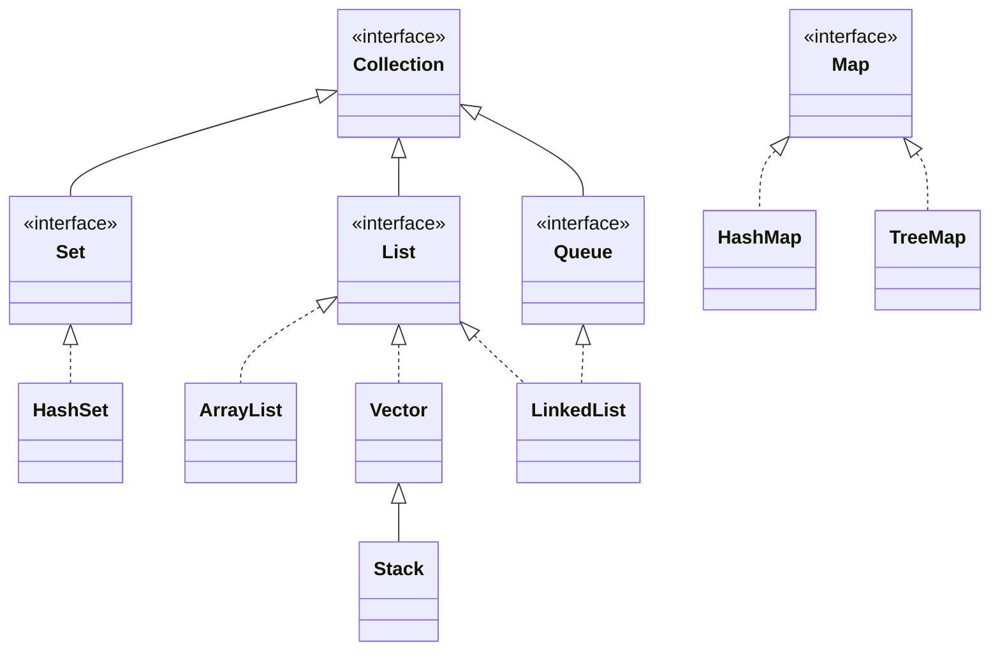

# 9강 — 단언문, 제네릭, 컬렉션

[레포지토리 안내](../../README.ko.md) | [English](Concepts_Lecture.md) | [한국어](Concepts_Lecture.ko.md)

> **최종 수정일:** 2026-10-19

> **학습 목표:**
> 1. 디버깅과 계약에 의한 설계를 위해 단언문을 사용할 수 있다
> 2. 제네릭 타입과 제한된 타입 매개변수를 적용할 수 있다
> 3. Java 컬렉션 프레임워크(List, Set, Map)를 활용할 수 있다
> 4. Iterator로 컬렉션의 원소를 차례로 방문할 수 있다

---

## 목차

- [1. 단언문 (Assertion)](#1-단언문-assertion)
  - [1.1 문법과 사용법](#11-문법과-사용법)
  - [1.2 단언문 활성화](#12-단언문-활성화)
- [2. 제네릭](#2-제네릭)
  - [2.1 제네릭의 개념](#21-제네릭의-개념)
  - [2.2 제네릭 클래스](#22-제네릭-클래스)
  - [2.3 제네릭 메서드](#23-제네릭-메서드)
  - [2.4 한정적 타입 매개변수](#24-한정적-타입-매개변수)
- [3. 컬렉션 프레임워크](#3-컬렉션-프레임워크)
  - [3.1 Java 인터페이스와 컬렉션 계층 구조](#31-java-인터페이스와-컬렉션-계층-구조)
  - [3.2 List 인터페이스](#32-list-인터페이스)
  - [3.3 ArrayList](#33-arraylist)
  - [3.4 Vector](#34-vector)
  - [3.5 Map 인터페이스](#35-map-인터페이스)
  - [3.6 HashMap](#36-hashmap)
  - [3.7 컬렉션 순회](#37-컬렉션-순회)
- [요약](#요약)
- [점검 문제](#점검-문제)

---

<br>

## 1. 단언문 (Assertion)

### 1.1 문법과 사용법

단언문은 개발 중 항상 참이어야 하는 조건을 런타임에 검사하는 데 사용된다:

```java
assert balance > oldBalance :
    "Error: balance did not increase after deposit";
```

조건이 `false`이면 제공된 메시지와 함께 `AssertionError`가 발생한다.

단언문은 두 가지 형식으로 쓴다.

```text
assert <boolean 식>;
assert <boolean 식> : <식>;
```

`<boolean 식>`은 코드가 올바르게 동작한다면 참이어야 하는 조건이다. 이 식이 `false`가 되면 `AssertionError`가 던져진다. `AssertionError`는 `Exception`이 아니라 `Error`의 하위 클래스이다(6강 3.5절). 두 번째 형식의 `<식>`은 `AssertionError` 생성자에 인자로 전달되어, 던져진 예외의 상세 메시지가 된다.

다음은 입금과 출금 뒤 잔액이 기대한 방향으로 바뀌었는지 단언문으로 확인하는 예이다.

```java
public class Chap9Program1 {

    static double balance;

    public static void main(String[] args) {
        balance = 100;

        deposit(20);
        System.out.println("Balance:" + balance);

        withdraw(20);
        System.out.println("Balance:" + balance);
    }

    private static double deposit(double amount) {
        double oldBalance = balance;
        balance += amount;
        assert balance > oldBalance :
            "Serious Error - balance did not increase after deposit";

        return balance;
    }

    private static double withdraw(double amount) {
        double oldBalance = balance;
        balance -= amount;
        assert balance < oldBalance :
            "Serious Error - balance did not decrease after withdrawal";

        return balance;
    }
}
```

정상적인 금액에서는 단언문이 모두 참이므로 `Balance:120.0`과 `Balance:100.0`을 출력한다. `withdraw(-20)`처럼 음수를 출금하면 잔액이 오히려 늘어나므로, 단언문을 활성화하고 실행했을 때 `AssertionError: Serious Error - balance did not decrease after withdrawal`이 발생한다.

### 1.2 단언문 활성화

단언문은 기본적으로 비활성화되어 있다. `-ea` JVM 플래그로 활성화한다:

```bash
java -ea MyProgram
```

`-ea`(enable assertions) 옵션 없이 실행하면 단언문을 검사하지 않고 프로그램을 실행한다. 이때는 `assert` 문의 식 자체가 평가되지 않으므로, 단언문의 식에 프로그램 동작에 필요한 부수 효과(변수 변경, 메서드 호출)를 넣으면 안 된다.

`assert`는 JDK 1.4에서 도입되었다. 그 전에는 `assert`가 일반 식별자였으므로, JDK 1.4는 호환성을 위해 기본적으로 `assert`를 식별자로 취급했고 단언문을 쓰려면 `javac -source 1.4 <소스 파일>`로 컴파일해야 했다. Java 5부터는 `assert`가 예약어이므로 별도의 컴파일 옵션 없이 `javac`로 컴파일하고, 실행할 때 `-ea`만 지정하면 된다.

> **핵심:** 단언문은 프로그램 불변 조건을 검사하는 데 사용해야 하며, 사용자 입력 검증에는 사용하지 않아야 한다. 사용자 입력에는 예외 처리나 조건문을 사용한다.

---

<br>

## 2. 제네릭

### 2.1 제네릭의 개념

> **용어 정의:** **제네릭**(generic)은 클래스나 메서드를 특정 타입에 묶지 않고 일반화하여, 사용할 때 여러 타입으로 바꿀 수 있게 하는 기법이다. `<E>`, `<K>`, `<V>`처럼 꺾쇠 안에 쓴 이름을 **타입 매개변수**(type parameter)라고 한다. 관례상 E는 원소(element), K는 키(key), V는 값(value), T는 타입(type)을 뜻한다.

예를 들어 제네릭 스택 `Stack<E>`를 한 번 정의하면, `E`를 `Integer`로 지정하여 정수만 담는 스택으로, `String`으로 지정하여 문자열만 담는 스택으로 쓸 수 있다.

```java
class Stack<E> {
    ...
    void push(E element) { ... }
    E pop() { ... }
    ...
}
```

`Stack<Integer>`에서는 `push(Integer element)`와 `Integer pop()`이, `Stack<String>`에서는 `push(String element)`와 `String pop()`이 된다. 3절의 컬렉션 클래스는 모두 이 제네릭 기법으로 구현되어 있다. C++의 템플릿과 같은 목적의 기능이다.

> **주의:** 타입 인자에는 참조 타입만 쓸 수 있다. `Vector<int>`는 컴파일 오류(`unexpected type`)이며, 기본형 값을 담으려면 `Vector<Integer>`처럼 래퍼 클래스를 쓴다. 이때 `v.add(5)`의 `int` 값 5는 `Integer` 객체로 자동 변환(오토박싱)되고, `int n = v.get(i);`에서는 `int`로 자동 변환(언박싱)된다.

### 2.2 제네릭 클래스

제네릭은 타입을 매개변수화하여 타입 안전하고 재사용 가능한 코드를 작성할 수 있게 한다:

```java
public class Box<T> {
    private T item;

    public void set(T item) { this.item = item; }
    public T get() { return item; }
}

// 사용 예
Box<String> stringBox = new Box<>();
stringBox.set("Hello");
String value = stringBox.get(); // 캐스팅 불필요
```

`new Box<>()`의 빈 꺾쇠(다이아몬드 연산자, Java 7부터)는 타입 인자를 변수 선언에서 추론하게 한다. 같은 방식의 `Locker<T>` 클래스는 선언, 생성, 사용 단계에서 각각 타입 인자를 지정한다.

```java
class Locker<T> {
    private T content;

    public Locker() {
        store(null);
    }

    public T retrieve() {
        return content;
    }

    public void store(T item) {
        content = item;
    }
}

// Declaration
Locker<String>  lockerOne;
Locker<Integer> lockerTwo;

// Creation
lockerOne = new Locker<String>();
lockerTwo = new Locker<Integer>();

// Usage
lockerOne.store("Hello");
lockerTwo.store(Integer.valueOf(10));
```

`lockerOne`에는 `String`만, `lockerTwo`에는 `Integer`만 저장할 수 있으며, 다른 타입을 넣으면 컴파일 오류가 난다.

### 2.3 제네릭 메서드

```java
public static <T> void printArray(T[] array) {
    for (T element : array) {
        System.out.print(element + " ");
    }
    System.out.println();
}
```

반환 타입 앞의 `<T>`가 이 메서드만의 타입 매개변수를 선언한다. `printArray(new Integer[]{1, 2, 3})`처럼 호출하면 컴파일러가 인자로부터 `T`를 `Integer`로 추론한다.

### 2.4 한정적 타입 매개변수

```java
// T는 Comparable의 하위 타입이어야 함
public static <T extends Comparable<T>> T findMax(T[] array) {
    T max = array[0];
    for (int i = 1; i < array.length; i++) {
        if (array[i].compareTo(max) > 0) {
            max = array[i];
        }
    }
    return max;
}
```

> **핵심:** `<T extends SomeType>`을 사용하여 특정 인터페이스를 구현하거나 특정 클래스를 확장하는 타입으로 제네릭을 제한할 수 있다.

`T`가 `Comparable<T>`를 구현한다고 보장되므로 메서드 안에서 `compareTo`를 호출할 수 있다. `Integer`와 `String`은 `Comparable`을 구현하므로 `findMax(new Integer[]{3, 9, 2})`는 9를 반환한다. `Comparable`을 구현하지 않는 `Object[]`를 넘기면 컴파일 오류가 난다. 이 메서드는 배열이 비어 있지 않다고 가정한다.

---

<br>

## 3. 컬렉션 프레임워크

### 3.1 Java 인터페이스와 컬렉션 계층 구조

표준 패키지 `java.util`에는 객체의 모음(컬렉션)을 관리하는 여러 클래스가 있으며, 이들을 통틀어 **Java 컬렉션 프레임워크**(Java Collection Framework, JCF)라고 한다. JCF는 객체를 집합(set), 리스트(list), 맵(map)으로 관리하는 클래스를 제공한다.

JCF는 Java 인터페이스로 각 컬렉션의 동작을 정의하고, 클래스가 그 인터페이스를 구현한다.

> **용어 정의:** **Java 인터페이스**(interface)는 객체의 동작만 정의한다. 몸체가 없는 `public` 메서드만 포함하고, `public` 상수 외의 데이터 멤버를 갖지 않으며, 인터페이스 자체의 인스턴스는 만들 수 없다.

> **참고:** **Java 8 이후의 인터페이스.** Java 8부터는 인터페이스에 몸체가 있는 `default` 메서드와 `static` 메서드를, Java 9부터는 `private` 메서드를 둘 수 있다. 위 정의는 이 기능을 제외한 전통적인 인터페이스의 정의이다.



*그림 1. 컬렉션 프레임워크의 주요 인터페이스와 클래스*

실선 화살표는 인터페이스 사이 또는 클래스 사이의 상속을, 점선 화살표는 클래스가 인터페이스를 구현함을 나타낸다. `Collection<E>`, `Set<E>`, `List<E>`, `Queue<E>`와 그 구현 클래스는 원소 타입 `E` 하나를, `Map<K, V>`와 그 구현 클래스는 키 타입 `K`와 값 타입 `V`를 타입 매개변수로 갖는다. `Map`은 `Collection`을 상속하지 않는 별도의 계층이다.

### 3.2 List 인터페이스

`List` 인터페이스는 객체의 모음을 선형 리스트 $L = (l_0, l_1, l_2, \ldots, l_N)$으로 관리하는 메서드를 제공한다. 리스트에 객체를 추가, 제거, 조회할 수 있으며, 추가할 수 있는 객체 수에 정해진 한계가 없다.

| 메서드 | 설명 |
|:-----|:-----|
| `boolean add(E o)` | 객체 `o`를 리스트 끝에 추가한다 |
| `void clear()` | 리스트를 비운다 |
| `E get(int idx)` | 위치 `idx`의 원소를 반환한다 |
| `E remove(int idx)` | 위치 `idx`의 원소를 제거하고 반환한다 |
| `int size()` | 리스트의 원소 수를 반환한다 |

*표 1. List 인터페이스의 주요 메서드*

리스트를 사용하려면 `List` 인터페이스를 구현한 클래스의 인스턴스를 만들어야 한다. 대표적인 구현 클래스는 배열로 데이터를 관리하는 `ArrayList`와 연결 노드 표현(linked-node representation)을 쓰는 `LinkedList`이다. 변수는 인터페이스 타입으로 선언하고 객체는 구현 클래스로 만들면, 나중에 구현 클래스만 바꾸어도 나머지 코드는 그대로 쓸 수 있다.

```java
/**
 * Maintains a list of library books
 */
private List<Book> books;

/**
 * Constructor
 */
public BookTracker() {
    books = new LinkedList<>();
}
```

> **주의:** `List<Integer>`에서 `remove(1)`은 `remove(int idx)`로 해석되어 위치 1의 원소를 제거한다. 값이 1인 원소를 제거하려면 `remove(Integer.valueOf(1))`처럼 `remove(Object o)`를 호출해야 한다.

### 3.3 ArrayList

`List` 인터페이스를 구현한 가변 크기 배열이다:

```java
ArrayList<String> names = new ArrayList<>();
names.add("Alice");
names.add("Bob");
names.get(0);       // "Alice"
names.size();       // 2
names.remove(0);    // "Alice" 제거
```

내부 배열이 가득 차면 더 큰 배열을 만들어 원소를 옮기므로 크기를 미리 정하지 않아도 된다. 인덱스로 원소에 접근하는 데는 O(1) 시간이 걸린다. 중간에 원소를 넣거나 빼면 뒤의 원소를 한 칸씩 옮겨야 하므로 O(n) 시간이 걸린다.

### 3.4 Vector

`Vector<E>`도 `List<E>`를 구현한 가변 크기 배열이다. `ArrayList`와 사용법이 거의 같지만 메서드가 동기화되어 있어 여러 스레드가 함께 써도 안전하다(13강). 대신 단일 스레드에서는 `ArrayList`보다 약간 느리다.

```java
Vector<Integer> v = new Vector<Integer>();

v.add(5);
v.add(4);
v.add(-1);

v.add(2, 100);

System.out.println("# of elements : " + v.size());
System.out.println("Capacity of the vector : " + v.capacity());

for (int i = 0; i < v.size(); i++) {
    int n = v.get(i);
    System.out.println(n);
}
```

`add(e)`는 끝에, `add(index, e)`는 지정한 위치에 원소를 넣고 그 뒤의 원소를 한 칸씩 민다. 따라서 `v.add(2, 100)` 뒤의 원소는 5, 4, 100, -1이다. `size()`는 원소 수 4를, `capacity()`는 내부 배열의 크기를 반환한다. 기본 생성자로 만든 `Vector`의 용량은 10이며, 원소가 용량을 넘으면 용량이 두 배로 늘어난다.

```text
         0     1     2     3     4    ...    9
v ──▶ ┌─────┬─────┬─────┬─────┬─────┬─────┬─────┐
      │  ●  │  ●  │  ●  │  ●  │     │ ... │     │  size 4, capacity 10
      └──┼──┴──┼──┴──┼──┴──┼──┴─────┴─────┴─────┘
         ▼     ▼     ▼     ▼
        [5]   [4]  [100]  [-1]
```

*그림 2. 원소 4개를 담은 Vector<Integer>의 내부 배열*

각 칸은 `Integer` 객체의 참조를 저장한다. 출력은 다음과 같다.

```text
# of elements : 4
Capacity of the vector : 10
5
4
100
-1
```

### 3.5 Map 인터페이스

`Map` 인터페이스는 (키, 값) 쌍인 **맵 항목**(map entry)의 모음을 관리하는 메서드를 제공한다. 키는 맵 안에서 중복될 수 없고, 키로 값을 찾는다.

| 메서드 | 설명 |
|:-----|:-----|
| `void clear()` | 맵을 비운다 |
| `boolean containsKey(Object key)` | 주어진 키의 항목이 있으면 `true`를 반환한다 |
| `V put(K key, V value)` | (key, value) 항목을 추가하고, 같은 키의 항목이 있었으면 값을 바꾼 뒤 이전 값을 반환한다 |
| `V get(Object key)` | 주어진 키의 값을 반환하고, 없으면 `null`을 반환한다 |
| `V remove(Object key)` | 주어진 키의 항목을 제거하고 그 값을 반환한다 |
| `int size()` | 맵의 항목 수를 반환한다 |

*표 2. Map 인터페이스의 주요 메서드*

맵을 사용하려면 `Map` 인터페이스를 구현한 클래스의 인스턴스를 만들어야 하며, 대표적인 구현 클래스는 `HashMap`과 `TreeMap`이다. `TreeMap`은 항목을 키의 순서로 정렬하여 유지한다.

```java
Map<String, String> catalog = new TreeMap<>();

catalog.put("CS101", "Intro Java Programming");
catalog.put("CS301", "Database Design");
catalog.put("CS413", "Software Design for Mobile Devices");

if (catalog.containsKey("CS101")) {
    System.out.println("We teach Java this semester");
} else {
    System.out.println("No Java courses this semester");
}
```

키 `"CS101"`이 있으므로 `We teach Java this semester`를 출력한다. 타입 인자 없이 `Map catalog = new TreeMap();`처럼 원시 타입(raw type)으로 쓰면 컴파일되기는 하지만 unchecked 경고가 나고 타입 검사의 이점을 잃는다.

### 3.6 HashMap

평균 O(1) 접근이 가능한 키-값 맵이다:

```java
HashMap<String, Integer> scores = new HashMap<>();
scores.put("Alice", 95);
scores.put("Bob", 87);
int aliceScore = scores.get("Alice"); // 95
```

`HashMap`은 키의 해시 값으로 항목의 위치를 정하므로 평균 O(1) 시간에 조회하지만, 항목의 순서는 보장하지 않는다.

> **주의:** 없는 키로 `get`을 호출하면 `null`이 반환된다. `int x = scores.get("Carol");`처럼 결과를 `int`에 대입하면 `null`을 언박싱하면서 `NullPointerException`이 발생한다. 키가 없을 수 있으면 `containsKey`로 먼저 확인하거나 `scores.getOrDefault("Carol", 0)`을 쓴다.

### 3.7 컬렉션 순회

```java
// 향상된 for 루프
for (String name : names) {
    System.out.println(name);
}

// Iterator
Iterator<String> it = names.iterator();
while (it.hasNext()) {
    System.out.println(it.next());
}

// forEach와 람다 (Java 8+)
names.forEach(name -> System.out.println(name));
```

`Iterator<E>` 인터페이스는 `Vector<E>`, `ArrayList<E>`, `LinkedList<E>` 같은 컬렉션의 원소를 인덱스 없이 차례로 방문하게 한다. 컬렉션의 `iterator()` 메서드가 `Iterator` 객체를 반환하며, `hasNext()`는 남은 원소가 있는지를, `next()`는 다음 원소를 반환한다. 3.4절의 인덱스 반복문은 다음처럼 바꿀 수 있다.

```java
Iterator<Integer> it = v.iterator();

while (it.hasNext()) {
    int n = it.next();
    System.out.println(n);
}
```

인덱스가 없는 `Set`이나 연결 리스트에서도 같은 코드로 순회할 수 있다는 것이 `Iterator`의 장점이다.

> **주의:** 향상된 for 루프로 순회하는 도중에 컬렉션의 `remove`를 호출하면 `ConcurrentModificationException`이 발생할 수 있다. 순회하면서 원소를 제거하려면 `Iterator`의 `remove()`를 쓴다.

---

<br>

## 요약

| 개념 | 핵심 요약 |
|:-----|:-----|
| 단언문 | 런타임에 불변 조건을 검사하며, `-ea`로 활성화하고 사용자 입력 검증에는 쓰지 않는다. |
| 제네릭 | 타입을 매개변수화하여 타입 안전하고 재사용 가능한 클래스와 메서드를 만든다. |
| 한정적 타입 | `<T extends Type>`으로 타입 매개변수가 받을 수 있는 타입을 제한한다. |
| JCF | `java.util`의 컬렉션 클래스 모음이며, 인터페이스로 동작을 정의하고 클래스가 구현한다. |
| ArrayList | 가변 크기 배열이며, 인덱스로 O(1) 시간에 접근한다. |
| Vector | 동기화된 가변 크기 배열이며, 기본 용량은 10이다. |
| HashMap | 키-값 쌍을 저장하며, 평균 O(1) 시간에 조회한다. |
| 순회 | 향상된 for 루프, Iterator, 람다 `forEach`로 원소를 차례로 방문한다. |

---

<br>

## 점검 문제

1. **단언문:** 1.1절의 `Chap9Program1`에서 `withdraw(20)`을 `withdraw(-20)`으로 바꾸었다. `java Chap9Program1`과 `java -ea Chap9Program1`로 실행한 결과는 각각 어떻게 다른가?

   <details>
   <summary>정답</summary>

   `java Chap9Program1`로 실행하면 단언문을 검사하지 않으므로 `Balance:120.0`과 `Balance:140.0`을 출력하고 정상 종료한다. `java -ea Chap9Program1`로 실행하면 출금 뒤 잔액이 140으로 늘어 `balance < oldBalance`가 거짓이므로, `Balance:120.0`을 출력한 뒤 `AssertionError: Serious Error - balance did not decrease after withdrawal`이 발생한다.

   </details>

2. **Vector:** 다음 코드의 출력을 쓰라.

   ```java
   Vector<Integer> v = new Vector<Integer>();
   v.add(7);
   v.add(0, 3);
   v.add(1, 5);
   System.out.println(v.size() + " " + v.capacity() + " " + v);
   ```

   <details>
   <summary>정답</summary>

   `3 10 [3, 5, 7]`이다. `add(7)` 뒤 [7], `add(0, 3)` 뒤 [3, 7], `add(1, 5)` 뒤 [3, 5, 7]이 된다. 원소가 3개이므로 크기는 3이고, 기본 용량 10을 넘지 않았으므로 용량은 10이다.

   </details>

3. **List의 remove:** `List<Integer> li = new ArrayList<>(List.of(1, 2, 3));`에 대해 `li.remove(1);`을 실행한 뒤의 리스트와, 이어서 `li.remove(Integer.valueOf(1));`을 실행한 뒤의 리스트를 쓰라.

   <details>
   <summary>정답</summary>

   `li.remove(1)`은 `remove(int idx)`이므로 위치 1의 원소 2를 제거하여 [1, 3]이 된다. `li.remove(Integer.valueOf(1))`은 `remove(Object o)`이므로 값이 1인 원소를 제거하여 [3]이 된다.

   </details>

4. **Map:** 빈 `HashMap<String, Integer> m`에 대해 `m.put("x", 1)`, `m.put("x", 2)`, `m.remove("x")`, `m.remove("y")`의 반환값을 차례로 쓰라.

   <details>
   <summary>정답</summary>

   차례로 `null`, `1`, `2`, `null`이다. 처음 `put`은 이전 값이 없으므로 `null`을, 두 번째 `put`은 같은 키의 이전 값 1을 반환하고 값을 2로 바꾼다. `remove("x")`는 제거한 값 2를, 없는 키에 대한 `remove("y")`는 `null`을 반환한다.

   </details>

5. **제네릭:** (a) `Vector<int>`가 컴파일되지 않는 이유는 무엇인가? (b) 2.4절의 `findMax`에 `new String[]{"pear", "apple", "fig"}`를 넘기면 무엇을 반환하는가?

   <details>
   <summary>정답</summary>

   (a) 타입 인자에는 참조 타입만 쓸 수 있고 `int`는 기본형이기 때문이다. `Vector<Integer>`를 써야 한다. (b) `String`은 `Comparable<String>`을 구현하며 `compareTo`는 사전 순으로 비교하므로, 사전 순으로 가장 뒤인 `"pear"`를 반환한다.

   </details>
