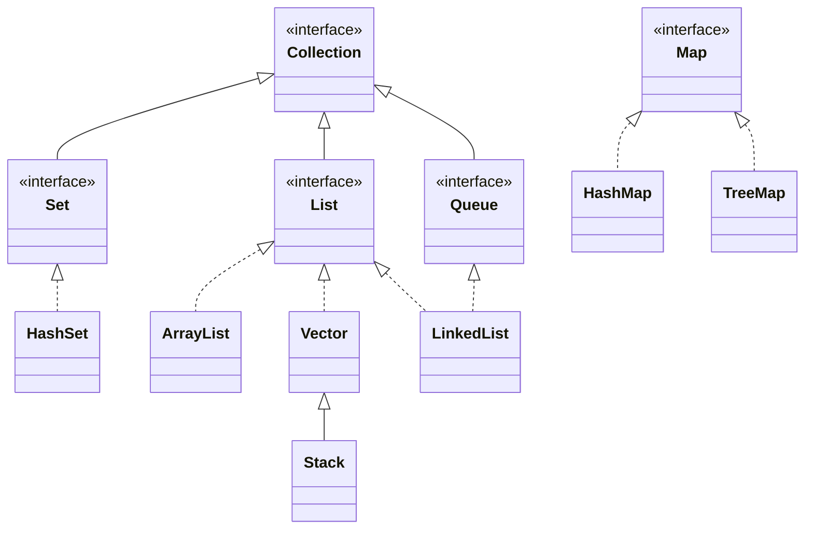

# Lecture 9 — Assertions, Generics, and Collections

[Repository Guide](../../README.md) | [English](Concepts_Lecture.md) | [한국어](Concepts_Lecture.ko.md)

> **Last Updated:** 2026-11-19

> **Learning Objectives:**
> 1. Use assertions for debugging and design-by-contract
> 2. Apply generic types and bounded type parameters
> 3. Utilize Java Collections Framework (List, Set, Map)
> 4. Visit the elements of a collection in turn with an Iterator
> 5. Understand wildcards and type erasure and interpret compile errors in generic code
> 6. Write classes that keep the equals and hashCode contract and choose a collection implementation that fits the task

---

## Table of Contents

- [1. Assertions](#1-assertions)
  - [1.1 Syntax and Usage](#11-syntax-and-usage)
  - [1.2 Enabling Assertions](#12-enabling-assertions)
  - [1.3 Conditions Checked by Assertions](#13-conditions-checked-by-assertions)
  - [1.4 Assertions versus Exception Handling](#14-assertions-versus-exception-handling)
- [2. Generics](#2-generics)
  - [2.1 The Concept of Generics](#21-the-concept-of-generics)
  - [2.2 Generic Classes](#22-generic-classes)
  - [2.3 Generic Methods](#23-generic-methods)
  - [2.4 Bounded Type Parameters](#24-bounded-type-parameters)
  - [2.5 Raw Types and Unchecked Warnings](#25-raw-types-and-unchecked-warnings)
  - [2.6 Generics and Subtyping](#26-generics-and-subtyping)
  - [2.7 Wildcards](#27-wildcards)
  - [2.8 Type Erasure](#28-type-erasure)
- [3. Collections Framework](#3-collections-framework)
  - [3.1 Java Interfaces and the Collection Hierarchy](#31-java-interfaces-and-the-collection-hierarchy)
  - [3.2 The List Interface](#32-the-list-interface)
  - [3.3 ArrayList](#33-arraylist)
  - [3.4 Vector](#34-vector)
  - [3.5 The Map Interface](#35-the-map-interface)
  - [3.6 HashMap](#36-hashmap)
  - [3.7 Iterating Collections](#37-iterating-collections)
  - [3.8 How the Capacity of a Vector Grows](#38-how-the-capacity-of-a-vector-grows)
  - [3.9 The Set Interface and Its Implementations](#39-the-set-interface-and-its-implementations)
  - [3.10 The equals and hashCode Contract](#310-the-equals-and-hashcode-contract)
  - [3.11 Sorting with Comparable and Comparator](#311-sorting-with-comparable-and-comparator)
  - [3.12 Iterating over a Map and Counting Frequencies](#312-iterating-over-a-map-and-counting-frequencies)
  - [3.13 Queue and Deque](#313-queue-and-deque)
  - [3.14 Choosing an Implementation and Time Complexity](#314-choosing-an-implementation-and-time-complexity)
  - [3.15 Modification during Iteration and ConcurrentModificationException](#315-modification-during-iteration-and-concurrentmodificationexception)
- [4. Common Mistakes](#4-common-mistakes)
- [Summary](#summary)
- [Self-Check Questions](#self-check-questions)
- [References](#references)

---

<br>

## 1. Assertions

### 1.1 Syntax and Usage

An **assertion** is a statement that checks, at run time, a condition that should always be true at some point of the program during development. If the condition is true, nothing happens; if it is false, the code before it contains an error, so execution stops. The following statement checks that the balance increased after a deposit.

```java
assert balance > oldBalance :
    "Error: balance did not increase after deposit";
```

If the condition is `false`, an `AssertionError` is thrown with the provided message.

The assert statement takes one of two forms.

```text
assert <boolean expression>;
assert <boolean expression> : <expression>;
```

`<boolean expression>` is the condition that must be true if the code is working correctly. If it evaluates to `false`, an `AssertionError` is thrown. `AssertionError` is a subclass of `Error`, not of `Exception` (Lecture 6, Section 3.5). In the second form, `<expression>` is passed as an argument to the `AssertionError` constructor and serves as the detailed message of the thrown error.

The following example uses assertions to check that the balance changes in the expected direction after a deposit and a withdrawal.

```java
public class Chap9Program1 {

    static double balance;

    public static void main(String[] args) {
        balance = 100;

        deposit(20);
        System.out.println("Balance:" + balance);

        withdraw(20);
        System.out.println("Balance:" + balance);
    }

    private static double deposit(double amount) {
        double oldBalance = balance;
        balance += amount;
        assert balance > oldBalance :
            "Serious Error - balance did not increase after deposit";

        return balance;
    }

    private static double withdraw(double amount) {
        double oldBalance = balance;
        balance -= amount;
        assert balance < oldBalance :
            "Serious Error - balance did not decrease after withdrawal";

        return balance;
    }
}
```

With normal amounts, all assertions hold, so the program prints `Balance:120.0` and `Balance:100.0`. Withdrawing a negative amount, as in `withdraw(-20)`, increases the balance instead, so running with assertions enabled raises `AssertionError: Serious Error - balance did not decrease after withdrawal`. The lab code for the same example is [AssertionDemo.java](../../Coursework/Lab09_Assertions-Generics-and-Collections/AssertionDemo.java), run with `java -ea AssertionDemo`.

### 1.2 Enabling Assertions

Assertions are disabled by default. Enable them with the `-ea` JVM flag:

```bash
java -ea MyProgram
```

Without the `-ea` (enable assertions) option, the program runs without checking assertions. In that case the expression of an `assert` statement is not even evaluated, so an assertion must not contain side effects that the program depends on (changing variables, calling methods that change state).

`assert` was introduced in JDK 1.4. Before that, `assert` was an ordinary identifier, so for compatibility JDK 1.4 treated `assert` as an identifier by default, and a program with assertions had to be compiled with `javac -source 1.4 <source file>`. From Java 5, `assert` is a reserved word, so the program is compiled with plain `javac` and only `-ea` is needed at run time.

Assertions should check program invariants, not validate user input. For user input, use exceptions or conditional checks.

### 1.3 Conditions Checked by Assertions

An assertion writes down, as code, the programmer's assumption that some condition is certainly true at some point. If the assumption breaks, the code before that point contains an error, so an assertion stops execution close to where the error arose and makes the cause easier to find. The conditions it checks fall into the four kinds of Table 1, according to their position and subject.

| Kind | Meaning | Example |
|:-----|:-----|:-----|
| Precondition | A condition that must hold when a method starts executing | `amount` of the private method `deposit(amount)` is greater than 0 |
| Postcondition | A condition that must hold when a method finishes | After a deposit the balance is greater than before |
| Class invariant | A condition that must hold whenever the object is visible from outside, that is, before and after every public method call | The balance of an account is not negative |
| Control-flow invariant | A condition about a point that execution should never reach | The `default` of a `switch` is never reached |

*Table 1. Kinds of conditions checked by assertions*

The assertions in `deposit()` and `withdraw()` of `Chap9Program1` in Section 1.1 are postconditions. A postcondition checks that the method produced the result it promised, so it is placed at the end of the method, just before returning a value. A control-flow invariant is written as `assert false` in the `default` of a `switch` when the programmer believes that every possible case has been handled. The following program shows how the result changes depending on whether assertions are enabled.

```java
public class AssertModes {
    static int checks = 0;

    static boolean countCheck() {
        checks++;                       // side effect: count the calls
        return true;
    }

    public static void main(String[] args) {
        boolean enabled = false;
        assert enabled = true;          // runs only under -ea
        System.out.println("assertions enabled: " + enabled);

        assert countCheck();
        System.out.println("checks = " + checks);

        System.out.println(season(4));
        System.out.println(season(13));
    }

    static String season(int month) {
        switch ((month - 1) / 3) {
            case 0: return "Q1";
            case 1: return "Q2";
            case 2: return "Q3";
            case 3: return "Q4";
            default:
                assert false : "month out of range: " + month;
                return "unknown";
        }
    }
}
```

The first assertion in `main()`, `assert enabled = true;`, uses the assignment operator `=` rather than the comparison operator `==`. The value of an assignment expression is the assigned value `true`, so this assertion never fails, and `enabled` becomes `true` only when assertions are enabled and the expression is evaluated. With this idiom a program can tell whether it was run with `-ea`. The second assertion calls a method that increases `checks` by 1 each time it is called. `season()` turns a month into a quarter string and reaches `default` when `(month - 1) / 3` is outside the range 0 to 3. Running it with `java AssertModes` gives the following.

```text
assertions enabled: false
checks = 0
Q2
unknown
```

Running it with `java -ea AssertModes` gives the following.

```text
assertions enabled: true
checks = 1
Q2
Exception in thread "main" java.lang.AssertionError: month out of range: 13
	at AssertModes.season(AssertModes.java:28)
	at AssertModes.main(AssertModes.java:18)
```

Comparing the two runs reveals three properties of assertions. First, the expression of a disabled assertion is not evaluated, so `enabled` stays `false` and `checks` stays 0. Second, the fact that the same program printed different values depending on the option means that putting side effects into an assertion makes the program's behavior depend on a run-time option. `assert enabled = true;` is an exceptional idiom that uses this property on purpose; ordinary code puts no side effects into assertion expressions. Third, when an out-of-range value such as month 13 arrives, without `-ea` the method silently returns `unknown`, but with `-ea` an `AssertionError` is raised together with a stack trace that names the failing method (`season`) and line number (28).

> **Note:** **Choosing the scope.** `-ea` enables the assertions of all classes except the system classes. The scope can be narrowed with a class name, as in `-ea:BankAccount`, or a package name followed by three dots, as in `-ea:com.example...`, and parts can be disabled again with `-da` (disable assertions). For example, `java -ea -da:Logger Main` enables assertions everywhere except in the `Logger` class. It is common to enable assertions during development and testing and to run a deployed program with them disabled, as by default.

### 1.4 Assertions versus Exception Handling

Assertions and exception handling both report something wrong, but they deal with different things. Exceptions deal with situations that can happen even in a correct program, for example a user typing letters instead of a number, a missing file, or a broken network connection. The program must recover from such situations or tell the user about them, so they must not be left to assertions, which can be switched off. Assertions catch situations that never happen if the program is correct, that is, programmer mistakes.

| Aspect | Assertion | Exception handling |
|:-----|:-----|:-----|
| Situation handled | A logic error inside the program | A normal failure coming from external input, resources, or the execution environment |
| Execution | Off by default and enabled with `-ea` | Always executed |
| On failure | Stops the program with `AssertionError` (a subclass of `Error`) | The exception is caught and recovered from, or reported to the caller |
| Typical place | Preconditions, postconditions, and invariants of private methods | Argument checks of public methods, input and output, user input |
| Example | `assert balance >= 0;` | `throw new IllegalArgumentException("amount must be positive");` |

*Table 2. Assertions compared with exception handling*

There are two reasons not to check the arguments of a public method with assertions. First, when other code calls a public method with a wrong argument, the error lies with the caller rather than with the method, and the method must always report it. An assertion disappears when the program runs without `-ea`, so it cannot keep this promise. Second, the kind of exception thrown for a wrong argument (`IllegalArgumentException`, `NullPointerException`, `IndexOutOfBoundsException`) is part of the method's specification, and `AssertionError` cannot express that specification. The arguments of a private method, which is called only from inside the same class, are the responsibility of the class author, so they can be checked with assertions.

The following `WithdrawCheck` has the same structure as `Chap9Program1` and calls `withdraw(-20)`.

```java
public class WithdrawCheck {
    static double balance = 100;

    public static void main(String[] args) {
        deposit(20);
        System.out.println("Balance:" + balance);
        withdraw(-20);
        System.out.println("Balance:" + balance);
    }

    private static void deposit(double amount) {
        double oldBalance = balance;
        balance += amount;
        assert balance > oldBalance : "balance did not increase after deposit";
    }

    private static void withdraw(double amount) {
        double oldBalance = balance;
        balance -= amount;
        assert balance < oldBalance : "balance did not decrease after withdrawal";
    }
}
```

Running it with `java WithdrawCheck` checks no assertions, so the wrong balance is printed as it is.

```text
Balance:120.0
Balance:140.0
```

Running it with `java -ea WithdrawCheck` makes `balance < oldBalance` false after the withdrawal, so the program stops before the second line is printed.

```text
Balance:120.0
Exception in thread "main" java.lang.AssertionError: balance did not decrease after withdrawal
	at WithdrawCheck.withdraw(WithdrawCheck.java:20)
	at WithdrawCheck.main(WithdrawCheck.java:7)
```

The first line of the stack trace, `at WithdrawCheck.withdraw(WithdrawCheck.java:20)`, points to line 20 where the assertion is, and the second line points to line 7 of `main()`, which called that method. The assertion reveals the error during development in this way, but in a program run without `-ea` the wrong balance 140.0 keeps being used. If the amount comes from a user, the first statement of `withdraw()` must check that `amount` is positive and throw an `IllegalArgumentException` if it is not.

---

<br>

## 2. Generics

### 2.1 The Concept of Generics

> **Definition:** **Generics** is a technique that generalizes a class or method instead of tying it to a specific type, so that it can be turned into various types when used.

> **Definition:** A name written inside angle brackets, such as `<E>`, `<K>`, or `<V>`, is a **type parameter**. By convention, E stands for element, K for key, V for value, and T for type.

For example, once a generic stack `Stack<E>` is defined, specifying `E` as `Integer` gives a stack that holds only integers, and specifying it as `String` gives a stack that holds only strings.

```java
class Stack<E> {
    ...
    void push(E element) { ... }
    E pop() { ... }
    ...
}
```

In `Stack<Integer>` the methods become `push(Integer element)` and `Integer pop()`, and in `Stack<String>` they become `push(String element)` and `String pop()`. The collection classes of Section 3 are all implemented with this generic technique. The feature serves the same purpose as C++ templates.

Only reference types can be type arguments. `Vector<int>` is a compile error (`unexpected type`); to hold primitive values, use a wrapper class as in `Vector<Integer>`. The `int` value 5 in `v.add(5)` is then converted to an `Integer` object automatically (autoboxing), and `int n = v.get(i);` converts back to `int` automatically (unboxing).

### 2.2 Generic Classes

Generics enable type-safe, reusable code by parameterizing types. The `Box<T>` below is a box that holds one object of any type, and the type `T` of the object it holds is fixed when the box is created.

```java
public class Box<T> {
    private T item;

    public void set(T item) { this.item = item; }
    public T get() { return item; }
}

// Usage
Box<String> stringBox = new Box<>();
stringBox.set("Hello");
String value = stringBox.get(); // no cast needed
```

The empty angle brackets in `new Box<>()` (the diamond operator, from Java 7) let the type argument be inferred from the variable declaration. The `Locker<T>` class below works the same way, with type arguments given at the declaration, creation, and usage steps.

```java
class Locker<T> {
    private T content;

    public Locker() {
        store(null);
    }

    public T retrieve() {
        return content;
    }

    public void store(T item) {
        content = item;
    }
}

// Declaration
Locker<String>  lockerOne;
Locker<Integer> lockerTwo;

// Creation
lockerOne = new Locker<String>();
lockerTwo = new Locker<Integer>();

// Usage
lockerOne.store("Hello");
lockerTwo.store(Integer.valueOf(10));
```

`lockerOne` can store only `String` values and `lockerTwo` only `Integer` values; storing any other type is a compile error.

### 2.3 Generic Methods

```java
public static <T> void printArray(T[] array) {
    for (T element : array) {
        System.out.print(element + " ");
    }
    System.out.println();
}
```

The `<T>` before the return type declares a type parameter of this method alone. In a call such as `printArray(new Integer[]{1, 2, 3})`, the compiler infers `T` as `Integer` from the argument.

### 2.4 Bounded Type Parameters

```java
// T must be a subtype of Comparable
public static <T extends Comparable<T>> T findMax(T[] array) {
    T max = array[0];
    for (int i = 1; i < array.length; i++) {
        if (array[i].compareTo(max) > 0) {
            max = array[i];
        }
    }
    return max;
}
```

Use `<T extends SomeType>` to restrict generics to types that implement a specific interface or extend a specific class.

Because `T` is guaranteed to implement `Comparable<T>`, the method can call `compareTo`. `Integer` and `String` implement `Comparable`, so `findMax(new Integer[]{3, 9, 2})` returns 9. Passing an `Object[]`, which does not implement `Comparable`, is a compile error. The method assumes that the array is not empty.

### 2.5 Raw Types and Unchecked Warnings

Before generics were introduced, collections treated every element as an `Object`. Even today, writing only the name of a generic type without type arguments, as in `List` or `ArrayList`, makes it behave in the old way, and a generic type used without type arguments is called a **raw type** (the `Map catalog` of Section 3.5). Any object can be put into a collection of a raw type, so the compiler cannot stop an element of the wrong type from getting in.

```java
import java.util.ArrayList;
import java.util.List;

public class RawList {
    public static void main(String[] args) {
        List names = new ArrayList();
        names.add("Alice");
        names.add(42);

        for (int i = 0; i < names.size(); i++) {
            String s = (String) names.get(i);
            System.out.println(s.toUpperCase());
        }
    }
}
```

`names` receives both the string `"Alice"` and the integer 42. When taking elements out, `get()` returns `Object`, so a cast to `(String)` is needed. Compiling this file with `javac RawList.java` produces no error, only two lines of notes.

```text
Note: RawList.java uses unchecked or unsafe operations.
Note: Recompile with -Xlint:unchecked for details.
```

Recompiling with `javac -Xlint:unchecked RawList.java`, as the note suggests, shows where the warnings are.

```text
RawList.java:7: warning: [unchecked] unchecked call to add(E) as a member of the raw type List
        names.add("Alice");
                 ^
  where E is a type-variable:
    E extends Object declared in interface List
RawList.java:8: warning: [unchecked] unchecked call to add(E) as a member of the raw type List
        names.add(42);
                 ^
  where E is a type-variable:
    E extends Object declared in interface List
2 warnings
```

An **unchecked warning** means that the code contains an operation whose type safety the compiler cannot verify. An error that the compiler could not verify shows up at run time.

```text
ALICE
Exception in thread "main" java.lang.ClassCastException: class java.lang.Integer cannot be cast to class java.lang.String (java.lang.Integer and java.lang.String are in module java.base of loader 'bootstrap')
	at RawList.main(RawList.java:11)
```

The first element is printed as `ALICE`, but a `ClassCastException` is raised at line 11, which casts the second element to `String`. The cause of the error is line 8, which put an integer in, but the exception occurs where the element is taken out and used, so in a large program the cause is hard to find. Declaring `List<String> names` makes `names.add(42)` a compile error, caught at the line that causes it, and removes the cast when taking elements out. The value of generics lies in turning run-time errors into compile errors in this way.

### 2.6 Generics and Subtyping

`Integer` is a subclass of `Number`. However, `List<Integer>` is not a subtype of `List<Number>`. If it were, the following code would have to be allowed.

```java
List<Integer> ints = new ArrayList<>();
List<Number> nums = ints;        // suppose this were allowed
nums.add(3.14);                  // a Double is a Number, so it fits in nums
Integer first = ints.get(0);     // a Double comes out of the same list
```

`nums` and `ints` refer to the same list object, so a `Double` put in through `nums` comes out through `ints` where an `Integer` should be. The compiler rejects the second line to prevent this. Two types that differ only in the type arguments of the same generic class have no subtype relation, a property called **invariant** (in the sense of types).

Arrays behave differently. If `String` is a subtype of `Object`, then `String[]` is also a subtype of `Object[]`, a property called **covariant**. In exchange, arrays check for wrong stores at run time.

```java
import java.util.ArrayList;
import java.util.List;

public class Variance {
    public static void main(String[] args) {
        Object[] objects = new String[2];  // arrays are covariant
        objects[0] = "ok";
        try {
            objects[1] = Integer.valueOf(7);
        } catch (ArrayStoreException e) {
            System.out.println("ArrayStoreException: " + e.getMessage());
        }

        List<Integer> ints = new ArrayList<>();
        // List<Number> nums = ints;        // compile error
        List<? extends Number> view = ints;
        ints.add(3);
        System.out.println(view.get(0).doubleValue());
    }
}
```

```text
ArrayStoreException: java.lang.Integer
3.0
```

The declared type of `objects` is `Object[]`, but the actual array is a `String[]`, so the JVM throws an `ArrayStoreException` the moment an `Integer` is stored. Arrays remember their element type even at run time, which makes this check possible. Generics do not remember the element type at run time, as Section 2.8 shows, so they cannot be checked in the same way and instead forbid the assignment itself at compile time. As the last two lines show, elements can be read from `view`, which was received as `? extends Number`. Compiling the assignment that was commented out together with a statement that puts an element into the wildcard type gives the following errors.

```java
import java.util.ArrayList;
import java.util.List;

public class VarianceError {
    public static void main(String[] args) {
        List<Integer> ints = new ArrayList<>();
        List<Number> nums = ints;
        List<? extends Number> view = ints;
        view.add(Integer.valueOf(1));
    }
}
```

```text
VarianceError.java:7: error: incompatible types: List<Integer> cannot be converted to List<Number>
        List<Number> nums = ints;
                            ^
VarianceError.java:9: error: incompatible types: Integer cannot be converted to CAP#1
        view.add(Integer.valueOf(1));
                                ^
  where CAP#1 is a fresh type-variable:
    CAP#1 extends Number from capture of ? extends Number
Note: Some messages have been simplified; recompile with -Xdiags:verbose to get full output
2 errors
```

The first error comes from the invariance rule. The `CAP#1` in the second error is the name the compiler gives to `? extends Number` after turning it into one specific unknown type (capture conversion). The compiler cannot know whether the list `view` refers to is a `List<Integer>` or a `List<Double>`, so it cannot guarantee that adding any `Number` is safe and rejects `add()`. This rule leads to the wildcards of Section 2.7.

### 2.7 Wildcards

Since a `List<Integer>` cannot be passed as a `List<Number>`, a single method that sums both a list of integers and a list of doubles uses a wildcard in place of the type argument.

> **Definition:** A **wildcard** is the `?` written in the place of a type argument of a generic type, and it stands for some unknown type. `<? extends T>` stands for T or one of its subtypes, `<? super T>` for T or one of its supertypes, and the unbounded `<?>` for any type.

| Form | Examples of accepted arguments | Reading elements | Adding elements |
|:-----|:-----|:-----|:-----|
| `List<?>` | Every list, such as `List<String>` and `List<Integer>` | Read as `Object` | Only `null` can be added |
| `List<? extends Number>` | `List<Number>`, `List<Integer>`, `List<Double>` | Read as `Number` | Only `null` can be added |
| `List<? super Integer>` | `List<Integer>`, `List<Number>`, `List<Object>` | Read only as `Object` | An `Integer` can be added |

*Table 3. The three wildcards and reading and adding elements*

```java
import java.util.ArrayList;
import java.util.List;

public class Wildcards {
    static double sum(List<? extends Number> src) {      // producer: read only
        double total = 0;
        for (Number n : src) total += n.doubleValue();
        return total;
    }

    static void fillOneToThree(List<? super Integer> dst) { // consumer: write only
        for (int i = 1; i <= 3; i++) dst.add(i);
    }

    static int countAll(List<?> any) {                   // element type unused
        return any.size();
    }

    static <T> void copy(List<? super T> dst, List<? extends T> src) {
        for (T item : src) dst.add(item);
    }

    public static void main(String[] args) {
        List<Integer> ints = List.of(1, 2, 3);
        List<Double> doubles = List.of(0.5, 1.5);
        System.out.println(sum(ints) + " " + sum(doubles));

        List<Number> numbers = new ArrayList<>();
        List<Object> objects = new ArrayList<>();
        fillOneToThree(numbers);
        fillOneToThree(objects);
        System.out.println(numbers + " " + objects);

        System.out.println(countAll(List.of("a", "b")) + " " + countAll(doubles));

        copy(objects, doubles);
        System.out.println(objects);
    }
}
```

```text
6.0 2.0
[1, 2, 3] [1, 2, 3]
2 2
[1, 2, 3, 0.5, 1.5]
```

`sum()` only reads elements taken out of the list, so it uses `? extends Number`. Whatever the elements are, they are `Number`s, so `doubleValue()` can be called, and the same method computes the sum 6.0 of a `List<Integer>` and the sum 2.0 of a `List<Double>`. `fillOneToThree()` only puts integers into the list, so it uses `? super Integer`. If the element type of the list is a supertype of `Integer`, any `Integer` can be added, so it fills both a `List<Number>` and a `List<Object>` with 1, 2, 3. `countAll()` neither reads nor adds elements and only needs the size, so the unbounded `?` is enough.

`copy()` uses the two wildcards together. It takes `T`s out of `src` (`? extends T`) and puts `T`s into `dst` (`? super T`). In `copy(objects, doubles)` the compiler infers `T` as `Double`. `List<Object>` fits `List<? super Double>` and `List<Double>` fits `List<? extends Double>`, so the call compiles and 0.5 and 1.5 are appended after the 1, 2, 3 already in `objects`.

The rule is summarized as using `extends` for a parameter that hands out elements (a producer) and `super` for a parameter that takes elements in (a consumer), and it is known by its initials as PECS (Producer Extends, Consumer Super). A parameter that is both read and written uses an exact type such as `List<T>` rather than a wildcard. Return types do not use wildcards either, because if the return type were `List<? extends Number>`, the caller could not add elements to the returned list.

### 2.8 Type Erasure

After finishing the type checks of generic code, the Java compiler removes the type arguments when it generates bytecode. This process is called **type erasure**, and it follows these rules.

- An unbounded type parameter `T` becomes `Object`.
- A bounded type parameter `T extends Comparable<T>` becomes its first bound, `Comparable`.
- A parameterized type such as `List<String>` becomes the raw type `List`, and the compiler inserts casts where elements are taken out.

Java chose this approach so that code compiled before generics and code compiled after them can work together on the same JVM. To the JVM, `ArrayList<String>` and `ArrayList<Integer>` are the same `ArrayList` class.

```java
import java.util.ArrayList;
import java.util.List;

public class Erasure {
    static class Box<T extends Comparable<T>> {
        private T item;
        void set(T item) { this.item = item; }
        T get() { return item; }
        boolean isBiggerThan(T other) { return item.compareTo(other) > 0; }
    }

    public static void main(String[] args) throws Exception {
        List<String> a = new ArrayList<>();
        List<Integer> b = new ArrayList<>();
        System.out.println(a.getClass() == b.getClass());
        System.out.println(a.getClass().getName());

        System.out.println(Box.class.getDeclaredMethod("set", Comparable.class));
        System.out.println(Box.class.getDeclaredMethod("get").getReturnType());

        Box<Integer> box = new Box<>();
        box.set(9);
        System.out.println(box.isBiggerThan(4));
    }
}
```

```text
true
java.util.ArrayList
void Erasure$Box.set(java.lang.Comparable)
interface java.lang.Comparable
true
```

The `true` on the first line means that a `List<String>` object and a `List<Integer>` object have the same run-time class, and the second line shows that the name of that class has no type arguments. The third line is the result of finding the `set` method of `Box` by reflection. The method declared as `set(T item)` in the source became `set(Comparable)` in the bytecode, because the bound of `T` is `Comparable<T>` and `T` was replaced by its erasure `Comparable`. The return type of `get()` is `Comparable` for the same reason. `box.isBiggerThan(4)` still returns `true` correctly because the type checks were already completed at compile time.

At run time it is unknown what `T` is, so operations that need the actual type of `T` do not compile.

```java
import java.util.List;

public class ErasureError<T> {
    T make() { return new T(); }
    boolean test(Object o) { return o instanceof List<String>; }
    T[] array() { return new T[10]; }
}
```

```text
ErasureError.java:4: error: unexpected type
    T make() { return new T(); }
                          ^
  required: class
  found:    type parameter T
  where T is a type-variable:
    T extends Object declared in class ErasureError
ErasureError.java:5: error: Object cannot be safely cast to List<String>
    boolean test(Object o) { return o instanceof List<String>; }
                                    ^
ErasureError.java:6: error: generic array creation
    T[] array() { return new T[10]; }
                         ^
3 errors
```

- `new T()`: at run time it is unknown which class `T` is, so no object can be created. If an object is needed, take a `Supplier<T>` or a `Class<T>` as an argument and create it from that.
- `o instanceof List<String>`: the object at run time keeps no type argument `String`, so this cannot be tested. `o instanceof List<?>` is allowed.
- `new T[10]`: an array must remember its element type at run time (Section 2.6), but an erased `T` cannot be remembered. This is why implementations of generic collections keep an internal `Object[]` and cast when taking elements out.

Primitive types cannot be type arguments (the `Vector<int>` of Section 2.1) because a primitive value cannot sit in the place of the `Object` left by erasure.

> **Note:** **Overloading with the same erasure.** Declaring both `void print(List<String> a)` and `void print(List<Integer> a)` in one class makes both methods become `print(List)` after erasure, giving the compile error "name clash: print(List<Integer>) and print(List<String>) have the same erasure". Methods whose parameters differ only in type arguments cannot be overloaded.

---

<br>

## 3. Collections Framework

### 3.1 Java Interfaces and the Collection Hierarchy

The standard package `java.util` contains various classes for maintaining a collection of objects, and they are collectively referred to as the **Java Collection Framework** (JCF). JCF provides classes that maintain collections of objects as sets, lists, and maps.

JCF defines the behavior of each collection with a Java interface, and classes implement that interface.

> **Definition:** A **Java interface** defines only the behavior of objects. It includes only `public` methods with no method bodies, has no data members except `public` constants, and no instance of the interface itself can be created.

**Interfaces since Java 8:** From Java 8, an interface can contain `default` and `static` methods with bodies, and from Java 9 it can contain `private` methods. The definition above is the traditional one that excludes these features.



*Figure 1. Main interfaces and classes of the collection framework*

Solid arrows show inheritance between interfaces or between classes, and dashed arrows show a class implementing an interface. `Collection<E>`, `Set<E>`, `List<E>`, `Queue<E>`, and their implementing classes take one type parameter, the element type `E`, while `Map<K, V>` and its implementing classes take the key type `K` and the value type `V`. `Map` is a separate hierarchy that does not extend `Collection`.

### 3.2 The List Interface

The `List` interface provides methods to maintain a collection of objects as a linear list $L = (l_0, l_1, l_2, \ldots, l_N)$. Objects can be added to, removed from, and retrieved from a list, and there is no set limit to the number of objects that can be added.

| Method | Description |
|:-----|:-----|
| `boolean add(E o)` | Adds the object `o` to the end of the list |
| `void clear()` | Makes the list empty |
| `E get(int idx)` | Returns the element at position `idx` |
| `E remove(int idx)` | Removes and returns the element at position `idx` |
| `int size()` | Returns the number of elements in the list |

*Table 4. Main methods of the List interface*

To use a list, we must create an instance of a class that implements the `List` interface. Two typical implementing classes are `ArrayList`, which manages data with an array, and `LinkedList`, which uses linked-node representation. Declaring the variable with the interface type and creating the object from an implementing class means that only the implementing class needs to change later, while the rest of the code stays the same.

```java
/**
 * Maintains a list of library books
 */
private List<Book> books;

/**
 * Constructor
 */
public BookTracker() {
    books = new LinkedList<>();
}
```

For a `List<Integer>`, `remove(1)` is resolved as `remove(int idx)` and removes the element at position 1. To remove the element whose value is 1, call `remove(Object o)`, as in `remove(Integer.valueOf(1))`.

### 3.3 ArrayList

`ArrayList` is a resizable array implementation of the `List` interface. It stores the elements in order in an internal array, so an element can be found directly by its position.

```java
ArrayList<String> names = new ArrayList<>();
names.add("Alice");
names.add("Bob");
names.get(0);       // "Alice"
names.size();       // 2
names.remove(0);    // removes "Alice"
```

When the internal array is full, a larger array is created and the elements are moved, so the size need not be fixed in advance. Accessing an element by index takes O(1) time. Inserting or removing an element in the middle requires shifting the following elements by one position, which takes O(n) time.

> **[Data Structures]** `ArrayList` and the `Vector` of Section 3.4 are dynamic arrays, studied in data structures: each time the capacity runs out, they create an array larger by a constant factor and move the elements, so appending an element takes amortized O(1) time. The `LinkedList` of Section 3.2 is a doubly linked list: reaching the element at position i requires following the nodes one by one, so index access takes O(n) time, but insertion and deletion do not shift the following elements.

### 3.4 Vector

`Vector<E>` is also a resizable array that implements `List<E>`. Its usage is almost the same as that of `ArrayList`, but its methods are synchronized, so it is safe when several threads use it together (Lecture 15, Section 4). In exchange, it is slightly slower than `ArrayList` in a single thread.

```java
Vector<Integer> v = new Vector<Integer>();

v.add(5);
v.add(4);
v.add(-1);

v.add(2, 100);

System.out.println("# of elements : " + v.size());
System.out.println("Capacity of the vector : " + v.capacity());

for (int i = 0; i < v.size(); i++) {
    int n = v.get(i);
    System.out.println(n);
}
```

`add(e)` appends an element at the end, and `add(index, e)` inserts it at the given position and shifts the following elements by one. After `v.add(2, 100)`, the elements are therefore 5, 4, 100, -1. `size()` returns the number of elements, 4, and `capacity()` returns the size of the internal array. A `Vector` created with the default constructor has a capacity of 10, and the capacity doubles when the elements exceed it.

```text
         0     1     2     3     4    ...    9
v ──▶ ┌─────┬─────┬─────┬─────┬─────┬─────┬─────┐
      │  ●  │  ●  │  ●  │  ●  │     │ ... │     │  size 4, capacity 10
      └──┼──┴──┼──┴──┼──┴──┼──┴─────┴─────┴─────┘
         ▼     ▼     ▼     ▼
        [5]   [4]  [100]  [-1]
```

*Figure 2. Internal array of a `Vector<Integer>` holding four elements*

Each slot stores a reference to an `Integer` object. The output is as follows.

```text
# of elements : 4
Capacity of the vector : 10
5
4
100
-1
```

### 3.5 The Map Interface

The `Map` interface provides methods to maintain a collection of (key, value) pairs called **map entries**. Keys cannot be duplicated within a map, and a value is looked up by its key.

| Method | Description |
|:-----|:-----|
| `void clear()` | Makes the map empty |
| `boolean containsKey(Object key)` | Returns `true` if the map contains an entry with the given key |
| `V put(K key, V value)` | Adds the (key, value) entry; if an entry with the same key existed, replaces its value and returns the previous value |
| `V get(Object key)` | Returns the value for the given key, or `null` if there is none |
| `V remove(Object key)` | Removes the entry with the given key and returns its value |
| `int size()` | Returns the number of entries in the map |

*Table 5. Main methods of the Map interface*

To use a map, we must create an instance of a class that implements the `Map` interface, and two typical implementing classes are `HashMap` and `TreeMap`. `TreeMap` keeps its entries sorted in key order.

```java
Map<String, String> catalog = new TreeMap<>();

catalog.put("CS101", "Intro Java Programming");
catalog.put("CS301", "Database Design");
catalog.put("CS413", "Software Design for Mobile Devices");

if (catalog.containsKey("CS101")) {
    System.out.println("We teach Java this semester");
} else {
    System.out.println("No Java courses this semester");
}
```

The key `"CS101"` exists, so the program prints `We teach Java this semester`. Using the raw type without type arguments, as in `Map catalog = new TreeMap();`, still compiles but produces an unchecked warning and loses the benefit of type checking.

### 3.6 HashMap

`HashMap` is a key-value map that gives access to an entry in O(1) time on average. The following code stores scores with names as keys.

```java
HashMap<String, Integer> scores = new HashMap<>();
scores.put("Alice", 95);
scores.put("Bob", 87);
int aliceScore = scores.get("Alice"); // 95
```

`HashMap` places each entry according to the hash value of its key, so lookups take O(1) time on average, but the order of entries is not guaranteed.

> **Caution:** Calling `get` with a missing key returns `null`. Assigning the result to an `int`, as in `int x = scores.get("Carol");`, unboxes `null` and throws `NullPointerException`. If a key may be missing, check it first with `containsKey` or use `scores.getOrDefault("Carol", 0)`.

### 3.7 Iterating Collections

```java
// For-each loop
for (String name : names) {
    System.out.println(name);
}

// Iterator
Iterator<String> it = names.iterator();
while (it.hasNext()) {
    System.out.println(it.next());
}

// forEach with lambda (Java 8+)
names.forEach(name -> System.out.println(name));
```

The `Iterator<E>` interface lets us visit the elements of collections such as `Vector<E>`, `ArrayList<E>`, and `LinkedList<E>` in turn without indices. The collection's `iterator()` method returns an `Iterator` object; `hasNext()` tells whether elements remain, and `next()` returns the next element. The index loop of Section 3.4 can be rewritten as follows.

```java
Iterator<Integer> it = v.iterator();

while (it.hasNext()) {
    int n = it.next();
    System.out.println(n);
}
```

The advantage of `Iterator` is that the same code visits the elements in turn both in a `Set`, which has no indices, and in a `LinkedList`, whose index access is slow.

> **Caution:** Calling the collection's `remove` while traversing it with a for-each loop can throw `ConcurrentModificationException`. To remove elements during traversal, use the `Iterator`'s `remove()`.

### 3.8 How the Capacity of a Vector Grows

Section 3.4 stated that a `Vector` created with the default constructor has a capacity of 10 and that the capacity doubles when the elements exceed it. The following program adds elements one by one and prints the moments when the capacity changes.

```java
import java.util.ArrayList;
import java.util.Vector;

public class Capacity {
    public static void main(String[] args) {
        Vector<Integer> v = new Vector<>();
        int last = v.capacity();
        System.out.println("size 0, capacity " + last);
        for (int i = 1; i <= 41; i++) {
            v.add(i);
            if (v.capacity() != last) {
                last = v.capacity();
                System.out.println("size " + v.size() + ", capacity " + last);
            }
        }
        Vector<Integer> w = new Vector<>(4, 3);   // initial capacity 4, increment 3
        for (int i = 0; i < 8; i++) w.add(i);
        System.out.println("w: size " + w.size() + ", capacity " + w.capacity());
    }
}
```

```text
size 0, capacity 10
size 11, capacity 20
size 21, capacity 40
size 41, capacity 80
w: size 8, capacity 10
```

Up to 10 elements the capacity is 10, and the moment the 11th element is added, the internal array is replaced by a new array of size 20. The 10 existing elements are copied into the new array at that point. In the same way the capacity becomes 40 at the 21st element and 80 at the 41st. When the increment is set with the constructor `Vector(int initialCapacity, int capacityIncrement)`, the capacity grows by that amount rather than doubling, so the capacity of `w`, with initial capacity 4 and increment 3, goes through 4, 7, and 10.

Doubling the capacity bounds the total number of copied elements by a constant multiple of n while n elements are appended. While 41 elements were added, copying happened only when the capacities 10, 20, and 40 were full, so 10 + 20 + 40 = 70 elements were copied in total, fewer than 2 per added element (70 / 41 ≈ 1.71). Appending one element therefore takes O(1) time on average (the amortized time of Section 3.3). The capacity of an `ArrayList` also grows automatically, but its growth policy is not specified beyond the fact that appending an element has constant amortized time cost [1].

### 3.9 The Set Interface and Its Implementations

> **Definition:** A **set** is a collection that never holds the same element twice. `add(e)` of `Set<E>` leaves the set unchanged and returns `false` if an equal element is already present.

`Set` has three typical implementations, and they iterate over the elements in different orders.

- `HashSet` decides where to store an element from its hash value. `add`, `remove`, and `contains` take O(1) time on average, but the iteration order is not defined.
- `LinkedHashSet` adds to `HashSet` a linked list that remembers the insertion order. Iterating returns the elements in insertion order.
- `TreeSet` keeps its elements sorted on top of a `TreeMap`, and `TreeMap` is implemented as a red-black tree [2]. The basic operations take O(log n) time, and iterating returns the elements in ascending order. The elements must implement `Comparable`, or a `Comparator` must be passed to the constructor (Section 3.11).

```java
import java.util.*;

public class Sets {
    public static void main(String[] args) {
        String[] words = {"pear", "apple", "fig", "apple", "kiwi", "fig"};
        Set<String> hash = new HashSet<>();
        Set<String> linked = new LinkedHashSet<>();
        Set<String> tree = new TreeSet<>();
        for (String w : words) {
            boolean added = hash.add(w);
            linked.add(w);
            tree.add(w);
            if (!added) System.out.println("duplicate rejected: " + w);
        }
        System.out.println("HashSet       " + hash);
        System.out.println("LinkedHashSet " + linked);
        System.out.println("TreeSet       " + tree);
        System.out.println(tree.contains("kiwi") + " " + tree.size());

        Set<String> a = new TreeSet<>(List.of("a", "b", "c"));
        Set<String> b = new TreeSet<>(List.of("b", "c", "d"));
        Set<String> union = new TreeSet<>(a);        union.addAll(b);
        Set<String> inter = new TreeSet<>(a);        inter.retainAll(b);
        Set<String> diff  = new TreeSet<>(a);        diff.removeAll(b);
        System.out.println(union + " " + inter + " " + diff);
    }
}
```

```text
duplicate rejected: apple
duplicate rejected: fig
HashSet       [apple, pear, kiwi, fig]
LinkedHashSet [pear, apple, fig, kiwi]
TreeSet       [apple, fig, kiwi, pear]
true 4
[a, b, c, d] [b, c] [a]
```

Among the six words, `apple` and `fig` appear twice, so the second `add` returns `false` and all three sets hold 4 elements. The output order shows that `LinkedHashSet` keeps the order of first insertion (`pear`, `apple`, `fig`, `kiwi`) and `TreeSet` keeps dictionary order. The order of a `HashSet` is decided by the hash values and the size of the internal array, so even the same elements can come out in a different order depending on the JDK version or the history of insertions. Code that depends on order should not use `HashSet`.

The last line shows set operations. `addAll` forms the union, `retainAll` the intersection, and `removeAll` the difference. All three methods modify the set they are called on, so to preserve the original sets, call them on copies as above.

### 3.10 The equals and hashCode Contract

`HashSet` and `HashMap` decide whether two elements are equal with `equals()` and decide which slot stores an element with `hashCode()`. Both methods are defined in `Object`, and the default `equals()` of `Object` considers two references equal only when they refer to the same object. A class whose objects should count as the same value when their contents are equal, such as coordinates, dates, or student IDs, overrides `equals()`, and it must then override `hashCode()` as well. The contract set by the specification of `Object.hashCode()` is as follows [3].

1. As long as the information used in `equals` comparisons of an object does not change, `hashCode()` must return the same integer during one execution. The value may differ between executions.
2. If `a.equals(b)` is `true`, then `a.hashCode()` and `b.hashCode()` must be the same integer.
3. When `a.equals(b)` is `false`, the two hash values need not differ. However, the more the hash values of unequal objects differ, the better hash tables perform.

`equals()` itself must also be reflexive, symmetric, transitive, and consistent, and `x.equals(null)` must be `false` (Lecture 11, Section 6). In the following program, `PointA` overrides only `equals()`, while `PointB` overrides both methods.

```java
import java.util.HashSet;
import java.util.Objects;
import java.util.Set;

public class HashContract {
    static class PointA {                  // overrides equals only
        final int x, y;
        PointA(int x, int y) { this.x = x; this.y = y; }
        @Override public boolean equals(Object o) {
            if (this == o) return true;
            if (!(o instanceof PointA p)) return false;
            return x == p.x && y == p.y;
        }
    }

    static class PointB {                  // overrides both
        final int x, y;
        PointB(int x, int y) { this.x = x; this.y = y; }
        @Override public boolean equals(Object o) {
            return o instanceof PointB p && x == p.x && y == p.y;
        }
        @Override public int hashCode() { return Objects.hash(x, y); }
    }

    public static void main(String[] args) {
        PointA a1 = new PointA(1, 2), a2 = new PointA(1, 2);
        System.out.println("A equals: " + a1.equals(a2)
                + ", same hash: " + (a1.hashCode() == a2.hashCode()));
        Set<PointA> setA = new HashSet<>();
        setA.add(a1);
        setA.add(a2);
        System.out.println("A set size " + setA.size()
                + ", contains (1,2): " + setA.contains(new PointA(1, 2)));

        PointB b1 = new PointB(1, 2), b2 = new PointB(1, 2);
        System.out.println("B equals: " + b1.equals(b2) + ", hash " + b1.hashCode()
                + " and " + b2.hashCode());
        Set<PointB> setB = new HashSet<>();
        setB.add(b1);
        setB.add(b2);
        System.out.println("B set size " + setB.size()
                + ", contains (1,2): " + setB.contains(new PointB(1, 2)));
    }
}
```

```text
A equals: true, same hash: false
A set size 2, contains (1,2): false
B equals: true, hash 994 and 994
B set size 1, contains (1,2): true
```

The two `PointA` objects are equal according to `equals()`, but their hash values differ, because the `Object.hashCode()` inherited by `PointA` generally gives a different value to each object. When adding an element, `HashSet` first finds a slot from the hash value and compares with `equals()` only against the elements in that slot, so `a2`, whose hash value differs, goes into a different slot from `a1` and the same point is stored twice. Searching with a newly created `new PointA(1, 2)` also looks in a different slot, so `contains` is `false`.

`hashCode()` of `PointB` computes the hash value from the two fields with `Objects.hash(x, y)`. This method starts from 1, and for each field multiplies by 31 and adds the field's hash value, so for (1, 2) it returns 31 × (31 × 1 + 1) + 2 = 994. Two objects with the same coordinates have the same hash value and go into the same slot, where `equals()` returns `true`, so the second `add` is rejected.

> **Caution:** Changing the fields of an object after putting it into a `HashSet` or using it as a key of a `HashMap` changes its hash value, and the object stays in its old slot where it can no longer be found. A class used as a key is safest when it is immutable, with `final` fields as in the two classes above.

### 3.11 Sorting with Comparable and Comparator

`TreeSet`, `TreeMap`, and `Collections.sort()` need to know the order of elements. There are two ways to define the order.

- **Natural ordering:** the class implements `Comparable<T>` and provides `compareTo(T other)`. `compareTo` returns a negative number if the object is less than `other`, 0 if they are equal, and a positive number if it is greater. `Integer`, `String`, and `LocalDate` have a natural ordering.
- **Comparator:** a `Comparator<T>` object made outside the class compares two objects with `compare(T a, T b)`. It is used to sort the same class by different criteria in different situations.

```java
import java.util.*;

public class Sorting {
    record Student(int id, String name, double gpa) implements Comparable<Student> {
        @Override
        public int compareTo(Student other) {        // natural order: by id
            return Integer.compare(id, other.id);
        }
    }

    public static void main(String[] args) {
        List<Student> list = new ArrayList<>(List.of(
            new Student(3, "Choi", 3.9),
            new Student(1, "Park", 3.5),
            new Student(2, "Kim", 3.9),
            new Student(4, "Lee", 2.8)));

        Collections.sort(list);
        System.out.println(names(list));

        list.sort(Comparator.comparing(Student::name));
        System.out.println(names(list));

        list.sort(Comparator.comparingDouble(Student::gpa).reversed()
                            .thenComparing(Student::name));
        System.out.println(names(list));
    }

    static List<String> names(List<Student> list) {
        List<String> out = new ArrayList<>();
        for (Student s : list) out.add(s.id() + ":" + s.name());
        return out;
    }
}
```

```text
[1:Park, 2:Kim, 3:Choi, 4:Lee]
[3:Choi, 2:Kim, 4:Lee, 1:Park]
[3:Choi, 2:Kim, 1:Park, 4:Lee]
```

`Student` is declared as a record. Records became a standard feature in Java 16 [4], and the compiler generates the fields declared as components, the constructor, the accessors `id()`, `name()`, and `gpa()`, and `equals()`, `hashCode()`, and `toString()`. `compareTo` compares student IDs with `Integer.compare(id, other.id)`. Comparing by subtraction, as in `id - other.id`, can flip the sign when the difference exceeds the `int` range, so `Integer.compare` is used.

The first sort, `Collections.sort(list)`, follows the natural ordering by student ID and gives 1, 2, 3, 4. The second sort uses `Comparator.comparing(Student::name)` for dictionary order of names (Choi, Kim, Lee, Park). The third sort orders by GPA in descending order with `comparingDouble(Student::gpa).reversed()`, and the order of Choi and Kim, who share a GPA of 3.9, is decided by name with `thenComparing(Student::name)`. The result is Choi and Kim with 3.9, Park with 3.5, and Lee with 2.8. `Collections.sort` and `List.sort` are **stable sorts**, so elements that compare as equal keep their order from before the sort.

### 3.12 Iterating over a Map and Counting Frequencies

`Map` does not inherit from `Collection` (Section 3.1), so it cannot be iterated over directly with a for-each loop; one of the following three views is iterated over instead.

- `keySet()` returns the keys as a `Set<K>`.
- `values()` returns the values as a `Collection<V>`. Values can be duplicated, so this is not a `Set`.
- `entrySet()` returns the (key, value) entries as a `Set<Map.Entry<K, V>>`. The entry's `getKey()` and `getValue()` give the key and value together, so when both are needed this is more efficient than iterating over `keySet()` and calling `get()` again.

A view is not a copy but a window into the map, so removing an element from a view removes the entry from the map. A typical use of a map is counting frequencies.

```java
import java.util.*;

public class WordCount {
    public static void main(String[] args) {
        String text = "to be or not to be that is the question to ask";
        Map<String, Integer> counts = new TreeMap<>();
        for (String w : text.split(" ")) {
            counts.put(w, counts.getOrDefault(w, 0) + 1);
        }
        System.out.println(counts);

        for (Map.Entry<String, Integer> e : counts.entrySet()) {
            if (e.getValue() > 1) System.out.println(e.getKey() + " -> " + e.getValue());
        }

        Map<String, Integer> merged = new HashMap<>();
        for (String w : text.split(" ")) merged.merge(w, 1, Integer::sum);
        System.out.println(merged.get("to") + " " + merged.get("be") + " " + merged.get("xyz"));
        System.out.println(counts.keySet().size() + " keys, " + counts.values().stream().mapToInt(i -> i).sum() + " words");
    }
}
```

```text
{ask=1, be=2, is=1, not=1, or=1, question=1, that=1, the=1, to=3}
be -> 2
to -> 3
3 2 null
9 keys, 12 words
```

`counts.getOrDefault(w, 0) + 1` adds 1 to 0 when a word appears for the first time and adds 1 to the existing count otherwise. After the first word `to` is processed the map is `{to=1}`, the second word `be` makes it `{be=1, to=1}`, and the fifth word `to` raises the value of `to` to 2. Since it is a `TreeMap`, the output is in dictionary order of the keys. The `entrySet()` loop picks only the words that appeared more than once and prints `be -> 2` and `to -> 3`.

`merge(w, 1, Integer::sum)` does the same in one line. If the key is absent it puts 1, and otherwise it puts the result of applying `Integer::sum` to the existing value and 1. `get` for the absent key `xyz` is `null`. The 9 keys and 12 words on the last line match the number of distinct words and the total number of words in the sentence.

### 3.13 Queue and Deque

`Queue<E>` in Figure 1 defines the behavior of a queue, which adds elements at one end and removes them from the other. Its subinterface `Deque<E>` (double-ended queue) can add and remove at both ends, so it can serve as both a queue and a stack. Each operation has two methods, which differ in how they report failure.

| Operation | Method that throws an exception | Method that returns a special value |
|:-----|:-----|:-----|
| Insert | `add(e)` | `offer(e)` (`false` if a capacity limit prevents insertion) |
| Remove | `remove()` | `poll()` (`null` if empty) |
| Examine the head | `element()` | `peek()` (`null` if empty) |

*Table 6. The two groups of methods of the Queue interface*

```java
import java.util.ArrayDeque;
import java.util.Deque;
import java.util.LinkedList;
import java.util.Queue;

public class Deques {
    public static void main(String[] args) {
        Deque<String> stack = new ArrayDeque<>();
        stack.push("a"); stack.push("b"); stack.push("c");
        System.out.println(stack + " pop=" + stack.pop() + " peek=" + stack.peek());

        Queue<String> queue = new LinkedList<>();
        queue.offer("a"); queue.offer("b"); queue.offer("c");
        System.out.println(queue + " poll=" + queue.poll() + " peek=" + queue.peek());

        Queue<String> empty = new ArrayDeque<>();
        System.out.println("poll on empty: " + empty.poll());
        try {
            empty.remove();
        } catch (java.util.NoSuchElementException e) {
            System.out.println("remove on empty: NoSuchElementException");
        }
    }
}
```

```text
[c, b, a] pop=c peek=b
[a, b, c] poll=a peek=b
poll on empty: null
remove on empty: NoSuchElementException
```

When `ArrayDeque` is used as a stack, `push` inserts at the front and `pop` removes from the front, so a stack into which a, b, c were pushed in turn prints as `[c, b, a]` and `pop()` returns `c`, the last one pushed. The arguments of the first `println` are evaluated from left to right, so the contents of the stack enter the string first, then `pop()` runs, and then `peek()` returns `b`, the new front. The `LinkedList` used as a queue adds at the back with `offer` and removes from the front with `poll`, so `a`, added first, comes out first. On an empty queue `poll()` returns `null`, but `remove()` throws a `NoSuchElementException`.

The `Stack` class in Figure 1 extends `Vector`, so all its methods are synchronized and it also inherits position-based methods that a stack does not need. The API documentation of `Stack` itself recommends using the `Deque` interface and its implementations, which provide a more complete and consistent set of LIFO operations, in preference to `Stack` [5].

> **[Data Structures]** A queue is a FIFO (first in, first out) data structure, in which the element added first comes out first, and a stack is a LIFO (last in, first out) data structure, in which the element added last comes out first. `ArrayDeque` is implemented with a resizable array, so most of its operations take amortized O(1) time, and `LinkedList` adds and removes in O(1) time by attaching and detaching nodes at both ends of a doubly linked list.

### 3.14 Choosing an Implementation and Time Complexity

| Implementation | Internal structure | Time complexity of the main operations | Iteration order |
|:-----|:-----|:-----|:-----|
| `ArrayList` | Resizable array | `get(i)` O(1), `add` at the end amortized O(1), insertion and removal in the middle O(n), `contains` O(n) | Insertion order |
| `LinkedList` | Doubly linked list | `get(i)` O(n), insertion and removal at both ends O(1), `contains` O(n) | Insertion order |
| `HashSet`, `HashMap` | Hash table | `add`, `remove`, `contains` (for maps `put`, `get`) O(1) on average | Not defined |
| `LinkedHashSet`, `LinkedHashMap` | Hash table and doubly linked list | Same as the hash table | Insertion order |
| `TreeSet`, `TreeMap` | Red-black tree | `add`, `remove`, `contains` (for maps `put`, `get`) O(log n) | Sorted order |
| `ArrayDeque` | Resizable array | Insertion and removal at both ends amortized O(1) | Front to back |

*Table 7. Internal structure and time complexity of the main implementations*

Measurement shows what difference the complexities in the table make in practice. The following program inserts 100,000 integers at the front of an `ArrayList` and a `LinkedList`, then reads and sums them all with `get(i)` for positions 0 through 99,999.

```java
import java.util.*;

public class ListTiming {
    static long ms(long t0) { return (System.nanoTime() - t0) / 1_000_000; }

    public static void main(String[] args) {
        final int N = 100_000;
        for (List<Integer> list : List.<List<Integer>>of(new ArrayList<>(), new LinkedList<>())) {
            String name = list.getClass().getSimpleName();
            long t0 = System.nanoTime();
            for (int i = 0; i < N; i++) list.add(0, i);      // insert at the front
            long front = ms(t0);

            t0 = System.nanoTime();
            long sum = 0;
            for (int i = 0; i < N; i++) sum += list.get(i);  // access by index
            long get = ms(t0);
            System.out.printf("%-10s add(0,x): %5d ms   get(i): %5d ms   sum=%d%n", name, front, get, sum);
        }
    }
}
```

The result on a 12-core computer is as follows. The times vary with the computer and the moment of the run, but the difference between the two classes appears in the same direction.

```text
ArrayList  add(0,x):   443 ms   get(i):     1 ms   sum=4999950000
LinkedList add(0,x):     2 ms   get(i):  4479 ms   sum=4999950000
```

`ArrayList` shifts every existing element one position back for each insertion at the front. The i-th insertion moves i elements, so one insertion is O(n) and all 100,000 insertions are $`O(n^2)`$. The total number of moved elements is 0 + 1 + ... + 99,999 = 4,999,950,000, but array copying moves contiguous memory in bulk and is fast, so it took a little over 0.4 seconds. `LinkedList`, by contrast, only changes the links of the front node, so all insertions finished in 2 milliseconds. For reading, the relation is reversed. `get(i)` of `ArrayList` is a single index computation, so 100,000 reads took 1 millisecond, but `get(i)` of `LinkedList` must follow the nodes from the nearer end to the i-th node. It passes n/4, about 25,000 nodes, per read on average, so it moves about $`2.5 \times 10^9`$ times in total and took more than 4 seconds. The sums of the two lists are both 4,999,950,000.

Choose an implementation by the following criteria. Use `ArrayList` for frequent access by position, `ArrayDeque` for adding and removing only at the ends, `HashSet` for removing duplicates and searching quickly, `TreeSet` or `TreeMap` when sorted order is needed, and `LinkedHashSet` or `LinkedHashMap` for fast search that keeps insertion order. Even insertion in the middle, where `LinkedList` has a theoretical advantage, costs O(n) to follow the nodes to the position, so it pays off only when an iterator is already at that position.

### 3.15 Modification during Iteration and ConcurrentModificationException

The caution box of Section 3.7 stated that calling the collection's `remove` during a for-each loop can throw `ConcurrentModificationException`. The mechanism is as follows. `ArrayList` increases its internal modification count `modCount` by 1 at every structural modification (`add`, `remove`) that changes its size. An iterator remembers the `modCount` at its creation and compares it with the current value at every `next()` call; if they differ, it concludes that a structural modification bypassed the iterator and throws the exception. An iterator that fails as soon as it detects such a problem is called a **fail-fast** iterator.

```java
import java.util.*;

public class Cme {
    public static void main(String[] args) {
        List<Integer> a = new ArrayList<>(List.of(1, 2, 3, 4, 5));
        try {
            for (Integer x : a) {
                if (x % 2 == 0) a.remove(x);
            }
        } catch (ConcurrentModificationException e) {
            System.out.println("CME, list now " + a);
        }

        List<Integer> b = new ArrayList<>(List.of(1, 2, 3, 4));
        for (Integer x : b) {
            System.out.println("visit " + x);
            if (x == 3) b.remove(x);
        }
        System.out.println("no exception, list now " + b);

        List<Integer> c = new ArrayList<>(List.of(1, 2, 3, 4, 5));
        Iterator<Integer> it = c.iterator();
        while (it.hasNext()) {
            if (it.next() % 2 == 0) it.remove();
        }
        System.out.println("iterator remove " + c);

        List<Integer> d = new ArrayList<>(List.of(1, 2, 3, 4, 5));
        d.removeIf(x -> x % 2 == 0);
        System.out.println("removeIf " + d);
    }
}
```

```text
CME, list now [1, 3, 4, 5]
visit 1
visit 2
visit 3
no exception, list now [1, 2, 4]
iterator remove [1, 3, 5]
removeIf [1, 3, 5]
```

In the first list [1, 2, 3, 4, 5], when 2 is reached, `a.remove(x)` removes 2 and the list becomes [1, 3, 4, 5]; the next `next()` detects the change of `modCount` and throws the exception. Since `x` has type `Integer`, this `remove` is `remove(Object)`, which removes by value rather than by position (Section 3.2).

The second list is a case with no exception, which is even more dangerous. A for-each loop calls `next()` while `hasNext()` is `true`, and `hasNext()` of the `ArrayList` iterator only checks whether `cursor`, the next position to read, differs from `size()`. Tracing the iteration gives Table 8.

| Step | Element read | cursor after reading | Action | List after the action | size() | hasNext() |
|:-----|:-----|:-----|:-----|:-----|:-----|:-----|
| 1 | 1 | 1 | None | [1, 2, 3, 4] | 4 | true |
| 2 | 2 | 2 | None | [1, 2, 3, 4] | 4 | true |
| 3 | 3 | 3 | `b.remove(x)` removes 3 | [1, 2, 4] | 3 | false |

*Table 8. Trace of the iteration when the second-to-last element is removed*

After 3 is removed, `cursor` (3) equals `size()` (3), so `hasNext()` returns `false` and the loop ends without calling `next()` again. There is no chance to check `modCount`, so no exception is raised, but element 4 is never visited. The API documentation also states that fail-fast iterators throw the exception only on a best-effort basis, that this behavior cannot be guaranteed, and that a program must not depend on this exception for its correctness [1].

There are two correct ways to remove elements during iteration. As in the third list, using an iterator directly and removing the element just returned by `next()` with the iterator's `remove()` lets the iterator adjust both `cursor` and its remembered `modCount`, so the iteration continues normally. As in the fourth list, `removeIf(condition)` lets the collection remove all elements that satisfy the condition at once. Both ways remove the even numbers and leave [1, 3, 5].

> **Caution:** Despite the word Concurrent in the name of the exception, it also occurs in a single-threaded program, as in the examples above. When several threads modify one collection together, the problem is solved with concurrent collections such as the `ConcurrentHashMap` of Lecture 15, Section 5, or with synchronization.

---

<br>

## 4. Common Mistakes

| Mistake | What happens | How to fix it |
|:-----|:-----|:-----|
| Putting a state-changing call into an assertion expression | The program behaves differently depending on `-ea` | Let the expression only check, and do the needed computation outside the assertion |
| Checking the arguments of a public method with assertions | Without `-ea`, wrong arguments pass through | Throw an exception such as `IllegalArgumentException` |
| Declaring without type arguments, as in `List list = new ArrayList();` | Wrong elements compile, and a `ClassCastException` occurs when they are taken out | Write type arguments, as in `List<String>` |
| Passing a `List<Integer>` to a `List<Number>` parameter | A compile error occurs because of the invariance rule | If the method only reads, accept `List<? extends Number>` |
| Calling `remove(1)` on a `List<Integer>` to remove the value 1 | The element at position 1 is removed | Call `remove(Integer.valueOf(1))` |
| Overriding only `equals()` without `hashCode()` | Objects with the same value enter a `HashSet` twice and `contains` returns `false` | Override both methods from the same fields |
| Assigning the result of `get()` for an absent key to an `int` | Unboxing `null` throws a `NullPointerException` | Use `getOrDefault` or `containsKey` |
| Calling the collection's `remove` inside a for-each loop | `ConcurrentModificationException` occurs or elements are skipped | Use the iterator's `remove()` or `removeIf` |
| Depending on the iteration order of a `HashSet` or `HashMap` | The order changes when the JDK or the data changes | When order matters, use `LinkedHashSet`, `TreeSet`, and so on |
| Implementing `compareTo` as `this.id - other.id` | When the difference exceeds the `int` range the sign flips and the sort is wrong | Use `Integer.compare` |

*Table 9. Common mistakes with assertions, generics, and collections*

---

<br>

## Summary

| Concept | Key Summary |
|:--------|:----------|
| Assertions | They check invariants at run time, are enabled with `-ea`, and are not used to validate user input. |
| Generics | They parameterize types to create type-safe, reusable classes and methods. |
| Bounded types | `<T extends Type>` restricts the types that a type parameter accepts. |
| JCF | It is the set of collection classes in `java.util`, where interfaces define behavior and classes implement it. |
| ArrayList | It is a resizable array with O(1) access by index. |
| Vector | It is a synchronized resizable array with a default capacity of 10. |
| HashMap | It stores key-value pairs with O(1) average lookup. |
| Iteration | For-each loops, Iterators, and lambda `forEach` visit the elements in turn. |
| Wildcards | `? extends T` is used for a producer that hands out elements, `? super T` for a consumer that takes elements in, and `?` for a parameter that does not use the element type. |
| Type erasure | The compiler removes type arguments after type checking, so `new T()`, `new T[]`, and `instanceof List<String>` cannot be used. |
| Set | Duplicates are not allowed, and the iteration orders of `HashSet`, `LinkedHashSet`, and `TreeSet` are undefined, insertion order, and sorted order, respectively. |
| equals and hashCode | Two objects equal by `equals` must have the same hash value, so the two methods are overridden together. |
| Sorting | The natural ordering is defined by `Comparable` and other criteria by `Comparator`, and `Collections.sort` is a stable sort. |
| Fail-fast iterator | It throws `ConcurrentModificationException` when the structure changes outside the iterator during iteration, but this behavior is not guaranteed. |

---

<br>

## Self-Check Questions

1. **Assertions:** In `Chap9Program1` of Section 1.1, `withdraw(20)` is changed to `withdraw(-20)`. How do the results of running `java Chap9Program1` and `java -ea Chap9Program1` differ?

   <details>
   <summary>Answer</summary>

   With `java Chap9Program1`, assertions are not checked, so the program prints `Balance:120.0` and `Balance:140.0` and ends normally. With `java -ea Chap9Program1`, the balance rises to 140 after the withdrawal, so `balance < oldBalance` is false; the program prints `Balance:120.0` and then raises `AssertionError: Serious Error - balance did not decrease after withdrawal`.

   </details>

2. **Vector:** Write the output of the following code.

   ```java
   Vector<Integer> v = new Vector<Integer>();
   v.add(7);
   v.add(0, 3);
   v.add(1, 5);
   System.out.println(v.size() + " " + v.capacity() + " " + v);
   ```

   <details>
   <summary>Answer</summary>

   The output is `3 10 [3, 5, 7]`. After `add(7)` the vector is [7], after `add(0, 3)` it is [3, 7], and after `add(1, 5)` it is [3, 5, 7]. It has 3 elements, so the size is 3, and the default capacity of 10 has not been exceeded, so the capacity is 10.

   </details>

3. **remove on a List:** For `List<Integer> li = new ArrayList<>(List.of(1, 2, 3));`, write the list after `li.remove(1);` and then after `li.remove(Integer.valueOf(1));`.

   <details>
   <summary>Answer</summary>

   `li.remove(1)` is `remove(int idx)`, so it removes the element 2 at position 1, leaving [1, 3]. `li.remove(Integer.valueOf(1))` is `remove(Object o)`, so it removes the element whose value is 1, leaving [3].

   </details>

4. **Map:** For an empty `HashMap<String, Integer> m`, write the return values of `m.put("x", 1)`, `m.put("x", 2)`, `m.remove("x")`, and `m.remove("y")` in order.

   <details>
   <summary>Answer</summary>

   They are `null`, `1`, `2`, and `null`. The first `put` has no previous value and returns `null`; the second `put` returns the previous value 1 for the same key and changes the value to 2. `remove("x")` returns the removed value 2, and `remove("y")` for a missing key returns `null`.

   </details>

5. **Generics:** (a) Why does `Vector<int>` not compile? (b) What does `findMax` of Section 2.4 return for `new String[]{"pear", "apple", "fig"}`?

   <details>
   <summary>Answer</summary>

   (a) Only reference types can be type arguments, and `int` is a primitive type. `Vector<Integer>` must be used. (b) `String` implements `Comparable<String>`, and `compareTo` compares in lexicographic order, so it returns `"pear"`, which comes last in lexicographic order.

   </details>

6. **Wildcards:** For `static void addAll(List<? super Integer> dst)`, choose all of the following calls that compile and explain why. (a) `addAll(new ArrayList<Number>())` (b) `addAll(new ArrayList<Double>())` (c) `addAll(new ArrayList<Object>())`

   <details>
   <summary>Answer</summary>

   (a) and (c) compile. `? super Integer` accepts a list whose element type is `Integer` or one of its supertypes, and `Number` and `Object` are supertypes of `Integer`. `Double` is not a supertype of `Integer`, so (b) is a compile error. Putting an `Integer` into a `List<Double>` would in fact break its element type, so rejecting it is correct.

   </details>

7. **equals and hashCode:** After `m.put(new PointA(0, 0), "origin")` is executed on a `HashMap<PointA, String> m` that uses the `PointA` of Section 3.10 as keys, what does `m.get(new PointA(0, 0))` return? What happens with `PointB` as the key?

   <details>
   <summary>Answer</summary>

   With `PointA` it returns `null`. The two `PointA` objects are equal by `equals()`, but `Object.hashCode()` gives them different values, so `get` looks in a different slot from the one `put` used. With `PointB`, the hash values of the two objects are both `Objects.hash(0, 0)` = 961 and `equals()` is `true`, so it returns `"origin"`.

   </details>

8. **Iteration trace:** For `List<Integer> li = new ArrayList<>(List.of(5, 6, 7));`, does running `for (Integer x : li) if (x == 6) li.remove(x);` throw an exception? Write the list after the run and the elements visited.

   <details>
   <summary>Answer</summary>

   No exception is thrown. After 5 and 6 are visited, removing 6 makes the list [5, 7], and `cursor` (2) equals `size()` (2), so `hasNext()` returns `false` and the loop ends. Element 7 is never visited. Had the element to remove been the first element 5, the next `next()` would have thrown a `ConcurrentModificationException`.

   </details>

---

<br>

## References

1. Oracle, "ArrayList (Java SE 21 & JDK 21)," *Java Platform, Standard Edition 21 API Specification*. https://docs.oracle.com/en/java/javase/21/docs/api/java.base/java/util/ArrayList.html
2. Oracle, "TreeMap (Java SE 21 & JDK 21)," *Java Platform, Standard Edition 21 API Specification*. https://docs.oracle.com/en/java/javase/21/docs/api/java.base/java/util/TreeMap.html
3. Oracle, "Object (Java SE 21 & JDK 21)," *Java Platform, Standard Edition 21 API Specification*. https://docs.oracle.com/en/java/javase/21/docs/api/java.base/java/lang/Object.html
4. G. Bierman, "JEP 395: Records," OpenJDK. https://openjdk.org/jeps/395
5. Oracle, "Stack (Java SE 21 & JDK 21)," *Java Platform, Standard Edition 21 API Specification*. https://docs.oracle.com/en/java/javase/21/docs/api/java.base/java/util/Stack.html
