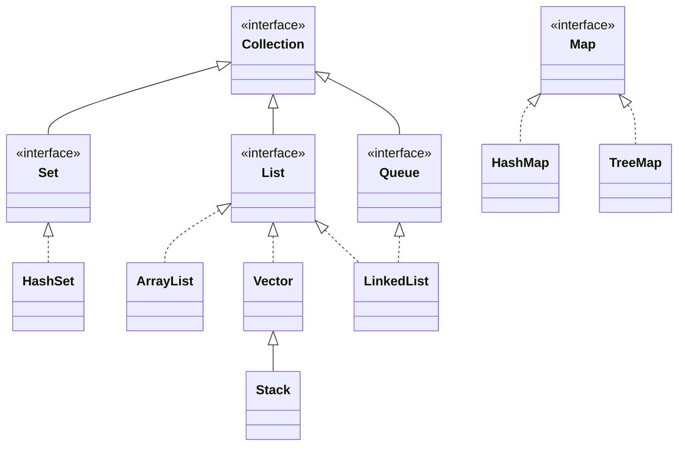

# Lecture 9 — Assertions, Generics, and Collections

[Repository Guide](../../README.md) | [English](Concepts_Lecture.md) | [한국어](Concepts_Lecture.ko.md)

> **Last Updated:** 2026-10-26

> **Learning Objectives:**
> 1. Use assertions for debugging and design-by-contract
> 2. Apply generic types and bounded type parameters
> 3. Utilize Java Collections Framework (List, Set, Map)
> 4. Visit the elements of a collection in turn with an Iterator

---

## Table of Contents

- [1. Assertions](#1-assertions)
  - [1.1 Syntax and Usage](#11-syntax-and-usage)
  - [1.2 Enabling Assertions](#12-enabling-assertions)
- [2. Generics](#2-generics)
  - [2.1 The Concept of Generics](#21-the-concept-of-generics)
  - [2.2 Generic Classes](#22-generic-classes)
  - [2.3 Generic Methods](#23-generic-methods)
  - [2.4 Bounded Type Parameters](#24-bounded-type-parameters)
- [3. Collections Framework](#3-collections-framework)
  - [3.1 Java Interfaces and the Collection Hierarchy](#31-java-interfaces-and-the-collection-hierarchy)
  - [3.2 The List Interface](#32-the-list-interface)
  - [3.3 ArrayList](#33-arraylist)
  - [3.4 Vector](#34-vector)
  - [3.5 The Map Interface](#35-the-map-interface)
  - [3.6 HashMap](#36-hashmap)
  - [3.7 Iterating Collections](#37-iterating-collections)
- [Summary](#summary)
- [Self-Check Questions](#self-check-questions)

---

<br>

## 1. Assertions

### 1.1 Syntax and Usage

Assertions are runtime checks for conditions that should always be true during development:

```java
assert balance > oldBalance :
    "Error: balance did not increase after deposit";
```

If the condition is `false`, an `AssertionError` is thrown with the provided message.

The assert statement takes one of two forms.

```text
assert <boolean expression>;
assert <boolean expression> : <expression>;
```

`<boolean expression>` is the condition that must be true if the code is working correctly. If it evaluates to `false`, an `AssertionError` is thrown. `AssertionError` is a subclass of `Error`, not of `Exception` (Lecture 6, Section 3.5). In the second form, `<expression>` is passed as an argument to the `AssertionError` constructor and serves as the detailed message of the thrown error.

The following example uses assertions to check that the balance changes in the expected direction after a deposit and a withdrawal.

```java
public class Chap9Program1 {

    static double balance;

    public static void main(String[] args) {
        balance = 100;

        deposit(20);
        System.out.println("Balance:" + balance);

        withdraw(20);
        System.out.println("Balance:" + balance);
    }

    private static double deposit(double amount) {
        double oldBalance = balance;
        balance += amount;
        assert balance > oldBalance :
            "Serious Error - balance did not increase after deposit";

        return balance;
    }

    private static double withdraw(double amount) {
        double oldBalance = balance;
        balance -= amount;
        assert balance < oldBalance :
            "Serious Error - balance did not decrease after withdrawal";

        return balance;
    }
}
```

With normal amounts, all assertions hold, so the program prints `Balance:120.0` and `Balance:100.0`. Withdrawing a negative amount, as in `withdraw(-20)`, increases the balance instead, so running with assertions enabled raises `AssertionError: Serious Error - balance did not decrease after withdrawal`.

### 1.2 Enabling Assertions

Assertions are disabled by default. Enable them with the `-ea` JVM flag:

```bash
java -ea MyProgram
```

Without the `-ea` (enable assertions) option, the program runs without checking assertions. In that case the expression of an `assert` statement is not even evaluated, so an assertion must not contain side effects that the program depends on (changing variables, calling methods that change state).

`assert` was introduced in JDK 1.4. Before that, `assert` was an ordinary identifier, so for compatibility JDK 1.4 treated `assert` as an identifier by default, and a program with assertions had to be compiled with `javac -source 1.4 <source file>`. From Java 5, `assert` is a reserved word, so the program is compiled with plain `javac` and only `-ea` is needed at run time.

> **Key Point:** Assertions should check program invariants, not validate user input. For user input, use exceptions or conditional checks.

---

<br>

## 2. Generics

### 2.1 The Concept of Generics

> **Definition:** **Generics** is a technique that generalizes a class or method instead of tying it to a specific type, so that it can be turned into various types when used. A name written inside angle brackets, such as `<E>`, `<K>`, or `<V>`, is a **type parameter**. By convention, E stands for element, K for key, V for value, and T for type.

For example, once a generic stack `Stack<E>` is defined, specifying `E` as `Integer` gives a stack that holds only integers, and specifying it as `String` gives a stack that holds only strings.

```java
class Stack<E> {
    ...
    void push(E element) { ... }
    E pop() { ... }
    ...
}
```

In `Stack<Integer>` the methods become `push(Integer element)` and `Integer pop()`, and in `Stack<String>` they become `push(String element)` and `String pop()`. The collection classes of Section 3 are all implemented with this generic technique. The feature serves the same purpose as C++ templates.

> **Caution:** Only reference types can be type arguments. `Vector<int>` is a compile error (`unexpected type`); to hold primitive values, use a wrapper class as in `Vector<Integer>`. The `int` value 5 in `v.add(5)` is then converted to an `Integer` object automatically (autoboxing), and `int n = v.get(i);` converts back to `int` automatically (unboxing).

### 2.2 Generic Classes

Generics enable type-safe, reusable code by parameterizing types:

```java
public class Box<T> {
    private T item;

    public void set(T item) { this.item = item; }
    public T get() { return item; }
}

// Usage
Box<String> stringBox = new Box<>();
stringBox.set("Hello");
String value = stringBox.get(); // no cast needed
```

The empty angle brackets in `new Box<>()` (the diamond operator, from Java 7) let the type argument be inferred from the variable declaration. The `Locker<T>` class below works the same way, with type arguments given at the declaration, creation, and usage steps.

```java
class Locker<T> {
    private T content;

    public Locker() {
        store(null);
    }

    public T retrieve() {
        return content;
    }

    public void store(T item) {
        content = item;
    }
}

// Declaration
Locker<String>  lockerOne;
Locker<Integer> lockerTwo;

// Creation
lockerOne = new Locker<String>();
lockerTwo = new Locker<Integer>();

// Usage
lockerOne.store("Hello");
lockerTwo.store(Integer.valueOf(10));
```

`lockerOne` can store only `String` values and `lockerTwo` only `Integer` values; storing any other type is a compile error.

### 2.3 Generic Methods

```java
public static <T> void printArray(T[] array) {
    for (T element : array) {
        System.out.print(element + " ");
    }
    System.out.println();
}
```

The `<T>` before the return type declares a type parameter of this method alone. In a call such as `printArray(new Integer[]{1, 2, 3})`, the compiler infers `T` as `Integer` from the argument.

### 2.4 Bounded Type Parameters

```java
// T must be a subtype of Comparable
public static <T extends Comparable<T>> T findMax(T[] array) {
    T max = array[0];
    for (int i = 1; i < array.length; i++) {
        if (array[i].compareTo(max) > 0) {
            max = array[i];
        }
    }
    return max;
}
```

> **Key Point:** Use `<T extends SomeType>` to restrict generics to types that implement a specific interface or extend a specific class.

Because `T` is guaranteed to implement `Comparable<T>`, the method can call `compareTo`. `Integer` and `String` implement `Comparable`, so `findMax(new Integer[]{3, 9, 2})` returns 9. Passing an `Object[]`, which does not implement `Comparable`, is a compile error. The method assumes that the array is not empty.

---

<br>

## 3. Collections Framework

### 3.1 Java Interfaces and the Collection Hierarchy

The standard package `java.util` contains various classes for maintaining a collection of objects, and they are collectively referred to as the **Java Collection Framework** (JCF). JCF provides classes that maintain collections of objects as sets, lists, and maps.

JCF defines the behavior of each collection with a Java interface, and classes implement that interface.

> **Definition:** A **Java interface** defines only the behavior of objects. It includes only `public` methods with no method bodies, has no data members except `public` constants, and no instance of the interface itself can be created.

> **Note:** **Interfaces since Java 8.** From Java 8, an interface can contain `default` and `static` methods with bodies, and from Java 9 it can contain `private` methods. The definition above is the traditional one that excludes these features.



*Figure 1. Main interfaces and classes of the collection framework*

Solid arrows show inheritance between interfaces or between classes, and dashed arrows show a class implementing an interface. `Collection<E>`, `Set<E>`, `List<E>`, `Queue<E>`, and their implementing classes take one type parameter, the element type `E`, while `Map<K, V>` and its implementing classes take the key type `K` and the value type `V`. `Map` is a separate hierarchy that does not extend `Collection`.

### 3.2 The List Interface

The `List` interface provides methods to maintain a collection of objects as a linear list $L = (l_0, l_1, l_2, \ldots, l_N)$. Objects can be added to, removed from, and retrieved from a list, and there is no set limit to the number of objects that can be added.

| Method | Description |
|:-----|:-----|
| `boolean add(E o)` | Adds the object `o` to the end of the list |
| `void clear()` | Makes the list empty |
| `E get(int idx)` | Returns the element at position `idx` |
| `E remove(int idx)` | Removes and returns the element at position `idx` |
| `int size()` | Returns the number of elements in the list |

*Table 1. Main methods of the List interface*

To use a list, we must create an instance of a class that implements the `List` interface. Two typical implementing classes are `ArrayList`, which manages data with an array, and `LinkedList`, which uses linked-node representation. Declaring the variable with the interface type and creating the object from an implementing class means that only the implementing class needs to change later, while the rest of the code stays the same.

```java
/**
 * Maintains a list of library books
 */
private List<Book> books;

/**
 * Constructor
 */
public BookTracker() {
    books = new LinkedList<>();
}
```

> **Caution:** For a `List<Integer>`, `remove(1)` is resolved as `remove(int idx)` and removes the element at position 1. To remove the element whose value is 1, call `remove(Object o)`, as in `remove(Integer.valueOf(1))`.

### 3.3 ArrayList

A resizable array implementation of the `List` interface:

```java
ArrayList<String> names = new ArrayList<>();
names.add("Alice");
names.add("Bob");
names.get(0);       // "Alice"
names.size();       // 2
names.remove(0);    // removes "Alice"
```

When the internal array is full, a larger array is created and the elements are moved, so the size need not be fixed in advance. Accessing an element by index takes O(1) time. Inserting or removing an element in the middle requires shifting the following elements by one position, which takes O(n) time.

> **[Data Structures]** `ArrayList` and the `Vector` of Section 3.4 are dynamic arrays, studied in data structures: each time the capacity runs out, they create an array larger by a constant factor and move the elements, so appending an element takes amortized O(1) time. The `LinkedList` of Section 3.2 is a doubly linked list: reaching the element at position i requires following the nodes one by one, so index access takes O(n) time, but insertion and deletion do not shift the following elements.

### 3.4 Vector

`Vector<E>` is also a resizable array that implements `List<E>`. Its usage is almost the same as that of `ArrayList`, but its methods are synchronized, so it is safe when several threads use it together (Lecture 15, Section 4). In exchange, it is slightly slower than `ArrayList` in a single thread.

```java
Vector<Integer> v = new Vector<Integer>();

v.add(5);
v.add(4);
v.add(-1);

v.add(2, 100);

System.out.println("# of elements : " + v.size());
System.out.println("Capacity of the vector : " + v.capacity());

for (int i = 0; i < v.size(); i++) {
    int n = v.get(i);
    System.out.println(n);
}
```

`add(e)` appends an element at the end, and `add(index, e)` inserts it at the given position and shifts the following elements by one. After `v.add(2, 100)`, the elements are therefore 5, 4, 100, -1. `size()` returns the number of elements, 4, and `capacity()` returns the size of the internal array. A `Vector` created with the default constructor has a capacity of 10, and the capacity doubles when the elements exceed it.

```text
         0     1     2     3     4    ...    9
v ──▶ ┌─────┬─────┬─────┬─────┬─────┬─────┬─────┐
      │  ●  │  ●  │  ●  │  ●  │     │ ... │     │  size 4, capacity 10
      └──┼──┴──┼──┴──┼──┴──┼──┴─────┴─────┴─────┘
         ▼     ▼     ▼     ▼
        [5]   [4]  [100]  [-1]
```

*Figure 2. Internal array of a `Vector<Integer>` holding four elements*

Each slot stores a reference to an `Integer` object. The output is as follows.

```text
# of elements : 4
Capacity of the vector : 10
5
4
100
-1
```

### 3.5 The Map Interface

The `Map` interface provides methods to maintain a collection of (key, value) pairs called **map entries**. Keys cannot be duplicated within a map, and a value is looked up by its key.

| Method | Description |
|:-----|:-----|
| `void clear()` | Makes the map empty |
| `boolean containsKey(Object key)` | Returns `true` if the map contains an entry with the given key |
| `V put(K key, V value)` | Adds the (key, value) entry; if an entry with the same key existed, replaces its value and returns the previous value |
| `V get(Object key)` | Returns the value for the given key, or `null` if there is none |
| `V remove(Object key)` | Removes the entry with the given key and returns its value |
| `int size()` | Returns the number of entries in the map |

*Table 2. Main methods of the Map interface*

To use a map, we must create an instance of a class that implements the `Map` interface, and two typical implementing classes are `HashMap` and `TreeMap`. `TreeMap` keeps its entries sorted in key order.

```java
Map<String, String> catalog = new TreeMap<>();

catalog.put("CS101", "Intro Java Programming");
catalog.put("CS301", "Database Design");
catalog.put("CS413", "Software Design for Mobile Devices");

if (catalog.containsKey("CS101")) {
    System.out.println("We teach Java this semester");
} else {
    System.out.println("No Java courses this semester");
}
```

The key `"CS101"` exists, so the program prints `We teach Java this semester`. Using the raw type without type arguments, as in `Map catalog = new TreeMap();`, still compiles but produces an unchecked warning and loses the benefit of type checking.

### 3.6 HashMap

A key-value map with O(1) average access:

```java
HashMap<String, Integer> scores = new HashMap<>();
scores.put("Alice", 95);
scores.put("Bob", 87);
int aliceScore = scores.get("Alice"); // 95
```

`HashMap` places each entry according to the hash value of its key, so lookups take O(1) time on average, but the order of entries is not guaranteed.

> **Caution:** Calling `get` with a missing key returns `null`. Assigning the result to an `int`, as in `int x = scores.get("Carol");`, unboxes `null` and throws `NullPointerException`. If a key may be missing, check it first with `containsKey` or use `scores.getOrDefault("Carol", 0)`.

### 3.7 Iterating Collections

```java
// For-each loop
for (String name : names) {
    System.out.println(name);
}

// Iterator
Iterator<String> it = names.iterator();
while (it.hasNext()) {
    System.out.println(it.next());
}

// forEach with lambda (Java 8+)
names.forEach(name -> System.out.println(name));
```

The `Iterator<E>` interface lets us visit the elements of collections such as `Vector<E>`, `ArrayList<E>`, and `LinkedList<E>` in turn without indices. The collection's `iterator()` method returns an `Iterator` object; `hasNext()` tells whether elements remain, and `next()` returns the next element. The index loop of Section 3.4 can be rewritten as follows.

```java
Iterator<Integer> it = v.iterator();

while (it.hasNext()) {
    int n = it.next();
    System.out.println(n);
}
```

The advantage of `Iterator` is that the same code visits the elements in turn both in a `Set`, which has no indices, and in a `LinkedList`, whose index access is slow.

> **Caution:** Calling the collection's `remove` while traversing it with a for-each loop can throw `ConcurrentModificationException`. To remove elements during traversal, use the `Iterator`'s `remove()`.

---

<br>

## Summary

| Concept | Key Summary |
|:--------|:----------|
| Assertions | They check invariants at run time, are enabled with `-ea`, and are not used to validate user input. |
| Generics | They parameterize types to create type-safe, reusable classes and methods. |
| Bounded types | `<T extends Type>` restricts the types that a type parameter accepts. |
| JCF | It is the set of collection classes in `java.util`, where interfaces define behavior and classes implement it. |
| ArrayList | It is a resizable array with O(1) access by index. |
| Vector | It is a synchronized resizable array with a default capacity of 10. |
| HashMap | It stores key-value pairs with O(1) average lookup. |
| Iteration | For-each loops, Iterators, and lambda `forEach` visit the elements in turn. |

---

<br>

## Self-Check Questions

1. **Assertions:** In `Chap9Program1` of Section 1.1, `withdraw(20)` is changed to `withdraw(-20)`. How do the results of running `java Chap9Program1` and `java -ea Chap9Program1` differ?

   <details>
   <summary>Answer</summary>

   With `java Chap9Program1`, assertions are not checked, so the program prints `Balance:120.0` and `Balance:140.0` and ends normally. With `java -ea Chap9Program1`, the balance rises to 140 after the withdrawal, so `balance < oldBalance` is false; the program prints `Balance:120.0` and then raises `AssertionError: Serious Error - balance did not decrease after withdrawal`.

   </details>

2. **Vector:** Write the output of the following code.

   ```java
   Vector<Integer> v = new Vector<Integer>();
   v.add(7);
   v.add(0, 3);
   v.add(1, 5);
   System.out.println(v.size() + " " + v.capacity() + " " + v);
   ```

   <details>
   <summary>Answer</summary>

   The output is `3 10 [3, 5, 7]`. After `add(7)` the vector is [7], after `add(0, 3)` it is [3, 7], and after `add(1, 5)` it is [3, 5, 7]. It has 3 elements, so the size is 3, and the default capacity of 10 has not been exceeded, so the capacity is 10.

   </details>

3. **remove on a List:** For `List<Integer> li = new ArrayList<>(List.of(1, 2, 3));`, write the list after `li.remove(1);` and then after `li.remove(Integer.valueOf(1));`.

   <details>
   <summary>Answer</summary>

   `li.remove(1)` is `remove(int idx)`, so it removes the element 2 at position 1, leaving [1, 3]. `li.remove(Integer.valueOf(1))` is `remove(Object o)`, so it removes the element whose value is 1, leaving [3].

   </details>

4. **Map:** For an empty `HashMap<String, Integer> m`, write the return values of `m.put("x", 1)`, `m.put("x", 2)`, `m.remove("x")`, and `m.remove("y")` in order.

   <details>
   <summary>Answer</summary>

   They are `null`, `1`, `2`, and `null`. The first `put` has no previous value and returns `null`; the second `put` returns the previous value 1 for the same key and changes the value to 2. `remove("x")` returns the removed value 2, and `remove("y")` for a missing key returns `null`.

   </details>

5. **Generics:** (a) Why does `Vector<int>` not compile? (b) What does `findMax` of Section 2.4 return for `new String[]{"pear", "apple", "fig"}`?

   <details>
   <summary>Answer</summary>

   (a) Only reference types can be type arguments, and `int` is a primitive type. `Vector<Integer>` must be used. (b) `String` implements `Comparable<String>`, and `compareTo` compares in lexicographic order, so it returns `"pear"`, which comes last in lexicographic order.

   </details>
