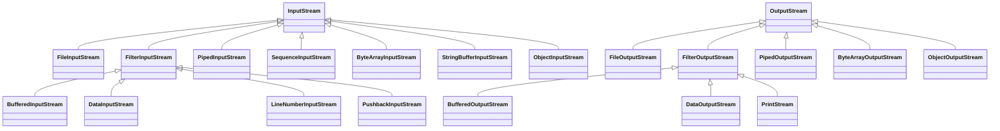

# 10강 — 파일 입출력

[레포지토리 안내](../../README.ko.md) | [English](Concepts_Lecture.md) | [한국어](Concepts_Lecture.ko.md)

> **최종 수정일:** 2026-10-26

> **학습 목표:**
> 1. File 클래스와 JFileChooser로 파일을 지정하고 정보를 얻을 수 있다
> 2. FileReader/FileWriter와 BufferedReader로 파일을 읽고 쓸 수 있다
> 3. 텍스트 파일에서 구조화된 데이터를 파싱할 수 있다
> 4. 바이트 스트림, Data 스트림, 객체 스트림으로 바이너리 파일을 읽고 쓸 수 있다
> 5. try-with-resources로 자동 자원 관리를 적용할 수 있다

---

## 목차

- [1. 파일 입출력 기초](#1-파일-입출력-기초)
  - [1.1 바이트 스트림 vs. 문자 스트림](#11-바이트-스트림-vs-문자-스트림)
  - [1.2 File 클래스](#12-file-클래스)
  - [1.3 JFileChooser 클래스](#13-jfilechooser-클래스)
- [2. 텍스트 파일 입출력](#2-텍스트-파일-입출력)
  - [2.1 텍스트 파일 읽기](#21-텍스트-파일-읽기)
  - [2.2 텍스트 파일 쓰기](#22-텍스트-파일-쓰기)
  - [2.3 Scanner로 텍스트 파일 파싱](#23-scanner로-텍스트-파일-파싱)
- [3. 바이너리 파일 입출력](#3-바이너리-파일-입출력)
  - [3.1 저수준 입출력: FileInputStream과 FileOutputStream](#31-저수준-입출력-fileinputstream과-fileoutputstream)
  - [3.2 DataInputStream과 DataOutputStream](#32-datainputstream과-dataoutputstream)
  - [3.3 ObjectInputStream과 ObjectOutputStream](#33-objectinputstream과-objectoutputstream)
- [4. Try-with-Resources](#4-try-with-resources)
- [5. Serializable 인터페이스](#5-serializable-인터페이스)
- [요약](#요약)
- [점검 문제](#점검-문제)

---

<br>

## 1. 파일 입출력 기초

### 1.1 바이트 스트림 vs. 문자 스트림

파일에서 데이터를 읽거나 파일에 쓰려면 Java의 스트림 객체를 만들어 파일에 연결해야 한다. **스트림**(stream)은 데이터 항목(보통 8비트 바이트)의 연속이다. **입력 스트림**은 데이터 항목이 오는 원천(source)을, **출력 스트림**은 데이터 항목이 가는 목적지(destination)를 갖는다.

| 유형 | 기본 클래스 | 사용 사례 |
|:-----|:-----------|:---------|
| 바이트 스트림 | `InputStream` / `OutputStream` | 바이너리 데이터 (이미지, 오디오, 직렬화된 객체) |
| 문자 스트림 | `Reader` / `Writer` | 텍스트 데이터 (UTF-8/16 인코딩 파일) |

*표 1. 바이트 스트림과 문자 스트림의 비교*

### 1.2 File 클래스

`File` 클래스는 파일 또는 디렉터리의 경로를 나타내며, 실제로 파일을 열지는 않는다.

```java
File file = new File("data.txt");
System.out.println("Exists: " + file.exists());
System.out.println("Size:   " + file.length() + " bytes");
System.out.println("Path:   " + file.getAbsolutePath());
```

파일을 다루려면 먼저 `java.io`의 `File` 객체를 만든다. `new File("sample.dat")`는 현재 디렉터리의 `sample.dat`를 가리키고, `new File("C:/SamplePrograms/test.dat")`는 전체 경로로 `C:\SamplePrograms` 디렉터리의 `test.dat`를 가리킨다. Java는 Windows에서도 일반적인 경로 구분자 `/`를 받아들인다. 역슬래시를 쓰려면 문자열 안에서 `"C:\\SamplePrograms\\test.dat"`처럼 두 번 써야 한다.

```java
if (inFile.exists()) {      // inFile이 실제 파일이나 디렉터리와 연결되어 있는지 확인
    ...
}

if (inFile.isFile()) {      // inFile이 파일인지 확인 (false이면 디렉터리이거나 존재하지 않음)
    ...
}

File directory = new File("C:/JavaPrograms/Ch12");
String filename[] = directory.list();     // 디렉터리 안의 모든 파일 이름

for (int i = 0; i < filename.length; i++) {
    System.out.println(filename[i]);
}
```

`length()`는 파일의 크기를 바이트 단위로 반환하며, 파일이 없으면 0을 반환한다. `list()`는 디렉터리가 아닌 `File`에 대해서는 `null`을 반환한다.

### 1.3 JFileChooser 클래스

`javax.swing.JFileChooser` 객체는 사용자가 대화 상자에서 파일을 고르게 한다.

```java
JFileChooser chooser = new JFileChooser();
chooser.showOpenDialog(null);

// 특정 디렉터리에서 목록을 시작하려면
JFileChooser chooser = new JFileChooser("D:/JavaPrograms/Ch12");
chooser.showOpenDialog(null);
```

`showOpenDialog`는 사용자가 누른 버튼을 나타내는 값을 반환한다. 선택한 파일과 대화 상자가 보여 준 디렉터리는 각각 `getSelectedFile()`과 `getCurrentDirectory()`로 얻는다.

```java
int status = chooser.showOpenDialog(null);
if (status == JFileChooser.APPROVE_OPTION) {
    JOptionPane.showMessageDialog(null, "Open is clicked");
} else { //== JFileChooser.CANCEL_OPTION
    JOptionPane.showMessageDialog(null, "Cancel is clicked");
}

File selectedFile     = chooser.getSelectedFile();
File currentDirectory = chooser.getCurrentDirectory();
```

**파일 필터**를 쓰면 `JFileChooser`의 목록을 지정한 조건에 맞는 파일과 디렉터리로 제한할 수 있다. `javax.swing.filechooser.FileFilter`의 하위 클래스를 정의하여 `public boolean accept(File file)`과 `public String getDescription()`을 구현한다. 다음 `JavaFilter`는 목록을 디렉터리와 Java 소스 파일로 제한한다.

```java
class JavaFilter extends FileFilter {
    public boolean accept(File file) {
        return file.isDirectory() || file.getName().endsWith(".java");
    }
    public String getDescription() {
        return "Java source files (*.java)";
    }
}

chooser.setFileFilter(new JavaFilter());
```

---

<br>

## 2. 텍스트 파일 입출력

기본형 값을 바이너리 데이터로 저장하는 대신 문자열로 바꾸어 저장할 수 있다. 이렇게 만든 텍스트 파일은 아무 텍스트 편집기로나 내용을 볼 수 있다. 텍스트 파일에 쓸 때는 `PrintWriter`(또는 `BufferedWriter`)를, 읽을 때는 `FileReader`와 `BufferedReader`를 쓰며, Java 5.0부터는 `Scanner`로도 텍스트 파일을 읽을 수 있다.

### 2.1 텍스트 파일 읽기

```java
try (BufferedReader reader = new BufferedReader(new FileReader("input.txt"))) {
    String line;
    while ((line = reader.readLine()) != null) {
        System.out.println(line);
    }
} catch (IOException e) {
    System.err.println("Error reading file: " + e.getMessage());
}
```

`readLine()`은 줄바꿈 문자를 뺀 한 줄을 문자열로 반환하고, 파일 끝에 도달하면 `null`을 반환한다. 읽은 문자열을 숫자로 쓰려면 `Integer.parseInt(line)`처럼 변환한다. 2.2절의 `example3.data`를 이 방식으로 읽으면 `10`, `Hello, world.`, `true`의 세 줄이 출력된다.

### 2.2 텍스트 파일 쓰기

```java
try (BufferedWriter writer = new BufferedWriter(new FileWriter("output.txt"))) {
    writer.write("Hello, File I/O!");
    writer.newLine();
    writer.write("Second line.");
} catch (IOException e) {
    System.err.println("Error writing file: " + e.getMessage());
}
```

`PrintWriter`를 쓰면 `System.out`처럼 `print`와 `println`으로 여러 타입의 값을 문자열로 바꾸어 쓸 수 있다.

```java
File outFile = new File("example3.data");
FileOutputStream outFileStream = new FileOutputStream(outFile);
PrintWriter outStream = new PrintWriter(outFileStream);

// write values of primitive data types to the stream
outStream.println(10);
outStream.println("Hello, world.");
outStream.println(true);

// output done, so close the stream
outStream.close();
```

`PrintWriter`는 내부에 버퍼를 두므로 `close()`(또는 `flush()`)를 호출해야 버퍼의 내용이 파일에 기록된다.

> **핵심:** 성능을 위해 `FileReader`/`FileWriter`는 보통 `BufferedReader`/`BufferedWriter`로 감싸서 쓴다. 버퍼링은 실제 디스크 I/O 작업 횟수를 줄여준다.

### 2.3 Scanner로 텍스트 파일 파싱

`Scanner`에 `File` 객체를 넘기면 키보드 입력과 같은 메서드로 파일의 내용을 토큰 단위로 읽고 변환할 수 있다.

```java
Scanner scanner = new Scanner(new File("example3.data"));

int n = scanner.nextInt();          // 10
scanner.nextLine();                 // 첫 줄의 나머지(줄바꿈) 소비
String text = scanner.nextLine();   // "Hello, world."
boolean b = scanner.nextBoolean();  // true

scanner.close();
```

`next()`, `nextInt()`, `nextBoolean()`은 공백(빈칸, 탭, 줄바꿈)으로 구분된 토큰 하나를 읽고, `nextLine()`은 현재 위치부터 줄 끝까지를 읽는다. 그래서 `Hello, world.`처럼 빈칸이 들어 있는 줄은 `nextLine()`으로 읽어야 한 덩어리로 얻는다. 쉼표로 구분한 레코드처럼 구조화된 줄은 `nextLine()`으로 읽은 뒤 `line.split(",")`으로 나누고, 각 조각을 `Integer.parseInt` 등으로 변환하여 파싱한다.

---

<br>

## 3. 바이너리 파일 입출력

### 3.1 저수준 입출력: FileInputStream과 FileOutputStream

`FileOutputStream`과 `FileInputStream`은 파일 접근을 위한 기본 스트림이다. `FileOutputStream`은 `byte` 값의 연속을 출력하고, `FileInputStream`은 바이트 배열을 읽어 들인다. 바이트 스트림 클래스는 `InputStream`과 `OutputStream`을 루트로 하는 계층을 이룬다.



*그림 1. InputStream과 OutputStream의 클래스 계층 구조*

`LineNumberInputStream`과 `StringBufferInputStream`은 문자를 바이트로 잘못 다루는 문제 때문에 사용이 권장되지 않으며(deprecated), 대신 문자 스트림인 `LineNumberReader`와 `StringReader`를 쓴다.

다음 두 프로그램은 바이트 배열을 바이너리 파일에 저장하고 다시 읽는다.

```java
// set up file and stream
File outFile = new File("example1.data");
FileOutputStream outStream = new FileOutputStream(outFile);

// data to save
byte[] byteArray = { 10, 20, 30, 40, 50, 60, 70, 80 };

// write data to the stream
outStream.write(byteArray);

// output done, so close the stream
outStream.close();
```

```java
// set up file and stream
File inFile = new File("example1.data");
FileInputStream inStream = new FileInputStream(inFile);

// set up an array to read data in
int    fileSize  = (int) inFile.length();
byte[] byteArray = new byte[fileSize];

// read data in and display them
inStream.read(byteArray);
for (int i = 0; i < fileSize; i++) {
    System.out.println(byteArray[i]);
}

// input done, so close the stream
inStream.close();
```

읽는 쪽은 `inFile.length()`로 파일 크기를 구해 그만큼의 배열을 만든 뒤 한 번에 읽는다. 두 프로그램을 담은 `main`은 `FileOutputStream` 생성자와 `write`, `read`, `close`가 검사 예외인 `IOException`을 던질 수 있으므로 `throws IOException`을 선언하거나 `try-catch`로 감싸야 한다(6강 3.5절).

### 3.2 DataInputStream과 DataOutputStream

기본형 타입을 바이너리 형식으로 읽고 쓰기 위한 스트림이다:

```java
// 쓰기
try (DataOutputStream dos = new DataOutputStream(new FileOutputStream("data.bin"))) {
    dos.writeInt(42);
    dos.writeDouble(3.14);
    dos.writeBoolean(true);
    dos.writeUTF("Hello");
}

// 읽기 (쓰기 순서와 타입이 일치해야 함)
try (DataInputStream dis = new DataInputStream(new FileInputStream("data.bin"))) {
    int i = dis.readInt();
    double d = dis.readDouble();
    boolean b = dis.readBoolean();
    String s = dis.readUTF();
}
```

`DataOutputStream`은 `FileOutputStream` 위에 겹쳐 쓴다. 표준적인 준비 순서는 `File` 객체, 그 파일에 연결한 `FileOutputStream`, 그 스트림을 감싼 `DataOutputStream`의 순서이다.

```java
File             outFile       = new File("example2.data");
FileOutputStream outFileStream = new FileOutputStream(outFile);
DataOutputStream outDataStream = new DataOutputStream(outFileStream);

// write an int, boolean, double
outDataStream.writeInt(44);
outDataStream.writeBoolean(true);
outDataStream.writeDouble(7.2);

outDataStream.close();
```

```text
writeInt(44)    writeBoolean(true)    writeDouble(7.2)
      │                  │                    │
      └──────────────────┼────────────────────┘
                         ▼
             ┌───────────────────────┐
             │    DataOutputStream   │  기본형 값을 바이트열로 변환
             └───────────┬───────────┘
                         ▼
             ┌───────────────────────┐
             │    FileOutputStream   │  바이트를 파일에 씀
             └───────────┬───────────┘
                         ▼
                   example2.data
```

*그림 2. DataOutputStream과 FileOutputStream을 겹친 출력 구조*

`writeInt`는 4바이트, `writeBoolean`은 1바이트, `writeDouble`은 8바이트를 쓰므로 `example2.data`의 크기는 13바이트이다. 읽을 때는 같은 방식으로 `File`, `FileInputStream`, `DataInputStream`을 차례로 만들고, `DataInputStream`이 파일에서 읽은 바이트열을 기본형 값으로 변환한다.

```java
File            inFile       = new File("example2.data");
FileInputStream inFileStream = new FileInputStream(inFile);
DataInputStream inDataStream = new DataInputStream(inFileStream);

// read an int, boolean, double
int n = inDataStream.readInt();
boolean b = inDataStream.readBoolean();
double d = inDataStream.readDouble();

inDataStream.close();

// what did we get?
System.out.println("n = " + n);
System.out.println("b = " + b);
System.out.println("d = " + d);
```

출력은 `n = 44`, `b = true`, `d = 7.2`이다.

> **주의:** 바이너리 파일에는 값의 타입 정보가 저장되지 않는다. 저장한 기본형 데이터를 올바르게 읽으려면 쓴 순서와 타입을 알고, 읽기 연산의 순서를 쓰기 연산의 순서와 일치시켜야 한다. 순서가 다르면 예외 없이 잘못된 값을 읽을 수 있다.

### 3.3 ObjectInputStream과 ObjectOutputStream

객체 전체를 직렬화하기 위한 스트림이다:

```java
// 객체 쓰기
try (ObjectOutputStream oos = new ObjectOutputStream(new FileOutputStream("obj.bin"))) {
    oos.writeObject(myAccount);
}

// 객체 읽기
try (ObjectInputStream ois = new ObjectInputStream(new FileInputStream("obj.bin"))) {
    Account account = (Account) ois.readObject();
}
```

기본형 값을 저장하듯 객체도 쉽게 저장할 수 있다. 한 스트림에 서로 다른 클래스의 객체를 차례로 저장할 수 있다.

```java
File               outFile         = new File("objects.data");
FileOutputStream   outFileStream   = new FileOutputStream(outFile);
ObjectOutputStream outObjectStream = new ObjectOutputStream(outFileStream);

Person person = new Person("Mr. Espresso", 20, 'M');
outObjectStream.writeObject(person);

account1 = new Account();
bank1    = new Bank();
outObjectStream.writeObject(account1);   // 다른 클래스의 객체도 저장 가능
outObjectStream.writeObject(bank1);
```

`readObject()`의 반환 타입은 `Object`이므로 올바른 타입으로 캐스트해야 하며, 저장한 순서대로 읽어야 한다. `readObject()`는 `IOException` 외에 검사 예외인 `ClassNotFoundException`도 던질 수 있다.

```java
Person person = (Person) inObjectStream.readObject();

Account account1 = (Account) inObjectStream.readObject();
Bank    bank1    = (Bank) inObjectStream.readObject();
```

배열도 원소를 하나씩 처리하지 않고 배열 전체를 한 번에 저장하고 읽을 수 있다.

```java
Person[] people = new Person[N];   // assume N already has a value

// build the people array
. . .
// save the array
outObjectStream.writeObject(people);

// read the array
Person[] people = (Person[]) inObjectStream.readObject();
```

다음은 `Serializable`을 구현한 `Account` 객체 20개의 배열을 한 번에 저장하는 예이다.

```java
Account[] account = new Account[NUM_OF_ACCOUNT];   // NUM_OF_ACCOUNT = 20

for (int i = 0; i < NUM_OF_ACCOUNT; i++) {
    account[i] = new Account();
    account[i].setOwnerName("Student_" + (i + 1));
}

try (ObjectOutputStream outObjectStream =
         new ObjectOutputStream(new FileOutputStream("example4.data"))) {
    outObjectStream.writeObject(account);
}
```

`ObjectOutputStream`도 내부에 버퍼를 두므로, 스트림을 닫지 않으면 데이터 일부가 파일에 기록되지 않을 수 있다. 위처럼 try-with-resources로 닫는 것이 안전하다.

---

<br>

## 4. Try-with-Resources

Java 7 이상에서는 자동 자원 관리를 지원한다. `AutoCloseable`을 구현한 자원은 자동으로 닫힌다:

```java
try (FileReader fr = new FileReader("file.txt");
     BufferedReader br = new BufferedReader(fr)) {
    // br 사용
} // br과 fr이 자동으로 닫힘
```

자원은 선언의 역순으로 닫히므로 `br`이 먼저, `fr`이 나중에 닫힌다. 블록 안에서 예외가 발생해도 자원은 닫힌다.

> **핵심:** `finally` 블록에서 수동으로 `close()`를 호출하는 것보다 try-with-resources를 사용하는 것이 좋다. 코드가 짧고 깔끔하며 예외에 안전하다.

---

<br>

## 5. Serializable 인터페이스

`ObjectOutputStream`으로 객체를 쓰려면 해당 클래스가 `Serializable`을 구현해야 한다:

```java
import java.io.Serializable;

public class Account implements Serializable {
    private static final long serialVersionUID = 1L;
    private String ownerName;
    private double balance;
    // ...
}
```

`transient`로 표시된 필드는 직렬화에서 제외된다.

`Serializable`은 메서드가 없는 표시용 인터페이스이므로 `implements Serializable`만 쓰면 된다. 직렬화할 때 객체가 참조하는 다른 객체도 함께 저장되므로, `transient`가 아닌 필드의 타입도 직렬화할 수 있어야 한다. `Serializable`을 구현하지 않은 객체를 `writeObject`에 넘기면 `IOException`의 하위 클래스인 `NotSerializableException`이 실행 중에 발생한다. `transient` 필드와 `static` 필드는 저장되지 않으며, 객체를 읽어 들이면 `transient` 필드는 기본값(숫자는 0, 참조는 `null`)을 갖는다. `serialVersionUID`는 클래스의 버전 번호로, 저장할 때와 읽을 때의 값이 다르면 `InvalidClassException`이 발생한다.

---

<br>

## 요약

| 개념 | 핵심 요약 |
|:-----|:-----|
| 바이트 스트림 | 바이너리 데이터를 위해 `InputStream`/`OutputStream`을 사용한다. |
| 문자 스트림 | 텍스트 데이터를 위해 `Reader`/`Writer`를 사용한다. |
| File | 파일이나 디렉터리의 경로를 나타내며, 파일을 열지 않고 존재 여부와 크기 같은 정보를 제공한다. |
| 버퍼링 | 성능을 위해 원시 스트림을 `Buffered*`로 감싼다. |
| Scanner | 텍스트 파일을 토큰이나 줄 단위로 읽고 기본형 값으로 변환한다. |
| DataInputStream | 기본형 타입을 바이너리 형식으로 읽고 쓰며, 읽는 순서가 쓴 순서와 같아야 한다. |
| ObjectStream | 객체 전체를 직렬화하고 역직렬화하며, 읽은 객체는 올바른 타입으로 캐스트한다. |
| Try-with-resources | `AutoCloseable` 자원을 블록이 끝날 때 자동으로 정리한다. |
| Serializable | 객체 직렬화에 필요한 표시용 인터페이스이다. |

---

<br>

## 점검 문제

1. **바이트 스트림:** 3.1절의 첫 프로그램으로 만든 `example1.data`의 크기는 몇 바이트이고, 두 번째 프로그램은 무엇을 출력하는가?

   <details>
   <summary>정답</summary>

   바이트 8개를 썼으므로 크기는 8바이트이다. 두 번째 프로그램은 `inFile.length()`로 크기 8을 얻어 배열을 만들고 읽으므로 10, 20, 30, 40, 50, 60, 70, 80을 한 줄에 하나씩 출력한다.

   </details>

2. **Data 스트림의 파일 크기:** 3.2절에서 `writeInt(44)`, `writeBoolean(true)`, `writeDouble(7.2)`로 만든 `example2.data`의 크기를 구하라. 같은 값을 2.2절처럼 `PrintWriter`의 `println`으로 쓰면 파일 내용은 어떻게 다른가?

   <details>
   <summary>정답</summary>

   `int` 4바이트, `boolean` 1바이트, `double` 8바이트로 모두 13바이트이다. `PrintWriter`로 쓰면 값이 `44`, `true`, `7.2`라는 문자열과 줄바꿈 문자로 저장되므로 텍스트 편집기로 읽을 수 있고, 크기는 문자 수에 따라 정해진다.

   </details>

3. **읽는 순서:** `example2.data`를 `readBoolean()`, `readInt()`, `readDouble()` 순서로 읽으면 각각 어떤 값을 얻는가? 예외가 발생하는가?

   <details>
   <summary>정답</summary>

   예외는 발생하지 않고 `false`, `11265`, `7.2`를 얻는다. 44는 4바이트 `00 00 00 2C`(16진수)로 저장되어 있으므로 `readBoolean()`은 첫 바이트 0을 읽어 `false`가 된다. `readInt()`는 다음 4바이트 `00 00 2C 01`(마지막 01은 `true`)을 읽어 $44 \times 256 + 1 = 11265$가 된다. 남은 8바이트는 원래 `double` 값이므로 `readDouble()`은 우연히 7.2를 얻는다. 타입 정보가 없으므로 순서가 틀려도 오류 없이 잘못된 값을 읽는다.

   </details>

4. **Scanner의 토큰:** 2.2절의 `example3.data`(줄 `10`, `Hello, world.`, `true`)를 `Scanner`로 열고 `next()`를 세 번 호출하면 각각 무엇을 반환하는가?

   <details>
   <summary>정답</summary>

   `10`, `Hello,`, `world.`를 반환한다. `next()`는 공백으로 구분된 토큰을 읽으므로 두 번째 줄의 `Hello, world.`가 두 토큰으로 나뉘고, 세 번째 호출까지는 `true`에 도달하지 않는다. 줄 전체를 읽으려면 `nextLine()`을 써야 한다.

   </details>

5. **직렬화:** `ownerName`이 `"Kim"`이고 `transient double balance`가 50.0인 `Serializable` 객체를 `ObjectOutputStream`으로 저장한 뒤 다시 읽으면 두 필드의 값은 무엇인가? 클래스가 `Serializable`을 구현하지 않았다면 어떻게 되는가?

   <details>
   <summary>정답</summary>

   `ownerName`은 `"Kim"`으로 복원되지만, `transient` 필드인 `balance`는 저장되지 않으므로 기본값 0.0이 된다. `Serializable`을 구현하지 않았다면 컴파일은 되지만 `writeObject`를 실행할 때 `NotSerializableException`이 발생한다.

   </details>
