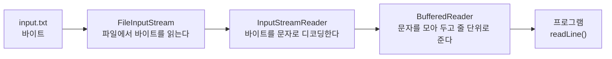
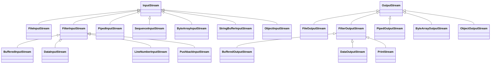
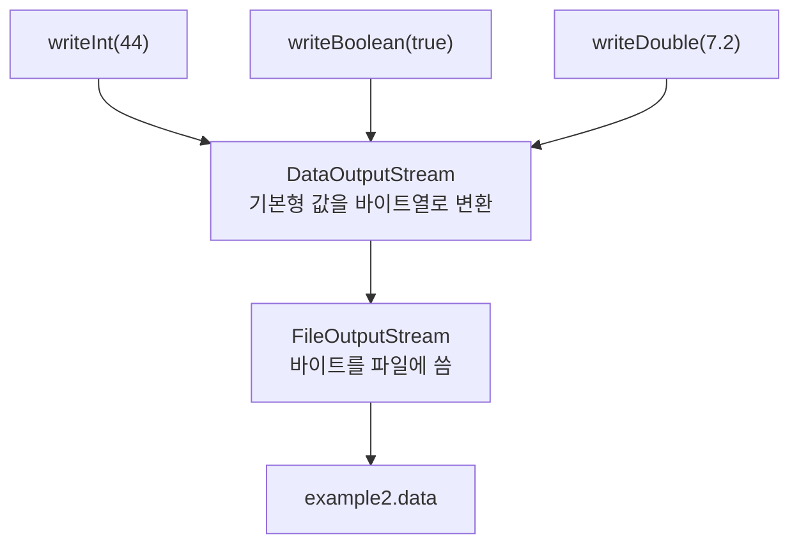

# 10강 — 파일 입출력

[레포지토리 안내](../../README.ko.md) | [English](Concepts_Lecture.md) | [한국어](Concepts_Lecture.ko.md)

> **최종 수정일:** 2026-11-19

> **학습 목표:**
> 1. File 클래스와 JFileChooser로 파일을 지정하고 정보를 얻을 수 있다
> 2. FileReader/FileWriter와 BufferedReader로 파일을 읽고 쓸 수 있다
> 3. 텍스트 파일에서 구조화된 데이터를 파싱할 수 있다
> 4. 바이트 스트림, Data 스트림, 객체 스트림으로 바이너리 파일을 읽고 쓸 수 있다
> 5. try-with-resources로 자동 자원 관리를 적용할 수 있다
> 6. 문자 인코딩과 버퍼링이 입출력 결과에 미치는 영향을 설명하고 java.nio.file의 Path와 Files로 파일을 다룰 수 있다

---

## 목차

- [1. 파일 입출력 기초](#1-파일-입출력-기초)
  - [1.1 바이트 스트림 vs. 문자 스트림](#11-바이트-스트림-vs-문자-스트림)
  - [1.2 File 클래스](#12-file-클래스)
  - [1.3 JFileChooser 클래스](#13-jfilechooser-클래스)
  - [1.4 스트림의 계층과 감싸기](#14-스트림의-계층과-감싸기)
  - [1.5 문자 인코딩과 문자 스트림](#15-문자-인코딩과-문자-스트림)
  - [1.6 상대 경로와 작업 디렉터리](#16-상대-경로와-작업-디렉터리)
  - [1.7 입출력 예외](#17-입출력-예외)
- [2. 텍스트 파일 입출력](#2-텍스트-파일-입출력)
  - [2.1 텍스트 파일 읽기](#21-텍스트-파일-읽기)
  - [2.2 텍스트 파일 쓰기](#22-텍스트-파일-쓰기)
  - [2.3 Scanner로 텍스트 파일 파싱](#23-scanner로-텍스트-파일-파싱)
  - [2.4 버퍼링과 flush의 동작](#24-버퍼링과-flush의-동작)
  - [2.5 레코드 형식의 텍스트 파일 파싱](#25-레코드-형식의-텍스트-파일-파싱)
  - [2.6 Scanner와 BufferedReader의 비교](#26-scanner와-bufferedreader의-비교)
  - [2.7 줄바꿈 문자](#27-줄바꿈-문자)
- [3. 바이너리 파일 입출력](#3-바이너리-파일-입출력)
  - [3.1 저수준 입출력: FileInputStream과 FileOutputStream](#31-저수준-입출력-fileinputstream과-fileoutputstream)
  - [3.2 DataInputStream과 DataOutputStream](#32-datainputstream과-dataoutputstream)
  - [3.3 ObjectInputStream과 ObjectOutputStream](#33-objectinputstream과-objectoutputstream)
  - [3.4 바이너리 파일에 저장된 바이트](#34-바이너리-파일에-저장된-바이트)
  - [3.5 파일 끝의 처리](#35-파일-끝의-처리)
  - [3.6 임의 접근 파일](#36-임의-접근-파일)
  - [3.7 메모리를 대상으로 하는 스트림](#37-메모리를-대상으로-하는-스트림)
- [4. Try-with-Resources](#4-try-with-resources)
  - [4.1 자원을 닫는 순서](#41-자원을-닫는-순서)
  - [4.2 억제된 예외](#42-억제된-예외)
  - [4.3 finally로 닫는 방식과의 비교](#43-finally로-닫는-방식과의-비교)
  - [4.4 try-with-resources로 닫을 수 있는 자원](#44-try-with-resources로-닫을-수-있는-자원)
- [5. Serializable 인터페이스](#5-serializable-인터페이스)
  - [5.1 객체 그래프와 공유 참조](#51-객체-그래프와-공유-참조)
  - [5.2 serialVersionUID와 클래스의 호환성](#52-serialversionuid와-클래스의-호환성)
  - [5.3 직렬화와 상속](#53-직렬화와-상속)
- [6. java.nio.file 패키지](#6-javaniofile-패키지)
  - [6.1 Path](#61-path)
  - [6.2 Files로 읽고 쓰기](#62-files로-읽고-쓰기)
  - [6.3 디렉터리와 파일의 관리](#63-디렉터리와-파일의-관리)
  - [6.4 File 클래스와의 비교](#64-file-클래스와의-비교)
  - [6.5 디렉터리 트리의 순회](#65-디렉터리-트리의-순회)
- [7. 흔한 실수](#7-흔한-실수)
- [요약](#요약)
- [점검 문제](#점검-문제)
- [참고 문헌](#참고-문헌)

---

<br>

## 1. 파일 입출력 기초

### 1.1 바이트 스트림 vs. 문자 스트림

파일에서 데이터를 읽거나 파일에 쓰려면 Java의 스트림 객체를 만들어 파일에 연결해야 한다. **스트림**(stream)은 데이터 항목(보통 8비트 바이트)의 연속이다. **입력 스트림**은 데이터 항목이 오는 원천(source)을, **출력 스트림**은 데이터 항목이 가는 목적지(destination)를 갖는다.

| 유형 | 기본 클래스 | 사용 사례 |
|:-----|:-----------|:---------|
| 바이트 스트림 | `InputStream` / `OutputStream` | 바이너리 데이터 (이미지, 오디오, 직렬화된 객체) |
| 문자 스트림 | `Reader` / `Writer` | 텍스트 데이터 (UTF-8/16 인코딩 파일) |

*표 1. 바이트 스트림과 문자 스트림의 비교*

### 1.2 File 클래스

`File` 클래스는 파일 또는 디렉터리의 경로를 나타내며, 실제로 파일을 열지는 않는다.

```java
File file = new File("data.txt");
System.out.println("Exists: " + file.exists());
System.out.println("Size:   " + file.length() + " bytes");
System.out.println("Path:   " + file.getAbsolutePath());
```

파일을 다루려면 먼저 `java.io`의 `File` 객체를 만든다. `new File("sample.dat")`는 현재 디렉터리의 `sample.dat`를 가리키고, `new File("C:/SamplePrograms/test.dat")`는 전체 경로로 `C:\SamplePrograms` 디렉터리의 `test.dat`를 가리킨다. Java는 Windows에서도 일반적인 경로 구분자 `/`를 받아들인다. 역슬래시를 쓰려면 문자열 안에서 `"C:\\SamplePrograms\\test.dat"`처럼 두 번 써야 한다.

```java
if (inFile.exists()) {      // inFile이 실제 파일이나 디렉터리와 연결되어 있는지 확인
    ...
}

if (inFile.isFile()) {      // inFile이 파일인지 확인 (false이면 디렉터리이거나 존재하지 않음)
    ...
}

File directory = new File("C:/JavaPrograms/Ch12");
String filename[] = directory.list();     // 디렉터리 안의 모든 파일 이름

for (int i = 0; i < filename.length; i++) {
    System.out.println(filename[i]);
}
```

`length()`는 파일의 크기를 바이트 단위로 반환하며, 파일이 없으면 0을 반환한다. `list()`는 디렉터리가 아닌 `File`에 대해서는 `null`을 반환한다.

### 1.3 JFileChooser 클래스

`javax.swing.JFileChooser` 객체는 사용자가 대화 상자에서 파일을 고르게 한다.

```java
JFileChooser chooser = new JFileChooser();
chooser.showOpenDialog(null);

// 특정 디렉터리에서 목록을 시작하려면
JFileChooser chooser = new JFileChooser("D:/JavaPrograms/Ch12");
chooser.showOpenDialog(null);
```

`showOpenDialog`는 사용자가 누른 버튼을 나타내는 값을 반환한다. 선택한 파일과 대화 상자가 보여 준 디렉터리는 각각 `getSelectedFile()`과 `getCurrentDirectory()`로 얻는다.

```java
int status = chooser.showOpenDialog(null);
if (status == JFileChooser.APPROVE_OPTION) {
    JOptionPane.showMessageDialog(null, "Open is clicked");
} else { //== JFileChooser.CANCEL_OPTION
    JOptionPane.showMessageDialog(null, "Cancel is clicked");
}

File selectedFile     = chooser.getSelectedFile();
File currentDirectory = chooser.getCurrentDirectory();
```

**파일 필터**를 쓰면 `JFileChooser`의 목록을 지정한 조건에 맞는 파일과 디렉터리로 제한할 수 있다. `javax.swing.filechooser.FileFilter`의 하위 클래스를 정의하여 `public boolean accept(File file)`과 `public String getDescription()`을 구현한다. 다음 `JavaFilter`는 목록을 디렉터리와 Java 소스 파일로 제한한다.

```java
class JavaFilter extends FileFilter {
    public boolean accept(File file) {
        return file.isDirectory() || file.getName().endsWith(".java");
    }
    public String getDescription() {
        return "Java source files (*.java)";
    }
}

chooser.setFileFilter(new JavaFilter());
```

### 1.4 스트림의 계층과 감싸기

`java.io`의 스트림 클래스는 두 부류로 나뉜다. 하나는 파일, 메모리 배열, 소켓처럼 실제 데이터의 원천이나 목적지에 직접 연결되는 스트림이고(`FileInputStream`, `ByteArrayInputStream`, `FileReader`), 다른 하나는 다른 스트림을 감싸서 기능을 더하는 스트림이다(`BufferedInputStream`, `DataInputStream`, `BufferedReader`). 뒤의 부류는 생성자에서 다른 스트림을 받으며, 자신에게 들어온 요청을 처리한 뒤 감싼 스트림에 넘긴다. 이렇게 객체를 감싸서 같은 인터페이스를 유지한 채 기능을 덧붙이는 설계를 **데코레이터 패턴(decorator pattern)** 이라고 하며, `java.io`의 `Filter`로 시작하는 클래스(`FilterInputStream`, `FilterOutputStream`)가 그 바탕이다(그림 2).

텍스트 파일을 줄 단위로 읽는 데 흔히 쓰는 스트림 연결은 다음과 같다.

```java
BufferedReader in = new BufferedReader(
                        new InputStreamReader(
                            new FileInputStream("input.txt"), StandardCharsets.UTF_8));
```



*그림 1. 텍스트 파일을 읽는 스트림의 감싸기*

맨 안쪽의 `FileInputStream`은 파일에서 바이트를 읽는다. `InputStreamReader`는 그 바이트를 정해진 문자 인코딩에 따라 문자로 바꾸는 다리 역할을 하며, 이 연결에서 바이트 스트림과 문자 스트림이 만나는 곳은 이 한 곳뿐이다. 바깥의 `BufferedReader`는 문자를 큰 덩어리로 미리 읽어 두고 `readLine()`으로 한 줄씩 내준다. 2.1절의 `new BufferedReader(new FileReader("input.txt"))`도 같은 구조이며, `FileReader`는 `FileInputStream`과 `InputStreamReader`를 합친 편의 클래스이다.

감싼 스트림을 닫을 때는 가장 바깥의 스트림 하나만 닫으면 된다. 바깥 스트림의 `close()`는 감싼 스트림의 `close()`를 차례로 호출하여 맨 안쪽의 파일까지 닫는다. 쓰기 쪽도 대칭이다. `PrintWriter`가 `BufferedWriter`를, `BufferedWriter`가 `OutputStreamWriter`를, `OutputStreamWriter`가 `FileOutputStream`을 감싸며, 바깥 스트림을 닫으면 버퍼의 내용이 안쪽으로 밀려 나간 뒤 파일이 닫힌다.

| 역할 | 바이트 스트림 | 문자 스트림 |
|:-----|:-----|:-----|
| 파일에 직접 연결 | `FileInputStream`, `FileOutputStream` | `FileReader`, `FileWriter` |
| 버퍼링 | `BufferedInputStream`, `BufferedOutputStream` | `BufferedReader`, `BufferedWriter` |
| 기본형 값과 객체 | `DataInputStream`, `DataOutputStream`, `ObjectInputStream`, `ObjectOutputStream` | 없음 |
| 서식 있는 출력 | `PrintStream` (`System.out`) | `PrintWriter` |
| 바이트와 문자의 변환 | 없음 | `InputStreamReader`, `OutputStreamWriter` |

*표 2. 역할별 바이트 스트림과 문자 스트림*

### 1.5 문자 인코딩과 문자 스트림

Java의 `char`와 `String`은 문자를 유니코드로 나타내지만, 파일에 저장되는 것은 바이트이다. 문자를 바이트열로 바꾸는 규칙을 **문자 인코딩(character encoding)** 또는 문자 집합(charset)이라고 하며, 같은 문자열도 인코딩에 따라 바이트열이 달라진다. 문자 스트림은 읽을 때 바이트를 문자로 디코딩하고 쓸 때 문자를 바이트로 인코딩하므로, 쓸 때와 읽을 때 같은 인코딩을 써야 원래 문자열이 복원된다.

```java
import java.io.*;
import java.nio.charset.Charset;
import java.nio.charset.StandardCharsets;

public class Encoding {
    static String hex(byte[] b) {
        StringBuilder sb = new StringBuilder();
        for (byte x : b) sb.append(String.format("%02X ", x));
        return sb.toString().trim();
    }

    public static void main(String[] args) throws IOException {
        System.out.println("default charset: " + Charset.defaultCharset());
        String s = "Java자바";
        System.out.println("chars: " + s.length());
        System.out.println("UTF-8    " + s.getBytes(StandardCharsets.UTF_8).length + " bytes: "
                + hex(s.getBytes(StandardCharsets.UTF_8)));
        System.out.println("UTF-16BE " + s.getBytes(StandardCharsets.UTF_16BE).length + " bytes: "
                + hex(s.getBytes(StandardCharsets.UTF_16BE)));

        try (Writer w = new OutputStreamWriter(new FileOutputStream("enc.txt"), StandardCharsets.UTF_8)) {
            w.write(s);
        }
        System.out.println("file size: " + new File("enc.txt").length());

        try (BufferedReader ok = new BufferedReader(new InputStreamReader(
                 new FileInputStream("enc.txt"), StandardCharsets.UTF_8));
             BufferedReader bad = new BufferedReader(new InputStreamReader(
                 new FileInputStream("enc.txt"), StandardCharsets.ISO_8859_1))) {
            System.out.println("read as UTF-8:      " + ok.readLine());
            String wrong = bad.readLine();
            System.out.println("read as ISO-8859-1: " + wrong.length() + " chars");
        }
    }
}
```

```text
default charset: UTF-8
chars: 6
UTF-8    10 bytes: 4A 61 76 61 EC 9E 90 EB B0 94
UTF-16BE 12 bytes: 00 4A 00 61 00 76 00 61 C7 90 BC 14
file size: 10
read as UTF-8:      Java자바
read as ISO-8859-1: 10 chars
```

`"Java자바"`는 문자 6개이다. UTF-8에서 영문자 J, a, v, a는 각각 1바이트(`4A 61 76 61`)이고, 한글 자와 바는 각각 3바이트(`EC 9E 90`, `EB B0 94`)이므로 모두 4 + 3 × 2 = 10바이트이다. UTF-16BE는 이 문자들을 모두 2바이트로 나타내므로 6 × 2 = 12바이트이고, 자와 바의 유니코드 값 U+C790과 U+BC14가 그대로 보인다. `OutputStreamWriter`에 UTF-8을 지정해 쓴 파일의 크기도 10바이트이다. 이 파일을 UTF-8로 읽으면 원래 문자열이 나오지만, 한 바이트를 한 문자로 읽는 ISO-8859-1로 읽으면 바이트 10개가 문자 10개가 되어 한글이 깨진다.

인코딩을 지정하지 않는 `FileReader`, `FileWriter`, `InputStreamReader`의 생성자는 플랫폼의 기본 문자 집합을 쓴다 [1]. JDK 17까지는 기본 문자 집합이 운영체제와 로캘에 따라 달라서, 한국어 Windows에서 쓴 파일을 다른 컴퓨터에서 읽으면 한글이 깨지는 일이 있었다. JDK 18부터는 표준 Java API의 기본 문자 집합이 UTF-8로 정해졌다 [2]. 위 출력의 첫 줄 `default charset: UTF-8`이 그 결과이다. 그래도 다른 프로그램과 파일을 주고받는 코드는 `StandardCharsets.UTF_8`처럼 인코딩을 명시하는 것이 안전하다.

> **주의:** 바이트 수와 문자 수는 일반적으로 같지 않다. `File.length()`나 `Files.size()`가 반환하는 것은 바이트 수이고, 문자 수가 아니다. UTF-8 파일의 크기로 배열을 만들어 문자를 읽으면, 한글이 들어 있을 때 배열이 필요한 크기보다 커진다.

### 1.6 상대 경로와 작업 디렉터리

1.2절의 `new File("sample.dat")`처럼 디렉터리를 밝히지 않은 경로를 **상대 경로(relative path)** 라 하고, `C:/SamplePrograms/test.dat`나 `/home/user/test.dat`처럼 파일 시스템의 맨 위부터 적은 경로를 **절대 경로(absolute path)** 라 한다. 상대 경로는 소스 파일이나 클래스 파일의 위치가 아니라, 프로그램을 실행한 디렉터리인 **작업 디렉터리(working directory)** 를 기준으로 해석된다. 다음 프로그램은 상대 경로 `scores.csv`의 파일을 연다.

```java
import java.io.File;
import java.io.FileNotFoundException;
import java.io.FileReader;

public class RelPath {
    public static void main(String[] args) {
        File f = new File("scores.csv");
        System.out.println("absolute? " + f.isAbsolute() + ", exists? " + f.exists());
        try (FileReader r = new FileReader(f)) {
            System.out.println("opened " + f.getName());
        } catch (FileNotFoundException e) {
            System.out.println("FileNotFoundException: " + e.getMessage());
        } catch (java.io.IOException e) {
            System.out.println("IOException: " + e.getMessage());
        }
    }
}
```

`scores.csv`가 있는 디렉터리에서 실행한 결과와, 같은 클래스 파일을 다른 디렉터리에서 실행한 결과는 다음과 같다.

```text
absolute? false, exists? true
opened scores.csv
```

```text
absolute? false, exists? false
FileNotFoundException: scores.csv (No such file or directory)
```

코드와 클래스 파일은 같지만 작업 디렉터리가 달라서 두 번째 실행은 파일을 찾지 못했다. 괄호 안의 `No such file or directory`는 macOS와 Linux가 알려 준 원인이며, Windows에서는 다른 문구가 나온다. IDE에서 프로그램을 실행하면 작업 디렉터리는 보통 프로젝트의 최상위 디렉터리이고 소스 폴더가 아니므로, 소스 파일 옆에 둔 데이터 파일을 찾지 못하는 일이 흔하다. 현재 작업 디렉터리는 `System.getProperty("user.dir")`로 알 수 있다. 경로의 구분자는 Windows가 `\`, macOS와 Linux가 `/`이지만, Java는 Windows에서도 `/`를 받아들이므로(1.2절) 코드에는 `/`를 쓰거나 `Path.of("data", "scores.csv")`처럼 이름을 나누어 넘기는 것이 이식성이 높다.

### 1.7 입출력 예외

파일 입출력의 메서드는 대부분 **검사 예외(checked exception)** 인 `IOException`이나 그 하위 클래스를 던진다고 선언되어 있다. 검사 예외는 `try-catch`로 처리하거나 메서드 선언에 `throws`로 밝혀야 하며, 둘 다 하지 않으면 컴파일되지 않는다(6강 3.5절).

```java
import java.io.FileReader;

public class Unreported {
    public static void main(String[] args) {
        FileReader r = new FileReader("scores.csv");
        r.close();
    }
}
```

```text
Unreported.java:5: error: unreported exception FileNotFoundException; must be caught or declared to be thrown
        FileReader r = new FileReader("scores.csv");
                       ^
Unreported.java:6: error: unreported exception IOException; must be caught or declared to be thrown
        r.close();
               ^
2 errors
```

`FileReader`의 생성자는 파일을 열지 못하면 `FileNotFoundException`을, `close()`는 `IOException`을 던질 수 있으므로 두 줄 모두 오류가 난다. 자주 만나는 입출력 예외는 다음과 같다.

| 예외 | 발생하는 상황 |
|:-----|:-----|
| `FileNotFoundException` | `java.io`의 스트림이 파일을 열지 못했다 (없는 파일, 디렉터리, 권한 부족) |
| `EOFException` | `DataInputStream`, `ObjectInputStream`이 값을 다 읽기 전에 파일 끝에 도달했다 (3.5절) |
| `NotSerializableException` | `Serializable`이 아닌 객체를 직렬화하려 했다 (5절) |
| `InvalidClassException` | 직렬화된 클래스와 현재 클래스가 호환되지 않는다 (5.2절) |
| `NoSuchFileException` | `java.nio.file`의 메서드가 파일을 찾지 못했다 (6.3절) |
| `UncheckedIOException` | 람다처럼 검사 예외를 던질 수 없는 곳에서 `IOException`을 감싸 던진다 (6.5절) |

*표 3. 자주 만나는 입출력 예외*

`UncheckedIOException`만 `RuntimeException`의 하위 클래스이고, 나머지는 모두 `IOException`의 하위 클래스이다. 예외를 잡을 때는 구체적인 예외를 먼저, `IOException`을 나중에 쓴다. 1.6절의 `RelPath`도 `FileNotFoundException`을 먼저 잡고 그 밖의 `IOException`을 나중에 잡는다. 순서를 바꾸면 앞의 `catch (IOException e)`가 `FileNotFoundException`까지 받으므로, 뒤의 `catch`는 도달할 수 없어 컴파일 오류가 난다.

---

<br>

## 2. 텍스트 파일 입출력

기본형 값을 바이너리 데이터로 저장하는 대신 문자열로 바꾸어 저장할 수 있다. 이렇게 만든 텍스트 파일은 아무 텍스트 편집기로나 내용을 볼 수 있다. 텍스트 파일에 쓸 때는 `PrintWriter`(또는 `BufferedWriter`)를, 읽을 때는 `FileReader`와 `BufferedReader`를 쓰며, Java 5.0부터는 `Scanner`로도 텍스트 파일을 읽을 수 있다.

### 2.1 텍스트 파일 읽기

```java
try (BufferedReader reader = new BufferedReader(new FileReader("input.txt"))) {
    String line;
    while ((line = reader.readLine()) != null) {
        System.out.println(line);
    }
} catch (IOException e) {
    System.err.println("Error reading file: " + e.getMessage());
}
```

`readLine()`은 줄바꿈 문자를 뺀 한 줄을 문자열로 반환하고, 파일 끝에 도달하면 `null`을 반환한다. 읽은 문자열을 숫자로 쓰려면 `Integer.parseInt(line)`처럼 변환한다. 2.2절의 `example3.data`를 이 방식으로 읽으면 `10`, `Hello, world.`, `true`의 세 줄이 출력된다.

### 2.2 텍스트 파일 쓰기

```java
try (BufferedWriter writer = new BufferedWriter(new FileWriter("output.txt"))) {
    writer.write("Hello, File I/O!");
    writer.newLine();
    writer.write("Second line.");
} catch (IOException e) {
    System.err.println("Error writing file: " + e.getMessage());
}
```

`PrintWriter`를 쓰면 `System.out`처럼 `print`와 `println`으로 여러 타입의 값을 문자열로 바꾸어 쓸 수 있다.

```java
File outFile = new File("example3.data");
FileOutputStream outFileStream = new FileOutputStream(outFile);
PrintWriter outStream = new PrintWriter(outFileStream);

// write values of primitive data types to the stream
outStream.println(10);
outStream.println("Hello, world.");
outStream.println(true);

// output done, so close the stream
outStream.close();
```

`PrintWriter`는 내부에 버퍼를 두므로 `close()`(또는 `flush()`)를 호출해야 버퍼의 내용이 파일에 기록된다.

> **핵심:** 성능을 위해 `FileReader`/`FileWriter`는 보통 `BufferedReader`/`BufferedWriter`로 감싸서 쓴다. 버퍼링은 실제 디스크 I/O 작업 횟수를 줄여준다.

### 2.3 Scanner로 텍스트 파일 파싱

`Scanner`에 `File` 객체를 넘기면 키보드 입력과 같은 메서드로 파일의 내용을 토큰 단위로 읽고 변환할 수 있다.

```java
Scanner scanner = new Scanner(new File("example3.data"));

int n = scanner.nextInt();          // 10
scanner.nextLine();                 // 첫 줄의 나머지(줄바꿈) 소비
String text = scanner.nextLine();   // "Hello, world."
boolean b = scanner.nextBoolean();  // true

scanner.close();
```

`next()`, `nextInt()`, `nextBoolean()`은 공백(빈칸, 탭, 줄바꿈)으로 구분된 토큰 하나를 읽고, `nextLine()`은 현재 위치부터 줄 끝까지를 읽는다. 그래서 `Hello, world.`처럼 빈칸이 들어 있는 줄은 `nextLine()`으로 읽어야 한 덩어리로 얻는다. 쉼표로 구분한 레코드처럼 구조화된 줄은 `nextLine()`으로 읽은 뒤 `line.split(",")`으로 나누고, 각 조각을 `Integer.parseInt` 등으로 변환하여 파싱한다.

### 2.4 버퍼링과 flush의 동작

2.2절에서 `PrintWriter`는 `close()`나 `flush()`를 호출해야 버퍼의 내용이 파일에 기록된다고 했다. 다음 프로그램은 쓰기의 각 단계에서 파일의 실제 크기를 출력한다.

```java
import java.io.*;

public class FlushDemo {
    public static void main(String[] args) throws IOException {
        File f = new File("flush.txt");
        PrintWriter out = new PrintWriter(new FileWriter(f));
        out.println("first line");
        System.out.println("after println: " + f.length() + " bytes");
        out.flush();
        System.out.println("after flush:   " + f.length() + " bytes");
        out.println("second line");
        out.close();
        System.out.println("after close:   " + f.length() + " bytes");
    }
}
```

```text
after println: 0 bytes
after flush:   11 bytes
after close:   23 bytes
```

`println("first line")`이 끝난 뒤에도 파일은 0바이트이다. 문자열은 `FileWriter`의 내부 버퍼에 들어 있을 뿐 아직 운영체제에 넘어가지 않았다. `flush()`를 호출하면 버퍼의 11바이트(`first line` 10자와 줄바꿈 문자 1자)가 파일에 기록되고, `close()`는 남은 12바이트(`second line`과 줄바꿈)를 기록한 뒤 파일을 닫아 크기가 23바이트가 된다. 프로그램이 `close()` 없이 끝나면 버퍼에 남은 내용은 사라진다.

버퍼를 두는 이유는 성능이다. 스트림의 `write()` 한 번이 운영체제의 쓰기 호출 한 번으로 이어지면, 호출마다 사용자 모드와 커널 모드를 오가는 비용이 든다. 버퍼링 스트림은 데이터를 메모리에 모아 두었다가 버퍼가 차거나 `flush()`, `close()`가 호출될 때 한꺼번에 넘기므로 운영체제 호출의 횟수가 크게 줄어든다.

```java
import java.io.*;

public class Buffering {
    static final int N = 1_000_000;

    static long write(OutputStream out) throws IOException {
        long t0 = System.nanoTime();
        try (out) {
            for (int i = 0; i < N; i++) out.write(i & 0xFF);   // 한 바이트씩 쓴다
        }
        return (System.nanoTime() - t0) / 1_000_000;
    }

    public static void main(String[] args) throws IOException {
        long raw = write(new FileOutputStream("raw.bin"));
        long buf = write(new BufferedOutputStream(new FileOutputStream("buf.bin")));
        System.out.println("FileOutputStream:          " + raw + " ms");
        System.out.println("BufferedOutputStream:      " + buf + " ms");
        System.out.println("sizes " + new File("raw.bin").length() + " " + new File("buf.bin").length());
    }
}
```

```text
FileOutputStream:          1737 ms
BufferedOutputStream:      13 ms
sizes 1000000 1000000
```

두 경우 모두 1,000,000바이트를 한 바이트씩 썼고 결과 파일의 크기도 같다. 그러나 `FileOutputStream`에 직접 쓰면 `write()` 한 번마다 운영체제를 호출하여 1.7초 남짓이 걸렸고, `BufferedOutputStream`으로 감싸면 버퍼가 찰 때만 운영체제를 호출하여 13밀리초에 끝났다. 시간은 컴퓨터마다 다르지만, 작은 단위로 여러 번 쓰는 프로그램에서 버퍼링의 효과는 수십 배에서 백 배 이상이다. 한 번에 큰 배열을 쓰는 3.1절의 `write(byteArray)`처럼 호출 횟수가 이미 적으면 효과가 작다. `try (out)`은 이미 선언한 자원 변수를 try-with-resources로 닫게 하는 형태이며, 그 변수는 final이거나 값이 바뀌지 않는 사실상 final 변수여야 한다.

> **참고:** **System.out의 버퍼.** `System.out`은 `PrintStream`이며, 줄바꿈 문자를 쓰거나 `println`을 호출할 때 자동으로 비우도록 만들어져 있다. 그래서 콘솔 출력은 `flush()` 없이도 바로 보인다. 파일에 연결한 `PrintWriter`는 생성자 `new PrintWriter(writer, true)`로 만들어야 `println`마다 자동으로 비운다.

### 2.5 레코드 형식의 텍스트 파일 파싱

한 줄에 레코드 하나를 쓰고 필드를 쉼표로 구분한 텍스트 파일을 CSV(comma-separated values) 파일이라고 한다. 2.3절의 방법대로 줄을 읽고 `split(",")`으로 나누면 필드를 얻는다. 실제 데이터에는 형식이 틀린 줄이 섞여 있을 수 있으므로, 파싱할 때 예외를 줄 단위로 처리하여 한 줄의 오류가 전체를 멈추지 않게 한다.

```java
import java.io.*;
import java.util.Scanner;

public class CsvParse {
    public static void main(String[] args) throws IOException {
        try (PrintWriter w = new PrintWriter(new FileWriter("scores.csv"))) {
            w.println("name,score");
            w.println("Kim,90");
            w.println("Lee,85");
            w.println("Park,ninety");
            w.println("Choi,77");
        }

        int total = 0, count = 0;
        try (Scanner sc = new Scanner(new File("scores.csv"))) {
            sc.nextLine();                                  // 머리글 줄을 건너뛴다
            int lineNo = 1;
            while (sc.hasNextLine()) {
                String line = sc.nextLine();
                lineNo++;
                String[] parts = line.split(",");
                try {
                    int score = Integer.parseInt(parts[1].trim());
                    total += score;
                    count++;
                } catch (NumberFormatException e) {
                    System.out.println("line " + lineNo + " skipped: " + line);
                }
            }
        }
        System.out.printf("%d records, average %.2f%n", count, (double) total / count);
    }
}
```

```text
line 4 skipped: Park,ninety
3 records, average 84.00
```

첫 `nextLine()`은 머리글 줄 `name,score`를 건너뛴다. 이어서 `Kim,90`은 `parts`가 `{"Kim", "90"}`이 되어 90을 더하고, `Lee,85`는 85를 더한다. 네 번째 줄 `Park,ninety`에서는 `Integer.parseInt("ninety")`가 `NumberFormatException`을 던지므로 그 줄만 건너뛰고 메시지를 출력한다. `Choi,77`까지 처리하면 레코드 3개의 합은 90 + 85 + 77 = 252이고 평균은 252 / 3 = 84.00이다. `(double) total / count`에서 캐스트를 빼면 정수 나눗셈이 되어 소수 부분이 사라진다.

이 방식은 필드 안에 쉼표가 없는 단순한 파일에만 맞다. 필드가 `"Seoul, Korea"`처럼 따옴표로 감싸여 쉼표를 담고 있으면 `split(",")`이 필드를 잘못 나누므로, 그런 파일은 따옴표 규칙을 처리하는 별도의 파서를 써야 한다.

### 2.6 Scanner와 BufferedReader의 비교

2.1절의 `BufferedReader`와 2.3절의 `Scanner`는 모두 텍스트 파일을 읽지만, 쓰임새가 다르다.

| 항목 | `BufferedReader` | `Scanner` |
|:-----|:-----|:-----|
| 읽는 단위 | 줄 (`readLine()`) 또는 문자 (`read()`) | 토큰 (`next()`, `nextInt()` 등)과 줄 (`nextLine()`) |
| 값의 변환 | 문자열을 받아 직접 변환한다 (`Integer.parseInt`) | `nextInt()`, `nextDouble()`이 바로 변환한다 |
| 형식이 틀린 입력 | 변환하는 쪽에서 `NumberFormatException`이 난다 | `InputMismatchException`이 난다 |
| 입출력 오류 | `IOException`을 던진다 | 던지지 않고 기록해 두며 `ioException()`으로 확인한다 |
| 큰 파일의 속도 | 빠르다 | 정규 표현식으로 토큰을 나누므로 상대적으로 느리다 |

*표 4. BufferedReader와 Scanner의 비교*

줄 단위로 많은 데이터를 읽고 직접 파싱할 때는 `BufferedReader`가, 키보드 입력처럼 적은 양의 값을 타입별로 바로 받을 때는 `Scanner`가 편하다. `Scanner`는 읽는 중에 `IOException`이 나도 예외를 던지지 않고 입력이 끝난 것처럼 동작하므로, 파일을 끝까지 읽었는지 오류로 멈췄는지 구별해야 하는 프로그램에서는 반복이 끝난 뒤 `ioException()`이 `null`인지 확인한다.

### 2.7 줄바꿈 문자

텍스트 파일의 줄은 줄바꿈 문자로 구분되는데, 이 문자는 운영체제마다 다르다. macOS와 Linux는 LF(line feed, `\n`, 0x0A) 하나를, Windows는 CR(carriage return, `\r`, 0x0D)과 LF 두 문자를 쓴다. `println()`과 `BufferedWriter.newLine()`은 실행 중인 운영체제의 줄바꿈 문자열인 `System.lineSeparator()`를 쓰므로, 같은 프로그램이 만든 파일이라도 운영체제에 따라 크기가 다르다. 2.4절의 `FlushDemo`는 macOS에서 실행했으므로 `first line`과 줄바꿈이 11바이트였지만, Windows에서는 줄마다 1바이트씩 늘어 12바이트가 된다.

읽는 쪽은 이 차이를 신경 쓸 필요가 적다. `readLine()`과 `Scanner.nextLine()`, `Files.readAllLines()`는 LF, CR, CR 다음의 LF를 모두 줄의 끝으로 인정하고, 반환하는 문자열에서 줄바꿈 문자를 뺀다. 반면 다른 프로그램이 정확한 형식을 요구하는 파일(예: 네트워크 프로토콜의 메시지, 일부 CSV 표준)을 쓸 때는 `println()` 대신 `print(text + "\r\n")`처럼 줄바꿈 문자를 직접 정한다. 14강의 소켓 통신에서 메시지 끝에 `"\n"`을 직접 붙이는 것도 같은 이유이다.

---

<br>

## 3. 바이너리 파일 입출력

### 3.1 저수준 입출력: FileInputStream과 FileOutputStream

`FileOutputStream`과 `FileInputStream`은 파일 접근을 위한 기본 스트림이다. `FileOutputStream`은 `byte` 값의 연속을 출력하고, `FileInputStream`은 바이트 배열을 읽어 들인다. 바이트 스트림 클래스는 `InputStream`과 `OutputStream`을 루트로 하는 계층을 이룬다.



*그림 2. InputStream과 OutputStream의 클래스 계층 구조*

`LineNumberInputStream`과 `StringBufferInputStream`은 문자를 바이트로 잘못 다루는 문제 때문에 사용이 권장되지 않으며(deprecated), 대신 문자 스트림인 `LineNumberReader`와 `StringReader`를 쓴다.

다음 두 프로그램은 바이트 배열을 바이너리 파일에 저장하고 다시 읽는다.

```java
// set up file and stream
File outFile = new File("example1.data");
FileOutputStream outStream = new FileOutputStream(outFile);

// data to save
byte[] byteArray = { 10, 20, 30, 40, 50, 60, 70, 80 };

// write data to the stream
outStream.write(byteArray);

// output done, so close the stream
outStream.close();
```

```java
// set up file and stream
File inFile = new File("example1.data");
FileInputStream inStream = new FileInputStream(inFile);

// set up an array to read data in
int    fileSize  = (int) inFile.length();
byte[] byteArray = new byte[fileSize];

// read data in and display them
inStream.read(byteArray);
for (int i = 0; i < fileSize; i++) {
    System.out.println(byteArray[i]);
}

// input done, so close the stream
inStream.close();
```

읽는 쪽은 `inFile.length()`로 파일 크기를 구해 그만큼의 배열을 만든 뒤 한 번에 읽는다. 두 프로그램을 담은 `main`은 `FileOutputStream` 생성자와 `write`, `read`, `close`가 검사 예외인 `IOException`을 던질 수 있으므로 `throws IOException`을 선언하거나 `try-catch`로 감싸야 한다(6강 3.5절).

### 3.2 DataInputStream과 DataOutputStream

`DataOutputStream`과 `DataInputStream`은 `int`, `double`, `boolean` 같은 기본형 값을 바이너리 형식으로 쓰고 읽는 스트림이다. 다음 코드는 네 종류의 값을 쓰고 같은 순서로 다시 읽는다.

```java
// 쓰기
try (DataOutputStream dos = new DataOutputStream(new FileOutputStream("data.bin"))) {
    dos.writeInt(42);
    dos.writeDouble(3.14);
    dos.writeBoolean(true);
    dos.writeUTF("Hello");
}

// 읽기 (쓰기 순서와 타입이 일치해야 함)
try (DataInputStream dis = new DataInputStream(new FileInputStream("data.bin"))) {
    int i = dis.readInt();
    double d = dis.readDouble();
    boolean b = dis.readBoolean();
    String s = dis.readUTF();
}
```

`DataOutputStream`은 `FileOutputStream` 위에 겹쳐 쓴다. 표준적인 준비 순서는 `File` 객체, 그 파일에 연결한 `FileOutputStream`, 그 스트림을 감싼 `DataOutputStream`의 순서이다.

```java
File             outFile       = new File("example2.data");
FileOutputStream outFileStream = new FileOutputStream(outFile);
DataOutputStream outDataStream = new DataOutputStream(outFileStream);

// write an int, boolean, double
outDataStream.writeInt(44);
outDataStream.writeBoolean(true);
outDataStream.writeDouble(7.2);

outDataStream.close();
```



*그림 3. DataOutputStream과 FileOutputStream을 겹친 출력 구조*

`writeInt`는 4바이트, `writeBoolean`은 1바이트, `writeDouble`은 8바이트를 쓰므로 `example2.data`의 크기는 13바이트이다. 읽을 때는 같은 방식으로 `File`, `FileInputStream`, `DataInputStream`을 차례로 만들고, `DataInputStream`이 파일에서 읽은 바이트열을 기본형 값으로 변환한다.

```java
File            inFile       = new File("example2.data");
FileInputStream inFileStream = new FileInputStream(inFile);
DataInputStream inDataStream = new DataInputStream(inFileStream);

// read an int, boolean, double
int n = inDataStream.readInt();
boolean b = inDataStream.readBoolean();
double d = inDataStream.readDouble();

inDataStream.close();

// what did we get?
System.out.println("n = " + n);
System.out.println("b = " + b);
System.out.println("d = " + d);
```

출력은 `n = 44`, `b = true`, `d = 7.2`이다.

> **주의:** 바이너리 파일에는 값의 타입 정보가 저장되지 않는다. 저장한 기본형 데이터를 올바르게 읽으려면 쓴 순서와 타입을 알고, 읽기 연산의 순서를 쓰기 연산의 순서와 일치시켜야 한다. 순서가 다르면 예외 없이 잘못된 값을 읽을 수 있다.

### 3.3 ObjectInputStream과 ObjectOutputStream

`ObjectOutputStream`과 `ObjectInputStream`은 객체 전체를 바이트열로 바꾸어 저장하고(직렬화) 다시 객체로 복원하는(역직렬화) 스트림이다.

```java
// 객체 쓰기
try (ObjectOutputStream oos = new ObjectOutputStream(new FileOutputStream("obj.bin"))) {
    oos.writeObject(myAccount);
}

// 객체 읽기
try (ObjectInputStream ois = new ObjectInputStream(new FileInputStream("obj.bin"))) {
    Account account = (Account) ois.readObject();
}
```

기본형 값을 저장하듯 객체도 쉽게 저장할 수 있다. 한 스트림에 서로 다른 클래스의 객체를 차례로 저장할 수 있다.

```java
File               outFile         = new File("objects.data");
FileOutputStream   outFileStream   = new FileOutputStream(outFile);
ObjectOutputStream outObjectStream = new ObjectOutputStream(outFileStream);

Person person = new Person("Mr. Espresso", 20, 'M');
outObjectStream.writeObject(person);

account1 = new Account();
bank1    = new Bank();
outObjectStream.writeObject(account1);   // 다른 클래스의 객체도 저장 가능
outObjectStream.writeObject(bank1);
```

`readObject()`의 반환 타입은 `Object`이므로 올바른 타입으로 캐스트해야 하며, 저장한 순서대로 읽어야 한다. `readObject()`는 `IOException` 외에 검사 예외인 `ClassNotFoundException`도 던질 수 있다.

```java
Person person = (Person) inObjectStream.readObject();

Account account1 = (Account) inObjectStream.readObject();
Bank    bank1    = (Bank) inObjectStream.readObject();
```

배열도 원소를 하나씩 처리하지 않고 배열 전체를 한 번에 저장하고 읽을 수 있다.

```java
Person[] people = new Person[N];   // assume N already has a value

// build the people array
. . .
// save the array
outObjectStream.writeObject(people);

// read the array
Person[] people = (Person[]) inObjectStream.readObject();
```

다음은 `Serializable`을 구현한 `Account` 객체 20개의 배열을 한 번에 저장하는 예이다.

```java
Account[] account = new Account[NUM_OF_ACCOUNT];   // NUM_OF_ACCOUNT = 20

for (int i = 0; i < NUM_OF_ACCOUNT; i++) {
    account[i] = new Account();
    account[i].setOwnerName("Student_" + (i + 1));
}

try (ObjectOutputStream outObjectStream =
         new ObjectOutputStream(new FileOutputStream("example4.data"))) {
    outObjectStream.writeObject(account);
}
```

`ObjectOutputStream`도 내부에 버퍼를 두므로, 스트림을 닫지 않으면 데이터 일부가 파일에 기록되지 않을 수 있다. 위처럼 try-with-resources로 닫는 것이 안전하다.

### 3.4 바이너리 파일에 저장된 바이트

3.2절의 `example2.data`에 실제로 어떤 바이트가 저장되는지 확인하면, 바이너리 형식에 타입 정보가 없다는 말의 뜻이 분명해진다. 다음 프로그램은 같은 파일을 만든 뒤 내용을 16진수로 출력한다.

```java
import java.io.*;
import java.nio.file.Files;
import java.nio.file.Path;

public class HexDump {
    public static void main(String[] args) throws IOException {
        try (DataOutputStream out = new DataOutputStream(new FileOutputStream("example2.data"))) {
            out.writeInt(44);
            out.writeBoolean(true);
            out.writeDouble(7.2);
        }
        dump("example2.data");

        try (DataOutputStream out = new DataOutputStream(new FileOutputStream("utf.data"))) {
            out.writeUTF("Hi자바");
        }
        dump("utf.data");
        System.out.println(Long.toHexString(Double.doubleToLongBits(7.2)));
    }

    static void dump(String name) throws IOException {
        byte[] b = Files.readAllBytes(Path.of(name));
        StringBuilder sb = new StringBuilder(name + " (" + b.length + " bytes):");
        for (byte x : b) sb.append(String.format(" %02X", x));
        System.out.println(sb);
    }
}
```

```text
example2.data (13 bytes): 00 00 00 2C 01 40 1C CC CC CC CC CC CD
utf.data (10 bytes): 00 08 48 69 EC 9E 90 EB B0 94
401ccccccccccccd
```

`example2.data`의 13바이트는 다음과 같이 나뉜다.

| 위치 | 바이트 | 쓴 메서드 | 뜻 |
|:-----|:-----|:-----|:-----|
| 0\~3 | `00 00 00 2C` | `writeInt(44)` | 44 = 0x2C를 4바이트로, 높은 바이트부터 |
| 4 | `01` | `writeBoolean(true)` | `true`는 1, `false`는 0 |
| 5\~12 | `40 1C CC CC CC CC CC CD` | `writeDouble(7.2)` | 7.2의 IEEE 754 배정밀도 비트 패턴, 높은 바이트부터 |

*표 5. example2.data의 바이트 구성*

`DataOutputStream`은 `int`를 4바이트로, `double`을 `Double.doubleToLongBits()`로 얻은 64비트 패턴의 8바이트로 쓰며, 모두 높은 바이트를 먼저 쓴다 [3]. 높은 자리의 바이트를 앞에 두는 순서를 **빅 엔디언(big-endian)** 이라고 한다. 어느 컴퓨터에서 쓰든 순서가 같으므로 다른 운영체제에서도 같은 파일을 읽을 수 있다. 출력의 마지막 줄 `401ccccccccccccd`는 `doubleToLongBits(7.2)`의 16진수 값이며 5\~12번 바이트와 일치한다. 7.2는 2진수로 정확히 나타낼 수 없으므로 가수 부분이 `CCC...`로 반복되고 마지막 자리에서 반올림되어 `CD`로 끝난다.

`writeUTF("Hi자바")`의 결과는 처음 2바이트 `00 08`이 뒤따르는 바이트 수 8을 나타내고, 그 뒤에 `H`, `i`의 1바이트와 자, 바의 3바이트씩이 온다. `writeUTF`는 이 길이를 2바이트로 쓰므로 인코딩한 결과가 65,535바이트를 넘는 문자열은 쓸 수 없다 [3]. 바이트 수를 먼저 기록해 두는 덕분에 `readUTF()`는 문자열이 어디서 끝나는지 알 수 있다. 반면 `writeInt`나 `writeDouble`은 아무 표시 없이 값의 바이트만 쓰므로, 읽는 쪽이 순서와 타입을 알아야 한다(3.2절의 주의 상자).

### 3.5 파일 끝의 처리

저장된 값의 개수를 모르는 파일을 끝까지 읽으려면, 파일 끝(end of file, EOF)에 도달했음을 알아내야 한다. 스트림마다 파일 끝을 알리는 방식이 다르다.

| 메서드 | 파일 끝에서의 동작 |
|:-----|:-----|
| `InputStream.read()` | -1을 반환한다 (읽은 바이트는 0\~255의 `int`) |
| `InputStream.read(byte[] b)` | 읽은 바이트 수를 반환하며, 더 읽을 것이 없으면 -1을 반환한다 |
| `Reader.read()` | -1을 반환한다 |
| `BufferedReader.readLine()` | `null`을 반환한다 |
| `DataInputStream.readInt()` 등 | `EOFException`을 던진다 |
| `ObjectInputStream.readObject()` | `EOFException`을 던진다 |
| `Scanner.hasNext()`, `hasNextLine()` | `false`를 반환한다 |

*표 6. 스트림별 파일 끝의 표시*

```java
import java.io.*;

public class EofDemo {
    public static void main(String[] args) throws IOException {
        try (FileOutputStream out = new FileOutputStream("example1.data")) {
            out.write(new byte[] {10, 20, 30, 40, 50, 60, 70, 80});
        }
        try (FileInputStream in = new FileInputStream("example1.data")) {
            int b, count = 0, sum = 0;
            while ((b = in.read()) != -1) {     // -1이면 파일 끝
                count++;
                sum += b;
            }
            System.out.println(count + " bytes, sum " + sum);
        }

        try (DataOutputStream out = new DataOutputStream(new FileOutputStream("ints.data"))) {
            for (int i = 1; i <= 3; i++) out.writeInt(i * 100);
        }
        try (DataInputStream in = new DataInputStream(new FileInputStream("ints.data"))) {
            while (true) {
                try {
                    System.out.println("read " + in.readInt());
                } catch (EOFException e) {
                    System.out.println("EOFException: no more ints");
                    break;
                }
            }
        }
    }
}
```

```text
8 bytes, sum 360
read 100
read 200
read 300
EOFException: no more ints
```

첫 반복문은 `read()`가 -1을 반환할 때까지 바이트를 하나씩 읽는다. `read()`의 반환 타입이 `byte`가 아니라 `int`인 이유가 여기에 있다. 바이트 값 0\~255와 파일 끝을 뜻하는 -1을 모두 나타내야 하기 때문이다. 바이트 8개의 합은 10 + 20 + ... + 80 = 360이다. 두 번째 반복문의 `readInt()`는 정수 3개를 읽은 뒤 네 번째 호출에서 4바이트를 채우지 못하므로 `EOFException`을 던지고, `catch` 블록이 반복을 끝낸다. `DataInputStream`의 메서드는 -1 같은 특별한 값을 반환할 수 없다. -1도 올바른 `int` 값이기 때문이다.

> **주의:** `while ((b = in.read()) != -1)`에서 괄호를 빼고 `b = in.read() != -1`이라고 쓰면, `!=`가 `=`보다 먼저 계산되어 `b`에 바이트가 아니라 `boolean` 비교 결과가 대입되려 하므로 컴파일 오류가 난다. 읽은 값을 변수에 대입하는 부분을 반드시 괄호로 묶는다.

### 3.6 임의 접근 파일

지금까지의 스트림은 파일을 앞에서부터 차례로 읽거나 쓰는 **순차 접근(sequential access)** 만 지원한다. 1,000번째 값을 읽으려면 앞의 999개를 모두 읽어야 한다. `java.io.RandomAccessFile`은 파일 안의 위치를 가리키는 **파일 포인터(file pointer)** 를 원하는 곳으로 옮겨(`seek`) 그 자리에서 읽고 쓰는 **임의 접근(random access)** 을 지원한다. 레코드의 크기가 모두 같으면 i번째 레코드의 위치는 i × (레코드 크기)이므로 바로 찾아갈 수 있다.

```java
import java.io.IOException;
import java.io.RandomAccessFile;

public class Records {
    static final int RECORD = 12;                         // int 학번 4바이트 + double 점수 8바이트

    public static void main(String[] args) throws IOException {
        try (RandomAccessFile f = new RandomAccessFile("records.data", "rw")) {
            f.setLength(0);
            int[] ids = {101, 102, 103, 104};
            double[] scores = {88.5, 92.0, 79.5, 95.0};
            for (int i = 0; i < ids.length; i++) {
                f.writeInt(ids[i]);
                f.writeDouble(scores[i]);
            }
            System.out.println("length " + f.length());

            f.seek(2 * RECORD);                           // 세 번째 레코드로 이동
            System.out.println("record 2: " + f.readInt() + " " + f.readDouble());

            f.seek(1 * RECORD + 4);                       // 두 번째 레코드의 점수 위치
            f.writeDouble(100.0);
            f.seek(RECORD);
            System.out.println("record 1: " + f.readInt() + " " + f.readDouble()
                    + ", pointer now " + f.getFilePointer());
        }
    }
}
```

```text
length 48
record 2: 103 79.5
record 1: 102 100.0, pointer now 24
```

모드 `"rw"`는 읽기와 쓰기를 모두 허용하며, 파일이 없으면 만든다. `RandomAccessFile`은 `DataInputStream`, `DataOutputStream`과 같은 `readInt()`, `writeDouble()` 메서드를 가지므로, 레코드 하나는 `int` 학번 4바이트와 `double` 점수 8바이트를 합친 12바이트이고 레코드 4개의 파일은 48바이트이다. `seek(2 * 12)`, 즉 `seek(24)`는 세 번째 레코드(번호 2)의 시작으로 이동하여 103과 79.5를 읽는다. `seek(12 + 4)`는 두 번째 레코드에서 학번 4바이트를 건너뛴 점수의 위치이며, 그 자리에 100.0을 덮어쓴다. 파일의 다른 부분은 바뀌지 않는다. 마지막으로 두 번째 레코드를 다시 읽으면 점수가 100.0으로 바뀌어 있고, 12바이트를 읽은 뒤의 파일 포인터는 24이다. 이처럼 고정 길이 레코드와 임의 접근을 쓰면 파일 전체를 다시 쓰지 않고 한 레코드만 고칠 수 있으며, 이 원리는 17강의 데이터베이스가 데이터를 저장하는 방식의 바탕이 된다.

### 3.7 메모리를 대상으로 하는 스트림

스트림의 원천과 목적지는 파일만이 아니다. `ByteArrayOutputStream`은 쓴 바이트를 메모리의 배열에 모으고, `ByteArrayInputStream`은 배열을 원천으로 바이트를 읽는다. 문자 스트림에는 같은 역할의 `StringWriter`와 `StringReader`가 있다. 1.4절의 감싸기 구조 덕분에 `DataOutputStream`이나 `PrintWriter`는 감싼 스트림이 파일인지 메모리인지 알 필요가 없다.

```java
import java.io.*;

public class InMemory {
    public static void main(String[] args) throws IOException {
        ByteArrayOutputStream buffer = new ByteArrayOutputStream();
        try (DataOutputStream out = new DataOutputStream(buffer)) {
            out.writeInt(44);
            out.writeBoolean(true);
            out.writeDouble(7.2);
        }
        byte[] bytes = buffer.toByteArray();
        System.out.println("in memory: " + bytes.length + " bytes");

        try (DataInputStream in = new DataInputStream(new ByteArrayInputStream(bytes))) {
            System.out.println(in.readInt() + " " + in.readBoolean() + " " + in.readDouble());
        }

        StringWriter sw = new StringWriter();
        try (PrintWriter pw = new PrintWriter(sw)) {
            pw.printf("%s scored %d%n", "Kim", 90);
        }
        System.out.print("captured: " + sw);
        System.out.println("line separator bytes: " + System.lineSeparator().length());
    }
}
```

```text
in memory: 13 bytes
44 true 7.2
captured: Kim scored 90
line separator bytes: 1
```

`DataOutputStream`이 `ByteArrayOutputStream`을 감싸므로, 3.2절과 같은 세 값이 파일 대신 메모리에 쓰여 13바이트의 배열이 된다. 그 배열을 `ByteArrayInputStream`으로 감싸 읽으면 44, `true`, 7.2가 그대로 나온다. `StringWriter`는 `PrintWriter`의 출력을 문자열로 모은다. 이런 스트림은 파일을 만들지 않고 직렬화한 크기를 재거나, 입출력 코드를 시험할 때 파일 대신 넘기는 데 쓰인다. 메모리 스트림의 `close()`는 아무 일도 하지 않으며, 닫은 뒤에도 `toByteArray()`로 내용을 얻을 수 있다. 마지막 줄의 1은 이 프로그램을 실행한 macOS의 줄바꿈 문자열이 LF 한 문자라는 뜻이다(2.7절).

---

<br>

## 4. Try-with-Resources

Java 7 이상에서는 자동 자원 관리를 지원한다. `try` 다음의 괄호 안에서 선언한 자원은 `AutoCloseable` 인터페이스를 구현해야 하며, 블록이 끝나면 자동으로 닫힌다. 이 문장을 **try-with-resources** 문이라고 한다.

```java
try (FileReader fr = new FileReader("file.txt");
     BufferedReader br = new BufferedReader(fr)) {
    // br 사용
} // br과 fr이 자동으로 닫힘
```

자원은 선언의 역순으로 닫히므로 `br`이 먼저, `fr`이 나중에 닫힌다. 블록 안에서 예외가 발생해도 자원은 닫힌다.

> **핵심:** `finally` 블록에서 수동으로 `close()`를 호출하는 것보다 try-with-resources를 사용하는 것이 좋다. 코드가 짧고 깔끔하며 예외에 안전하다.

### 4.1 자원을 닫는 순서

다음 프로그램의 `Res`는 만들어질 때와 닫힐 때 메시지를 출력하는 `AutoCloseable` 자원이다.

```java
public class TryResources {
    static class Res implements AutoCloseable {
        private final String name;
        private final boolean failOnClose;

        Res(String name, boolean failOnClose) {
            this.name = name;
            this.failOnClose = failOnClose;
            System.out.println("open " + name);
        }

        @Override
        public void close() {
            System.out.println("close " + name);
            if (failOnClose) throw new IllegalStateException("close failed: " + name);
        }
    }

    public static void main(String[] args) {
        try (Res a = new Res("A", false); Res b = new Res("B", false)) {
            System.out.println("body");
        }

        try (Res c = new Res("C", true)) {
            throw new RuntimeException("body failed");
        } catch (RuntimeException e) {
            System.out.println("caught: " + e.getMessage());
            for (Throwable s : e.getSuppressed())
                System.out.println("suppressed: " + s.getMessage());
        }
    }
}
```

```text
open A
open B
body
close B
close A
open C
close C
caught: body failed
suppressed: close failed: C
```

첫 번째 `try`는 자원 A와 B를 선언 순서대로 연 뒤 블록을 실행하고, 블록이 끝나면 B, A의 순서로 닫는다. 나중에 연 자원이 먼저 연 자원에 의존하는 경우가 많으므로(1.4절에서 바깥 스트림이 안쪽 스트림을 감싸듯이) 역순으로 닫는 것이 안전하다. JLS는 자원을 초기화한 순서의 역순으로 닫고, `null`이 아닌 값으로 초기화된 자원만 닫으며, 한 자원을 닫다가 예외가 나도 다른 자원은 계속 닫는다고 정한다 [4].

### 4.2 억제된 예외

두 번째 `try`에서는 블록이 `RuntimeException("body failed")`를 던지고, 그 뒤 자원 C를 닫는 `close()`도 `IllegalStateException`을 던진다. 예외가 두 개 생겼지만 `catch`가 받는 것은 블록에서 먼저 난 `body failed`이다. `close()`에서 난 예외는 버려지지 않고 첫 예외에 **억제된 예외(suppressed exception)** 로 붙으며, `getSuppressed()`로 꺼낼 수 있다. 출력의 마지막 줄이 그것이다.

이 규칙이 중요한 이유는 문제의 원인을 잃지 않기 위해서이다. 파일을 쓰다가 디스크가 가득 차 예외가 났고, 이어서 파일을 닫는 과정에서도 예외가 났다면, 원인은 첫 예외에 있다. try-with-resources는 원인이 되는 첫 예외를 던지고 나중의 예외를 그 안에 기록해 둔다.

### 4.3 finally로 닫는 방식과의 비교

try-with-resources가 없던 때에는 자원을 다음처럼 `finally` 블록에서 닫았다.

```java
BufferedReader br = null;
try {
    br = new BufferedReader(new FileReader("file.txt"));
    System.out.println(br.readLine());
} catch (IOException e) {
    System.err.println("read failed: " + e.getMessage());
} finally {
    if (br != null) {
        try {
            br.close();
        } catch (IOException e) {
            System.err.println("close failed: " + e.getMessage());
        }
    }
}
```

이 코드에는 세 가지 부담이 있다. 첫째, `finally`에서 쓰려면 변수를 `try` 밖에서 `null`로 선언해야 하고, 생성자가 실패했을 때를 위해 `null`인지 검사해야 한다. 둘째, `close()`도 `IOException`을 던지므로 `finally` 안에 또 `try-catch`가 필요하다. 셋째, `try` 블록과 `close()`에서 모두 예외가 나면 `finally`에서 난 예외가 앞의 예외를 덮어써 원인이 사라진다. 4.2절에서 본 대로 try-with-resources는 세 문제를 모두 해결한다. 같은 일을 하는 코드는 다음과 같다.

```java
try (BufferedReader br = new BufferedReader(new FileReader("file.txt"))) {
    System.out.println(br.readLine());
} catch (IOException e) {
    System.err.println("read or close failed: " + e.getMessage());
}
```

`catch` 블록은 자원을 닫은 뒤에 실행되므로, `catch`에서는 이미 닫힌 자원을 쓸 수 없다.

### 4.4 try-with-resources로 닫을 수 있는 자원

try-with-resources의 괄호에는 `java.lang.AutoCloseable`을 구현한 객체만 선언할 수 있다. `AutoCloseable`에는 `void close() throws Exception` 하나만 있으며, 입출력 클래스가 구현하는 `java.io.Closeable`은 그 하위 인터페이스로 `close()`가 `IOException`만 던지도록 좁힌 것이다. 이 강의의 모든 스트림, `Scanner`, `RandomAccessFile`, 14강의 `Socket`과 `ServerSocket`, 17강의 데이터베이스 연결이 모두 이 인터페이스를 구현하므로, 같은 문법으로 닫을 수 있다.

`AutoCloseable`이 아닌 클래스의 객체를 괄호에 쓰면 "incompatible types: try-with-resources not applicable to variable type" 컴파일 오류가 난다. 직접 만든 클래스가 파일이나 연결 같은 자원을 붙잡고 있다면 4.1절의 `Res`처럼 `AutoCloseable`을 구현하여 같은 방식으로 닫히게 한다. `Closeable.close()`는 이미 닫힌 자원에 다시 호출해도 아무 일도 하지 않아야 한다고 정해져 있으므로, 감싼 스트림이 안쪽 스트림을 닫고 안쪽 스트림이 다시 닫히는 일이 생겨도 문제가 없다.

---

<br>

## 5. Serializable 인터페이스

`ObjectOutputStream`으로 객체를 쓰려면 그 클래스가 `java.io.Serializable`을 구현해야 한다.

```java
import java.io.Serializable;

public class Account implements Serializable {
    private static final long serialVersionUID = 1L;
    private String ownerName;
    private double balance;
    // ...
}
```

`transient`로 표시된 필드는 직렬화에서 제외된다.

`Serializable`은 메서드가 없는 표시용 인터페이스이므로 `implements Serializable`만 쓰면 된다. 직렬화할 때 객체가 참조하는 다른 객체도 함께 저장되므로, `transient`가 아닌 필드의 타입도 직렬화할 수 있어야 한다. `Serializable`을 구현하지 않은 객체를 `writeObject`에 넘기면 `IOException`의 하위 클래스인 `NotSerializableException`이 실행 중에 발생한다. `transient` 필드와 `static` 필드는 저장되지 않으며, 객체를 읽어 들이면 `transient` 필드는 기본값(숫자는 0, 참조는 `null`)을 갖는다. `serialVersionUID`는 클래스의 버전 번호로, 저장할 때와 읽을 때의 값이 다르면 `InvalidClassException`이 발생한다.

### 5.1 객체 그래프와 공유 참조

`writeObject()`는 넘겨받은 객체만이 아니라 그 객체의 필드가 참조하는 객체, 그 객체가 다시 참조하는 객체를 모두 따라가며 저장한다. 객체와 참조가 이루는 이 구조를 **객체 그래프(object graph)** 라고 한다. 기본 직렬화는 객체의 클래스와 `transient`도 `static`도 아닌 모든 필드의 값을 쓰며, 한 객체를 가리키는 참조가 여럿이면 참조 공유 방식으로 기록하여 객체 그래프를 쓸 때와 같은 모양으로 복원한다 [5].

다음 두 프로그램 가운데 `SaveGraph`는 같은 `Account` 객체를 두 번 참조하는 배열을 저장하고, `LoadGraph`는 다른 JVM에서 그 배열을 읽는다.

```java
import java.io.Serializable;

public class Account implements Serializable {
    private static final long serialVersionUID = 1L;
    static int created = 0;
    private String owner;
    private transient double cachedRate = 0.05;

    public Account(String owner) { this.owner = owner; created++; }
    public String getOwner() { return owner; }
    public double getCachedRate() { return cachedRate; }
}
```

```java
import java.io.*;

public class SaveGraph {
    public static void main(String[] args) throws IOException {
        Account shared = new Account("Kim");
        Account[] pair = { shared, shared };            // 같은 객체를 두 번 참조한다
        try (ObjectOutputStream out = new ObjectOutputStream(new FileOutputStream("graph.data"))) {
            out.writeObject(pair);
        }
        System.out.println("saved, file size " + new File("graph.data").length() + " bytes");
    }
}
```

```java
import java.io.*;

public class LoadGraph {
    public static void main(String[] args) throws Exception {
        try (ObjectInputStream in = new ObjectInputStream(new FileInputStream("graph.data"))) {
            Account[] pair = (Account[]) in.readObject();
            System.out.println("owner " + pair[0].getOwner());
            System.out.println("same object: " + (pair[0] == pair[1]));
            System.out.println("transient field: " + pair[0].getCachedRate());
            System.out.println("static created: " + Account.created);
        }
    }
}
```

`java SaveGraph`와 `java LoadGraph`를 차례로 실행한 결과는 다음과 같다.

```text
saved, file size 99 bytes
```

```text
owner Kim
same object: true
transient field: 0.0
static created: 0
```

읽어 들인 `pair[0]`과 `pair[1]`은 `==`로 비교해도 `true`이다. 같은 객체를 두 번 저장하지 않고 두 번째에는 앞의 객체를 가리키는 표시만 기록했기 때문이며, 복원된 그래프에도 객체가 하나뿐이다. 이 성질 덕분에 서로를 참조하는 순환 구조도 무한히 반복되지 않고 저장된다. `transient` 필드 `cachedRate`는 저장되지 않으므로 0.05가 아니라 `double`의 기본값 0.0이다. 필드 선언의 초기화 식 `= 0.05`도 역직렬화에서는 실행되지 않는다는 점에 주의해야 한다. `static` 필드 `created`는 객체가 아니라 클래스에 속하므로 저장되지 않으며, `LoadGraph`의 JVM에서는 생성자가 한 번도 호출되지 않았으므로 0이다.

### 5.2 serialVersionUID와 클래스의 호환성

직렬화된 데이터에는 클래스의 이름과 `serialVersionUID`가 함께 기록된다. 역직렬화할 때 JVM은 기록된 값과 현재 클래스의 값을 비교하고, 다르면 같은 이름이라도 호환되지 않는 클래스로 보고 객체를 만들지 않는다. 앞의 `graph.data`를 `serialVersionUID`만 `2L`로 바꾸어 다시 컴파일한 `Account`로 읽으면, 예외 메시지의 첫 줄은 다음과 같다.

```text
Exception in thread "main" java.io.InvalidClassException: Account; local class incompatible: stream classdesc serialVersionUID = 1, local class serialVersionUID = 2
```

클래스에 `serialVersionUID`를 선언하지 않으면 직렬화 실행 환경이 클래스의 구조(이름, 필드, 메서드 등)에서 값을 계산한다. 이 경우 메서드 하나를 더하는 정도의 변경으로도 값이 바뀌어 기존 파일을 읽지 못할 수 있으므로, 직렬화할 클래스에는 값을 직접 선언해 두고, 저장된 데이터와 호환되지 않게 클래스를 바꾸었을 때만 값을 올린다.

> **주의:** 역직렬화는 생성자를 거치지 않고 바이트열에서 객체를 만들므로, 생성자에서 하던 검사가 실행되지 않는다. 출처를 믿을 수 없는 데이터를 `readObject()`로 읽으면 잘못된 상태의 객체가 만들어지거나 보안 문제가 생길 수 있다. 다른 프로그램과 데이터를 주고받을 때는 텍스트 형식(CSV, JSON 등)이 더 안전하고 이식성이 높다.

### 5.3 직렬화와 상속

`Serializable`을 구현한 클래스의 하위 클래스는 자동으로 직렬화할 수 있다. 반대로 하위 클래스만 `Serializable`이고 상위 클래스는 아니면, 상위 클래스에서 물려받은 필드는 저장되지 않는다. 역직렬화할 때 JVM은 `Serializable`이 아닌 가장 가까운 상위 클래스의 매개변수 없는 생성자를 호출하여 그 부분을 초기화한다.

```java
import java.io.*;

public class SerialInherit {
    static class Person {                                 // Serializable이 아니다
        String name = "unknown";
        Person() { System.out.println("Person() called"); }
    }

    static class Student extends Person implements Serializable {
        private static final long serialVersionUID = 1L;
        int id;
        Student(String name, int id) { this.name = name; this.id = id; }
    }

    public static void main(String[] args) throws Exception {
        Student s = new Student("Kim", 7);
        ByteArrayOutputStream bytes = new ByteArrayOutputStream();
        try (ObjectOutputStream out = new ObjectOutputStream(bytes)) {
            out.writeObject(s);
        }
        System.out.println("--- reading");
        try (ObjectInputStream in = new ObjectInputStream(new ByteArrayInputStream(bytes.toByteArray()))) {
            Student t = (Student) in.readObject();
            System.out.println(t.name + " " + t.id);
        }
    }
}
```

```text
Person() called
--- reading
Person() called
unknown 7
```

`Student`를 만들 때 상위 클래스의 생성자 `Person()`이 호출되고(11강 1.4절), 생성자가 `name`을 `"Kim"`으로 바꾼다. 저장할 때 `Student`의 필드 `id`는 기록되지만 `Person`에서 물려받은 `name`은 `Person`이 `Serializable`이 아니므로 기록되지 않는다. 읽을 때는 `Student`의 생성자는 호출되지 않고 `Person()`이 다시 호출되어 `name`이 필드 초기값 `"unknown"`이 되므로, 복원된 객체는 `unknown 7`을 출력한다. 상위 클래스에 매개변수 없는 생성자가 없으면 역직렬화가 `InvalidClassException`으로 실패한다. 상위 클래스의 상태까지 저장하려면 상위 클래스도 `Serializable`을 구현해야 한다.

---

<br>

## 6. java.nio.file 패키지

Java 7에 추가된 `java.nio.file` 패키지는 `File` 클래스를 대신하는 새 파일 API이다. 경로를 나타내는 `Path` 인터페이스와, 파일을 읽고 쓰고 관리하는 정적 메서드를 모은 `Files` 클래스가 중심이다.

### 6.1 Path

`Path`는 파일 시스템의 경로를 나타낸다. `File`처럼 경로만 나타낼 뿐 파일을 열지 않으며, 경로가 가리키는 파일이 없어도 `Path` 객체를 만들 수 있다. `Path.of("notes", "todo.txt")`나 `Path.of("notes/todo.txt")`로 만들고, 다음 메서드로 경로를 다룬다.

- `getFileName()`은 경로의 마지막 이름(`todo.txt`)을, `getParent()`는 그 앞부분(`notes`)을 반환한다.
- `resolve(other)`는 이 경로 뒤에 `other`를 붙인 경로를 반환한다. `dir.resolve("todo.txt")`는 `notes/todo.txt`이다.
- `normalize()`는 경로에서 현재 디렉터리를 뜻하는 `.`과, 앞의 이름과 짝을 이루는 상위 디렉터리 `..`을 지운다.
- `toAbsolutePath()`는 현재 디렉터리를 기준으로 한 절대 경로를 반환한다.

### 6.2 Files로 읽고 쓰기

```java
import java.io.IOException;
import java.nio.file.*;
import java.util.List;
import java.util.stream.Stream;

public class NioFiles {
    public static void main(String[] args) throws IOException {
        Path dir = Path.of("notes");
        Files.createDirectories(dir);
        Path file = dir.resolve("todo.txt");                 // notes/todo.txt
        System.out.println(file + " | name " + file.getFileName() + " | parent " + file.getParent());
        System.out.println(Path.of("notes/./a/../todo.txt").normalize());

        Files.write(file, List.of("buy milk", "write report", "call home"));
        System.out.println(Files.exists(file) + " " + Files.size(file) + " bytes");

        List<String> lines = Files.readAllLines(file);
        System.out.println(lines.size() + " lines, first = " + lines.get(0));

        try (Stream<String> s = Files.lines(file)) {
            System.out.println("lines with 'e': " + s.filter(l -> l.contains("e")).count());
        }

        Files.writeString(file, "pay rent\n", StandardOpenOption.APPEND);
        System.out.println(Files.readString(file).replace("\n", " / "));

        Path copy = Files.copy(file, dir.resolve("todo-copy.txt"), StandardCopyOption.REPLACE_EXISTING);
        try (Stream<Path> s = Files.list(dir)) {
            s.map(p -> p.getFileName().toString()).sorted().forEach(System.out::println);
        }

        Files.delete(copy);
        try {
            Files.delete(copy);
        } catch (NoSuchFileException e) {
            System.out.println("NoSuchFileException: " + e.getMessage());
        }
        System.out.println(Files.deleteIfExists(copy));
    }
}
```

```text
notes/todo.txt | name todo.txt | parent notes
notes/todo.txt
true 32 bytes
3 lines, first = buy milk
lines with 'e': 2
buy milk / write report / call home / pay rent /
todo-copy.txt
todo.txt
NoSuchFileException: notes/todo-copy.txt
false
```

첫 두 줄은 6.1절의 경로 연산이다. `notes/./a/../todo.txt`에서 `.`을 지우고 `a/..`을 상쇄하면 `notes/todo.txt`가 된다. `normalize()`는 문자열만 다루므로 디렉터리 `a`가 실제로 있는지 확인하지 않는다.

`Files.write(file, lines)`는 문자열 리스트의 각 원소를 한 줄로 써서 파일을 만들고, 이미 있으면 내용을 지우고 새로 쓴다. 세 줄의 바이트 수는 `buy milk`와 줄바꿈 9바이트, `write report`와 줄바꿈 13바이트, `call home`과 줄바꿈 10바이트를 더한 32바이트이다. `Files.readAllLines(file)`은 파일 전체를 줄의 리스트로 읽는다. 두 메서드는 인코딩을 지정하지 않으면 플랫폼 기본값과 관계없이 UTF-8을 쓴다 [6]. 이 메서드는 파일 전체를 메모리에 올리므로 큰 파일에는 맞지 않으며, API 문서도 큰 파일을 읽는 용도가 아니라고 밝힌다 [6].

큰 파일은 `Files.lines(file)`로 읽는다. 이 메서드는 줄을 필요할 때 하나씩 읽어 오는 `Stream<String>`을 반환하므로 파일 전체를 메모리에 올리지 않는다. 반환된 스트림은 열린 파일을 붙잡고 있으므로 try-with-resources로 닫아야 한다 [6]. 위 코드는 `e`가 들어 있는 줄(`write report`, `call home`)을 세어 2를 출력한다. `Files.writeString(file, text, StandardOpenOption.APPEND)`는 기존 내용 뒤에 문자열을 덧붙이고, `Files.readString(file)`은 파일 전체를 문자열 하나로 읽는다.

### 6.3 디렉터리와 파일의 관리

`Files.createDirectories(dir)`는 디렉터리를 만들며, 중간 디렉터리가 없으면 함께 만들고 이미 있으면 아무 일도 하지 않는다. `Files.copy(src, dst, REPLACE_EXISTING)`은 파일을 복사하고, 옵션이 없으면 대상 파일이 이미 있을 때 `FileAlreadyExistsException`을 던진다. `Files.move()`는 이동하거나 이름을 바꾼다. `Files.list(dir)`는 디렉터리의 항목을 `Stream<Path>`로 반환하며, 순서가 정해져 있지 않으므로 위 코드는 이름을 정렬하여 출력한다.

`Files.delete(path)`는 파일이 없으면 `NoSuchFileException`을 던지고, `Files.deleteIfExists(path)`는 지운 파일이 있었는지를 `boolean`으로 반환한다. 위 코드는 사본을 지운 뒤 같은 파일을 한 번 더 지우려다 예외를 받고, `deleteIfExists`는 지울 파일이 없으므로 `false`를 반환한다. 비어 있지 않은 디렉터리를 `delete`하면 `DirectoryNotEmptyException`이 난다.

### 6.4 File 클래스와의 비교

| 작업 | `java.io.File` | `java.nio.file` |
|:-----|:-----|:-----|
| 경로 만들기 | `new File("a/b.txt")` | `Path.of("a/b.txt")` |
| 존재 확인 | `file.exists()` | `Files.exists(path)` |
| 크기 | `file.length()` (파일이 없으면 0) | `Files.size(path)` (파일이 없으면 예외) |
| 삭제 | `file.delete()` (실패하면 `false`만 반환) | `Files.delete(path)` (실패하면 원인을 담은 예외) |
| 디렉터리 목록 | `dir.list()` (실패하면 `null`) | `Files.list(dir)` (스트림, 실패하면 예외) |
| 텍스트 전체 읽기 | `BufferedReader`로 직접 반복 | `Files.readAllLines`, `Files.readString` |
| 서로 바꾸기 | `file.toPath()` | `path.toFile()` |

*표 7. File 클래스와 java.nio.file의 비교*

`File`의 메서드는 실패를 `false`나 `null`로만 알려 원인을 알 수 없는 경우가 많다. 1.2절에서 `list()`가 디렉터리가 아닌 `File`에 대해 `null`을 반환한다고 한 것도 그 예이다. `Files`의 메서드는 `NoSuchFileException`, `AccessDeniedException`, `DirectoryNotEmptyException`처럼 원인을 구별하는 예외를 던지므로 오류 처리가 분명하다. 새 코드에서는 `java.nio.file`을 쓰고, `File`을 받는 기존 API(`JFileChooser.getSelectedFile()` 등)와는 `toPath()`, `toFile()`로 연결한다.

### 6.5 디렉터리 트리의 순회

`Files.list(dir)`는 디렉터리의 바로 아래 항목만 반환한다. 하위 디렉터리까지 모두 방문하려면 `Files.walk(start)`를 쓴다. 이 메서드는 시작 경로를 포함하여 그 아래의 모든 파일과 디렉터리를 깊이 우선으로 방문하는 `Stream<Path>`를 반환하며, `Files.lines()`처럼 열린 디렉터리를 붙잡고 있으므로 try-with-resources로 닫아야 한다 [6].

```java
import java.io.IOException;
import java.nio.file.*;
import java.util.stream.Stream;

public class Walk {
    public static void main(String[] args) throws IOException {
        Path root = Path.of("tree");
        Files.createDirectories(root.resolve("src/util"));
        Files.writeString(root.resolve("README.txt"), "hello\n");
        Files.writeString(root.resolve("src/Main.java"), "class Main {}\n");
        Files.writeString(root.resolve("src/util/Io.java"), "class Io {}\n");

        try (Stream<Path> s = Files.walk(root)) {
            s.sorted().forEach(p -> {
                try {
                    String kind = Files.isDirectory(p) ? "dir " : Files.size(p) + " B";
                    System.out.printf("%-22s %s%n", p, kind);
                } catch (IOException e) {
                    throw new java.io.UncheckedIOException(e);
                }
            });
        }
        try (Stream<Path> s = Files.walk(root)) {
            long n = s.filter(p -> p.toString().endsWith(".java")).count();
            System.out.println(n + " java files");
        }
    }
}
```

```text
tree                   dir
tree/README.txt        6 B
tree/src               dir
tree/src/Main.java     14 B
tree/src/util          dir
tree/src/util/Io.java  12 B
2 java files
```

`tree` 아래에 디렉터리 두 개(`src`, `src/util`)와 파일 세 개를 만든 뒤 `walk`로 모두 방문했다. 출력은 경로를 정렬했으므로 디렉터리가 그 안의 파일보다 앞에 온다. 파일 크기는 줄바꿈을 포함한 바이트 수이며, `hello`와 줄바꿈이 6바이트, `class Main {}`와 줄바꿈이 14바이트이다. 두 번째 스트림은 이름이 `.java`로 끝나는 경로만 세어 2를 출력한다.

`forEach`에 넘긴 람다 안에서는 `Files.size()`가 던지는 검사 예외 `IOException`을 밖으로 던질 수 없다. 람다가 구현하는 함수형 인터페이스 `Consumer`의 메서드가 검사 예외를 선언하지 않기 때문이다. 그래서 위 코드는 `IOException`을 잡아 검사하지 않는 예외인 `UncheckedIOException`으로 감싸 다시 던진다(1.7절).

---

<br>

## 7. 흔한 실수

| 실수 | 일어나는 일 | 바로잡는 방법 |
|:-----|:-----|:-----|
| 출력 스트림을 닫지 않고 프로그램을 끝낸다 | 버퍼에 남은 데이터가 파일에 기록되지 않는다 | try-with-resources로 닫거나 `flush()`를 호출한다 |
| 인코딩을 지정하지 않고 다른 시스템의 텍스트 파일을 읽는다 | 기본 문자 집합이 다르면 한글이 깨진다 | `StandardCharsets.UTF_8`처럼 인코딩을 명시한다 |
| 바이트 수를 문자 수로 여긴다 | UTF-8의 한글은 한 글자가 3바이트이므로 계산이 틀린다 | 문자 수는 읽은 문자열의 `length()`로 구한다 |
| 작은 단위로 여러 번 쓰면서 버퍼링 스트림을 쓰지 않는다 | 운영체제 호출이 많아 수십 배 이상 느려진다 | `BufferedOutputStream`, `BufferedWriter`로 감싼다 |
| Data 스트림으로 쓴 순서와 다른 순서로 읽는다 | 예외 없이 잘못된 값을 읽는다 | 쓰기와 읽기의 순서와 타입을 맞춘다 |
| `read()`의 결과를 `byte` 변수에 받는다 | 바이트 255와 파일 끝 -1을 구별할 수 없다 | `int` 변수에 받아 -1과 비교한다 |
| `readLine()`의 `null`을 검사하지 않는다 | 파일 끝에서 `NullPointerException`이 난다 | `while ((line = br.readLine()) != null)` 형태로 쓴다 |
| `Serializable`을 구현하지 않은 객체를 필드로 가진 클래스를 직렬화한다 | 실행 중에 `NotSerializableException`이 난다 | 그 필드의 클래스도 `Serializable`로 하거나 필드를 `transient`로 둔다 |
| 직렬화할 클래스에 `serialVersionUID`를 두지 않는다 | 클래스를 조금만 바꾸어도 기존 파일을 읽지 못한다 | 값을 직접 선언한다 |
| `Files.lines()`의 스트림을 닫지 않는다 | 파일이 열린 채 남는다 | try-with-resources로 감싼다 |

*표 8. 파일 입출력의 흔한 실수*

---

<br>

## 요약

| 개념 | 핵심 요약 |
|:-----|:-----|
| 바이트 스트림 | 바이너리 데이터를 위해 `InputStream`/`OutputStream`을 사용한다. |
| 문자 스트림 | 텍스트 데이터를 위해 `Reader`/`Writer`를 사용한다. |
| File | 파일이나 디렉터리의 경로를 나타내며, 파일을 열지 않고 존재 여부와 크기 같은 정보를 제공한다. |
| 버퍼링 | 성능을 위해 원시 스트림을 `Buffered*`로 감싼다. |
| Scanner | 텍스트 파일을 토큰이나 줄 단위로 읽고 기본형 값으로 변환한다. |
| DataInputStream | 기본형 타입을 바이너리 형식으로 읽고 쓰며, 읽는 순서가 쓴 순서와 같아야 한다. |
| ObjectStream | 객체 전체를 직렬화하고 역직렬화하며, 읽은 객체는 올바른 타입으로 캐스트한다. |
| Try-with-resources | `AutoCloseable` 자원을 블록이 끝날 때 자동으로 정리한다. |
| Serializable | 객체 직렬화에 필요한 표시용 인터페이스이다. |
| 데코레이터 | 버퍼링, 인코딩, 기본형 변환 스트림이 다른 스트림을 감싸 기능을 더하며, 가장 바깥 스트림을 닫으면 모두 닫힌다. |
| 문자 인코딩 | 문자와 바이트를 바꾸는 규칙이며, JDK 18부터 기본 문자 집합은 UTF-8이지만 교환하는 파일은 인코딩을 명시한다. |
| 빅 엔디언 | `DataOutputStream`은 값을 높은 바이트부터 써서 운영체제와 관계없이 같은 바이트열을 만든다. |
| 파일 끝 | `read()`는 -1, `readLine()`은 `null`, `readInt()`와 `readObject()`는 `EOFException`으로 알린다. |
| 억제된 예외 | try-with-resources에서 블록의 예외가 먼저 던져지고, 자원을 닫다가 난 예외는 `getSuppressed()`로 붙는다. |
| 객체 그래프 | 직렬화는 참조된 객체를 모두 저장하고 공유 참조를 그대로 복원하며, `transient`와 `static` 필드는 저장하지 않는다. |
| java.nio.file | `Path`로 경로를 나타내고 `Files`의 정적 메서드로 읽고 쓰며, 실패를 원인별 예외로 알린다. |
| 상대 경로 | 소스나 클래스 파일의 위치가 아니라 프로그램을 실행한 작업 디렉터리를 기준으로 해석된다. |
| 임의 접근 | `RandomAccessFile`은 `seek`으로 파일 포인터를 옮겨 고정 길이 레코드를 바로 읽고 고친다. |

---

<br>

## 점검 문제

1. **바이트 스트림:** 3.1절의 첫 프로그램으로 만든 `example1.data`의 크기는 몇 바이트이고, 두 번째 프로그램은 무엇을 출력하는가?

   <details>
   <summary>정답</summary>

   바이트 8개를 썼으므로 크기는 8바이트이다. 두 번째 프로그램은 `inFile.length()`로 크기 8을 얻어 배열을 만들고 읽으므로 10, 20, 30, 40, 50, 60, 70, 80을 한 줄에 하나씩 출력한다.

   </details>

2. **Data 스트림의 파일 크기:** 3.2절에서 `writeInt(44)`, `writeBoolean(true)`, `writeDouble(7.2)`로 만든 `example2.data`의 크기를 구하라. 같은 값을 2.2절처럼 `PrintWriter`의 `println`으로 쓰면 파일 내용은 어떻게 다른가?

   <details>
   <summary>정답</summary>

   `int` 4바이트, `boolean` 1바이트, `double` 8바이트로 모두 13바이트이다. `PrintWriter`로 쓰면 값이 `44`, `true`, `7.2`라는 문자열과 줄바꿈 문자로 저장되므로 텍스트 편집기로 읽을 수 있고, 크기는 문자 수에 따라 정해진다.

   </details>

3. **읽는 순서:** `example2.data`를 `readBoolean()`, `readInt()`, `readDouble()` 순서로 읽으면 각각 어떤 값을 얻는가? 예외가 발생하는가?

   <details>
   <summary>정답</summary>

   예외는 발생하지 않고 `false`, `11265`, `7.2`를 얻는다. 44는 4바이트 `00 00 00 2C`(16진수)로 저장되어 있으므로 `readBoolean()`은 첫 바이트 0을 읽어 `false`가 된다. `readInt()`는 다음 4바이트 `00 00 2C 01`(마지막 01은 `true`)을 읽어 $44 \times 256 + 1 = 11265$가 된다. 남은 8바이트는 원래 `double` 값이므로 `readDouble()`은 우연히 7.2를 얻는다. 타입 정보가 없으므로 순서가 틀려도 오류 없이 잘못된 값을 읽는다.

   </details>

4. **Scanner의 토큰:** 2.2절의 `example3.data`(줄 `10`, `Hello, world.`, `true`)를 `Scanner`로 열고 `next()`를 세 번 호출하면 각각 무엇을 반환하는가?

   <details>
   <summary>정답</summary>

   `10`, `Hello,`, `world.`를 반환한다. `next()`는 공백으로 구분된 토큰을 읽으므로 두 번째 줄의 `Hello, world.`가 두 토큰으로 나뉘고, 세 번째 호출까지는 `true`에 도달하지 않는다. 줄 전체를 읽으려면 `nextLine()`을 써야 한다.

   </details>

5. **직렬화:** `ownerName`이 `"Kim"`이고 `transient double balance`가 50.0인 `Serializable` 객체를 `ObjectOutputStream`으로 저장한 뒤 다시 읽으면 두 필드의 값은 무엇인가? 클래스가 `Serializable`을 구현하지 않았다면 어떻게 되는가?

   <details>
   <summary>정답</summary>

   `ownerName`은 `"Kim"`으로 복원되지만, `transient` 필드인 `balance`는 저장되지 않으므로 기본값 0.0이 된다. `Serializable`을 구현하지 않았다면 컴파일은 되지만 `writeObject`를 실행할 때 `NotSerializableException`이 발생한다.

   </details>

6. **인코딩:** 문자열 `"OOP객체"`를 UTF-8로 저장한 파일의 크기는 몇 바이트인가? 같은 문자열을 `DataOutputStream.writeUTF()`로 쓰면 몇 바이트가 되는가?

   <details>
   <summary>정답</summary>

   UTF-8 파일은 9바이트이다. 영문자 O, O, P가 1바이트씩 3바이트이고 한글 객과 체가 3바이트씩 6바이트이다. `writeUTF()`는 뒤따르는 바이트 수를 나타내는 2바이트를 앞에 쓰므로 2 + 9 = 11바이트이다. 문자 수는 5이므로, 세 값이 모두 다르다.

   </details>

7. **자원을 여는 중의 예외:** `try (R a = new R("A"); R b = new R("B")) { ... }`에서 `b`의 생성자가 예외를 던졌다. 블록은 실행되는가? 닫히는 자원은 무엇인가?

   <details>
   <summary>정답</summary>

   블록은 실행되지 않고, 이미 초기화된 `a`만 닫힌다. `b`는 초기화되지 않았으므로 닫을 대상이 아니다. 실제로 실행하면 `open A`, `close A`가 출력된 뒤 `catch` 블록이 `b`의 생성자에서 난 예외를 받는다. try-with-resources는 초기화된 자원만 역순으로 닫는다(4.1절).

   </details>

8. **타입이 다른 읽기:** 3.4절의 `example2.data`(13바이트)를 `DataInputStream`으로 열고 `readInt()`를 반복해서 호출하면 몇 번 성공하고 각각 어떤 값을 읽는가? 그다음에는 어떻게 되는가?

   <details>
   <summary>정답</summary>

   세 번 성공한다. 첫 번째는 `00 00 00 2C`를 읽어 44, 두 번째는 `01 40 1C CC`를 읽어 0x01401CCC = 20,978,892, 세 번째는 `CC CC CC CC`를 읽어 부호 있는 `int`로 -858,993,460이다. 남은 바이트는 `CD` 하나뿐이므로 네 번째 호출은 4바이트를 채우지 못해 `EOFException`을 던진다. 바이너리 파일에는 타입 정보가 없어서 두 번째와 세 번째 호출은 예외 없이 잘못된 값을 읽는다.

   </details>

---

<br>

## 참고 문헌

1. Oracle, "FileReader (Java SE 21 & JDK 21)," *Java Platform, Standard Edition 21 API Specification*. https://docs.oracle.com/en/java/javase/21/docs/api/java.base/java/io/FileReader.html
2. A. Bateman and N. Sato, "JEP 400: UTF-8 by Default," OpenJDK. https://openjdk.org/jeps/400
3. Oracle, "DataOutputStream (Java SE 21 & JDK 21)," *Java Platform, Standard Edition 21 API Specification*. https://docs.oracle.com/en/java/javase/21/docs/api/java.base/java/io/DataOutputStream.html
4. J. Gosling et al., "14.20.3 try-with-resources," *The Java Language Specification, Java SE 21 Edition*. https://docs.oracle.com/javase/specs/jls/se21/html/jls-14.html#jls-14.20.3
5. Oracle, "ObjectOutputStream (Java SE 21 & JDK 21)," *Java Platform, Standard Edition 21 API Specification*. https://docs.oracle.com/en/java/javase/21/docs/api/java.base/java/io/ObjectOutputStream.html
6. Oracle, "Files (Java SE 21 & JDK 21)," *Java Platform, Standard Edition 21 API Specification*. https://docs.oracle.com/en/java/javase/21/docs/api/java.base/java/nio/file/Files.html
