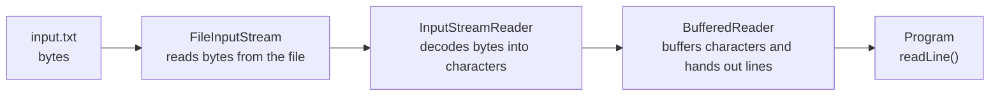
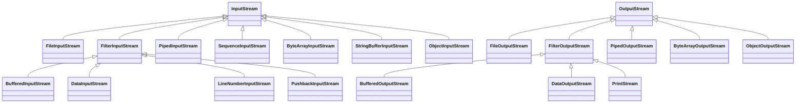
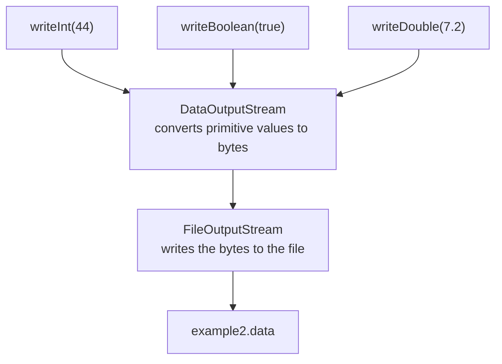

# Lecture 10 — File I/O

[Repository Guide](../../README.md) | [English](Concepts_Lecture.md) | [한국어](Concepts_Lecture.ko.md)

> **Last Updated:** 2026-11-27

> **Learning Objectives:**
> 1. Specify files and obtain information about them with the File class and JFileChooser
> 2. Read and write files using FileReader/FileWriter and BufferedReader
> 3. Parse structured data from text files
> 4. Read and write binary files with byte streams, data streams, and object streams
> 5. Apply try-with-resources for automatic resource management
> 6. Explain how character encoding and buffering affect I/O results and handle files with Path and Files of java.nio.file

---

## Table of Contents

- [1. File I/O Fundamentals](#1-file-io-fundamentals)
  - [1.1 Byte Streams vs. Character Streams](#11-byte-streams-vs-character-streams)
  - [1.2 The File Class](#12-the-file-class)
  - [1.3 The JFileChooser Class](#13-the-jfilechooser-class)
  - [1.4 The Stream Hierarchy and Wrapping](#14-the-stream-hierarchy-and-wrapping)
  - [1.5 Character Encoding and Character Streams](#15-character-encoding-and-character-streams)
  - [1.6 Relative Paths and the Working Directory](#16-relative-paths-and-the-working-directory)
  - [1.7 I/O Exceptions](#17-io-exceptions)
- [2. Text File I/O](#2-text-file-io)
  - [2.1 Reading Text Files](#21-reading-text-files)
  - [2.2 Writing Text Files](#22-writing-text-files)
  - [2.3 Parsing Text Files with Scanner](#23-parsing-text-files-with-scanner)
  - [2.4 How Buffering and flush Work](#24-how-buffering-and-flush-work)
  - [2.5 Parsing Record-Formatted Text Files](#25-parsing-record-formatted-text-files)
  - [2.6 Scanner Compared with BufferedReader](#26-scanner-compared-with-bufferedreader)
  - [2.7 Line Separators](#27-line-separators)
- [3. Binary File I/O](#3-binary-file-io)
  - [3.1 Low-Level I/O: FileInputStream and FileOutputStream](#31-low-level-io-fileinputstream-and-fileoutputstream)
  - [3.2 DataInputStream and DataOutputStream](#32-datainputstream-and-dataoutputstream)
  - [3.3 ObjectInputStream and ObjectOutputStream](#33-objectinputstream-and-objectoutputstream)
  - [3.4 The Bytes Stored in a Binary File](#34-the-bytes-stored-in-a-binary-file)
  - [3.5 Handling the End of a File](#35-handling-the-end-of-a-file)
  - [3.6 Random Access Files](#36-random-access-files)
  - [3.7 Streams over Memory](#37-streams-over-memory)
- [4. Try-with-Resources](#4-try-with-resources)
  - [4.1 The Order of Closing Resources](#41-the-order-of-closing-resources)
  - [4.2 Suppressed Exceptions](#42-suppressed-exceptions)
  - [4.3 Comparison with Closing in finally](#43-comparison-with-closing-in-finally)
  - [4.4 Resources That try-with-resources Can Close](#44-resources-that-try-with-resources-can-close)
- [5. The Serializable Interface](#5-the-serializable-interface)
  - [5.1 Object Graphs and Shared References](#51-object-graphs-and-shared-references)
  - [5.2 serialVersionUID and Class Compatibility](#52-serialversionuid-and-class-compatibility)
  - [5.3 Serialization and Inheritance](#53-serialization-and-inheritance)
- [6. The java.nio.file Package](#6-the-javaniofile-package)
  - [6.1 Path](#61-path)
  - [6.2 Reading and Writing with Files](#62-reading-and-writing-with-files)
  - [6.3 Managing Directories and Files](#63-managing-directories-and-files)
  - [6.4 Comparison with the File Class](#64-comparison-with-the-file-class)
  - [6.5 Walking a Directory Tree](#65-walking-a-directory-tree)
- [7. Common Mistakes](#7-common-mistakes)
- [Summary](#summary)
- [Self-Check Questions](#self-check-questions)
- [References](#references)

---

<br>

## 1. File I/O Fundamentals

### 1.1 Byte Streams vs. Character Streams

To read data from or write data to a file, we must create one of the Java stream objects and attach it to the file. A **stream** is a sequence of data items, usually 8-bit bytes. An **input stream** has a source from which the data items come, and an **output stream** has a destination to which the data items go.

| Type | Base Classes | Use Case |
|:-----|:-------------|:---------|
| Byte Streams | `InputStream` / `OutputStream` | Binary data (images, audio, serialized objects) |
| Character Streams | `Reader` / `Writer` | Text data (UTF-8/16 encoded files) |

*Table 1. Comparison of byte streams and character streams*

### 1.2 The File Class

The `File` class represents the path of a file or directory and does not actually open the file.

```java
File file = new File("data.txt");
System.out.println("Exists: " + file.exists());
System.out.println("Size:   " + file.length() + " bytes");
System.out.println("Path:   " + file.getAbsolutePath());
```

To operate on a file, we first create a `File` object from `java.io`. `new File("sample.dat")` refers to `sample.dat` in the current directory, and `new File("C:/SamplePrograms/test.dat")` refers to `test.dat` in the directory `C:\SamplePrograms` by its full pathname. Java accepts the generic path separator `/` even on Windows. A backslash must be written twice inside a string, as in `"C:\\SamplePrograms\\test.dat"`.

```java
if (inFile.exists()) {      // check whether inFile is associated with a real file or directory
    ...
}

if (inFile.isFile()) {      // check whether inFile is a file (false: a directory or nonexistent)
    ...
}

File directory = new File("C:/JavaPrograms/Ch12");
String filename[] = directory.list();     // names of all files in the directory

for (int i = 0; i < filename.length; i++) {
    System.out.println(filename[i]);
}
```

`length()` returns the size of the file in bytes and returns 0 if the file does not exist. `list()` returns `null` for a `File` that is not a directory.

### 1.3 The JFileChooser Class

A `javax.swing.JFileChooser` object lets the user select a file in a dialog.

```java
JFileChooser chooser = new JFileChooser();
chooser.showOpenDialog(null);

// To start the listing from a specific directory
JFileChooser chooser = new JFileChooser("D:/JavaPrograms/Ch12");
chooser.showOpenDialog(null);
```

`showOpenDialog` returns a value indicating which button the user clicked. The selected file and the directory shown by the dialog are obtained with `getSelectedFile()` and `getCurrentDirectory()`.

```java
int status = chooser.showOpenDialog(null);
if (status == JFileChooser.APPROVE_OPTION) {
    JOptionPane.showMessageDialog(null, "Open is clicked");
} else { //== JFileChooser.CANCEL_OPTION
    JOptionPane.showMessageDialog(null, "Cancel is clicked");
}

File selectedFile     = chooser.getSelectedFile();
File currentDirectory = chooser.getCurrentDirectory();
```

A **file filter** restricts the listing in `JFileChooser` to only those files and directories that meet the designated criteria. We define a subclass of `javax.swing.filechooser.FileFilter` and implement `public boolean accept(File file)` and `public String getDescription()`. The following `JavaFilter` restricts the listing to directories and Java source files.

```java
class JavaFilter extends FileFilter {
    public boolean accept(File file) {
        return file.isDirectory() || file.getName().endsWith(".java");
    }
    public String getDescription() {
        return "Java source files (*.java)";
    }
}

chooser.setFileFilter(new JavaFilter());
```

### 1.4 The Stream Hierarchy and Wrapping

The stream classes of `java.io` fall into two groups. One group connects directly to an actual source or destination of data such as a file, a memory array, or a socket (`FileInputStream`, `ByteArrayInputStream`, `FileReader`); the other wraps another stream and adds a capability (`BufferedInputStream`, `DataInputStream`, `BufferedReader`). The latter group takes another stream in its constructor, handles the requests it receives, and passes them on to the wrapped stream. This design, which wraps an object and adds a capability while keeping the same interface, is called the **decorator pattern**, and the `java.io` classes whose names begin with `Filter` (`FilterInputStream`, `FilterOutputStream`) are its basis (Figure 2).

A stream chain commonly used to read a text file line by line looks like this.

```java
BufferedReader in = new BufferedReader(
                        new InputStreamReader(
                            new FileInputStream("input.txt"), StandardCharsets.UTF_8));
```



*Figure 1. Wrapping of streams that read a text file*

The innermost `FileInputStream` reads bytes from the file. `InputStreamReader` acts as a bridge that turns those bytes into characters according to a given character encoding, and it is the only point in this chain where byte streams meet character streams. The outer `BufferedReader` reads characters ahead in large chunks and hands them out one line at a time through `readLine()`. The `new BufferedReader(new FileReader("input.txt"))` of Section 2.1 has the same structure; `FileReader` is a convenience class that combines `FileInputStream` and `InputStreamReader`.

When closing wrapped streams, closing only the outermost stream is enough. The outer stream's `close()` calls the `close()` of the stream it wraps, in turn, down to the innermost file. The writing side is symmetric: `PrintWriter` wraps `BufferedWriter`, `BufferedWriter` wraps `OutputStreamWriter`, and `OutputStreamWriter` wraps `FileOutputStream`, and closing the outer stream pushes the buffered contents inward before the file is closed.

| Role | Byte streams | Character streams |
|:-----|:-----|:-----|
| Connected directly to a file | `FileInputStream`, `FileOutputStream` | `FileReader`, `FileWriter` |
| Buffering | `BufferedInputStream`, `BufferedOutputStream` | `BufferedReader`, `BufferedWriter` |
| Primitive values and objects | `DataInputStream`, `DataOutputStream`, `ObjectInputStream`, `ObjectOutputStream` | None |
| Formatted output | `PrintStream` (`System.out`) | `PrintWriter` |
| Conversion between bytes and characters | None | `InputStreamReader`, `OutputStreamWriter` |

*Table 2. Byte streams and character streams by role*

### 1.5 Character Encoding and Character Streams

Java's `char` and `String` represent characters in Unicode, but what a file stores is bytes. The rule that turns characters into a byte sequence is called a **character encoding**, or charset, and the same string becomes a different byte sequence under a different encoding. Character streams decode bytes into characters when reading and encode characters into bytes when writing, so the original string is restored only when the same encoding is used for writing and reading.

```java wide-ok
import java.io.*;
import java.nio.charset.Charset;
import java.nio.charset.StandardCharsets;

public class Encoding {
    static String hex(byte[] b) {
        StringBuilder sb = new StringBuilder();
        for (byte x : b) sb.append(String.format("%02X ", x));
        return sb.toString().trim();
    }

    public static void main(String[] args) throws IOException {
        System.out.println("default charset: " + Charset.defaultCharset());
        String s = "Java자바";
        System.out.println("chars: " + s.length());
        System.out.println("UTF-8    " + s.getBytes(StandardCharsets.UTF_8).length + " bytes: "
                + hex(s.getBytes(StandardCharsets.UTF_8)));
        System.out.println("UTF-16BE " + s.getBytes(StandardCharsets.UTF_16BE).length + " bytes: "
                + hex(s.getBytes(StandardCharsets.UTF_16BE)));

        try (Writer w = new OutputStreamWriter(new FileOutputStream("enc.txt"), StandardCharsets.UTF_8)) {
            w.write(s);
        }
        System.out.println("file size: " + new File("enc.txt").length());

        try (BufferedReader ok = new BufferedReader(new InputStreamReader(
                 new FileInputStream("enc.txt"), StandardCharsets.UTF_8));
             BufferedReader bad = new BufferedReader(new InputStreamReader(
                 new FileInputStream("enc.txt"), StandardCharsets.ISO_8859_1))) {
            System.out.println("read as UTF-8:      " + ok.readLine());
            String wrong = bad.readLine();
            System.out.println("read as ISO-8859-1: " + wrong.length() + " chars");
        }
    }
}
```

```text wide-ok
default charset: UTF-8
chars: 6
UTF-8    10 bytes: 4A 61 76 61 EC 9E 90 EB B0 94
UTF-16BE 12 bytes: 00 4A 00 61 00 76 00 61 C7 90 BC 14
file size: 10
read as UTF-8:      Java자바
read as ISO-8859-1: 10 chars
```

`"Java자바"` has 6 characters. In UTF-8 each of the Latin letters J, a, v, a takes 1 byte (`4A 61 76 61`) and each of the Hangul syllables 자 and 바 takes 3 bytes (`EC 9E 90`, `EB B0 94`), for 4 + 3 × 2 = 10 bytes in total. UTF-16BE represents all these characters in 2 bytes, for 6 × 2 = 12 bytes, and the Unicode values U+C790 and U+BC14 of 자 and 바 appear as they are. The file written with UTF-8 specified for `OutputStreamWriter` is also 10 bytes. Reading this file as UTF-8 gives back the original string, but reading it as ISO-8859-1, which reads one byte as one character, turns the 10 bytes into 10 characters and garbles the Hangul.

The constructors of `FileReader`, `FileWriter`, and `InputStreamReader` that take no encoding use the platform's default charset [1]. Up to JDK 17 the default charset depended on the operating system and locale, so a file written on Korean Windows could show garbled Hangul when read on another computer. From JDK 18 on, the default charset of the standard Java APIs is specified as UTF-8 [2]. The first output line, `default charset: UTF-8`, reflects this. Code that exchanges files with other programs is still safer when it names the encoding explicitly, as in `StandardCharsets.UTF_8`.

> **Caution:** The number of bytes and the number of characters are generally not the same. What `File.length()` and `Files.size()` return is the number of bytes, not characters. Creating an array of characters from the size of a UTF-8 file makes it larger than needed when the file contains Hangul.

### 1.6 Relative Paths and the Working Directory

A path that names no directory, like `new File("sample.dat")` in Section 1.2, is called a **relative path**, and a path written from the top of the file system, like `C:/SamplePrograms/test.dat` or `/home/user/test.dat`, is called an **absolute path**. A relative path is resolved not against the location of the source file or class file but against the directory from which the program was run, the **working directory**. The following program opens the file at the relative path `scores.csv`.

```java
import java.io.File;
import java.io.FileNotFoundException;
import java.io.FileReader;

public class RelPath {
    public static void main(String[] args) {
        File f = new File("scores.csv");
        System.out.println("absolute? " + f.isAbsolute() + ", exists? " + f.exists());
        try (FileReader r = new FileReader(f)) {
            System.out.println("opened " + f.getName());
        } catch (FileNotFoundException e) {
            System.out.println("FileNotFoundException: " + e.getMessage());
        } catch (java.io.IOException e) {
            System.out.println("IOException: " + e.getMessage());
        }
    }
}
```

The results of running it in the directory that contains `scores.csv` and of running the same class file from another directory are as follows.

```text
absolute? false, exists? true
opened scores.csv
```

```text
absolute? false, exists? false
FileNotFoundException: scores.csv (No such file or directory)
```

The code and class file are the same, but the working directory differs, so the second run could not find the file. The reason in parentheses, `No such file or directory`, is the wording of macOS and Linux; Windows reports it in different words. When a program is run from an IDE, the working directory is usually the top directory of the project rather than the source folder, so a data file placed next to the source file is often not found. The current working directory can be obtained with `System.getProperty("user.dir")`. The path separator is `\` on Windows and `/` on macOS and Linux, but Java accepts `/` even on Windows (Section 1.2), so writing `/` in code, or passing the names separately as in `Path.of("data", "scores.csv")`, is more portable.

### 1.7 I/O Exceptions

Most file I/O methods are declared to throw the **checked exception** `IOException` or one of its subclasses. A checked exception must be handled with `try-catch` or stated in the method declaration with `throws`; if neither is done, the code does not compile (Lecture 6, Section 3.5).

```java
import java.io.FileReader;

public class Unreported {
    public static void main(String[] args) {
        FileReader r = new FileReader("scores.csv");
        r.close();
    }
}
```

```text
Unreported.java:5: error: unreported exception FileNotFoundException; must be caught or declared to be thrown
        FileReader r = new FileReader("scores.csv");
                       ^
Unreported.java:6: error: unreported exception IOException; must be caught or declared to be thrown
        r.close();
               ^
2 errors
```

The constructor of `FileReader` can throw `FileNotFoundException` when it cannot open the file, and `close()` can throw `IOException`, so both lines are errors. The I/O exceptions met most often are as follows.

| Exception | When it occurs |
|:-----|:-----|
| `FileNotFoundException` | A `java.io` stream could not open a file (missing file, a directory, insufficient permission) |
| `EOFException` | `DataInputStream` or `ObjectInputStream` reached the end of the file before reading a whole value (Section 3.5) |
| `NotSerializableException` | An attempt was made to serialize an object that is not `Serializable` (Section 5) |
| `InvalidClassException` | The serialized class and the current class are incompatible (Section 5.2) |
| `NoSuchFileException` | A `java.nio.file` method could not find a file (Section 6.3) |
| `UncheckedIOException` | It wraps an `IOException` where checked exceptions cannot be thrown, such as in a lambda (Section 6.5) |

*Table 3. I/O exceptions met most often*

Only `UncheckedIOException` is a subclass of `RuntimeException`; all the others are subclasses of `IOException`. When catching exceptions, write the specific exception first and `IOException` later. `RelPath` in Section 1.6 also catches `FileNotFoundException` first and other `IOException`s later. Reversing the order would let the earlier `catch (IOException e)` receive `FileNotFoundException` too, so the later `catch` would be unreachable and a compile error would occur.

---

<br>

## 2. Text File I/O

Instead of storing primitive data values as binary data, we can convert them to strings and store those. The resulting text file can be viewed with any text editor. To write to a text file we use `PrintWriter` (or `BufferedWriter`), and to read from one we use `FileReader` and `BufferedReader`; from Java 5.0 we can also read text files with `Scanner`.

### 2.1 Reading Text Files

```java
try (BufferedReader reader = new BufferedReader(new FileReader("input.txt"))) {
    String line;
    while ((line = reader.readLine()) != null) {
        System.out.println(line);
    }
} catch (IOException e) {
    System.err.println("Error reading file: " + e.getMessage());
}
```

`readLine()` returns one line as a string without the line terminator, and returns `null` at the end of the file. To use a line as a number, convert it, as in `Integer.parseInt(line)`. Reading `example3.data` from Section 2.2 this way prints three lines: `10`, `Hello, world.`, and `true`.

### 2.2 Writing Text Files

```java
try (BufferedWriter writer = new BufferedWriter(new FileWriter("output.txt"))) {
    writer.write("Hello, File I/O!");
    writer.newLine();
    writer.write("Second line.");
} catch (IOException e) {
    System.err.println("Error writing file: " + e.getMessage());
}
```

With `PrintWriter`, values of various types are converted to strings and written with `print` and `println`, just as with `System.out`.

```java
File outFile = new File("example3.data");
FileOutputStream outFileStream = new FileOutputStream(outFile);
PrintWriter outStream = new PrintWriter(outFileStream);

// write values of primitive data types to the stream
outStream.println(10);
outStream.println("Hello, world.");
outStream.println(true);

// output done, so close the stream
outStream.close();
```

`PrintWriter` keeps an internal buffer, so `close()` (or `flush()`) must be called for the buffered content to reach the file.

> **Key Point:** For performance, `FileReader`/`FileWriter` are usually wrapped in `BufferedReader`/`BufferedWriter`. Buffering reduces the number of actual disk I/O operations.

### 2.3 Parsing Text Files with Scanner

Passing a `File` object to `Scanner` lets us read and convert the contents of a file token by token with the same methods as for keyboard input.

```java
Scanner scanner = new Scanner(new File("example3.data"));

int n = scanner.nextInt();          // 10
scanner.nextLine();                 // consume the rest of the first line (the newline)
String text = scanner.nextLine();   // "Hello, world."
boolean b = scanner.nextBoolean();  // true

scanner.close();
```

`next()`, `nextInt()`, and `nextBoolean()` read one token separated by whitespace (spaces, tabs, newlines), while `nextLine()` reads from the current position to the end of the line. A line that contains spaces, such as `Hello, world.`, must therefore be read with `nextLine()` to get it as one piece. A structured line such as a comma-separated record is parsed by reading it with `nextLine()`, splitting it with `line.split(",")`, and converting each piece with `Integer.parseInt` or similar.

### 2.4 How Buffering and flush Work

Section 2.2 stated that the contents of a `PrintWriter` buffer reach the file only when `close()` or `flush()` is called. The following program prints the actual size of the file at each step of writing.

```java
import java.io.*;

public class FlushDemo {
    public static void main(String[] args) throws IOException {
        File f = new File("flush.txt");
        PrintWriter out = new PrintWriter(new FileWriter(f));
        out.println("first line");
        System.out.println("after println: " + f.length() + " bytes");
        out.flush();
        System.out.println("after flush:   " + f.length() + " bytes");
        out.println("second line");
        out.close();
        System.out.println("after close:   " + f.length() + " bytes");
    }
}
```

```text
after println: 0 bytes
after flush:   11 bytes
after close:   23 bytes
```

Even after `println("first line")` finishes, the file is 0 bytes. The string is only in the internal buffer of `FileWriter` and has not yet been handed to the operating system. Calling `flush()` writes the 11 bytes in the buffer (the 10 characters of `first line` and 1 newline character) to the file, and `close()` writes the remaining 12 bytes (`second line` and a newline) and closes the file, making it 23 bytes. If a program ends without `close()`, whatever is left in the buffer is lost.

The reason for buffering is performance. If each `write()` of a stream led to one write call of the operating system, every call would pay the cost of switching between user mode and kernel mode. A buffering stream collects data in memory and hands it over in bulk when the buffer is full or when `flush()` or `close()` is called, which greatly reduces the number of operating-system calls.

```java
import java.io.*;

public class Buffering {
    static final int N = 1_000_000;

    static long write(OutputStream out) throws IOException {
        long t0 = System.nanoTime();
        try (out) {
            for (int i = 0; i < N; i++) out.write(i & 0xFF);   // one byte at a time
        }
        return (System.nanoTime() - t0) / 1_000_000;
    }

    public static void main(String[] args) throws IOException {
        long raw = write(new FileOutputStream("raw.bin"));
        long buf = write(new BufferedOutputStream(new FileOutputStream("buf.bin")));
        System.out.println("FileOutputStream:          " + raw + " ms");
        System.out.println("BufferedOutputStream:      " + buf + " ms");
        System.out.println("sizes " + new File("raw.bin").length() + " " + new File("buf.bin").length());
    }
}
```

```text
FileOutputStream:          1737 ms
BufferedOutputStream:      13 ms
sizes 1000000 1000000
```

Both cases wrote 1,000,000 bytes one byte at a time, and the resulting files have the same size. But writing directly to `FileOutputStream` called the operating system for every `write()` and took a little over 1.7 seconds, while wrapping it in `BufferedOutputStream` called the operating system only when the buffer was full and finished in 13 milliseconds. The times differ between computers, but in a program that writes many small pieces, buffering speeds things up from tens to more than a hundred times. When the number of calls is already small, as with `write(byteArray)` in Section 3.1, which writes a large array at once, the effect is small. `try (out)` is a form that lets try-with-resources close a resource variable declared earlier; the variable must be final or effectively final, never changing its value.

> **Note:** **The buffer of System.out.** `System.out` is a `PrintStream` made to flush automatically when a newline is written or `println` is called. This is why console output appears immediately without `flush()`. A `PrintWriter` connected to a file flushes on every `println` only if it is created with the constructor `new PrintWriter(writer, true)`.

### 2.5 Parsing Record-Formatted Text Files

A text file that holds one record per line with fields separated by commas is called a CSV (comma-separated values) file. Reading a line and splitting it with `split(",")`, as in Section 2.3, gives the fields. Real data may contain malformed lines, so parsing handles exceptions line by line so that an error in one line does not stop the whole run.

```java
import java.io.*;
import java.util.Scanner;

public class CsvParse {
    public static void main(String[] args) throws IOException {
        try (PrintWriter w = new PrintWriter(new FileWriter("scores.csv"))) {
            w.println("name,score");
            w.println("Kim,90");
            w.println("Lee,85");
            w.println("Park,ninety");
            w.println("Choi,77");
        }

        int total = 0, count = 0;
        try (Scanner sc = new Scanner(new File("scores.csv"))) {
            sc.nextLine();                                  // skip the header line
            int lineNo = 1;
            while (sc.hasNextLine()) {
                String line = sc.nextLine();
                lineNo++;
                String[] parts = line.split(",");
                try {
                    int score = Integer.parseInt(parts[1].trim());
                    total += score;
                    count++;
                } catch (NumberFormatException e) {
                    System.out.println("line " + lineNo + " skipped: " + line);
                }
            }
        }
        System.out.printf("%d records, average %.2f%n", count, (double) total / count);
    }
}
```

```text
line 4 skipped: Park,ninety
3 records, average 84.00
```

The first `nextLine()` skips the header line `name,score`. Next, `Kim,90` makes `parts` equal to `{"Kim", "90"}` and adds 90, and `Lee,85` adds 85. On the fourth line, `Park,ninety`, `Integer.parseInt("ninety")` throws a `NumberFormatException`, so only that line is skipped and a message is printed. After `Choi,77` is processed, the sum of the 3 records is 90 + 85 + 77 = 252 and the average is 252 / 3 = 84.00. Removing the cast in `(double) total / count` would make it an integer division and drop the fractional part.

This approach suits only simple files without commas inside fields. If a field contains a comma inside quotes, as in `"Seoul, Korea"`, `split(",")` splits the field wrongly, so such files need a separate parser that handles the quoting rules.

### 2.6 Scanner Compared with BufferedReader

`BufferedReader` of Section 2.1 and `Scanner` of Section 2.3 both read text files, but they serve different purposes.

| Aspect | `BufferedReader` | `Scanner` |
|:-----|:-----|:-----|
| Unit of reading | Lines (`readLine()`) or characters (`read()`) | Tokens (`next()`, `nextInt()`, and so on) and lines (`nextLine()`) |
| Converting values | Receives strings and converts them itself (`Integer.parseInt`) | `nextInt()` and `nextDouble()` convert directly |
| Malformed input | A `NumberFormatException` occurs where the conversion is done | An `InputMismatchException` occurs |
| I/O errors | Throws `IOException` | Does not throw; records it, to be checked with `ioException()` |
| Speed on large files | Fast | Relatively slow, because it splits tokens with regular expressions |

*Table 4. BufferedReader compared with Scanner*

`BufferedReader` is convenient for reading a lot of data line by line and parsing it yourself, and `Scanner` for receiving a few values directly by type, as with keyboard input. `Scanner` does not throw even when an `IOException` occurs while reading and behaves as if the input had ended, so a program that must tell whether it read a file to the end or stopped on an error checks whether `ioException()` is `null` after the loop ends.

### 2.7 Line Separators

Lines of a text file are separated by line-separator characters, which differ between operating systems. macOS and Linux use a single LF (line feed, `\n`, 0x0A), and Windows uses the two characters CR (carriage return, `\r`, 0x0D) and LF. `println()` and `BufferedWriter.newLine()` use `System.lineSeparator()`, the line-separator string of the running operating system, so files made by the same program differ in size between operating systems. `FlushDemo` of Section 2.4 was run on macOS, so `first line` and its newline were 11 bytes, but on Windows each line grows by 1 byte and this becomes 12 bytes.

The reading side seldom needs to care about this difference. `readLine()`, `Scanner.nextLine()`, and `Files.readAllLines()` accept LF, CR, and CR followed by LF as the end of a line, and they remove the line-separator characters from the strings they return. In contrast, when writing a file whose exact format another program requires (for example, messages of a network protocol or some CSV standards), the line separator is set explicitly, as in `print(text + "\r\n")`, instead of using `println()`. Appending `"\n"` directly to the end of messages in the socket communication of Lecture 14 has the same reason.

---

<br>

## 3. Binary File I/O

### 3.1 Low-Level I/O: FileInputStream and FileOutputStream

`FileOutputStream` and `FileInputStream` are the basic streams for file access. `FileOutputStream` outputs a sequence of `byte` values, and `FileInputStream` reads in an array of bytes. The byte stream classes form a hierarchy rooted at `InputStream` and `OutputStream`.



*Figure 2. Class hierarchy of InputStream and OutputStream*

`LineNumberInputStream` and `StringBufferInputStream` are deprecated because they treat bytes as characters incorrectly; the character streams `LineNumberReader` and `StringReader` are used instead.

The following two programs save a byte array to a binary file and read it back.

```java
// set up file and stream
File outFile = new File("example1.data");
FileOutputStream outStream = new FileOutputStream(outFile);

// data to save
byte[] byteArray = { 10, 20, 30, 40, 50, 60, 70, 80 };

// write data to the stream
outStream.write(byteArray);

// output done, so close the stream
outStream.close();
```

```java
// set up file and stream
File inFile = new File("example1.data");
FileInputStream inStream = new FileInputStream(inFile);

// set up an array to read data in
int    fileSize  = (int) inFile.length();
byte[] byteArray = new byte[fileSize];

// read data in and display them
inStream.read(byteArray);
for (int i = 0; i < fileSize; i++) {
    System.out.println(byteArray[i]);
}

// input done, so close the stream
inStream.close();
```

The reading side gets the file size with `inFile.length()`, creates an array of that size, and reads it all at once. The `main` containing either program must declare `throws IOException` or use `try-catch`, because the `FileOutputStream` constructor, `write`, `read`, and `close` can throw the checked exception `IOException` (Lecture 6, Section 3.5).

### 3.2 DataInputStream and DataOutputStream

`DataOutputStream` and `DataInputStream` are streams that write and read primitive values such as `int`, `double`, and `boolean` in binary format. The following code writes four kinds of values and reads them back in the same order.

```java
// Writing
try (DataOutputStream dos = new DataOutputStream(new FileOutputStream("data.bin"))) {
    dos.writeInt(42);
    dos.writeDouble(3.14);
    dos.writeBoolean(true);
    dos.writeUTF("Hello");
}

// Reading (must match the write order and types)
try (DataInputStream dis = new DataInputStream(new FileInputStream("data.bin"))) {
    int i = dis.readInt();
    double d = dis.readDouble();
    boolean b = dis.readBoolean();
    String s = dis.readUTF();
}
```

A `DataOutputStream` is layered on top of a `FileOutputStream`. The standard setup sequence is a `File` object, a `FileOutputStream` attached to that file, and a `DataOutputStream` wrapping that stream.

```java
File             outFile       = new File("example2.data");
FileOutputStream outFileStream = new FileOutputStream(outFile);
DataOutputStream outDataStream = new DataOutputStream(outFileStream);

// write an int, boolean, double
outDataStream.writeInt(44);
outDataStream.writeBoolean(true);
outDataStream.writeDouble(7.2);

outDataStream.close();
```



*Figure 3. Output structure layering DataOutputStream on FileOutputStream*

`writeInt` writes 4 bytes, `writeBoolean` 1 byte, and `writeDouble` 8 bytes, so `example2.data` is 13 bytes long. Reading uses the same pattern, creating a `File`, a `FileInputStream`, and a `DataInputStream` in turn, and the `DataInputStream` converts the bytes read from the file into primitive values.

```java
File            inFile       = new File("example2.data");
FileInputStream inFileStream = new FileInputStream(inFile);
DataInputStream inDataStream = new DataInputStream(inFileStream);

// read an int, boolean, double
int n = inDataStream.readInt();
boolean b = inDataStream.readBoolean();
double d = inDataStream.readDouble();

inDataStream.close();

// what did we get?
System.out.println("n = " + n);
System.out.println("b = " + b);
System.out.println("d = " + d);
```

The output is `n = 44`, `b = true`, and `d = 7.2`.

> **Caution:** A binary file stores no type information about its values. To read stored primitive data back correctly, we must know the order and types in which it was written, and the order of read operations must match the order of write operations. If the orders differ, wrong values can be read without any exception.

### 3.3 ObjectInputStream and ObjectOutputStream

`ObjectOutputStream` and `ObjectInputStream` are streams that turn a whole object into a byte sequence and store it (serialization) and restore it as an object (deserialization).

```java
// Writing an object
try (ObjectOutputStream oos = new ObjectOutputStream(new FileOutputStream("obj.bin"))) {
    oos.writeObject(myAccount);
}

// Reading an object
try (ObjectInputStream ois = new ObjectInputStream(new FileInputStream("obj.bin"))) {
    Account account = (Account) ois.readObject();
}
```

Objects can be stored just as easily as primitive data values. Objects of different classes can be saved one after another to the same stream.

```java
File               outFile         = new File("objects.data");
FileOutputStream   outFileStream   = new FileOutputStream(outFile);
ObjectOutputStream outObjectStream = new ObjectOutputStream(outFileStream);

Person person = new Person("Mr. Espresso", 20, 'M');
outObjectStream.writeObject(person);

account1 = new Account();
bank1    = new Bank();
outObjectStream.writeObject(account1);   // objects of different classes can be saved
outObjectStream.writeObject(bank1);
```

The return type of `readObject()` is `Object`, so the result must be cast to the correct type, and objects must be read in the order they were saved. Besides `IOException`, `readObject()` can throw the checked exception `ClassNotFoundException`.

```java
Person person = (Person) inObjectStream.readObject();

Account account1 = (Account) inObjectStream.readObject();
Bank    bank1    = (Bank) inObjectStream.readObject();
```

An array can also be saved and loaded as a whole at once instead of processing its elements individually.

```java
Person[] people = new Person[N];   // assume N already has a value

// build the people array
. . .
// save the array
outObjectStream.writeObject(people);

// read the array
Person[] people = (Person[]) inObjectStream.readObject();
```

The following example saves an array of 20 `Account` objects, whose class implements `Serializable`, at once.

```java
Account[] account = new Account[NUM_OF_ACCOUNT];   // NUM_OF_ACCOUNT = 20

for (int i = 0; i < NUM_OF_ACCOUNT; i++) {
    account[i] = new Account();
    account[i].setOwnerName("Student_" + (i + 1));
}

try (ObjectOutputStream outObjectStream =
         new ObjectOutputStream(new FileOutputStream("example4.data"))) {
    outObjectStream.writeObject(account);
}
```

`ObjectOutputStream` also keeps an internal buffer, so if the stream is not closed, part of the data may never be written to the file. Closing it with try-with-resources, as above, is safe.

### 3.4 The Bytes Stored in a Binary File

Looking at the bytes actually stored in `example2.data` of Section 3.2 makes clear what it means that a binary format carries no type information. The following program creates the same file and prints its contents in hexadecimal.

```java wide-ok
import java.io.*;
import java.nio.file.Files;
import java.nio.file.Path;

public class HexDump {
    public static void main(String[] args) throws IOException {
        try (DataOutputStream out = new DataOutputStream(new FileOutputStream("example2.data"))) {
            out.writeInt(44);
            out.writeBoolean(true);
            out.writeDouble(7.2);
        }
        dump("example2.data");

        try (DataOutputStream out = new DataOutputStream(new FileOutputStream("utf.data"))) {
            out.writeUTF("Hi자바");
        }
        dump("utf.data");
        System.out.println(Long.toHexString(Double.doubleToLongBits(7.2)));
    }

    static void dump(String name) throws IOException {
        byte[] b = Files.readAllBytes(Path.of(name));
        StringBuilder sb = new StringBuilder(name + " (" + b.length + " bytes):");
        for (byte x : b) sb.append(String.format(" %02X", x));
        System.out.println(sb);
    }
}
```

```text
example2.data (13 bytes): 00 00 00 2C 01 40 1C CC CC CC CC CC CD
utf.data (10 bytes): 00 08 48 69 EC 9E 90 EB B0 94
401ccccccccccccd
```

The 13 bytes of `example2.data` divide as follows.

| Position | Bytes | Method that wrote them | Meaning |
|:-----|:-----|:-----|:-----|
| 0-3 | `00 00 00 2C` | `writeInt(44)` | 44 = 0x2C in 4 bytes, high byte first |
| 4 | `01` | `writeBoolean(true)` | `true` is 1, `false` is 0 |
| 5-12 | `40 1C CC CC CC CC CC CD` | `writeDouble(7.2)` | The IEEE 754 double-precision bit pattern of 7.2, high byte first |

*Table 5. Byte layout of example2.data*

`DataOutputStream` writes an `int` as 4 bytes and a `double` as the 8 bytes of the 64-bit pattern obtained with `Double.doubleToLongBits()`, both high byte first [3]. Placing the higher-order byte first is called **big-endian** order. The order is the same on whatever computer the file is written, so the same file can be read on other operating systems. The last output line, `401ccccccccccccd`, is the hexadecimal value of `doubleToLongBits(7.2)` and matches bytes 5 through 12. 7.2 cannot be represented exactly in binary, so the mantissa repeats as `CCC...` and is rounded at the last digit, ending in `CD`.

In the result of `writeUTF("Hi자바")`, the first 2 bytes `00 08` give the number 8 of bytes that follow, followed by 1 byte each for `H` and `i` and 3 bytes each for 자 and 바. `writeUTF` writes this length in 2 bytes, so a string whose encoded form exceeds 65,535 bytes cannot be written [3]. Because the number of bytes is recorded first, `readUTF()` knows where the string ends. In contrast, `writeInt` and `writeDouble` write only the bytes of the value without any marker, so the reader must know the order and types (the caution box of Section 3.2).

### 3.5 Handling the End of a File

To read to the end a file whose number of stored values is unknown, a program must detect that it has reached the end of the file (EOF). Streams signal the end of a file in different ways.

| Method | Behavior at the end of a file |
|:-----|:-----|
| `InputStream.read()` | Returns -1 (a byte read is an `int` from 0 to 255) |
| `InputStream.read(byte[] b)` | Returns the number of bytes read, and -1 when there is nothing more to read |
| `Reader.read()` | Returns -1 |
| `BufferedReader.readLine()` | Returns `null` |
| `DataInputStream.readInt()` and the like | Throws `EOFException` |
| `ObjectInputStream.readObject()` | Throws `EOFException` |
| `Scanner.hasNext()`, `hasNextLine()` | Returns `false` |

*Table 6. How each stream signals the end of a file*

```java
import java.io.*;

public class EofDemo {
    public static void main(String[] args) throws IOException {
        try (FileOutputStream out = new FileOutputStream("example1.data")) {
            out.write(new byte[] {10, 20, 30, 40, 50, 60, 70, 80});
        }
        try (FileInputStream in = new FileInputStream("example1.data")) {
            int b, count = 0, sum = 0;
            while ((b = in.read()) != -1) {     // -1 means end of file
                count++;
                sum += b;
            }
            System.out.println(count + " bytes, sum " + sum);
        }

        try (DataOutputStream out = new DataOutputStream(new FileOutputStream("ints.data"))) {
            for (int i = 1; i <= 3; i++) out.writeInt(i * 100);
        }
        try (DataInputStream in = new DataInputStream(new FileInputStream("ints.data"))) {
            while (true) {
                try {
                    System.out.println("read " + in.readInt());
                } catch (EOFException e) {
                    System.out.println("EOFException: no more ints");
                    break;
                }
            }
        }
    }
}
```

```text
8 bytes, sum 360
read 100
read 200
read 300
EOFException: no more ints
```

The first loop reads bytes one at a time until `read()` returns -1. This is why the return type of `read()` is `int` rather than `byte`: it must represent both the byte values 0 to 255 and -1, which means the end of the file. The sum of the 8 bytes is 10 + 20 + ... + 80 = 360. In the second loop, `readInt()` reads 3 integers, and on the fourth call it cannot fill 4 bytes, so it throws an `EOFException` and the `catch` block ends the loop. The methods of `DataInputStream` cannot return a special value such as -1, because -1 is also a valid `int` value.

> **Caution:** Writing `b = in.read() != -1` without the parentheses of `while ((b = in.read()) != -1)` computes `!=` before `=`, so a `boolean` comparison result, not a byte, would be assigned to `b`, which is a compile error. Always put the assignment of the read value in parentheses.

### 3.6 Random Access Files

The streams so far support only **sequential access**, which reads or writes a file in order from the beginning. Reading the 1,000th value requires reading all 999 before it. `java.io.RandomAccessFile` supports **random access**, which moves the **file pointer**, the position within the file, to any place (`seek`) and reads and writes there. If all records have the same size, the position of the i-th record is i × (record size), so it can be reached directly.

```java
import java.io.IOException;
import java.io.RandomAccessFile;

public class Records {
    static final int RECORD = 12;                         // int id 4 bytes + double score 8 bytes

    public static void main(String[] args) throws IOException {
        try (RandomAccessFile f = new RandomAccessFile("records.data", "rw")) {
            f.setLength(0);
            int[] ids = {101, 102, 103, 104};
            double[] scores = {88.5, 92.0, 79.5, 95.0};
            for (int i = 0; i < ids.length; i++) {
                f.writeInt(ids[i]);
                f.writeDouble(scores[i]);
            }
            System.out.println("length " + f.length());

            f.seek(2 * RECORD);                           // move to the third record
            System.out.println("record 2: " + f.readInt() + " " + f.readDouble());

            f.seek(1 * RECORD + 4);                       // score of the second record
            f.writeDouble(100.0);
            f.seek(RECORD);
            System.out.println("record 1: " + f.readInt() + " " + f.readDouble()
                    + ", pointer now " + f.getFilePointer());
        }
    }
}
```

```text
length 48
record 2: 103 79.5
record 1: 102 100.0, pointer now 24
```

Mode `"rw"` allows both reading and writing and creates the file if it does not exist. `RandomAccessFile` has the same `readInt()` and `writeDouble()` methods as `DataInputStream` and `DataOutputStream`, so one record is 12 bytes, 4 bytes for the `int` ID and 8 bytes for the `double` score, and a file of 4 records is 48 bytes. `seek(2 * 12)`, that is, `seek(24)`, moves to the start of the third record (number 2) and reads 103 and 79.5. `seek(12 + 4)` is the position of the score in the second record, skipping its 4-byte ID, and 100.0 is written over it there. The other parts of the file do not change. Finally, reading the second record again shows the score changed to 100.0, and after reading 12 bytes the file pointer is 24. Fixed-length records with random access thus allow one record to be changed without rewriting the whole file, and this principle underlies how the databases of Lecture 17 store data.

### 3.7 Streams over Memory

The source and destination of a stream are not limited to files. `ByteArrayOutputStream` collects the bytes written to it in an array in memory, and `ByteArrayInputStream` reads bytes with an array as its source. Character streams have `StringWriter` and `StringReader` in the same roles. Thanks to the wrapping structure of Section 1.4, `DataOutputStream` and `PrintWriter` need not know whether the wrapped stream is a file or memory.

```java
import java.io.*;

public class InMemory {
    public static void main(String[] args) throws IOException {
        ByteArrayOutputStream buffer = new ByteArrayOutputStream();
        try (DataOutputStream out = new DataOutputStream(buffer)) {
            out.writeInt(44);
            out.writeBoolean(true);
            out.writeDouble(7.2);
        }
        byte[] bytes = buffer.toByteArray();
        System.out.println("in memory: " + bytes.length + " bytes");

        try (DataInputStream in = new DataInputStream(new ByteArrayInputStream(bytes))) {
            System.out.println(in.readInt() + " " + in.readBoolean() + " " + in.readDouble());
        }

        StringWriter sw = new StringWriter();
        try (PrintWriter pw = new PrintWriter(sw)) {
            pw.printf("%s scored %d%n", "Kim", 90);
        }
        System.out.print("captured: " + sw);
        System.out.println("line separator bytes: " + System.lineSeparator().length());
    }
}
```

```text
in memory: 13 bytes
44 true 7.2
captured: Kim scored 90
line separator bytes: 1
```

`DataOutputStream` wraps `ByteArrayOutputStream`, so the same three values as in Section 3.2 are written to memory instead of a file and become an array of 13 bytes. Wrapping that array in `ByteArrayInputStream` and reading it gives back 44, `true`, and 7.2. `StringWriter` collects the output of `PrintWriter` into a string. Such streams are used to measure a serialized size without creating a file, or to pass in place of a file when testing I/O code. `close()` of a memory stream does nothing, and the contents can still be obtained with `toByteArray()` after it is closed. The 1 on the last line means that the line-separator string of macOS, on which this program was run, is the single character LF (Section 2.7).

---

<br>

## 4. Try-with-Resources

Java 7+ supports automatic resource management. A resource declared in the parentheses after `try` must implement the `AutoCloseable` interface, and it is closed automatically when the block ends. This statement is called the **try-with-resources** statement.

```java
try (FileReader fr = new FileReader("file.txt");
     BufferedReader br = new BufferedReader(fr)) {
    // use br
} // br and fr are automatically closed here
```

Resources are closed in the reverse order of their declaration, so `br` is closed first and `fr` second. The resources are closed even if an exception occurs inside the block.

> **Key Point:** Prefer try-with-resources over manual `close()` calls in `finally` blocks. It is shorter, cleaner, and exception-safe.

### 4.1 The Order of Closing Resources

`Res` in the following program is an `AutoCloseable` resource that prints a message when it is created and when it is closed.

```java
public class TryResources {
    static class Res implements AutoCloseable {
        private final String name;
        private final boolean failOnClose;

        Res(String name, boolean failOnClose) {
            this.name = name;
            this.failOnClose = failOnClose;
            System.out.println("open " + name);
        }

        @Override
        public void close() {
            System.out.println("close " + name);
            if (failOnClose) throw new IllegalStateException("close failed: " + name);
        }
    }

    public static void main(String[] args) {
        try (Res a = new Res("A", false); Res b = new Res("B", false)) {
            System.out.println("body");
        }

        try (Res c = new Res("C", true)) {
            throw new RuntimeException("body failed");
        } catch (RuntimeException e) {
            System.out.println("caught: " + e.getMessage());
            for (Throwable s : e.getSuppressed())
                System.out.println("suppressed: " + s.getMessage());
        }
    }
}
```

```text
open A
open B
body
close B
close A
open C
close C
caught: body failed
suppressed: close failed: C
```

The first `try` opens resources A and B in declaration order, runs the block, and closes them in the order B, A when the block ends. A resource opened later often depends on one opened earlier (just as an outer stream wraps an inner stream in Section 1.4), so closing in reverse order is safe. The JLS specifies that resources are closed in the reverse order of their initialization, that only resources initialized to a non-null value are closed, and that an exception while closing one resource does not prevent the closing of the others [4].

### 4.2 Suppressed Exceptions

In the second `try`, the block throws `RuntimeException("body failed")`, and then the `close()` that closes resource C also throws an `IllegalStateException`. Two exceptions arose, but what `catch` receives is `body failed`, which occurred first in the block. The exception from `close()` is not discarded but attached to the first exception as a **suppressed exception**, which can be retrieved with `getSuppressed()`. The last output line shows it.

This rule matters because it keeps the cause of a problem from being lost. If an exception occurred because the disk filled up while writing a file and another exception followed while closing the file, the cause lies in the first exception. try-with-resources throws the first exception, which is the cause, and records the later exception inside it.

### 4.3 Comparison with Closing in finally

Before try-with-resources existed, resources were closed in a `finally` block as follows.

```java
BufferedReader br = null;
try {
    br = new BufferedReader(new FileReader("file.txt"));
    System.out.println(br.readLine());
} catch (IOException e) {
    System.err.println("read failed: " + e.getMessage());
} finally {
    if (br != null) {
        try {
            br.close();
        } catch (IOException e) {
            System.err.println("close failed: " + e.getMessage());
        }
    }
}
```

This code carries three burdens. First, to use the variable in `finally`, it must be declared as `null` outside `try`, and it must be checked for `null` in case the constructor failed. Second, `close()` also throws `IOException`, so another `try-catch` is needed inside `finally`. Third, if exceptions occur both in the `try` block and in `close()`, the exception from `finally` overwrites the earlier one and the cause disappears. As Section 4.2 showed, try-with-resources solves all three problems. Code that does the same work is as follows.

```java
try (BufferedReader br = new BufferedReader(new FileReader("file.txt"))) {
    System.out.println(br.readLine());
} catch (IOException e) {
    System.err.println("read or close failed: " + e.getMessage());
}
```

The `catch` block runs after the resource has been closed, so a closed resource cannot be used in `catch`.

### 4.4 Resources That try-with-resources Can Close

Only objects that implement `java.lang.AutoCloseable` can be declared in the parentheses of try-with-resources. `AutoCloseable` has a single method, `void close() throws Exception`, and `java.io.Closeable`, which the I/O classes implement, is its subinterface whose `close()` is narrowed to throw only `IOException`. All the streams of this lecture, `Scanner`, `RandomAccessFile`, `Socket` and `ServerSocket` of Lecture 14, and the database connections of Lecture 17 implement these interfaces, so they can be closed with the same syntax.

Writing an object of a class that is not `AutoCloseable` in the parentheses gives the compile error "incompatible types: try-with-resources not applicable to variable type". If a class of your own holds a resource such as a file or a connection, it implements `AutoCloseable` like `Res` of Section 4.1 so that it is closed in the same way. `Closeable.close()` is specified to have no effect when called again on a resource that is already closed, so no problem arises even when a wrapping stream closes an inner stream and the inner stream is closed once more.

---

<br>

## 5. The Serializable Interface

A class must implement `java.io.Serializable` to be written with `ObjectOutputStream`.

```java
import java.io.Serializable;

public class Account implements Serializable {
    private static final long serialVersionUID = 1L;
    private String ownerName;
    private double balance;
    // ...
}
```

Fields marked `transient` are excluded from serialization.

`Serializable` is a marker interface with no methods, so writing `implements Serializable` is all that is needed. Serialization also saves the objects that an object refers to, so the types of its non-`transient` fields must be serializable as well. Passing an object that does not implement `Serializable` to `writeObject` throws `NotSerializableException`, a subclass of `IOException`, at run time. `transient` and `static` fields are not saved, and when the object is read back, `transient` fields hold default values (0 for numbers, `null` for references). `serialVersionUID` is the version number of the class, and if the values at saving and loading time differ, `InvalidClassException` is thrown.

### 5.1 Object Graphs and Shared References

`writeObject()` stores not only the object passed to it but also every object its fields refer to, and every object those refer to in turn. The structure formed by objects and references is called an **object graph**. Default serialization writes the class of an object and the values of all its fields that are neither `transient` nor `static`, and when several references point to one object it records them with a reference sharing mechanism, so the object graph is restored to the same shape as when it was written [5].

Of the following two programs, `SaveGraph` stores an array that refers to the same `Account` object twice, and `LoadGraph` reads that array in another JVM.

```java
import java.io.Serializable;

public class Account implements Serializable {
    private static final long serialVersionUID = 1L;
    static int created = 0;
    private String owner;
    private transient double cachedRate = 0.05;

    public Account(String owner) { this.owner = owner; created++; }
    public String getOwner() { return owner; }
    public double getCachedRate() { return cachedRate; }
}
```

```java
import java.io.*;

public class SaveGraph {
    public static void main(String[] args) throws IOException {
        Account shared = new Account("Kim");
        Account[] pair = { shared, shared };            // two references to one object
        try (ObjectOutputStream out = new ObjectOutputStream(new FileOutputStream("graph.data"))) {
            out.writeObject(pair);
        }
        System.out.println("saved, file size " + new File("graph.data").length() + " bytes");
    }
}
```

```java
import java.io.*;

public class LoadGraph {
    public static void main(String[] args) throws Exception {
        try (ObjectInputStream in = new ObjectInputStream(new FileInputStream("graph.data"))) {
            Account[] pair = (Account[]) in.readObject();
            System.out.println("owner " + pair[0].getOwner());
            System.out.println("same object: " + (pair[0] == pair[1]));
            System.out.println("transient field: " + pair[0].getCachedRate());
            System.out.println("static created: " + Account.created);
        }
    }
}
```

Running `java SaveGraph` and `java LoadGraph` in turn gives the following.

```text
saved, file size 99 bytes
```

```text
owner Kim
same object: true
transient field: 0.0
static created: 0
```

The `pair[0]` and `pair[1]` that were read compare `true` even with `==`. The same object was not stored twice; the second time only a marker pointing to the earlier object was recorded, and the restored graph also contains only one object. Thanks to this property, even circular structures that refer to each other are stored without endless repetition. The `transient` field `cachedRate` is not stored, so it is the `double` default 0.0 rather than 0.05. Note that the initializer `= 0.05` in the field declaration is not executed during deserialization either. The `static` field `created` belongs to the class, not to the object, so it is not stored, and it is 0 because no constructor was ever called in the JVM of `LoadGraph`.

### 5.2 serialVersionUID and Class Compatibility

Serialized data records the name of the class together with its `serialVersionUID`. During deserialization the JVM compares the recorded value with that of the current class, and if they differ it treats the class as incompatible even under the same name and does not create the object. Reading the earlier `graph.data` with an `Account` recompiled with only `serialVersionUID` changed to `2L` gives an exception whose first message line is the following.

```text
Exception in thread "main" java.io.InvalidClassException: Account; local class incompatible: stream classdesc serialVersionUID = 1, local class serialVersionUID = 2
```

If a class declares no `serialVersionUID`, the serialization runtime computes a value from the structure of the class (its name, fields, methods, and so on). In that case even a change as small as adding a method can change the value and make existing files unreadable, so a class to be serialized declares the value itself and raises it only when the class is changed incompatibly with stored data.

> **Caution:** Deserialization creates objects from a byte sequence without going through constructors, so checks done in the constructor are not executed. Reading data from an untrusted source with `readObject()` can create objects in invalid states or cause security problems. When exchanging data with other programs, text formats (CSV, JSON, and so on) are safer and more portable.

### 5.3 Serialization and Inheritance

A subclass of a class that implements `Serializable` can be serialized automatically. Conversely, if only the subclass is `Serializable` and its superclass is not, the fields inherited from the superclass are not stored. During deserialization the JVM calls the no-argument constructor of the nearest superclass that is not `Serializable` to initialize that part.

```java
import java.io.*;

public class SerialInherit {
    static class Person {                                 // not Serializable
        String name = "unknown";
        Person() { System.out.println("Person() called"); }
    }

    static class Student extends Person implements Serializable {
        private static final long serialVersionUID = 1L;
        int id;
        Student(String name, int id) { this.name = name; this.id = id; }
    }

    public static void main(String[] args) throws Exception {
        Student s = new Student("Kim", 7);
        ByteArrayOutputStream bytes = new ByteArrayOutputStream();
        try (ObjectOutputStream out = new ObjectOutputStream(bytes)) {
            out.writeObject(s);
        }
        System.out.println("--- reading");
        try (ObjectInputStream in = new ObjectInputStream(new ByteArrayInputStream(bytes.toByteArray()))) {
            Student t = (Student) in.readObject();
            System.out.println(t.name + " " + t.id);
        }
    }
}
```

```text
Person() called
--- reading
Person() called
unknown 7
```

When `Student` is created, the superclass constructor `Person()` is called (Lecture 11, Section 1.4), and the constructor changes `name` to `"Kim"`. When storing, the `Student` field `id` is recorded, but `name`, inherited from `Person`, is not recorded because `Person` is not `Serializable`. When reading, the constructor of `Student` is not called, but `Person()` is called again and `name` gets its field initial value `"unknown"`, so the restored object prints `unknown 7`. If the superclass has no no-argument constructor, deserialization fails with an `InvalidClassException`. To store the state of the superclass as well, the superclass must also implement `Serializable`.

---

<br>

## 6. The java.nio.file Package

The `java.nio.file` package, added in Java 7, is a newer file API that replaces the `File` class. Its center is the `Path` interface, which represents a path, and the `Files` class, which collects static methods that read, write, and manage files.

### 6.1 Path

`Path` represents a path in the file system. Like `File`, it only represents a path and does not open a file, and a `Path` object can be created even if no file exists at that path. It is created with `Path.of("notes", "todo.txt")` or `Path.of("notes/todo.txt")`, and paths are handled with the following methods.

- `getFileName()` returns the last name of the path (`todo.txt`), and `getParent()` returns the part before it (`notes`).
- `resolve(other)` returns the path with `other` appended to this path. `dir.resolve("todo.txt")` is `notes/todo.txt`.
- `normalize()` removes `.`, which means the current directory, and the parent directory `..` together with the name it pairs with.
- `toAbsolutePath()` returns the absolute path relative to the current directory.

### 6.2 Reading and Writing with Files

```java
import java.io.IOException;
import java.nio.file.*;
import java.util.List;
import java.util.stream.Stream;

public class NioFiles {
    public static void main(String[] args) throws IOException {
        Path dir = Path.of("notes");
        Files.createDirectories(dir);
        Path file = dir.resolve("todo.txt");                 // notes/todo.txt
        System.out.println(file + " | name " + file.getFileName() + " | parent " + file.getParent());
        System.out.println(Path.of("notes/./a/../todo.txt").normalize());

        Files.write(file, List.of("buy milk", "write report", "call home"));
        System.out.println(Files.exists(file) + " " + Files.size(file) + " bytes");

        List<String> lines = Files.readAllLines(file);
        System.out.println(lines.size() + " lines, first = " + lines.get(0));

        try (Stream<String> s = Files.lines(file)) {
            System.out.println("lines with 'e': " + s.filter(l -> l.contains("e")).count());
        }

        Files.writeString(file, "pay rent\n", StandardOpenOption.APPEND);
        System.out.println(Files.readString(file).replace("\n", " / "));

        Path copy = Files.copy(file, dir.resolve("todo-copy.txt"), StandardCopyOption.REPLACE_EXISTING);
        try (Stream<Path> s = Files.list(dir)) {
            s.map(p -> p.getFileName().toString()).sorted().forEach(System.out::println);
        }

        Files.delete(copy);
        try {
            Files.delete(copy);
        } catch (NoSuchFileException e) {
            System.out.println("NoSuchFileException: " + e.getMessage());
        }
        System.out.println(Files.deleteIfExists(copy));
    }
}
```

```text
notes/todo.txt | name todo.txt | parent notes
notes/todo.txt
true 32 bytes
3 lines, first = buy milk
lines with 'e': 2
buy milk / write report / call home / pay rent /
todo-copy.txt
todo.txt
NoSuchFileException: notes/todo-copy.txt
false
```

The first two lines are the path operations of Section 6.1. Removing `.` from `notes/./a/../todo.txt` and cancelling `a/..` leaves `notes/todo.txt`. `normalize()` works only on the string, so it does not check whether directory `a` actually exists.

`Files.write(file, lines)` creates a file by writing each element of a list of strings as one line, and if the file exists it erases the contents and writes anew. The byte count of the three lines is 9 bytes for `buy milk` and a newline, 13 bytes for `write report` and a newline, and 10 bytes for `call home` and a newline, 32 bytes in total. `Files.readAllLines(file)` reads the whole file as a list of lines. Without a specified encoding both methods use UTF-8, regardless of the platform default [6]. This method loads the whole file into memory and does not suit large files; the API documentation also states that it is not intended for reading large files [6].

Large files are read with `Files.lines(file)`. This method returns a `Stream<String>` that reads lines one at a time as they are needed, so the whole file is not loaded into memory. The returned stream holds an open file, so it must be closed with try-with-resources [6]. The code above counts the lines that contain `e` (`write report`, `call home`) and prints 2. `Files.writeString(file, text, StandardOpenOption.APPEND)` appends a string after the existing contents, and `Files.readString(file)` reads the whole file as one string.

### 6.3 Managing Directories and Files

`Files.createDirectories(dir)` creates a directory, creating missing intermediate directories as well, and does nothing if it already exists. `Files.copy(src, dst, REPLACE_EXISTING)` copies a file; without the option it throws `FileAlreadyExistsException` when the target already exists. `Files.move()` moves or renames. `Files.list(dir)` returns the entries of a directory as a `Stream<Path>` in no defined order, so the code above sorts the names before printing them.

`Files.delete(path)` throws `NoSuchFileException` if the file does not exist, and `Files.deleteIfExists(path)` returns as a `boolean` whether there was a file to delete. The code above deletes the copy, receives an exception when it tries to delete the same file again, and `deleteIfExists` returns `false` because there is no file left to delete. Deleting a non-empty directory with `delete` raises `DirectoryNotEmptyException`.

### 6.4 Comparison with the File Class

| Task | `java.io.File` | `java.nio.file` |
|:-----|:-----|:-----|
| Creating a path | `new File("a/b.txt")` | `Path.of("a/b.txt")` |
| Checking existence | `file.exists()` | `Files.exists(path)` |
| Size | `file.length()` (0 if the file does not exist) | `Files.size(path)` (an exception if the file does not exist) |
| Deleting | `file.delete()` (only `false` on failure) | `Files.delete(path)` (an exception carrying the cause on failure) |
| Listing a directory | `dir.list()` (`null` on failure) | `Files.list(dir)` (a stream, an exception on failure) |
| Reading all text | Looping with a `BufferedReader` | `Files.readAllLines`, `Files.readString` |
| Converting between them | `file.toPath()` | `path.toFile()` |

*Table 7. The File class compared with java.nio.file*

The methods of `File` often report failure only with `false` or `null`, leaving the cause unknown. The fact noted in Section 1.2 that `list()` returns `null` for a `File` that is not a directory is one example. The methods of `Files` throw exceptions that distinguish the cause, such as `NoSuchFileException`, `AccessDeniedException`, and `DirectoryNotEmptyException`, which makes error handling clear. New code uses `java.nio.file` and connects to existing APIs that take a `File` (such as `JFileChooser.getSelectedFile()`) through `toPath()` and `toFile()`.

### 6.5 Walking a Directory Tree

`Files.list(dir)` returns only the entries directly under a directory. To visit all subdirectories as well, use `Files.walk(start)`. This method returns a `Stream<Path>` that visits, depth first, the start path and every file and directory under it, and like `Files.lines()` it holds open directories, so it must be closed with try-with-resources [6].

```java
import java.io.IOException;
import java.nio.file.*;
import java.util.stream.Stream;

public class Walk {
    public static void main(String[] args) throws IOException {
        Path root = Path.of("tree");
        Files.createDirectories(root.resolve("src/util"));
        Files.writeString(root.resolve("README.txt"), "hello\n");
        Files.writeString(root.resolve("src/Main.java"), "class Main {}\n");
        Files.writeString(root.resolve("src/util/Io.java"), "class Io {}\n");

        try (Stream<Path> s = Files.walk(root)) {
            s.sorted().forEach(p -> {
                try {
                    String kind = Files.isDirectory(p) ? "dir " : Files.size(p) + " B";
                    System.out.printf("%-22s %s%n", p, kind);
                } catch (IOException e) {
                    throw new java.io.UncheckedIOException(e);
                }
            });
        }
        try (Stream<Path> s = Files.walk(root)) {
            long n = s.filter(p -> p.toString().endsWith(".java")).count();
            System.out.println(n + " java files");
        }
    }
}
```

```text
tree                   dir
tree/README.txt        6 B
tree/src               dir
tree/src/Main.java     14 B
tree/src/util          dir
tree/src/util/Io.java  12 B
2 java files
```

The program created two directories (`src`, `src/util`) and three files under `tree` and visited them all with `walk`. The output is sorted by path, so a directory comes before the files inside it. The file sizes are byte counts including the newline: `hello` and a newline are 6 bytes, and `class Main {}` and a newline are 14 bytes. The second stream counts only the paths whose names end in `.java` and prints 2.

Inside the lambda passed to `forEach`, the checked exception `IOException` thrown by `Files.size()` cannot be thrown outward, because the method of `Consumer`, the functional interface the lambda implements, declares no checked exception. So the code above catches the `IOException`, wraps it in the unchecked `UncheckedIOException`, and throws that instead (Section 1.7).

---

<br>

## 7. Common Mistakes

| Mistake | What happens | How to fix it |
|:-----|:-----|:-----|
| Ending the program without closing an output stream | Data left in the buffer is not written to the file | Close it with try-with-resources or call `flush()` |
| Reading a text file from another system without specifying the encoding | Hangul is garbled if the default charsets differ | Name the encoding explicitly, as in `StandardCharsets.UTF_8` |
| Treating the number of bytes as the number of characters | A Hangul character takes 3 bytes in UTF-8, so the calculation is wrong | Get the number of characters from `length()` of the string read |
| Writing many small pieces without a buffering stream | Many operating-system calls make it tens of times slower or worse | Wrap it in `BufferedOutputStream` or `BufferedWriter` |
| Reading in a different order from the order written with Data streams | Wrong values are read without any exception | Match the order and types of writing and reading |
| Receiving the result of `read()` in a `byte` variable | Byte 255 and the end-of-file -1 cannot be told apart | Receive it in an `int` variable and compare with -1 |
| Not checking `readLine()` for `null` | A `NullPointerException` occurs at the end of the file | Write it in the form `while ((line = br.readLine()) != null)` |
| Serializing a class with a field whose object does not implement `Serializable` | A `NotSerializableException` occurs at run time | Make the field's class `Serializable` too or mark the field `transient` |
| Leaving out `serialVersionUID` in a class to be serialized | Even a small change to the class makes existing files unreadable | Declare the value explicitly |
| Not closing the stream of `Files.lines()` | The file stays open | Wrap it in try-with-resources |

*Table 8. Common mistakes in file I/O*

---

<br>

## Summary

| Concept | Key Summary |
|:--------|:----------|
| Byte Streams | `InputStream`/`OutputStream` are used for binary data. |
| Character Streams | `Reader`/`Writer` are used for text data. |
| File | It represents the path of a file or directory and provides information such as existence and size without opening the file. |
| Buffering | Raw streams are wrapped in `Buffered*` for performance. |
| Scanner | It reads a text file by tokens or lines and converts the values to primitive types. |
| DataInputStream | It reads and writes primitive types in binary format, and the read order must match the write order. |
| ObjectStream | It serializes and deserializes entire objects, and objects read back are cast to the correct type. |
| Try-with-resources | It automatically cleans up `AutoCloseable` resources when the block ends. |
| Serializable | It is the marker interface required for object serialization. |
| Decorator | Buffering, encoding, and primitive-conversion streams wrap other streams to add capabilities, and closing the outermost stream closes them all. |
| Character encoding | It is the rule that converts between characters and bytes; from JDK 18 the default charset is UTF-8, but exchanged files name their encoding explicitly. |
| Big-endian | `DataOutputStream` writes values high byte first, producing the same byte sequence on every operating system. |
| End of file | `read()` signals it with -1, `readLine()` with `null`, and `readInt()` and `readObject()` with `EOFException`. |
| Suppressed exception | In try-with-resources the exception of the block is thrown first, and an exception from closing a resource is attached through `getSuppressed()`. |
| Object graph | Serialization stores every referenced object and restores shared references as they were, and it does not store `transient` and `static` fields. |
| java.nio.file | `Path` represents a path and the static methods of `Files` read and write, reporting failures with exceptions that name the cause. |
| Relative path | It is resolved not against the location of the source or class file but against the working directory from which the program was run. |
| Random access | `RandomAccessFile` moves the file pointer with `seek` to read and change fixed-length records directly. |

---

<br>

## Self-Check Questions

1. **Byte streams:** How many bytes long is `example1.data` created by the first program in Section 3.1, and what does the second program print?

   <details>
   <summary>Answer</summary>

   Eight bytes were written, so the file is 8 bytes long. The second program gets the size 8 with `inFile.length()`, creates an array of that size, and reads it, so it prints 10, 20, 30, 40, 50, 60, 70, and 80, one per line.

   </details>

2. **File size with data streams:** Find the size of `example2.data` created with `writeInt(44)`, `writeBoolean(true)`, and `writeDouble(7.2)` in Section 3.2. How would the file contents differ if the same values were written with `println` of a `PrintWriter`, as in Section 2.2?

   <details>
   <summary>Answer</summary>

   It is 4 bytes for the `int`, 1 byte for the `boolean`, and 8 bytes for the `double`, 13 bytes in total. With a `PrintWriter`, the values are stored as the strings `44`, `true`, and `7.2` with newline characters, so the file can be read in a text editor, and its size depends on the number of characters.

   </details>

3. **Read order:** What values are obtained if `example2.data` is read with `readBoolean()`, `readInt()`, and `readDouble()` in that order? Is an exception thrown?

   <details>
   <summary>Answer</summary>

   No exception is thrown, and the values are `false`, `11265`, and `7.2`. The value 44 is stored as the 4 bytes `00 00 00 2C` (hexadecimal), so `readBoolean()` reads the first byte, 0, and gives `false`. `readInt()` reads the next 4 bytes, `00 00 2C 01` (the final 01 is `true`), giving $44 \times 256 + 1 = 11265$. The remaining 8 bytes are the original `double`, so `readDouble()` happens to get 7.2. Because there is no type information, a wrong order reads wrong values without an error.

   </details>

4. **Scanner tokens:** If `example3.data` from Section 2.2 (lines `10`, `Hello, world.`, and `true`) is opened with a `Scanner` and `next()` is called three times, what does each call return?

   <details>
   <summary>Answer</summary>

   The calls return `10`, `Hello,`, and `world.`. `next()` reads whitespace-separated tokens, so `Hello, world.` on the second line splits into two tokens, and the third call does not reach `true`. To read a whole line, use `nextLine()`.

   </details>

5. **Serialization:** A `Serializable` object whose `ownerName` is `"Kim"` and whose `transient double balance` is 50.0 is saved with `ObjectOutputStream` and read back. What are the values of the two fields? What happens if the class does not implement `Serializable`?

   <details>
   <summary>Answer</summary>

   `ownerName` is restored as `"Kim"`, but the `transient` field `balance` is not saved and gets the default value 0.0. If the class does not implement `Serializable`, the code still compiles, but `NotSerializableException` is thrown when `writeObject` runs.

   </details>

6. **Encoding:** How many bytes is a file that stores the string `"OOP객체"` in UTF-8? How many bytes does the same string take when written with `DataOutputStream.writeUTF()`?

   <details>
   <summary>Answer</summary>

   The UTF-8 file is 9 bytes. The Latin letters O, O, P take 1 byte each, 3 bytes in all, and the Hangul syllables 객 and 체 take 3 bytes each, 6 bytes in all. `writeUTF()` writes 2 bytes in front giving the number of bytes that follow, so it takes 2 + 9 = 11 bytes. The number of characters is 5, so all three values differ.

   </details>

7. **An exception while opening resources:** In `try (R a = new R("A"); R b = new R("B")) { ... }`, the constructor of `b` threw an exception. Is the block executed? Which resources are closed?

   <details>
   <summary>Answer</summary>

   The block is not executed, and only `a`, which was already initialized, is closed. `b` was not initialized, so there is nothing to close. Running it actually prints `open A` and `close A`, and then the `catch` block receives the exception from the constructor of `b`. try-with-resources closes only initialized resources, in reverse order (Section 4.1).

   </details>

8. **Reading with different types:** Opening the `example2.data` (13 bytes) of Section 3.4 with a `DataInputStream` and calling `readInt()` repeatedly, how many calls succeed and what values do they read? What happens next?

   <details>
   <summary>Answer</summary>

   Three calls succeed. The first reads `00 00 00 2C` as 44, the second reads `01 40 1C CC` as 0x01401CCC = 20,978,892, and the third reads `CC CC CC CC` as the signed `int` -858,993,460. Only the single byte `CD` remains, so the fourth call cannot fill 4 bytes and throws an `EOFException`. A binary file carries no type information, so the second and third calls read wrong values without any exception.

   </details>

---

<br>

## References

1. Oracle, "FileReader (Java SE 21 & JDK 21)," *Java Platform, Standard Edition 21 API Specification*. https://docs.oracle.com/en/java/javase/21/docs/api/java.base/java/io/FileReader.html
2. A. Bateman and N. Sato, "JEP 400: UTF-8 by Default," OpenJDK. https://openjdk.org/jeps/400
3. Oracle, "DataOutputStream (Java SE 21 & JDK 21)," *Java Platform, Standard Edition 21 API Specification*. https://docs.oracle.com/en/java/javase/21/docs/api/java.base/java/io/DataOutputStream.html
4. J. Gosling et al., "14.20.3 try-with-resources," *The Java Language Specification, Java SE 21 Edition*. https://docs.oracle.com/javase/specs/jls/se21/html/jls-14.html#jls-14.20.3
5. Oracle, "ObjectOutputStream (Java SE 21 & JDK 21)," *Java Platform, Standard Edition 21 API Specification*. https://docs.oracle.com/en/java/javase/21/docs/api/java.base/java/io/ObjectOutputStream.html
6. Oracle, "Files (Java SE 21 & JDK 21)," *Java Platform, Standard Edition 21 API Specification*. https://docs.oracle.com/en/java/javase/21/docs/api/java.base/java/nio/file/Files.html
