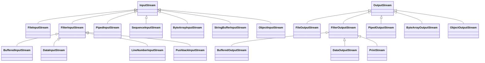

# Lecture 10 — File I/O

[Repository Guide](../../README.md) | [English](Concepts_Lecture.md) | [한국어](Concepts_Lecture.ko.md)

> **Last Updated:** 2026-10-19

> **Learning Objectives:**
> 1. Specify files and obtain information about them with the File class and JFileChooser
> 2. Read and write files using FileReader/FileWriter and BufferedReader
> 3. Parse structured data from text files
> 4. Read and write binary files with byte streams, data streams, and object streams
> 5. Apply try-with-resources for automatic resource management

---

## Table of Contents

- [1. File I/O Fundamentals](#1-file-io-fundamentals)
  - [1.1 Byte Streams vs. Character Streams](#11-byte-streams-vs-character-streams)
  - [1.2 The File Class](#12-the-file-class)
  - [1.3 The JFileChooser Class](#13-the-jfilechooser-class)
- [2. Text File I/O](#2-text-file-io)
  - [2.1 Reading Text Files](#21-reading-text-files)
  - [2.2 Writing Text Files](#22-writing-text-files)
  - [2.3 Parsing Text Files with Scanner](#23-parsing-text-files-with-scanner)
- [3. Binary File I/O](#3-binary-file-io)
  - [3.1 Low-Level I/O: FileInputStream and FileOutputStream](#31-low-level-io-fileinputstream-and-fileoutputstream)
  - [3.2 DataInputStream and DataOutputStream](#32-datainputstream-and-dataoutputstream)
  - [3.3 ObjectInputStream and ObjectOutputStream](#33-objectinputstream-and-objectoutputstream)
- [4. Try-with-Resources](#4-try-with-resources)
- [5. The Serializable Interface](#5-the-serializable-interface)
- [Summary](#summary)
- [Self-Check Questions](#self-check-questions)

---

<br>

## 1. File I/O Fundamentals

### 1.1 Byte Streams vs. Character Streams

To read data from or write data to a file, we must create one of the Java stream objects and attach it to the file. A **stream** is a sequence of data items, usually 8-bit bytes. An **input stream** has a source from which the data items come, and an **output stream** has a destination to which the data items go.

| Type | Base Classes | Use Case |
|:-----|:-------------|:---------|
| Byte Streams | `InputStream` / `OutputStream` | Binary data (images, audio, serialized objects) |
| Character Streams | `Reader` / `Writer` | Text data (UTF-8/16 encoded files) |

*Table 1. Comparison of byte streams and character streams*

### 1.2 The File Class

The `File` class represents a file or directory path (does not actually open files):

```java
File file = new File("data.txt");
System.out.println("Exists: " + file.exists());
System.out.println("Size:   " + file.length() + " bytes");
System.out.println("Path:   " + file.getAbsolutePath());
```

To operate on a file, we first create a `File` object from `java.io`. `new File("sample.dat")` refers to `sample.dat` in the current directory, and `new File("C:/SamplePrograms/test.dat")` refers to `test.dat` in the directory `C:\SamplePrograms` by its full pathname. Java accepts the generic path separator `/` even on Windows. A backslash must be written twice inside a string, as in `"C:\\SamplePrograms\\test.dat"`.

```java
if (inFile.exists()) {      // check whether inFile is associated with a real file or directory
    ...
}

if (inFile.isFile()) {      // check whether inFile is a file (false: a directory or nonexistent)
    ...
}

File directory = new File("C:/JavaPrograms/Ch12");
String filename[] = directory.list();     // names of all files in the directory

for (int i = 0; i < filename.length; i++) {
    System.out.println(filename[i]);
}
```

`length()` returns the size of the file in bytes and returns 0 if the file does not exist. `list()` returns `null` for a `File` that is not a directory.

### 1.3 The JFileChooser Class

A `javax.swing.JFileChooser` object lets the user select a file in a dialog.

```java
JFileChooser chooser = new JFileChooser();
chooser.showOpenDialog(null);

// To start the listing from a specific directory
JFileChooser chooser = new JFileChooser("D:/JavaPrograms/Ch12");
chooser.showOpenDialog(null);
```

`showOpenDialog` returns a value indicating which button the user clicked. The selected file and the directory shown by the dialog are obtained with `getSelectedFile()` and `getCurrentDirectory()`.

```java
int status = chooser.showOpenDialog(null);
if (status == JFileChooser.APPROVE_OPTION) {
    JOptionPane.showMessageDialog(null, "Open is clicked");
} else { //== JFileChooser.CANCEL_OPTION
    JOptionPane.showMessageDialog(null, "Cancel is clicked");
}

File selectedFile     = chooser.getSelectedFile();
File currentDirectory = chooser.getCurrentDirectory();
```

A **file filter** restricts the listing in `JFileChooser` to only those files and directories that meet the designated criteria. We define a subclass of `javax.swing.filechooser.FileFilter` and implement `public boolean accept(File file)` and `public String getDescription()`. The following `JavaFilter` restricts the listing to directories and Java source files.

```java
class JavaFilter extends FileFilter {
    public boolean accept(File file) {
        return file.isDirectory() || file.getName().endsWith(".java");
    }
    public String getDescription() {
        return "Java source files (*.java)";
    }
}

chooser.setFileFilter(new JavaFilter());
```

---

<br>

## 2. Text File I/O

Instead of storing primitive data values as binary data, we can convert them to strings and store those. The resulting text file can be viewed with any text editor. To write to a text file we use `PrintWriter` (or `BufferedWriter`), and to read from one we use `FileReader` and `BufferedReader`; from Java 5.0 we can also read text files with `Scanner`.

### 2.1 Reading Text Files

```java
try (BufferedReader reader = new BufferedReader(new FileReader("input.txt"))) {
    String line;
    while ((line = reader.readLine()) != null) {
        System.out.println(line);
    }
} catch (IOException e) {
    System.err.println("Error reading file: " + e.getMessage());
}
```

`readLine()` returns one line as a string without the line terminator, and returns `null` at the end of the file. To use a line as a number, convert it, as in `Integer.parseInt(line)`. Reading `example3.data` from Section 2.2 this way prints three lines: `10`, `Hello, world.`, and `true`.

### 2.2 Writing Text Files

```java
try (BufferedWriter writer = new BufferedWriter(new FileWriter("output.txt"))) {
    writer.write("Hello, File I/O!");
    writer.newLine();
    writer.write("Second line.");
} catch (IOException e) {
    System.err.println("Error writing file: " + e.getMessage());
}
```

With `PrintWriter`, values of various types are converted to strings and written with `print` and `println`, just as with `System.out`.

```java
File outFile = new File("example3.data");
FileOutputStream outFileStream = new FileOutputStream(outFile);
PrintWriter outStream = new PrintWriter(outFileStream);

// write values of primitive data types to the stream
outStream.println(10);
outStream.println("Hello, world.");
outStream.println(true);

// output done, so close the stream
outStream.close();
```

`PrintWriter` keeps an internal buffer, so `close()` (or `flush()`) must be called for the buffered content to reach the file.

> **Key Point:** For performance, `FileReader`/`FileWriter` are usually wrapped in `BufferedReader`/`BufferedWriter`. Buffering reduces the number of actual disk I/O operations.

### 2.3 Parsing Text Files with Scanner

Passing a `File` object to `Scanner` lets us read and convert the contents of a file token by token with the same methods as for keyboard input.

```java
Scanner scanner = new Scanner(new File("example3.data"));

int n = scanner.nextInt();          // 10
scanner.nextLine();                 // consume the rest of the first line (the newline)
String text = scanner.nextLine();   // "Hello, world."
boolean b = scanner.nextBoolean();  // true

scanner.close();
```

`next()`, `nextInt()`, and `nextBoolean()` read one token separated by whitespace (spaces, tabs, newlines), while `nextLine()` reads from the current position to the end of the line. A line that contains spaces, such as `Hello, world.`, must therefore be read with `nextLine()` to get it as one piece. A structured line such as a comma-separated record is parsed by reading it with `nextLine()`, splitting it with `line.split(",")`, and converting each piece with `Integer.parseInt` or similar.

---

<br>

## 3. Binary File I/O

### 3.1 Low-Level I/O: FileInputStream and FileOutputStream

`FileOutputStream` and `FileInputStream` are the basic streams for file access. `FileOutputStream` outputs a sequence of `byte` values, and `FileInputStream` reads in an array of bytes. The byte stream classes form a hierarchy rooted at `InputStream` and `OutputStream`.



*Figure 1. Class hierarchy of InputStream and OutputStream*

`LineNumberInputStream` and `StringBufferInputStream` are deprecated because they treat bytes as characters incorrectly; the character streams `LineNumberReader` and `StringReader` are used instead.

The following two programs save a byte array to a binary file and read it back.

```java
// set up file and stream
File outFile = new File("example1.data");
FileOutputStream outStream = new FileOutputStream(outFile);

// data to save
byte[] byteArray = { 10, 20, 30, 40, 50, 60, 70, 80 };

// write data to the stream
outStream.write(byteArray);

// output done, so close the stream
outStream.close();
```

```java
// set up file and stream
File inFile = new File("example1.data");
FileInputStream inStream = new FileInputStream(inFile);

// set up an array to read data in
int    fileSize  = (int) inFile.length();
byte[] byteArray = new byte[fileSize];

// read data in and display them
inStream.read(byteArray);
for (int i = 0; i < fileSize; i++) {
    System.out.println(byteArray[i]);
}

// input done, so close the stream
inStream.close();
```

The reading side gets the file size with `inFile.length()`, creates an array of that size, and reads it all at once. The `main` containing either program must declare `throws IOException` or use `try-catch`, because the `FileOutputStream` constructor, `write`, `read`, and `close` can throw the checked exception `IOException` (Lecture 6, Section 3.5).

### 3.2 DataInputStream and DataOutputStream

For reading/writing primitive types in binary format:

```java
// Writing
try (DataOutputStream dos = new DataOutputStream(new FileOutputStream("data.bin"))) {
    dos.writeInt(42);
    dos.writeDouble(3.14);
    dos.writeBoolean(true);
    dos.writeUTF("Hello");
}

// Reading (must match the write order and types)
try (DataInputStream dis = new DataInputStream(new FileInputStream("data.bin"))) {
    int i = dis.readInt();
    double d = dis.readDouble();
    boolean b = dis.readBoolean();
    String s = dis.readUTF();
}
```

A `DataOutputStream` is layered on top of a `FileOutputStream`. The standard setup sequence is a `File` object, a `FileOutputStream` attached to that file, and a `DataOutputStream` wrapping that stream.

```java
File             outFile       = new File("example2.data");
FileOutputStream outFileStream = new FileOutputStream(outFile);
DataOutputStream outDataStream = new DataOutputStream(outFileStream);

// write an int, boolean, double
outDataStream.writeInt(44);
outDataStream.writeBoolean(true);
outDataStream.writeDouble(7.2);

outDataStream.close();
```

```text
writeInt(44)    writeBoolean(true)    writeDouble(7.2)
      │                  │                    │
      └──────────────────┼────────────────────┘
                         ▼
             ┌───────────────────────┐
             │    DataOutputStream   │  converts primitive values to bytes
             └───────────┬───────────┘
                         ▼
             ┌───────────────────────┐
             │    FileOutputStream   │  writes the bytes to the file
             └───────────┬───────────┘
                         ▼
                   example2.data
```

*Figure 2. Output structure layering DataOutputStream on FileOutputStream*

`writeInt` writes 4 bytes, `writeBoolean` 1 byte, and `writeDouble` 8 bytes, so `example2.data` is 13 bytes long. Reading uses the same pattern, creating a `File`, a `FileInputStream`, and a `DataInputStream` in turn, and the `DataInputStream` converts the bytes read from the file into primitive values.

```java
File            inFile       = new File("example2.data");
FileInputStream inFileStream = new FileInputStream(inFile);
DataInputStream inDataStream = new DataInputStream(inFileStream);

// read an int, boolean, double
int n = inDataStream.readInt();
boolean b = inDataStream.readBoolean();
double d = inDataStream.readDouble();

inDataStream.close();

// what did we get?
System.out.println("n = " + n);
System.out.println("b = " + b);
System.out.println("d = " + d);
```

The output is `n = 44`, `b = true`, and `d = 7.2`.

> **Caution:** A binary file stores no type information about its values. To read stored primitive data back correctly, we must know the order and types in which it was written, and the order of read operations must match the order of write operations. If the orders differ, wrong values can be read without any exception.

### 3.3 ObjectInputStream and ObjectOutputStream

For serializing entire objects:

```java
// Writing an object
try (ObjectOutputStream oos = new ObjectOutputStream(new FileOutputStream("obj.bin"))) {
    oos.writeObject(myAccount);
}

// Reading an object
try (ObjectInputStream ois = new ObjectInputStream(new FileInputStream("obj.bin"))) {
    Account account = (Account) ois.readObject();
}
```

Objects can be stored just as easily as primitive data values. Objects of different classes can be saved one after another to the same stream.

```java
File               outFile         = new File("objects.data");
FileOutputStream   outFileStream   = new FileOutputStream(outFile);
ObjectOutputStream outObjectStream = new ObjectOutputStream(outFileStream);

Person person = new Person("Mr. Espresso", 20, 'M');
outObjectStream.writeObject(person);

account1 = new Account();
bank1    = new Bank();
outObjectStream.writeObject(account1);   // objects of different classes can be saved
outObjectStream.writeObject(bank1);
```

The return type of `readObject()` is `Object`, so the result must be cast to the correct type, and objects must be read in the order they were saved. Besides `IOException`, `readObject()` can throw the checked exception `ClassNotFoundException`.

```java
Person person = (Person) inObjectStream.readObject();

Account account1 = (Account) inObjectStream.readObject();
Bank    bank1    = (Bank) inObjectStream.readObject();
```

An array can also be saved and loaded as a whole at once instead of processing its elements individually.

```java
Person[] people = new Person[N];   // assume N already has a value

// build the people array
. . .
// save the array
outObjectStream.writeObject(people);

// read the array
Person[] people = (Person[]) inObjectStream.readObject();
```

The following example saves an array of 20 `Account` objects, whose class implements `Serializable`, at once.

```java
Account[] account = new Account[NUM_OF_ACCOUNT];   // NUM_OF_ACCOUNT = 20

for (int i = 0; i < NUM_OF_ACCOUNT; i++) {
    account[i] = new Account();
    account[i].setOwnerName("Student_" + (i + 1));
}

try (ObjectOutputStream outObjectStream =
         new ObjectOutputStream(new FileOutputStream("example4.data"))) {
    outObjectStream.writeObject(account);
}
```

`ObjectOutputStream` also keeps an internal buffer, so if the stream is not closed, part of the data may never be written to the file. Closing it with try-with-resources, as above, is safe.

---

<br>

## 4. Try-with-Resources

Java 7+ supports automatic resource management. Resources implementing `AutoCloseable` are closed automatically:

```java
try (FileReader fr = new FileReader("file.txt");
     BufferedReader br = new BufferedReader(fr)) {
    // use br
} // br and fr are automatically closed here
```

Resources are closed in the reverse order of their declaration, so `br` is closed first and `fr` second. The resources are closed even if an exception occurs inside the block.

> **Key Point:** Prefer try-with-resources over manual `close()` calls in `finally` blocks. It is shorter, cleaner, and exception-safe.

---

<br>

## 5. The Serializable Interface

A class must implement `Serializable` to be written with `ObjectOutputStream`:

```java
import java.io.Serializable;

public class Account implements Serializable {
    private static final long serialVersionUID = 1L;
    private String ownerName;
    private double balance;
    // ...
}
```

Fields marked `transient` are excluded from serialization.

`Serializable` is a marker interface with no methods, so writing `implements Serializable` is all that is needed. Serialization also saves the objects that an object refers to, so the types of its non-`transient` fields must be serializable as well. Passing an object that does not implement `Serializable` to `writeObject` throws `NotSerializableException`, a subclass of `IOException`, at run time. `transient` and `static` fields are not saved, and when the object is read back, `transient` fields hold default values (0 for numbers, `null` for references). `serialVersionUID` is the version number of the class, and if the values at saving and loading time differ, `InvalidClassException` is thrown.

---

<br>

## Summary

| Concept | Key Summary |
|:--------|:----------|
| Byte Streams | `InputStream`/`OutputStream` are used for binary data. |
| Character Streams | `Reader`/`Writer` are used for text data. |
| File | It represents the path of a file or directory and provides information such as existence and size without opening the file. |
| Buffering | Raw streams are wrapped in `Buffered*` for performance. |
| Scanner | It reads a text file by tokens or lines and converts the values to primitive types. |
| DataInputStream | It reads and writes primitive types in binary format, and the read order must match the write order. |
| ObjectStream | It serializes and deserializes entire objects, and objects read back are cast to the correct type. |
| Try-with-resources | It automatically cleans up `AutoCloseable` resources when the block ends. |
| Serializable | It is the marker interface required for object serialization. |

---

<br>

## Self-Check Questions

1. **Byte streams:** How many bytes long is `example1.data` created by the first program in Section 3.1, and what does the second program print?

   <details>
   <summary>Answer</summary>

   Eight bytes were written, so the file is 8 bytes long. The second program gets the size 8 with `inFile.length()`, creates an array of that size, and reads it, so it prints 10, 20, 30, 40, 50, 60, 70, and 80, one per line.

   </details>

2. **File size with data streams:** Find the size of `example2.data` created with `writeInt(44)`, `writeBoolean(true)`, and `writeDouble(7.2)` in Section 3.2. How would the file contents differ if the same values were written with `println` of a `PrintWriter`, as in Section 2.2?

   <details>
   <summary>Answer</summary>

   It is 4 bytes for the `int`, 1 byte for the `boolean`, and 8 bytes for the `double`, 13 bytes in total. With a `PrintWriter`, the values are stored as the strings `44`, `true`, and `7.2` with newline characters, so the file can be read in a text editor, and its size depends on the number of characters.

   </details>

3. **Read order:** What values are obtained if `example2.data` is read with `readBoolean()`, `readInt()`, and `readDouble()` in that order? Is an exception thrown?

   <details>
   <summary>Answer</summary>

   No exception is thrown, and the values are `false`, `11265`, and `7.2`. The value 44 is stored as the 4 bytes `00 00 00 2C` (hexadecimal), so `readBoolean()` reads the first byte, 0, and gives `false`. `readInt()` reads the next 4 bytes, `00 00 2C 01` (the final 01 is `true`), giving $44 \times 256 + 1 = 11265$. The remaining 8 bytes are the original `double`, so `readDouble()` happens to get 7.2. Because there is no type information, a wrong order reads wrong values without an error.

   </details>

4. **Scanner tokens:** If `example3.data` from Section 2.2 (lines `10`, `Hello, world.`, and `true`) is opened with a `Scanner` and `next()` is called three times, what does each call return?

   <details>
   <summary>Answer</summary>

   The calls return `10`, `Hello,`, and `world.`. `next()` reads whitespace-separated tokens, so `Hello, world.` on the second line splits into two tokens, and the third call does not reach `true`. To read a whole line, use `nextLine()`.

   </details>

5. **Serialization:** A `Serializable` object whose `ownerName` is `"Kim"` and whose `transient double balance` is 50.0 is saved with `ObjectOutputStream` and read back. What are the values of the two fields? What happens if the class does not implement `Serializable`?

   <details>
   <summary>Answer</summary>

   `ownerName` is restored as `"Kim"`, but the `transient` field `balance` is not saved and gets the default value 0.0. If the class does not implement `Serializable`, the code still compiles, but `NotSerializableException` is thrown when `writeObject` runs.

   </details>
