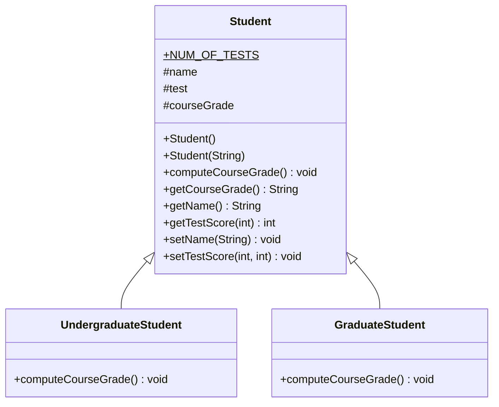
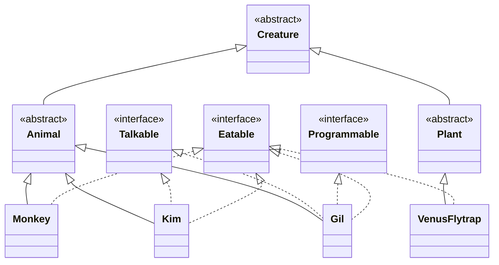
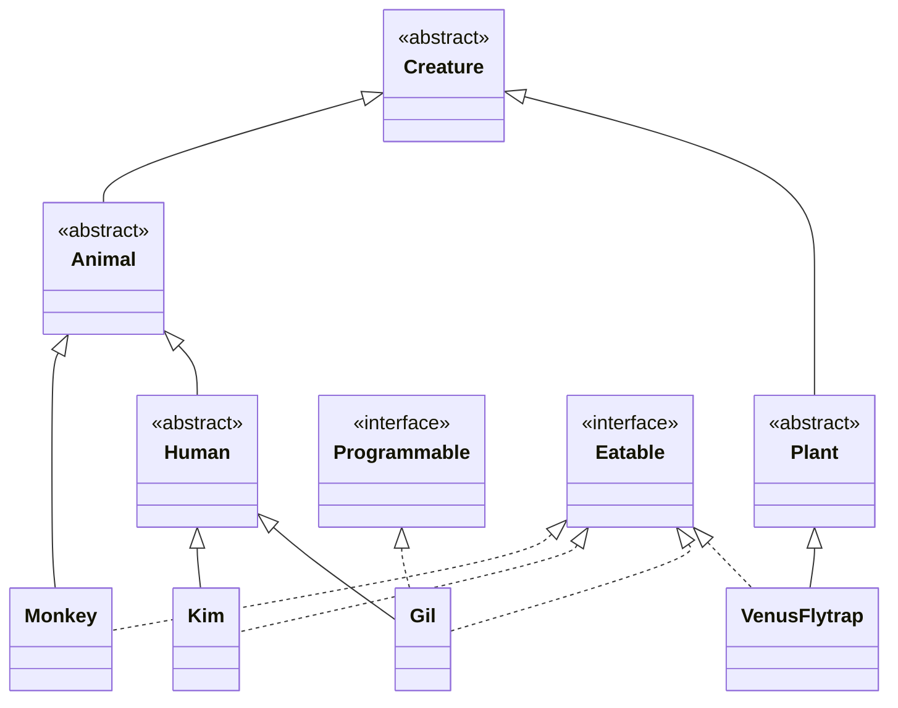

# 11강 — 상속과 다형성

[레포지토리 안내](../../README.ko.md) | [English](Concepts_Lecture.md) | [한국어](Concepts_Lecture.ko.md)

> **최종 수정일:** 2026-11-19

> **학습 목표:**
> 1. 상속을 사용하여 클래스 계층을 구현할 수 있다
> 2. 메서드 오버라이딩과 동적 바인딩을 적용할 수 있다
> 3. 유연하고 확장 가능한 설계를 위해 다형성을 사용할 수 있다
> 4. 추상 클래스와 인터페이스의 차이를 설명하고 상황에 맞게 고를 수 있다
> 5. 객체의 생성 순서와 동적 디스패치를 단계별로 추적하고 오버라이딩 규칙의 컴파일 오류를 해석할 수 있다
> 6. Object의 toString, equals, hashCode를 계약에 맞게 재정의할 수 있다

---

## 목차

- [1. 상속 계층 구조](#1-상속-계층-구조)
  - [1.1 사례: 학부생과 대학원생 명부](#11-사례-학부생과-대학원생-명부)
  - [1.2 상속을 이용한 클래스 정의](#12-상속을-이용한-클래스-정의)
  - [1.3 protected 접근 제어자](#13-protected-접근-제어자)
  - [1.4 super()를 이용한 생성자 체이닝](#14-super를-이용한-생성자-체이닝)
  - [1.5 객체가 만들어지는 순서](#15-객체가-만들어지는-순서)
  - [1.6 super로 상위 클래스의 메서드 호출](#16-super로-상위-클래스의-메서드-호출)
- [2. 다형성](#2-다형성)
  - [2.1 다형성의 의미](#21-다형성의-의미)
  - [2.2 동적 바인딩](#22-동적-바인딩)
  - [2.3 instanceof 연산자](#23-instanceof-연산자)
  - [2.4 업캐스팅과 다운캐스팅](#24-업캐스팅과-다운캐스팅)
  - [2.5 정적 타입과 동적 타입으로 본 메서드 호출](#25-정적-타입과-동적-타입으로-본-메서드-호출)
  - [2.6 명부 예제의 완성](#26-명부-예제의-완성)
- [3. 메서드 오버라이딩](#3-메서드-오버라이딩)
  - [3.1 오버라이딩 규칙](#31-오버라이딩-규칙)
  - [3.2 @Override 애너테이션](#32-override-애너테이션)
  - [3.3 오버라이딩으로 구현하는 다형성](#33-오버라이딩으로-구현하는-다형성)
  - [3.4 오버라이딩과 오버로딩](#34-오버라이딩과-오버로딩)
  - [3.5 오버라이딩 규칙을 어긴 코드의 컴파일 오류](#35-오버라이딩-규칙을-어긴-코드의-컴파일-오류)
  - [3.6 필드와 static 메서드의 숨김](#36-필드와-static-메서드의-숨김)
  - [3.7 생성자에서 오버라이딩되는 메서드를 호출할 때](#37-생성자에서-오버라이딩되는-메서드를-호출할-때)
- [4. 추상 클래스와 인터페이스](#4-추상-클래스와-인터페이스)
  - [4.1 추상 클래스](#41-추상-클래스)
  - [4.2 인터페이스](#42-인터페이스)
  - [4.3 추상 클래스와 인터페이스의 비교](#43-추상-클래스와-인터페이스의-비교)
  - [4.4 추상 클래스로 바꾼 Shape](#44-추상-클래스로-바꾼-shape)
  - [4.5 인터페이스의 default 메서드와 static 메서드](#45-인터페이스의-default-메서드와-static-메서드)
- [5. 상속을 활용한 디자인 패턴](#5-상속을-활용한-디자인-패턴)
- [6. Object 클래스의 메서드](#6-object-클래스의-메서드)
  - [6.1 toString](#61-tostring)
  - [6.2 equals](#62-equals)
  - [6.3 hashCode와 getClass](#63-hashcode와-getclass)
- [7. 상속의 제한과 합성](#7-상속의-제한과-합성)
  - [7.1 final 클래스와 final 메서드](#71-final-클래스와-final-메서드)
  - [7.2 상속과 합성](#72-상속과-합성)
- [8. 흔한 실수](#8-흔한-실수)
- [요약](#요약)
- [점검 문제](#점검-문제)
- [참고 문헌](#참고-문헌)

---

<br>

## 1. 상속 계층 구조

### 1.1 사례: 학부생과 대학원생 명부

학부생과 대학원생이 함께 들어 있는 수강생 명부(class roster)를 구현하는 경우를 생각한다. 각 학생의 기록에는 이름, 시험 점수 세 개, 최종 학점이 들어 있고, 학점을 계산하는 공식은 학부생과 대학원생이 서로 다르다.

두 종류의 학생을 모델링하는 방법은 두 가지이다.

- 학부생용 클래스와 대학원생용 클래스를 서로 관련 없는 두 클래스로 정의한다. 상속 관계로 연결되지 않은 두 클래스를 **관련 없는 클래스(unrelated classes)** 라고 한다.
- 두 종류의 학생을 하나의 **상속 계층(inheritance hierarchy)** 에 속한 클래스로 모델링한다.

두 번째 방법을 택하면 `Student`, `UndergraduateStudent`, `GraduateStudent`의 세 클래스를 설계한다. `Student`는 두 종류의 학생에게 공통인 데이터와 동작을 담고, 두 하위 클래스는 각자에게만 해당하는 데이터와 동작(여기서는 학점 계산 공식)을 담는다.



*그림 1. Student, UndergraduateStudent, GraduateStudent의 상속 계층*

UML 클래스 다이어그램에서 `+`는 public 멤버, `#`는 protected 멤버를 뜻하고, 밑줄 친 `NUM_OF_TESTS`는 static 상수이다. 학점 공식이 학생 종류마다 다르므로 두 하위 클래스가 `computeCourseGrade()`를 각자 구현한다. `Student`에도 같은 메서드를 선언해 두어야 `Student` 타입 변수로 이 메서드를 호출할 수 있다(2.2절).

### 1.2 상속을 이용한 클래스 정의

```java
public class Person {
    private int weight;
    int age;
    protected int height;
    public String name;

    public void setWeight(int weight) { this.weight = weight; }
    public int getWeight() { return weight; }
}

public class Student extends Person {
    public void set() {
        age = 39;
        name = "PSY";
        height = 182;
        setWeight(99); // weight는 private이므로 직접 접근 불가
    }

    public void display() {
        System.out.println("Age: " + age);
        System.out.println("Name: " + name);
        System.out.println("Height: " + height);
    }
}
```

`Student`는 `extends Person`으로 `Person`을 상속하므로 `Person`의 필드와 메서드를 물려받는다. `age`(접근 제어자 생략, 같은 패키지), `height`(protected), `name`(public)은 `Student`의 메서드에서 이름으로 바로 쓸 수 있다. `weight`는 private이므로 `Student` 객체 안에 존재하기는 하지만 `Student`의 코드에서 이름으로 접근할 수 없고, 상속받은 public 메서드 `setWeight()`를 거쳐야 한다. `main()`에서 `Student` 객체를 만들고 `set()`과 `display()`를 차례로 호출하면 다음이 출력된다.

```text
Age: 39
Name: PSY
Height: 182
```

같은 구조를 하나의 파일로 만든 실습 코드는 [PersonStudentDemo.java](../../Coursework/Lab11_Inheritance-and-Polymorphism/PersonStudentDemo.java)에 있다.

### 1.3 protected 접근 제어자

Java의 접근 제어자는 private, 생략(default, package-private), protected, public의 네 가지이며, 이 순서대로 접근할 수 있는 범위가 넓어진다.

| 접근 제어자 | 같은 클래스 | 같은 패키지 | 다른 패키지의 하위 클래스 | 그 밖의 모든 클래스 |
|:-----|:-----|:-----|:-----|:-----|
| `private` | O | X | X | X |
| 생략 (default) | O | O | X | X |
| `protected` | O | O | O | X |
| `public` | O | O | O | O |

*표 1. 접근 제어자별 접근 가능 범위*

`protected` 멤버는 다음에서 접근 가능하다:
- 해당 클래스 자체
- 같은 패키지 내의 클래스
- 모든 패키지의 하위 클래스

> **참고:** **상속과 멤버 접근.** 하위 클래스의 인스턴스는 상위 클래스에서 물려받은 구성 요소를 자신의 일부로 포함한다. private 멤버도 객체 안에 존재하며, 하위 클래스의 코드에서 이름으로 접근할 수 없을 뿐이다.

### 1.4 super()를 이용한 생성자 체이닝

상위 클래스의 멤버와 달리 **생성자는 상속되지 않는다.** 클래스마다 생성자를 직접 정의하거나, 생성자를 하나도 정의하지 않았을 때 컴파일러가 추가하는 기본 생성자를 쓴다. 하위 클래스의 생성자에서 `super(...)`를 호출하면 상위 클래스의 생성자가 실행된다. 이 호출은 생성자의 첫 문장에 둔다(Java 25부터의 완화는 8강 2.2절의 참고).

```java
public class Point {
    private int x, y;

    public Point(int x, int y) {
        this.x = x;
        this.y = y;
    }
}

public class ColorPoint extends Point {
    private String color;

    public ColorPoint(int x, int y, String color) {
        super(x, y);          // 반드시 첫 번째 문장이어야 함
        this.color = color;
    }
}
```

`ColorPoint`의 생성자는 `super(x, y)`로 `Point`의 생성자에 좌표 초기화를 맡기고, 자신의 필드 `color`만 직접 초기화한다. `Point`의 `x`, `y`는 private이므로 `ColorPoint`가 직접 대입할 수 없다는 점에서도 `super(x, y)`가 필요하다. `Point`에 좌표를 `(x,y)` 형식으로 출력하는 `showPoint()`를 두고 `ColorPoint`에 `color`를 출력한 뒤 `showPoint()`를 호출하는 `showColorPoint()`를 두면, `new ColorPoint(5, 6, "blue").showColorPoint()`는 `blue(5,6)`을 출력한다.

> **주의:** 생성자에 `super(...)` 호출을 쓰지 않으면 컴파일러가 첫 문장으로 인자 없는 `super()`를 넣는다. 위의 `Point`처럼 상위 클래스에 매개변수 없는 생성자가 없으면 이 호출이 컴파일 오류가 된다. 또 `extends` 절이 없는 클래스의 상위 클래스는 `Object`이다.

### 1.5 객체가 만들어지는 순서

`new`로 하위 클래스의 객체를 만들면, 객체 하나 안에 상위 클래스 부분과 하위 클래스 부분이 함께 들어간다(1.3절의 참고 상자). 상위 클래스 부분이 먼저 준비되어야 하위 클래스의 코드가 그것을 쓸 수 있으므로, 생성은 위에서 아래로 진행된다. 다음 프로그램은 3단계 계층에서 각 단계가 실행되는 순서를 출력한다.

```java
public class CtorOrder {
    static String log(String s) { System.out.println(s); return s; }

    static class Person {
        String tag = log("Person field initializer");
        Person() {
            log("Person() body");
        }
    }

    static class Student extends Person {
        String school = log("Student field initializer");
        Student() {
            this("unknown");
            log("Student() body");
        }
        Student(String school) {
            super();
            log("Student(String) body, school = " + this.school + " -> " + school);
            this.school = school;
        }
    }

    static class GradStudent extends Student {
        GradStudent() {
            log("GradStudent() body");
        }
    }

    public static void main(String[] args) {
        new GradStudent();
    }
}
```

```text
Person field initializer
Person() body
Student field initializer
Student(String) body, school = Student field initializer -> unknown
Student() body
GradStudent() body
```

`new GradStudent()`의 실행을 단계별로 추적하면 다음과 같다.

1. JVM이 객체에 필요한 메모리를 할당하고 모든 필드를 기본값(`null`, 0, `false`)으로 채운다. 이 시점에 `tag`와 `school`은 `null`이다.
2. `GradStudent()`의 첫 문장에는 `super(...)`나 `this(...)`가 없으므로 컴파일러가 넣은 `super()`가 `Student()`를 호출한다.
3. `Student()`의 첫 문장 `this("unknown")`은 같은 클래스의 `Student(String)`을 호출한다. `this(...)`로 다른 생성자에 넘긴 생성자는 필드 초기화 식을 실행하지 않으며, 초기화는 `super(...)`를 호출하는 생성자에서 한 번만 일어난다.
4. `Student(String)`의 `super()`가 `Person()`을 호출하고, `Person()`은 다시 `Object()`를 호출한다. `Object()`가 반환되면 `Person`의 필드 초기화 식이 실행되어 첫 줄이 출력되고, 이어서 `Person()`의 본문이 둘째 줄을 출력한다.
5. `Person()`이 반환되면 `Student`의 필드 초기화 식이 실행되어 `school`에 문자열이 들어가고, 이어서 `Student(String)`의 본문이 실행된다. 넷째 줄에서 본문이 처음 본 `school`의 값이 필드 초기화 식의 결과라는 점이 이 순서를 보여 준다. 본문은 `school`을 `"unknown"`으로 바꾼다.
6. `Student(String)`이 반환되면 `Student()`의 나머지 본문이, 그다음 `GradStudent()`의 본문이 실행된다.

정리하면, 생성자 호출은 하위 클래스에서 시작해 `Object`까지 올라가고, 실제 초기화는 `Object`에서 시작해 하위 클래스로 내려오며, 각 클래스 안에서는 필드 초기화 식이 생성자 본문보다 먼저 실행된다. `super(...)`가 생성자의 첫 문장이어야 하는 규칙(1.4절)은 상위 클래스 부분이 하위 클래스 부분보다 먼저 초기화되도록 보장하기 위한 것이다.

### 1.6 super로 상위 클래스의 메서드 호출

하위 클래스가 메서드를 오버라이딩하면, 하위 클래스의 객체에서 그 이름으로 부르는 메서드는 하위 클래스의 것이 된다. 오버라이딩한 메서드 안에서 상위 클래스의 원래 구현을 쓰고 싶으면 `super.메서드이름(...)`으로 호출한다. 생성자 호출 `super(...)`와 달리 이 형태는 메서드 안의 어느 위치에서나 쓸 수 있다.

```java
public class SuperCall {
    static class Account {
        protected double balance = 100;
        String describe() { return "Account balance " + balance; }
    }

    static class SavingsAccount extends Account {
        private double rate = 0.05;
        @Override
        String describe() {
            return super.describe() + ", rate " + rate;   // 상위 클래스의 구현을 다시 쓴다
        }
    }

    public static void main(String[] args) {
        Account a = new SavingsAccount();
        System.out.println(a.describe());
    }
}
```

```text
Account balance 100.0, rate 0.05
```

`SavingsAccount.describe()`는 `super.describe()`로 `Account`의 설명 문자열을 얻은 뒤 이율을 덧붙인다. 변수 `a`의 타입이 `Account`여도 실제 객체가 `SavingsAccount`이므로 `a.describe()`는 `SavingsAccount`의 메서드를 실행하고(2.2절), 그 안의 `super.describe()`는 동적 바인딩을 거치지 않고 바로 위 클래스 `Account`의 구현을 호출한다. 이렇게 상위 클래스의 동작을 버리지 않고 확장하는 것이 오버라이딩의 흔한 형태이다. `super.super.describe()`처럼 두 단계 위의 구현을 직접 부르는 문법은 없다.

---

<br>

## 2. 다형성

### 2.1 다형성의 의미

**다형성(polymorphism)** 은 하나의 변수가 같은 상속 계층에 속한 여러 하위 클래스의 객체를 가리킬 수 있게 하는 성질이다. 예를 들어 `Cat`과 `Dog`가 `Pet`의 하위 클래스이면 다음 문장은 모두 올바르다.

```java
Pet myPet;

myPet = new Dog();
// ...
myPet = new Cat();
```

### 2.2 동적 바인딩

상위 클래스 변수는 하위 클래스 객체를 참조할 수 있으며, 이 변수로 메서드를 호출하면 JVM이 변수가 가리키는 객체의 실제 클래스를 보고 런타임에 호출할 메서드를 정한다. 이를 **동적 바인딩(dynamic binding)** 이라고 한다.

```java
Student[] roster = new Student[40];
roster[0] = new GraduateStudent();
roster[1] = new UndergraduateStudent();
roster[2] = new UndergraduateStudent();
roster[3] = new GraduateStudent();
int numberOfStudents = 4;

for (int i = 0; i < numberOfStudents; i++) {
    roster[i].computeCourseGrade(); // 적절한 하위 클래스 메서드가 호출됨
}
```

`roster` 배열은 `Student` 타입이므로 `GraduateStudent` 객체와 `UndergraduateStudent` 객체를 함께 담을 수 있다. `roster[i]`가 `GraduateStudent` 객체를 가리키면 `GraduateStudent`의 `computeCourseGrade()`가, `UndergraduateStudent` 객체를 가리키면 `UndergraduateStudent`의 `computeCourseGrade()`가 실행된다.

```text
roster ──► ┌───┬───┬───┬───┬──────┬─────┬──────┐
           │ 0 │ 1 │ 2 │ 3 │  4   │ ... │  39  │
           ├───┼───┼───┼───┼──────┼─────┼──────┤
           │ ● │ ● │ ● │ ● │ null │ ... │ null │
           └─┼─┴─┼─┴─┼─┴─┼─┴──────┴─────┴──────┘
             │   │   │   └──► :GraduateStudent
             │   │   └──────► :UndergraduateStudent
             │   └──────────► :UndergraduateStudent
             └──────────────► :GraduateStudent
```

*그림 2. 하위 클래스 객체를 가리키는 roster 배열의 상태*

> **주의:** `new Student[40]`은 참조 40개를 담는 배열만 만들며, 객체를 대입하지 않은 원소는 `null`이다. 따라서 반복은 실제 학생 수(`numberOfStudents`)까지만 해야 한다. `for (Student s : roster)`처럼 배열 전체를 돌면 첫 번째 `null` 원소에서 `NullPointerException`이 발생한다.

> **핵심:** 다형성을 사용하면 상위 클래스 타입으로 코드를 작성하면서 런타임에 올바른 하위 클래스 동작을 자동으로 호출할 수 있다.

### 2.3 instanceof 연산자

`instanceof` 연산자는 객체가 어떤 클래스의 인스턴스인지 검사한다. `x instanceof C`는 `x`가 가리키는 객체가 `C`의 인스턴스이거나 `C`의 하위 타입의 인스턴스이면 `true`이고, `x`가 `null`이면 `false`이다.

```java
if (roster[i] instanceof UndergraduateStudent) {
    System.out.println("Undergraduate student found.");
}
```

이 검사를 반복문 안에 두면 명부의 학부생 수를 셀 수 있다.

```java
int undergradCount = 0;
for (int i = 0; i < numberOfStudents; i++) {
    if (roster[i] instanceof UndergraduateStudent) {
        undergradCount++;
    }
}
```

### 2.4 업캐스팅과 다운캐스팅

2.1절의 `Pet myPet = new Dog();`처럼 하위 클래스의 객체를 상위 클래스 타입의 변수에 대입하는 것을 **업캐스팅(upcasting)** 이라고 한다. 모든 `Dog`는 `Pet`이므로 업캐스팅은 항상 안전하며 캐스트 연산자 없이 자동으로 일어난다. 반대로 상위 클래스 타입의 참조를 하위 클래스 타입으로 바꾸는 것을 **다운캐스팅(downcasting)** 이라 하며, 모든 `Pet`이 `Dog`인 것은 아니므로 `(Dog)`처럼 캐스트 연산자로 명시해야 한다.

```java
public class Casting {
    static class Pet { String name() { return "pet"; } }
    static class Dog extends Pet {
        @Override String name() { return "dog"; }
        void fetch() { System.out.println("fetching"); }
    }
    static class Cat extends Pet { @Override String name() { return "cat"; } }

    public static void main(String[] args) {
        Pet p = new Dog();                 // 업캐스팅: 자동으로 일어난다
        System.out.println(p.name());
        // p.fetch();                      // compile error: Pet has no fetch()

        Dog d = (Dog) p;                   // 다운캐스팅: 명시해야 한다
        d.fetch();

        Pet q = new Cat();
        try {
            Dog wrong = (Dog) q;
        } catch (ClassCastException e) {
            System.out.println(e.getMessage());
        }

        for (Pet x : new Pet[] { new Dog(), new Cat() }) {
            if (x instanceof Dog dog) {    // 검사와 캐스트를 한 번에
                dog.fetch();
            } else {
                System.out.println(x.name() + " cannot fetch");
            }
        }
    }
}
```

```text
dog
fetching
class Casting$Cat cannot be cast to class Casting$Dog (Casting$Cat and Casting$Dog are in unnamed module of loader 'app')
fetching
cat cannot fetch
```

변수 `p`의 타입은 `Pet`이므로 `p`로는 `Pet`에 선언된 메서드만 호출할 수 있다. 실제 객체가 `Dog`여도 `p.fetch()`는 컴파일 오류이다. 컴파일러는 변수의 타입만 보고 호출할 수 있는 메서드를 판단하기 때문이다. `Dog`의 메서드를 쓰려면 `(Dog) p`로 다운캐스팅한다. 다운캐스팅은 컴파일 시간에는 허용되지만, 실행 중에 JVM이 객체의 실제 클래스를 검사하여 맞지 않으면 `ClassCastException`을 던진다. `q`가 가리키는 객체는 `Cat`이므로 `(Dog) q`에서 예외가 나고, 메시지는 어느 클래스를 어느 클래스로 바꾸려 했는지 알려 준다.

안전한 다운캐스팅은 2.3절의 `instanceof`로 먼저 검사하는 것이다. Java 16부터는 `x instanceof Dog dog`처럼 검사와 동시에 변수를 선언하는 패턴 매칭을 쓸 수 있다 [1]. 검사가 참이면 `dog`가 이미 `Dog` 타입으로 캐스트된 변수가 되므로 따로 캐스트할 필요가 없다. 반복문의 첫 원소는 `Dog`이므로 `fetching`을, 둘째 원소는 `Cat`이므로 `cat cannot fetch`를 출력한다.

> **주의:** 다운캐스팅이 자주 필요하다면 설계를 다시 볼 필요가 있다. 객체의 종류에 따라 다른 일을 해야 할 때 `instanceof`와 캐스트를 늘어놓기보다, 그 동작을 상위 클래스의 메서드로 선언하고 하위 클래스에서 오버라이딩하면 2.2절의 동적 바인딩이 알맞은 메서드를 고른다.

### 2.5 정적 타입과 동적 타입으로 본 메서드 호출

변수에는 두 가지 타입이 있다. 선언에 적은 타입을 **정적 타입(static type)** 이라 하고, 실행 중에 변수가 실제로 가리키는 객체의 클래스를 **동적 타입(dynamic type)** 이라 한다. `Animal ad = new Dog();`에서 `ad`의 정적 타입은 `Animal`, 동적 타입은 `Dog`이다. 메서드 호출 `x.m(y)`는 두 단계로 정해진다.

1. **컴파일 시간:** 컴파일러는 `x`의 정적 타입에서 이름이 `m`인 메서드 가운데, 인자 `y`의 정적 타입에 가장 잘 맞는 시그니처 하나를 고른다. 오버로딩(3.4절)은 이 단계에서 해결된다 [2].
2. **실행 시간:** JVM은 `x`의 동적 타입에서 시작하여 상위 클래스 쪽으로 올라가며, 1단계에서 고른 시그니처를 오버라이딩한 메서드를 처음 만나는 곳에서 실행한다. 오버라이딩은 이 단계에서 해결된다.

즉 어떤 시그니처를 부를지는 인자의 정적 타입이, 그 시그니처의 어느 구현을 실행할지는 호출 대상의 동적 타입이 정한다. 두 규칙이 함께 작용하는 예는 다음과 같다.

```java
public class Dispatch {
    static class Animal {
        String meet(Animal other) { return "Animal.meet(Animal)"; }
        String meet(Dog other)    { return "Animal.meet(Dog)"; }
    }

    static class Dog extends Animal {
        @Override String meet(Animal other) { return "Dog.meet(Animal)"; }
        @Override String meet(Dog other)    { return "Dog.meet(Dog)"; }
    }

    public static void main(String[] args) {
        Animal a = new Animal();
        Animal ad = new Dog();
        Dog d = new Dog();

        System.out.println("1 " + a.meet(d));
        System.out.println("2 " + ad.meet(a));
        System.out.println("3 " + ad.meet(ad));
        System.out.println("4 " + ad.meet(d));
        System.out.println("5 " + d.meet((Animal) d));
    }
}
```

```text
1 Animal.meet(Dog)
2 Dog.meet(Animal)
3 Dog.meet(Animal)
4 Dog.meet(Dog)
5 Dog.meet(Animal)
```

| 호출 | 호출 대상의 정적 타입, 동적 타입 | 인자의 정적 타입 | 1단계에서 고른 시그니처 | 2단계에서 실행한 메서드 |
|:-----|:-----|:-----|:-----|:-----|
| 1 `a.meet(d)` | `Animal`, `Animal` | `Dog` | `meet(Dog)` | `Animal.meet(Dog)` |
| 2 `ad.meet(a)` | `Animal`, `Dog` | `Animal` | `meet(Animal)` | `Dog.meet(Animal)` |
| 3 `ad.meet(ad)` | `Animal`, `Dog` | `Animal` | `meet(Animal)` | `Dog.meet(Animal)` |
| 4 `ad.meet(d)` | `Animal`, `Dog` | `Dog` | `meet(Dog)` | `Dog.meet(Dog)` |
| 5 `d.meet((Animal) d)` | `Dog`, `Dog` | `Animal` | `meet(Animal)` | `Dog.meet(Animal)` |

*표 2. 다섯 호출의 시그니처 선택과 실행 메서드*

가장 헷갈리기 쉬운 것은 3번이다. 인자 `ad`가 실제로는 `Dog` 객체를 가리키지만, 컴파일러는 `ad`의 정적 타입 `Animal`만 보고 `meet(Animal)`을 고른다. 실행 시간에는 호출 대상 `ad`의 동적 타입 `Dog`에서 `meet(Animal)`의 구현을 찾으므로 `Dog.meet(Animal)`이 실행된다. 인자의 동적 타입은 메서드 선택에 쓰이지 않는다. 5번도 같은 이유로, 같은 객체 `d`를 넘겼지만 `(Animal)`로 정적 타입을 바꾸었으므로 `meet(Animal)`이 선택된다. Java처럼 호출 대상 하나의 동적 타입만으로 구현을 고르는 방식을 단일 디스패치(single dispatch)라고 한다.

> **[프로그래밍언어]** JVM 구현은 보통 클래스마다 가상 메서드 표(vtable)를 두어 2단계를 빠르게 처리한다. 표의 각 칸은 메서드 시그니처 하나에 대응하고, 하위 클래스의 표는 상위 클래스의 표를 복사한 뒤 오버라이딩한 칸만 자신의 구현으로 바꾼다. 그러면 호출할 때 객체의 클래스에서 표를 찾아 정해진 칸의 메서드를 실행하기만 하면 된다.

### 2.6 명부 예제의 완성

1.1절의 명부를 실제로 동작하는 프로그램으로 완성하면 이 강의의 개념이 한곳에 모인다. 학점 공식은 학부생은 세 시험의 평균이 70점 이상이면 Pass, 대학원생은 80점 이상이면 Pass로 정한다. 학생은 반드시 학부생이거나 대학원생이므로 `Student`는 추상 클래스로 두고(4.1절), 학점 계산을 추상 메서드로 선언한다.

```java
abstract class Student {
    protected static final int NUM_OF_TESTS = 3;
    protected String name;
    protected int[] test = new int[NUM_OF_TESTS];
    protected String courseGrade = "****";

    Student(String name, int t1, int t2, int t3) {
        this.name = name;
        test[0] = t1; test[1] = t2; test[2] = t3;
    }

    double average() {
        int total = 0;
        for (int t : test) total += t;
        return total / (double) NUM_OF_TESTS;
    }

    abstract void computeCourseGrade();                // 학생 종류마다 다르다

    String getCourseGrade() { return courseGrade; }
}

class UndergraduateStudent extends Student {
    UndergraduateStudent(String n, int a, int b, int c) { super(n, a, b, c); }
    @Override void computeCourseGrade() { courseGrade = average() >= 70 ? "Pass" : "No Pass"; }
}

class GraduateStudent extends Student {
    GraduateStudent(String n, int a, int b, int c) { super(n, a, b, c); }
    @Override void computeCourseGrade() { courseGrade = average() >= 80 ? "Pass" : "No Pass"; }
}

public class Roster {
    public static void main(String[] args) {
        Student[] roster = {
            new UndergraduateStudent("Kim", 70, 75, 80),
            new GraduateStudent("Lee", 70, 75, 80),
            new GraduateStudent("Park", 85, 90, 80),
            new UndergraduateStudent("Choi", 60, 65, 70)
        };
        for (Student s : roster) {
            s.computeCourseGrade();
            System.out.printf("%-5s %-21s avg %.2f  %s%n",
                    s.name, s.getClass().getSimpleName(), s.average(), s.getCourseGrade());
        }
    }
}
```

```text
Kim   UndergraduateStudent  avg 75.00  Pass
Lee   GraduateStudent       avg 75.00  No Pass
Park  GraduateStudent       avg 85.00  Pass
Choi  UndergraduateStudent  avg 65.00  No Pass
```

`Student`는 이름과 점수 배열을 `protected`로 두어(1.3절) 하위 클래스가 직접 쓸 수 있게 하고, 평균을 구하는 `average()`처럼 두 종류에 공통인 동작을 구현한다. 하위 클래스의 생성자는 `super(n, a, b, c)`로 공통 부분의 초기화를 상위 클래스에 맡긴다(1.4절). `main()`의 `roster` 배열은 정적 타입이 `Student[]`이므로 두 종류의 객체를 함께 담을 수 있고(2.1절), 반복문의 `s.computeCourseGrade()`는 각 원소의 동적 타입에 따라 다른 공식을 실행한다(2.2절).

출력을 확인하면 Kim과 Lee는 점수가 70, 75, 80으로 같아 평균이 (70 + 75 + 80) / 3 = 75.00으로 같지만, 학부생 Kim은 기준 70점을 넘어 Pass, 대학원생 Lee는 기준 80점에 못 미쳐 No Pass이다. Park의 평균은 (85 + 90 + 80) / 3 = 85.00으로 대학원생 기준을 넘고, Choi의 평균 65.00은 학부생 기준에 못 미친다. `getClass().getSimpleName()`은 동적 타입의 이름을 보여 준다(6.3절). 새로운 종류의 학생(예: 청강생)을 더할 때는 `Student`를 상속하는 클래스 하나를 만들어 `computeCourseGrade()`를 구현하면 되고, 반복문을 포함한 기존 코드는 바꾸지 않아도 된다. 이처럼 기존 코드를 고치지 않고 새 종류를 더할 수 있다는 점이 다형성의 가장 큰 이점이다.

평균을 `total / NUM_OF_TESTS`로 계산하면 정수 나눗셈이 되어 소수 부분이 버려진다. 예를 들어 점수가 70, 70, 69이면 합 209를 3으로 나눈 69.67이 아니라 69가 된다. 위 코드는 `(double)`로 바꾸어 나눈다.

---

<br>

## 3. 메서드 오버라이딩

### 3.1 오버라이딩 규칙

**메서드 오버라이딩(method overriding)** 은 상위 클래스에 선언된 메서드를 하위 클래스가 같은 시그니처로 다시 정의하여 자신의 내용으로 새로 구현하는 것이다.

- 메서드 이름과 매개변수 목록(타입, 개수, 순서)이 상위 클래스 메서드와 일치해야 한다.
- 반환 타입도 일치해야 한다. 단, 반환 타입이 참조 타입이면 그 하위 타입으로 바꿀 수 있다(**공변 반환 타입**, covariant return type).
- 접근 수준은 오버라이딩되는 메서드보다 더 제한적일 수 없다. 예를 들어 public 메서드를 protected로 오버라이딩할 수 없다.
- `final` 메서드는 오버라이딩할 수 없다. `static` 메서드를 하위 클래스에서 같은 시그니처로 선언하면 오버라이딩이 아니라 **숨김(hiding)** 이 되어 동적 바인딩이 일어나지 않는다. `private` 메서드는 하위 클래스에서 보이지 않으므로 오버라이딩의 대상이 아니다.
- 오버라이딩하는 메서드는 원래 메서드보다 더 넓은 검사 예외(checked exception)를 던지도록 선언할 수 없다.

### 3.2 @Override 애너테이션

```java
class Shape {
    public void draw() {
        System.out.println("Shape");
    }
}

class Circle extends Shape {
    @Override
    public void draw() {
        System.out.println("Circle");
    }
}
```

> **핵심:** `@Override`를 붙인 메서드가 상위 클래스의 어떤 메서드도 오버라이딩하지 않으면(이름이나 매개변수가 다르면) 컴파일 오류가 난다. 붙이지 않으면 이런 실수가 오류 없이 오버라이딩이 아닌 새로운 메서드를 만들므로, 오버라이딩하는 메서드에는 항상 `@Override`를 붙인다.

### 3.3 오버라이딩으로 구현하는 다형성

오버라이딩은 하나의 인터페이스(같은 이름의 메서드)로 서로 다른 내용을 실행하는 객체 지향의 다형성을 실현하며, 호출할 메서드가 실행 중에 정해지므로 **실행 시간 다형성(동적 바인딩)** 이라고도 한다. 다음 예에서 `Shape`의 하위 클래스 `Line`, `Rect`, `Circle`은 모두 `draw()`를 오버라이딩한다.

```java
class Shape {
    public void draw() { System.out.println("Shape"); }
}
class Line extends Shape {
    public void draw() { System.out.println("Line"); }
}
class Rect extends Shape {
    public void draw() { System.out.println("Rect"); }
}
class Circle extends Shape {
    public void draw() { System.out.println("Circle"); }
}

public class Chap11Program3 {
    public static void main(String[] args) {
        Line line = new Line();
        paint(line);
        paint(new Shape());
        paint(new Line());
        paint(new Rect());
        paint(new Circle());
    }

    static void paint(Shape p) {
        p.draw(); // p가 실제로 가리키는 객체의 draw()가 호출됨
    }
}
```

`paint()`의 매개변수 타입은 `Shape` 하나이지만, 넘겨받은 객체의 실제 클래스에 따라 `Line`, `Shape`, `Line`, `Rect`, `Circle`이 차례로 한 줄씩 출력된다.

게임 프로그램에서도 같은 구조를 쓸 수 있다. 무기를 나타내는 `Weapon` 클래스의 `fire()`가 최소 피해량 1을 반환하고, 하위 클래스가 이를 오버라이딩하여 저격총은 120, 다른 캐릭터의 무기는 100을 반환하게 한다.

```java
public class Weapon {
    protected int fire() { return 1; }
}
public class WidowWeaponSniper extends Weapon {
    @Override
    protected int fire() { return 120; }
}
public class DoomfistWeapon extends Weapon {
    @Override
    protected int fire() { return 100; }
}
```

`Weapon weapon` 변수에 `new Weapon()`, `new WidowWeaponSniper()`, `new DoomfistWeapon()`을 차례로 대입하고 `weapon.fire()`를 호출하면 1, 120, 100이 반환된다. 실습 코드 [InheritanceDemo.java](../../Coursework/Lab11_Inheritance-and-Polymorphism/InheritanceDemo.java)는 추상 클래스 `Shape`를 상속하는 도형 계층으로 같은 원리를 보인다.

### 3.4 오버라이딩과 오버로딩

| 구분 | 오버라이딩 (overriding) | 오버로딩 (overloading) |
|:-----|:-----|:-----|
| 정의 | 상위 클래스의 메서드를 하위 클래스에서 다시 정의 | 같은 이름의 메서드를 매개변수 목록을 달리하여 여러 개 정의 |
| 메서드 이름 | 같음 | 같음 |
| 매개변수 목록 | 같음 | 달라야 함 |
| 관계 | 상속 관계의 두 클래스 사이 | 한 클래스 안 또는 상속 관계 |
| 호출할 메서드의 결정 | 실행 시간 (동적 바인딩) | 컴파일 시간 (정적 바인딩) |

*표 3. 오버라이딩과 오버로딩의 비교*

```java
// 오버라이딩: Hound의 bark()가 Dog의 bark()를 다시 정의한다
class Dog {
    public void bark() { System.out.println("woof "); }
}
class Hound extends Dog {
    public void sniff() { System.out.println("sniff "); }
    public void bark() { System.out.println("bowl"); }
}

// 오버로딩: 이름이 같고 매개변수가 다른 bark()를 하나 더 정의한다
class Dog {
    public void bark() { System.out.println("woof "); }
    public void bark(int num) {
        for (int i = 0; i < num; i++)
            System.out.println("woof ");
    }
}
```

### 3.5 오버라이딩 규칙을 어긴 코드의 컴파일 오류

3.1절의 규칙은 JLS가 정한 것이며, 어기면 컴파일러가 이유를 밝힌 오류를 낸다 [3]. 다음 `Derived`는 `Base`의 메서드 다섯 개를 다시 선언하는데, 그 가운데 네 개가 규칙을 어긴다.

```java
import java.io.IOException;

class Base {
    public void show() { }
    protected Object make() { return null; }
    void load() throws IOException { }
    final void lock() { }
}

class Derived extends Base {
    void show() { }
    protected String make() { return "ok"; }
    void load() throws Exception { }
    void lock() { }
    @Override void shwo() { }
}
```

```text
OverrideErrors.java:11: error: show() in Derived cannot override show() in Base
    void show() { }
         ^
  attempting to assign weaker access privileges; was public
OverrideErrors.java:13: error: load() in Derived cannot override load() in Base
    void load() throws Exception { }
         ^
  overridden method does not throw Exception
OverrideErrors.java:14: error: lock() in Derived cannot override lock() in Base
    void lock() { }
         ^
  overridden method is final
OverrideErrors.java:15: error: method does not override or implement a method from a supertype
    @Override void shwo() { }
    ^
4 errors
```

- `show()`: `Base`의 public 메서드를 접근 제어자를 생략한 package-private으로 다시 선언했다. 상위 클래스 타입의 변수로 public 메서드를 부를 수 있었는데 하위 클래스 객체에서 갑자기 부를 수 없게 되면 2.2절의 다형성이 깨지므로, 접근 범위를 좁히는 것은 금지된다.
- `make()`: 반환 타입을 `Object`에서 그 하위 타입 `String`으로 바꾸었다. 공변 반환 타입(3.1절)이므로 오류가 나지 않는다. 반대로 `String`을 반환하던 메서드를 `Object`를 반환하도록 바꾸면 오류이다.
- `load()`: `Base.load()`는 `IOException`만 던진다고 선언했는데, `Derived.load()`는 더 넓은 `Exception`을 던진다고 선언했다. `Base` 타입으로 `load()`를 호출하는 코드는 `IOException`만 처리하도록 작성되었을 것이므로, 더 넓은 검사 예외를 던지는 것은 금지된다. 더 좁은 예외(예: `FileNotFoundException`)를 던지거나 예외를 던지지 않는 것은 허용된다.
- `lock()`: `final` 메서드는 오버라이딩할 수 없다(7.1절).
- `shwo()`: 이름을 잘못 쓴 메서드에 `@Override`를 붙였으므로, 상위 타입에 같은 시그니처가 없다는 오류가 난다(3.2절). `@Override`가 없었다면 오류 없이 새 메서드가 하나 더 생겼을 것이다.

### 3.6 필드와 static 메서드의 숨김

오버라이딩과 동적 바인딩은 인스턴스 메서드에만 적용된다. 하위 클래스에 상위 클래스와 같은 이름의 필드를 선언하면 상위 클래스의 필드를 **숨기며(hiding)**, 같은 시그니처의 static 메서드를 선언해도 숨김이 된다(3.1절). 숨긴 멤버는 동적 타입이 아니라 정적 타입으로 선택된다.

```java
public class Hiding {
    static class Parent {
        String name = "parent field";
        static String kind() { return "Parent.kind()"; }
        String who() { return "Parent.who()"; }
    }

    static class Child extends Parent {
        String name = "child field";                  // 필드 숨김
        static String kind() { return "Child.kind()"; } // static 메서드 숨김
        @Override String who() { return "Child.who()"; }
        String both() { return name + " / " + super.name; }
    }

    public static void main(String[] args) {
        Parent p = new Child();
        Child c = (Child) p;
        System.out.println(p.name + " | " + c.name);
        System.out.println(p.who() + " | " + c.who());
        System.out.println(Parent.kind() + " | " + Child.kind());
        System.out.println(c.both());
    }
}
```

```text
parent field | child field
Child.who() | Child.who()
Parent.kind() | Child.kind()
child field / parent field
```

`p`와 `c`는 같은 `Child` 객체를 가리킨다. 그런데 `p.name`은 `parent field`, `c.name`은 `child field`이다. 필드는 변수의 정적 타입으로 선택되므로, 정적 타입이 `Parent`인 `p`로는 `Parent`의 `name`을 읽는다. 객체 안에는 두 `name` 필드가 모두 들어 있으며, `Child`의 메서드 `both()`처럼 `super.name`으로 숨겨진 쪽에 접근할 수 있다. 반면 인스턴스 메서드 `who()`는 오버라이딩되었으므로 두 변수 모두 `Child.who()`를 실행한다. static 메서드는 객체가 아니라 클래스에 속하므로 `Parent.kind()`와 `Child.kind()`처럼 클래스 이름으로 부르며, 서로를 대신하지 않는다. 같은 이름의 필드를 하위 클래스에 다시 선언하면 읽는 사람이 어느 필드인지 혼동하기 쉬우므로, 필드는 숨기지 않는 것이 좋다.

### 3.7 생성자에서 오버라이딩되는 메서드를 호출할 때

1.5절의 생성 순서와 2.2절의 동적 바인딩이 겹치면 예상하지 못한 결과가 나온다. 상위 클래스의 생성자가 오버라이딩될 수 있는 메서드를 호출하는 경우이다.

```java
public class CtorTrap {
    static class Shape {
        Shape() {
            System.out.println("Shape constructor sees: " + describe());
        }
        String describe() { return "shape"; }
    }

    static class Circle extends Shape {
        private final String color = new String("red");
        private int radius = 5;

        @Override
        String describe() { return "circle color=" + color + " radius=" + radius; }
    }

    public static void main(String[] args) {
        Circle c = new Circle();
        System.out.println("after construction:   " + c.describe());
    }
}
```

```text
Shape constructor sees: circle color=null radius=0
after construction:   circle color=red radius=5
```

`new Circle()`은 먼저 `Shape()`를 실행하고, `Shape()` 안의 `describe()`는 동적 바인딩으로 `Circle.describe()`를 실행한다. 그러나 이 시점에는 `Shape()`가 아직 끝나지 않았으므로 `Circle`의 필드 초기화 식이 실행되지 않았고(1.5절의 5단계), `color`와 `radius`는 기본값 `null`과 0이다. 생성이 끝난 뒤에 같은 메서드를 부르면 `red`와 5가 나온다. `color`를 `new String("red")`로 초기화한 것은 컴파일러가 상수 `"red"`를 메서드 안에 직접 넣어 이 현상을 가리는 일을 막기 위해서이다. 생성자에서는 `private`, `final`, `static` 메서드처럼 오버라이딩될 수 없는 메서드만 호출해야 하위 클래스가 덜 초기화된 상태로 쓰이는 일을 피할 수 있다.

---

<br>

## 4. 추상 클래스와 인터페이스

### 4.1 추상 클래스

상위 클래스를 정의할 때 그 상위 클래스의 인스턴스는 만들 필요가 없는 경우가 많다. 예를 들어 학생은 반드시 학부생이거나 대학원생이어야 한다면 `UndergraduateStudent`와 `GraduateStudent`의 인스턴스만 있으면 되므로, `Student`는 인스턴스를 만들 수 없게 정의해야 한다.

> **용어 정의:** **추상 클래스(abstract class)** 는 (1) `abstract` 제어자로 정의했거나, (2) 추상 메서드를 포함하거나, (3) 상속받은 추상 메서드를 구현하지 않은 클래스이다. 뒤의 두 경우에도 클래스 선언에 `abstract`를 붙여야 하며, 붙이지 않으면 컴파일 오류가 난다.

> **용어 정의:** **추상 메서드(abstract method)** 는 `abstract` 키워드를 붙이고 메서드 본문 대신 세미콜론으로 끝나는 메서드이다. private 메서드와 static 메서드는 abstract로 선언할 수 없다.

추상 클래스는 인스턴스화할 수 없으며 추상 메서드를 포함할 수 있다. 다음 `Shape`는 넓이를 구하는 방법을 하위 클래스에 맡기고, 넓이를 출력하는 일만 직접 구현한다.

```java
abstract class Shape {
    abstract double area();

    public void printArea() {
        System.out.println("Area: " + area());
    }
}
```

추상 클래스는 추상 메서드 없이 정의할 수도 있고(`abstract class MyComponent { String name; ... }`), 생성자와 일반 메서드를 가질 수도 있다. 그러나 `new`로 객체를 만들 수는 없다.

```java
Shape shape;
shape = new Shape();  // 컴파일 오류: Shape는 추상 클래스이다
shape = new Circle(); // 가능: 추상 클래스 타입의 변수는 하위 클래스 객체를 가리킬 수 있다
```

추상 클래스를 상속하는 클래스가 인스턴스를 만들 수 있으려면 모든 추상 메서드를 구현해야 한다. 팀장이 다음 추상 클래스 `Calculator`를 설계했다면, 이를 상속하는 클래스는 세 메서드를 모두 오버라이딩해야 한다.

```java
abstract class Calculator {
    public abstract int add(int a, int b);
    public abstract int subtract(int a, int b);
    public abstract double average(int[] a);
}
```

`add(a, b)`가 `a + b`, `subtract(a, b)`가 `a - b`, `average(a)`가 원소의 합을 `double`로 구해 원소 수로 나눈 값을 반환하도록 구현하면 `add(2, 3)`은 5, `subtract(2, 3)`은 -1, `average(new int[] {2, 3, 4})`는 3.0을 반환한다.

### 4.2 인터페이스

인터페이스는 구현 클래스가 반드시 충족해야 하는 계약을 정의한다. 다음 `Drawable`은 그릴 수 있는 객체가 갖추어야 할 메서드 하나를 정한다.

```java
interface Drawable {
    void draw();
}

class Circle extends Shape implements Drawable {
    @Override
    double area() { return Math.PI * radius * radius; }

    @Override
    public void draw() { System.out.println("Drawing circle"); }
}
```

이 `Circle`은 4.1절의 추상 클래스 `Shape`를 상속하여 `area()`를 구현하고, 인터페이스 `Drawable`을 구현하여 `draw()`를 구현한다. `radius`는 `Circle`에 선언된 반지름 필드라고 가정한다. 인터페이스의 메서드는 암묵적으로 public이므로 구현하는 `draw()`도 public이어야 한다.

### 4.3 추상 클래스와 인터페이스의 비교

| 항목 | 인터페이스 | 추상 클래스 |
|:-----|:-----|:-----|
| 생성자 | 가질 수 없다 | 가질 수 있다 |
| 필드 | 암묵적으로 `public static final`인 상수만 가질 수 있다 | 인스턴스 필드와 static 필드를 모두 가질 수 있고, final이 아니어도 된다 |
| 멤버의 접근 제어자 | 기본이 public이며, Java 9부터 private 메서드를 둘 수 있다. protected 멤버는 둘 수 없다 | private, 생략, protected, public을 모두 쓸 수 있다 |
| 추상 메서드 | 본문 없는 메서드는 암묵적으로 `public abstract`이다 | `abstract` 키워드로 선언한다 |
| 구현이 있는 메서드 | Java 8부터 default 메서드와 static 메서드를 가질 수 있다 | 일반 메서드, static 메서드, final 메서드를 가질 수 있다 |
| final 메서드 | 가질 수 없다 | 가질 수 있다 |
| 다중 상속 | 한 클래스가 여러 인터페이스를 구현할 수 있다 | 한 클래스는 하나의 클래스만 상속할 수 있다 |

*표 4. Java 인터페이스와 추상 클래스의 비교*

> **주의:** 인터페이스에 선언한 필드는 값을 바꿀 수 있는 데이터 멤버가 아니라 상수이다. 따라서 인터페이스는 객체의 상태를 담지 못하며, 공통 상태가 필요하면 추상 클래스를 쓴다.

인터페이스는 서로 관련 없는 클래스에 공통 능력을 부여할 때 쓴다. 예를 들어 인터페이스 `Vehicle`은 `Car`, `Plane`, `Boat`가 각자 구현한다. 추상 클래스는 밀접하게 관련된 클래스가 공통 상태와 코드를 공유할 때 쓴다. 예를 들어 추상 클래스 `Dog`는 `Dalmatian`, `Collie`, `BlackLab`이 상속한다.



*그림 3. 추상 클래스와 인터페이스를 함께 쓴 생물 계층*

그림 3에서 추상 클래스 `Creature`, `Animal`, `Plant`는 is-a 관계의 뼈대를 이루고, 구체 클래스 `Monkey`, `Kim`, `Gil`, `VenusFlytrap`이 그 아래에 있다. 말할 수 있음(`Talkable`), 프로그래밍할 수 있음(`Programmable`), 먹을 수 있음(`Eatable`)은 계층의 여러 가지에 흩어진 능력이므로 인터페이스로 표현한다.



*그림 4. 공통 능력을 추상 클래스 Human으로 옮긴 생물 계층*

`Talkable`을 구현하는 클래스가 모두 사람이라면 그림 4처럼 추상 클래스 `Human`을 두고 말하는 기능을 그 안에 구현할 수 있다. 반면 `Eatable`은 동물과 식물에 걸쳐 있어 하나의 상위 클래스로 묶을 수 없으므로 인터페이스로 남는다.

### 4.4 추상 클래스로 바꾼 Shape

3.3절의 `Shape`는 일반 클래스이므로 `new Shape()`로 객체를 만들 수 있고, `paint(new Shape())`는 `Shape`를 출력했다. 그러나 도형의 종류가 정해지지 않은 `Shape` 객체는 실제로 그릴 것이 없으므로, `Shape`의 `draw()`에는 의미 있는 구현이 없다. 이런 경우 `draw()`를 추상 메서드로 바꾸고 `Shape`를 추상 클래스로 선언하면, 하위 클래스는 `draw()`를 반드시 구현해야 하고 `Shape` 자체의 객체는 만들 수 없게 된다.

```java
abstract class Shape {
    public void paint() { draw(); }            // 골격은 상위 클래스가 정한다
    public abstract void draw();
}

class Line extends Shape {
    @Override public void draw() { System.out.println("Line"); }
}

class Rect extends Shape {
    @Override public void draw() { System.out.println("Rect"); }
}

class Circle extends Shape {
    @Override public void draw() { System.out.println("Circle"); }
}

public class AbstractShapes {
    public static void main(String[] args) {
        Shape[] shapes = { new Line(), new Rect(), new Circle() };
        for (Shape s : shapes) s.paint();
    }
}
```

```text
Line
Rect
Circle
```

`paint()`는 추상 클래스 안의 일반 메서드로서 `draw()`를 호출한다. `draw()`의 구현은 없지만, `paint()`가 실행되는 것은 언제나 구체 하위 클래스의 객체에서이므로 동적 바인딩이 그 클래스의 `draw()`를 찾는다. 상위 클래스가 처리의 골격을 정하고 하위 클래스가 단계를 채우는 이 구조가 5절의 Template Method 패턴이다. `Shape`를 상속하면서 `draw()`를 구현하지 않거나 `Shape`를 직접 생성하면 다음 오류가 난다.

```java
abstract class Shape {
    public abstract void draw();
}

class Triangle extends Shape { }

public class AbstractError {
    public static void main(String[] args) {
        Shape s = new Shape();
    }
}
```

```text
AbstractError.java:5: error: Triangle is not abstract and does not override abstract method draw() in Shape
class Triangle extends Shape { }
^
AbstractError.java:9: error: Shape is abstract; cannot be instantiated
        Shape s = new Shape();
                  ^
2 errors
```

첫 오류는 4.1절의 정의대로, 상속받은 추상 메서드를 구현하지 않은 `Triangle`이 추상 클래스로 선언되지 않았다는 뜻이다. 둘째 오류는 추상 클래스를 인스턴스화하려 했다는 뜻이다. 추상 클래스 타입의 변수와 배열(`Shape[] shapes`)은 얼마든지 선언할 수 있다.

### 4.5 인터페이스의 default 메서드와 static 메서드

전통적인 인터페이스에 메서드를 하나 추가하면, 그 인터페이스를 구현한 모든 클래스가 새 메서드를 구현할 때까지 컴파일되지 않는다. Java 8은 이 문제를 풀기 위해 인터페이스에 본문이 있는 **default 메서드**를 도입했다. 구현 클래스는 default 메서드를 물려받아 그대로 쓰거나 오버라이딩할 수 있다. 인터페이스의 **static 메서드**는 클래스의 static 메서드처럼 인터페이스 이름으로 호출하며, 구현 클래스로 상속되지 않는다.

```java
public class Defaults {
    interface Greeter {
        String name();
        default String greet() { return "Hello, " + name(); }      // 구현이 있는 메서드
        static Greeter of(String n) { return () -> n; }             // 인터페이스의 static 메서드
    }

    interface Polite {
        default String greet() { return "Good day"; }
    }

    static class Robot implements Greeter, Polite {
        public String name() { return "R2"; }
        @Override
        public String greet() {                                      // 충돌을 직접 해결한다
            return Greeter.super.greet() + " / " + Polite.super.greet();
        }
    }

    static class Base { public String greet() { return "Base wins"; } }
    static class Child extends Base implements Polite { }

    public static void main(String[] args) {
        System.out.println(Greeter.of("Kim").greet());
        System.out.println(new Robot().greet());
        System.out.println(new Child().greet());
    }
}
```

```text
Hello, Kim
Hello, R2 / Good day
Base wins
```

`Greeter.of("Kim")`은 static 메서드로, 추상 메서드 `name()` 하나를 람다로 구현한 `Greeter` 객체를 반환한다. 그 객체의 `greet()`는 default 메서드이므로 `Hello, Kim`이 된다. `Robot`은 `Greeter`와 `Polite`를 함께 구현하는데, 두 인터페이스가 같은 시그니처의 default 메서드 `greet()`를 가지고 있어 어느 것을 물려받을지 정할 수 없다. 이때 클래스는 `greet()`를 직접 오버라이딩해야 하며, 그 안에서 `Greeter.super.greet()`처럼 `인터페이스이름.super.메서드()`로 특정 인터페이스의 default 구현을 부를 수 있다. 오버라이딩하지 않으면 다음 오류가 난다.

```java
interface A { default String hello() { return "A"; } }
interface B { default String hello() { return "B"; } }
class C implements A, B { }
```

```text
DefaultConflict.java:3: error: types A and B are incompatible;
class C implements A, B { }
^
  class C inherits unrelated defaults for hello() from types A and B
1 error
```

`Child`는 클래스 `Base`의 `greet()`와 인터페이스 `Polite`의 default `greet()`를 함께 물려받지만 오류가 나지 않고 `Base wins`를 출력한다. 클래스의 메서드가 인터페이스의 default 메서드보다 우선하기 때문이다. 정리하면 같은 시그니처의 메서드가 여러 곳에서 오면 (1) 클래스나 상위 클래스의 메서드가 이기고, (2) 그다음에는 더 구체적인 하위 인터페이스의 default 메서드가 이기며, (3) 그래도 정해지지 않으면 클래스가 직접 오버라이딩해야 한다.

> **참고:** **default 메서드와 다중 상속.** default 메서드로 인터페이스도 구현을 가질 수 있게 되었지만, 인터페이스는 여전히 인스턴스 필드를 가질 수 없다(4.3절의 표). 그래서 여러 인터페이스에서 동작은 물려받을 수 있어도 상태는 물려받을 수 없으며, 같은 필드를 두 경로로 물려받는 다중 상속의 문제가 생기지 않는다. 동작이 충돌할 때만 위 규칙으로 해결한다.

---

<br>

## 5. 상속을 활용한 디자인 패턴

**디자인 패턴**(design pattern)은 자주 반복되는 설계 문제에 대한 검증된 해법에 이름을 붙여 정리한 것이다. 표 5는 상속과 다형성을 활용하는 대표적인 패턴이다.

| 패턴 | 설명 | 예시 |
|:--------|:------------|:--------|
| Template Method | 상위 클래스가 알고리즘 골격을 정의하고, 하위 클래스가 각 단계를 구현한다 | `Shape.printArea()`가 추상 `area()`를 호출 |
| Strategy | 동작을 상위 타입(인터페이스나 상위 클래스)으로 정의하고, 객체가 그 구현 중 하나를 참조하게 하여 동작을 바꾼다 | 게임 캐릭터가 서로 다른 `Weapon` 하위 클래스 객체를 갈아 끼움 |
| Factory | 생성할 객체의 정확한 클래스를 호출하는 쪽에서 지정하지 않고 객체를 생성한다 | `StudentFactory.create("grad")` |

*표 5. 상속과 다형성을 활용하는 디자인 패턴*

---

<br>

## 6. Object 클래스의 메서드

`extends` 절이 없는 클래스의 상위 클래스는 `Object`이므로(1.4절), 모든 클래스는 직접 또는 간접적으로 `Object`를 상속한다. `Object`가 정의한 메서드 가운데 클래스가 자주 오버라이딩하는 것은 `toString()`, `equals()`, `hashCode()`이고, `getClass()`는 `final`이라 오버라이딩할 수 없다.

```java
import java.util.Objects;

public class ObjectMethods {
    static class Plain { int x = 1; }

    static class Point {
        private final int x, y;
        Point(int x, int y) { this.x = x; this.y = y; }

        @Override
        public String toString() { return "Point(" + x + ", " + y + ")"; }

        @Override
        public boolean equals(Object o) {
            if (this == o) return true;                       // 같은 객체
            if (o == null || getClass() != o.getClass()) return false;
            Point p = (Point) o;
            return x == p.x && y == p.y;
        }

        @Override
        public int hashCode() { return Objects.hash(x, y); }
    }

    static class ColorPoint extends Point {
        private final String color;
        ColorPoint(int x, int y, String color) { super(x, y); this.color = color; }
    }

    public static void main(String[] args) {
        Plain a = new Plain();
        System.out.println(a.toString().startsWith("ObjectMethods$Plain@"));
        System.out.println(a.equals(new Plain()) + " " + a.equals(a));

        Point p = new Point(1, 2), q = new Point(1, 2);
        System.out.println(p + " " + (p == q) + " " + p.equals(q) + " " + (p.hashCode() == q.hashCode()));
        System.out.println(p.equals(null) + " " + p.equals("Point(1, 2)"));

        ColorPoint c = new ColorPoint(1, 2, "red");
        System.out.println(p.equals(c) + " " + c.equals(p));
        System.out.println(p.getClass().getSimpleName() + " " + c.getClass().getSimpleName()
                + " " + (c instanceof Point));
    }
}
```

```text
true
false true
Point(1, 2) false true true
false false
false false
Point ColorPoint true
```

### 6.1 toString

`toString()`은 객체를 사람이 읽을 수 있는 문자열로 나타낸다. 문자열 연결 `"..." + obj`와 `System.out.println(obj)`는 자동으로 이 메서드를 호출한다. `Object`의 기본 구현은 클래스 이름, `@`, 해시 값의 16진수를 이어 붙인 문자열(예: `ObjectMethods$Plain@` 뒤에 16진수)을 반환하므로, 출력의 첫 줄처럼 클래스 이름으로 시작하지만 내용은 알려 주지 않는다. 해시 값 부분은 실행할 때마다 다를 수 있다. `Point`는 `toString()`을 오버라이딩하여 `Point(1, 2)`를 반환하므로 디버깅과 로그에서 객체의 상태를 바로 볼 수 있다.

### 6.2 equals

`Object.equals()`의 기본 구현은 `==`과 같아서, 두 참조가 같은 객체를 가리킬 때만 `true`이다. 출력의 둘째 줄에서 내용이 같은 두 `Plain`은 `false`, 자기 자신과는 `true`이다. 내용이 같으면 같은 값으로 보아야 하는 클래스는 `equals()`를 오버라이딩하며, 다음 성질을 지켜야 한다 [4].

| 성질 | 뜻 (null이 아닌 x, y, z에 대해) |
|:-----|:-----|
| 반사성 | `x.equals(x)`는 `true`이다 |
| 대칭성 | `x.equals(y)`가 `true`인 것과 `y.equals(x)`가 `true`인 것은 동치이다 |
| 추이성 | `x.equals(y)`와 `y.equals(z)`가 `true`이면 `x.equals(z)`도 `true`이다 |
| 일관성 | 비교에 쓰는 정보가 바뀌지 않으면 여러 번 호출해도 같은 결과를 낸다 |
| null과의 비교 | `x.equals(null)`은 `false`이다 |

*표 6. equals가 지켜야 할 성질*

`Point.equals()`는 다음 순서로 작성되어 있다. 먼저 같은 객체이면 바로 `true`를 반환한다. 다음으로 `o`가 `null`이거나 클래스가 다르면 `false`를 반환한다. 마지막으로 `Object`를 `Point`로 캐스트하고 필드를 비교한다. 매개변수의 타입이 `Point`가 아니라 `Object`여야 오버라이딩이 된다는 점에 주의해야 한다. `equals(Point o)`로 선언하면 오버로딩이 되어 컬렉션은 여전히 `Object.equals()`를 호출한다(3.4절, 2.5절). 출력의 셋째 줄에서 `p == q`는 서로 다른 객체이므로 `false`, `p.equals(q)`는 좌표가 같으므로 `true`이다. 넷째 줄에서 `null`과 문자열과의 비교는 모두 `false`이다.

### 6.3 hashCode와 getClass

`equals()`를 오버라이딩한 클래스는 `hashCode()`도 오버라이딩하여, `equals()`로 같은 두 객체가 같은 해시 값을 갖게 해야 한다. 이 계약과 이를 어겼을 때 `HashSet`에서 생기는 문제는 9강 3.10절에서 다루었다. `Point`는 같은 필드 `x`, `y`로 `Objects.hash(x, y)`를 계산하므로 셋째 줄의 해시 값 비교가 `true`이다.

`equals()`에서 클래스를 비교하는 방법은 두 가지이다. `Point`처럼 `getClass() != o.getClass()`를 쓰면 동적 타입이 정확히 같아야 같다고 보므로, `Point(1, 2)`와 `ColorPoint(1, 2, "red")`는 어느 쪽에서 비교해도 `false`이다(다섯째 줄). 대신 `o instanceof Point`를 쓰면 `p.equals(c)`는 `true`이지만, `ColorPoint`가 색까지 비교하도록 `equals()`를 오버라이딩한 경우 `c.equals(p)`는 `false`가 되어 대칭성이 깨진다. `getClass()`는 객체의 동적 타입을 나타내는 `Class` 객체를 반환하며, 마지막 줄처럼 `c`의 클래스는 `ColorPoint`이지만 `c instanceof Point`는 `true`이다. 하위 클래스가 비교할 필드를 더할 수 있는 클래스에서는 `getClass()` 방식이, 하위 클래스도 같은 값으로 취급해야 하는 클래스에서는 `instanceof` 방식이 맞다.

---

<br>

## 7. 상속의 제한과 합성

### 7.1 final 클래스와 final 메서드

`final`로 선언한 메서드는 하위 클래스에서 오버라이딩할 수 없고(3.5절의 `lock()`), `final`로 선언한 클래스는 아예 상속할 수 없다. `String`, `Integer` 같은 래퍼 클래스, `Math`가 `final` 클래스이다. `String`이 `final`이 아니라면 하위 클래스가 `equals()`나 `length()`를 다르게 오버라이딩하여, 문자열을 받는 모든 코드가 그 동작을 믿을 수 없게 된다. `final` 클래스를 상속하려 하면 다음 오류가 난다.

```java
final class Money { }
class Coin extends Money { }
```

```text
FinalError.java:2: error: cannot inherit from final Money
class Coin extends Money { }
                   ^
1 error
```

> **참고:** **봉인 클래스.** Java 17부터는 `sealed`로 선언하여 상속할 수 있는 하위 클래스를 `permits` 절로 한정할 수 있다 [5]. 예를 들어 `sealed interface Payment permits Card, Cash { }`를 구현할 수 있는 것은 `Card`와 `Cash`뿐이며, 다른 클래스가 구현하려 하면 "class is not allowed to extend sealed class: Payment (as it is not listed in its 'permits' clause)" 오류가 난다. 하위 타입이 모두 알려져 있으므로, 컴파일러는 `switch`가 모든 경우를 처리했는지 검사할 수 있다.

### 7.2 상속과 합성

상속은 코드를 재사용하는 강력한 수단이지만, 하위 클래스가 상위 클래스의 구현에 묶인다는 대가가 있다. 상위 클래스의 내부가 바뀌면 하위 클래스가 깨질 수 있고(3.7절), 하위 클래스는 상위 클래스의 public 메서드를 원하지 않아도 모두 물려받는다. 9강 3.13절의 `Stack`이 `Vector`를 상속한 탓에 스택에 맞지 않는 위치 기반 메서드까지 갖게 된 것이 그 예이다.

**합성(composition)** 은 다른 클래스의 객체를 필드로 두고 필요한 기능을 그 객체에 맡기는 방식이다. 상속이 is-a 관계(학부생은 학생이다)를 나타낸다면, 합성은 has-a 관계(자동차는 엔진을 가진다)를 나타낸다.

```java
import java.util.ArrayList;

public class Stack2<E> {
    private final ArrayList<E> items = new ArrayList<>();   // has-a: 리스트를 가진다

    public void push(E e) { items.add(e); }
    public E pop()        { return items.remove(items.size() - 1); }
    public boolean isEmpty() { return items.isEmpty(); }
}
```

`Stack2`는 `ArrayList`를 상속하지 않고 필드로 가지므로, 바깥에는 `push`, `pop`, `isEmpty`만 드러난다. 사용자가 `get(0)`이나 `add(0, e)`로 스택의 규칙을 깨뜨릴 수 없고, 나중에 내부 구현을 `ArrayDeque`로 바꾸어도 바깥 코드는 바뀌지 않는다. 두 클래스 사이에 is-a 관계가 성립하고 상위 클래스가 상속을 염두에 두고 설계되었을 때 상속을 쓰고, 그렇지 않으면 합성을 먼저 고려한다.

---

<br>

## 8. 흔한 실수

| 실수 | 일어나는 일 | 바로잡는 방법 |
|:-----|:-----|:-----|
| 상위 클래스에 매개변수 없는 생성자가 없는데 하위 클래스 생성자에서 `super(...)`를 생략한다 | 컴파일러가 넣은 `super()` 때문에 컴파일 오류가 난다 | 알맞은 `super(...)`를 첫 문장에 쓴다 |
| 오버라이딩하려는 메서드의 이름이나 매개변수를 잘못 쓴다 | 오류 없이 새 메서드가 생겨 동적 바인딩이 일어나지 않는다 | 항상 `@Override`를 붙인다 |
| 오버라이딩하면서 접근 범위를 좁히거나 더 넓은 검사 예외를 던진다 | 컴파일 오류가 난다 | 같거나 넓은 접근 범위, 같거나 좁은 예외로 선언한다 |
| 인자의 동적 타입으로 오버로딩된 메서드가 골라진다고 기대한다 | 인자의 정적 타입으로 시그니처가 정해진다 | 동작을 인자 객체의 오버라이딩된 메서드로 옮긴다 |
| 확인 없이 다운캐스팅한다 | 실행 중에 `ClassCastException`이 난다 | `instanceof` 패턴으로 검사한 뒤 쓴다 |
| 하위 클래스에 같은 이름의 필드를 다시 선언한다 | 변수의 정적 타입에 따라 다른 필드가 읽힌다 | 필드를 숨기지 않고 상위 클래스의 필드를 쓴다 |
| 생성자에서 오버라이딩될 수 있는 메서드를 호출한다 | 하위 클래스의 필드가 초기화되기 전에 쓰인다 | 생성자에서는 `private`, `final` 메서드만 호출한다 |
| `equals(Point o)`처럼 매개변수 타입을 바꾸어 선언한다 | 오버로딩이 되어 컬렉션이 `Object.equals()`를 쓴다 | `equals(Object o)`로 선언하고 `@Override`를 붙인다 |
| `equals()`만 오버라이딩한다 | 해시 기반 컬렉션에서 같은 값을 찾지 못한다 | `hashCode()`를 함께 오버라이딩한다 |
| has-a 관계인 클래스를 상속으로 만든다 | 필요 없는 메서드까지 드러나 규칙이 깨진다 | 객체를 필드로 두는 합성을 쓴다 |

*표 7. 상속과 다형성의 흔한 실수*

---

<br>

## 요약

| 개념 | 핵심 요약 |
|:--------|:----------|
| 상속 | `extends`로 is-a 관계를 만들며, Java 클래스는 하나의 클래스만 상속할 수 있다. |
| protected | 같은 패키지의 클래스와 다른 패키지의 하위 클래스에서 접근할 수 있다. |
| super() | 생성자는 상속되지 않으므로 하위 클래스 생성자가 첫 문장에서 상위 클래스 생성자를 호출한다. |
| 다형성 | 상위 클래스 변수가 하위 클래스 객체를 가리키고, 실행할 메서드는 동적 바인딩으로 정해진다. |
| instanceof | 객체의 런타임 타입이 주어진 클래스이거나 그 하위 클래스인지 검사한다. |
| 메서드 오버라이딩 | 같은 시그니처로 상위 클래스 메서드를 다시 정의하며, `@Override`로 실수를 컴파일 시간에 잡는다. |
| 오버로딩 | 같은 이름에 다른 매개변수 목록을 가진 메서드를 정의하며, 호출할 메서드는 컴파일 시간에 정해진다. |
| 추상 클래스 | 인스턴스화할 수 없고 추상 메서드를 가질 수 있으며, 공통 상태와 코드를 공유하는 데 쓴다. |
| 인터페이스 | 구현 클래스가 지켜야 할 계약을 정의하며, 한 클래스는 여러 인터페이스를 구현할 수 있다. |
| 생성 순서 | 생성자 호출은 하위 클래스에서 `Object`까지 올라가고, 초기화는 위에서 아래로 진행되며 클래스마다 필드 초기화 식이 생성자 본문보다 먼저 실행된다. |
| 업캐스팅과 다운캐스팅 | 업캐스팅은 자동이고 안전하며, 다운캐스팅은 캐스트 연산자가 필요하고 실패하면 `ClassCastException`이 난다. |
| 정적 타입과 동적 타입 | 호출할 시그니처는 인자의 정적 타입으로 컴파일 시간에, 실행할 구현은 호출 대상의 동적 타입으로 실행 시간에 정해진다. |
| 숨김 | 필드와 static 메서드는 오버라이딩되지 않고 숨겨지며, 변수의 정적 타입으로 선택된다. |
| default 메서드 | 인터페이스가 가지는 구현이며, 충돌하면 클래스의 메서드가 우선하고 그래도 정해지지 않으면 직접 오버라이딩한다. |
| Object의 메서드 | `toString`은 객체의 문자열 표현을, `equals`와 `hashCode`는 값의 같음을 정하며 두 메서드는 함께 오버라이딩한다. |
| 합성 | 다른 객체를 필드로 두어 기능을 맡기는 방식이며, is-a가 아닌 has-a 관계에 쓴다. |

---

<br>

## 점검 문제

1. **접근 제어자:** 1.2절의 `Person`은 패키지 `p1`에, `Student`는 다른 패키지 `p2`에 있다. `Student`의 메서드에서 이름으로 직접 접근할 수 있는 `Person`의 필드를 모두 쓰라.

   <details>
   <summary>정답</summary>

   `height`(protected)와 `name`(public)이다. `weight`는 private이므로 하위 클래스에서 직접 접근할 수 없고, `age`는 접근 제어자를 생략한 package-private 필드이므로 다른 패키지의 하위 클래스에서는 접근할 수 없다. `age`에 접근하면 컴파일러가 "age is not public in Person; cannot be accessed from outside package" 오류를 낸다.

   </details>

2. **instanceof:** `Student`와 `Researcher`는 `Person`을 상속하고 `Professor`는 `Researcher`를 상속한다. `Person jee = new Student(); Person kim = new Professor(); Person lee = new Researcher();`일 때 다음 식의 값을 각각 쓰라. (a) `jee instanceof Person` (b) `jee instanceof Student` (c) `kim instanceof Student` (d) `kim instanceof Professor` (e) `kim instanceof Researcher` (f) `lee instanceof Professor`

   <details>
   <summary>정답</summary>

   (a) true (b) true (c) false (d) true (e) true (f) false이다. `instanceof`는 변수의 선언 타입이 아니라 변수가 가리키는 객체의 실제 클래스를 기준으로 하며, 그 클래스의 상위 클래스에 대해서도 true이다. `kim`이 가리키는 `Professor` 객체는 `Researcher`이기도 하므로 (e)는 true이고, `lee`가 가리키는 `Researcher` 객체는 `Professor`가 아니므로 (f)는 false이다.

   </details>

3. **동적 바인딩:** 3.3절의 `Chap11Program3`을 실행했을 때의 출력을 쓰고, `paint(new Shape())`가 `Shape`를 출력하는 이유를 설명하라.

   <details>
   <summary>정답</summary>

   `Line`, `Shape`, `Line`, `Rect`, `Circle`이 한 줄씩 출력된다. `p.draw()`는 `p`가 실제로 가리키는 객체의 클래스에서 `draw()`를 찾는다. `new Shape()`로 만든 객체의 클래스는 `Shape`이므로 `Shape`의 `draw()`가 실행된다.

   </details>

4. **생성자 체이닝:** 1.4절의 `ColorPoint` 생성자에서 `super(x, y);`를 지우면 어떻게 되는가? `Point`에는 `Point(int x, int y)` 생성자만 있다.

   <details>
   <summary>정답</summary>

   컴파일 오류가 난다. `super(...)` 호출이 없으면 컴파일러가 생성자 첫 문장에 인자 없는 `super()`를 넣는데, `Point`에는 매개변수 없는 생성자가 없기 때문이다. `Point`에 매개변수 없는 생성자를 추가하면 컴파일되지만, 그때는 좌표가 매개변수 없는 생성자가 정한 값으로 초기화된다.

   </details>

5. **추상 클래스:** 4.1절의 `Calculator`를 상속하는 클래스 `MyCalc`가 `add()`와 `subtract()`만 구현하고 `average()`를 구현하지 않았다. `MyCalc`를 컴파일하려면 어떻게 해야 하는가?

   <details>
   <summary>정답</summary>

   `MyCalc`는 상속받은 추상 메서드 `average()`를 구현하지 않았으므로 추상 클래스이다. 따라서 `abstract class MyCalc`로 선언해야 컴파일되며, 이 경우 `MyCalc`의 인스턴스는 만들 수 없다. 인스턴스를 만들려면 `average(int[] a)`를 구현해야 한다.

   </details>

6. **생성 순서:** 다음 코드를 실행했을 때의 출력을 순서대로 쓰라.

   ```java
   class A { A() { System.out.print("A "); } }
   class B extends A { int v = init(); int init() { System.out.print("v "); return 1; } B() { System.out.print("B "); } }
   class C extends B { C() { System.out.print("C "); } }
   // main: new C();
   ```

   <details>
   <summary>정답</summary>

   `A v B C`이다. `new C()`는 `B()`, `A()`, `Object()`를 차례로 호출하며 올라간 뒤, 위에서부터 초기화한다. `A()`의 본문이 `A`를 출력하고, `B`에서는 필드 초기화 식 `v = init()`이 생성자 본문보다 먼저 실행되어 `v`를, 이어서 본문이 `B`를 출력한다. 마지막으로 `C()`의 본문이 `C`를 출력한다.

   </details>

7. **디스패치:** 2.5절의 `Animal`과 `Dog`에서 `Dog dd = new Dog(); Animal aa = dd;`일 때 (a) `aa.meet(dd)` (b) `dd.meet(aa)` (c) `new Animal().meet(aa)`의 결과를 쓰라.

   <details>
   <summary>정답</summary>

   (a) `Dog.meet(Dog)`: 인자 `dd`의 정적 타입이 `Dog`이므로 `meet(Dog)`이 선택되고, 호출 대상의 동적 타입 `Dog`에서 실행된다. (b) `Dog.meet(Animal)`: 인자 `aa`의 정적 타입이 `Animal`이므로 `meet(Animal)`이 선택된다. (c) `Animal.meet(Animal)`: 호출 대상이 `Animal` 객체이고 인자의 정적 타입이 `Animal`이다.

   </details>

8. **equals:** `class Money { int amount; public boolean equals(Money m) { return m != null && amount == m.amount; } }`인 클래스의 같은 금액 객체 두 개를 `HashSet<Money>`에 넣으면 크기는 얼마인가? 이유와 고치는 방법을 쓰라.

   <details>
   <summary>정답</summary>

   크기는 2이다. `equals(Money m)`은 `Object.equals(Object)`를 오버라이딩하지 않고 오버로딩하므로, `HashSet`이 호출하는 `equals(Object)`는 여전히 참조를 비교한다. 게다가 `hashCode()`도 오버라이딩하지 않았으므로 두 객체가 다른 칸에 들어간다. `@Override public boolean equals(Object o)`로 선언하여 `amount`를 비교하고, `hashCode()`를 `Integer.hashCode(amount)` 등으로 함께 오버라이딩해야 크기가 1이 된다.

   </details>

---

<br>

## 참고 문헌

1. G. Bierman, "JEP 394: Pattern Matching for instanceof," OpenJDK. https://openjdk.org/jeps/394
2. J. Gosling et al., "15.12 Method Invocation Expressions," *The Java Language Specification, Java SE 21 Edition*. https://docs.oracle.com/javase/specs/jls/se21/html/jls-15.html#jls-15.12
3. J. Gosling et al., "8.4.8.3 Requirements in Overriding and Hiding," *The Java Language Specification, Java SE 21 Edition*. https://docs.oracle.com/javase/specs/jls/se21/html/jls-8.html#jls-8.4.8.3
4. Oracle, "Object (Java SE 21 & JDK 21)," *Java Platform, Standard Edition 21 API Specification*. https://docs.oracle.com/en/java/javase/21/docs/api/java.base/java/lang/Object.html
5. G. Bierman, "JEP 409: Sealed Classes," OpenJDK. https://openjdk.org/jeps/409
