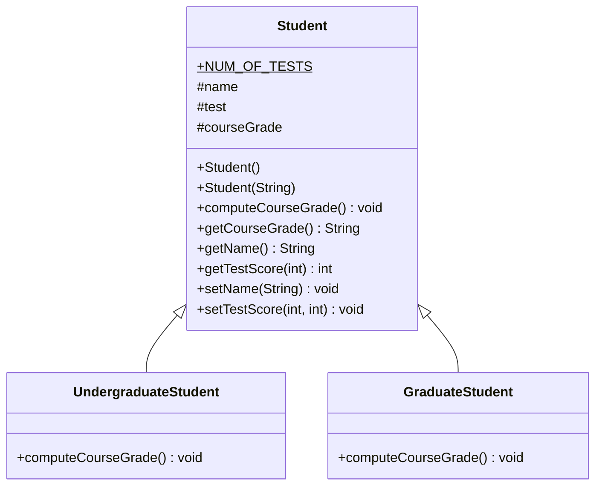
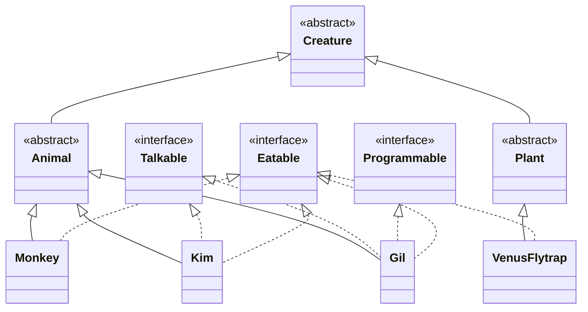
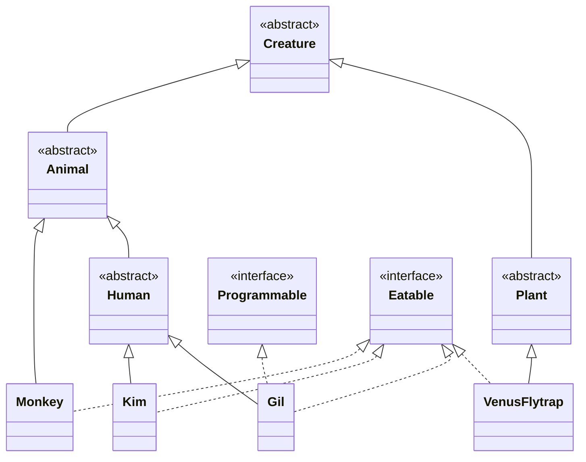

# 11강 — 상속과 다형성

[레포지토리 안내](../../README.ko.md) | [English](Concepts_Lecture.md) | [한국어](Concepts_Lecture.ko.md)

> **최종 수정일:** 2026-10-19

> **학습 목표:**
> 1. 상속을 사용하여 클래스 계층을 구현할 수 있다
> 2. 메서드 오버라이딩과 동적 디스패치를 적용할 수 있다
> 3. 유연하고 확장 가능한 설계를 위해 다형성을 사용할 수 있다
> 4. 추상 클래스와 인터페이스의 차이를 설명하고 상황에 맞게 고를 수 있다

---

## 목차

- [1. 상속 계층 구조](#1-상속-계층-구조)
  - [1.1 사례: 학부생과 대학원생 명부](#11-사례-학부생과-대학원생-명부)
  - [1.2 상속을 이용한 클래스 정의](#12-상속을-이용한-클래스-정의)
  - [1.3 protected 접근 제한자](#13-protected-접근-제한자)
  - [1.4 super()를 이용한 생성자 체이닝](#14-super를-이용한-생성자-체이닝)
- [2. 다형성](#2-다형성)
  - [2.1 다형성의 의미](#21-다형성의-의미)
  - [2.2 동적 바인딩](#22-동적-바인딩)
  - [2.3 instanceof 연산자](#23-instanceof-연산자)
- [3. 메서드 오버라이딩](#3-메서드-오버라이딩)
  - [3.1 오버라이딩 규칙](#31-오버라이딩-규칙)
  - [3.2 @Override 애너테이션](#32-override-애너테이션)
  - [3.3 오버라이딩으로 구현하는 다형성](#33-오버라이딩으로-구현하는-다형성)
  - [3.4 오버라이딩과 오버로딩](#34-오버라이딩과-오버로딩)
- [4. 추상 클래스와 인터페이스](#4-추상-클래스와-인터페이스)
  - [4.1 추상 클래스](#41-추상-클래스)
  - [4.2 인터페이스](#42-인터페이스)
  - [4.3 추상 클래스와 인터페이스의 비교](#43-추상-클래스와-인터페이스의-비교)
- [5. 상속을 활용한 디자인 패턴](#5-상속을-활용한-디자인-패턴)
- [요약](#요약)
- [점검 문제](#점검-문제)

---

<br>

## 1. 상속 계층 구조

### 1.1 사례: 학부생과 대학원생 명부

학부생과 대학원생이 함께 들어 있는 수강생 명부(class roster)를 구현하는 경우를 생각한다. 각 학생의 기록에는 이름, 시험 점수 세 개, 최종 학점이 들어 있고, 학점을 계산하는 공식은 학부생과 대학원생이 서로 다르다.

두 종류의 학생을 모델링하는 방법은 두 가지이다.

- 학부생용 클래스와 대학원생용 클래스를 서로 관련 없는 두 클래스로 정의한다. 상속 관계로 연결되지 않은 두 클래스를 **관련 없는 클래스(unrelated classes)** 라고 한다.
- 두 종류의 학생을 하나의 **상속 계층(inheritance hierarchy)** 에 속한 클래스로 모델링한다.

두 번째 방법을 택하면 `Student`, `UndergraduateStudent`, `GraduateStudent`의 세 클래스를 설계한다. `Student`는 두 종류의 학생에게 공통인 데이터와 동작을 담고, 두 하위 클래스는 각자에게만 해당하는 데이터와 동작(여기서는 학점 계산 공식)을 담는다.



*그림 1. Student, UndergraduateStudent, GraduateStudent의 상속 계층*

UML 클래스 다이어그램에서 `+`는 public 멤버, `#`는 protected 멤버를 뜻하고, 밑줄 친 `NUM_OF_TESTS`는 static 상수이다. 학점 공식이 학생 종류마다 다르므로 두 하위 클래스가 `computeCourseGrade()`를 각자 구현한다. `Student`에도 같은 메서드를 선언해 두어야 `Student` 타입 변수로 이 메서드를 호출할 수 있다(2.2절).

### 1.2 상속을 이용한 클래스 정의

```java
public class Person {
    private int weight;
    int age;
    protected int height;
    public String name;

    public void setWeight(int weight) { this.weight = weight; }
    public int getWeight() { return weight; }
}

public class Student extends Person {
    public void set() {
        age = 39;
        name = "PSY";
        height = 182;
        setWeight(99); // weight는 private이므로 직접 접근 불가
    }

    public void display() {
        System.out.println("Age: " + age);
        System.out.println("Name: " + name);
        System.out.println("Height: " + height);
    }
}
```

`Student`는 `extends Person`으로 `Person`을 상속하므로 `Person`의 필드와 메서드를 물려받는다. `age`(접근 제한자 생략, 같은 패키지), `height`(protected), `name`(public)은 `Student`의 메서드에서 이름으로 바로 쓸 수 있다. `weight`는 private이므로 `Student` 객체 안에 존재하기는 하지만 `Student`의 코드에서 이름으로 접근할 수 없고, 상속받은 public 메서드 `setWeight()`를 거쳐야 한다. `main()`에서 `Student` 객체를 만들고 `set()`과 `display()`를 차례로 호출하면 다음이 출력된다.

```text
Age: 39
Name: PSY
Height: 182
```

같은 구조를 하나의 파일로 만든 실습 코드는 [PersonStudentDemo.java](../../Coursework/Lab11_Inheritance-and-Polymorphism/PersonStudentDemo.java)에 있다.

### 1.3 protected 접근 제한자

Java의 접근 제한자는 private, 생략(default, package-private), protected, public의 네 가지이며, 이 순서대로 접근할 수 있는 범위가 넓어진다.

| 접근 제한자 | 같은 클래스 | 같은 패키지 | 다른 패키지의 하위 클래스 | 그 밖의 모든 클래스 |
|:-----|:-----|:-----|:-----|:-----|
| `private` | O | X | X | X |
| 생략 (default) | O | O | X | X |
| `protected` | O | O | O | X |
| `public` | O | O | O | O |

*표 1. 접근 제한자별 접근 가능 범위*

`protected` 멤버는 다음에서 접근 가능하다:
- 해당 클래스 자체
- 같은 패키지 내의 클래스
- 모든 패키지의 하위 클래스

> **참고:** **상속과 멤버 접근.** 하위 클래스의 인스턴스는 상위 클래스에서 물려받은 구성 요소를 자신의 일부로 포함한다. private 멤버도 객체 안에 존재하며, 하위 클래스의 코드에서 이름으로 접근할 수 없을 뿐이다.

### 1.4 super()를 이용한 생성자 체이닝

상위 클래스의 멤버와 달리 **생성자는 상속되지 않는다.** 클래스마다 생성자를 직접 정의하거나, 생성자를 하나도 정의하지 않았을 때 컴파일러가 추가하는 기본 생성자를 쓴다. 하위 클래스의 생성자에서 `super(...)`를 호출하면 상위 클래스의 생성자가 실행된다.

```java
public class Point {
    private int x, y;

    public Point(int x, int y) {
        this.x = x;
        this.y = y;
    }
}

public class ColorPoint extends Point {
    private String color;

    public ColorPoint(int x, int y, String color) {
        super(x, y);          // 반드시 첫 번째 문장이어야 함
        this.color = color;
    }
}
```

`ColorPoint`의 생성자는 `super(x, y)`로 `Point`의 생성자에 좌표 초기화를 맡기고, 자신의 필드 `color`만 직접 초기화한다. `Point`의 `x`, `y`는 private이므로 `ColorPoint`가 직접 대입할 수 없다는 점에서도 `super(x, y)`가 필요하다. `Point`에 좌표를 `(x,y)` 형식으로 출력하는 `showPoint()`를 두고 `ColorPoint`에 `color`를 출력한 뒤 `showPoint()`를 호출하는 `showColorPoint()`를 두면, `new ColorPoint(5, 6, "blue").showColorPoint()`는 `blue(5,6)`을 출력한다.

> **주의:** 생성자에 `super(...)` 호출을 쓰지 않으면 컴파일러가 첫 문장으로 인자 없는 `super()`를 넣는다. 위의 `Point`처럼 상위 클래스에 인자 없는 생성자가 없으면 이 호출이 컴파일 오류가 된다. 또 `extends` 절이 없는 클래스의 상위 클래스는 `Object`이다.

---

<br>

## 2. 다형성

### 2.1 다형성의 의미

**다형성(polymorphism)** 은 하나의 변수가 같은 상속 계층에 속한 여러 하위 클래스의 객체를 가리킬 수 있게 하는 성질이다. 예를 들어 `Cat`과 `Dog`가 `Pet`의 하위 클래스이면 다음 문장은 모두 올바르다.

```java
Pet myPet;

myPet = new Dog();
// ...
myPet = new Cat();
```

### 2.2 동적 바인딩

상위 클래스 변수가 하위 클래스 객체를 참조할 수 있다. JVM은 런타임에 호출할 메서드를 결정한다:

```java
Student[] roster = new Student[40];
roster[0] = new GraduateStudent();
roster[1] = new UndergraduateStudent();
roster[2] = new UndergraduateStudent();
roster[3] = new GraduateStudent();
int numberOfStudents = 4;

for (int i = 0; i < numberOfStudents; i++) {
    roster[i].computeCourseGrade(); // 적절한 하위 클래스 메서드가 호출됨
}
```

`roster` 배열은 `Student` 타입이므로 `GraduateStudent` 객체와 `UndergraduateStudent` 객체를 함께 담을 수 있다. `roster[i]`가 `GraduateStudent` 객체를 가리키면 `GraduateStudent`의 `computeCourseGrade()`가, `UndergraduateStudent` 객체를 가리키면 `UndergraduateStudent`의 `computeCourseGrade()`가 실행된다.

```text
roster ──► ┌───┬───┬───┬───┬──────┬─────┬──────┐
           │ 0 │ 1 │ 2 │ 3 │  4   │ ... │  39  │
           ├───┼───┼───┼───┼──────┼─────┼──────┤
           │ ● │ ● │ ● │ ● │ null │ ... │ null │
           └─┼─┴─┼─┴─┼─┴─┼─┴──────┴─────┴──────┘
             │   │   │   └──► :GraduateStudent
             │   │   └──────► :UndergraduateStudent
             │   └──────────► :UndergraduateStudent
             └──────────────► :GraduateStudent
```

*그림 2. 하위 클래스 객체를 가리키는 roster 배열의 상태*

> **주의:** `new Student[40]`은 참조 40개를 담는 배열만 만들며, 객체를 대입하지 않은 원소는 `null`이다. 따라서 반복은 실제 학생 수(`numberOfStudents`)까지만 해야 한다. `for (Student s : roster)`처럼 배열 전체를 돌면 첫 번째 `null` 원소에서 `NullPointerException`이 발생한다.

> **핵심:** 다형성을 사용하면 상위 클래스 타입으로 코드를 작성하면서 런타임에 올바른 하위 클래스 동작을 자동으로 호출할 수 있다.

### 2.3 instanceof 연산자

`instanceof` 연산자는 객체가 어떤 클래스의 인스턴스인지 검사한다. `x instanceof C`는 `x`가 가리키는 객체가 `C`의 인스턴스이거나 `C`의 하위 타입의 인스턴스이면 `true`이고, `x`가 `null`이면 `false`이다.

```java
if (roster[i] instanceof UndergraduateStudent) {
    System.out.println("Undergraduate student found.");
}
```

이 검사를 반복문 안에 두면 명부의 학부생 수를 셀 수 있다.

```java
int undergradCount = 0;
for (int i = 0; i < numberOfStudents; i++) {
    if (roster[i] instanceof UndergraduateStudent) {
        undergradCount++;
    }
}
```

---

<br>

## 3. 메서드 오버라이딩

### 3.1 오버라이딩 규칙

**메서드 오버라이딩(method overriding)** 은 상위 클래스에 선언된 메서드를 하위 클래스가 같은 시그니처로 다시 정의하여 자신의 내용으로 새로 구현하는 것이다.

- 메서드 이름과 매개변수 목록(타입, 개수, 순서)이 상위 클래스 메서드와 일치해야 한다.
- 반환 타입도 일치해야 한다. 단, 반환 타입이 참조 타입이면 그 하위 타입으로 바꿀 수 있다(**공변 반환 타입**, covariant return type).
- 접근 수준은 오버라이딩되는 메서드보다 더 제한적일 수 없다. 예를 들어 public 메서드를 protected로 오버라이딩할 수 없다.
- `final` 메서드는 오버라이딩할 수 없다. `static` 메서드를 하위 클래스에서 같은 시그니처로 선언하면 오버라이딩이 아니라 **숨김(hiding)** 이 되어 동적 바인딩이 일어나지 않는다. `private` 메서드는 하위 클래스에서 보이지 않으므로 오버라이딩의 대상이 아니다.
- 오버라이딩하는 메서드는 원래 메서드보다 더 넓은 검사 예외(checked exception)를 던지도록 선언할 수 없다.

### 3.2 @Override 애너테이션

```java
class Shape {
    public void draw() {
        System.out.println("Shape");
    }
}

class Circle extends Shape {
    @Override
    public void draw() {
        System.out.println("Circle");
    }
}
```

> **핵심:** `@Override`를 붙인 메서드가 상위 클래스의 어떤 메서드도 오버라이딩하지 않으면(이름이나 매개변수가 다르면) 컴파일 오류가 난다. 붙이지 않으면 이런 실수가 오류 없이 오버라이딩이 아닌 새로운 메서드를 만들므로, 오버라이딩하는 메서드에는 항상 `@Override`를 붙인다.

### 3.3 오버라이딩으로 구현하는 다형성

오버라이딩은 하나의 인터페이스(같은 이름의 메서드)로 서로 다른 내용을 실행하는 객체 지향의 다형성을 실현하며, 호출할 메서드가 실행 중에 정해지므로 **실행 시간 다형성(동적 바인딩)** 이라고도 한다. 다음 예에서 `Shape`의 하위 클래스 `Line`, `Rect`, `Circle`은 모두 `draw()`를 오버라이딩한다.

```java
class Shape {
    public void draw() { System.out.println("Shape"); }
}
class Line extends Shape {
    public void draw() { System.out.println("Line"); }
}
class Rect extends Shape {
    public void draw() { System.out.println("Rect"); }
}
class Circle extends Shape {
    public void draw() { System.out.println("Circle"); }
}

public class Chap11Program3 {
    public static void main(String[] args) {
        Line line = new Line();
        paint(line);
        paint(new Shape());
        paint(new Line());
        paint(new Rect());
        paint(new Circle());
    }

    static void paint(Shape p) {
        p.draw(); // p가 실제로 가리키는 객체의 draw()가 호출됨
    }
}
```

`paint()`의 매개변수 타입은 `Shape` 하나이지만, 넘겨받은 객체의 실제 클래스에 따라 `Line`, `Shape`, `Line`, `Rect`, `Circle`이 차례로 한 줄씩 출력된다.

게임 프로그램에서도 같은 구조를 쓸 수 있다. 무기를 나타내는 `Weapon` 클래스의 `fire()`가 최소 피해량 1을 반환하고, 하위 클래스가 이를 오버라이딩하여 저격총은 120, 다른 캐릭터의 무기는 100을 반환하게 한다.

```java
public class Weapon {
    protected int fire() { return 1; }
}
public class WidowWeaponSniper extends Weapon {
    @Override
    protected int fire() { return 120; }
}
public class DoomfistWeapon extends Weapon {
    @Override
    protected int fire() { return 100; }
}
```

`Weapon weapon` 변수에 `new Weapon()`, `new WidowWeaponSniper()`, `new DoomfistWeapon()`을 차례로 대입하고 `weapon.fire()`를 호출하면 1, 120, 100이 반환된다. 실습 코드 [InheritanceDemo.java](../../Coursework/Lab11_Inheritance-and-Polymorphism/InheritanceDemo.java)는 추상 클래스 `Shape`를 상속하는 도형 계층으로 같은 원리를 보인다.

### 3.4 오버라이딩과 오버로딩

| 구분 | 오버라이딩 (overriding) | 오버로딩 (overloading) |
|:-----|:-----|:-----|
| 정의 | 상위 클래스의 메서드를 하위 클래스에서 다시 정의 | 같은 이름의 메서드를 매개변수 목록을 달리하여 여러 개 정의 |
| 메서드 이름 | 같음 | 같음 |
| 매개변수 목록 | 같음 | 달라야 함 |
| 관계 | 상속 관계의 두 클래스 사이 | 한 클래스 안 또는 상속 관계 |
| 호출할 메서드의 결정 | 실행 시간 (동적 바인딩) | 컴파일 시간 (정적 바인딩) |

*표 2. 오버라이딩과 오버로딩의 비교*

```java
// 오버라이딩: Hound의 bark()가 Dog의 bark()를 다시 정의한다
class Dog {
    public void bark() { System.out.println("woof "); }
}
class Hound extends Dog {
    public void sniff() { System.out.println("sniff "); }
    public void bark() { System.out.println("bowl"); }
}

// 오버로딩: 이름이 같고 매개변수가 다른 bark()를 하나 더 정의한다
class Dog {
    public void bark() { System.out.println("woof "); }
    public void bark(int num) {
        for (int i = 0; i < num; i++)
            System.out.println("woof ");
    }
}
```

---

<br>

## 4. 추상 클래스와 인터페이스

### 4.1 추상 클래스

상위 클래스를 정의할 때 그 상위 클래스의 인스턴스는 만들 필요가 없는 경우가 많다. 예를 들어 학생은 반드시 학부생이거나 대학원생이어야 한다면 `UndergraduateStudent`와 `GraduateStudent`의 인스턴스만 있으면 되므로, `Student`는 인스턴스를 만들 수 없게 정의해야 한다.

> **용어 정의:** **추상 클래스(abstract class)** 는 (1) `abstract` 제한자로 정의했거나, (2) 추상 메서드를 포함하거나, (3) 상속받은 추상 메서드를 구현하지 않은 클래스이다. 뒤의 두 경우에도 클래스 선언에 `abstract`를 붙여야 하며, 붙이지 않으면 컴파일 오류가 난다. **추상 메서드(abstract method)** 는 `abstract` 키워드를 붙이고 메서드 본문 대신 세미콜론으로 끝나는 메서드이다. private 메서드와 static 메서드는 abstract로 선언할 수 없다.

추상 클래스는 인스턴스화할 수 없으며 추상 메서드를 포함할 수 있다:

```java
abstract class Shape {
    abstract double area();

    public void printArea() {
        System.out.println("Area: " + area());
    }
}
```

추상 클래스는 추상 메서드 없이 정의할 수도 있고(`abstract class MyComponent { String name; ... }`), 생성자와 일반 메서드를 가질 수도 있다. 그러나 `new`로 객체를 만들 수는 없다.

```java
Shape shape;
shape = new Shape();  // 컴파일 오류: Shape는 추상 클래스이다
shape = new Circle(); // 가능: 추상 클래스 타입의 변수는 하위 클래스 객체를 가리킬 수 있다
```

추상 클래스를 상속하는 클래스가 인스턴스를 만들 수 있으려면 모든 추상 메서드를 구현해야 한다. 팀장이 다음 추상 클래스 `Calculator`를 설계했다면, 이를 상속하는 클래스는 세 메서드를 모두 오버라이딩해야 한다.

```java
abstract class Calculator {
    public abstract int add(int a, int b);
    public abstract int subtract(int a, int b);
    public abstract double average(int[] a);
}
```

`add(a, b)`가 `a + b`, `subtract(a, b)`가 `a - b`, `average(a)`가 원소의 합을 `double`로 구해 원소 수로 나눈 값을 반환하도록 구현하면 `add(2, 3)`은 5, `subtract(2, 3)`은 -1, `average(new int[] {2, 3, 4})`는 3.0을 반환한다.

### 4.2 인터페이스

인터페이스는 구현 클래스가 반드시 충족해야 하는 계약을 정의한다:

```java
interface Drawable {
    void draw();
}

class Circle extends Shape implements Drawable {
    @Override
    double area() { return Math.PI * radius * radius; }

    @Override
    public void draw() { System.out.println("Drawing circle"); }
}
```

이 `Circle`은 4.1절의 추상 클래스 `Shape`를 상속하여 `area()`를 구현하고, 인터페이스 `Drawable`을 구현하여 `draw()`를 구현한다. `radius`는 `Circle`에 선언된 반지름 필드라고 가정한다. 인터페이스의 메서드는 암묵적으로 public이므로 구현하는 `draw()`도 public이어야 한다.

### 4.3 추상 클래스와 인터페이스의 비교

| 항목 | 인터페이스 | 추상 클래스 |
|:-----|:-----|:-----|
| 생성자 | 가질 수 없다 | 가질 수 있다 |
| 필드 | 암묵적으로 `public static final`인 상수만 가질 수 있다 | 인스턴스 필드와 static 필드를 모두 가질 수 있고, final이 아니어도 된다 |
| 멤버의 접근 제한자 | 기본이 public이며, Java 9부터 private 메서드를 둘 수 있다. protected 멤버는 둘 수 없다 | private, 생략, protected, public을 모두 쓸 수 있다 |
| 추상 메서드 | 본문 없는 메서드는 암묵적으로 `public abstract`이다 | `abstract` 키워드로 선언한다 |
| 구현이 있는 메서드 | Java 8부터 default 메서드와 static 메서드를 가질 수 있다 | 일반 메서드, static 메서드, final 메서드를 가질 수 있다 |
| final 메서드 | 가질 수 없다 | 가질 수 있다 |
| 다중 상속 | 한 클래스가 여러 인터페이스를 구현할 수 있다 | 한 클래스는 하나의 클래스만 상속할 수 있다 |

*표 3. Java 인터페이스와 추상 클래스의 비교*

> **주의:** 인터페이스에 선언한 필드는 값을 바꿀 수 있는 데이터 멤버가 아니라 상수이다. 따라서 인터페이스는 객체의 상태를 담지 못하며, 공통 상태가 필요하면 추상 클래스를 쓴다.

인터페이스는 서로 관련 없는 클래스에 공통 능력을 부여할 때 쓴다. 예를 들어 인터페이스 `Vehicle`은 `Car`, `Plane`, `Boat`가 각자 구현한다. 추상 클래스는 밀접하게 관련된 클래스가 공통 상태와 코드를 공유할 때 쓴다. 예를 들어 추상 클래스 `Dog`는 `Dalmatian`, `Collie`, `BlackLab`이 상속한다.



*그림 3. 추상 클래스와 인터페이스를 함께 쓴 생물 계층*

그림 3에서 추상 클래스 `Creature`, `Animal`, `Plant`는 is-a 관계의 뼈대를 이루고, 구체 클래스 `Monkey`, `Kim`, `Gil`, `VenusFlytrap`이 그 아래에 있다. 말할 수 있음(`Talkable`), 프로그래밍할 수 있음(`Programmable`), 먹을 수 있음(`Eatable`)은 계층의 여러 가지에 흩어진 능력이므로 인터페이스로 표현한다.



*그림 4. 공통 능력을 추상 클래스 Human으로 옮긴 생물 계층*

`Talkable`을 구현하는 클래스가 모두 사람이라면 그림 4처럼 추상 클래스 `Human`을 두고 말하는 기능을 그 안에 구현할 수 있다. 반면 `Eatable`은 동물과 식물에 걸쳐 있어 하나의 상위 클래스로 묶을 수 없으므로 인터페이스로 남는다.

---

<br>

## 5. 상속을 활용한 디자인 패턴

| 패턴 | 설명 | 예시 |
|:--------|:------------|:--------|
| Template Method | 상위 클래스가 알고리즘 골격을 정의하고, 하위 클래스가 각 단계를 구현한다 | `Shape.printArea()`가 추상 `area()`를 호출 |
| Strategy | 동작을 상위 타입(인터페이스나 상위 클래스)으로 정의하고, 객체가 그 구현 중 하나를 참조하게 하여 동작을 바꾼다 | 게임 캐릭터가 서로 다른 `Weapon` 하위 클래스 객체를 갈아 끼움 |
| Factory | 생성할 객체의 정확한 클래스를 호출하는 쪽에서 지정하지 않고 객체를 생성한다 | `StudentFactory.create("grad")` |

*표 4. 상속과 다형성을 활용하는 디자인 패턴*

---

<br>

## 요약

| 개념 | 핵심 요약 |
|:--------|:----------|
| 상속 | `extends`로 is-a 관계를 만들며, Java 클래스는 하나의 클래스만 상속할 수 있다. |
| protected | 같은 패키지의 클래스와 다른 패키지의 하위 클래스에서 접근할 수 있다. |
| super() | 생성자는 상속되지 않으므로 하위 클래스 생성자가 첫 문장에서 상위 클래스 생성자를 호출한다. |
| 다형성 | 상위 클래스 변수가 하위 클래스 객체를 가리키고, 실행할 메서드는 동적 바인딩으로 정해진다. |
| instanceof | 객체의 런타임 타입이 주어진 클래스이거나 그 하위 클래스인지 검사한다. |
| 메서드 오버라이딩 | 같은 시그니처로 상위 클래스 메서드를 다시 정의하며, `@Override`로 실수를 컴파일 시간에 잡는다. |
| 오버로딩 | 같은 이름에 다른 매개변수 목록을 가진 메서드를 정의하며, 호출할 메서드는 컴파일 시간에 정해진다. |
| 추상 클래스 | 인스턴스화할 수 없고 추상 메서드를 가질 수 있으며, 공통 상태와 코드를 공유하는 데 쓴다. |
| 인터페이스 | 구현 클래스가 지켜야 할 계약을 정의하며, 한 클래스는 여러 인터페이스를 구현할 수 있다. |

---

<br>

## 점검 문제

1. **접근 제한자:** 1.2절의 `Person`은 패키지 `p1`에, `Student`는 다른 패키지 `p2`에 있다. `Student`의 메서드에서 이름으로 직접 접근할 수 있는 `Person`의 필드를 모두 쓰라.

   <details>
   <summary>정답</summary>

   `height`(protected)와 `name`(public)이다. `weight`는 private이므로 하위 클래스에서 직접 접근할 수 없고, `age`는 접근 제한자를 생략한 package-private 필드이므로 다른 패키지의 하위 클래스에서는 접근할 수 없다. `age`에 접근하면 컴파일러가 "age is not public in Person; cannot be accessed from outside package" 오류를 낸다.

   </details>

2. **instanceof:** `Student`와 `Researcher`는 `Person`을 상속하고 `Professor`는 `Researcher`를 상속한다. `Person jee = new Student(); Person kim = new Professor(); Person lee = new Researcher();`일 때 다음 식의 값을 각각 쓰라. (a) `jee instanceof Person` (b) `jee instanceof Student` (c) `kim instanceof Student` (d) `kim instanceof Professor` (e) `kim instanceof Researcher` (f) `lee instanceof Professor`

   <details>
   <summary>정답</summary>

   (a) true (b) true (c) false (d) true (e) true (f) false이다. `instanceof`는 변수의 선언 타입이 아니라 변수가 가리키는 객체의 실제 클래스를 기준으로 하며, 그 클래스의 상위 클래스에 대해서도 true이다. `kim`이 가리키는 `Professor` 객체는 `Researcher`이기도 하므로 (e)는 true이고, `lee`가 가리키는 `Researcher` 객체는 `Professor`가 아니므로 (f)는 false이다.

   </details>

3. **동적 바인딩:** 3.3절의 `Chap11Program3`을 실행했을 때의 출력을 쓰고, `paint(new Shape())`가 `Shape`를 출력하는 이유를 설명하라.

   <details>
   <summary>정답</summary>

   `Line`, `Shape`, `Line`, `Rect`, `Circle`이 한 줄씩 출력된다. `p.draw()`는 `p`가 실제로 가리키는 객체의 클래스에서 `draw()`를 찾는다. `new Shape()`로 만든 객체의 클래스는 `Shape`이므로 `Shape`의 `draw()`가 실행된다.

   </details>

4. **생성자 체이닝:** 1.4절의 `ColorPoint` 생성자에서 `super(x, y);`를 지우면 어떻게 되는가? `Point`에는 `Point(int x, int y)` 생성자만 있다.

   <details>
   <summary>정답</summary>

   컴파일 오류가 난다. `super(...)` 호출이 없으면 컴파일러가 생성자 첫 문장에 인자 없는 `super()`를 넣는데, `Point`에는 인자 없는 생성자가 없기 때문이다. `Point`에 인자 없는 생성자를 추가하면 컴파일되지만, 그때는 좌표가 인자 없는 생성자가 정한 값으로 초기화된다.

   </details>

5. **추상 클래스:** 4.1절의 `Calculator`를 상속하는 클래스 `MyCalc`가 `add()`와 `subtract()`만 구현하고 `average()`를 구현하지 않았다. `MyCalc`를 컴파일하려면 어떻게 해야 하는가?

   <details>
   <summary>정답</summary>

   `MyCalc`는 상속받은 추상 메서드 `average()`를 구현하지 않았으므로 추상 클래스이다. 따라서 `abstract class MyCalc`로 선언해야 컴파일되며, 이 경우 `MyCalc`의 인스턴스는 만들 수 없다. 인스턴스를 만들려면 `average(int[] a)`를 구현해야 한다.

   </details>
