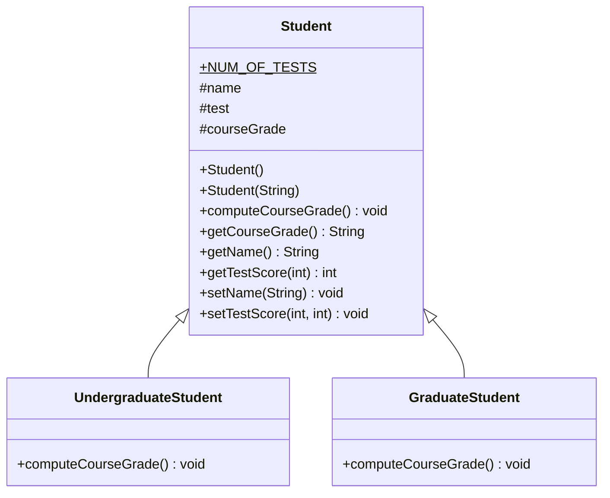
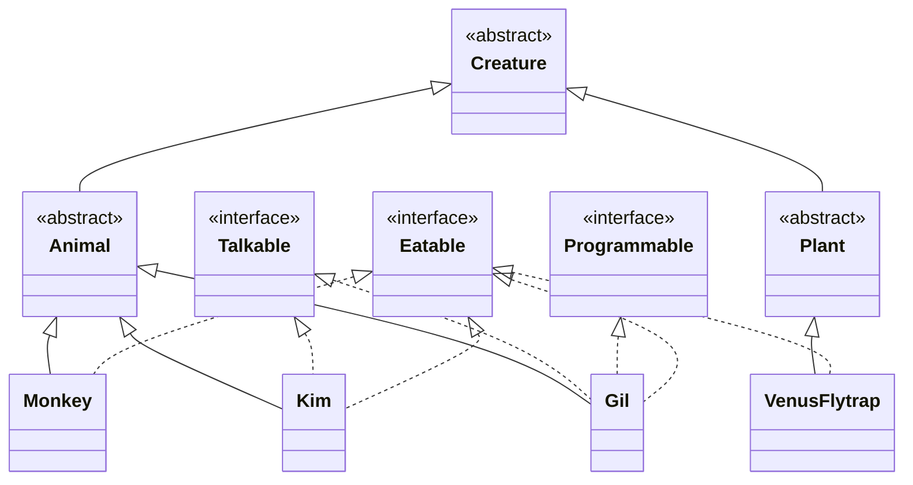
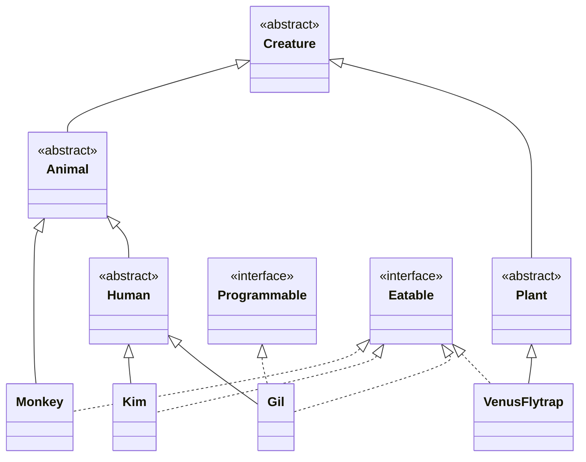

# Lecture 11 — Inheritance and Polymorphism

[Repository Guide](../../README.md) | [English](Concepts_Lecture.md) | [한국어](Concepts_Lecture.ko.md)

> **Last Updated:** 2026-11-19

> **Learning Objectives:**
> 1. Implement class hierarchies using inheritance
> 2. Apply method overriding and dynamic binding
> 3. Use polymorphism for flexible and extensible design
> 4. Explain the differences between abstract classes and interfaces and choose the right one for a situation
> 5. Trace the order of object creation and dynamic dispatch step by step and interpret compile errors from the overriding rules
> 6. Override toString, equals, and hashCode of Object in line with their contracts

---

## Table of Contents

- [1. Inheritance Hierarchy](#1-inheritance-hierarchy)
  - [1.1 Case Study: A Roster of Undergraduate and Graduate Students](#11-case-study-a-roster-of-undergraduate-and-graduate-students)
  - [1.2 Defining Classes with Inheritance](#12-defining-classes-with-inheritance)
  - [1.3 The protected Modifier](#13-the-protected-modifier)
  - [1.4 Constructor Chaining with super()](#14-constructor-chaining-with-super)
  - [1.5 The Order in Which an Object Is Created](#15-the-order-in-which-an-object-is-created)
  - [1.6 Calling Superclass Methods with super](#16-calling-superclass-methods-with-super)
- [2. Polymorphism](#2-polymorphism)
  - [2.1 What Polymorphism Means](#21-what-polymorphism-means)
  - [2.2 Dynamic Binding](#22-dynamic-binding)
  - [2.3 The instanceof Operator](#23-the-instanceof-operator)
  - [2.4 Upcasting and Downcasting](#24-upcasting-and-downcasting)
  - [2.5 Method Calls Seen through Static and Dynamic Types](#25-method-calls-seen-through-static-and-dynamic-types)
  - [2.6 Completing the Roster Example](#26-completing-the-roster-example)
- [3. Method Overriding](#3-method-overriding)
  - [3.1 Rules for Overriding](#31-rules-for-overriding)
  - [3.2 The @Override Annotation](#32-the-override-annotation)
  - [3.3 Polymorphism Through Overriding](#33-polymorphism-through-overriding)
  - [3.4 Overriding and Overloading](#34-overriding-and-overloading)
  - [3.5 Compile Errors from Breaking the Overriding Rules](#35-compile-errors-from-breaking-the-overriding-rules)
  - [3.6 Hiding Fields and Static Methods](#36-hiding-fields-and-static-methods)
  - [3.7 Calling an Overridden Method from a Constructor](#37-calling-an-overridden-method-from-a-constructor)
- [4. Abstract Classes and Interfaces](#4-abstract-classes-and-interfaces)
  - [4.1 Abstract Classes](#41-abstract-classes)
  - [4.2 Interfaces](#42-interfaces)
  - [4.3 Comparing Abstract Classes and Interfaces](#43-comparing-abstract-classes-and-interfaces)
  - [4.4 Shape Turned into an Abstract Class](#44-shape-turned-into-an-abstract-class)
  - [4.5 Default and Static Methods of Interfaces](#45-default-and-static-methods-of-interfaces)
- [5. Design Patterns Using Inheritance](#5-design-patterns-using-inheritance)
- [6. Methods of the Object Class](#6-methods-of-the-object-class)
  - [6.1 toString](#61-tostring)
  - [6.2 equals](#62-equals)
  - [6.3 hashCode and getClass](#63-hashcode-and-getclass)
- [7. Restricting Inheritance and Composition](#7-restricting-inheritance-and-composition)
  - [7.1 final Classes and final Methods](#71-final-classes-and-final-methods)
  - [7.2 Inheritance and Composition](#72-inheritance-and-composition)
- [8. Common Mistakes](#8-common-mistakes)
- [Summary](#summary)
- [Self-Check Questions](#self-check-questions)
- [References](#references)

---

<br>

## 1. Inheritance Hierarchy

### 1.1 Case Study: A Roster of Undergraduate and Graduate Students

Consider implementing a class roster that contains both undergraduate and graduate students. Each student's record contains a name, three test scores, and the final course grade, and the formula for the course grade differs between undergraduate and graduate students.

There are two ways to model the two kinds of students.

- Define two unrelated classes, one for undergraduates and one for graduates. Two classes that are not connected by an inheritance relationship are called **unrelated classes**.
- Model the two kinds of students with classes that belong to one **inheritance hierarchy**.

With the second approach we design three classes: `Student`, `UndergraduateStudent`, and `GraduateStudent`. `Student` holds the data and behavior common to both kinds of students, and each subclass holds the data and behavior specific to it (here, the grading formula).



*Figure 1. Inheritance hierarchy of Student, UndergraduateStudent, and GraduateStudent*

In a UML class diagram, `+` marks a public member and `#` marks a protected member, and the underlined `NUM_OF_TESTS` is a static constant. Because the grading formula depends on the kind of student, each subclass implements `computeCourseGrade()` in its own way. `Student` must also declare this method so that it can be called through a `Student` variable (Section 2.2).

### 1.2 Defining Classes with Inheritance

```java
public class Person {
    private int weight;
    int age;
    protected int height;
    public String name;

    public void setWeight(int weight) { this.weight = weight; }
    public int getWeight() { return weight; }
}

public class Student extends Person {
    public void set() {
        age = 39;
        name = "PSY";
        height = 182;
        setWeight(99); // cannot access weight directly (private)
    }

    public void display() {
        System.out.println("Age: " + age);
        System.out.println("Name: " + name);
        System.out.println("Height: " + height);
    }
}
```

`Student` inherits from `Person` through `extends Person`, so it receives the fields and methods of `Person`. `age` (no modifier, same package), `height` (protected), and `name` (public) can be used by name directly in the methods of `Student`. `weight` is private, so although it exists inside a `Student` object, the code of `Student` cannot access it by name and must go through the inherited public method `setWeight()`. Creating a `Student` object in `main()` and calling `set()` and then `display()` prints the following.

```text
Age: 39
Name: PSY
Height: 182
```

The lab code [PersonStudentDemo.java](../../Coursework/Lab11_Inheritance-and-Polymorphism/PersonStudentDemo.java) puts the same structure in a single file.

### 1.3 The protected Modifier

Java has four access modifiers, private, no modifier (default, package-private), protected, and public, and the range of access widens in this order.

| Modifier | Same Class | Same Package | Subclass in Another Package | Any Other Class |
|:-----|:-----|:-----|:-----|:-----|
| `private` | O | X | X | X |
| No modifier (default) | O | O | X | X |
| `protected` | O | O | O | X |
| `public` | O | O | O | O |

*Table 1. Access range of each access modifier*

`protected` members are visible to:
- The class itself
- Classes in the same package
- Subclasses in any package

> **Note:** **Inheritance and member access.** An instance of a subclass contains the components inherited from the superclass as part of itself. Private members also exist inside the object, and the code of the subclass simply cannot access them by name.

### 1.4 Constructor Chaining with super()

Unlike the members of a superclass, **constructors are not inherited.** Each class either defines its own constructors or uses the default constructor that the compiler adds when no constructor is defined. Calling `super(...)` in a subclass constructor runs a constructor of the superclass. This call is placed as the first statement of the constructor (for the relaxation from Java 25, see the note in Lecture 8, Section 2.2).

```java
public class Point {
    private int x, y;

    public Point(int x, int y) {
        this.x = x;
        this.y = y;
    }
}

public class ColorPoint extends Point {
    private String color;

    public ColorPoint(int x, int y, String color) {
        super(x, y);          // must be the first statement
        this.color = color;
    }
}
```

The constructor of `ColorPoint` delegates the coordinate initialization to the constructor of `Point` with `super(x, y)` and initializes only its own field `color`. Since `x` and `y` of `Point` are private, `ColorPoint` cannot assign them directly, which is another reason `super(x, y)` is needed. If `Point` has a `showPoint()` that prints the coordinates as `(x,y)` and `ColorPoint` has a `showColorPoint()` that prints `color` and then calls `showPoint()`, then `new ColorPoint(5, 6, "blue").showColorPoint()` prints `blue(5,6)`.

> **Caution:** If a constructor does not call `super(...)`, the compiler inserts a no-argument `super()` as its first statement. If the superclass has no no-argument constructor, like `Point` above, this call is a compile error. Also, a class without an `extends` clause has `Object` as its superclass.

### 1.5 The Order in Which an Object Is Created

When an object of a subclass is created with `new`, one object contains both the superclass part and the subclass part (the note box of Section 1.3). The superclass part must be ready before the subclass code can use it, so creation proceeds from the top down. The following program prints the order in which each stage runs in a three-level hierarchy.

```java
public class CtorOrder {
    static String log(String s) { System.out.println(s); return s; }

    static class Person {
        String tag = log("Person field initializer");
        Person() {
            log("Person() body");
        }
    }

    static class Student extends Person {
        String school = log("Student field initializer");
        Student() {
            this("unknown");
            log("Student() body");
        }
        Student(String school) {
            super();
            log("Student(String) body, school = " + this.school + " -> " + school);
            this.school = school;
        }
    }

    static class GradStudent extends Student {
        GradStudent() {
            log("GradStudent() body");
        }
    }

    public static void main(String[] args) {
        new GradStudent();
    }
}
```

```text
Person field initializer
Person() body
Student field initializer
Student(String) body, school = Student field initializer -> unknown
Student() body
GradStudent() body
```

Tracing the execution of `new GradStudent()` step by step gives the following.

1. The JVM allocates the memory the object needs and fills every field with its default value (`null`, 0, `false`). At this point `tag` and `school` are `null`.
2. The first statement of `GradStudent()` contains no `super(...)` or `this(...)`, so the `super()` inserted by the compiler calls `Student()`.
3. The first statement of `Student()`, `this("unknown")`, calls `Student(String)` of the same class. A constructor that hands over to another constructor with `this(...)` does not run the field initializers; initialization happens only once, in the constructor that calls `super(...)`.
4. `super()` of `Student(String)` calls `Person()`, and `Person()` in turn calls `Object()`. When `Object()` returns, the field initializer of `Person` runs and prints the first line, and then the body of `Person()` prints the second line.
5. When `Person()` returns, the field initializer of `Student` runs and puts a string into `school`, and then the body of `Student(String)` runs. On the fourth line, the value of `school` first seen by the body is the result of the field initializer, which shows this order. The body changes `school` to `"unknown"`.
6. When `Student(String)` returns, the rest of the body of `Student()` runs, and then the body of `GradStudent()`.

In summary, constructor calls go up from the subclass to `Object`, the actual initialization comes down from `Object` to the subclass, and within each class the field initializers run before the constructor body. The rule that `super(...)` must be the first statement of a constructor (Section 1.4) exists to guarantee that the superclass part is initialized before the subclass part.

### 1.6 Calling Superclass Methods with super

When a subclass overrides a method, calling that name on an object of the subclass reaches the subclass's method. To use the superclass's original implementation inside the overriding method, call it with `super.methodName(...)`. Unlike the constructor call `super(...)`, this form can be used anywhere in a method.

```java
public class SuperCall {
    static class Account {
        protected double balance = 100;
        String describe() { return "Account balance " + balance; }
    }

    static class SavingsAccount extends Account {
        private double rate = 0.05;
        @Override
        String describe() {
            return super.describe() + ", rate " + rate;   // reuse the superclass version
        }
    }

    public static void main(String[] args) {
        Account a = new SavingsAccount();
        System.out.println(a.describe());
    }
}
```

```text
Account balance 100.0, rate 0.05
```

`SavingsAccount.describe()` gets the description string of `Account` with `super.describe()` and then appends the rate. Even though the type of variable `a` is `Account`, the actual object is a `SavingsAccount`, so `a.describe()` runs the method of `SavingsAccount` (Section 2.2), and the `super.describe()` inside it calls the implementation of the class directly above, `Account`, without dynamic binding. Extending the superclass behavior instead of discarding it in this way is a common form of overriding. There is no syntax such as `super.super.describe()` that calls the implementation two levels up directly.

---

<br>

## 2. Polymorphism

### 2.1 What Polymorphism Means

**Polymorphism** allows a single variable to refer to objects of different subclasses in the same inheritance hierarchy. For example, if `Cat` and `Dog` are subclasses of `Pet`, the following statements are all valid.

```java
Pet myPet;

myPet = new Dog();
// ...
myPet = new Cat();
```

### 2.2 Dynamic Binding

A superclass variable can refer to a subclass object, and when a method is called through that variable, the JVM chooses the method to call at runtime from the actual class of the object the variable refers to. This is called **dynamic binding**.

```java
Student[] roster = new Student[40];
roster[0] = new GraduateStudent();
roster[1] = new UndergraduateStudent();
roster[2] = new UndergraduateStudent();
roster[3] = new GraduateStudent();
int numberOfStudents = 4;

for (int i = 0; i < numberOfStudents; i++) {
    roster[i].computeCourseGrade(); // calls the appropriate subclass method
}
```

Because the `roster` array has type `Student`, it can hold `GraduateStudent` and `UndergraduateStudent` objects together. If `roster[i]` refers to a `GraduateStudent` object, the `computeCourseGrade()` of `GraduateStudent` runs, and if it refers to an `UndergraduateStudent` object, the `computeCourseGrade()` of `UndergraduateStudent` runs.

```text
roster ──► ┌───┬───┬───┬───┬──────┬─────┬──────┐
           │ 0 │ 1 │ 2 │ 3 │  4   │ ... │  39  │
           ├───┼───┼───┼───┼──────┼─────┼──────┤
           │ ● │ ● │ ● │ ● │ null │ ... │ null │
           └─┼─┴─┼─┴─┼─┴─┼─┴──────┴─────┴──────┘
             │   │   │   └──► :GraduateStudent
             │   │   └──────► :UndergraduateStudent
             │   └──────────► :UndergraduateStudent
             └──────────────► :GraduateStudent
```

*Figure 2. State of the roster array referring to subclass objects*

> **Caution:** `new Student[40]` creates only an array of 40 references, and every element that has not been assigned an object is `null`. The loop must therefore run only up to the actual number of students (`numberOfStudents`). Looping over the whole array, as in `for (Student s : roster)`, throws a `NullPointerException` at the first `null` element.

> **Key Point:** Polymorphism enables writing code that works with the superclass type while automatically invoking the correct subclass behavior at runtime.

### 2.3 The instanceof Operator

The `instanceof` operator tests which class an object is an instance of. `x instanceof C` is `true` if the object that `x` refers to is an instance of `C` or of a subtype of `C`, and `false` if `x` is `null`.

```java
if (roster[i] instanceof UndergraduateStudent) {
    System.out.println("Undergraduate student found.");
}
```

Placing this test inside a loop counts the undergraduate students in the roster.

```java
int undergradCount = 0;
for (int i = 0; i < numberOfStudents; i++) {
    if (roster[i] instanceof UndergraduateStudent) {
        undergradCount++;
    }
}
```

### 2.4 Upcasting and Downcasting

Assigning an object of a subclass to a variable of a superclass type, as in `Pet myPet = new Dog();` of Section 2.1, is called **upcasting**. Every `Dog` is a `Pet`, so upcasting is always safe and happens automatically without a cast operator. Conversely, converting a reference of a superclass type to a subclass type is called **downcasting**, and since not every `Pet` is a `Dog`, it must be made explicit with a cast operator such as `(Dog)`.

```java
public class Casting {
    static class Pet { String name() { return "pet"; } }
    static class Dog extends Pet {
        @Override String name() { return "dog"; }
        void fetch() { System.out.println("fetching"); }
    }
    static class Cat extends Pet { @Override String name() { return "cat"; } }

    public static void main(String[] args) {
        Pet p = new Dog();                 // upcast: implicit
        System.out.println(p.name());
        // p.fetch();                      // compile error: Pet has no fetch()

        Dog d = (Dog) p;                   // downcast: explicit
        d.fetch();

        Pet q = new Cat();
        try {
            Dog wrong = (Dog) q;
        } catch (ClassCastException e) {
            System.out.println(e.getMessage());
        }

        for (Pet x : new Pet[] { new Dog(), new Cat() }) {
            if (x instanceof Dog dog) {    // test and cast at once
                dog.fetch();
            } else {
                System.out.println(x.name() + " cannot fetch");
            }
        }
    }
}
```

```text
dog
fetching
class Casting$Cat cannot be cast to class Casting$Dog (Casting$Cat and Casting$Dog are in unnamed module of loader 'app')
fetching
cat cannot fetch
```

The type of variable `p` is `Pet`, so only methods declared in `Pet` can be called through `p`. Even though the actual object is a `Dog`, `p.fetch()` is a compile error, because the compiler decides which methods can be called by looking only at the type of the variable. To use a method of `Dog`, downcast with `(Dog) p`. A downcast is allowed at compile time, but at run time the JVM checks the actual class of the object and throws a `ClassCastException` if it does not match. The object `q` refers to is a `Cat`, so `(Dog) q` throws the exception, and the message tells which class was being converted to which.

A safe downcast first tests with the `instanceof` of Section 2.3. Since Java 16, pattern matching such as `x instanceof Dog dog`, which declares a variable while testing, can be used [1]. If the test is true, `dog` is already a variable cast to type `Dog`, so no separate cast is needed. The first element of the loop is a `Dog`, so it prints `fetching`, and the second is a `Cat`, so it prints `cat cannot fetch`.

> **Caution:** If downcasting is needed often, the design deserves another look. When objects must do different things depending on their kind, rather than lining up `instanceof` tests and casts, declare the behavior as a superclass method and override it in the subclasses so that the dynamic binding of Section 2.2 chooses the right method.

### 2.5 Method Calls Seen through Static and Dynamic Types

A variable has two types. The type written in the declaration is called its **static type**, and the class of the object the variable actually refers to at run time is called its **dynamic type**. In `Animal ad = new Dog();`, the static type of `ad` is `Animal` and its dynamic type is `Dog`. A method call `x.m(y)` is decided in two steps.

1. **Compile time:** among the methods named `m` in the static type of `x`, the compiler chooses the one signature that best fits the static type of the argument `y`. Overloading (Section 3.4) is resolved in this step [2].
2. **Run time:** the JVM starts from the dynamic type of `x`, moves up toward the superclasses, and runs the first method it meets that overrides the signature chosen in step 1. Overriding is resolved in this step.

That is, the static type of the argument decides which signature to call, and the dynamic type of the call target decides which implementation of that signature runs. An example in which the two rules act together is as follows.

```java
public class Dispatch {
    static class Animal {
        String meet(Animal other) { return "Animal.meet(Animal)"; }
        String meet(Dog other)    { return "Animal.meet(Dog)"; }
    }

    static class Dog extends Animal {
        @Override String meet(Animal other) { return "Dog.meet(Animal)"; }
        @Override String meet(Dog other)    { return "Dog.meet(Dog)"; }
    }

    public static void main(String[] args) {
        Animal a = new Animal();
        Animal ad = new Dog();
        Dog d = new Dog();

        System.out.println("1 " + a.meet(d));
        System.out.println("2 " + ad.meet(a));
        System.out.println("3 " + ad.meet(ad));
        System.out.println("4 " + ad.meet(d));
        System.out.println("5 " + d.meet((Animal) d));
    }
}
```

```text
1 Animal.meet(Dog)
2 Dog.meet(Animal)
3 Dog.meet(Animal)
4 Dog.meet(Dog)
5 Dog.meet(Animal)
```

| Call | Static type, dynamic type of the target | Static type of the argument | Signature chosen in step 1 | Method run in step 2 |
|:-----|:-----|:-----|:-----|:-----|
| 1 `a.meet(d)` | `Animal`, `Animal` | `Dog` | `meet(Dog)` | `Animal.meet(Dog)` |
| 2 `ad.meet(a)` | `Animal`, `Dog` | `Animal` | `meet(Animal)` | `Dog.meet(Animal)` |
| 3 `ad.meet(ad)` | `Animal`, `Dog` | `Animal` | `meet(Animal)` | `Dog.meet(Animal)` |
| 4 `ad.meet(d)` | `Animal`, `Dog` | `Dog` | `meet(Dog)` | `Dog.meet(Dog)` |
| 5 `d.meet((Animal) d)` | `Dog`, `Dog` | `Animal` | `meet(Animal)` | `Dog.meet(Animal)` |

*Table 2. Signature selection and the method run for the five calls*

The most confusing is call 3. The argument `ad` actually refers to a `Dog` object, but the compiler looks only at the static type `Animal` of `ad` and chooses `meet(Animal)`. At run time the implementation of `meet(Animal)` is looked up in `Dog`, the dynamic type of the target `ad`, so `Dog.meet(Animal)` runs. The dynamic type of the argument is not used in choosing the method. For the same reason, call 5 passes the same object `d`, but its static type was changed with `(Animal)`, so `meet(Animal)` is chosen. Choosing the implementation from the dynamic type of the call target alone, as Java does, is called single dispatch.

> **[Programming Languages]** JVM implementations usually keep a virtual method table (vtable) per class to handle step 2 quickly. Each slot of the table corresponds to one method signature, and a subclass's table copies its superclass's table and replaces only the slots it overrides with its own implementations. A call then only needs to find the table of the object's class and run the method in the fixed slot.

### 2.6 Completing the Roster Example

Completing the roster of Section 1.1 as a working program brings the concepts of this lecture together in one place. The grading rule here is that an undergraduate passes with an average of 70 or more on the three tests, and a graduate student with 80 or more. Every student must be either an undergraduate or a graduate student, so `Student` is made abstract (Section 4.1) and grade computation is declared as an abstract method.

```java
abstract class Student {
    protected static final int NUM_OF_TESTS = 3;
    protected String name;
    protected int[] test = new int[NUM_OF_TESTS];
    protected String courseGrade = "****";

    Student(String name, int t1, int t2, int t3) {
        this.name = name;
        test[0] = t1; test[1] = t2; test[2] = t3;
    }

    double average() {
        int total = 0;
        for (int t : test) total += t;
        return total / (double) NUM_OF_TESTS;
    }

    abstract void computeCourseGrade();                // differs by kind of student

    String getCourseGrade() { return courseGrade; }
}

class UndergraduateStudent extends Student {
    UndergraduateStudent(String n, int a, int b, int c) { super(n, a, b, c); }
    @Override void computeCourseGrade() { courseGrade = average() >= 70 ? "Pass" : "No Pass"; }
}

class GraduateStudent extends Student {
    GraduateStudent(String n, int a, int b, int c) { super(n, a, b, c); }
    @Override void computeCourseGrade() { courseGrade = average() >= 80 ? "Pass" : "No Pass"; }
}

public class Roster {
    public static void main(String[] args) {
        Student[] roster = {
            new UndergraduateStudent("Kim", 70, 75, 80),
            new GraduateStudent("Lee", 70, 75, 80),
            new GraduateStudent("Park", 85, 90, 80),
            new UndergraduateStudent("Choi", 60, 65, 70)
        };
        for (Student s : roster) {
            s.computeCourseGrade();
            System.out.printf("%-5s %-21s avg %.2f  %s%n",
                    s.name, s.getClass().getSimpleName(), s.average(), s.getCourseGrade());
        }
    }
}
```

```text
Kim   UndergraduateStudent  avg 75.00  Pass
Lee   GraduateStudent       avg 75.00  No Pass
Park  GraduateStudent       avg 85.00  Pass
Choi  UndergraduateStudent  avg 65.00  No Pass
```

`Student` keeps the name and the score array `protected` (Section 1.3) so that subclasses can use them directly, and it implements behavior common to both kinds, such as `average()`, which computes the average. The subclass constructors leave the initialization of the common part to the superclass with `super(n, a, b, c)` (Section 1.4). The static type of the `roster` array in `main()` is `Student[]`, so it can hold both kinds of objects together (Section 2.1), and `s.computeCourseGrade()` in the loop runs a different rule depending on the dynamic type of each element (Section 2.2).

Checking the output, Kim and Lee have the same scores 70, 75, 80 and the same average (70 + 75 + 80) / 3 = 75.00, but the undergraduate Kim exceeds the threshold of 70 and passes, while the graduate student Lee falls short of 80 and does not. Park's average (85 + 90 + 80) / 3 = 85.00 exceeds the graduate threshold, and Choi's average 65.00 falls short of the undergraduate threshold. `getClass().getSimpleName()` shows the name of the dynamic type (Section 6.3). Adding a new kind of student (for example, an auditor) only requires one class that extends `Student` and implements `computeCourseGrade()`; the existing code, including the loop, does not need to change. Being able to add new kinds without modifying existing code in this way is the greatest benefit of polymorphism.

Computing the average as `total / NUM_OF_TESTS` would be an integer division that discards the fractional part. For example, scores of 70, 70, and 69 would give 69 instead of 69.67, the sum 209 divided by 3. The code above converts to `(double)` before dividing.

---

<br>

## 3. Method Overriding

### 3.1 Rules for Overriding

**Method overriding** means that a subclass redefines a method declared in its superclass with the same signature and gives it a new implementation of its own.

- The method name and parameter list (types, number, and order) must match the superclass method.
- The return type must also match. If the return type is a reference type, however, it can be replaced with a subtype (**covariant return type**).
- Access level cannot be more restrictive than the overridden method. For example, a public method cannot be overridden as protected.
- `final` methods cannot be overridden. Declaring a `static` method with the same signature in a subclass is **hiding**, not overriding, and no dynamic binding takes place. `private` methods are not visible in the subclass, so they are not subject to overriding.
- An overriding method cannot declare broader checked exceptions than the original method.

### 3.2 The @Override Annotation

```java
class Shape {
    public void draw() {
        System.out.println("Shape");
    }
}

class Circle extends Shape {
    @Override
    public void draw() {
        System.out.println("Circle");
    }
}
```

> **Key Point:** If a method marked with `@Override` does not override any superclass method (because its name or parameters differ), the compiler reports an error. Without the annotation, such a mistake silently creates a new method instead of an override, so always mark overriding methods with `@Override`.

### 3.3 Polymorphism Through Overriding

Overriding realizes object-oriented polymorphism, in which one interface (a method of the same name) executes different contents, and because the method to call is determined during execution, it is also called **run-time polymorphism (dynamic binding)**. In the following example, the subclasses `Line`, `Rect`, and `Circle` of `Shape` all override `draw()`.

```java
class Shape {
    public void draw() { System.out.println("Shape"); }
}
class Line extends Shape {
    public void draw() { System.out.println("Line"); }
}
class Rect extends Shape {
    public void draw() { System.out.println("Rect"); }
}
class Circle extends Shape {
    public void draw() { System.out.println("Circle"); }
}

public class Chap11Program3 {
    public static void main(String[] args) {
        Line line = new Line();
        paint(line);
        paint(new Shape());
        paint(new Line());
        paint(new Rect());
        paint(new Circle());
    }

    static void paint(Shape p) {
        p.draw(); // calls draw() of the object p actually refers to
    }
}
```

The parameter type of `paint()` is only `Shape`, yet depending on the actual class of the object passed in, `Line`, `Shape`, `Line`, `Rect`, and `Circle` are printed in order, one per line.

The same structure works in a game program. The `fire()` method of a `Weapon` class that represents a weapon returns a minimum damage of 1, and subclasses override it so that a sniper rifle returns 120 and another character's weapon returns 100.

```java
public class Weapon {
    protected int fire() { return 1; }
}
public class WidowWeaponSniper extends Weapon {
    @Override
    protected int fire() { return 120; }
}
public class DoomfistWeapon extends Weapon {
    @Override
    protected int fire() { return 100; }
}
```

Assigning `new Weapon()`, `new WidowWeaponSniper()`, and `new DoomfistWeapon()` in turn to a `Weapon weapon` variable and calling `weapon.fire()` returns 1, 120, and 100. The lab code [InheritanceDemo.java](../../Coursework/Lab11_Inheritance-and-Polymorphism/InheritanceDemo.java) shows the same principle with a shape hierarchy that extends an abstract class `Shape`.

### 3.4 Overriding and Overloading

| Aspect | Overriding | Overloading |
|:-----|:-----|:-----|
| Definition | Redefines a superclass method in a subclass | Defines several methods of the same name with different parameter lists |
| Method name | Same | Same |
| Parameter list | Same | Must differ |
| Relationship | Between two classes related by inheritance | Within one class or across an inheritance relationship |
| When the method to call is chosen | Run time (dynamic binding) | Compile time (static binding) |

*Table 3. Comparison of overriding and overloading*

```java
// Overriding: bark() of Hound redefines bark() of Dog
class Dog {
    public void bark() { System.out.println("woof "); }
}
class Hound extends Dog {
    public void sniff() { System.out.println("sniff "); }
    public void bark() { System.out.println("bowl"); }
}

// Overloading: defines another bark() with the same name and different parameters
class Dog {
    public void bark() { System.out.println("woof "); }
    public void bark(int num) {
        for (int i = 0; i < num; i++)
            System.out.println("woof ");
    }
}
```

### 3.5 Compile Errors from Breaking the Overriding Rules

The rules of Section 3.1 are set by the JLS, and breaking them makes the compiler report an error that states the reason [3]. The following `Derived` redeclares five methods of `Base`, four of which break the rules.

```java
import java.io.IOException;

class Base {
    public void show() { }
    protected Object make() { return null; }
    void load() throws IOException { }
    final void lock() { }
}

class Derived extends Base {
    void show() { }
    protected String make() { return "ok"; }
    void load() throws Exception { }
    void lock() { }
    @Override void shwo() { }
}
```

```text
OverrideErrors.java:11: error: show() in Derived cannot override show() in Base
    void show() { }
         ^
  attempting to assign weaker access privileges; was public
OverrideErrors.java:13: error: load() in Derived cannot override load() in Base
    void load() throws Exception { }
         ^
  overridden method does not throw Exception
OverrideErrors.java:14: error: lock() in Derived cannot override lock() in Base
    void lock() { }
         ^
  overridden method is final
OverrideErrors.java:15: error: method does not override or implement a method from a supertype
    @Override void shwo() { }
    ^
4 errors
```

- `show()`: a public method of `Base` is redeclared as package-private, with no access modifier. If a public method that could be called through a variable of the superclass type suddenly could not be called on a subclass object, the polymorphism of Section 2.2 would break, so narrowing access is forbidden.
- `make()`: the return type is changed from `Object` to its subtype `String`. This is a covariant return type (Section 3.1), so no error occurs. Changing a method that returned `String` to return `Object` would be an error.
- `load()`: `Base.load()` is declared to throw only `IOException`, but `Derived.load()` is declared to throw the broader `Exception`. Code that calls `load()` through the type `Base` was presumably written to handle only `IOException`, so throwing a broader checked exception is forbidden. Throwing a narrower exception (for example `FileNotFoundException`) or no exception is allowed.
- `lock()`: a `final` method cannot be overridden (Section 7.1).
- `shwo()`: `@Override` was put on a method with a misspelled name, so an error reports that no supertype has the same signature (Section 3.2). Without `@Override`, one more new method would have been created without any error.

### 3.6 Hiding Fields and Static Methods

Overriding and dynamic binding apply only to instance methods. Declaring a field in a subclass with the same name as a superclass field **hides** the superclass field, and declaring a static method with the same signature is also hiding (Section 3.1). A hidden member is selected by the static type, not the dynamic type.

```java
public class Hiding {
    static class Parent {
        String name = "parent field";
        static String kind() { return "Parent.kind()"; }
        String who() { return "Parent.who()"; }
    }

    static class Child extends Parent {
        String name = "child field";                  // hides the field
        static String kind() { return "Child.kind()"; } // hides the static method
        @Override String who() { return "Child.who()"; }
        String both() { return name + " / " + super.name; }
    }

    public static void main(String[] args) {
        Parent p = new Child();
        Child c = (Child) p;
        System.out.println(p.name + " | " + c.name);
        System.out.println(p.who() + " | " + c.who());
        System.out.println(Parent.kind() + " | " + Child.kind());
        System.out.println(c.both());
    }
}
```

```text
parent field | child field
Child.who() | Child.who()
Parent.kind() | Child.kind()
child field / parent field
```

`p` and `c` refer to the same `Child` object. Yet `p.name` is `parent field` and `c.name` is `child field`. Fields are selected by the static type of the variable, so `p`, whose static type is `Parent`, reads the `name` of `Parent`. The object contains both `name` fields, and the hidden one can be reached with `super.name`, as in the method `both()` of `Child`. The instance method `who()`, on the other hand, is overridden, so both variables run `Child.who()`. Static methods belong to the class rather than to an object, so they are called with class names, as in `Parent.kind()` and `Child.kind()`, and neither replaces the other. Redeclaring a field with the same name in a subclass easily confuses readers about which field is meant, so it is better not to hide fields.

### 3.7 Calling an Overridden Method from a Constructor

When the creation order of Section 1.5 overlaps with the dynamic binding of Section 2.2, an unexpected result appears. This is the case in which a superclass constructor calls a method that can be overridden.

```java
public class CtorTrap {
    static class Shape {
        Shape() {
            System.out.println("Shape constructor sees: " + describe());
        }
        String describe() { return "shape"; }
    }

    static class Circle extends Shape {
        private final String color = new String("red");
        private int radius = 5;

        @Override
        String describe() { return "circle color=" + color + " radius=" + radius; }
    }

    public static void main(String[] args) {
        Circle c = new Circle();
        System.out.println("after construction:   " + c.describe());
    }
}
```

```text
Shape constructor sees: circle color=null radius=0
after construction:   circle color=red radius=5
```

`new Circle()` first runs `Shape()`, and `describe()` inside `Shape()` runs `Circle.describe()` through dynamic binding. At this point, however, `Shape()` has not yet finished, so the field initializers of `Circle` have not run (step 5 of Section 1.5), and `color` and `radius` hold the defaults `null` and 0. Calling the same method after construction gives `red` and 5. `color` is initialized with `new String("red")` to keep the compiler from inserting the constant `"red"` directly into the method and hiding this effect. A constructor should call only methods that cannot be overridden, such as `private`, `final`, and `static` methods, to avoid a subclass being used in a partly initialized state.

---

<br>

## 4. Abstract Classes and Interfaces

### 4.1 Abstract Classes

When we define a superclass, we often do not need to create any instances of it. For example, if a student must be either an undergraduate or a graduate student, only instances of `UndergraduateStudent` and `GraduateStudent` are needed, so `Student` should be defined so that no instances of it can be created.

> **Definition:** An **abstract class** is a class that (1) is defined with the modifier `abstract`, (2) contains an abstract method, or (3) does not implement an inherited abstract method. In the last two cases the class declaration must also carry `abstract`, or the compiler reports an error.

> **Definition:** An **abstract method** is a method marked with the keyword `abstract` that ends with a semicolon instead of a method body. Private methods and static methods cannot be declared abstract.

Abstract classes cannot be instantiated and may contain abstract methods. The `Shape` below leaves the way of computing the area to its subclasses and implements only the printing of the area itself.

```java
abstract class Shape {
    abstract double area();

    public void printArea() {
        System.out.println("Area: " + area());
    }
}
```

An abstract class can also be defined without any abstract method (`abstract class MyComponent { String name; ... }`), and it can have constructors and ordinary methods. It still cannot be instantiated with `new`.

```java
Shape shape;
shape = new Shape();  // compile error: Shape is abstract
shape = new Circle(); // allowed: a variable of an abstract type can refer to a subclass object
```

For a subclass of an abstract class to be instantiable, it must implement every abstract method. If a team leader designed the following abstract class `Calculator`, a class that extends it must override all three methods.

```java
abstract class Calculator {
    public abstract int add(int a, int b);
    public abstract int subtract(int a, int b);
    public abstract double average(int[] a);
}
```

If `add(a, b)` returns `a + b`, `subtract(a, b)` returns `a - b`, and `average(a)` returns the sum of the elements computed as a `double` divided by the number of elements, then `add(2, 3)` returns 5, `subtract(2, 3)` returns -1, and `average(new int[] {2, 3, 4})` returns 3.0.

### 4.2 Interfaces

Interfaces define contracts that implementing classes must fulfill. The `Drawable` below fixes the one method that an object that can be drawn must have.

```java
interface Drawable {
    void draw();
}

class Circle extends Shape implements Drawable {
    @Override
    double area() { return Math.PI * radius * radius; }

    @Override
    public void draw() { System.out.println("Drawing circle"); }
}
```

This `Circle` extends the abstract class `Shape` of Section 4.1 and implements `area()`, and it implements the interface `Drawable` by implementing `draw()`. Assume that `radius` is a radius field declared in `Circle`. Interface methods are implicitly public, so the implementing `draw()` must also be public.

### 4.3 Comparing Abstract Classes and Interfaces

| Aspect | Interface | Abstract Class |
|:-----|:-----|:-----|
| Constructors | Not allowed | Allowed |
| Fields | Only constants, which are implicitly `public static final` | Both instance and static fields, which need not be final |
| Member access modifiers | Public by default, and private methods are allowed since Java 9. Protected members are not allowed | private, no modifier, protected, and public are all allowed |
| Abstract methods | A method without a body is implicitly `public abstract` | Declared with the `abstract` keyword |
| Methods with bodies | Default methods and static methods since Java 8 | Ordinary methods, static methods, and final methods |
| Final methods | Not allowed | Allowed |
| Multiple inheritance | A class can implement several interfaces | A class can extend only one class |

*Table 4. Comparison of Java interfaces and abstract classes*

> **Caution:** A field declared in an interface is a constant, not a data member whose value can change. An interface therefore cannot hold object state, and an abstract class is the right choice when common state is needed.

Interfaces give a common capability to classes that are otherwise unrelated. For example, the interface `Vehicle` is implemented separately by `Car`, `Plane`, and `Boat`. Abstract classes let closely related classes share common state and code. For example, the abstract class `Dog` is extended by `Dalmatian`, `Collie`, and `BlackLab`.



*Figure 3. Creature hierarchy combining abstract classes and interfaces*

In Figure 3, the abstract classes `Creature`, `Animal`, and `Plant` form the skeleton of the is-a relationships, and the concrete classes `Monkey`, `Kim`, `Gil`, and `VenusFlytrap` sit below them. Being able to talk (`Talkable`), program (`Programmable`), and be eaten (`Eatable`) are capabilities scattered across several branches of the hierarchy, so they are expressed as interfaces.



*Figure 4. Creature hierarchy with the common capability moved into the abstract class Human*

If every class that implements `Talkable` is a human, we can introduce an abstract class `Human` as in Figure 4 and implement talking inside it. `Eatable`, on the other hand, spans animals and plants and cannot be grouped under one superclass, so it remains an interface.

### 4.4 Shape Turned into an Abstract Class

The `Shape` of Section 3.3 is an ordinary class, so objects can be created with `new Shape()`, and `paint(new Shape())` printed `Shape`. A `Shape` object whose kind of figure is undecided has nothing real to draw, however, so `draw()` of `Shape` has no meaningful implementation. In such a case, turning `draw()` into an abstract method and declaring `Shape` abstract makes the subclasses implement `draw()` and prevents objects of `Shape` itself from being created.

```java
abstract class Shape {
    public void paint() { draw(); }            // the superclass fixes the skeleton
    public abstract void draw();
}

class Line extends Shape {
    @Override public void draw() { System.out.println("Line"); }
}

class Rect extends Shape {
    @Override public void draw() { System.out.println("Rect"); }
}

class Circle extends Shape {
    @Override public void draw() { System.out.println("Circle"); }
}

public class AbstractShapes {
    public static void main(String[] args) {
        Shape[] shapes = { new Line(), new Rect(), new Circle() };
        for (Shape s : shapes) s.paint();
    }
}
```

```text
Line
Rect
Circle
```

`paint()` is an ordinary method inside the abstract class and calls `draw()`. `draw()` has no implementation, but `paint()` always runs on an object of a concrete subclass, so dynamic binding finds that class's `draw()`. This structure, in which the superclass fixes the skeleton of the processing and the subclasses fill in the steps, is the Template Method pattern of Section 5. Inheriting from `Shape` without implementing `draw()`, or creating a `Shape` directly, gives the following errors.

```java
abstract class Shape {
    public abstract void draw();
}

class Triangle extends Shape { }

public class AbstractError {
    public static void main(String[] args) {
        Shape s = new Shape();
    }
}
```

```text
AbstractError.java:5: error: Triangle is not abstract and does not override abstract method draw() in Shape
class Triangle extends Shape { }
^
AbstractError.java:9: error: Shape is abstract; cannot be instantiated
        Shape s = new Shape();
                  ^
2 errors
```

The first error means, by the definition of Section 4.1, that `Triangle`, which does not implement an inherited abstract method, was not declared abstract. The second error means that an attempt was made to instantiate an abstract class. Variables and arrays of an abstract class type (`Shape[] shapes`) can be declared freely.

### 4.5 Default and Static Methods of Interfaces

Adding a method to a traditional interface keeps every class that implements it from compiling until the class implements the new method. To solve this problem, Java 8 introduced **default methods**, interface methods with a body. An implementing class can inherit a default method and use it as it is, or override it. A **static method** of an interface is called with the interface name, like a static method of a class, and is not inherited by implementing classes.

```java
public class Defaults {
    interface Greeter {
        String name();
        default String greet() { return "Hello, " + name(); }      // a method with a body
        static Greeter of(String n) { return () -> n; }             // static interface method
    }

    interface Polite {
        default String greet() { return "Good day"; }
    }

    static class Robot implements Greeter, Polite {
        public String name() { return "R2"; }
        @Override
        public String greet() {                                      // resolve the conflict
            return Greeter.super.greet() + " / " + Polite.super.greet();
        }
    }

    static class Base { public String greet() { return "Base wins"; } }
    static class Child extends Base implements Polite { }

    public static void main(String[] args) {
        System.out.println(Greeter.of("Kim").greet());
        System.out.println(new Robot().greet());
        System.out.println(new Child().greet());
    }
}
```

```text
Hello, Kim
Hello, R2 / Good day
Base wins
```

`Greeter.of("Kim")` is a static method that returns a `Greeter` object implementing its one abstract method `name()` with a lambda. The `greet()` of that object is a default method, so it gives `Hello, Kim`. `Robot` implements both `Greeter` and `Polite`, and the two interfaces have default methods `greet()` with the same signature, so it cannot be decided which to inherit. The class must then override `greet()` itself, and inside it can call the default implementation of a particular interface in the form `InterfaceName.super.method()`, as in `Greeter.super.greet()`. Without the override, the following error occurs.

```java
interface A { default String hello() { return "A"; } }
interface B { default String hello() { return "B"; } }
class C implements A, B { }
```

```text
DefaultConflict.java:3: error: types A and B are incompatible;
class C implements A, B { }
^
  class C inherits unrelated defaults for hello() from types A and B
1 error
```

`Child` inherits both the `greet()` of class `Base` and the default `greet()` of interface `Polite`, yet no error occurs and it prints `Base wins`, because a method of a class takes precedence over a default method of an interface. In summary, when methods with the same signature come from several places, (1) the method of the class or a superclass wins, (2) next, the default method of the more specific subinterface wins, and (3) if it is still undecided, the class must override the method itself.

> **Note:** **Default methods and multiple inheritance.** Default methods let interfaces carry implementations, but interfaces still cannot have instance fields (the table of Section 4.3). So behavior can be inherited from several interfaces but state cannot, and the multiple-inheritance problem of inheriting the same field along two paths does not arise. Only conflicts in behavior need the rules above.

---

<br>

## 5. Design Patterns Using Inheritance

A **design pattern** is a proven solution to a recurring design problem, recorded under a name. Table 5 lists typical patterns that make use of inheritance and polymorphism.

| Pattern | Description | Example |
|:--------|:------------|:--------|
| Template Method | Superclass defines the algorithm skeleton, and subclasses fill in the steps | `Shape.printArea()` calls abstract `area()` |
| Strategy | Defines a behavior as a supertype (an interface or a superclass) and changes the behavior by letting an object refer to one of its implementations | A game character swaps between objects of different `Weapon` subclasses |
| Factory | Creates objects without the caller specifying the exact class to instantiate | `StudentFactory.create("grad")` |

*Table 5. Design patterns that use inheritance and polymorphism*

---

<br>

## 6. Methods of the Object Class

The superclass of a class without an `extends` clause is `Object` (Section 1.4), so every class inherits from `Object`, directly or indirectly. Among the methods defined by `Object`, the ones classes often override are `toString()`, `equals()`, and `hashCode()`; `getClass()` is `final` and cannot be overridden.

```java
import java.util.Objects;

public class ObjectMethods {
    static class Plain { int x = 1; }

    static class Point {
        private final int x, y;
        Point(int x, int y) { this.x = x; this.y = y; }

        @Override
        public String toString() { return "Point(" + x + ", " + y + ")"; }

        @Override
        public boolean equals(Object o) {
            if (this == o) return true;                       // same object
            if (o == null || getClass() != o.getClass()) return false;
            Point p = (Point) o;
            return x == p.x && y == p.y;
        }

        @Override
        public int hashCode() { return Objects.hash(x, y); }
    }

    static class ColorPoint extends Point {
        private final String color;
        ColorPoint(int x, int y, String color) { super(x, y); this.color = color; }
    }

    public static void main(String[] args) {
        Plain a = new Plain();
        System.out.println(a.toString().startsWith("ObjectMethods$Plain@"));
        System.out.println(a.equals(new Plain()) + " " + a.equals(a));

        Point p = new Point(1, 2), q = new Point(1, 2);
        System.out.println(p + " " + (p == q) + " " + p.equals(q) + " " + (p.hashCode() == q.hashCode()));
        System.out.println(p.equals(null) + " " + p.equals("Point(1, 2)"));

        ColorPoint c = new ColorPoint(1, 2, "red");
        System.out.println(p.equals(c) + " " + c.equals(p));
        System.out.println(p.getClass().getSimpleName() + " " + c.getClass().getSimpleName()
                + " " + (c instanceof Point));
    }
}
```

```text
true
false true
Point(1, 2) false true true
false false
false false
Point ColorPoint true
```

### 6.1 toString

`toString()` represents an object as a human-readable string. String concatenation `"..." + obj` and `System.out.println(obj)` call this method automatically. The default implementation of `Object` returns the class name, `@`, and the hash value in hexadecimal joined together (for example `ObjectMethods$Plain@` followed by hexadecimal digits), so, as on the first output line, it starts with the class name but tells nothing about the contents. The hash part can differ on every run. `Point` overrides `toString()` to return `Point(1, 2)`, so debugging output and logs show the state of the object directly.

### 6.2 equals

The default implementation of `Object.equals()` is the same as `==` and is `true` only when two references refer to the same object. On the second output line, two `Plain` objects with the same contents give `false`, and comparison with itself gives `true`. A class whose objects should count as the same value when their contents are equal overrides `equals()`, and it must keep the following properties [4].

| Property | Meaning (for non-null x, y, z) |
|:-----|:-----|
| Reflexive | `x.equals(x)` is `true` |
| Symmetric | `x.equals(y)` is `true` if and only if `y.equals(x)` is `true` |
| Transitive | If `x.equals(y)` and `y.equals(z)` are `true`, then `x.equals(z)` is also `true` |
| Consistent | Repeated calls give the same result as long as the information used in the comparison does not change |
| Comparison with null | `x.equals(null)` is `false` |

*Table 6. Properties that equals must keep*

`Point.equals()` is written in the following order. First, if it is the same object, it returns `true` at once. Next, if `o` is `null` or of a different class, it returns `false`. Finally, it casts `Object` to `Point` and compares the fields. Note that the parameter type must be `Object`, not `Point`, for this to be an override. Declaring `equals(Point o)` makes it an overload, and collections still call `Object.equals()` (Sections 3.4 and 2.5). On the third output line, `p == q` is `false` because they are different objects, and `p.equals(q)` is `true` because their coordinates are equal. On the fourth line, the comparisons with `null` and with a string are both `false`.

### 6.3 hashCode and getClass

A class that overrides `equals()` must also override `hashCode()` so that two objects equal by `equals()` have the same hash value. This contract, and the problem that arises in a `HashSet` when it is broken, were covered in Lecture 9, Section 3.10. `Point` computes `Objects.hash(x, y)` from the same fields `x` and `y`, so the hash-value comparison on the third line is `true`.

There are two ways to compare classes in `equals()`. Using `getClass() != o.getClass()`, as `Point` does, counts objects as equal only when their dynamic types are exactly the same, so `Point(1, 2)` and `ColorPoint(1, 2, "red")` are unequal whichever side does the comparison (the fifth line). Using `o instanceof Point` instead makes `p.equals(c)` `true`, but if `ColorPoint` overrides `equals()` to compare the color as well, `c.equals(p)` becomes `false` and symmetry breaks. `getClass()` returns the `Class` object that represents the dynamic type of an object; as on the last line, the class of `c` is `ColorPoint`, but `c instanceof Point` is `true`. The `getClass()` approach suits classes whose subclasses may add fields to compare, and the `instanceof` approach suits classes whose subclasses must be treated as the same value.

---

<br>

## 7. Restricting Inheritance and Composition

### 7.1 final Classes and final Methods

A method declared `final` cannot be overridden in a subclass (`lock()` of Section 3.5), and a class declared `final` cannot be inherited at all. `String`, wrapper classes such as `Integer`, and `Math` are `final` classes. If `String` were not `final`, a subclass could override `equals()` or `length()` differently, and no code that receives a string could trust that behavior. Trying to inherit from a `final` class gives the following error.

```java
final class Money { }
class Coin extends Money { }
```

```text
FinalError.java:2: error: cannot inherit from final Money
class Coin extends Money { }
                   ^
1 error
```

> **Note:** **Sealed classes.** Since Java 17, declaring a class or interface `sealed` limits the subclasses that may inherit from it to those listed in a `permits` clause [5]. For example, only `Card` and `Cash` can implement `sealed interface Payment permits Card, Cash { }`, and any other class that tries gets the error "class is not allowed to extend sealed class: Payment (as it is not listed in its 'permits' clause)". Since all subtypes are known, the compiler can check whether a `switch` handles every case.

### 7.2 Inheritance and Composition

Inheritance is a powerful means of reusing code, but its price is that the subclass is tied to the implementation of the superclass. Changes inside the superclass can break the subclass (Section 3.7), and the subclass inherits every public method of the superclass whether it wants them or not. The `Stack` of Lecture 9, Section 3.13, which extends `Vector` and therefore has position-based methods that do not fit a stack, is an example.

**Composition** keeps an object of another class as a field and delegates the needed work to that object. Whereas inheritance expresses an is-a relation (an undergraduate is a student), composition expresses a has-a relation (a car has an engine).

```java
import java.util.ArrayList;

public class Stack2<E> {
    private final ArrayList<E> items = new ArrayList<>();   // has-a: holds a list

    public void push(E e) { items.add(e); }
    public E pop()        { return items.remove(items.size() - 1); }
    public boolean isEmpty() { return items.isEmpty(); }
}
```

`Stack2` holds an `ArrayList` as a field rather than inheriting from it, so only `push`, `pop`, and `isEmpty` are visible from outside. Users cannot break the rules of the stack with `get(0)` or `add(0, e)`, and the outside code does not change even if the internal implementation is later switched to `ArrayDeque`. Use inheritance when an is-a relation holds between the two classes and the superclass was designed with inheritance in mind; otherwise consider composition first.

---

<br>

## 8. Common Mistakes

| Mistake | What happens | How to fix it |
|:-----|:-----|:-----|
| Omitting `super(...)` in a subclass constructor when the superclass has no no-argument constructor | The `super()` inserted by the compiler causes a compile error | Write the proper `super(...)` as the first statement |
| Misspelling the name or parameters of a method meant to override | A new method is created without error and no dynamic binding occurs | Always put `@Override` |
| Narrowing access or throwing a broader checked exception while overriding | A compile error occurs | Declare the same or wider access and the same or narrower exceptions |
| Expecting an overloaded method to be chosen by the dynamic type of the argument | The signature is decided by the static type of the argument | Move the behavior into an overridden method of the argument object |
| Downcasting without checking | A `ClassCastException` occurs at run time | Test with an `instanceof` pattern before use |
| Redeclaring a field with the same name in a subclass | Different fields are read depending on the static type of the variable | Do not hide fields; use the superclass field |
| Calling an overridable method from a constructor | Subclass fields are used before they are initialized | Call only `private` and `final` methods from constructors |
| Declaring `equals` with a changed parameter type, as in `equals(Point o)` | It becomes an overload and collections use `Object.equals()` | Declare `equals(Object o)` and put `@Override` |
| Overriding only `equals()` | Hash-based collections cannot find equal values | Override `hashCode()` together |
| Building a has-a relation with inheritance | Unneeded methods are exposed and the rules can be broken | Use composition, keeping the object as a field |

*Table 7. Common mistakes with inheritance and polymorphism*

---

<br>

## Summary

| Concept | Key Summary |
|:--------|:----------|
| Inheritance | `extends` creates an is-a relationship, and a Java class can extend only one class. |
| protected | It is accessible from classes in the same package and from subclasses in other packages. |
| super() | Constructors are not inherited, so a subclass constructor calls a superclass constructor as its first statement. |
| Polymorphism | A superclass variable refers to a subclass object, and the method to run is chosen by dynamic binding. |
| instanceof | It tests whether the runtime type of an object is a given class or one of its subclasses. |
| Method Overriding | It redefines a superclass method with the same signature, and `@Override` catches mistakes at compile time. |
| Overloading | It defines methods with the same name and different parameter lists, and the method to call is chosen at compile time. |
| Abstract Class | It cannot be instantiated, may have abstract methods, and is used to share common state and code. |
| Interface | It defines a contract that implementing classes must keep, and a class can implement multiple interfaces. |
| Creation order | Constructor calls go up from the subclass to `Object`, initialization proceeds from the top down, and in each class the field initializers run before the constructor body. |
| Upcasting and downcasting | Upcasting is automatic and safe, while downcasting needs a cast operator and throws `ClassCastException` on failure. |
| Static and dynamic types | The signature to call is decided at compile time by the static type of the argument, and the implementation to run at run time by the dynamic type of the call target. |
| Hiding | Fields and static methods are not overridden but hidden, and they are selected by the static type of the variable. |
| Default method | It is an implementation carried by an interface; in a conflict the class's method takes precedence, and if it is still undecided the class overrides it itself. |
| Methods of Object | `toString` gives the string representation of an object, and `equals` and `hashCode` define equality of values; the two are overridden together. |
| Composition | It keeps another object as a field and delegates work to it, and it is used for has-a rather than is-a relations. |

---

<br>

## Self-Check Questions

1. **Access modifiers:** `Person` from Section 1.2 is in package `p1`, and `Student` is in a different package `p2`. List all fields of `Person` that the methods of `Student` can access directly by name.

   <details>
   <summary>Answer</summary>

   `height` (protected) and `name` (public). `weight` is private, so a subclass cannot access it directly, and `age` is a package-private field with no modifier, so a subclass in another package cannot access it. Accessing `age` makes the compiler report the error "age is not public in Person; cannot be accessed from outside package".

   </details>

2. **instanceof:** `Student` and `Researcher` extend `Person`, and `Professor` extends `Researcher`. Given `Person jee = new Student(); Person kim = new Professor(); Person lee = new Researcher();`, give the value of each expression. (a) `jee instanceof Person` (b) `jee instanceof Student` (c) `kim instanceof Student` (d) `kim instanceof Professor` (e) `kim instanceof Researcher` (f) `lee instanceof Professor`

   <details>
   <summary>Answer</summary>

   (a) true (b) true (c) false (d) true (e) true (f) false. `instanceof` is based on the actual class of the object the variable refers to, not on the declared type of the variable, and it is also true for the superclasses of that class. The `Professor` object that `kim` refers to is also a `Researcher`, so (e) is true, and the `Researcher` object that `lee` refers to is not a `Professor`, so (f) is false.

   </details>

3. **Dynamic binding:** Give the output of `Chap11Program3` from Section 3.3, and explain why `paint(new Shape())` prints `Shape`.

   <details>
   <summary>Answer</summary>

   `Line`, `Shape`, `Line`, `Rect`, and `Circle` are printed, one per line. `p.draw()` looks up `draw()` in the class of the object that `p` actually refers to. The object created by `new Shape()` has class `Shape`, so the `draw()` of `Shape` runs.

   </details>

4. **Constructor chaining:** What happens if `super(x, y);` is removed from the `ColorPoint` constructor in Section 1.4? `Point` has only the constructor `Point(int x, int y)`.

   <details>
   <summary>Answer</summary>

   A compile error occurs. Without a `super(...)` call, the compiler inserts a no-argument `super()` as the first statement of the constructor, but `Point` has no no-argument constructor. Adding a no-argument constructor to `Point` makes the code compile, but then the coordinates are initialized to the values that the no-argument constructor sets.

   </details>

5. **Abstract classes:** A class `MyCalc` that extends `Calculator` from Section 4.1 implements only `add()` and `subtract()` and does not implement `average()`. What must be done for `MyCalc` to compile?

   <details>
   <summary>Answer</summary>

   `MyCalc` does not implement the inherited abstract method `average()`, so it is an abstract class. It compiles only if declared as `abstract class MyCalc`, and then no instance of `MyCalc` can be created. To create instances, `average(int[] a)` must be implemented.

   </details>

6. **Creation order:** Write, in order, the output of running the following code.

   ```java
   class A { A() { System.out.print("A "); } }
   class B extends A { int v = init(); int init() { System.out.print("v "); return 1; } B() { System.out.print("B "); } }
   class C extends B { C() { System.out.print("C "); } }
   // main: new C();
   ```

   <details>
   <summary>Answer</summary>

   It is `A v B C`. `new C()` calls `B()`, `A()`, and `Object()` in turn on the way up and then initializes from the top. The body of `A()` prints `A`; in `B`, the field initializer `v = init()` runs before the constructor body and prints `v`, and then the body prints `B`. Finally the body of `C()` prints `C`.

   </details>

7. **Dispatch:** With the `Animal` and `Dog` of Section 2.5 and `Dog dd = new Dog(); Animal aa = dd;`, write the results of (a) `aa.meet(dd)` (b) `dd.meet(aa)` (c) `new Animal().meet(aa)`.

   <details>
   <summary>Answer</summary>

   (a) `Dog.meet(Dog)`: the static type of the argument `dd` is `Dog`, so `meet(Dog)` is chosen and runs in `Dog`, the dynamic type of the target. (b) `Dog.meet(Animal)`: the static type of the argument `aa` is `Animal`, so `meet(Animal)` is chosen. (c) `Animal.meet(Animal)`: the target is an `Animal` object and the static type of the argument is `Animal`.

   </details>

8. **equals:** For a class `class Money { int amount; public boolean equals(Money m) { return m != null && amount == m.amount; } }`, what is the size of a `HashSet<Money>` after two objects with the same amount are added? Explain why and how to fix it.

   <details>
   <summary>Answer</summary>

   The size is 2. `equals(Money m)` does not override `Object.equals(Object)` but overloads it, so the `equals(Object)` that `HashSet` calls still compares references. Moreover, `hashCode()` is not overridden either, so the two objects go into different slots. Declaring `@Override public boolean equals(Object o)` to compare `amount`, and overriding `hashCode()` together, for example with `Integer.hashCode(amount)`, makes the size 1.

   </details>

---

<br>

## References

1. G. Bierman, "JEP 394: Pattern Matching for instanceof," OpenJDK. https://openjdk.org/jeps/394
2. J. Gosling et al., "15.12 Method Invocation Expressions," *The Java Language Specification, Java SE 21 Edition*. https://docs.oracle.com/javase/specs/jls/se21/html/jls-15.html#jls-15.12
3. J. Gosling et al., "8.4.8.3 Requirements in Overriding and Hiding," *The Java Language Specification, Java SE 21 Edition*. https://docs.oracle.com/javase/specs/jls/se21/html/jls-8.html#jls-8.4.8.3
4. Oracle, "Object (Java SE 21 & JDK 21)," *Java Platform, Standard Edition 21 API Specification*. https://docs.oracle.com/en/java/javase/21/docs/api/java.base/java/lang/Object.html
5. G. Bierman, "JEP 409: Sealed Classes," OpenJDK. https://openjdk.org/jeps/409
