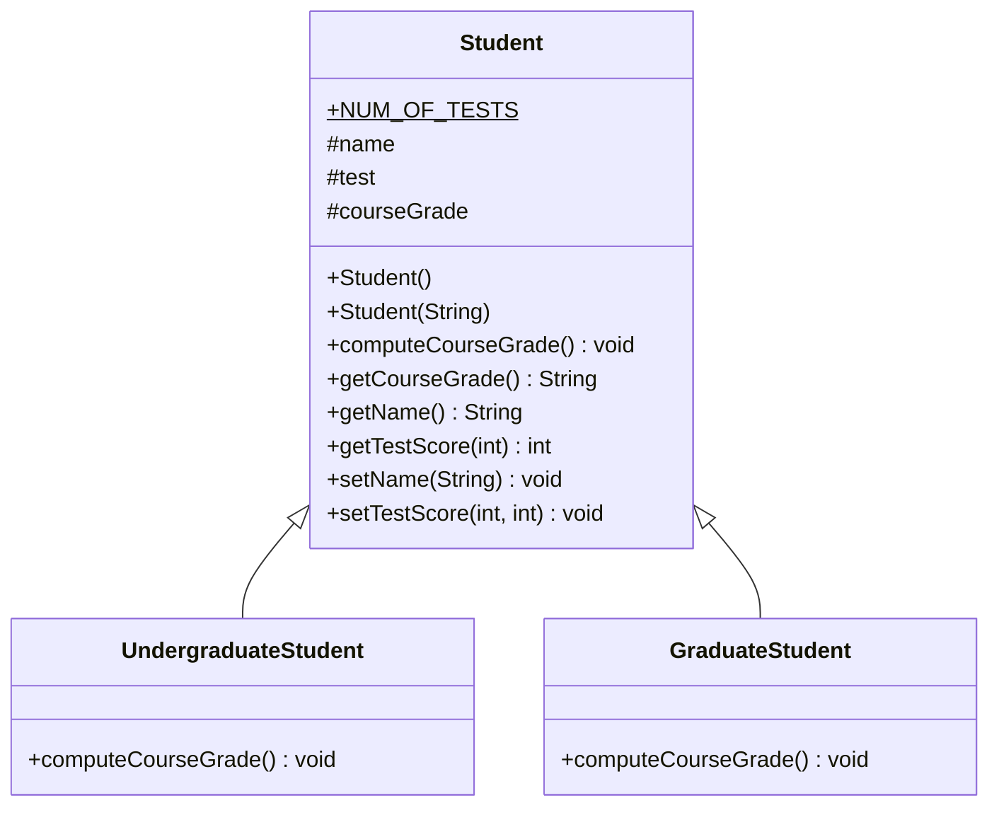
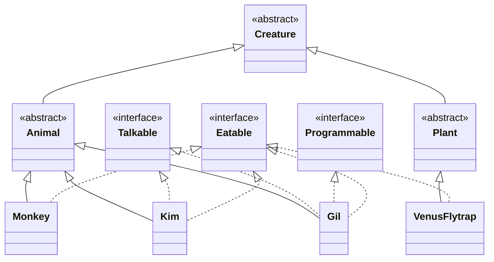
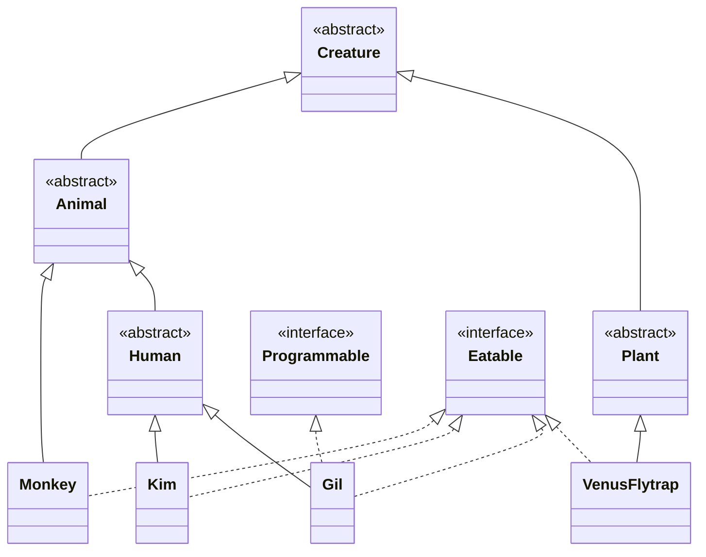

# Lecture 11 — Inheritance and Polymorphism

[Repository Guide](../../README.md) | [English](Concepts_Lecture.md) | [한국어](Concepts_Lecture.ko.md)

> **Last Updated:** 2026-10-26

> **Learning Objectives:**
> 1. Implement class hierarchies using inheritance
> 2. Apply method overriding and dynamic binding
> 3. Use polymorphism for flexible and extensible design
> 4. Explain the differences between abstract classes and interfaces and choose the right one for a situation

---

## Table of Contents

- [1. Inheritance Hierarchy](#1-inheritance-hierarchy)
  - [1.1 Case Study: A Roster of Undergraduate and Graduate Students](#11-case-study-a-roster-of-undergraduate-and-graduate-students)
  - [1.2 Defining Classes with Inheritance](#12-defining-classes-with-inheritance)
  - [1.3 The protected Modifier](#13-the-protected-modifier)
  - [1.4 Constructor Chaining with super()](#14-constructor-chaining-with-super)
- [2. Polymorphism](#2-polymorphism)
  - [2.1 What Polymorphism Means](#21-what-polymorphism-means)
  - [2.2 Dynamic Binding](#22-dynamic-binding)
  - [2.3 The instanceof Operator](#23-the-instanceof-operator)
- [3. Method Overriding](#3-method-overriding)
  - [3.1 Rules for Overriding](#31-rules-for-overriding)
  - [3.2 The @Override Annotation](#32-the-override-annotation)
  - [3.3 Polymorphism Through Overriding](#33-polymorphism-through-overriding)
  - [3.4 Overriding and Overloading](#34-overriding-and-overloading)
- [4. Abstract Classes and Interfaces](#4-abstract-classes-and-interfaces)
  - [4.1 Abstract Classes](#41-abstract-classes)
  - [4.2 Interfaces](#42-interfaces)
  - [4.3 Comparing Abstract Classes and Interfaces](#43-comparing-abstract-classes-and-interfaces)
- [5. Design Patterns Using Inheritance](#5-design-patterns-using-inheritance)
- [Summary](#summary)
- [Self-Check Questions](#self-check-questions)

---

<br>

## 1. Inheritance Hierarchy

### 1.1 Case Study: A Roster of Undergraduate and Graduate Students

Consider implementing a class roster that contains both undergraduate and graduate students. Each student's record contains a name, three test scores, and the final course grade, and the formula for the course grade differs between undergraduate and graduate students.

There are two ways to model the two kinds of students.

- Define two unrelated classes, one for undergraduates and one for graduates. Two classes that are not connected by an inheritance relationship are called **unrelated classes**.
- Model the two kinds of students with classes that belong to one **inheritance hierarchy**.

With the second approach we design three classes: `Student`, `UndergraduateStudent`, and `GraduateStudent`. `Student` holds the data and behavior common to both kinds of students, and each subclass holds the data and behavior specific to it (here, the grading formula).



*Figure 1. Inheritance hierarchy of Student, UndergraduateStudent, and GraduateStudent*

In a UML class diagram, `+` marks a public member and `#` marks a protected member, and the underlined `NUM_OF_TESTS` is a static constant. Because the grading formula depends on the kind of student, each subclass implements `computeCourseGrade()` in its own way. `Student` must also declare this method so that it can be called through a `Student` variable (Section 2.2).

### 1.2 Defining Classes with Inheritance

```java
public class Person {
    private int weight;
    int age;
    protected int height;
    public String name;

    public void setWeight(int weight) { this.weight = weight; }
    public int getWeight() { return weight; }
}

public class Student extends Person {
    public void set() {
        age = 39;
        name = "PSY";
        height = 182;
        setWeight(99); // cannot access weight directly (private)
    }

    public void display() {
        System.out.println("Age: " + age);
        System.out.println("Name: " + name);
        System.out.println("Height: " + height);
    }
}
```

`Student` inherits from `Person` through `extends Person`, so it receives the fields and methods of `Person`. `age` (no modifier, same package), `height` (protected), and `name` (public) can be used by name directly in the methods of `Student`. `weight` is private, so although it exists inside a `Student` object, the code of `Student` cannot access it by name and must go through the inherited public method `setWeight()`. Creating a `Student` object in `main()` and calling `set()` and then `display()` prints the following.

```text
Age: 39
Name: PSY
Height: 182
```

The lab code [PersonStudentDemo.java](../../Coursework/Lab11_Inheritance-and-Polymorphism/PersonStudentDemo.java) puts the same structure in a single file.

### 1.3 The protected Modifier

Java has four access modifiers, private, no modifier (default, package-private), protected, and public, and the range of access widens in this order.

| Modifier | Same Class | Same Package | Subclass in Another Package | Any Other Class |
|:-----|:-----|:-----|:-----|:-----|
| `private` | O | X | X | X |
| No modifier (default) | O | O | X | X |
| `protected` | O | O | O | X |
| `public` | O | O | O | O |

*Table 1. Access range of each access modifier*

`protected` members are visible to:
- The class itself
- Classes in the same package
- Subclasses in any package

> **Note:** **Inheritance and member access.** An instance of a subclass contains the components inherited from the superclass as part of itself. Private members also exist inside the object, and the code of the subclass simply cannot access them by name.

### 1.4 Constructor Chaining with super()

Unlike the members of a superclass, **constructors are not inherited.** Each class either defines its own constructors or uses the default constructor that the compiler adds when no constructor is defined. Calling `super(...)` in a subclass constructor runs a constructor of the superclass. This call is placed as the first statement of the constructor (for the relaxation from Java 25, see the note in Lecture 8, Section 2.2).

```java
public class Point {
    private int x, y;

    public Point(int x, int y) {
        this.x = x;
        this.y = y;
    }
}

public class ColorPoint extends Point {
    private String color;

    public ColorPoint(int x, int y, String color) {
        super(x, y);          // must be the first statement
        this.color = color;
    }
}
```

The constructor of `ColorPoint` delegates the coordinate initialization to the constructor of `Point` with `super(x, y)` and initializes only its own field `color`. Since `x` and `y` of `Point` are private, `ColorPoint` cannot assign them directly, which is another reason `super(x, y)` is needed. If `Point` has a `showPoint()` that prints the coordinates as `(x,y)` and `ColorPoint` has a `showColorPoint()` that prints `color` and then calls `showPoint()`, then `new ColorPoint(5, 6, "blue").showColorPoint()` prints `blue(5,6)`.

> **Caution:** If a constructor does not call `super(...)`, the compiler inserts a no-argument `super()` as its first statement. If the superclass has no no-argument constructor, like `Point` above, this call is a compile error. Also, a class without an `extends` clause has `Object` as its superclass.

---

<br>

## 2. Polymorphism

### 2.1 What Polymorphism Means

**Polymorphism** allows a single variable to refer to objects of different subclasses in the same inheritance hierarchy. For example, if `Cat` and `Dog` are subclasses of `Pet`, the following statements are all valid.

```java
Pet myPet;

myPet = new Dog();
// ...
myPet = new Cat();
```

### 2.2 Dynamic Binding

A superclass variable can refer to a subclass object, and when a method is called through that variable, the JVM chooses the method to call at runtime from the actual class of the object the variable refers to. This is called **dynamic binding**.

```java
Student[] roster = new Student[40];
roster[0] = new GraduateStudent();
roster[1] = new UndergraduateStudent();
roster[2] = new UndergraduateStudent();
roster[3] = new GraduateStudent();
int numberOfStudents = 4;

for (int i = 0; i < numberOfStudents; i++) {
    roster[i].computeCourseGrade(); // calls the appropriate subclass method
}
```

Because the `roster` array has type `Student`, it can hold `GraduateStudent` and `UndergraduateStudent` objects together. If `roster[i]` refers to a `GraduateStudent` object, the `computeCourseGrade()` of `GraduateStudent` runs, and if it refers to an `UndergraduateStudent` object, the `computeCourseGrade()` of `UndergraduateStudent` runs.

```text
roster ──► ┌───┬───┬───┬───┬──────┬─────┬──────┐
           │ 0 │ 1 │ 2 │ 3 │  4   │ ... │  39  │
           ├───┼───┼───┼───┼──────┼─────┼──────┤
           │ ● │ ● │ ● │ ● │ null │ ... │ null │
           └─┼─┴─┼─┴─┼─┴─┼─┴──────┴─────┴──────┘
             │   │   │   └──► :GraduateStudent
             │   │   └──────► :UndergraduateStudent
             │   └──────────► :UndergraduateStudent
             └──────────────► :GraduateStudent
```

*Figure 2. State of the roster array referring to subclass objects*

> **Caution:** `new Student[40]` creates only an array of 40 references, and every element that has not been assigned an object is `null`. The loop must therefore run only up to the actual number of students (`numberOfStudents`). Looping over the whole array, as in `for (Student s : roster)`, throws a `NullPointerException` at the first `null` element.

> **Key Point:** Polymorphism enables writing code that works with the superclass type while automatically invoking the correct subclass behavior at runtime.

### 2.3 The instanceof Operator

The `instanceof` operator tests which class an object is an instance of. `x instanceof C` is `true` if the object that `x` refers to is an instance of `C` or of a subtype of `C`, and `false` if `x` is `null`.

```java
if (roster[i] instanceof UndergraduateStudent) {
    System.out.println("Undergraduate student found.");
}
```

Placing this test inside a loop counts the undergraduate students in the roster.

```java
int undergradCount = 0;
for (int i = 0; i < numberOfStudents; i++) {
    if (roster[i] instanceof UndergraduateStudent) {
        undergradCount++;
    }
}
```

---

<br>

## 3. Method Overriding

### 3.1 Rules for Overriding

**Method overriding** means that a subclass redefines a method declared in its superclass with the same signature and gives it a new implementation of its own.

- The method name and parameter list (types, number, and order) must match the superclass method.
- The return type must also match. If the return type is a reference type, however, it can be replaced with a subtype (**covariant return type**).
- Access level cannot be more restrictive than the overridden method. For example, a public method cannot be overridden as protected.
- `final` methods cannot be overridden. Declaring a `static` method with the same signature in a subclass is **hiding**, not overriding, and no dynamic binding takes place. `private` methods are not visible in the subclass, so they are not subject to overriding.
- An overriding method cannot declare broader checked exceptions than the original method.

### 3.2 The @Override Annotation

```java
class Shape {
    public void draw() {
        System.out.println("Shape");
    }
}

class Circle extends Shape {
    @Override
    public void draw() {
        System.out.println("Circle");
    }
}
```

> **Key Point:** If a method marked with `@Override` does not override any superclass method (because its name or parameters differ), the compiler reports an error. Without the annotation, such a mistake silently creates a new method instead of an override, so always mark overriding methods with `@Override`.

### 3.3 Polymorphism Through Overriding

Overriding realizes object-oriented polymorphism, in which one interface (a method of the same name) executes different contents, and because the method to call is determined during execution, it is also called **run-time polymorphism (dynamic binding)**. In the following example, the subclasses `Line`, `Rect`, and `Circle` of `Shape` all override `draw()`.

```java
class Shape {
    public void draw() { System.out.println("Shape"); }
}
class Line extends Shape {
    public void draw() { System.out.println("Line"); }
}
class Rect extends Shape {
    public void draw() { System.out.println("Rect"); }
}
class Circle extends Shape {
    public void draw() { System.out.println("Circle"); }
}

public class Chap11Program3 {
    public static void main(String[] args) {
        Line line = new Line();
        paint(line);
        paint(new Shape());
        paint(new Line());
        paint(new Rect());
        paint(new Circle());
    }

    static void paint(Shape p) {
        p.draw(); // calls draw() of the object p actually refers to
    }
}
```

The parameter type of `paint()` is only `Shape`, yet depending on the actual class of the object passed in, `Line`, `Shape`, `Line`, `Rect`, and `Circle` are printed in order, one per line.

The same structure works in a game program. The `fire()` method of a `Weapon` class that represents a weapon returns a minimum damage of 1, and subclasses override it so that a sniper rifle returns 120 and another character's weapon returns 100.

```java
public class Weapon {
    protected int fire() { return 1; }
}
public class WidowWeaponSniper extends Weapon {
    @Override
    protected int fire() { return 120; }
}
public class DoomfistWeapon extends Weapon {
    @Override
    protected int fire() { return 100; }
}
```

Assigning `new Weapon()`, `new WidowWeaponSniper()`, and `new DoomfistWeapon()` in turn to a `Weapon weapon` variable and calling `weapon.fire()` returns 1, 120, and 100. The lab code [InheritanceDemo.java](../../Coursework/Lab11_Inheritance-and-Polymorphism/InheritanceDemo.java) shows the same principle with a shape hierarchy that extends an abstract class `Shape`.

### 3.4 Overriding and Overloading

| Aspect | Overriding | Overloading |
|:-----|:-----|:-----|
| Definition | Redefines a superclass method in a subclass | Defines several methods of the same name with different parameter lists |
| Method name | Same | Same |
| Parameter list | Same | Must differ |
| Relationship | Between two classes related by inheritance | Within one class or across an inheritance relationship |
| When the method to call is chosen | Run time (dynamic binding) | Compile time (static binding) |

*Table 2. Comparison of overriding and overloading*

```java
// Overriding: bark() of Hound redefines bark() of Dog
class Dog {
    public void bark() { System.out.println("woof "); }
}
class Hound extends Dog {
    public void sniff() { System.out.println("sniff "); }
    public void bark() { System.out.println("bowl"); }
}

// Overloading: defines another bark() with the same name and different parameters
class Dog {
    public void bark() { System.out.println("woof "); }
    public void bark(int num) {
        for (int i = 0; i < num; i++)
            System.out.println("woof ");
    }
}
```

---

<br>

## 4. Abstract Classes and Interfaces

### 4.1 Abstract Classes

When we define a superclass, we often do not need to create any instances of it. For example, if a student must be either an undergraduate or a graduate student, only instances of `UndergraduateStudent` and `GraduateStudent` are needed, so `Student` should be defined so that no instances of it can be created.

> **Definition:** An **abstract class** is a class that (1) is defined with the modifier `abstract`, (2) contains an abstract method, or (3) does not implement an inherited abstract method. In the last two cases the class declaration must also carry `abstract`, or the compiler reports an error. An **abstract method** is a method marked with the keyword `abstract` that ends with a semicolon instead of a method body. Private methods and static methods cannot be declared abstract.

Abstract classes cannot be instantiated and may contain abstract methods:

```java
abstract class Shape {
    abstract double area();

    public void printArea() {
        System.out.println("Area: " + area());
    }
}
```

An abstract class can also be defined without any abstract method (`abstract class MyComponent { String name; ... }`), and it can have constructors and ordinary methods. It still cannot be instantiated with `new`.

```java
Shape shape;
shape = new Shape();  // compile error: Shape is abstract
shape = new Circle(); // allowed: a variable of an abstract type can refer to a subclass object
```

For a subclass of an abstract class to be instantiable, it must implement every abstract method. If a team leader designed the following abstract class `Calculator`, a class that extends it must override all three methods.

```java
abstract class Calculator {
    public abstract int add(int a, int b);
    public abstract int subtract(int a, int b);
    public abstract double average(int[] a);
}
```

If `add(a, b)` returns `a + b`, `subtract(a, b)` returns `a - b`, and `average(a)` returns the sum of the elements computed as a `double` divided by the number of elements, then `add(2, 3)` returns 5, `subtract(2, 3)` returns -1, and `average(new int[] {2, 3, 4})` returns 3.0.

### 4.2 Interfaces

Interfaces define a contract that implementing classes must fulfill:

```java
interface Drawable {
    void draw();
}

class Circle extends Shape implements Drawable {
    @Override
    double area() { return Math.PI * radius * radius; }

    @Override
    public void draw() { System.out.println("Drawing circle"); }
}
```

This `Circle` extends the abstract class `Shape` of Section 4.1 and implements `area()`, and it implements the interface `Drawable` by implementing `draw()`. Assume that `radius` is a radius field declared in `Circle`. Interface methods are implicitly public, so the implementing `draw()` must also be public.

### 4.3 Comparing Abstract Classes and Interfaces

| Aspect | Interface | Abstract Class |
|:-----|:-----|:-----|
| Constructors | Not allowed | Allowed |
| Fields | Only constants, which are implicitly `public static final` | Both instance and static fields, which need not be final |
| Member access modifiers | Public by default, and private methods are allowed since Java 9. Protected members are not allowed | private, no modifier, protected, and public are all allowed |
| Abstract methods | A method without a body is implicitly `public abstract` | Declared with the `abstract` keyword |
| Methods with bodies | Default methods and static methods since Java 8 | Ordinary methods, static methods, and final methods |
| Final methods | Not allowed | Allowed |
| Multiple inheritance | A class can implement several interfaces | A class can extend only one class |

*Table 3. Comparison of Java interfaces and abstract classes*

> **Caution:** A field declared in an interface is a constant, not a data member whose value can change. An interface therefore cannot hold object state, and an abstract class is the right choice when common state is needed.

Interfaces give a common capability to classes that are otherwise unrelated. For example, the interface `Vehicle` is implemented separately by `Car`, `Plane`, and `Boat`. Abstract classes let closely related classes share common state and code. For example, the abstract class `Dog` is extended by `Dalmatian`, `Collie`, and `BlackLab`.



*Figure 3. Creature hierarchy combining abstract classes and interfaces*

In Figure 3, the abstract classes `Creature`, `Animal`, and `Plant` form the skeleton of the is-a relationships, and the concrete classes `Monkey`, `Kim`, `Gil`, and `VenusFlytrap` sit below them. Being able to talk (`Talkable`), program (`Programmable`), and be eaten (`Eatable`) are capabilities scattered across several branches of the hierarchy, so they are expressed as interfaces.



*Figure 4. Creature hierarchy with the common capability moved into the abstract class Human*

If every class that implements `Talkable` is a human, we can introduce an abstract class `Human` as in Figure 4 and implement talking inside it. `Eatable`, on the other hand, spans animals and plants and cannot be grouped under one superclass, so it remains an interface.

---

<br>

## 5. Design Patterns Using Inheritance

A **design pattern** is a proven solution to a recurring design problem, recorded under a name. Table 4 lists typical patterns that make use of inheritance and polymorphism.

| Pattern | Description | Example |
|:--------|:------------|:--------|
| Template Method | Superclass defines the algorithm skeleton, and subclasses fill in the steps | `Shape.printArea()` calls abstract `area()` |
| Strategy | Defines a behavior as a supertype (an interface or a superclass) and changes the behavior by letting an object refer to one of its implementations | A game character swaps between objects of different `Weapon` subclasses |
| Factory | Creates objects without the caller specifying the exact class to instantiate | `StudentFactory.create("grad")` |

*Table 4. Design patterns that use inheritance and polymorphism*

---

<br>

## Summary

| Concept | Key Summary |
|:--------|:----------|
| Inheritance | `extends` creates an is-a relationship, and a Java class can extend only one class. |
| protected | It is accessible from classes in the same package and from subclasses in other packages. |
| super() | Constructors are not inherited, so a subclass constructor calls a superclass constructor as its first statement. |
| Polymorphism | A superclass variable refers to a subclass object, and the method to run is chosen by dynamic binding. |
| instanceof | It tests whether the runtime type of an object is a given class or one of its subclasses. |
| Method Overriding | It redefines a superclass method with the same signature, and `@Override` catches mistakes at compile time. |
| Overloading | It defines methods with the same name and different parameter lists, and the method to call is chosen at compile time. |
| Abstract Class | It cannot be instantiated, may have abstract methods, and is used to share common state and code. |
| Interface | It defines a contract that implementing classes must keep, and a class can implement multiple interfaces. |

---

<br>

## Self-Check Questions

1. **Access modifiers:** `Person` from Section 1.2 is in package `p1`, and `Student` is in a different package `p2`. List all fields of `Person` that the methods of `Student` can access directly by name.

   <details>
   <summary>Answer</summary>

   `height` (protected) and `name` (public). `weight` is private, so a subclass cannot access it directly, and `age` is a package-private field with no modifier, so a subclass in another package cannot access it. Accessing `age` makes the compiler report the error "age is not public in Person; cannot be accessed from outside package".

   </details>

2. **instanceof:** `Student` and `Researcher` extend `Person`, and `Professor` extends `Researcher`. Given `Person jee = new Student(); Person kim = new Professor(); Person lee = new Researcher();`, give the value of each expression. (a) `jee instanceof Person` (b) `jee instanceof Student` (c) `kim instanceof Student` (d) `kim instanceof Professor` (e) `kim instanceof Researcher` (f) `lee instanceof Professor`

   <details>
   <summary>Answer</summary>

   (a) true (b) true (c) false (d) true (e) true (f) false. `instanceof` is based on the actual class of the object the variable refers to, not on the declared type of the variable, and it is also true for the superclasses of that class. The `Professor` object that `kim` refers to is also a `Researcher`, so (e) is true, and the `Researcher` object that `lee` refers to is not a `Professor`, so (f) is false.

   </details>

3. **Dynamic binding:** Give the output of `Chap11Program3` from Section 3.3, and explain why `paint(new Shape())` prints `Shape`.

   <details>
   <summary>Answer</summary>

   `Line`, `Shape`, `Line`, `Rect`, and `Circle` are printed, one per line. `p.draw()` looks up `draw()` in the class of the object that `p` actually refers to. The object created by `new Shape()` has class `Shape`, so the `draw()` of `Shape` runs.

   </details>

4. **Constructor chaining:** What happens if `super(x, y);` is removed from the `ColorPoint` constructor in Section 1.4? `Point` has only the constructor `Point(int x, int y)`.

   <details>
   <summary>Answer</summary>

   A compile error occurs. Without a `super(...)` call, the compiler inserts a no-argument `super()` as the first statement of the constructor, but `Point` has no no-argument constructor. Adding a no-argument constructor to `Point` makes the code compile, but then the coordinates are initialized to the values that the no-argument constructor sets.

   </details>

5. **Abstract classes:** A class `MyCalc` that extends `Calculator` from Section 4.1 implements only `add()` and `subtract()` and does not implement `average()`. What must be done for `MyCalc` to compile?

   <details>
   <summary>Answer</summary>

   `MyCalc` does not implement the inherited abstract method `average()`, so it is an abstract class. It compiles only if declared as `abstract class MyCalc`, and then no instance of `MyCalc` can be created. To create instances, `average(int[] a)` must be implemented.

   </details>
