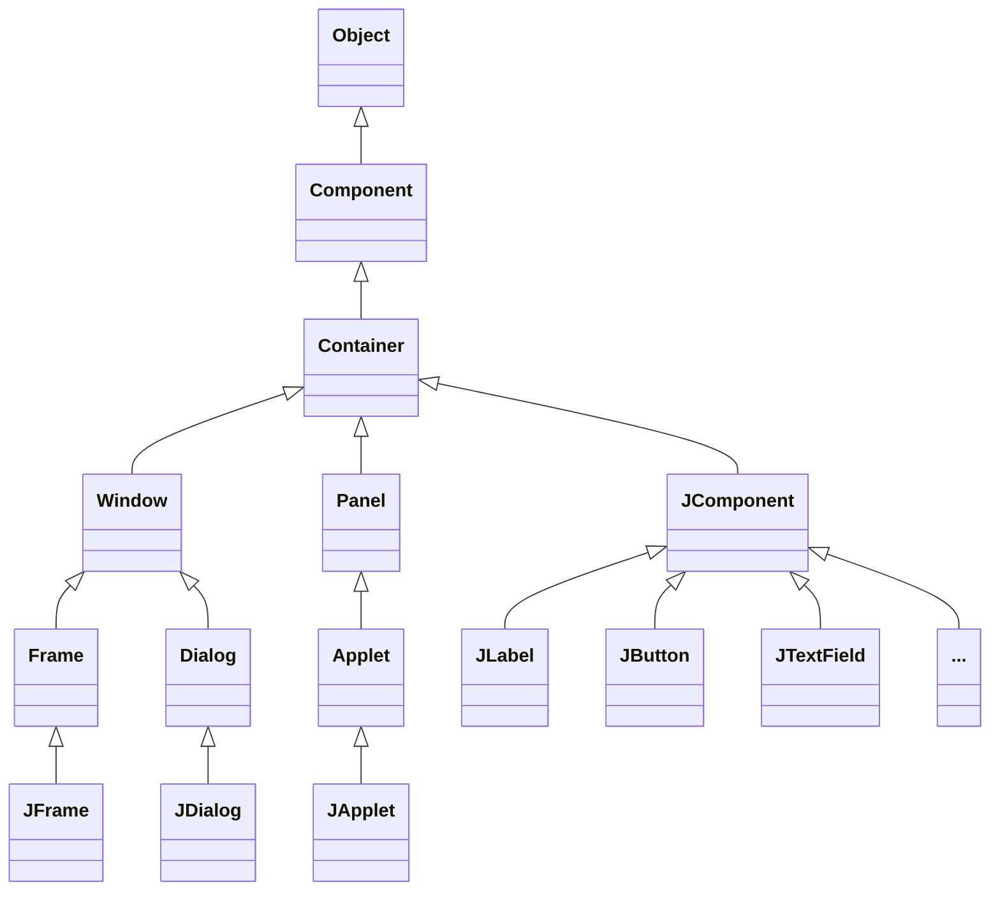
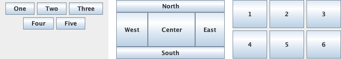
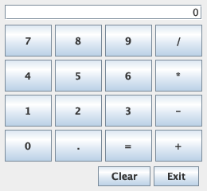
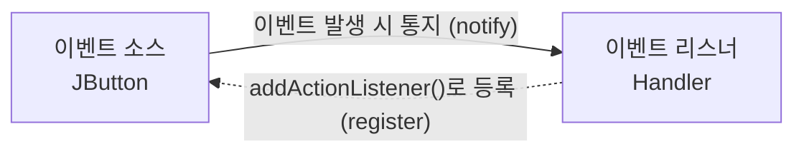
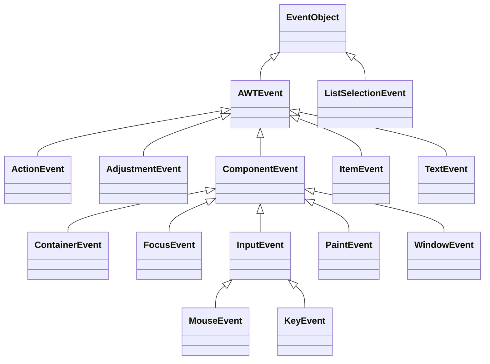
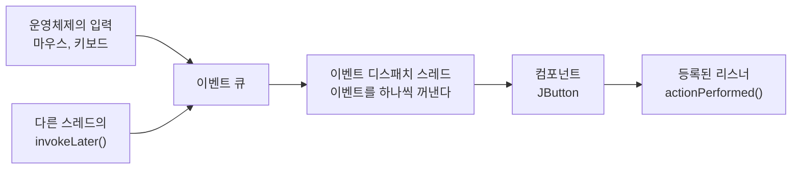

# 12강 — 고급 GUI

[레포지토리 안내](../../README.ko.md) | [English](Concepts_Lecture.md) | [한국어](Concepts_Lecture.ko.md)

> **최종 수정일:** 2026-11-19

> **학습 목표:**
> 1. Swing 컴포넌트를 사용하여 GUI 애플리케이션을 구축할 수 있다
> 2. 리스너와 내부 클래스로 이벤트를 처리할 수 있다
> 3. 반응형 UI 설계를 위해 배치 관리자를 적용할 수 있다
> 4. 어댑터 클래스를 사용하여 마우스 이벤트와 키 이벤트를 처리할 수 있다
> 5. 배치 관리자가 컴포넌트의 위치와 크기를 계산하는 과정을 추적하고 패널을 중첩하여 화면을 구성할 수 있다
> 6. 이벤트 디스패치 스레드에서 이벤트가 처리되는 흐름을 설명하고 오래 걸리는 작업을 분리할 수 있다

---

## 목차

- [1. Swing 개요](#1-swing-개요)
  - [1.1 AWT vs. Swing](#11-awt-vs-swing)
  - [1.2 GUI 클래스 계층 구조](#12-gui-클래스-계층-구조)
- [2. JFrame과 컨텐트팬](#2-jframe과-컨텐트팬)
  - [2.1 JFrame 생성](#21-jframe-생성)
  - [2.2 JFrame 상속](#22-jframe-상속)
  - [2.3 기본 프레임과 창의 크기](#23-기본-프레임과-창의-크기)
- [3. 배치 관리자](#3-배치-관리자)
  - [3.1 FlowLayout](#31-flowlayout)
  - [3.2 BorderLayout](#32-borderlayout)
  - [3.3 GridLayout](#33-gridlayout)
  - [3.4 절대 위치 지정](#34-절대-위치-지정)
  - [3.5 배치 관리자가 계산한 위치와 크기](#35-배치-관리자가-계산한-위치와-크기)
  - [3.6 패널을 중첩한 화면 구성](#36-패널을-중첩한-화면-구성)
  - [3.7 BoxLayout과 CardLayout](#37-boxlayout과-cardlayout)
- [4. 주요 Swing 컴포넌트](#4-주요-swing-컴포넌트)
  - [4.1 텍스트를 다루는 컴포넌트](#41-텍스트를-다루는-컴포넌트)
  - [4.2 텍스트 컴포넌트의 동작](#42-텍스트-컴포넌트의-동작)
- [5. 이벤트 처리](#5-이벤트-처리)
  - [5.1 위임 기반 이벤트 모델](#51-위임-기반-이벤트-모델)
  - [5.2 이벤트 객체](#52-이벤트-객체)
  - [5.3 ActionListener](#53-actionlistener)
  - [5.4 익명 클래스와 람다](#54-익명-클래스와-람다)
  - [5.5 마우스 이벤트와 어댑터 클래스](#55-마우스-이벤트와-어댑터-클래스)
  - [5.6 키 이벤트](#56-키-이벤트)
  - [5.7 이벤트 디스패치 스레드](#57-이벤트-디스패치-스레드)
  - [5.8 오래 걸리는 작업과 SwingWorker](#58-오래-걸리는-작업과-swingworker)
  - [5.9 리스너를 작성하는 방법의 비교](#59-리스너를-작성하는-방법의-비교)
  - [5.10 입력 이벤트가 리스너에 전달되는 과정](#510-입력-이벤트가-리스너에-전달되는-과정)
  - [5.11 이벤트 클래스와 리스너의 이름 규칙](#511-이벤트-클래스와-리스너의-이름-규칙)
- [6. 흔한 실수](#6-흔한-실수)
- [요약](#요약)
- [점검 문제](#점검-문제)
- [참고 문헌](#참고-문헌)

---

<br>

## 1. Swing 개요

### 1.1 AWT vs. Swing

Java의 GUI 프로그램은 `javax.swing` 패키지와 `java.awt` 패키지의 클래스로 구현한다. Swing 클래스는 전부 Java로 구현되어 있어 운영체제가 달라도 똑같이 동작하므로, 여러 운영체제 사이의 호환성이 더 높다.

| 특징 | AWT | Swing |
|:--------|:----|:------|
| 패키지 | `java.awt` | `javax.swing` |
| 컴포넌트 | 중량(OS 네이티브) | 경량(Java 렌더링) |
| 룩 앤 필 | 플랫폼 종속적 | 플랫폼 독립적 (교체 가능한 룩 앤 필) |
| 명명 규칙 | `Button`, `Label` | `JButton`, `JLabel` |

*표 1. AWT와 Swing의 비교*

### 1.2 GUI 클래스 계층 구조



*그림 1. AWT와 Swing의 GUI 클래스 계층*

`Component`는 화면에 나타나는 모든 GUI 객체의 상위 클래스이고, `Container`는 다른 컴포넌트를 담을 수 있는 컴포넌트이다. `Font`, `Color`, `Graphics`처럼 컴포넌트가 아닌 AWT 클래스는 `Object`를 바로 상속한다. Swing의 최상위 창인 `JFrame`, `JDialog`, `JApplet`은 각각 AWT의 `Frame`, `Dialog`, `Applet`을 상속하고, 나머지 Swing 컴포넌트는 `Container`의 하위 클래스인 `JComponent`를 상속한다. `JComponent` 아래에서 `JTextField`, `JTextArea`, `JEditorPane`은 `JTextComponent`를 상속하고(`JPasswordField`는 `JTextField`의 하위 클래스), `JButton`, `JToggleButton`(그 아래 `JCheckBox`, `JRadioButton`), `JMenuItem`(그 아래 `JMenu`, `JCheckBoxMenuItem`, `JRadioButtonMenuItem`)은 `AbstractButton`을 상속한다. `Applet`과 `JApplet`은 Java 9부터 사용 중단(deprecated)되었다.

---

<br>

## 2. JFrame과 컨텐트팬

### 2.1 JFrame 생성

```java
JFrame frame = new JFrame("My Window");
frame.setSize(400, 300);
frame.setDefaultCloseOperation(JFrame.EXIT_ON_CLOSE);
frame.setVisible(true);
```

`JFrame`은 제목 표시줄과 테두리가 있는 최상위 창이다. 위 코드는 제목이 `My Window`인 프레임을 만들고, 크기를 가로 400, 세로 300픽셀로 정하고, 창을 닫으면 프로그램이 끝나게 한 뒤, 창을 화면에 보이게 한다. `setVisible(true)`를 호출하기 전에는 창이 나타나지 않는다.

> **참고:** **이벤트 디스패치 스레드.** Swing 컴포넌트는 스레드 안전(thread-safe)하지 않으므로, 컴포넌트를 만들고 고치는 코드는 **이벤트 디스패치 스레드(Event Dispatch Thread, EDT)** 에서 실행하는 것이 원칙이다. 이벤트 리스너의 메서드는 EDT에서 호출된다. `main()`에서 프레임을 만들 때는 `SwingUtilities.invokeLater(() -> new MyFrame());`처럼 작업을 EDT에 넘기는 것이 권장 방식이며, 이 정리본의 짧은 예제는 간결하게 쓰기 위해 `main()`에서 바로 프레임을 만든다.

### 2.2 JFrame 상속

맞춤형 프레임 창을 만들려면 `extends`로 `JFrame`의 하위 클래스를 정의한다. `JFrame`에는 모든 프레임 창에 필요한 기본 기능이 들어 있으므로, 하위 클래스는 생성자에서 제목, 크기, 내용만 정하면 된다.

```java
public class MyFrame extends JFrame {
    public MyFrame() {
        setTitle("Welcome to GUI!");
        setSize(300, 300);
        setDefaultCloseOperation(EXIT_ON_CLOSE);

        Container contentPane = getContentPane();
        contentPane.setBackground(Color.BLUE);

        setVisible(true);
    }
}
```

**컨텐트팬(content pane)** 은 버튼, 레이블, 스크롤바 같은 GUI 객체를 올려놓는 프레임 안의 영역이다. 프레임의 `getContentPane()` 메서드로 컨텐트팬을 얻고, 위 코드처럼 `setBackground(Color.BLUE)`로 배경색을 파란색으로 바꾸거나 `add()`로 컴포넌트를 붙인다. `MyFrame`의 생성자가 모든 설정을 하므로 `main()`에서는 `new MyFrame()`만 호출하면 창이 나타난다. 같은 프레임을 만드는 실습 코드는 [BasicSwingFrame.java](../../Coursework/Lab12_Advanced-GUI/BasicSwingFrame.java)에 있다.

### 2.3 기본 프레임과 창의 크기

크기를 정하지 않은 프레임은 거의 보이지 않는다. 다음은 `JFrame`을 상속하지 않고 기본 생성자로 프레임만 만들어 화면에 보이게 한 가장 단순한 프로그램이다.

```java
import javax.swing.*;

class Ch7DefaultJFrame {
    public static void main(String[] args) {
        JFrame defaultJFrame;
        defaultJFrame = new JFrame();
        defaultJFrame.setVisible(true);
    }
}
```

이 프로그램을 실행하면 제목 표시줄의 아이콘과 최소화, 최대화, 닫기 버튼만 겨우 들어가는 작은 창이 화면 왼쪽 위 구석에 나타나므로, 창이 뜬 것을 알아채지 못하기 쉽다. `JFrame`의 기본 크기가 0 × 0이고 기본 위치가 화면의 (0, 0)이기 때문이다. 또 닫기 버튼을 눌러도 창이 숨겨질 뿐 프로그램은 끝나지 않는데, 기본 닫기 동작이 `HIDE_ON_CLOSE`이기 때문이다. 그래서 2.1절과 2.2절의 프레임은 다음 세 가지를 함께 정한다.

- **크기:** `setSize(가로, 세로)`로 직접 정하거나, 컴포넌트를 모두 붙인 뒤 `pack()`을 호출한다. `pack()`은 배치 관리자에게 컨텐트팬이 원하는 크기(선호 크기, preferred size)를 물어 창의 크기를 그에 맞춘다(3.6절).
- **위치:** `setLocation(x, y)`로 정하거나, `setLocationRelativeTo(null)`로 화면 가운데에 놓는다.
- **닫기 동작:** `setDefaultCloseOperation(JFrame.EXIT_ON_CLOSE)`로 창을 닫을 때 프로그램이 끝나게 한다.

`setVisible(true)`는 이 설정을 모두 마친 뒤 마지막에 호출한다. 창이 보인 뒤에 컴포넌트를 더하면, `revalidate()`와 `repaint()`를 호출해야 새 배치가 화면에 반영된다.

프레임 하나는 여러 GUI 객체가 모여 이루어진다. 예를 들어 숫자 맞히기 게임 창 하나에는 최상위 창인 `JFrame`, 그 위의 메뉴 막대와 `Game`, `Help` 메뉴(`JMenu`), 안내 문구와 그림을 보여 주는 `JLabel`(그림은 `ImageIcon`), 추측한 숫자를 입력하는 `JTextField`, `Guess`와 `Cancel` 버튼(`JButton`)이 들어간다. 이 객체들은 모두 1.2절의 계층에 속하며, 컨테이너가 다른 컴포넌트를 담는 관계로 하나의 트리를 이룬다.

---

<br>

## 3. 배치 관리자

컨텐트팬에 GUI 객체를 놓는 방법은 두 가지이다. 하나는 **배치 관리자(layout manager)** 를 써서 컴포넌트의 위치와 크기를 자동으로 정하는 방법이고(FlowLayout, BorderLayout, GridLayout 등), 다른 하나는 배치 관리자를 `null`로 두고 위치를 직접 정하는 **절대 위치 지정(absolute positioning)** 이다(3.4절). 배치 관리자는 창의 크기가 바뀌면 컴포넌트를 다시 배치한다.

### 3.1 FlowLayout

컴포넌트를 왼쪽에서 오른쪽으로 배치하며, 공간이 부족하면 다음 행으로 줄 바꿈한다:

```java
container.setLayout(new FlowLayout());
container.add(new JButton("A"));
container.add(new JButton("B"));
```

생성자 `FlowLayout(int align, int hGap, int vGap)`으로 정렬 방식과 컴포넌트 사이의 간격을 정할 수 있다. 예를 들어 `new FlowLayout(FlowLayout.LEFT, 30, 40)`은 각 행을 왼쪽으로 정렬하고, 같은 행의 컴포넌트 사이에 수평 간격 30픽셀, 행 사이에 수직 간격 40픽셀을 둔다. 인자 없는 생성자는 가운데 정렬과 간격 5픽셀을 쓴다. 실습 코드 [FlowLayoutDemo.java](../../Coursework/Lab12_Advanced-GUI/FlowLayoutDemo.java)는 사칙연산 버튼을 FlowLayout으로 배치한다.

### 3.2 BorderLayout

컨테이너를 NORTH, SOUTH, EAST, WEST, CENTER의 5개 영역으로 나눈다:

```java
container.setLayout(new BorderLayout());
container.add(new JButton("Top"), BorderLayout.NORTH);
container.add(new JButton("Center"), BorderLayout.CENTER);
```

```text
┌──────────────────────────────┐
│            NORTH             │
├──────┬────────────────┬──────┤
│      │                │      │
│ WEST │     CENTER     │ EAST │
│      │                │      │
├──────┴────────────────┴──────┤
│            SOUTH             │
└──────────────────────────────┘
```

*그림 2. BorderLayout의 다섯 영역*

`add()`의 두 번째 인자로 영역을 지정하며, 영역을 생략하면 CENTER에 놓인다. 한 영역에는 컴포넌트 하나만 표시되므로 같은 영역에 두 번 `add()`하면 나중에 추가한 컴포넌트만 보인다. CENTER는 나머지 네 영역이 차지하고 남은 공간을 모두 채운다.

### 3.3 GridLayout

컴포넌트를 행과 열의 격자 형태로 배치한다:

```java
container.setLayout(new GridLayout(3, 2)); // 3행, 2열
```

GridLayout은 컨테이너를 크기가 같은 직사각형 칸으로 나누고 한 칸에 컴포넌트 하나씩을 놓는다. 컴포넌트는 `add()`한 순서대로 첫 행의 왼쪽부터 오른쪽으로 채우고, 행이 차면 다음 행으로 넘어간다. 생성자 `GridLayout(int rows, int cols, int hGap, int vGap)`은 칸 사이의 간격도 정한다. 다음 코드는 이름, 학번, 학과, 학년을 입력받는 양식을 4행 2열의 격자로 만들고 행 사이에 5픽셀 간격을 둔다.

```java
GridLayout grid = new GridLayout(4, 2);
grid.setVgap(5);

Container c = getContentPane();
c.setLayout(grid);
c.add(new JLabel(" Name"));
c.add(new JTextField(""));
c.add(new JLabel(" ID"));
c.add(new JTextField(""));
c.add(new JLabel(" Department"));
c.add(new JTextField(""));
c.add(new JLabel(" Grade"));
c.add(new JTextField(""));
```

컨테이너마다 기본 배치 관리자가 정해져 있으며, `setLayout()`으로 바꿀 수 있다(예: `JPanel p = new JPanel(); p.setLayout(new BorderLayout());`, `Container c = frame.getContentPane(); c.setLayout(new FlowLayout());`).

| 컨테이너 | 기본 배치 관리자 |
|:----------|:--------------|
| Window, JWindow | BorderLayout |
| Frame, JFrame | BorderLayout |
| Dialog, JDialog | BorderLayout |
| Panel, JPanel | FlowLayout |
| Applet, JApplet | FlowLayout |

*표 2. 컨테이너별 기본 배치 관리자*

Swing의 최상위 창(`JFrame`, `JDialog`, `JApplet` 등)에서 기본 배치 관리자가 적용되는 곳은 정확히는 그 창의 컨텐트팬이며, 컨텐트팬의 기본 배치 관리자는 BorderLayout이다. 따라서 `JApplet`의 컨텐트팬도 BorderLayout이고, 표의 FlowLayout은 AWT의 `Applet`에 해당한다.

### 3.4 절대 위치 지정

`setLayout(null)`로 배치 관리자를 없애면 각 컴포넌트의 크기와 위치를 `setSize()`와 `setLocation()`(또는 `setBounds()`)으로 직접 정해야 한다. 크기를 정하지 않은 컴포넌트는 크기가 0이라 보이지 않는다. 이 방식은 마우스나 키보드로 컴포넌트를 움직이는 프로그램(5.5절, 5.6절)에 쓰인다.

```java
c.setLayout(null);
JLabel simpleLabel = new JLabel("Hello");
simpleLabel.setSize(50, 20);     // 폭 50, 높이 20픽셀
simpleLabel.setLocation(30, 30); // 컨텐트팬의 (30, 30)에 놓는다
c.add(simpleLabel);
```

### 3.5 배치 관리자가 계산한 위치와 크기

배치 관리자는 컨테이너의 크기와 각 컴포넌트의 선호 크기를 바탕으로 컴포넌트마다 위치와 크기를 계산한다. 컴포넌트의 **선호 크기(preferred size)** 는 그 컴포넌트가 내용을 온전히 보여 주는 데 필요한 크기이며, 버튼이라면 글자의 길이와 글꼴, 여백으로 정해진다. 다음 프로그램은 크기가 220 × 120인 패널 세 개에 각각 FlowLayout, BorderLayout, GridLayout을 적용하고, 배치 관리자가 정한 각 버튼의 좌표와 크기를 출력한다. 화면에 창을 띄우지 않고 패널의 `doLayout()`을 직접 호출하여 배치만 계산하게 했다.

```java
import javax.swing.*;
import java.awt.*;
import java.awt.image.BufferedImage;
import java.io.File;
import javax.imageio.ImageIO;

public class Layouts {
    static JPanel panel(LayoutManager lm, int w, int h) {
        JPanel p = new JPanel(lm);
        p.setSize(w, h);
        return p;
    }

    static void show(String title, JPanel p) {
        p.doLayout();                                  // 배치 관리자에게 배치를 시킨다
        System.out.println(title + " (panel " + p.getWidth() + "x" + p.getHeight() + ")");
        for (Component c : p.getComponents()) {
            Rectangle r = c.getBounds();
            System.out.printf("  %-7s x=%3d y=%3d w=%3d h=%3d%n",
                    ((AbstractButton) c).getText(), r.x, r.y, r.width, r.height);
        }
    }

    public static void main(String[] args) throws Exception {
        JPanel flow = panel(new FlowLayout(), 220, 120);
        for (String s : new String[] {"One", "Two", "Three", "Four", "Five"}) flow.add(new JButton(s));
        System.out.println("preferred size of One: " + flow.getComponent(0).getPreferredSize());
        show("FlowLayout", flow);

        JPanel border = panel(new BorderLayout(), 220, 120);
        border.add(new JButton("North"), BorderLayout.NORTH);
        border.add(new JButton("South"), BorderLayout.SOUTH);
        border.add(new JButton("East"), BorderLayout.EAST);
        border.add(new JButton("West"), BorderLayout.WEST);
        border.add(new JButton("Center"), BorderLayout.CENTER);
        show("BorderLayout", border);

        JPanel grid = panel(new GridLayout(2, 3, 5, 5), 220, 120);
        for (int i = 1; i <= 6; i++) grid.add(new JButton(String.valueOf(i)));
        show("GridLayout(2, 3, 5, 5)", grid);

        if (args.length > 0) save(args[0], flow, border, grid);
    }

    static void save(String file, JPanel... ps) throws Exception {
        int gap = 16, w = 0, h = 0;
        for (JPanel p : ps) { w += p.getWidth() + gap; h = Math.max(h, p.getHeight()); }
        BufferedImage img = new BufferedImage(w - gap, h, BufferedImage.TYPE_INT_ARGB);
        Graphics2D g = img.createGraphics();
        int x = 0;
        for (JPanel p : ps) {
            Graphics2D gg = (Graphics2D) g.create(x, 0, p.getWidth(), p.getHeight());
            p.paint(gg);
            gg.dispose();
            x += p.getWidth() + gap;
        }
        g.dispose();
        ImageIO.write(img, "png", new File(file));
    }
}
```

```text
preferred size of One: java.awt.Dimension[width=59,height=25]
FlowLayout (panel 220x120)
  One     x= 11 y=  5 w= 59 h= 25
  Two     x= 75 y=  5 w= 60 h= 25
  Three   x=140 y=  5 w= 69 h= 25
  Four    x= 47 y= 35 w= 62 h= 25
  Five    x=114 y= 35 w= 59 h= 25
BorderLayout (panel 220x120)
  North   x=  0 y=  0 w=220 h= 25
  South   x=  0 y= 95 w=220 h= 25
  East    x=160 y= 25 w= 60 h= 70
  West    x=  0 y= 25 w= 64 h= 70
  Center  x= 64 y= 25 w= 96 h= 70
GridLayout(2, 3, 5, 5) (panel 220x120)
  1       x=  0 y=  0 w= 70 h= 57
  2       x= 75 y=  0 w= 70 h= 57
  3       x=150 y=  0 w= 70 h= 57
  4       x=  0 y= 62 w= 70 h= 57
  5       x= 75 y= 62 w= 70 h= 57
  6       x=150 y= 62 w= 70 h= 57
```



*그림 3. FlowLayout, BorderLayout, GridLayout으로 배치한 버튼*

그림 3은 같은 프로그램이 세 패널을 이미지로 그린 결과이다(왼쪽부터 FlowLayout, BorderLayout, GridLayout). 좌표는 모두 패널의 왼쪽 위를 (0, 0)으로 하는 픽셀 단위이다.

**FlowLayout.** 인자 없는 생성자는 가운데 정렬, 수평 간격 5, 수직 간격 5이다(3.1절). 배치 관리자는 행의 왼쪽 끝에 간격 5를 두고, 컴포넌트를 선호 크기 그대로 하나씩 놓으면서 사이에 간격 5를 둔다. 첫 행에 One(폭 59), Two(60), Three(69)를 놓으면 필요한 폭은 5 + 59 + 5 + 60 + 5 + 69 + 5 = 208로 패널의 폭 220 안에 들어가지만, Four(62)를 더하면 208 + 62 + 5 = 275가 되어 넘치므로 Four는 다음 행으로 내려간다. 가운데 정렬이므로 첫 행의 남는 폭 220 - 208 = 12의 절반인 6만큼 오른쪽으로 밀려, One의 x 좌표는 6 + 5 = 11이 된다. 둘째 행은 Four와 Five의 필요한 폭이 5 + 62 + 5 + 59 + 5 = 136이므로 남는 폭 84의 절반 42를 더해 Four의 x가 47이다. 행의 y 좌표는 수직 간격 5에서 시작하여 첫 행의 높이 25와 간격 5를 더한 35가 둘째 행이다. FlowLayout은 컴포넌트의 크기를 바꾸지 않으므로 패널을 넓히면 버튼이 한 행에 모이고 좁히면 더 많은 행으로 나뉜다.

**BorderLayout.** NORTH와 SOUTH는 높이만 선호 크기(25)를 따르고 폭은 패널 전체(220)로 늘어난다. EAST와 WEST는 반대로 폭만 선호 크기(60, 64)를 따르고, 높이는 NORTH와 SOUTH가 차지하고 남은 120 - 25 - 25 = 70이다. CENTER는 나머지 공간 전부, 즉 x가 64부터 160까지인 폭 96, 높이 70을 차지한다. CENTER의 버튼은 선호 크기가 몇이든 남은 공간에 맞추어 늘어나거나 줄어든다.

**GridLayout(2, 3, 5, 5).** 모든 칸의 크기가 같으며 선호 크기는 무시된다. 칸의 폭은 (220 - 2 × 5) / 3 = 70, 높이는 (120 - 1 × 5) / 2 = 57.5에서 소수 부분을 버린 57이다. 칸은 첫 행의 왼쪽부터 채워지므로 버튼 4는 둘째 행의 첫 칸, y = 57 + 5 = 62에 놓인다.

> **주의:** 선호 크기는 글꼴과 룩 앤 필에 따라 달라지므로, 위 숫자는 이 프로그램을 실행한 환경(Metal 룩 앤 필)의 값이다. 다른 운영체제나 글꼴에서는 버튼의 폭이 달라지고, FlowLayout에서 줄이 바뀌는 위치도 달라질 수 있다. 배치 관리자를 쓰는 이유가 바로 이 차이를 프로그램이 직접 계산하지 않아도 되게 하는 데 있다.

### 3.6 패널을 중첩한 화면 구성

실제 화면은 배치 관리자 하나로 만들기 어렵다. 계산기를 예로 들면, 위에는 결과 칸이 가로로 길게, 가운데에는 같은 크기의 단추가 격자로, 아래에는 몇 개의 버튼이 오른쪽에 모여 있어야 한다. 이런 화면은 영역마다 `JPanel`을 하나씩 두어 알맞은 배치 관리자를 정하고, 그 패널들을 바깥 컨테이너에 다시 배치하여 만든다. `JPanel`은 그 자체가 컴포넌트이면서 컨테이너이므로 이런 중첩이 가능하다.

```java
import javax.swing.*;
import java.awt.*;
import java.awt.image.BufferedImage;
import java.io.File;
import javax.imageio.ImageIO;

public class NestedLayout {
    static JPanel build() {
        JPanel root = new JPanel(new BorderLayout(0, 6));       // 바깥: BorderLayout
        root.setBorder(BorderFactory.createEmptyBorder(6, 6, 6, 6));

        JTextField display = new JTextField("0");
        display.setHorizontalAlignment(JTextField.RIGHT);
        root.add(display, BorderLayout.NORTH);

        JPanel keys = new JPanel(new GridLayout(4, 4, 4, 4));   // 가운데: GridLayout
        for (String k : "7 8 9 / 4 5 6 * 1 2 3 - 0 . = +".split(" ")) keys.add(new JButton(k));
        root.add(keys, BorderLayout.CENTER);

        JPanel bottom = new JPanel(new FlowLayout(FlowLayout.RIGHT, 4, 0)); // 아래: FlowLayout
        bottom.add(new JButton("Clear"));
        bottom.add(new JButton("Exit"));
        root.add(bottom, BorderLayout.SOUTH);
        return root;
    }

    static void layoutAll(Container c) {
        c.doLayout();
        for (Component k : c.getComponents()) if (k instanceof Container cc) layoutAll(cc);
    }

    public static void main(String[] args) throws Exception {
        JPanel root = build();
        Dimension pref = root.getPreferredSize();              // pack()이 쓰는 크기
        System.out.println("preferred size " + pref.width + "x" + pref.height);
        root.setSize(260, 240);
        layoutAll(root);
        for (Component c : root.getComponents())
            System.out.println(c.getClass().getSimpleName() + " " + c.getBounds().toString().replace("java.awt.Rectangle", ""));
        Component seven = ((Container) root.getComponent(1)).getComponent(0);
        System.out.println("key 7 inside keys panel " + seven.getBounds().toString().replace("java.awt.Rectangle", ""));

        if (args.length > 0) {
            BufferedImage img = new BufferedImage(260, 240, BufferedImage.TYPE_INT_RGB);
            Graphics2D g = img.createGraphics();
            root.paint(g);
            g.dispose();
            ImageIO.write(img, "png", new File(args[0]));
        }
    }
}
```

```text
preferred size 200x180
JTextField [x=6,y=6,width=248,height=19]
JPanel [x=6,y=31,width=248,height=172]
JPanel [x=6,y=209,width=248,height=25]
key 7 inside keys panel [x=0,y=0,width=59,height=40]
```



*그림 4. BorderLayout 안에 GridLayout과 FlowLayout 패널을 넣은 계산기 화면*

바깥 패널 `root`는 `BorderLayout(0, 6)`으로 영역 사이에 수직 간격 6을 두고, 테두리에 여백 6을 준다. NORTH의 결과 칸은 폭이 260 - 6 - 6 = 248로 늘어나고 높이는 선호 크기 19를 따른다. SOUTH의 버튼 패널은 높이 25로 y = 240 - 6 - 25 = 209에 놓인다. CENTER의 단추 패널은 그 사이의 높이 209 - 6 - 31 = 172를 모두 차지한다. 단추 패널 안에서는 다시 GridLayout이 폭 248과 높이 172를 4 × 4칸으로 나누므로, 단추 하나는 폭 (248 - 3 × 4) / 4 = 59, 높이 (172 - 3 × 4) / 4 = 40이 된다. 배치는 바깥 컨테이너에서 안쪽 컨테이너로 차례로 진행된다.

출력의 첫 줄 200 × 180은 이 화면의 선호 크기이다. 바깥 BorderLayout은 각 영역 패널의 선호 크기를 묻고, 단추 패널의 GridLayout은 가장 큰 단추의 선호 크기에 칸 수를 곱해 답하는 식으로 계산이 안쪽에서 바깥으로 올라온다. 프레임에서 `pack()`을 호출하면 컨텐트팬이 이 크기를 갖도록 창의 크기가 정해지므로, 글꼴이 달라져도 내용이 잘리지 않는다(2.3절).

### 3.7 BoxLayout과 CardLayout

3.1\~3.3절의 세 배치 관리자 외에 자주 쓰는 것이 두 가지 더 있다. `javax.swing.BoxLayout`은 컴포넌트를 한 방향으로, 즉 위에서 아래로(`Y_AXIS`) 또는 왼쪽에서 오른쪽으로(`X_AXIS`) 한 줄로 쌓는다. FlowLayout과 달리 줄을 바꾸지 않으며, 컴포넌트 사이에 고정된 간격(strut)이나 남는 공간을 흡수하는 빈 컴포넌트(glue)를 넣어 배치를 조정한다. `java.awt.CardLayout`은 여러 컴포넌트를 카드처럼 겹쳐 두고 한 번에 하나만 보여 준다. 마법사 형식의 단계별 화면이나 로그인 화면에서 주 화면으로 넘어가는 프로그램에 쓰인다.

```java
import javax.swing.*;
import java.awt.*;

public class MoreLayouts {
    public static void main(String[] args) {
        JPanel box = new JPanel();
        box.setLayout(new BoxLayout(box, BoxLayout.Y_AXIS));   // 위에서 아래로 쌓는다
        box.add(new JButton("Short"));
        box.add(Box.createVerticalStrut(10));                   // 고정 간격 10
        box.add(new JButton("A longer button"));
        box.add(Box.createVerticalGlue());                      // 남는 공간을 흡수한다
        box.add(new JButton("Bottom"));
        box.setSize(200, 160);
        box.doLayout();
        for (Component c : box.getComponents()) {
            String name = c instanceof JButton b ? b.getText() : "(filler)";
            Rectangle r = c.getBounds();
            System.out.printf("%-16s y=%3d h=%3d w=%3d%n", name, r.y, r.height, r.width);
        }

        CardLayout cards = new CardLayout();
        JPanel deck = new JPanel(cards);
        deck.add(new JLabel("login screen"), "login");
        deck.add(new JLabel("main screen"), "main");
        deck.add(new JLabel("settings screen"), "settings");
        deck.setSize(200, 100);
        cards.show(deck, "main");
        printVisible(deck);
        cards.next(deck);
        printVisible(deck);
        cards.next(deck);
        printVisible(deck);
    }

    static void printVisible(JPanel deck) {
        for (Component c : deck.getComponents())
            if (c.isVisible()) System.out.println("visible card: " + ((JLabel) c).getText());
    }
}
```

```text
Short            y=  0 h= 25 w= 67
(filler)         y= 25 h= 10 w=200
A longer button  y= 35 h= 25 w=133
(filler)         y= 60 h= 75 w=  0
Bottom           y=135 h= 25 w= 80
visible card: main screen
visible card: settings screen
visible card: login screen
```

BoxLayout 패널의 높이 160은 버튼 세 개의 높이 25 × 3 = 75, strut의 10, glue가 흡수한 75로 나뉜다. 버튼은 선호 높이를 그대로 지키며 쌓이고, glue가 `A longer button`과 `Bottom` 사이의 남는 공간을 모두 차지하므로 `Bottom`은 패널의 맨 아래(y = 135)에 붙는다. 버튼의 폭은 각자의 선호 폭(67, 133, 80)이며, 패널의 폭 200으로 늘어나지 않는다. 버튼의 최대 크기가 선호 크기와 같기 때문이다. BoxLayout은 컴포넌트의 최대 크기까지만 늘리고, 그 범위 안에서 남는 공간은 glue에 준다.

CardLayout은 `add(컴포넌트, 이름)`으로 카드를 이름과 함께 넣고, `show(컨테이너, 이름)`으로 특정 카드를 보여 준다. `next()`는 다음 카드로 넘어가며, 마지막 카드에서 호출하면 첫 카드로 돌아간다. 출력에서 `main`, `settings`, `login`의 순서로 바뀐 것이 그 동작이다. 보이지 않는 카드는 컨테이너에서 빠지는 것이 아니라 `isVisible()`이 `false`인 상태로 남아 있으므로, 다시 보여 줄 때 입력한 내용이 그대로 남는다.

---

<br>

## 4. 주요 Swing 컴포넌트

| 컴포넌트 | 용도 |
|:----------|:--------|
| `JLabel` | 텍스트 또는 이미지 표시 |
| `JButton` | 클릭 가능한 버튼 |
| `JTextField` | 한 줄 텍스트 입력 |
| `JPasswordField` | 입력한 글자를 가려 보여 주는 한 줄 텍스트 입력 |
| `JTextArea` | 여러 줄 텍스트 입력 |
| `JCheckBox` | 토글 선택/해제 |
| `JRadioButton` | 배타적 선택 (ButtonGroup과 함께 사용) |
| `JComboBox` | 드롭다운 선택 |
| `JList` | 스크롤 가능한 목록 |
| `JSlider` | 막대를 움직여 범위 안의 값 선택 |
| `JSpinner` | 위아래 화살표로 값을 하나씩 바꾸며 선택 |
| `JProgressBar` | 작업 진행률 표시 |
| `JToolTip` | 마우스를 올렸을 때 나타나는 도움말 |
| `JScrollPane` | 모든 컴포넌트에 스크롤바 추가 |
| `JMenuBar`, `JMenu`, `JMenuItem` | 메뉴 시스템 |
| `JDialog` | 프레임과 별도로 뜨는 대화 상자 |
| `JColorChooser` | 색상 선택 대화 상자 |
| `JTable` | 행과 열로 이루어진 표 |
| `JTree` | 계층 구조를 펼치고 접는 트리 |
| `JEditorPane`, `JTextPane` | 서식 있는 텍스트(HTML 등)와 그림을 담는 편집 영역 |
| `JToolBar` | 자주 쓰는 명령의 버튼을 모은 도구 모음 |
| `JTabbedPane` | 탭을 눌러 여러 패널 가운데 하나를 보여 주는 컨테이너 |
| `JSplitPane` | 경계선을 끌어 두 컴포넌트의 영역을 나누는 컨테이너 |

*표 3. 주요 Swing 컴포넌트와 용도*

### 4.1 텍스트를 다루는 컴포넌트

`JLabel`, `JTextField`, `JTextArea`는 텍스트를 다룬다.

- `JLabel`은 사용자가 고칠 수 없는 텍스트나 이미지를 표시한다. 이미지 레이블을 만들려면 문자열 대신 `ImageIcon` 객체를 생성자에 넘긴다.
- `JTextField`는 사용자에게서 한 줄의 텍스트를 입력받는다. 사용자가 Enter 키를 누르면 액션 이벤트가 발생하고, 입력된 텍스트는 `getText()`로 읽는다.
- `JTextArea`는 여러 줄의 텍스트를 입력받거나, 고칠 수 없게 설정하여 여러 줄의 텍스트를 표시하는 데 쓴다. `setText()`는 현재 내용을 주어진 텍스트로 바꾸고, `append()`는 현재 내용 뒤에 텍스트를 덧붙인다.

`JTextArea`에는 기본적으로 스크롤바가 없다. 스크롤바를 붙이려면 `JTextArea`를 `JScrollPane` 객체 안에 넣고, 그 `JScrollPane`을 컨테이너에 추가한다.

```java
JTextArea log = new JTextArea();
log.setText("Server started\n");   // 내용을 바꾼다
log.append("Client connected\n");  // 내용 뒤에 덧붙인다
c.add(new JScrollPane(log), BorderLayout.CENTER);
JLabel imageLabel = new JLabel(new ImageIcon("images/logo.png"));
```

### 4.2 텍스트 컴포넌트의 동작

4.1절의 텍스트 컴포넌트가 실제로 어떻게 동작하는지는 창을 띄우지 않고도 확인할 수 있다. 다음 프로그램은 각 컴포넌트의 메서드를 직접 호출한다.

```java
import javax.swing.*;

public class TextDemo {
    public static void main(String[] args) {
        JTextField name = new JTextField(10);
        name.addActionListener(e -> System.out.println("Enter pressed, text = " + name.getText()));
        name.setText("Kim");
        name.postActionEvent();                         // Enter 키를 누른 것과 같은 이벤트

        JPasswordField pw = new JPasswordField();
        pw.setText("s3cret");
        char[] chars = pw.getPassword();
        System.out.println("password length " + chars.length + ", echo char '" + pw.getEchoChar() + "'");
        java.util.Arrays.fill(chars, ' ');

        JTextArea log = new JTextArea(5, 20);
        log.setText("Server started\n");
        log.append("Client connected\n");
        log.append("Client left");
        System.out.println("lines " + log.getLineCount() + ", chars " + log.getText().length());
        log.setText("reset");
        System.out.println("after setText: [" + log.getText() + "], editable " + log.isEditable());
    }
}
```

```text
Enter pressed, text = Kim
password length 6, echo char '•'
lines 3, chars 43
after setText: [reset], editable true
```

`postActionEvent()`는 `JTextField`에서 Enter 키를 눌렀을 때와 같은 액션 이벤트를 발생시키므로, 등록한 리스너가 `getText()`로 입력된 텍스트 `Kim`을 읽는다. `JPasswordField`는 입력한 글자를 화면에 에코 문자(룩 앤 필이 정하며, 이 실행의 Metal 룩 앤 필에서는 `•`)로 가려 보여 주며, 내용은 `String`이 아니라 `char[]`로 돌려주는 `getPassword()`로 읽는다. `String`은 불변이라 다 쓴 뒤에도 메모리에서 지울 수 없지만, 배열은 위 코드처럼 다른 문자로 덮어 비밀번호가 메모리에 오래 남지 않게 할 수 있다. `JTextArea`에 `setText()`로 한 줄, `append()`로 두 줄을 더하면 줄 수는 3이고, 문자 수는 15 + 17 + 11 = 43이다. 마지막 `setText("reset")`은 이전 내용을 모두 지우고 새 내용으로 바꾼다. `setEditable(false)`를 호출하지 않았으므로 사용자가 고칠 수 있는 상태(`true`)이다.

---

<br>

## 5. 이벤트 처리

### 5.1 위임 기반 이벤트 모델

버튼 클릭처럼 GUI 객체에서 일어나는 사용자의 동작을 **이벤트(event)** 라 하고, 이벤트를 처리하는 방식을 **이벤트 처리(event handling)** 라 한다. Java의 이벤트 처리는 **위임 기반 이벤트 모델(delegation-based event model)** 을 따르며, 두 종류의 객체로 구현된다.

- **이벤트 소스(event source)** 는 이벤트가 일어나는 GUI 객체이다. 버튼, 텍스트 상자, 리스트 상자, 메뉴가 대표적인 이벤트 소스이며, 보통은 이벤트 소스를 직접 정의하지 않고 Swing이 제공하는 것을 쓴다.
- **이벤트 리스너(event listener)** 는 이벤트가 발생했을 때 실행될 메서드를 가진 객체이다. 리스너가 통지를 받으려면 먼저 이벤트 소스에 등록되어야 한다.



*그림 5. 이벤트 소스와 이벤트 리스너의 등록과 통지*

등록과 통지는 이벤트의 종류별로 이루어진다. 마우스 리스너는 마우스 이벤트를, 아이템 리스너는 항목 선택 이벤트를 처리한다. 가장 흔한 것은 **액션 이벤트(action event)** 로, 버튼을 클릭하거나 메뉴 항목을 선택하거나 `JTextField`에서 Enter 키를 누르면 발생하며 액션 리스너가 처리한다.

| 리스너 인터페이스 | 메서드 | 어댑터 클래스 |
|:-----|:-----|:-----|
| `ActionListener` | `actionPerformed` | 없음 |
| `ItemListener` | `itemStateChanged` | 없음 |
| `MouseListener` | `mousePressed`, `mouseReleased`, `mouseClicked`, `mouseEntered`, `mouseExited` | `MouseAdapter` |
| `MouseMotionListener` | `mouseDragged`, `mouseMoved` | `MouseMotionAdapter` (`MouseAdapter`도 구현) |
| `KeyListener` | `keyPressed`, `keyReleased`, `keyTyped` | `KeyAdapter` |

*표 4. 주요 리스너 인터페이스와 메서드, 어댑터 클래스*

### 5.2 이벤트 객체

이벤트가 발생하면 이벤트 소스는 이벤트에 관한 정보를 담은 **이벤트 객체(event object)** 를 만들어 리스너의 메서드에 인자로 넘긴다. 모든 이벤트 클래스는 `java.util.EventObject`를 상속한다.



*그림 6. 이벤트 클래스의 상속 계층*

`AWTEvent`와 그 하위 클래스는 `java.awt.event` 패키지(`AWTEvent` 자체는 `java.awt`)에, `ListSelectionEvent`는 `javax.swing.event` 패키지에 있다. 이벤트 객체는 다음 메서드로 이벤트의 정보를 알려 준다.

| 클래스 | 메서드 | 반환하는 정보 |
|:-----|:-----|:-----|
| `EventObject` | `Object getSource()` | 이벤트를 발생시킨 소스 객체 |
| `ActionEvent` | `String getActionCommand()` | 액션 명령 문자열 (버튼이면 기본값은 버튼의 텍스트) |
| `ItemEvent` | `Object getItem()`, `int getStateChange()` | 선택이 바뀐 항목, 선택되었는지 해제되었는지 |
| `InputEvent` | `int getModifiers()` | 함께 눌린 Shift, Ctrl, Alt 같은 보조 키 |
| `MouseEvent` | `int getX()`, `int getY()`, `Point getPoint()`, `int getButton()`, `int getClickCount()` | 마우스 위치, 눌린 버튼, 클릭 횟수 |
| `KeyEvent` | `char getKeyChar()`, `int getKeyCode()`, `static String getKeyText(int keyCode)` | 입력된 문자, 키 코드, 키 코드에 해당하는 키 이름 |

*표 5. 이벤트 객체의 주요 메서드*

### 5.3 ActionListener

인터페이스는 상수와 추상 메서드로 동작을 명세하며(Java 8부터는 default 메서드와 static 메서드도 가질 수 있다), 인터페이스를 구현하는 클래스는 그 추상 메서드의 본문을 제공한다. 이벤트 소스의 `addActionListener()`에는 `ActionListener` 인터페이스를 구현한 클래스의 인스턴스를 넘겨야 한다. `ActionListener`에는 `actionPerformed()` 메서드 하나만 있으므로, 이를 구현하는 클래스는 `actionPerformed()`의 본문에 이벤트가 발생했을 때 실행할 코드를 쓴다.

```java
JButton button = new JButton("Click Me");
button.addActionListener(new ActionListener() {
    @Override
    public void actionPerformed(ActionEvent e) {
        System.out.println("Button clicked!");
    }
});
```

리스너를 별도의 클래스로 정의할 수도 있다. 다음 `MyActionListener`는 `getSource()`로 이벤트를 발생시킨 버튼을 얻고, 버튼의 텍스트가 `Action`이면 `Click!!`을 출력한다.

```java
JButton btn = new JButton("Action");
btn.addActionListener(new MyActionListener());

class MyActionListener implements ActionListener {
    public void actionPerformed(ActionEvent e) {
        JButton b = (JButton) e.getSource();
        if (b.getText().equals("Action"))
            System.out.println("Click!!");
        else
            b.setText("Action");
    }
}
```

`MyActionListener` 같은 별도의 리스너 클래스를 두는 대신, 이벤트 소스를 담고 있는 객체 자신을 리스너로 만드는 경우도 많다. 예를 들어 프레임 클래스가 `implements ActionListener`로 선언하고 `actionPerformed()`를 구현한 뒤, 자신이 담은 버튼마다 `button.addActionListener(this)`를 호출하면 프레임이 그 버튼들의 액션 이벤트를 처리한다. 이때 어느 버튼에서 이벤트가 왔는지는 `getSource()`나 `getActionCommand()`로 구분한다.

### 5.4 익명 클래스와 람다

5.3절의 첫 예제처럼 `new ActionListener() { ... }`로 이름 없는 클래스를 정의하면서 바로 객체를 만드는 것을 **익명 클래스(anonymous class)** 라 한다. 추상 메서드가 하나뿐인 인터페이스(함수형 인터페이스)는 람다식으로 더 짧게 구현할 수 있다.

```java
// 람다 (Java 8+) -- 단일 메서드 인터페이스에 대한 간결한 문법
button.addActionListener(e -> System.out.println("Clicked!"));
```

> **핵심:** 간결한 이벤트 핸들러에는 람다를 사용한다. 핸들러 로직이 복잡하거나 여러 컴포넌트에서 공유되는 경우에는 명명된 클래스를 사용한다.

> **주의:** 람다는 함수형 인터페이스에만 쓸 수 있다. `MouseListener`나 `KeyListener`처럼 추상 메서드가 여럿인 인터페이스에 람다를 넘기면 "MouseListener is not a functional interface" 같은 컴파일 오류가 난다.

### 5.5 마우스 이벤트와 어댑터 클래스

마우스 이벤트에는 마우스 이동, 드래그(버튼을 누른 채로 이동), 버튼 클릭 같은 사용자 동작이 있다. `MouseListener` 인터페이스는 마우스 버튼과 관련된 동작을, `MouseMotionListener` 인터페이스는 마우스의 움직임(`mouseDragged`, `mouseMoved`)을 처리한다.

```java
interface MouseListener {
    public void mousePressed(MouseEvent e);
    public void mouseReleased(MouseEvent e);
    public void mouseClicked(MouseEvent e);
    public void mouseEntered(MouseEvent e);
    public void mouseExited(MouseEvent e);
}
```

리스너 인터페이스를 구현하는 클래스는 모든 추상 메서드를 구현해야 한다. 마우스 버튼을 누른 동작(`mousePressed()`)만 처리하고 싶어도 나머지 네 메서드를 빈 본문으로 모두 써야 한다. **어댑터 클래스(adapter class)** 는 리스너의 모든 메서드를 아무 일도 하지 않는 본문으로 미리 구현해 둔 클래스이다. 예를 들어 `MouseAdapter`는 `MouseListener`, `MouseMotionListener`, `MouseWheelListener`의 메서드를 모두 빈 본문으로 구현한다. 어댑터 클래스를 상속하면 필요한 메서드만 오버라이딩하면 된다.

다음은 컨텐트팬의 아무 곳에서나 마우스 버튼을 누르면 `Hello` 레이블을 그 위치로 옮기는 프로그램이다. 내부 클래스 `MyMouseAdapter`는 `MouseAdapter`를 상속하여 `mousePressed()`만 오버라이딩한다. `MouseListener`를 직접 구현하면 나머지 네 메서드를 `public void mouseReleased(MouseEvent e) {}`처럼 빈 본문으로 더 써야 한다.

```java
public class Chap12Program5 extends JFrame {
    private JLabel simpleLabel = new JLabel("Hello");

    public Chap12Program5() {
        setTitle("Example of Mouse Event");
        setDefaultCloseOperation(JFrame.EXIT_ON_CLOSE);
        Container c = getContentPane();
        c.addMouseListener(new MyMouseAdapter());

        c.setLayout(null);
        simpleLabel.setSize(50, 20);
        simpleLabel.setLocation(30, 30);
        c.add(simpleLabel);

        setSize(250, 250);
        setVisible(true);
    }

    class MyMouseAdapter extends MouseAdapter {
        public void mousePressed(MouseEvent e) {
            int x = e.getX();               // 눌린 위치의 x 좌표
            int y = e.getY();               // 눌린 위치의 y 좌표
            simpleLabel.setLocation(x, y);  // 레이블을 그 위치로 옮긴다
        }
    }
}
```

내부 클래스는 바깥 클래스의 필드 `simpleLabel`에 직접 접근할 수 있으므로 리스너 안에서 레이블을 옮길 수 있다. 레이블을 마음대로 옮기기 위해 컨텐트팬은 절대 위치 지정(3.4절)을 쓴다.

### 5.6 키 이벤트

키를 입력하면 다음 세 경우에 키 이벤트가 발생하고, `KeyListener`의 해당 메서드가 호출된다. 유니코드 문자 키를 누르고 놓으면 일반적으로 `keyPressed()`, `keyTyped()`, `keyReleased()` 순서로 호출된다.

- 키를 눌렀을 때: `keyPressed()`
- 키를 놓았을 때: `keyReleased()`
- 유니코드 문자 키를 입력했을 때: `keyTyped()`

키는 두 종류로 나뉜다. **유니코드 키**는 A\~Z, a\~z, 0\~9, `!`, `@`, `&`처럼 문자를 입력하는 키이고, **유니코드가 아닌 키**는 Function 키, Home, 방향키, Delete, Control, Shift, Alt처럼 문자가 없는 키이다. 유니코드가 아닌 키는 `keyTyped()`를 발생시키지 않으므로 `keyPressed()`에서 `getKeyCode()`로 얻은 키 코드를 `KeyEvent.VK_UP` 같은 가상 키 상수와 비교해 판별한다.

다음 코드는 방향키를 누를 때마다 `HELLO` 레이블을 그 방향으로 10픽셀씩 옮긴다.

```java
c.setLayout(null);
c.addKeyListener(new MyKeyListener());
c.setFocusable(true);   // 컨텐트팬이 키 입력을 받을 수 있게 한다
c.requestFocus();       // 키 입력 포커스를 컨텐트팬에 둔다

class MyKeyListener extends KeyAdapter {
    public void keyPressed(KeyEvent e) {
        switch (e.getKeyCode()) {
        case KeyEvent.VK_UP:
            la.setLocation(la.getX(), la.getY() - FLYING_UNIT); break;
        case KeyEvent.VK_DOWN:
            la.setLocation(la.getX(), la.getY() + FLYING_UNIT); break;
        case KeyEvent.VK_LEFT:
            la.setLocation(la.getX() - FLYING_UNIT, la.getY()); break;
        case KeyEvent.VK_RIGHT:
            la.setLocation(la.getX() + FLYING_UNIT, la.getY()); break;
        }
    }
}
```

여기서 `la`는 `HELLO` 레이블, `FLYING_UNIT`은 10으로 정한 상수이다.

> **주의:** 키 이벤트는 키보드 포커스를 가진 컴포넌트에만 전달된다. 컨텐트팬은 기본적으로 포커스를 받지 않으므로 `setFocusable(true)`와 `requestFocus()`를 호출해야 하며, `requestFocus()`는 창이 화면에 나타난 뒤에 호출해야 효과가 있다. 다른 곳을 클릭해 포커스를 잃었을 때를 대비해 마우스를 클릭하면 다시 `requestFocus()`를 호출하는 리스너를 함께 두기도 한다.

### 5.7 이벤트 디스패치 스레드

2.1절의 참고 상자에서 Swing 컴포넌트를 이벤트 디스패치 스레드(EDT)에서 다루어야 한다고 했다. 그 이유와 동작을 자세히 보면 다음과 같다. 사용자가 버튼을 누르면 운영체제가 보낸 마우스 입력이 AWT의 **이벤트 큐(event queue)** 에 들어간다. EDT는 이 큐에서 이벤트를 하나씩 꺼내, 이벤트가 일어난 컴포넌트에 전달하고, 컴포넌트는 등록된 리스너의 메서드를 호출한다. 화면을 다시 그리는 요청도 같은 큐를 거친다. Swing의 이벤트 처리 코드는 모두 이 스레드에서 실행되며, 대부분의 Swing 객체 메서드는 스레드 안전하지 않아서 여러 스레드가 함께 호출하면 스레드 간섭이나 메모리 일관성 오류가 생길 수 있다 [1].



*그림 7. 이벤트 큐와 이벤트 디스패치 스레드를 거쳐 리스너가 호출되는 흐름*

다음 프로그램은 각 작업이 어느 스레드에서 실행되는지 출력한다.

```java
import javax.swing.*;
import java.util.List;

public class EdtDemo {
    static void log(String s) {
        System.out.println(String.format("%-28s", s) + " on " + Thread.currentThread().getName()
                + (SwingUtilities.isEventDispatchThread() ? " (EDT)" : ""));
    }

    public static void main(String[] args) throws Exception {
        log("main starts");
        SwingUtilities.invokeLater(() -> log("task 1 from invokeLater"));
        SwingUtilities.invokeLater(() -> log("task 2 from invokeLater"));
        log("main continues");
        SwingUtilities.invokeAndWait(() -> log("task 3 from invokeAndWait"));
        log("main after invokeAndWait");

        SwingUtilities.invokeAndWait(() -> {
            JButton b = new JButton("OK");
            b.addActionListener(e -> log("listener A: " + e.getActionCommand()));
            b.addActionListener(e -> log("listener B"));
            b.doClick();                                  // 클릭을 흉내 낸다
        });

        long t0 = System.nanoTime();
        SwingUtilities.invokeLater(() -> {
            try { Thread.sleep(500); } catch (InterruptedException e) { }   // EDT를 0.5초 막는다
        });
        SwingUtilities.invokeAndWait(() ->
            log("next event waited " + Math.round((System.nanoTime() - t0) / 1e6 / 100) * 100 + " ms"));

        SwingWorker<Long, Integer> worker = new SwingWorker<>() {
            @Override protected Long doInBackground() throws Exception {
                log("doInBackground");
                long sum = 0;
                for (int i = 1; i <= 1_000_000; i++) sum += i;
                publish(50);
                return sum;
            }
            @Override protected void process(List<Integer> chunks) { log("process " + chunks); }
            @Override protected void done() {
                try { log("done: sum = " + get()); } catch (Exception e) { }
            }
        };
        worker.execute();
        worker.get();
        Thread.sleep(200);
        log("main ends");
    }
}
```

```text
main starts                  on main
main continues               on main
task 1 from invokeLater      on AWT-EventQueue-0 (EDT)
task 2 from invokeLater      on AWT-EventQueue-0 (EDT)
task 3 from invokeAndWait    on AWT-EventQueue-0 (EDT)
main after invokeAndWait     on main
listener B                   on AWT-EventQueue-0 (EDT)
listener A: OK               on AWT-EventQueue-0 (EDT)
next event waited 500 ms     on AWT-EventQueue-0 (EDT)
doInBackground               on SwingWorker-pool-1-thread-1
process [50]                 on AWT-EventQueue-0 (EDT)
done: sum = 500000500000     on AWT-EventQueue-0 (EDT)
main ends                    on main
```

출력의 앞부분에서 다음을 확인할 수 있다.

1. `main()`은 메인 스레드에서 실행된다. `SwingUtilities.invokeLater(작업)`는 작업을 이벤트 큐에 넣기만 하고 바로 반환하므로, 이 실행에서는 `main continues`가 작업 1, 2보다 먼저 출력되었다. 그사이에 EDT가 작업 1을 먼저 실행할 수도 있으므로 두 스레드의 출력 순서는 정해져 있지 않다. 큐에 넣은 작업은 넣은 순서대로 `AWT-EventQueue-0`이라는 이름의 EDT에서 실행된다.
2. `invokeAndWait(작업)`는 작업을 큐에 넣고, EDT가 그 작업을 끝낼 때까지 호출한 스레드를 기다리게 한다. 그래서 `main after invokeAndWait`는 작업 3 뒤에 출력된다. `invokeAndWait`를 EDT 안에서 호출하면 EDT가 자기 자신을 기다리게 되므로 `Error`가 발생한다.
3. `doClick()`은 버튼을 누른 것과 같은 액션 이벤트를 만들고, 등록된 두 리스너를 같은 EDT에서 차례로 호출한다. OpenJDK의 Swing 구현은 리스너를 등록의 역순으로 호출하므로 나중에 등록한 B가 A보다 먼저 호출되었다. 이 순서는 API 명세가 정한 것이 아니므로, 리스너가 여럿일 때는 서로의 호출 순서에 의존하지 않도록 작성하는 것이 안전하다.

이어지는 줄은 EDT를 막았을 때의 결과이다. 큐에 넣은 첫 작업이 `Thread.sleep(500)`으로 EDT를 0.5초 붙잡는 동안, 그 뒤에 넣은 작업은 실행되지 못하고 약 500밀리초를 기다렸다. 실제 프로그램에서 이렇게 기다리는 것은 마우스 클릭, 키 입력, 화면 다시 그리기 같은 모든 이벤트이다. EDT의 작업은 빨리 끝나야 하며, 그렇지 않으면 처리되지 못한 이벤트가 쌓여 사용자 인터페이스가 응답하지 않게 된다 [1]. 14강 5절의 주의 상자가 지적한, 액션 리스너 안에서 서버의 응답을 기다리는 클라이언트가 바로 이 상황이다.

### 5.8 오래 걸리는 작업과 SwingWorker

오래 걸리는 작업은 EDT가 아닌 별도의 스레드에서 실행하고, 그 결과를 화면에 반영하는 부분만 EDT로 돌려보낸다. 13강의 방법으로 스레드를 직접 만들고 `invokeLater()`로 결과를 넘길 수도 있지만, Swing은 이 형태를 묶어 둔 `javax.swing.SwingWorker<T, V>` 클래스를 제공한다. `T`는 최종 결과의 타입, `V`는 중간 결과의 타입이다.

| 메서드 | 실행되는 스레드 | 하는 일 |
|:-----|:-----|:-----|
| `doInBackground()` | 작업자 스레드 | 오래 걸리는 작업을 하고 최종 결과를 반환한다 |
| `publish(V...)` | `doInBackground()` 안에서 호출 | 중간 결과를 보낸다 |
| `process(List<V>)` | EDT | `publish`로 보낸 중간 결과를 받아 화면에 반영한다 |
| `done()` | EDT | `doInBackground()`가 끝난 뒤 호출되며, `get()`으로 결과를 얻는다 |

*표 6. SwingWorker의 주요 메서드와 실행되는 스레드*

`SwingWorker`는 `doInBackground()`를 작업자 스레드에서, `process()`와 `done()`을 EDT에서 호출한다 [2]. 5.7절 출력의 뒷부분이 그 결과이다. 1부터 1,000,000까지의 합 500,000,500,000은 `SwingWorker-pool-1-thread-1`이라는 작업자 스레드에서 계산되었고, 중간 결과 `[50]`과 최종 결과는 EDT에서 처리되었다. 실제 프로그램이라면 `process()`에서 진행 막대(`JProgressBar`)를, `done()`에서 결과 레이블을 고친다. `execute()`는 작업을 시작시키고 바로 반환하므로 버튼의 액션 리스너에서 호출해도 EDT가 막히지 않는다.

### 5.9 리스너를 작성하는 방법의 비교

5.3절과 5.4절에서 리스너를 작성하는 여러 방법을 보았다. 다음 프로그램은 다섯 가지 방법을 한곳에 모은 것이다.

```java
import javax.swing.*;
import java.awt.event.*;

public class ListenerStyles {
    static class NamedListener implements ActionListener {            // (1) 별도의 클래스
        public void actionPerformed(ActionEvent e) { System.out.println("named class: " + e.getActionCommand()); }
    }

    static class Form implements ActionListener {                     // (5) 컨테이너 자신이 리스너
        JButton save = new JButton("Save"), load = new JButton("Load");
        private int clicks = 0;

        class InnerListener implements ActionListener {               // (2) 내부 클래스
            public void actionPerformed(ActionEvent e) { clicks++; System.out.println("inner class, clicks = " + clicks); }
        }

        Form() {
            save.addActionListener(this);
            load.addActionListener(this);
            save.addActionListener(new InnerListener());
        }

        public void actionPerformed(ActionEvent e) {
            if (e.getSource() == save) System.out.println("form: save pressed");
            else if ("Load".equals(e.getActionCommand())) System.out.println("form: load pressed");
        }
    }

    public static void main(String[] args) {
        JButton b = new JButton("Go");
        b.addActionListener(new NamedListener());
        b.addActionListener(new ActionListener() {                    // (3) 익명 클래스
            public void actionPerformed(ActionEvent e) { System.out.println("anonymous class"); }
        });
        b.addActionListener(e -> System.out.println("lambda"));       // (4) 람다
        b.doClick();

        Form f = new Form();
        f.save.doClick();
        f.load.doClick();
        f.save.doClick();
    }
}
```

```text
lambda
anonymous class
named class: Go
inner class, clicks = 1
form: save pressed
form: load pressed
inner class, clicks = 2
form: save pressed
```

| 방법 | 형태 | 바깥 클래스의 필드 접근 | 알맞은 경우 |
|:-----|:-----|:-----|:-----|
| (1) 별도의 클래스 | `class NamedListener implements ActionListener` | 생성자로 넘겨받아야 한다 | 여러 화면에서 같은 처리를 재사용할 때 |
| (2) 내부 클래스 | 바깥 클래스 안의 `class InnerListener` | 바로 쓸 수 있다 (`clicks`) | 상태를 가진 리스너, 처리가 길 때 |
| (3) 익명 클래스 | `new ActionListener() { ... }` | 바로 쓸 수 있다 | 한 곳에서만 쓰는 리스너, 메서드가 여럿인 어댑터 |
| (4) 람다 | `e -> ...` | 바로 쓸 수 있다 | 함수형 인터페이스의 짧은 처리 |
| (5) 컨테이너 자신 | `class Form implements ActionListener`, `addActionListener(this)` | 자기 필드이다 | 여러 버튼을 한 메서드에서 구분하여 처리할 때 |

*표 7. 리스너를 작성하는 다섯 가지 방법*

`Go` 버튼의 세 리스너는 모두 같은 이벤트를 받으며, 5.7절에서 본 대로 등록의 역순으로 호출되어 람다가 먼저 출력되었다. `Form`의 `save` 버튼에는 `Form` 자신과 내부 클래스의 리스너가 함께 등록되어 있으므로, 한 번 누를 때마다 두 리스너가 모두 호출되고 내부 클래스는 바깥 객체의 필드 `clicks`를 1씩 늘린다. `Form.actionPerformed()`는 두 버튼의 이벤트를 모두 받으므로, `getSource()`로 이벤트를 보낸 객체를 비교하거나 `getActionCommand()`로 버튼의 텍스트를 비교하여 구분한다.

내부 클래스, 익명 클래스, 람다가 바깥의 지역 변수를 쓸 때는 그 변수가 `final`이거나, 값이 한 번도 바뀌지 않는 사실상 final 변수여야 한다. 람다 안에서 바꿔야 하는 값은 필드로 두거나 배열, 객체에 담는다. 또 람다 안의 `this`는 바깥 객체를 가리키지만, 익명 클래스 안의 `this`는 익명 클래스의 객체 자신을 가리킨다는 차이가 있다.

### 5.10 입력 이벤트가 리스너에 전달되는 과정

5.5절의 `Chap12Program5`처럼 마우스를 누른 위치로 레이블을 옮기는 처리가 어떻게 이루어지는지, 운영체제의 입력 대신 프로그램이 만든 `MouseEvent`를 컴포넌트에 전달하여 확인할 수 있다.

```java
import javax.swing.*;
import java.awt.event.*;

public class MouseDispatch {
    public static void main(String[] args) {
        JPanel c = new JPanel(null);                    // 컨텐트팬 역할
        c.setSize(250, 250);
        JLabel hello = new JLabel("Hello");
        hello.setBounds(30, 30, 50, 20);
        c.add(hello);

        c.addMouseListener(new MouseAdapter() {
            @Override
            public void mousePressed(MouseEvent e) {
                hello.setLocation(e.getX(), e.getY());
                System.out.println("pressed at (" + e.getX() + ", " + e.getY() + "), clicks "
                        + e.getClickCount() + ", button " + e.getButton());
            }
        });

        int[][] points = {{120, 80}, {10, 200}};
        for (int[] p : points) {
            MouseEvent e = new MouseEvent(c, MouseEvent.MOUSE_PRESSED, System.currentTimeMillis(),
                    0, p[0], p[1], 1, false, MouseEvent.BUTTON1);
            c.dispatchEvent(e);                         // 운영체제가 보낸 것처럼 전달한다
            System.out.println("label now at " + hello.getX() + ", " + hello.getY());
        }
        System.out.println("mouse listeners: " + c.getMouseListeners().length);
    }
}
```

```text
pressed at (120, 80), clicks 1, button 1
label now at 120, 80
pressed at (10, 200), clicks 1, button 1
label now at 10, 200
mouse listeners: 1
```

`new MouseEvent(...)`의 인자는 차례로 이벤트 소스(`c`), 이벤트의 종류(`MOUSE_PRESSED`), 발생 시각, 보조 키 상태(0은 없음), x와 y 좌표, 클릭 횟수, 팝업 메뉴를 여는 이벤트인지 여부, 눌린 버튼이다. `dispatchEvent(e)`는 운영체제의 입력이 EDT에 도착했을 때와 같은 경로로 이벤트를 처리한다. 컴포넌트는 이벤트의 종류를 보고 등록된 `MouseListener`의 `mousePressed()`를 호출하며, 리스너는 이벤트 객체에서 좌표를 읽어 레이블을 (120, 80), (10, 200)으로 옮긴다. 레이블의 좌표는 컨텐트팬에 대한 상대 좌표이고, 이벤트의 `getX()`, `getY()`도 이벤트 소스인 컨텐트팬을 기준으로 한 좌표이므로 둘을 그대로 쓸 수 있다.

키 이벤트는 같은 방식으로 전달되지 않는다. AWT의 키보드 포커스 관리자가 키 이벤트를 포커스를 가진 컴포넌트로 보내므로, 포커스가 없는 컴포넌트에 키 이벤트를 직접 전달해도 리스너가 호출되지 않는다. 5.6절의 주의 상자에서 `setFocusable(true)`와 `requestFocus()`가 필요하다고 한 것도 이 때문이다.

### 5.11 이벤트 클래스와 리스너의 이름 규칙

AWT와 Swing의 이벤트 관련 이름은 일정한 규칙을 따른다. 이벤트 종류의 이름을 Xxx라 하면, 이벤트 객체의 클래스는 `XxxEvent`, 리스너 인터페이스는 `XxxListener`, 이벤트 소스에 리스너를 등록하고 떼는 메서드는 `addXxxListener()`와 `removeXxxListener()`이며, 리스너의 메서드가 여럿이면 빈 본문으로 구현한 `XxxAdapter`가 있다.

| 이벤트 종류 | 이벤트 클래스 | 리스너 인터페이스 | 등록 메서드 | 대표적인 이벤트 소스 |
|:-----|:-----|:-----|:-----|:-----|
| 액션 | `ActionEvent` | `ActionListener` | `addActionListener()` | `JButton`, `JTextField`, `JMenuItem` |
| 아이템 | `ItemEvent` | `ItemListener` | `addItemListener()` | `JCheckBox`, `JRadioButton`, `JComboBox` |
| 마우스 | `MouseEvent` | `MouseListener`, `MouseMotionListener` | `addMouseListener()`, `addMouseMotionListener()` | 모든 컴포넌트 |
| 키 | `KeyEvent` | `KeyListener` | `addKeyListener()` | 포커스를 가진 컴포넌트 |
| 창 | `WindowEvent` | `WindowListener` | `addWindowListener()` | `JFrame`, `JDialog` |
| 포커스 | `FocusEvent` | `FocusListener` | `addFocusListener()` | 모든 컴포넌트 |

*표 8. 이벤트 종류별 클래스, 리스너, 등록 메서드*

이 규칙을 알면 처음 보는 컴포넌트도 API 문서에서 `add...Listener` 메서드를 찾아 어떤 이벤트를 발생시키는지 바로 알 수 있다. 예를 들어 창을 닫기 직전에 저장할지 묻고 싶다면 `JFrame`에 `WindowListener`를 등록하고, 메서드가 일곱 개이므로 `WindowAdapter`를 상속하여 `windowClosing()`만 오버라이딩한다. 한 소스에 같은 종류의 리스너를 여러 개 등록할 수 있고, 한 리스너 객체를 여러 소스에 등록할 수도 있다(5.9절의 `Form`). 더는 필요 없는 리스너는 `removeXxxListener()`로 떼어 낸다.

---

<br>

## 6. 흔한 실수

| 실수 | 일어나는 일 | 바로잡는 방법 |
|:-----|:-----|:-----|
| 프레임의 크기를 정하지 않는다 | 제목 표시줄만 보이는 작은 창이 왼쪽 위에 뜬다 | `setSize()`나 `pack()`을 호출한다 |
| 닫기 동작을 정하지 않는다 | 창을 닫아도 프로그램이 계속 실행된다 | `setDefaultCloseOperation(EXIT_ON_CLOSE)`를 호출한다 |
| 모든 설정 전에 `setVisible(true)`를 호출하고 나중에 컴포넌트를 더한다 | 더한 컴포넌트가 화면에 바로 나타나지 않는다 | 설정을 마친 뒤 마지막에 호출하거나 `revalidate()`를 호출한다 |
| BorderLayout의 한 영역에 컴포넌트를 둘 이상 더한다 | 마지막 컴포넌트만 보인다 | 영역에 `JPanel`을 두고 그 안에 여러 컴포넌트를 넣는다 |
| 배치 관리자가 있는 컨테이너에서 `setSize()`, `setLocation()`으로 위치를 정한다 | 배치 관리자가 다시 배치하면서 값이 덮어써진다 | 위치를 직접 정하려면 `setLayout(null)`로 바꾼다 |
| 절대 위치 지정에서 크기를 정하지 않는다 | 크기가 0이라 컴포넌트가 보이지 않는다 | `setSize()`나 `setBounds()`로 크기를 정한다 |
| 리스너 안에서 오래 걸리는 작업을 한다 | EDT가 막혀 창이 응답하지 않는다 | `SwingWorker`나 별도 스레드로 옮긴다 |
| 다른 스레드에서 Swing 컴포넌트를 직접 고친다 | 드물게 화면이 깨지거나 예외가 난다 | `SwingUtilities.invokeLater()`로 EDT에 넘긴다 |
| 추상 메서드가 여럿인 리스너에 람다를 쓴다 | 함수형 인터페이스가 아니라는 컴파일 오류가 난다 | 어댑터 클래스를 상속한 익명 클래스를 쓴다 |
| 키 이벤트를 받을 컴포넌트에 포커스를 주지 않는다 | 키 리스너가 호출되지 않는다 | `setFocusable(true)`와 `requestFocus()`를 호출한다 |

*표 9. GUI 프로그래밍의 흔한 실수*

---

<br>

## 요약

| 개념 | 핵심 요약 |
|:--------|:----------|
| Swing | 전부 Java로 구현되어 운영체제와 관계없이 똑같이 동작하는 경량 GUI 툴킷이다. |
| JFrame | 최상위 창이며, 맞춤형 프레임을 만들 때는 상속하여 생성자에서 설정한다. |
| 컨텐트팬 | GUI 객체가 배치되는 프레임 안의 컨테이너이며 `getContentPane()`으로 얻는다. |
| 배치 관리자 | FlowLayout(JPanel 기본), BorderLayout(JFrame 기본), GridLayout이 컴포넌트를 자동 배치하고, `null`이면 위치를 직접 정한다. |
| 위임 기반 이벤트 모델 | 이벤트 소스에 등록된 이벤트 리스너가 이벤트 객체를 받아 이벤트를 처리한다. |
| 이벤트 처리 | 리스너 인터페이스를 구현하며, 함수형 인터페이스는 람다로 간결하게 구현할 수 있다. |
| 어댑터 클래스 | 리스너의 메서드를 빈 본문으로 구현해 두어 필요한 메서드만 오버라이딩하게 한다. |
| 키 이벤트 | 포커스를 가진 컴포넌트에 전달되며, 문자가 없는 키는 `keyPressed()`에서 키 코드로 판별한다. |
| 컴포넌트 | JButton, JLabel, JTextField, JTextArea, JComboBox 등이 있으며, 스크롤이 필요하면 JScrollPane에 넣는다. |
| 선호 크기 | 컴포넌트가 내용을 온전히 보여 주는 데 필요한 크기이며, 배치 관리자와 `pack()`이 이 값을 바탕으로 크기를 정한다. |
| 패널 중첩 | 영역마다 `JPanel`과 알맞은 배치 관리자를 두고 바깥 컨테이너에 다시 배치하여 복잡한 화면을 만든다. |
| 이벤트 디스패치 스레드 | 이벤트 큐의 이벤트를 하나씩 꺼내 리스너를 호출하는 스레드이며, Swing 컴포넌트는 이 스레드에서만 다룬다. |
| invokeLater | 작업을 이벤트 큐에 넣고 바로 반환하며, `invokeAndWait`는 EDT가 작업을 마칠 때까지 기다린다. |
| SwingWorker | `doInBackground()`를 작업자 스레드에서, `process()`와 `done()`을 EDT에서 실행하여 오래 걸리는 작업을 분리한다. |

---

<br>

## 점검 문제

1. **GridLayout:** 컨텐트팬을 `new GridLayout(4, 3, 5, 5)`로 설정하고 버튼 `1`~`9`, `*`, `0`, `/`를 이 순서로 `add()`했다. 버튼 `0`은 몇 행 몇 열에 놓이는가?

   <details>
   <summary>정답</summary>

   4행 2열이다. GridLayout은 첫 행의 왼쪽부터 오른쪽으로 칸을 채우므로 `1`\~`3`이 1행, `4`\~`6`이 2행, `7`\~`9`가 3행을 채우고, 네 번째 행에 `*`, `0`, `/`가 차례로 놓인다.

   </details>

2. **BorderLayout:** BorderLayout을 쓰는 컨텐트팬 `c`에 `c.add(new JButton("A"));`와 `c.add(new JButton("B"));`를 차례로 실행했다. 화면에 보이는 버튼은 무엇인가?

   <details>
   <summary>정답</summary>

   `B`만 보인다. 영역을 지정하지 않은 `add()`는 두 버튼을 모두 CENTER에 넣고, 한 영역에는 컴포넌트 하나만 배치되므로 나중에 추가한 `B`가 CENTER 전체를 차지한다. `A`는 컨테이너에 남아 있지만 크기가 0으로 배치되어 보이지 않는다.

   </details>

3. **어댑터 클래스:** 마우스 버튼을 놓는 동작만 처리하려고 한다. `MouseListener`를 구현할 때와 `MouseAdapter`를 상속할 때 각각 작성해야 하는 메서드를 쓰라.

   <details>
   <summary>정답</summary>

   `MouseListener`를 구현하면 `mouseReleased()`에 처리 코드를 쓰고, 나머지 `mousePressed()`, `mouseClicked()`, `mouseEntered()`, `mouseExited()`도 빈 본문으로 모두 작성해야 한다. `MouseAdapter`를 상속하면 다섯 메서드가 이미 빈 본문으로 구현되어 있으므로 `mouseReleased()` 하나만 오버라이딩하면 된다.

   </details>

4. **람다:** `button.addActionListener(e -> ...)`는 컴파일되지만 `c.addMouseListener(e -> ...)`는 컴파일되지 않는다. 그 이유를 설명하라.

   <details>
   <summary>정답</summary>

   람다식은 추상 메서드가 하나뿐인 함수형 인터페이스의 구현으로만 쓸 수 있다. `ActionListener`는 추상 메서드가 `actionPerformed()` 하나이므로 람다로 구현할 수 있지만, `MouseListener`는 추상 메서드가 다섯 개이므로 함수형 인터페이스가 아니어서 컴파일 오류가 난다.

   </details>

5. **키 이벤트:** 5.6절의 프로그램에서 방향키를 누를 때 `keyTyped()`가 호출되는가? 또 `c.setFocusable(true)`와 `c.requestFocus()`를 빼면 어떻게 되는가?

   <details>
   <summary>정답</summary>

   호출되지 않는다. 방향키는 문자를 입력하지 않는 유니코드가 아닌 키이므로 `keyPressed()`와 `keyReleased()`만 발생한다. 두 호출을 빼면 컨텐트팬이 키보드 포커스를 받지 못하므로 키 이벤트가 전달되지 않아 레이블이 움직이지 않는다.

   </details>

6. **FlowLayout 추적:** 3.5절의 FlowLayout 패널의 폭을 220에서 300으로 넓히면 버튼은 몇 행에 놓이는가? 첫 버튼 One과 마지막 버튼 Five의 x 좌표를 구하라. 버튼의 선호 폭은 One 59, Two 60, Three 69, Four 62, Five 59이다.

   <details>
   <summary>정답</summary>

   두 행에 놓인다. Four까지 놓은 폭은 5 + 59 + 5 + 60 + 5 + 69 + 5 + 62 + 5 = 275로 300 안에 들어가지만, Five를 더하면 275 + 59 + 5 = 339가 되어 넘치므로 Five는 둘째 행으로 내려간다. 첫 행의 남는 폭은 300 - 275 = 25이고 그 절반은 정수 나눗셈으로 12이므로 One의 x는 12 + 5 = 17이다. 둘째 행은 폭이 5 + 59 + 5 = 69이므로 남는 폭 231의 절반 115를 더해 Five의 x가 120이다.

   </details>

7. **EDT의 실행 순서:** 메인 스레드에서 다음을 차례로 실행하면 출력 순서는 어떻게 되는가? `print("A"); invokeLater(() -> print("B")); print("C"); invokeAndWait(() -> print("D")); print("E");`

   <details>
   <summary>정답</summary>

   A, C, B, D, E 또는 A, B, C, D, E이다. A가 처음이고 E가 마지막이며, B는 항상 D보다 먼저 나온다. `invokeLater`는 B를 출력하는 작업을 이벤트 큐에 넣고 바로 반환하므로, 메인 스레드의 C와 EDT의 B 가운데 어느 것이 먼저 출력될지는 정해져 있지 않다(5.7절). `invokeAndWait`는 D를 출력하는 작업을 큐의 B 뒤에 넣고 EDT가 그 작업을 마칠 때까지 기다리므로, EDT가 B와 D를 차례로 실행한 뒤에 메인 스레드가 E를 출력한다.

   </details>

---

<br>

## 참고 문헌

1. Oracle, "The Event Dispatch Thread," *The Java Tutorials: Creating a GUI With Swing, Concurrency in Swing*. https://docs.oracle.com/javase/tutorial/uiswing/concurrency/dispatch.html
2. Oracle, "SwingWorker (Java SE 21 & JDK 21)," *Java Platform, Standard Edition 21 API Specification*. https://docs.oracle.com/en/java/javase/21/docs/api/java.desktop/javax/swing/SwingWorker.html
