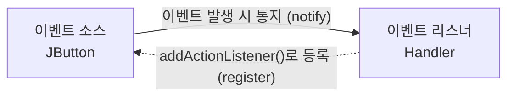
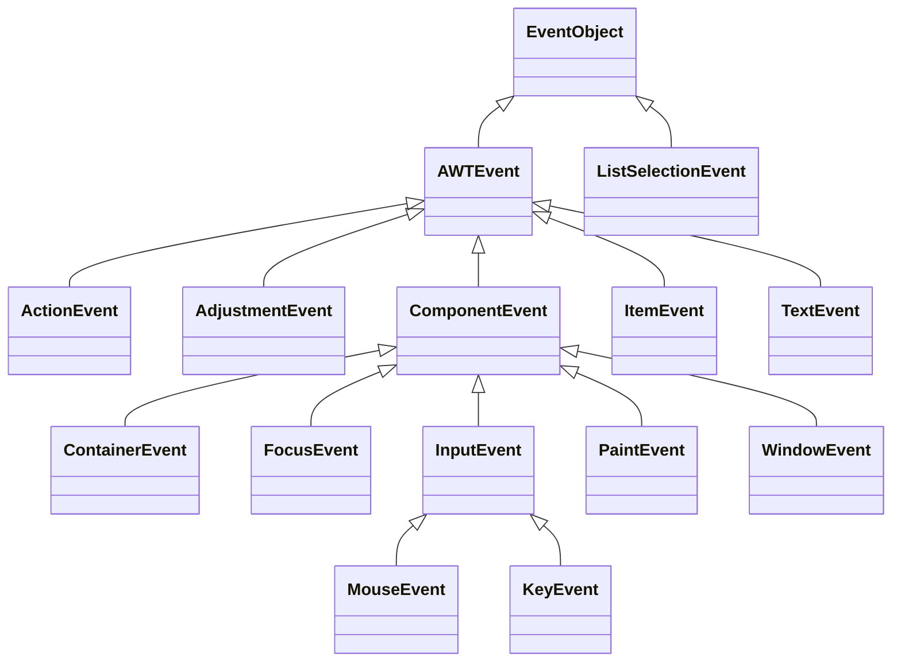

# 12강 — 고급 GUI

[레포지토리 안내](../../README.ko.md) | [English](Concepts_Lecture.md) | [한국어](Concepts_Lecture.ko.md)

> **최종 수정일:** 2026-10-26

> **학습 목표:**
> 1. Swing 컴포넌트를 사용하여 GUI 애플리케이션을 구축할 수 있다
> 2. 리스너와 내부 클래스로 이벤트를 처리할 수 있다
> 3. 반응형 UI 설계를 위해 배치 관리자를 적용할 수 있다
> 4. 어댑터 클래스를 사용하여 마우스 이벤트와 키 이벤트를 처리할 수 있다

---

## 목차

- [1. Swing 개요](#1-swing-개요)
  - [1.1 AWT vs. Swing](#11-awt-vs-swing)
  - [1.2 GUI 클래스 계층 구조](#12-gui-클래스-계층-구조)
- [2. JFrame과 컨텐트팬](#2-jframe과-컨텐트팬)
  - [2.1 JFrame 생성](#21-jframe-생성)
  - [2.2 JFrame 상속](#22-jframe-상속)
- [3. 배치 관리자](#3-배치-관리자)
  - [3.1 FlowLayout](#31-flowlayout)
  - [3.2 BorderLayout](#32-borderlayout)
  - [3.3 GridLayout](#33-gridlayout)
  - [3.4 절대 위치 지정](#34-절대-위치-지정)
- [4. 주요 Swing 컴포넌트](#4-주요-swing-컴포넌트)
  - [4.1 텍스트를 다루는 컴포넌트](#41-텍스트를-다루는-컴포넌트)
- [5. 이벤트 처리](#5-이벤트-처리)
  - [5.1 위임 기반 이벤트 모델](#51-위임-기반-이벤트-모델)
  - [5.2 이벤트 객체](#52-이벤트-객체)
  - [5.3 ActionListener](#53-actionlistener)
  - [5.4 익명 클래스와 람다](#54-익명-클래스와-람다)
  - [5.5 마우스 이벤트와 어댑터 클래스](#55-마우스-이벤트와-어댑터-클래스)
  - [5.6 키 이벤트](#56-키-이벤트)
- [요약](#요약)
- [점검 문제](#점검-문제)

---

<br>

## 1. Swing 개요

### 1.1 AWT vs. Swing

Java의 GUI 프로그램은 `javax.swing` 패키지와 `java.awt` 패키지의 클래스로 구현한다. Swing 클래스는 전부 Java로 구현되어 있어 운영체제가 달라도 똑같이 동작하므로, 여러 운영체제 사이의 호환성이 더 높다.

| 특징 | AWT | Swing |
|:--------|:----|:------|
| 패키지 | `java.awt` | `javax.swing` |
| 컴포넌트 | 중량(OS 네이티브) | 경량(Java 렌더링) |
| 룩 앤 필 | 플랫폼 종속적 | 플랫폼 독립적 (교체 가능한 룩 앤 필) |
| 명명 규칙 | `Button`, `Label` | `JButton`, `JLabel` |

*표 1. AWT와 Swing의 비교*

### 1.2 GUI 클래스 계층 구조

```text
Object -> Component -> Container -> Window -> Frame -> JFrame
                                           -> Dialog -> JDialog
                                 -> Panel -> Applet -> JApplet
                                 -> JComponent -> JLabel, JButton, JTextField, ...
```

*그림 1. AWT와 Swing의 GUI 클래스 계층*

`Component`는 화면에 나타나는 모든 GUI 객체의 상위 클래스이고, `Container`는 다른 컴포넌트를 담을 수 있는 컴포넌트이다. `Font`, `Color`, `Graphics`처럼 컴포넌트가 아닌 AWT 클래스는 `Object`를 바로 상속한다. Swing의 최상위 창인 `JFrame`, `JDialog`, `JApplet`은 각각 AWT의 `Frame`, `Dialog`, `Applet`을 상속하고, 나머지 Swing 컴포넌트는 `Container`의 하위 클래스인 `JComponent`를 상속한다. `JComponent` 아래에서 `JTextField`, `JTextArea`, `JEditorPane`은 `JTextComponent`를 상속하고(`JPasswordField`는 `JTextField`의 하위 클래스), `JButton`, `JToggleButton`(그 아래 `JCheckBox`, `JRadioButton`), `JMenuItem`(그 아래 `JMenu`, `JCheckBoxMenuItem`, `JRadioButtonMenuItem`)은 `AbstractButton`을 상속한다. `Applet`과 `JApplet`은 Java 9부터 사용 중단(deprecated)되었다.

---

<br>

## 2. JFrame과 컨텐트팬

### 2.1 JFrame 생성

```java
JFrame frame = new JFrame("My Window");
frame.setSize(400, 300);
frame.setDefaultCloseOperation(JFrame.EXIT_ON_CLOSE);
frame.setVisible(true);
```

`JFrame`은 제목 표시줄과 테두리가 있는 최상위 창이다. 위 코드는 제목이 `My Window`인 프레임을 만들고, 크기를 가로 400, 세로 300픽셀로 정하고, 창을 닫으면 프로그램이 끝나게 한 뒤, 창을 화면에 보이게 한다. `setVisible(true)`를 호출하기 전에는 창이 나타나지 않는다.

> **참고:** **이벤트 디스패치 스레드.** Swing 컴포넌트는 스레드 안전(thread-safe)하지 않으므로, 컴포넌트를 만들고 고치는 코드는 **이벤트 디스패치 스레드(Event Dispatch Thread, EDT)** 에서 실행하는 것이 원칙이다. 이벤트 리스너의 메서드는 EDT에서 호출된다. `main()`에서 프레임을 만들 때는 `SwingUtilities.invokeLater(() -> new MyFrame());`처럼 작업을 EDT에 넘기는 것이 권장 방식이며, 이 정리본의 짧은 예제는 간결하게 쓰기 위해 `main()`에서 바로 프레임을 만든다.

### 2.2 JFrame 상속

맞춤형 프레임 창을 만들려면 `extends`로 `JFrame`의 하위 클래스를 정의한다. `JFrame`에는 모든 프레임 창에 필요한 기본 기능이 들어 있으므로, 하위 클래스는 생성자에서 제목, 크기, 내용만 정하면 된다.

```java
public class MyFrame extends JFrame {
    public MyFrame() {
        setTitle("Welcome to GUI!");
        setSize(300, 300);
        setDefaultCloseOperation(EXIT_ON_CLOSE);

        Container contentPane = getContentPane();
        contentPane.setBackground(Color.BLUE);

        setVisible(true);
    }
}
```

**컨텐트팬(content pane)** 은 버튼, 레이블, 스크롤바 같은 GUI 객체를 올려놓는 프레임 안의 영역이다. 프레임의 `getContentPane()` 메서드로 컨텐트팬을 얻고, 위 코드처럼 `setBackground(Color.BLUE)`로 배경색을 파란색으로 바꾸거나 `add()`로 컴포넌트를 붙인다. `MyFrame`의 생성자가 모든 설정을 하므로 `main()`에서는 `new MyFrame()`만 호출하면 창이 나타난다. 같은 프레임을 만드는 실습 코드는 [BasicSwingFrame.java](../../Coursework/Lab12_Advanced-GUI/BasicSwingFrame.java)에 있다.

---

<br>

## 3. 배치 관리자

컨텐트팬에 GUI 객체를 놓는 방법은 두 가지이다. 하나는 **배치 관리자(layout manager)** 를 써서 컴포넌트의 위치와 크기를 자동으로 정하는 방법이고(FlowLayout, BorderLayout, GridLayout 등), 다른 하나는 배치 관리자를 `null`로 두고 위치를 직접 정하는 **절대 위치 지정(absolute positioning)** 이다(3.4절). 배치 관리자는 창의 크기가 바뀌면 컴포넌트를 다시 배치한다.

### 3.1 FlowLayout

컴포넌트를 왼쪽에서 오른쪽으로 배치하며, 공간이 부족하면 다음 행으로 줄 바꿈한다:

```java
container.setLayout(new FlowLayout());
container.add(new JButton("A"));
container.add(new JButton("B"));
```

생성자 `FlowLayout(int align, int hGap, int vGap)`으로 정렬 방식과 컴포넌트 사이의 간격을 정할 수 있다. 예를 들어 `new FlowLayout(FlowLayout.LEFT, 30, 40)`은 각 행을 왼쪽으로 정렬하고, 같은 행의 컴포넌트 사이에 수평 간격 30픽셀, 행 사이에 수직 간격 40픽셀을 둔다. 인자 없는 생성자는 가운데 정렬과 간격 5픽셀을 쓴다. 실습 코드 [FlowLayoutDemo.java](../../Coursework/Lab12_Advanced-GUI/FlowLayoutDemo.java)는 사칙연산 버튼을 FlowLayout으로 배치한다.

### 3.2 BorderLayout

컨테이너를 NORTH, SOUTH, EAST, WEST, CENTER의 5개 영역으로 나눈다:

```java
container.setLayout(new BorderLayout());
container.add(new JButton("Top"), BorderLayout.NORTH);
container.add(new JButton("Center"), BorderLayout.CENTER);
```

```text
┌──────────────────────────────┐
│            NORTH             │
├──────┬────────────────┬──────┤
│      │                │      │
│ WEST │     CENTER     │ EAST │
│      │                │      │
├──────┴────────────────┴──────┤
│            SOUTH             │
└──────────────────────────────┘
```

*그림 2. BorderLayout의 다섯 영역*

`add()`의 두 번째 인자로 영역을 지정하며, 영역을 생략하면 CENTER에 놓인다. 한 영역에는 컴포넌트 하나만 표시되므로 같은 영역에 두 번 `add()`하면 나중에 추가한 컴포넌트만 보인다. CENTER는 나머지 네 영역이 차지하고 남은 공간을 모두 채운다.

### 3.3 GridLayout

컴포넌트를 행과 열의 격자 형태로 배치한다:

```java
container.setLayout(new GridLayout(3, 2)); // 3행, 2열
```

GridLayout은 컨테이너를 크기가 같은 직사각형 칸으로 나누고 한 칸에 컴포넌트 하나씩을 놓는다. 컴포넌트는 `add()`한 순서대로 첫 행의 왼쪽부터 오른쪽으로 채우고, 행이 차면 다음 행으로 넘어간다. 생성자 `GridLayout(int rows, int cols, int hGap, int vGap)`은 칸 사이의 간격도 정한다. 다음 코드는 이름, 학번, 학과, 학년을 입력받는 양식을 4행 2열의 격자로 만들고 행 사이에 5픽셀 간격을 둔다.

```java
GridLayout grid = new GridLayout(4, 2);
grid.setVgap(5);

Container c = getContentPane();
c.setLayout(grid);
c.add(new JLabel(" Name"));
c.add(new JTextField(""));
c.add(new JLabel(" ID"));
c.add(new JTextField(""));
c.add(new JLabel(" Department"));
c.add(new JTextField(""));
c.add(new JLabel(" Grade"));
c.add(new JTextField(""));
```

컨테이너마다 기본 배치 관리자가 정해져 있으며, `setLayout()`으로 바꿀 수 있다(예: `JPanel p = new JPanel(); p.setLayout(new BorderLayout());`, `Container c = frame.getContentPane(); c.setLayout(new FlowLayout());`).

| 컨테이너 | 기본 배치 관리자 |
|:----------|:--------------|
| Window, JWindow | BorderLayout |
| Frame, JFrame | BorderLayout |
| Dialog, JDialog | BorderLayout |
| Panel, JPanel | FlowLayout |
| Applet, JApplet | FlowLayout |

*표 2. 컨테이너별 기본 배치 관리자*

Swing의 최상위 창(`JFrame`, `JDialog` 등)에서 BorderLayout을 쓰는 것은 정확히는 그 창의 컨텐트팬이다.

### 3.4 절대 위치 지정

`setLayout(null)`로 배치 관리자를 없애면 각 컴포넌트의 크기와 위치를 `setSize()`와 `setLocation()`(또는 `setBounds()`)으로 직접 정해야 한다. 크기를 정하지 않은 컴포넌트는 크기가 0이라 보이지 않는다. 이 방식은 마우스나 키보드로 컴포넌트를 움직이는 프로그램(5.5절, 5.6절)에 쓰인다.

```java
c.setLayout(null);
JLabel simpleLabel = new JLabel("Hello");
simpleLabel.setSize(50, 20);     // 폭 50, 높이 20픽셀
simpleLabel.setLocation(30, 30); // 컨텐트팬의 (30, 30)에 놓는다
c.add(simpleLabel);
```

---

<br>

## 4. 주요 Swing 컴포넌트

| 컴포넌트 | 용도 |
|:----------|:--------|
| `JLabel` | 텍스트 또는 이미지 표시 |
| `JButton` | 클릭 가능한 버튼 |
| `JTextField` | 한 줄 텍스트 입력 |
| `JPasswordField` | 입력한 글자를 가려 보여 주는 한 줄 텍스트 입력 |
| `JTextArea` | 여러 줄 텍스트 입력 |
| `JCheckBox` | 토글 선택/해제 |
| `JRadioButton` | 배타적 선택 (ButtonGroup과 함께 사용) |
| `JComboBox` | 드롭다운 선택 |
| `JList` | 스크롤 가능한 목록 |
| `JSlider` | 막대를 움직여 범위 안의 값 선택 |
| `JSpinner` | 위아래 화살표로 값을 하나씩 바꾸며 선택 |
| `JProgressBar` | 작업 진행률 표시 |
| `JToolTip` | 마우스를 올렸을 때 나타나는 도움말 |
| `JScrollPane` | 모든 컴포넌트에 스크롤바 추가 |
| `JMenuBar`, `JMenu`, `JMenuItem` | 메뉴 시스템 |
| `JDialog` | 프레임과 별도로 뜨는 대화 상자 |
| `JColorChooser` | 색상 선택 대화 상자 |

*표 3. 주요 Swing 컴포넌트와 용도*

### 4.1 텍스트를 다루는 컴포넌트

`JLabel`, `JTextField`, `JTextArea`는 텍스트를 다룬다.

- `JLabel`은 사용자가 고칠 수 없는 텍스트나 이미지를 표시한다. 이미지 레이블을 만들려면 문자열 대신 `ImageIcon` 객체를 생성자에 넘긴다.
- `JTextField`는 사용자에게서 한 줄의 텍스트를 입력받는다. 사용자가 Enter 키를 누르면 액션 이벤트가 발생하고, 입력된 텍스트는 `getText()`로 읽는다.
- `JTextArea`는 여러 줄의 텍스트를 입력받거나, 고칠 수 없게 설정하여 여러 줄의 텍스트를 표시하는 데 쓴다. `setText()`는 현재 내용을 주어진 텍스트로 바꾸고, `append()`는 현재 내용 뒤에 텍스트를 덧붙인다.

`JTextArea`에는 기본적으로 스크롤바가 없다. 스크롤바를 붙이려면 `JTextArea`를 `JScrollPane` 객체 안에 넣고, 그 `JScrollPane`을 컨테이너에 추가한다.

```java
JTextArea log = new JTextArea();
log.setText("Server started\n");   // 내용을 바꾼다
log.append("Client connected\n");  // 내용 뒤에 덧붙인다
c.add(new JScrollPane(log), BorderLayout.CENTER);
JLabel imageLabel = new JLabel(new ImageIcon("images/logo.png"));
```

---

<br>

## 5. 이벤트 처리

### 5.1 위임 기반 이벤트 모델

버튼 클릭처럼 GUI 객체에서 일어나는 사용자의 동작을 **이벤트(event)** 라 하고, 이벤트를 처리하는 방식을 **이벤트 처리(event handling)** 라 한다. Java의 이벤트 처리는 **위임 기반 이벤트 모델(delegation-based event model)** 을 따르며, 두 종류의 객체로 구현된다.

- **이벤트 소스(event source)** 는 이벤트가 일어나는 GUI 객체이다. 버튼, 텍스트 상자, 리스트 상자, 메뉴가 대표적인 이벤트 소스이며, 보통은 이벤트 소스를 직접 정의하지 않고 Swing이 제공하는 것을 쓴다.
- **이벤트 리스너(event listener)** 는 이벤트가 발생했을 때 실행될 메서드를 가진 객체이다. 리스너가 통지를 받으려면 먼저 이벤트 소스에 등록되어야 한다.



*그림 3. 이벤트 소스와 이벤트 리스너의 등록과 통지*

등록과 통지는 이벤트의 종류별로 이루어진다. 마우스 리스너는 마우스 이벤트를, 아이템 리스너는 항목 선택 이벤트를 처리한다. 가장 흔한 것은 **액션 이벤트(action event)** 로, 버튼을 클릭하거나 메뉴 항목을 선택하거나 `JTextField`에서 Enter 키를 누르면 발생하며 액션 리스너가 처리한다.

| 리스너 인터페이스 | 메서드 | 어댑터 클래스 |
|:-----|:-----|:-----|
| `ActionListener` | `actionPerformed` | 없음 |
| `ItemListener` | `itemStateChanged` | 없음 |
| `MouseListener` | `mousePressed`, `mouseReleased`, `mouseClicked`, `mouseEntered`, `mouseExited` | `MouseAdapter` |
| `MouseMotionListener` | `mouseDragged`, `mouseMoved` | `MouseMotionAdapter` (`MouseAdapter`도 구현) |
| `KeyListener` | `keyPressed`, `keyReleased`, `keyTyped` | `KeyAdapter` |

*표 4. 주요 리스너 인터페이스와 메서드, 어댑터 클래스*

### 5.2 이벤트 객체

이벤트가 발생하면 이벤트 소스는 이벤트에 관한 정보를 담은 **이벤트 객체(event object)** 를 만들어 리스너의 메서드에 인자로 넘긴다. 모든 이벤트 클래스는 `java.util.EventObject`를 상속한다.



*그림 4. 이벤트 클래스의 상속 계층*

`AWTEvent`와 그 하위 클래스는 `java.awt.event` 패키지(`AWTEvent` 자체는 `java.awt`)에, `ListSelectionEvent`는 `javax.swing.event` 패키지에 있다. 이벤트 객체는 다음 메서드로 이벤트의 정보를 알려 준다.

| 클래스 | 메서드 | 반환하는 정보 |
|:-----|:-----|:-----|
| `EventObject` | `Object getSource()` | 이벤트를 발생시킨 소스 객체 |
| `ActionEvent` | `String getActionCommand()` | 액션 명령 문자열 (버튼이면 기본값은 버튼의 텍스트) |
| `ItemEvent` | `Object getItem()`, `int getStateChange()` | 선택이 바뀐 항목, 선택되었는지 해제되었는지 |
| `InputEvent` | `int getModifiers()` | 함께 눌린 Shift, Ctrl, Alt 같은 보조 키 |
| `MouseEvent` | `int getX()`, `int getY()`, `Point getPoint()`, `int getButton()`, `int getClickCount()` | 마우스 위치, 눌린 버튼, 클릭 횟수 |
| `KeyEvent` | `char getKeyChar()`, `int getKeyCode()`, `static String getKeyText(int keyCode)` | 입력된 문자, 키 코드, 키 코드에 해당하는 키 이름 |

*표 5. 이벤트 객체의 주요 메서드*

### 5.3 ActionListener

인터페이스는 상수와 추상 메서드로 동작을 명세하며(Java 8부터는 default 메서드와 static 메서드도 가질 수 있다), 인터페이스를 구현하는 클래스는 그 추상 메서드의 본문을 제공한다. 이벤트 소스의 `addActionListener()`에는 `ActionListener` 인터페이스를 구현한 클래스의 인스턴스를 넘겨야 한다. `ActionListener`에는 `actionPerformed()` 메서드 하나만 있으므로, 이를 구현하는 클래스는 `actionPerformed()`의 본문에 이벤트가 발생했을 때 실행할 코드를 쓴다.

```java
JButton button = new JButton("Click Me");
button.addActionListener(new ActionListener() {
    @Override
    public void actionPerformed(ActionEvent e) {
        System.out.println("Button clicked!");
    }
});
```

리스너를 별도의 클래스로 정의할 수도 있다. 다음 `MyActionListener`는 `getSource()`로 이벤트를 발생시킨 버튼을 얻고, 버튼의 텍스트가 `Action`이면 `Click!!`을 출력한다.

```java
JButton btn = new JButton("Action");
btn.addActionListener(new MyActionListener());

class MyActionListener implements ActionListener {
    public void actionPerformed(ActionEvent e) {
        JButton b = (JButton) e.getSource();
        if (b.getText().equals("Action"))
            System.out.println("Click!!");
        else
            b.setText("Action");
    }
}
```

`ButtonHandler` 같은 별도의 리스너 클래스를 두는 대신, 이벤트 소스를 담고 있는 객체 자신을 리스너로 만드는 경우도 많다. 예를 들어 프레임 클래스가 `implements ActionListener`로 선언하고 `actionPerformed()`를 구현한 뒤, 자신이 담은 버튼마다 `button.addActionListener(this)`를 호출하면 프레임이 그 버튼들의 액션 이벤트를 처리한다. 이때 어느 버튼에서 이벤트가 왔는지는 `getSource()`나 `getActionCommand()`로 구분한다.

### 5.4 익명 클래스와 람다

5.3절의 첫 예제처럼 `new ActionListener() { ... }`로 이름 없는 클래스를 정의하면서 바로 객체를 만드는 것을 **익명 클래스(anonymous class)** 라 한다. 추상 메서드가 하나뿐인 인터페이스(함수형 인터페이스)는 람다식으로 더 짧게 구현할 수 있다.

```java
// 람다 (Java 8+) -- 단일 메서드 인터페이스에 대한 간결한 문법
button.addActionListener(e -> System.out.println("Clicked!"));
```

> **핵심:** 간결한 이벤트 핸들러에는 람다를 사용한다. 핸들러 로직이 복잡하거나 여러 컴포넌트에서 공유되는 경우에는 명명된 클래스를 사용한다.

> **주의:** 람다는 함수형 인터페이스에만 쓸 수 있다. `MouseListener`나 `KeyListener`처럼 추상 메서드가 여럿인 인터페이스에 람다를 넘기면 "MouseListener is not a functional interface" 같은 컴파일 오류가 난다.

### 5.5 마우스 이벤트와 어댑터 클래스

마우스 이벤트에는 마우스 이동, 드래그(버튼을 누른 채로 이동), 버튼 클릭 같은 사용자 동작이 있다. `MouseListener` 인터페이스는 마우스 버튼과 관련된 동작을, `MouseMotionListener` 인터페이스는 마우스의 움직임(`mouseDragged`, `mouseMoved`)을 처리한다.

```java
interface MouseListener {
    public void mousePressed(MouseEvent e);
    public void mouseReleased(MouseEvent e);
    public void mouseClicked(MouseEvent e);
    public void mouseEntered(MouseEvent e);
    public void mouseExited(MouseEvent e);
}
```

리스너 인터페이스를 구현하는 클래스는 모든 추상 메서드를 구현해야 한다. 마우스 버튼을 누른 동작(`mousePressed()`)만 처리하고 싶어도 나머지 네 메서드를 빈 본문으로 모두 써야 한다. **어댑터 클래스(adapter class)** 는 리스너의 모든 메서드를 아무 일도 하지 않는 본문으로 미리 구현해 둔 클래스이다. 예를 들어 `MouseAdapter`는 `MouseListener`, `MouseMotionListener`, `MouseWheelListener`의 메서드를 모두 빈 본문으로 구현한다. 어댑터 클래스를 상속하면 필요한 메서드만 오버라이딩하면 된다.

다음은 컨텐트팬의 아무 곳에서나 마우스 버튼을 누르면 `Hello` 레이블을 그 위치로 옮기는 프로그램이다. 내부 클래스 `MyMouseAdapter`는 `MouseAdapter`를 상속하여 `mousePressed()`만 오버라이딩한다. `MouseListener`를 직접 구현하면 나머지 네 메서드를 `public void mouseReleased(MouseEvent e) {}`처럼 빈 본문으로 더 써야 한다.

```java
public class Chap12Program5 extends JFrame {
    private JLabel simpleLabel = new JLabel("Hello");

    public Chap12Program5() {
        setTitle("Example of Mouse Event");
        setDefaultCloseOperation(JFrame.EXIT_ON_CLOSE);
        Container c = getContentPane();
        c.addMouseListener(new MyMouseAdapter());

        c.setLayout(null);
        simpleLabel.setSize(50, 20);
        simpleLabel.setLocation(30, 30);
        c.add(simpleLabel);

        setSize(250, 250);
        setVisible(true);
    }

    class MyMouseAdapter extends MouseAdapter {
        public void mousePressed(MouseEvent e) {
            int x = e.getX();               // 눌린 위치의 x 좌표
            int y = e.getY();               // 눌린 위치의 y 좌표
            simpleLabel.setLocation(x, y);  // 레이블을 그 위치로 옮긴다
        }
    }
}
```

내부 클래스는 바깥 클래스의 필드 `simpleLabel`에 직접 접근할 수 있으므로 리스너 안에서 레이블을 옮길 수 있다. 레이블을 마음대로 옮기기 위해 컨텐트팬은 절대 위치 지정(3.4절)을 쓴다.

### 5.6 키 이벤트

키를 입력하면 다음 세 경우에 키 이벤트가 발생하고, `KeyListener`의 해당 메서드가 호출된다. 유니코드 문자 키를 누르고 놓으면 일반적으로 `keyPressed()`, `keyTyped()`, `keyReleased()` 순서로 호출된다.

- 키를 눌렀을 때: `keyPressed()`
- 키를 놓았을 때: `keyReleased()`
- 유니코드 문자 키를 입력했을 때: `keyTyped()`

키는 두 종류로 나뉜다. **유니코드 키**는 A\~Z, a\~z, 0\~9, `!`, `@`, `&`처럼 문자를 입력하는 키이고, **유니코드가 아닌 키**는 Function 키, Home, 방향키, Delete, Control, Shift, Alt처럼 문자가 없는 키이다. 유니코드가 아닌 키는 `keyTyped()`를 발생시키지 않으므로 `keyPressed()`에서 `getKeyCode()`로 얻은 키 코드를 `KeyEvent.VK_UP` 같은 가상 키 상수와 비교해 판별한다.

다음 코드는 방향키를 누를 때마다 `HELLO` 레이블을 그 방향으로 10픽셀씩 옮긴다.

```java
c.setLayout(null);
c.addKeyListener(new MyKeyListener());
c.setFocusable(true);   // 컨텐트팬이 키 입력을 받을 수 있게 한다
c.requestFocus();       // 키 입력 포커스를 컨텐트팬에 둔다

class MyKeyListener extends KeyAdapter {
    public void keyPressed(KeyEvent e) {
        switch (e.getKeyCode()) {
        case KeyEvent.VK_UP:
            la.setLocation(la.getX(), la.getY() - FLYING_UNIT); break;
        case KeyEvent.VK_DOWN:
            la.setLocation(la.getX(), la.getY() + FLYING_UNIT); break;
        case KeyEvent.VK_LEFT:
            la.setLocation(la.getX() - FLYING_UNIT, la.getY()); break;
        case KeyEvent.VK_RIGHT:
            la.setLocation(la.getX() + FLYING_UNIT, la.getY()); break;
        }
    }
}
```

여기서 `la`는 `HELLO` 레이블, `FLYING_UNIT`은 10으로 정한 상수이다.

> **주의:** 키 이벤트는 키보드 포커스를 가진 컴포넌트에만 전달된다. 컨텐트팬은 기본적으로 포커스를 받지 않으므로 `setFocusable(true)`와 `requestFocus()`를 호출해야 하며, `requestFocus()`는 창이 화면에 나타난 뒤에 호출해야 효과가 있다. 다른 곳을 클릭해 포커스를 잃었을 때를 대비해 마우스를 클릭하면 다시 `requestFocus()`를 호출하는 리스너를 함께 두기도 한다.

---

<br>

## 요약

| 개념 | 핵심 요약 |
|:--------|:----------|
| Swing | 전부 Java로 구현되어 운영체제와 관계없이 똑같이 동작하는 경량 GUI 툴킷이다. |
| JFrame | 최상위 창이며, 맞춤형 프레임을 만들 때는 상속하여 생성자에서 설정한다. |
| 컨텐트팬 | GUI 객체가 배치되는 프레임 안의 컨테이너이며 `getContentPane()`으로 얻는다. |
| 배치 관리자 | FlowLayout(JPanel 기본), BorderLayout(JFrame 기본), GridLayout이 컴포넌트를 자동 배치하고, `null`이면 위치를 직접 정한다. |
| 위임 기반 이벤트 모델 | 이벤트 소스에 등록된 이벤트 리스너가 이벤트 객체를 받아 이벤트를 처리한다. |
| 이벤트 처리 | 리스너 인터페이스를 구현하며, 함수형 인터페이스는 람다로 간결하게 구현할 수 있다. |
| 어댑터 클래스 | 리스너의 메서드를 빈 본문으로 구현해 두어 필요한 메서드만 오버라이딩하게 한다. |
| 키 이벤트 | 포커스를 가진 컴포넌트에 전달되며, 문자가 없는 키는 `keyPressed()`에서 키 코드로 판별한다. |
| 컴포넌트 | JButton, JLabel, JTextField, JTextArea, JComboBox 등이 있으며, 스크롤이 필요하면 JScrollPane에 넣는다. |

---

<br>

## 점검 문제

1. **GridLayout:** 컨텐트팬을 `new GridLayout(4, 3, 5, 5)`로 설정하고 버튼 `1`~`9`, `*`, `0`, `/`를 이 순서로 `add()`했다. 버튼 `0`은 몇 행 몇 열에 놓이는가?

   <details>
   <summary>정답</summary>

   4행 2열이다. GridLayout은 첫 행의 왼쪽부터 오른쪽으로 칸을 채우므로 `1`\~`3`이 1행, `4`\~`6`이 2행, `7`\~`9`가 3행을 채우고, 네 번째 행에 `*`, `0`, `/`가 차례로 놓인다.

   </details>

2. **BorderLayout:** BorderLayout을 쓰는 컨텐트팬 `c`에 `c.add(new JButton("A"));`와 `c.add(new JButton("B"));`를 차례로 실행했다. 화면에 보이는 버튼은 무엇인가?

   <details>
   <summary>정답</summary>

   `B`만 보인다. 영역을 지정하지 않은 `add()`는 두 버튼을 모두 CENTER에 넣고, 한 영역에는 컴포넌트 하나만 배치되므로 나중에 추가한 `B`가 CENTER 전체를 차지한다. `A`는 컨테이너에 남아 있지만 크기가 0으로 배치되어 보이지 않는다.

   </details>

3. **어댑터 클래스:** 마우스 버튼을 놓는 동작만 처리하려고 한다. `MouseListener`를 구현할 때와 `MouseAdapter`를 상속할 때 각각 작성해야 하는 메서드를 쓰라.

   <details>
   <summary>정답</summary>

   `MouseListener`를 구현하면 `mouseReleased()`에 처리 코드를 쓰고, 나머지 `mousePressed()`, `mouseClicked()`, `mouseEntered()`, `mouseExited()`도 빈 본문으로 모두 작성해야 한다. `MouseAdapter`를 상속하면 다섯 메서드가 이미 빈 본문으로 구현되어 있으므로 `mouseReleased()` 하나만 오버라이딩하면 된다.

   </details>

4. **람다:** `button.addActionListener(e -> ...)`는 컴파일되지만 `c.addMouseListener(e -> ...)`는 컴파일되지 않는다. 그 이유를 설명하라.

   <details>
   <summary>정답</summary>

   람다식은 추상 메서드가 하나뿐인 함수형 인터페이스의 구현으로만 쓸 수 있다. `ActionListener`는 추상 메서드가 `actionPerformed()` 하나이므로 람다로 구현할 수 있지만, `MouseListener`는 추상 메서드가 다섯 개이므로 함수형 인터페이스가 아니어서 컴파일 오류가 난다.

   </details>

5. **키 이벤트:** 5.6절의 프로그램에서 방향키를 누를 때 `keyTyped()`가 호출되는가? 또 `c.setFocusable(true)`와 `c.requestFocus()`를 빼면 어떻게 되는가?

   <details>
   <summary>정답</summary>

   호출되지 않는다. 방향키는 문자를 입력하지 않는 유니코드가 아닌 키이므로 `keyPressed()`와 `keyReleased()`만 발생한다. 두 호출을 빼면 컨텐트팬이 키보드 포커스를 받지 못하므로 키 이벤트가 전달되지 않아 레이블이 움직이지 않는다.

   </details>
