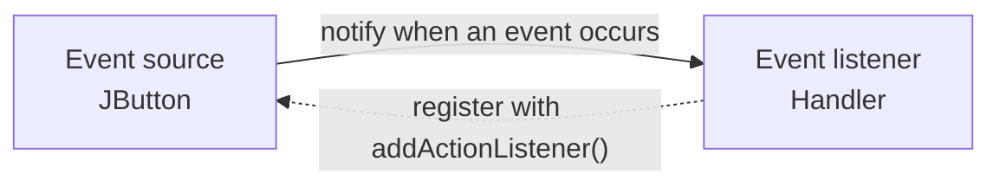
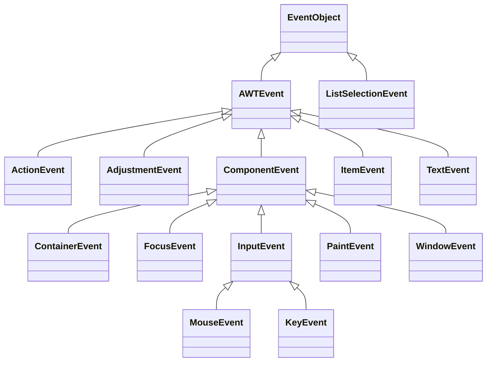

# Lecture 12 — Advanced GUI

[Repository Guide](../../README.md) | [English](Concepts_Lecture.md) | [한국어](Concepts_Lecture.ko.md)

> **Last Updated:** 2026-10-19

> **Learning Objectives:**
> 1. Build GUI applications using Swing components
> 2. Handle events with listeners and inner classes
> 3. Apply layout managers for responsive UI design
> 4. Handle mouse events and key events using adapter classes

---

## Table of Contents

- [1. Swing Overview](#1-swing-overview)
  - [1.1 AWT vs. Swing](#11-awt-vs-swing)
  - [1.2 GUI Class Hierarchy](#12-gui-class-hierarchy)
- [2. JFrame and Content Pane](#2-jframe-and-content-pane)
  - [2.1 Creating a JFrame](#21-creating-a-jframe)
  - [2.2 Subclassing JFrame](#22-subclassing-jframe)
- [3. Layout Managers](#3-layout-managers)
  - [3.1 FlowLayout](#31-flowlayout)
  - [3.2 BorderLayout](#32-borderlayout)
  - [3.3 GridLayout](#33-gridlayout)
  - [3.4 Absolute Positioning](#34-absolute-positioning)
- [4. Common Swing Components](#4-common-swing-components)
  - [4.1 Components for Text](#41-components-for-text)
- [5. Event Handling](#5-event-handling)
  - [5.1 The Delegation-Based Event Model](#51-the-delegation-based-event-model)
  - [5.2 Event Objects](#52-event-objects)
  - [5.3 ActionListener](#53-actionlistener)
  - [5.4 Anonymous Classes and Lambdas](#54-anonymous-classes-and-lambdas)
  - [5.5 Mouse Events and Adapter Classes](#55-mouse-events-and-adapter-classes)
  - [5.6 Key Events](#56-key-events)
- [Summary](#summary)
- [Self-Check Questions](#self-check-questions)

---

<br>

## 1. Swing Overview

### 1.1 AWT vs. Swing

GUI programs in Java are implemented with classes from the `javax.swing` and `java.awt` packages. The Swing classes are implemented entirely in Java and behave the same on different operating systems, so they offer greater compatibility across operating systems.

| Feature | AWT | Swing |
|:--------|:----|:------|
| Package | `java.awt` | `javax.swing` |
| Components | Heavyweight (OS-native) | Lightweight (Java-rendered) |
| Look & Feel | Platform-dependent | Platform-independent (pluggable look and feel) |
| Naming | `Button`, `Label` | `JButton`, `JLabel` |

*Table 1. Comparison of AWT and Swing*

### 1.2 GUI Class Hierarchy

```text
Object -> Component -> Container -> Window -> Frame -> JFrame
                                           -> Dialog -> JDialog
                                 -> Panel -> Applet -> JApplet
                                 -> JComponent -> JLabel, JButton, JTextField, ...
```

*Figure 1. GUI class hierarchy of AWT and Swing*

`Component` is the superclass of every GUI object that appears on the screen, and `Container` is a component that can hold other components. AWT classes that are not components, such as `Font`, `Color`, and `Graphics`, extend `Object` directly. The Swing top-level windows `JFrame`, `JDialog`, and `JApplet` extend the AWT classes `Frame`, `Dialog`, and `Applet`, and the other Swing components extend `JComponent`, a subclass of `Container`. Under `JComponent`, `JTextField`, `JTextArea`, and `JEditorPane` extend `JTextComponent` (`JPasswordField` is a subclass of `JTextField`), and `JButton`, `JToggleButton` (with `JCheckBox` and `JRadioButton` below it), and `JMenuItem` (with `JMenu`, `JCheckBoxMenuItem`, and `JRadioButtonMenuItem` below it) extend `AbstractButton`. `Applet` and `JApplet` have been deprecated since Java 9.

---

<br>

## 2. JFrame and Content Pane

### 2.1 Creating a JFrame

```java
JFrame frame = new JFrame("My Window");
frame.setSize(400, 300);
frame.setDefaultCloseOperation(JFrame.EXIT_ON_CLOSE);
frame.setVisible(true);
```

A `JFrame` is a top-level window with a title bar and a border. The code above creates a frame titled `My Window`, sets its size to 400 by 300 pixels, makes the program exit when the window is closed, and shows the window on the screen. The window does not appear until `setVisible(true)` is called.

> **Note:** **The event dispatch thread.** Swing components are not thread-safe, so as a rule the code that creates and modifies components runs on the **Event Dispatch Thread (EDT)**. Event listener methods are called on the EDT. When creating a frame from `main()`, the recommended way is to hand the work to the EDT, as in `SwingUtilities.invokeLater(() -> new MyFrame());`, and the short examples in these notes create the frame directly in `main()` for brevity.

### 2.2 Subclassing JFrame

To create a customized frame window, define a subclass of `JFrame` with `extends`. `JFrame` already contains the basic functionality that every frame window needs, so the subclass only sets the title, size, and contents in its constructor.

```java
public class MyFrame extends JFrame {
    public MyFrame() {
        setTitle("Welcome to GUI!");
        setSize(300, 300);
        setDefaultCloseOperation(EXIT_ON_CLOSE);

        Container contentPane = getContentPane();
        contentPane.setBackground(Color.BLUE);

        setVisible(true);
    }
}
```

The **content pane** is the area inside a frame where GUI objects such as buttons, labels, and scroll bars are placed. The frame's `getContentPane()` method returns the content pane, and we can change its background to blue with `setBackground(Color.BLUE)` as in the code above or attach components with `add()`. Because the constructor of `MyFrame` does all the setup, calling `new MyFrame()` in `main()` is enough to show the window. The lab code [BasicSwingFrame.java](../../Coursework/Lab12_Advanced-GUI/BasicSwingFrame.java) creates the same frame.

---

<br>

## 3. Layout Managers

There are two ways to place GUI objects on a content pane. One is to use a **layout manager** that sets the position and size of components automatically (FlowLayout, BorderLayout, GridLayout, and others), and the other is **absolute positioning**, which sets the layout manager to `null` and positions components directly (Section 3.4). A layout manager rearranges the components when the window is resized.

### 3.1 FlowLayout

Places components left-to-right, wrapping to the next row when space runs out:

```java
container.setLayout(new FlowLayout());
container.add(new JButton("A"));
container.add(new JButton("B"));
```

The constructor `FlowLayout(int align, int hGap, int vGap)` sets the alignment and the gaps between components. For example, `new FlowLayout(FlowLayout.LEFT, 30, 40)` aligns each row to the left and leaves a horizontal gap of 30 pixels between components in a row and a vertical gap of 40 pixels between rows. The no-argument constructor uses center alignment and gaps of 5 pixels. The lab code [FlowLayoutDemo.java](../../Coursework/Lab12_Advanced-GUI/FlowLayoutDemo.java) arranges arithmetic operation buttons with FlowLayout.

### 3.2 BorderLayout

Divides the container into five regions: NORTH, SOUTH, EAST, WEST, CENTER:

```java
container.setLayout(new BorderLayout());
container.add(new JButton("Top"), BorderLayout.NORTH);
container.add(new JButton("Center"), BorderLayout.CENTER);
```

```text
┌──────────────────────────────┐
│            NORTH             │
├──────┬────────────────┬──────┤
│      │                │      │
│ WEST │     CENTER     │ EAST │
│      │                │      │
├──────┴────────────────┴──────┤
│            SOUTH             │
└──────────────────────────────┘
```

*Figure 2. The five regions of BorderLayout*

The second argument of `add()` specifies the region, and a component added without a region goes to CENTER. Only one component is shown per region, so calling `add()` twice for the same region shows only the component added last. CENTER fills all the space left over by the other four regions.

### 3.3 GridLayout

Arranges components in a grid of rows and columns:

```java
container.setLayout(new GridLayout(3, 2)); // 3 rows, 2 columns
```

GridLayout divides the container into rectangular cells of equal size and places one component in each cell. Components fill the first row from left to right in the order they are added, and when a row is full they continue on the next row. The constructor `GridLayout(int rows, int cols, int hGap, int vGap)` also sets the gaps between cells. The following code builds a form that asks for a name, ID, department, and grade as a grid of 4 rows and 2 columns, with a gap of 5 pixels between rows.

```java
GridLayout grid = new GridLayout(4, 2);
grid.setVgap(5);

Container c = getContentPane();
c.setLayout(grid);
c.add(new JLabel(" Name"));
c.add(new JTextField(""));
c.add(new JLabel(" ID"));
c.add(new JTextField(""));
c.add(new JLabel(" Department"));
c.add(new JTextField(""));
c.add(new JLabel(" Grade"));
c.add(new JTextField(""));
```

Each container has a default layout manager, which `setLayout()` can change (for example, `JPanel p = new JPanel(); p.setLayout(new BorderLayout());` and `Container c = frame.getContentPane(); c.setLayout(new FlowLayout());`).

| Container | Default Layout |
|:----------|:--------------|
| Window, JWindow | BorderLayout |
| Frame, JFrame | BorderLayout |
| Dialog, JDialog | BorderLayout |
| Panel, JPanel | FlowLayout |
| Applet, JApplet | FlowLayout |

*Table 2. Default layout manager of each container*

For Swing top-level windows (`JFrame`, `JDialog`, and so on), it is precisely the content pane of the window that uses BorderLayout.

### 3.4 Absolute Positioning

When `setLayout(null)` removes the layout manager, the size and position of each component must be set directly with `setSize()` and `setLocation()` (or `setBounds()`). A component whose size is not set has size 0 and is not visible. This approach is used in programs that move components with the mouse or keyboard (Sections 5.5 and 5.6).

```java
c.setLayout(null);
JLabel simpleLabel = new JLabel("Hello");
simpleLabel.setSize(50, 20);     // width 50, height 20 pixels
simpleLabel.setLocation(30, 30); // place at (30, 30) of the content pane
c.add(simpleLabel);
```

---

<br>

## 4. Common Swing Components

| Component | Purpose |
|:----------|:--------|
| `JLabel` | Display text or images |
| `JButton` | Clickable button |
| `JTextField` | Single-line text input |
| `JPasswordField` | Single-line text input that masks the typed characters |
| `JTextArea` | Multi-line text input |
| `JCheckBox` | Toggle on/off |
| `JRadioButton` | Exclusive selection (with ButtonGroup) |
| `JComboBox` | Drop-down selection |
| `JList` | Scrollable list |
| `JSlider` | Select a value in a range by moving a knob |
| `JSpinner` | Select a value by stepping it with up and down arrows |
| `JProgressBar` | Show the progress of a task |
| `JToolTip` | Help text that appears when the mouse hovers |
| `JScrollPane` | Adds scrollbars to any component |
| `JMenuBar`, `JMenu`, `JMenuItem` | Menu system |
| `JDialog` | Dialog box that opens separately from the frame |
| `JColorChooser` | Color selection dialog |

*Table 3. Common Swing components and their purposes*

### 4.1 Components for Text

`JLabel`, `JTextField`, and `JTextArea` deal with text.

- A `JLabel` displays text or an image that the user cannot edit. To create an image label, pass an `ImageIcon` object to the constructor instead of a string.
- A `JTextField` accepts a single line of text from the user. When the user presses the Enter key, an action event is generated, and the entered text is read with `getText()`.
- A `JTextArea` accepts multiple lines of text, or, when made non-editable, displays multiple lines of text. `setText()` replaces the current content with the given text, and `append()` appends text to the current content.

A `JTextArea` has no scroll bars by default. To add scroll bars, place the `JTextArea` in a `JScrollPane` object and add that `JScrollPane` to the container.

```java
JTextArea log = new JTextArea();
log.setText("Server started\n");   // replaces the content
log.append("Client connected\n");  // appends to the content
c.add(new JScrollPane(log), BorderLayout.CENTER);
JLabel imageLabel = new JLabel(new ImageIcon("images/logo.png"));
```

---

<br>

## 5. Event Handling

### 5.1 The Delegation-Based Event Model

A user action on a GUI object, such as clicking a button, is called an **event**, and the mechanism that processes events is called **event handling**. Event handling in Java follows the **delegation-based event model** and is implemented by two types of objects.

- An **event source** is the GUI object where an event occurs. Buttons, text boxes, list boxes, and menus are common event sources, and we normally use the ones Swing provides rather than defining our own.
- An **event listener** is an object with a method that runs when an event occurs. A listener must first be registered with an event source to be notified.



*Figure 3. Registration and notification between an event source and an event listener*

Registration and notification are specific to each event type. A mouse listener handles mouse events, and an item listener handles item selection events. The most common type is the **action event**, which is generated by clicking a button, selecting a menu item, or pressing Enter in a `JTextField`, and is handled by an action listener.

| Listener Interface | Methods | Adapter Class |
|:-----|:-----|:-----|
| `ActionListener` | `actionPerformed` | None |
| `ItemListener` | `itemStateChanged` | None |
| `MouseListener` | `mousePressed`, `mouseReleased`, `mouseClicked`, `mouseEntered`, `mouseExited` | `MouseAdapter` |
| `MouseMotionListener` | `mouseDragged`, `mouseMoved` | `MouseMotionAdapter` (`MouseAdapter` also implements it) |
| `KeyListener` | `keyPressed`, `keyReleased`, `keyTyped` | `KeyAdapter` |

*Table 4. Common listener interfaces, their methods, and adapter classes*

### 5.2 Event Objects

When an event occurs, the event source creates an **event object** that holds information about the event and passes it as the argument to the listener method. Every event class extends `java.util.EventObject`.



*Figure 4. Inheritance hierarchy of event classes*

`AWTEvent` and its subclasses are in the `java.awt.event` package (`AWTEvent` itself is in `java.awt`), and `ListSelectionEvent` is in the `javax.swing.event` package. Event objects report information about the event through the following methods.

| Class | Method | Information Returned |
|:-----|:-----|:-----|
| `EventObject` | `Object getSource()` | The source object that generated the event |
| `ActionEvent` | `String getActionCommand()` | The action command string (for a button, the button text by default) |
| `ItemEvent` | `Object getItem()`, `int getStateChange()` | The item whose selection changed, and whether it was selected or deselected |
| `InputEvent` | `int getModifiers()` | Modifier keys such as Shift, Ctrl, and Alt held down at the same time |
| `MouseEvent` | `int getX()`, `int getY()`, `Point getPoint()`, `int getButton()`, `int getClickCount()` | Mouse position, the button pressed, and the click count |
| `KeyEvent` | `char getKeyChar()`, `int getKeyCode()`, `static String getKeyText(int keyCode)` | The typed character, the key code, and the key name for a key code |

*Table 5. Main methods of event objects*

### 5.3 ActionListener

An interface specifies a behavior with constants and abstract methods (since Java 8 it can also have default and static methods), and a class that implements the interface provides the bodies of those abstract methods. The `addActionListener()` method of an event source must receive an instance of a class that implements the `ActionListener` interface. `ActionListener` has only one method, `actionPerformed()`, so a class that implements it puts the code to run in response to the event in the body of `actionPerformed()`.

```java
JButton button = new JButton("Click Me");
button.addActionListener(new ActionListener() {
    @Override
    public void actionPerformed(ActionEvent e) {
        System.out.println("Button clicked!");
    }
});
```

A listener can also be defined as a separate class. The following `MyActionListener` gets the button that generated the event with `getSource()` and prints `Click!!` if the button text is `Action`.

```java
JButton btn = new JButton("Action");
btn.addActionListener(new MyActionListener());

class MyActionListener implements ActionListener {
    public void actionPerformed(ActionEvent e) {
        JButton b = (JButton) e.getSource();
        if (b.getText().equals("Action"))
            System.out.println("Click!!");
        else
            b.setText("Action");
    }
}
```

Instead of defining a separate listener class such as `ButtonHandler`, it is also common to make the object that contains the event sources the listener itself. For example, a frame class declared with `implements ActionListener` implements `actionPerformed()` and calls `button.addActionListener(this)` for each button it contains, so that the frame handles the action events of those buttons. Which button the event came from is then distinguished with `getSource()` or `getActionCommand()`.

### 5.4 Anonymous Classes and Lambdas

Defining a class without a name and creating its object at the same time, as with `new ActionListener() { ... }` in the first example of Section 5.3, is called an **anonymous class**. An interface with only one abstract method (a functional interface) can be implemented more briefly with a lambda expression.

```java
// Lambda (Java 8+) -- shorter syntax for single-method interfaces
button.addActionListener(e -> System.out.println("Clicked!"));
```

> **Key Point:** Use lambdas for concise event handlers. Use named classes when the handler logic is complex or shared across components.

> **Caution:** Lambdas work only for functional interfaces. Passing a lambda where an interface with several abstract methods, such as `MouseListener` or `KeyListener`, is expected causes a compile error such as "MouseListener is not a functional interface".

### 5.5 Mouse Events and Adapter Classes

Mouse events include user actions such as moving the mouse, dragging it (moving it while a button is pressed), and clicking its buttons. The `MouseListener` interface handles actions related to the mouse buttons, and the `MouseMotionListener` interface handles mouse movement (`mouseDragged` and `mouseMoved`).

```java
interface MouseListener {
    public void mousePressed(MouseEvent e);
    public void mouseReleased(MouseEvent e);
    public void mouseClicked(MouseEvent e);
    public void mouseEntered(MouseEvent e);
    public void mouseExited(MouseEvent e);
}
```

A class that implements a listener interface must implement every abstract method. Even to handle only the mouse press (`mousePressed()`), all four remaining methods must be written with empty bodies. An **adapter class** is a class that already implements every method of a listener with a body that does nothing. For example, `MouseAdapter` implements all methods of `MouseListener`, `MouseMotionListener`, and `MouseWheelListener` with empty bodies. Extending an adapter class means overriding only the methods that are needed.

The following program moves the `Hello` label to wherever the mouse button is pressed in the content pane. The inner class `MyMouseAdapter` extends `MouseAdapter` and overrides only `mousePressed()`. Implementing `MouseListener` directly would require writing the four other methods with empty bodies, as in `public void mouseReleased(MouseEvent e) {}`.

```java
public class Chap12Program5 extends JFrame {
    private JLabel simpleLabel = new JLabel("Hello");

    public Chap12Program5() {
        setTitle("Example of Mouse Event");
        setDefaultCloseOperation(JFrame.EXIT_ON_CLOSE);
        Container c = getContentPane();
        c.addMouseListener(new MyMouseAdapter());

        c.setLayout(null);
        simpleLabel.setSize(50, 20);
        simpleLabel.setLocation(30, 30);
        c.add(simpleLabel);

        setSize(250, 250);
        setVisible(true);
    }

    class MyMouseAdapter extends MouseAdapter {
        public void mousePressed(MouseEvent e) {
            int x = e.getX();               // x coordinate of the press
            int y = e.getY();               // y coordinate of the press
            simpleLabel.setLocation(x, y);  // move the label there
        }
    }
}
```

An inner class can access the field `simpleLabel` of its enclosing class directly, so the listener can move the label. The content pane uses absolute positioning (Section 3.4) so that the label can be placed anywhere.

### 5.6 Key Events

When a key is entered, a key event occurs in the following three cases, and the corresponding method of `KeyListener` is called. Pressing and releasing a Unicode character key usually calls `keyPressed()`, `keyTyped()`, and `keyReleased()` in that order.

- When a key is pressed: `keyPressed()`
- When a key is released: `keyReleased()`
- When a Unicode character key is typed: `keyTyped()`

Keys fall into two types. **Unicode keys** enter characters, such as A-Z, a-z, 0-9, `!`, `@`, and `&`, and **non-Unicode keys** have no character, such as the function keys, Home, the arrow keys, Delete, Control, Shift, and Alt. Non-Unicode keys do not generate `keyTyped()`, so they are identified in `keyPressed()` by comparing the key code from `getKeyCode()` with virtual key constants such as `KeyEvent.VK_UP`.

The following code moves the `HELLO` label 10 pixels in the direction of each arrow key pressed.

```java
c.setLayout(null);
c.addKeyListener(new MyKeyListener());
c.setFocusable(true);   // let the content pane receive key input
c.requestFocus();       // give the keyboard focus to the content pane

class MyKeyListener extends KeyAdapter {
    public void keyPressed(KeyEvent e) {
        switch (e.getKeyCode()) {
        case KeyEvent.VK_UP:
            la.setLocation(la.getX(), la.getY() - FLYING_UNIT); break;
        case KeyEvent.VK_DOWN:
            la.setLocation(la.getX(), la.getY() + FLYING_UNIT); break;
        case KeyEvent.VK_LEFT:
            la.setLocation(la.getX() - FLYING_UNIT, la.getY()); break;
        case KeyEvent.VK_RIGHT:
            la.setLocation(la.getX() + FLYING_UNIT, la.getY()); break;
        }
    }
}
```

Here `la` is the `HELLO` label and `FLYING_UNIT` is a constant set to 10.

> **Caution:** Key events are delivered only to the component that has the keyboard focus. A content pane does not receive focus by default, so `setFocusable(true)` and `requestFocus()` must be called, and `requestFocus()` takes effect only after the window is shown. To recover when the focus moves elsewhere after a click, a listener that calls `requestFocus()` again on a mouse click is often added as well.

---

<br>

## Summary

| Concept | Key Summary |
|:--------|:----------|
| Swing | It is a lightweight GUI toolkit implemented entirely in Java that behaves the same on every operating system. |
| JFrame | It is the top-level window, and a customized frame is created by subclassing it and configuring it in the constructor. |
| Content Pane | It is the container inside a frame where GUI objects are placed, obtained with `getContentPane()`. |
| Layout Managers | FlowLayout (default for JPanel), BorderLayout (default for JFrame), and GridLayout place components automatically, and with `null` positions are set directly. |
| Delegation-Based Event Model | An event listener registered with an event source receives an event object and handles the event. |
| Event Handling | It implements listener interfaces, and functional interfaces can be implemented concisely with lambdas. |
| Adapter Class | It implements the listener methods with empty bodies so that only the needed methods are overridden. |
| Key Events | They are delivered to the component with the focus, and keys without characters are identified by key code in `keyPressed()`. |
| Components | They include JButton, JLabel, JTextField, JTextArea, JComboBox, and others, and a component that needs scrolling goes in a JScrollPane. |

---

<br>

## Self-Check Questions

1. **GridLayout:** A content pane is set to `new GridLayout(4, 3, 5, 5)`, and the buttons `1`-`9`, `*`, `0`, and `/` are added with `add()` in this order. In which row and column is the button `0` placed?

   <details>
   <summary>Answer</summary>

   Row 4, column 2. GridLayout fills the cells of the first row from left to right, so `1`-`3` fill row 1, `4`-`6` fill row 2, and `7`-`9` fill row 3, and `*`, `0`, and `/` are placed in order in the fourth row.

   </details>

2. **BorderLayout:** On a content pane `c` that uses BorderLayout, `c.add(new JButton("A"));` and `c.add(new JButton("B"));` are executed in order. Which button is visible on the screen?

   <details>
   <summary>Answer</summary>

   Only `B` is visible. `add()` without a region puts both buttons in CENTER, and only one component is laid out per region, so `B`, added last, occupies the whole CENTER. `A` remains in the container but is laid out with size 0 and is not visible.

   </details>

3. **Adapter classes:** We want to handle only the release of a mouse button. List the methods that must be written when implementing `MouseListener` and when extending `MouseAdapter`.

   <details>
   <summary>Answer</summary>

   Implementing `MouseListener` requires writing the handling code in `mouseReleased()` and also writing all of `mousePressed()`, `mouseClicked()`, `mouseEntered()`, and `mouseExited()` with empty bodies. Extending `MouseAdapter` requires overriding only `mouseReleased()`, because all five methods are already implemented with empty bodies.

   </details>

4. **Lambdas:** `button.addActionListener(e -> ...)` compiles, but `c.addMouseListener(e -> ...)` does not. Explain why.

   <details>
   <summary>Answer</summary>

   A lambda expression can be used only as an implementation of a functional interface, which has exactly one abstract method. `ActionListener` has the single abstract method `actionPerformed()`, so a lambda can implement it, but `MouseListener` has five abstract methods and is not a functional interface, so a compile error occurs.

   </details>

5. **Key events:** In the program of Section 5.6, is `keyTyped()` called when an arrow key is pressed? What happens if `c.setFocusable(true)` and `c.requestFocus()` are removed?

   <details>
   <summary>Answer</summary>

   It is not called. Arrow keys are non-Unicode keys that do not enter characters, so only `keyPressed()` and `keyReleased()` occur. Without the two calls, the content pane cannot receive the keyboard focus, so no key events are delivered and the label does not move.

   </details>
