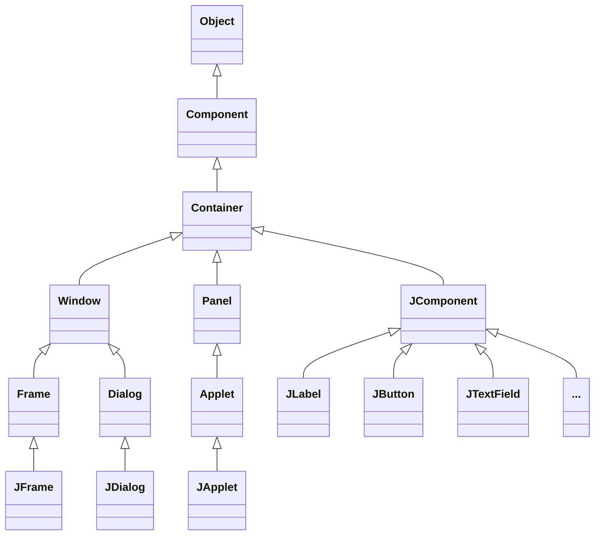
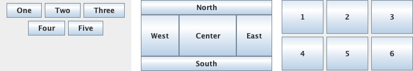
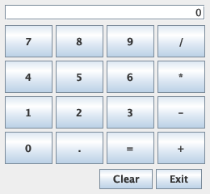
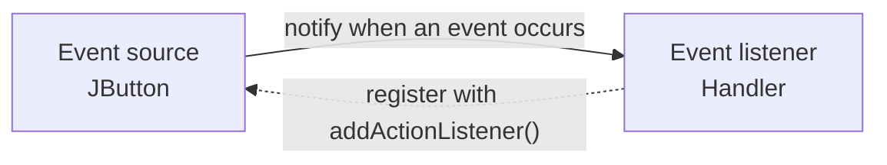
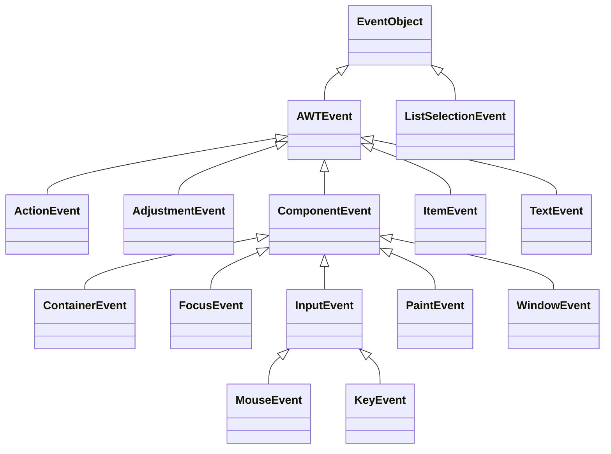
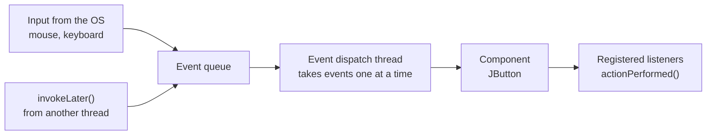

# Lecture 12 — Advanced GUI

[Repository Guide](../../README.md) | [English](Concepts_Lecture.md) | [한국어](Concepts_Lecture.ko.md)

> **Last Updated:** 2026-11-19

> **Learning Objectives:**
> 1. Build GUI applications using Swing components
> 2. Handle events with listeners and inner classes
> 3. Apply layout managers for responsive UI design
> 4. Handle mouse events and key events using adapter classes
> 5. Trace how layout managers compute the positions and sizes of components, and compose screens by nesting panels
> 6. Explain how events are processed on the event dispatch thread and move long-running work off it

---

## Table of Contents

- [1. Swing Overview](#1-swing-overview)
  - [1.1 AWT vs. Swing](#11-awt-vs-swing)
  - [1.2 GUI Class Hierarchy](#12-gui-class-hierarchy)
- [2. JFrame and Content Pane](#2-jframe-and-content-pane)
  - [2.1 Creating a JFrame](#21-creating-a-jframe)
  - [2.2 Subclassing JFrame](#22-subclassing-jframe)
  - [2.3 A Default Frame and the Window Size](#23-a-default-frame-and-the-window-size)
- [3. Layout Managers](#3-layout-managers)
  - [3.1 FlowLayout](#31-flowlayout)
  - [3.2 BorderLayout](#32-borderlayout)
  - [3.3 GridLayout](#33-gridlayout)
  - [3.4 Absolute Positioning](#34-absolute-positioning)
  - [3.5 Positions and Sizes Computed by Layout Managers](#35-positions-and-sizes-computed-by-layout-managers)
  - [3.6 Composing a Screen by Nesting Panels](#36-composing-a-screen-by-nesting-panels)
  - [3.7 BoxLayout and CardLayout](#37-boxlayout-and-cardlayout)
- [4. Common Swing Components](#4-common-swing-components)
  - [4.1 Components for Text](#41-components-for-text)
  - [4.2 How Text Components Behave](#42-how-text-components-behave)
- [5. Event Handling](#5-event-handling)
  - [5.1 The Delegation-Based Event Model](#51-the-delegation-based-event-model)
  - [5.2 Event Objects](#52-event-objects)
  - [5.3 ActionListener](#53-actionlistener)
  - [5.4 Anonymous Classes and Lambdas](#54-anonymous-classes-and-lambdas)
  - [5.5 Mouse Events and Adapter Classes](#55-mouse-events-and-adapter-classes)
  - [5.6 Key Events](#56-key-events)
  - [5.7 The Event Dispatch Thread](#57-the-event-dispatch-thread)
  - [5.8 Long-Running Work and SwingWorker](#58-long-running-work-and-swingworker)
  - [5.9 Comparing Ways to Write Listeners](#59-comparing-ways-to-write-listeners)
  - [5.10 How Input Events Reach Listeners](#510-how-input-events-reach-listeners)
  - [5.11 Naming Rules for Event Classes and Listeners](#511-naming-rules-for-event-classes-and-listeners)
- [6. Common Mistakes](#6-common-mistakes)
- [Summary](#summary)
- [Self-Check Questions](#self-check-questions)
- [References](#references)

---

<br>

## 1. Swing Overview

### 1.1 AWT vs. Swing

GUI programs in Java are implemented with classes from the `javax.swing` and `java.awt` packages. The Swing classes are implemented entirely in Java and behave the same on different operating systems, so they offer greater compatibility across operating systems.

| Feature | AWT | Swing |
|:--------|:----|:------|
| Package | `java.awt` | `javax.swing` |
| Components | Heavyweight (OS-native) | Lightweight (Java-rendered) |
| Look & Feel | Platform-dependent | Platform-independent (pluggable look and feel) |
| Naming | `Button`, `Label` | `JButton`, `JLabel` |

*Table 1. Comparison of AWT and Swing*

### 1.2 GUI Class Hierarchy



*Figure 1. GUI class hierarchy of AWT and Swing*

`Component` is the superclass of every GUI object that appears on the screen, and `Container` is a component that can hold other components. AWT classes that are not components, such as `Font`, `Color`, and `Graphics`, extend `Object` directly. The Swing top-level windows `JFrame`, `JDialog`, and `JApplet` extend the AWT classes `Frame`, `Dialog`, and `Applet`, and the other Swing components extend `JComponent`, a subclass of `Container`. Under `JComponent`, `JTextField`, `JTextArea`, and `JEditorPane` extend `JTextComponent` (`JPasswordField` is a subclass of `JTextField`), and `JButton`, `JToggleButton` (with `JCheckBox` and `JRadioButton` below it), and `JMenuItem` (with `JMenu`, `JCheckBoxMenuItem`, and `JRadioButtonMenuItem` below it) extend `AbstractButton`. `Applet` and `JApplet` have been deprecated since Java 9.

---

<br>

## 2. JFrame and Content Pane

### 2.1 Creating a JFrame

```java
JFrame frame = new JFrame("My Window");
frame.setSize(400, 300);
frame.setDefaultCloseOperation(JFrame.EXIT_ON_CLOSE);
frame.setVisible(true);
```

A `JFrame` is a top-level window with a title bar and a border. The code above creates a frame titled `My Window`, sets its size to 400 by 300 pixels, makes the program exit when the window is closed, and shows the window on the screen. The window does not appear until `setVisible(true)` is called.

> **Note:** **The event dispatch thread.** Swing components are not thread-safe, so as a rule the code that creates and modifies components runs on the **Event Dispatch Thread (EDT)**. Event listener methods are called on the EDT. When creating a frame from `main()`, the recommended way is to hand the work to the EDT, as in `SwingUtilities.invokeLater(() -> new MyFrame());`, and the short examples in these notes create the frame directly in `main()` for brevity.

### 2.2 Subclassing JFrame

To create a customized frame window, define a subclass of `JFrame` with `extends`. `JFrame` already contains the basic functionality that every frame window needs, so the subclass only sets the title, size, and contents in its constructor.

```java
public class MyFrame extends JFrame {
    public MyFrame() {
        setTitle("Welcome to GUI!");
        setSize(300, 300);
        setDefaultCloseOperation(EXIT_ON_CLOSE);

        Container contentPane = getContentPane();
        contentPane.setBackground(Color.BLUE);

        setVisible(true);
    }
}
```

The **content pane** is the area inside a frame where GUI objects such as buttons, labels, and scroll bars are placed. The frame's `getContentPane()` method returns the content pane, and we can change its background to blue with `setBackground(Color.BLUE)` as in the code above or attach components with `add()`. Because the constructor of `MyFrame` does all the setup, calling `new MyFrame()` in `main()` is enough to show the window. The lab code [BasicSwingFrame.java](../../Coursework/Lab12_Advanced-GUI/BasicSwingFrame.java) creates the same frame.

### 2.3 A Default Frame and the Window Size

A frame whose size has not been set is barely visible. The following is the simplest program that creates a frame with the default constructor, without subclassing `JFrame`, and makes it visible.

```java
import javax.swing.*;

class Ch7DefaultJFrame {
    public static void main(String[] args) {
        JFrame defaultJFrame;
        defaultJFrame = new JFrame();
        defaultJFrame.setVisible(true);
    }
}
```

Running this program makes a tiny window, just large enough for the title-bar icon and the minimize, maximize, and close buttons, appear in the top-left corner of the screen, so it is easy not to notice that a window opened at all. This is because the default size of a `JFrame` is 0 × 0 and its default position is (0, 0) on the screen. Moreover, pressing the close button only hides the window and the program does not end, because the default close operation is `HIDE_ON_CLOSE`. This is why the frames of Sections 2.1 and 2.2 set the following three things together.

- **Size:** set it directly with `setSize(width, height)`, or call `pack()` after adding all components. `pack()` asks the layout manager for the size the content pane wants (its preferred size) and fits the window to it (Section 3.6).
- **Position:** set it with `setLocation(x, y)`, or place the window at the center of the screen with `setLocationRelativeTo(null)`.
- **Close operation:** make the program end when the window is closed with `setDefaultCloseOperation(JFrame.EXIT_ON_CLOSE)`.

`setVisible(true)` is called last, after all these settings. If components are added after the window is visible, `revalidate()` and `repaint()` must be called for the new layout to appear on the screen.

A frame is made up of many GUI objects. For example, a number-guessing game window contains the top-level window `JFrame`, the menu bar above with the `Game` and `Help` menus (`JMenu`), a `JLabel` that shows a message and a picture (the picture is an `ImageIcon`), a `JTextField` for entering the guessed number, and the `Guess` and `Cancel` buttons (`JButton`). All these objects belong to the hierarchy of Section 1.2, and through containers holding other components they form a single tree.

---

<br>

## 3. Layout Managers

There are two ways to place GUI objects on a content pane. One is to use a **layout manager** that sets the position and size of components automatically (FlowLayout, BorderLayout, GridLayout, and others), and the other is **absolute positioning**, which sets the layout manager to `null` and positions components directly (Section 3.4). A layout manager rearranges the components when the window is resized.

### 3.1 FlowLayout

Places components left-to-right, wrapping to the next row when space runs out:

```java
container.setLayout(new FlowLayout());
container.add(new JButton("A"));
container.add(new JButton("B"));
```

The constructor `FlowLayout(int align, int hGap, int vGap)` sets the alignment and the gaps between components. For example, `new FlowLayout(FlowLayout.LEFT, 30, 40)` aligns each row to the left and leaves a horizontal gap of 30 pixels between components in a row and a vertical gap of 40 pixels between rows. The no-argument constructor uses center alignment and gaps of 5 pixels. The lab code [FlowLayoutDemo.java](../../Coursework/Lab12_Advanced-GUI/FlowLayoutDemo.java) arranges arithmetic operation buttons with FlowLayout.

### 3.2 BorderLayout

Divides the container into five regions: NORTH, SOUTH, EAST, WEST, CENTER:

```java
container.setLayout(new BorderLayout());
container.add(new JButton("Top"), BorderLayout.NORTH);
container.add(new JButton("Center"), BorderLayout.CENTER);
```

```text
┌──────────────────────────────┐
│            NORTH             │
├──────┬────────────────┬──────┤
│      │                │      │
│ WEST │     CENTER     │ EAST │
│      │                │      │
├──────┴────────────────┴──────┤
│            SOUTH             │
└──────────────────────────────┘
```

*Figure 2. The five regions of BorderLayout*

The second argument of `add()` specifies the region, and a component added without a region goes to CENTER. Only one component is shown per region, so calling `add()` twice for the same region shows only the component added last. CENTER fills all the space left over by the other four regions.

### 3.3 GridLayout

Arranges components in a grid of rows and columns:

```java
container.setLayout(new GridLayout(3, 2)); // 3 rows, 2 columns
```

GridLayout divides the container into rectangular cells of equal size and places one component in each cell. Components fill the first row from left to right in the order they are added, and when a row is full they continue on the next row. The constructor `GridLayout(int rows, int cols, int hGap, int vGap)` also sets the gaps between cells. The following code builds a form that asks for a name, ID, department, and grade as a grid of 4 rows and 2 columns, with a gap of 5 pixels between rows.

```java
GridLayout grid = new GridLayout(4, 2);
grid.setVgap(5);

Container c = getContentPane();
c.setLayout(grid);
c.add(new JLabel(" Name"));
c.add(new JTextField(""));
c.add(new JLabel(" ID"));
c.add(new JTextField(""));
c.add(new JLabel(" Department"));
c.add(new JTextField(""));
c.add(new JLabel(" Grade"));
c.add(new JTextField(""));
```

Each container has a default layout manager, which `setLayout()` can change (for example, `JPanel p = new JPanel(); p.setLayout(new BorderLayout());` and `Container c = frame.getContentPane(); c.setLayout(new FlowLayout());`).

| Container | Default Layout |
|:----------|:--------------|
| Window, JWindow | BorderLayout |
| Frame, JFrame | BorderLayout |
| Dialog, JDialog | BorderLayout |
| Panel, JPanel | FlowLayout |
| Applet, JApplet | FlowLayout |

*Table 2. Default layout manager of each container*

For Swing top-level windows (`JFrame`, `JDialog`, `JApplet`, and so on), the default layout manager applies precisely to the content pane of the window, and the default layout manager of a content pane is BorderLayout. The content pane of `JApplet` therefore also uses BorderLayout, and the FlowLayout in the table applies to the AWT `Applet`.

### 3.4 Absolute Positioning

When `setLayout(null)` removes the layout manager, the size and position of each component must be set directly with `setSize()` and `setLocation()` (or `setBounds()`). A component whose size is not set has size 0 and is not visible. This approach is used in programs that move components with the mouse or keyboard (Sections 5.5 and 5.6).

```java
c.setLayout(null);
JLabel simpleLabel = new JLabel("Hello");
simpleLabel.setSize(50, 20);     // width 50, height 20 pixels
simpleLabel.setLocation(30, 30); // place at (30, 30) of the content pane
c.add(simpleLabel);
```

### 3.5 Positions and Sizes Computed by Layout Managers

A layout manager computes a position and size for each component from the size of the container and the preferred size of each component. The **preferred size** of a component is the size it needs to show its contents in full; for a button it is determined by the length of the text, the font, and the margins. The following program applies FlowLayout, BorderLayout, and GridLayout to three panels of size 220 × 120 and prints the coordinates and size the layout manager gave each button. Instead of showing a window on the screen, it calls the panel's `doLayout()` directly to make it compute only the layout.

```java
import javax.swing.*;
import java.awt.*;
import java.awt.image.BufferedImage;
import java.io.File;
import javax.imageio.ImageIO;

public class Layouts {
    static JPanel panel(LayoutManager lm, int w, int h) {
        JPanel p = new JPanel(lm);
        p.setSize(w, h);
        return p;
    }

    static void show(String title, JPanel p) {
        p.doLayout();                                  // ask the layout manager to lay out
        System.out.println(title + " (panel " + p.getWidth() + "x" + p.getHeight() + ")");
        for (Component c : p.getComponents()) {
            Rectangle r = c.getBounds();
            System.out.printf("  %-7s x=%3d y=%3d w=%3d h=%3d%n",
                    ((AbstractButton) c).getText(), r.x, r.y, r.width, r.height);
        }
    }

    public static void main(String[] args) throws Exception {
        JPanel flow = panel(new FlowLayout(), 220, 120);
        for (String s : new String[] {"One", "Two", "Three", "Four", "Five"}) flow.add(new JButton(s));
        System.out.println("preferred size of One: " + flow.getComponent(0).getPreferredSize());
        show("FlowLayout", flow);

        JPanel border = panel(new BorderLayout(), 220, 120);
        border.add(new JButton("North"), BorderLayout.NORTH);
        border.add(new JButton("South"), BorderLayout.SOUTH);
        border.add(new JButton("East"), BorderLayout.EAST);
        border.add(new JButton("West"), BorderLayout.WEST);
        border.add(new JButton("Center"), BorderLayout.CENTER);
        show("BorderLayout", border);

        JPanel grid = panel(new GridLayout(2, 3, 5, 5), 220, 120);
        for (int i = 1; i <= 6; i++) grid.add(new JButton(String.valueOf(i)));
        show("GridLayout(2, 3, 5, 5)", grid);

        if (args.length > 0) save(args[0], flow, border, grid);
    }

    static void save(String file, JPanel... ps) throws Exception {
        int gap = 16, w = 0, h = 0;
        for (JPanel p : ps) { w += p.getWidth() + gap; h = Math.max(h, p.getHeight()); }
        BufferedImage img = new BufferedImage(w - gap, h, BufferedImage.TYPE_INT_ARGB);
        Graphics2D g = img.createGraphics();
        int x = 0;
        for (JPanel p : ps) {
            Graphics2D gg = (Graphics2D) g.create(x, 0, p.getWidth(), p.getHeight());
            p.paint(gg);
            gg.dispose();
            x += p.getWidth() + gap;
        }
        g.dispose();
        ImageIO.write(img, "png", new File(file));
    }
}
```

```text
preferred size of One: java.awt.Dimension[width=59,height=25]
FlowLayout (panel 220x120)
  One     x= 11 y=  5 w= 59 h= 25
  Two     x= 75 y=  5 w= 60 h= 25
  Three   x=140 y=  5 w= 69 h= 25
  Four    x= 47 y= 35 w= 62 h= 25
  Five    x=114 y= 35 w= 59 h= 25
BorderLayout (panel 220x120)
  North   x=  0 y=  0 w=220 h= 25
  South   x=  0 y= 95 w=220 h= 25
  East    x=160 y= 25 w= 60 h= 70
  West    x=  0 y= 25 w= 64 h= 70
  Center  x= 64 y= 25 w= 96 h= 70
GridLayout(2, 3, 5, 5) (panel 220x120)
  1       x=  0 y=  0 w= 70 h= 57
  2       x= 75 y=  0 w= 70 h= 57
  3       x=150 y=  0 w= 70 h= 57
  4       x=  0 y= 62 w= 70 h= 57
  5       x= 75 y= 62 w= 70 h= 57
  6       x=150 y= 62 w= 70 h= 57
```



*Figure 3. Buttons laid out with FlowLayout, BorderLayout, and GridLayout*

Figure 3 is what the same program drew when it painted the three panels into an image (from the left, FlowLayout, BorderLayout, GridLayout). All coordinates are in pixels, with the top-left corner of the panel as (0, 0).

**FlowLayout.** The no-argument constructor uses center alignment, a horizontal gap of 5, and a vertical gap of 5 (Section 3.1). The layout manager leaves a gap of 5 at the left end of a row and places the components one by one at their preferred sizes, with gaps of 5 between them. Placing One (width 59), Two (60), and Three (69) in the first row needs a width of 5 + 59 + 5 + 60 + 5 + 69 + 5 = 208, which fits in the panel width 220, but adding Four (62) gives 208 + 62 + 5 = 275, which overflows, so Four moves down to the next row. Because of center alignment, the first row is shifted right by 6, half the spare width 220 - 208 = 12, and the x coordinate of One becomes 6 + 5 = 11. In the second row Four and Five need 5 + 62 + 5 + 59 + 5 = 136, so half the spare width 84, that is 42, is added and the x of Four is 47. The y coordinates of the rows start at the vertical gap 5, and the second row is at 35, adding the first row's height 25 and the gap 5. FlowLayout does not change the sizes of components, so widening the panel gathers the buttons into one row and narrowing it splits them into more rows.

**BorderLayout.** NORTH and SOUTH follow the preferred size only in height (25), and their width stretches to the whole panel (220). EAST and WEST, conversely, follow the preferred size only in width (60, 64), and their height is what NORTH and SOUTH leave, 120 - 25 - 25 = 70. CENTER takes all the remaining space, that is, width 96 from x = 64 to 160 and height 70. The button in CENTER stretches or shrinks to fit the remaining space whatever its preferred size.

**GridLayout(2, 3, 5, 5).** All cells have the same size, and preferred sizes are ignored. The cell width is (220 - 2 × 5) / 3 = 70, and the height is 57, from (120 - 1 × 5) / 2 = 57.5 with the fraction dropped. Cells fill from the left of the first row, so button 4 is placed in the first cell of the second row, at y = 57 + 5 = 62.

> **Caution:** Preferred sizes depend on the font and the look and feel, so the numbers above are values from the environment in which this program ran (the Metal look and feel). On other operating systems or fonts the button widths differ, and the place where FlowLayout wraps can differ too. Not having to compute these differences in the program itself is exactly why layout managers are used.

### 3.6 Composing a Screen by Nesting Panels

A real screen is hard to build with one layout manager. In a calculator, for example, a result field must stretch across the top, equally sized keys must form a grid in the middle, and a few buttons must gather at the right of the bottom. Such a screen is built by giving each area its own `JPanel` with a suitable layout manager and laying out those panels again in an outer container. This nesting is possible because a `JPanel` is both a component and a container.

```java
import javax.swing.*;
import java.awt.*;
import java.awt.image.BufferedImage;
import java.io.File;
import javax.imageio.ImageIO;

public class NestedLayout {
    static JPanel build() {
        JPanel root = new JPanel(new BorderLayout(0, 6));       // outer: BorderLayout
        root.setBorder(BorderFactory.createEmptyBorder(6, 6, 6, 6));

        JTextField display = new JTextField("0");
        display.setHorizontalAlignment(JTextField.RIGHT);
        root.add(display, BorderLayout.NORTH);

        JPanel keys = new JPanel(new GridLayout(4, 4, 4, 4));   // center: GridLayout
        for (String k : "7 8 9 / 4 5 6 * 1 2 3 - 0 . = +".split(" ")) keys.add(new JButton(k));
        root.add(keys, BorderLayout.CENTER);

        JPanel bottom = new JPanel(new FlowLayout(FlowLayout.RIGHT, 4, 0)); // bottom: FlowLayout
        bottom.add(new JButton("Clear"));
        bottom.add(new JButton("Exit"));
        root.add(bottom, BorderLayout.SOUTH);
        return root;
    }

    static void layoutAll(Container c) {
        c.doLayout();
        for (Component k : c.getComponents()) if (k instanceof Container cc) layoutAll(cc);
    }

    public static void main(String[] args) throws Exception {
        JPanel root = build();
        Dimension pref = root.getPreferredSize();              // the size pack() uses
        System.out.println("preferred size " + pref.width + "x" + pref.height);
        root.setSize(260, 240);
        layoutAll(root);
        for (Component c : root.getComponents())
            System.out.println(c.getClass().getSimpleName() + " " + c.getBounds().toString().replace("java.awt.Rectangle", ""));
        Component seven = ((Container) root.getComponent(1)).getComponent(0);
        System.out.println("key 7 inside keys panel " + seven.getBounds().toString().replace("java.awt.Rectangle", ""));

        if (args.length > 0) {
            BufferedImage img = new BufferedImage(260, 240, BufferedImage.TYPE_INT_RGB);
            Graphics2D g = img.createGraphics();
            root.paint(g);
            g.dispose();
            ImageIO.write(img, "png", new File(args[0]));
        }
    }
}
```

```text
preferred size 200x180
JTextField [x=6,y=6,width=248,height=19]
JPanel [x=6,y=31,width=248,height=172]
JPanel [x=6,y=209,width=248,height=25]
key 7 inside keys panel [x=0,y=0,width=59,height=40]
```



*Figure 4. A calculator screen with GridLayout and FlowLayout panels inside a BorderLayout*

The outer panel `root` uses `BorderLayout(0, 6)` to leave a vertical gap of 6 between areas, and its border adds a margin of 6. The result field in NORTH stretches to a width of 260 - 6 - 6 = 248 and follows its preferred height of 19. The button panel in SOUTH has height 25 and is placed at y = 240 - 6 - 25 = 209. The key panel in CENTER takes all the height in between, 209 - 6 - 31 = 172. Inside the key panel, GridLayout in turn divides width 248 and height 172 into 4 × 4 cells, so one key has width (248 - 3 × 4) / 4 = 59 and height (172 - 3 × 4) / 4 = 40. Layout proceeds from the outer container to the inner containers in turn.

The 200 × 180 on the first output line is the preferred size of this screen. The outer BorderLayout asks each area panel for its preferred size, and the GridLayout of the key panel answers by multiplying the preferred size of the largest key by the number of cells, so the computation rises from the inside out. Calling `pack()` on a frame sets the window size so that the content pane gets this size, so the contents are not clipped even when the font changes (Section 2.3).

### 3.7 BoxLayout and CardLayout

Besides the three layout managers of Sections 3.1-3.3, two more are often used. `javax.swing.BoxLayout` stacks components in one direction, from top to bottom (`Y_AXIS`) or from left to right (`X_AXIS`), in a single line. Unlike FlowLayout it never wraps, and the arrangement is adjusted by inserting fixed gaps (struts) or invisible components that absorb spare space (glue) between components. `java.awt.CardLayout` stacks several components like cards and shows only one at a time. It is used for step-by-step wizard screens or programs that move from a login screen to the main screen.

```java
import javax.swing.*;
import java.awt.*;

public class MoreLayouts {
    public static void main(String[] args) {
        JPanel box = new JPanel();
        box.setLayout(new BoxLayout(box, BoxLayout.Y_AXIS));   // stack from top to bottom
        box.add(new JButton("Short"));
        box.add(Box.createVerticalStrut(10));                   // fixed gap of 10
        box.add(new JButton("A longer button"));
        box.add(Box.createVerticalGlue());                      // absorbs spare space
        box.add(new JButton("Bottom"));
        box.setSize(200, 160);
        box.doLayout();
        for (Component c : box.getComponents()) {
            String name = c instanceof JButton b ? b.getText() : "(filler)";
            Rectangle r = c.getBounds();
            System.out.printf("%-16s y=%3d h=%3d w=%3d%n", name, r.y, r.height, r.width);
        }

        CardLayout cards = new CardLayout();
        JPanel deck = new JPanel(cards);
        deck.add(new JLabel("login screen"), "login");
        deck.add(new JLabel("main screen"), "main");
        deck.add(new JLabel("settings screen"), "settings");
        deck.setSize(200, 100);
        cards.show(deck, "main");
        printVisible(deck);
        cards.next(deck);
        printVisible(deck);
        cards.next(deck);
        printVisible(deck);
    }

    static void printVisible(JPanel deck) {
        for (Component c : deck.getComponents())
            if (c.isVisible()) System.out.println("visible card: " + ((JLabel) c).getText());
    }
}
```

```text
Short            y=  0 h= 25 w= 67
(filler)         y= 25 h= 10 w=200
A longer button  y= 35 h= 25 w=133
(filler)         y= 60 h= 75 w=  0
Bottom           y=135 h= 25 w= 80
visible card: main screen
visible card: settings screen
visible card: login screen
```

The height 160 of the BoxLayout panel divides into 25 × 3 = 75 for the three buttons, 10 for the strut, and 75 absorbed by the glue. The buttons stack at their preferred heights, and the glue takes all the spare space between `A longer button` and `Bottom`, so `Bottom` sticks to the bottom of the panel (y = 135). The buttons keep their own preferred widths (67, 133, 80) and do not stretch to the panel width 200, because a button's maximum size equals its preferred size. BoxLayout stretches components only up to their maximum sizes and gives the remaining space to the glue.

CardLayout puts cards in with names through `add(component, name)` and shows a particular card with `show(container, name)`. `next()` moves to the next card, and calling it on the last card returns to the first. The change through `main`, `settings`, and `login` in the output is that behavior. A hidden card is not removed from the container but remains with `isVisible()` false, so what was entered on it is still there when it is shown again.

---

<br>

## 4. Common Swing Components

| Component | Purpose |
|:----------|:--------|
| `JLabel` | Display text or images |
| `JButton` | Clickable button |
| `JTextField` | Single-line text input |
| `JPasswordField` | Single-line text input that masks the typed characters |
| `JTextArea` | Multi-line text input |
| `JCheckBox` | Toggle on/off |
| `JRadioButton` | Exclusive selection (with ButtonGroup) |
| `JComboBox` | Drop-down selection |
| `JList` | Scrollable list |
| `JSlider` | Select a value in a range by moving a knob |
| `JSpinner` | Select a value by stepping it with up and down arrows |
| `JProgressBar` | Show the progress of a task |
| `JToolTip` | Help text that appears when the mouse hovers |
| `JScrollPane` | Adds scrollbars to any component |
| `JMenuBar`, `JMenu`, `JMenuItem` | Menu system |
| `JDialog` | Dialog box that opens separately from the frame |
| `JColorChooser` | Color selection dialog |
| `JTable` | Table of rows and columns |
| `JTree` | Tree that expands and collapses a hierarchy |
| `JEditorPane`, `JTextPane` | Editing area that holds styled text (HTML and so on) and pictures |
| `JToolBar` | Tool bar that collects buttons for frequently used commands |
| `JTabbedPane` | Container that shows one of several panels when its tab is clicked |
| `JSplitPane` | Container that divides the area of two components with a draggable divider |

*Table 3. Common Swing components and their purposes*

### 4.1 Components for Text

`JLabel`, `JTextField`, and `JTextArea` deal with text.

- A `JLabel` displays text or an image that the user cannot edit. To create an image label, pass an `ImageIcon` object to the constructor instead of a string.
- A `JTextField` accepts a single line of text from the user. When the user presses the Enter key, an action event is generated, and the entered text is read with `getText()`.
- A `JTextArea` accepts multiple lines of text, or, when made non-editable, displays multiple lines of text. `setText()` replaces the current content with the given text, and `append()` appends text to the current content.

A `JTextArea` has no scroll bars by default. To add scroll bars, place the `JTextArea` in a `JScrollPane` object and add that `JScrollPane` to the container.

```java
JTextArea log = new JTextArea();
log.setText("Server started\n");   // replaces the content
log.append("Client connected\n");  // appends to the content
c.add(new JScrollPane(log), BorderLayout.CENTER);
JLabel imageLabel = new JLabel(new ImageIcon("images/logo.png"));
```

### 4.2 How Text Components Behave

How the text components of Section 4.1 actually behave can be checked without showing a window. The following program calls the methods of each component directly.

```java
import javax.swing.*;

public class TextDemo {
    public static void main(String[] args) {
        JTextField name = new JTextField(10);
        name.addActionListener(e -> System.out.println("Enter pressed, text = " + name.getText()));
        name.setText("Kim");
        name.postActionEvent();                         // same event as pressing Enter

        JPasswordField pw = new JPasswordField();
        pw.setText("s3cret");
        char[] chars = pw.getPassword();
        System.out.println("password length " + chars.length + ", echo char '" + pw.getEchoChar() + "'");
        java.util.Arrays.fill(chars, ' ');

        JTextArea log = new JTextArea(5, 20);
        log.setText("Server started\n");
        log.append("Client connected\n");
        log.append("Client left");
        System.out.println("lines " + log.getLineCount() + ", chars " + log.getText().length());
        log.setText("reset");
        System.out.println("after setText: [" + log.getText() + "], editable " + log.isEditable());
    }
}
```

```text
Enter pressed, text = Kim
password length 6, echo char '•'
lines 3, chars 43
after setText: [reset], editable true
```

`postActionEvent()` raises the same action event as pressing the Enter key in a `JTextField`, so the registered listener reads the entered text `Kim` with `getText()`. `JPasswordField` hides the typed characters on the screen behind an echo character (chosen by the look and feel; `•` under the Metal look and feel of this run), and its contents are read with `getPassword()`, which returns a `char[]` rather than a `String`. A `String` is immutable and cannot be erased from memory after use, but an array can be overwritten with other characters, as in the code above, so the password does not stay in memory for long. Adding one line to a `JTextArea` with `setText()` and two with `append()` gives 3 lines and 15 + 17 + 11 = 43 characters. The final `setText("reset")` erases all previous contents and replaces them. `setEditable(false)` was not called, so the area remains editable by the user (`true`).

---

<br>

## 5. Event Handling

### 5.1 The Delegation-Based Event Model

A user action on a GUI object, such as clicking a button, is called an **event**, and the mechanism that processes events is called **event handling**. Event handling in Java follows the **delegation-based event model** and is implemented by two types of objects.

- An **event source** is the GUI object where an event occurs. Buttons, text boxes, list boxes, and menus are common event sources, and we normally use the ones Swing provides rather than defining our own.
- An **event listener** is an object with a method that runs when an event occurs. A listener must first be registered with an event source to be notified.



*Figure 5. Registration and notification between an event source and an event listener*

Registration and notification are specific to each event type. A mouse listener handles mouse events, and an item listener handles item selection events. The most common type is the **action event**, which is generated by clicking a button, selecting a menu item, or pressing Enter in a `JTextField`, and is handled by an action listener.

| Listener Interface | Methods | Adapter Class |
|:-----|:-----|:-----|
| `ActionListener` | `actionPerformed` | None |
| `ItemListener` | `itemStateChanged` | None |
| `MouseListener` | `mousePressed`, `mouseReleased`, `mouseClicked`, `mouseEntered`, `mouseExited` | `MouseAdapter` |
| `MouseMotionListener` | `mouseDragged`, `mouseMoved` | `MouseMotionAdapter` (`MouseAdapter` also implements it) |
| `KeyListener` | `keyPressed`, `keyReleased`, `keyTyped` | `KeyAdapter` |

*Table 4. Common listener interfaces, their methods, and adapter classes*

### 5.2 Event Objects

When an event occurs, the event source creates an **event object** that holds information about the event and passes it as the argument to the listener method. Every event class extends `java.util.EventObject`.



*Figure 6. Inheritance hierarchy of event classes*

`AWTEvent` and its subclasses are in the `java.awt.event` package (`AWTEvent` itself is in `java.awt`), and `ListSelectionEvent` is in the `javax.swing.event` package. Event objects report information about the event through the following methods.

| Class | Method | Information Returned |
|:-----|:-----|:-----|
| `EventObject` | `Object getSource()` | The source object that generated the event |
| `ActionEvent` | `String getActionCommand()` | The action command string (for a button, the button text by default) |
| `ItemEvent` | `Object getItem()`, `int getStateChange()` | The item whose selection changed, and whether it was selected or deselected |
| `InputEvent` | `int getModifiers()` | Modifier keys such as Shift, Ctrl, and Alt held down at the same time |
| `MouseEvent` | `int getX()`, `int getY()`, `Point getPoint()`, `int getButton()`, `int getClickCount()` | Mouse position, the button pressed, and the click count |
| `KeyEvent` | `char getKeyChar()`, `int getKeyCode()`, `static String getKeyText(int keyCode)` | The typed character, the key code, and the key name for a key code |

*Table 5. Main methods of event objects*

### 5.3 ActionListener

An interface specifies a behavior with constants and abstract methods (since Java 8 it can also have default and static methods), and a class that implements the interface provides the bodies of those abstract methods. The `addActionListener()` method of an event source must receive an instance of a class that implements the `ActionListener` interface. `ActionListener` has only one method, `actionPerformed()`, so a class that implements it puts the code to run in response to the event in the body of `actionPerformed()`.

```java
JButton button = new JButton("Click Me");
button.addActionListener(new ActionListener() {
    @Override
    public void actionPerformed(ActionEvent e) {
        System.out.println("Button clicked!");
    }
});
```

A listener can also be defined as a separate class. The following `MyActionListener` gets the button that generated the event with `getSource()` and prints `Click!!` if the button text is `Action`.

```java
JButton btn = new JButton("Action");
btn.addActionListener(new MyActionListener());

class MyActionListener implements ActionListener {
    public void actionPerformed(ActionEvent e) {
        JButton b = (JButton) e.getSource();
        if (b.getText().equals("Action"))
            System.out.println("Click!!");
        else
            b.setText("Action");
    }
}
```

Instead of defining a separate listener class such as `MyActionListener`, it is also common to make the object that contains the event sources the listener itself. For example, a frame class declared with `implements ActionListener` implements `actionPerformed()` and calls `button.addActionListener(this)` for each button it contains, so that the frame handles the action events of those buttons. Which button the event came from is then distinguished with `getSource()` or `getActionCommand()`.

### 5.4 Anonymous Classes and Lambdas

Defining a class without a name and creating its object at the same time, as with `new ActionListener() { ... }` in the first example of Section 5.3, is called an **anonymous class**. An interface with only one abstract method (a functional interface) can be implemented more briefly with a lambda expression.

```java
// Lambda (Java 8+) -- shorter syntax for single-method interfaces
button.addActionListener(e -> System.out.println("Clicked!"));
```

> **Key Point:** Use lambdas for concise event handlers. Use named classes when the handler logic is complex or shared across components.

> **Caution:** Lambdas work only for functional interfaces. Passing a lambda where an interface with several abstract methods, such as `MouseListener` or `KeyListener`, is expected causes a compile error such as "MouseListener is not a functional interface".

### 5.5 Mouse Events and Adapter Classes

Mouse events include user actions such as moving the mouse, dragging it (moving it while a button is pressed), and clicking its buttons. The `MouseListener` interface handles actions related to the mouse buttons, and the `MouseMotionListener` interface handles mouse movement (`mouseDragged` and `mouseMoved`).

```java
interface MouseListener {
    public void mousePressed(MouseEvent e);
    public void mouseReleased(MouseEvent e);
    public void mouseClicked(MouseEvent e);
    public void mouseEntered(MouseEvent e);
    public void mouseExited(MouseEvent e);
}
```

A class that implements a listener interface must implement every abstract method. Even to handle only the mouse press (`mousePressed()`), all four remaining methods must be written with empty bodies. An **adapter class** is a class that already implements every method of a listener with a body that does nothing. For example, `MouseAdapter` implements all methods of `MouseListener`, `MouseMotionListener`, and `MouseWheelListener` with empty bodies. Extending an adapter class means overriding only the methods that are needed.

The following program moves the `Hello` label to wherever the mouse button is pressed in the content pane. The inner class `MyMouseAdapter` extends `MouseAdapter` and overrides only `mousePressed()`. Implementing `MouseListener` directly would require writing the four other methods with empty bodies, as in `public void mouseReleased(MouseEvent e) {}`.

```java
public class Chap12Program5 extends JFrame {
    private JLabel simpleLabel = new JLabel("Hello");

    public Chap12Program5() {
        setTitle("Example of Mouse Event");
        setDefaultCloseOperation(JFrame.EXIT_ON_CLOSE);
        Container c = getContentPane();
        c.addMouseListener(new MyMouseAdapter());

        c.setLayout(null);
        simpleLabel.setSize(50, 20);
        simpleLabel.setLocation(30, 30);
        c.add(simpleLabel);

        setSize(250, 250);
        setVisible(true);
    }

    class MyMouseAdapter extends MouseAdapter {
        public void mousePressed(MouseEvent e) {
            int x = e.getX();               // x coordinate of the press
            int y = e.getY();               // y coordinate of the press
            simpleLabel.setLocation(x, y);  // move the label there
        }
    }
}
```

An inner class can access the field `simpleLabel` of its enclosing class directly, so the listener can move the label. The content pane uses absolute positioning (Section 3.4) so that the label can be placed anywhere.

### 5.6 Key Events

When a key is entered, a key event occurs in the following three cases, and the corresponding method of `KeyListener` is called. Pressing and releasing a Unicode character key usually calls `keyPressed()`, `keyTyped()`, and `keyReleased()` in that order.

- When a key is pressed: `keyPressed()`
- When a key is released: `keyReleased()`
- When a Unicode character key is typed: `keyTyped()`

Keys fall into two types. **Unicode keys** enter characters, such as A-Z, a-z, 0-9, `!`, `@`, and `&`, and **non-Unicode keys** have no character, such as the function keys, Home, the arrow keys, Delete, Control, Shift, and Alt. Non-Unicode keys do not generate `keyTyped()`, so they are identified in `keyPressed()` by comparing the key code from `getKeyCode()` with virtual key constants such as `KeyEvent.VK_UP`.

The following code moves the `HELLO` label 10 pixels in the direction of each arrow key pressed.

```java
c.setLayout(null);
c.addKeyListener(new MyKeyListener());
c.setFocusable(true);   // let the content pane receive key input
c.requestFocus();       // give the keyboard focus to the content pane

class MyKeyListener extends KeyAdapter {
    public void keyPressed(KeyEvent e) {
        switch (e.getKeyCode()) {
        case KeyEvent.VK_UP:
            la.setLocation(la.getX(), la.getY() - FLYING_UNIT); break;
        case KeyEvent.VK_DOWN:
            la.setLocation(la.getX(), la.getY() + FLYING_UNIT); break;
        case KeyEvent.VK_LEFT:
            la.setLocation(la.getX() - FLYING_UNIT, la.getY()); break;
        case KeyEvent.VK_RIGHT:
            la.setLocation(la.getX() + FLYING_UNIT, la.getY()); break;
        }
    }
}
```

Here `la` is the `HELLO` label and `FLYING_UNIT` is a constant set to 10.

> **Caution:** Key events are delivered only to the component that has the keyboard focus. A content pane does not receive focus by default, so `setFocusable(true)` and `requestFocus()` must be called, and `requestFocus()` takes effect only after the window is shown. To recover when the focus moves elsewhere after a click, a listener that calls `requestFocus()` again on a mouse click is often added as well.

### 5.7 The Event Dispatch Thread

The note box of Section 2.1 stated that Swing components should be handled on the event dispatch thread (EDT). Its reason and workings, in more detail, are as follows. When a user presses a button, the mouse input sent by the operating system enters the AWT **event queue**. The EDT takes events from this queue one at a time and delivers each to the component where it occurred, and the component calls the methods of its registered listeners. Requests to repaint the screen go through the same queue. All Swing event-handling code runs on this thread, and most Swing object methods are not thread safe, so calling them from several threads risks thread interference or memory consistency errors [1].



*Figure 7. Flow through the event queue and the event dispatch thread to the listeners*

The following program prints the thread on which each task runs.

```java
import javax.swing.*;
import java.util.List;

public class EdtDemo {
    static void log(String s) {
        System.out.println(String.format("%-28s", s) + " on " + Thread.currentThread().getName()
                + (SwingUtilities.isEventDispatchThread() ? " (EDT)" : ""));
    }

    public static void main(String[] args) throws Exception {
        log("main starts");
        SwingUtilities.invokeLater(() -> log("task 1 from invokeLater"));
        SwingUtilities.invokeLater(() -> log("task 2 from invokeLater"));
        log("main continues");
        SwingUtilities.invokeAndWait(() -> log("task 3 from invokeAndWait"));
        log("main after invokeAndWait");

        SwingUtilities.invokeAndWait(() -> {
            JButton b = new JButton("OK");
            b.addActionListener(e -> log("listener A: " + e.getActionCommand()));
            b.addActionListener(e -> log("listener B"));
            b.doClick();                                  // simulate a click
        });

        long t0 = System.nanoTime();
        SwingUtilities.invokeLater(() -> {
            try { Thread.sleep(500); } catch (InterruptedException e) { }   // block the EDT for 0.5 s
        });
        SwingUtilities.invokeAndWait(() ->
            log("next event waited " + Math.round((System.nanoTime() - t0) / 1e6 / 100) * 100 + " ms"));

        SwingWorker<Long, Integer> worker = new SwingWorker<>() {
            @Override protected Long doInBackground() throws Exception {
                log("doInBackground");
                long sum = 0;
                for (int i = 1; i <= 1_000_000; i++) sum += i;
                publish(50);
                return sum;
            }
            @Override protected void process(List<Integer> chunks) { log("process " + chunks); }
            @Override protected void done() {
                try { log("done: sum = " + get()); } catch (Exception e) { }
            }
        };
        worker.execute();
        worker.get();
        Thread.sleep(200);
        log("main ends");
    }
}
```

```text
main starts                  on main
main continues               on main
task 1 from invokeLater      on AWT-EventQueue-0 (EDT)
task 2 from invokeLater      on AWT-EventQueue-0 (EDT)
task 3 from invokeAndWait    on AWT-EventQueue-0 (EDT)
main after invokeAndWait     on main
listener B                   on AWT-EventQueue-0 (EDT)
listener A: OK               on AWT-EventQueue-0 (EDT)
next event waited 500 ms     on AWT-EventQueue-0 (EDT)
doInBackground               on SwingWorker-pool-1-thread-1
process [50]                 on AWT-EventQueue-0 (EDT)
done: sum = 500000500000     on AWT-EventQueue-0 (EDT)
main ends                    on main
```

The first part of the output shows the following.

1. `main()` runs on the main thread. `SwingUtilities.invokeLater(task)` only puts the task into the event queue and returns at once, so in this run `main continues` was printed before tasks 1 and 2. The EDT may run task 1 first in the meantime, so the order of output between the two threads is not fixed. Tasks put into the queue run in the order they were put in, on the EDT named `AWT-EventQueue-0`.
2. `invokeAndWait(task)` puts the task into the queue and makes the calling thread wait until the EDT finishes it. So `main after invokeAndWait` is printed after task 3. Calling `invokeAndWait` on the EDT itself would make the EDT wait for itself, so an `Error` is raised.
3. `doClick()` creates the same action event as pressing the button and calls the two registered listeners in turn on the same EDT. The Swing implementation of OpenJDK calls listeners in the reverse order of registration, so B, registered later, was called before A. This order is not defined by the API specification, so when there are several listeners, it is safe to write them so that none depends on the order in which the others are called.

The following line is the result of blocking the EDT. While the first queued task held the EDT for 0.5 seconds with `Thread.sleep(500)`, the task queued after it could not run and waited about 500 milliseconds. In a real program, what waits like this is every event: mouse clicks, key presses, and screen repaints. Tasks on the EDT must finish quickly; otherwise unhandled events back up and the user interface becomes unresponsive [1]. The client pointed out in the caution box of Lecture 14, Section 5, which waits for the server's reply inside an action listener, is exactly this situation.

### 5.8 Long-Running Work and SwingWorker

Long-running work runs on a thread other than the EDT, and only the part that reflects its result on the screen is sent back to the EDT. A thread can be created directly with the methods of Lecture 13 and the result handed over with `invokeLater()`, but Swing provides the `javax.swing.SwingWorker<T, V>` class, which packages this pattern. `T` is the type of the final result and `V` the type of intermediate results.

| Method | Thread on which it runs | What it does |
|:-----|:-----|:-----|
| `doInBackground()` | Worker thread | Does the long-running work and returns the final result |
| `publish(V...)` | Called inside `doInBackground()` | Sends intermediate results |
| `process(List<V>)` | EDT | Receives the intermediate results sent by `publish` and reflects them on the screen |
| `done()` | EDT | Called after `doInBackground()` finishes; the result is obtained with `get()` |

*Table 6. The main methods of SwingWorker and the threads they run on*

`SwingWorker` calls `doInBackground()` on a worker thread and `process()` and `done()` on the EDT [2]. The latter part of the output in Section 5.7 is the result. The sum 500,000,500,000 of 1 through 1,000,000 was computed on the worker thread named `SwingWorker-pool-1-thread-1`, and the intermediate result `[50]` and the final result were handled on the EDT. In a real program, `process()` would update a progress bar (`JProgressBar`) and `done()` a result label. `execute()` starts the work and returns at once, so calling it from a button's action listener does not block the EDT.

### 5.9 Comparing Ways to Write Listeners

Sections 5.3 and 5.4 showed several ways to write listeners. The following program gathers five of them in one place.

```java
import javax.swing.*;
import java.awt.event.*;

public class ListenerStyles {
    static class NamedListener implements ActionListener {            // (1) a separate class
        public void actionPerformed(ActionEvent e) { System.out.println("named class: " + e.getActionCommand()); }
    }

    static class Form implements ActionListener {                     // (5) the container itself
        JButton save = new JButton("Save"), load = new JButton("Load");
        private int clicks = 0;

        class InnerListener implements ActionListener {               // (2) an inner class
            public void actionPerformed(ActionEvent e) { clicks++; System.out.println("inner class, clicks = " + clicks); }
        }

        Form() {
            save.addActionListener(this);
            load.addActionListener(this);
            save.addActionListener(new InnerListener());
        }

        public void actionPerformed(ActionEvent e) {
            if (e.getSource() == save) System.out.println("form: save pressed");
            else if ("Load".equals(e.getActionCommand())) System.out.println("form: load pressed");
        }
    }

    public static void main(String[] args) {
        JButton b = new JButton("Go");
        b.addActionListener(new NamedListener());
        b.addActionListener(new ActionListener() {                    // (3) an anonymous class
            public void actionPerformed(ActionEvent e) { System.out.println("anonymous class"); }
        });
        b.addActionListener(e -> System.out.println("lambda"));       // (4) a lambda
        b.doClick();

        Form f = new Form();
        f.save.doClick();
        f.load.doClick();
        f.save.doClick();
    }
}
```

```text
lambda
anonymous class
named class: Go
inner class, clicks = 1
form: save pressed
form: load pressed
inner class, clicks = 2
form: save pressed
```

| Way | Form | Access to fields of the outer class | Suitable when |
|:-----|:-----|:-----|:-----|
| (1) A separate class | `class NamedListener implements ActionListener` | Must be passed in through the constructor | The same handling is reused on several screens |
| (2) An inner class | `class InnerListener` inside the outer class | Direct (`clicks`) | The listener has state or the handling is long |
| (3) An anonymous class | `new ActionListener() { ... }` | Direct | The listener is used in one place, or it is an adapter with several methods |
| (4) A lambda | `e -> ...` | Direct | Short handling for a functional interface |
| (5) The container itself | `class Form implements ActionListener`, `addActionListener(this)` | Its own fields | Several buttons are distinguished and handled in one method |

*Table 7. Five ways to write a listener*

The three listeners of the `Go` button all receive the same event and, as seen in Section 5.7, are called in the reverse order of registration, so the lambda printed first. The `save` button of `Form` has both `Form` itself and an inner-class listener registered, so each press calls both listeners, and the inner class increases the outer object's field `clicks` by 1. `Form.actionPerformed()` receives the events of both buttons, so it tells them apart by comparing the object that sent the event with `getSource()` or the button's text with `getActionCommand()`.

When inner classes, anonymous classes, and lambdas use local variables of the enclosing code, those variables must be `final` or effectively final, never changing their value. A value that must change inside a lambda is kept in a field, or in an array or object. Also, `this` inside a lambda refers to the enclosing object, whereas `this` inside an anonymous class refers to the anonymous class's own object.

### 5.10 How Input Events Reach Listeners

How the handling of `Chap12Program5` in Section 5.5, which moves a label to where the mouse was pressed, actually happens can be checked by delivering a `MouseEvent` made by the program to the component in place of operating-system input.

```java
import javax.swing.*;
import java.awt.event.*;

public class MouseDispatch {
    public static void main(String[] args) {
        JPanel c = new JPanel(null);                    // plays the content pane
        c.setSize(250, 250);
        JLabel hello = new JLabel("Hello");
        hello.setBounds(30, 30, 50, 20);
        c.add(hello);

        c.addMouseListener(new MouseAdapter() {
            @Override
            public void mousePressed(MouseEvent e) {
                hello.setLocation(e.getX(), e.getY());
                System.out.println("pressed at (" + e.getX() + ", " + e.getY() + "), clicks "
                        + e.getClickCount() + ", button " + e.getButton());
            }
        });

        int[][] points = {{120, 80}, {10, 200}};
        for (int[] p : points) {
            MouseEvent e = new MouseEvent(c, MouseEvent.MOUSE_PRESSED, System.currentTimeMillis(),
                    0, p[0], p[1], 1, false, MouseEvent.BUTTON1);
            c.dispatchEvent(e);                         // deliver as if from the OS
            System.out.println("label now at " + hello.getX() + ", " + hello.getY());
        }
        System.out.println("mouse listeners: " + c.getMouseListeners().length);
    }
}
```

```text
pressed at (120, 80), clicks 1, button 1
label now at 120, 80
pressed at (10, 200), clicks 1, button 1
label now at 10, 200
mouse listeners: 1
```

The arguments of `new MouseEvent(...)` are, in order, the event source (`c`), the event type (`MOUSE_PRESSED`), the time of the event, the modifier-key state (0 for none), the x and y coordinates, the click count, whether the event opens a popup menu, and the button pressed. `dispatchEvent(e)` processes the event along the same path as when operating-system input reaches the EDT. The component looks at the event type and calls `mousePressed()` of the registered `MouseListener`, and the listener reads the coordinates from the event object and moves the label to (120, 80) and (10, 200). The label's coordinates are relative to the content pane, and `getX()` and `getY()` of the event are also relative to the event source, the content pane, so the two can be used together directly.

Key events are not delivered in the same way. The AWT keyboard focus manager sends key events to the component that has the focus, so delivering a key event directly to a component without the focus does not call its listeners. This is also why the caution box of Section 5.6 said that `setFocusable(true)` and `requestFocus()` are needed.

### 5.11 Naming Rules for Event Classes and Listeners

Event-related names in AWT and Swing follow a fixed rule. If the name of an event kind is Xxx, the class of the event object is `XxxEvent`, the listener interface is `XxxListener`, the methods that attach and detach a listener on an event source are `addXxxListener()` and `removeXxxListener()`, and when the listener has several methods there is an `XxxAdapter` that implements them with empty bodies.

| Event kind | Event class | Listener interface | Registration method | Typical event sources |
|:-----|:-----|:-----|:-----|:-----|
| Action | `ActionEvent` | `ActionListener` | `addActionListener()` | `JButton`, `JTextField`, `JMenuItem` |
| Item | `ItemEvent` | `ItemListener` | `addItemListener()` | `JCheckBox`, `JRadioButton`, `JComboBox` |
| Mouse | `MouseEvent` | `MouseListener`, `MouseMotionListener` | `addMouseListener()`, `addMouseMotionListener()` | Every component |
| Key | `KeyEvent` | `KeyListener` | `addKeyListener()` | The component with the focus |
| Window | `WindowEvent` | `WindowListener` | `addWindowListener()` | `JFrame`, `JDialog` |
| Focus | `FocusEvent` | `FocusListener` | `addFocusListener()` | Every component |

*Table 8. Classes, listeners, and registration methods by event kind*

Knowing this rule, one can tell at once which events even an unfamiliar component raises by finding its `add...Listener` methods in the API documentation. For example, to ask whether to save just before a window closes, register a `WindowListener` on the `JFrame`; since it has seven methods, extend `WindowAdapter` and override only `windowClosing()`. Several listeners of the same kind can be registered on one source, and one listener object can be registered on several sources (the `Form` of Section 5.9). A listener that is no longer needed is detached with `removeXxxListener()`.

---

<br>

## 6. Common Mistakes

| Mistake | What happens | How to fix it |
|:-----|:-----|:-----|
| Not setting the size of a frame | A tiny window showing only the title bar appears at the top left | Call `setSize()` or `pack()` |
| Not setting the close operation | The program keeps running after the window is closed | Call `setDefaultCloseOperation(EXIT_ON_CLOSE)` |
| Calling `setVisible(true)` before all settings and adding components later | The added components do not appear at once | Call it last after the settings, or call `revalidate()` |
| Adding more than one component to one area of a BorderLayout | Only the last component is visible | Put a `JPanel` in the area and place several components in it |
| Setting positions with `setSize()` and `setLocation()` in a container with a layout manager | The values are overwritten when the layout manager lays out again | Switch to `setLayout(null)` to set positions yourself |
| Not setting sizes under absolute positioning | Components have size 0 and are invisible | Set the size with `setSize()` or `setBounds()` |
| Doing long-running work inside a listener | The EDT is blocked and the window stops responding | Move it to a `SwingWorker` or a separate thread |
| Changing Swing components directly from another thread | The screen occasionally breaks or exceptions occur | Hand the work to the EDT with `SwingUtilities.invokeLater()` |
| Using a lambda for a listener with several abstract methods | A compile error says it is not a functional interface | Use an anonymous class that extends an adapter class |
| Not giving the focus to the component that should receive key events | The key listener is not called | Call `setFocusable(true)` and `requestFocus()` |

*Table 9. Common mistakes in GUI programming*

---

<br>

## Summary

| Concept | Key Summary |
|:--------|:----------|
| Swing | It is a lightweight GUI toolkit implemented entirely in Java that behaves the same on every operating system. |
| JFrame | It is the top-level window, and a customized frame is created by subclassing it and configuring it in the constructor. |
| Content Pane | It is the container inside a frame where GUI objects are placed, obtained with `getContentPane()`. |
| Layout Managers | FlowLayout (default for JPanel), BorderLayout (default for JFrame), and GridLayout place components automatically, and with `null` positions are set directly. |
| Delegation-Based Event Model | An event listener registered with an event source receives an event object and handles the event. |
| Event Handling | It implements listener interfaces, and functional interfaces can be implemented concisely with lambdas. |
| Adapter Class | It implements the listener methods with empty bodies so that only the needed methods are overridden. |
| Key Events | They are delivered to the component with the focus, and keys without characters are identified by key code in `keyPressed()`. |
| Components | They include JButton, JLabel, JTextField, JTextArea, JComboBox, and others, and a component that needs scrolling goes in a JScrollPane. |
| Preferred size | It is the size a component needs to show its contents in full, and layout managers and `pack()` decide sizes from it. |
| Nesting panels | A complex screen is built by giving each area a `JPanel` with a suitable layout manager and laying those panels out again in an outer container. |
| Event dispatch thread | It is the thread that takes events from the event queue one at a time and calls the listeners, and Swing components are handled only on this thread. |
| invokeLater | It puts a task into the event queue and returns at once, while `invokeAndWait` waits until the EDT finishes the task. |
| SwingWorker | It runs `doInBackground()` on a worker thread and `process()` and `done()` on the EDT to separate long-running work. |

---

<br>

## Self-Check Questions

1. **GridLayout:** A content pane is set to `new GridLayout(4, 3, 5, 5)`, and the buttons `1`-`9`, `*`, `0`, and `/` are added with `add()` in this order. In which row and column is the button `0` placed?

   <details>
   <summary>Answer</summary>

   Row 4, column 2. GridLayout fills the cells of the first row from left to right, so `1`-`3` fill row 1, `4`-`6` fill row 2, and `7`-`9` fill row 3, and `*`, `0`, and `/` are placed in order in the fourth row.

   </details>

2. **BorderLayout:** On a content pane `c` that uses BorderLayout, `c.add(new JButton("A"));` and `c.add(new JButton("B"));` are executed in order. Which button is visible on the screen?

   <details>
   <summary>Answer</summary>

   Only `B` is visible. `add()` without a region puts both buttons in CENTER, and only one component is laid out per region, so `B`, added last, occupies the whole CENTER. `A` remains in the container but is laid out with size 0 and is not visible.

   </details>

3. **Adapter classes:** We want to handle only the release of a mouse button. List the methods that must be written when implementing `MouseListener` and when extending `MouseAdapter`.

   <details>
   <summary>Answer</summary>

   Implementing `MouseListener` requires writing the handling code in `mouseReleased()` and also writing all of `mousePressed()`, `mouseClicked()`, `mouseEntered()`, and `mouseExited()` with empty bodies. Extending `MouseAdapter` requires overriding only `mouseReleased()`, because all five methods are already implemented with empty bodies.

   </details>

4. **Lambdas:** `button.addActionListener(e -> ...)` compiles, but `c.addMouseListener(e -> ...)` does not. Explain why.

   <details>
   <summary>Answer</summary>

   A lambda expression can be used only as an implementation of a functional interface, which has exactly one abstract method. `ActionListener` has the single abstract method `actionPerformed()`, so a lambda can implement it, but `MouseListener` has five abstract methods and is not a functional interface, so a compile error occurs.

   </details>

5. **Key events:** In the program of Section 5.6, is `keyTyped()` called when an arrow key is pressed? What happens if `c.setFocusable(true)` and `c.requestFocus()` are removed?

   <details>
   <summary>Answer</summary>

   It is not called. Arrow keys are non-Unicode keys that do not enter characters, so only `keyPressed()` and `keyReleased()` occur. Without the two calls, the content pane cannot receive the keyboard focus, so no key events are delivered and the label does not move.

   </details>

6. **FlowLayout trace:** If the width of the FlowLayout panel of Section 3.5 is widened from 220 to 300, in how many rows are the buttons placed? Find the x coordinates of the first button One and the last button Five. The preferred widths are One 59, Two 60, Three 69, Four 62, and Five 59.

   <details>
   <summary>Answer</summary>

   They are placed in two rows. The width up to Four is 5 + 59 + 5 + 60 + 5 + 69 + 5 + 62 + 5 = 275, which fits in 300, but adding Five gives 275 + 59 + 5 = 339, which overflows, so Five moves down to the second row. The spare width of the first row is 300 - 275 = 25, and half of it by integer division is 12, so the x of One is 12 + 5 = 17. The second row is 5 + 59 + 5 = 69 wide, so half the spare width 231, that is 115, is added and the x of Five is 120.

   </details>

7. **Order of execution on the EDT:** What is the order of output when the main thread runs the following in turn? `print("A"); invokeLater(() -> print("B")); print("C"); invokeAndWait(() -> print("D")); print("E");`

   <details>
   <summary>Answer</summary>

   A, C, B, D, E or A, B, C, D, E. A comes first and E last, and B always comes before D. `invokeLater` puts the task that prints B into the event queue and returns at once, so whether C on the main thread or B on the EDT is printed first is not fixed (Section 5.7). `invokeAndWait` puts the task that prints D after B in the queue and waits until the EDT finishes it, so the main thread prints E after the EDT has run B and D in turn.

   </details>

---

<br>

## References

1. Oracle, "The Event Dispatch Thread," *The Java Tutorials: Creating a GUI With Swing, Concurrency in Swing*. https://docs.oracle.com/javase/tutorial/uiswing/concurrency/dispatch.html
2. Oracle, "SwingWorker (Java SE 21 & JDK 21)," *Java Platform, Standard Edition 21 API Specification*. https://docs.oracle.com/en/java/javase/21/docs/api/java.desktop/javax/swing/SwingWorker.html
