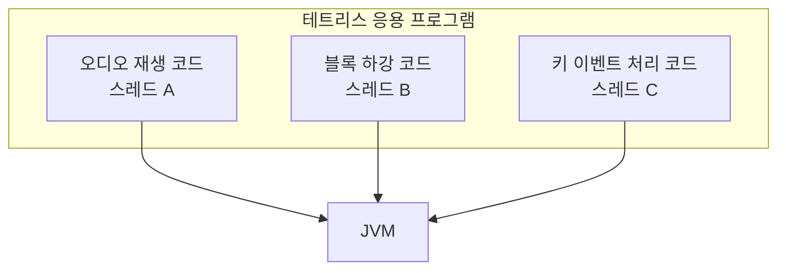
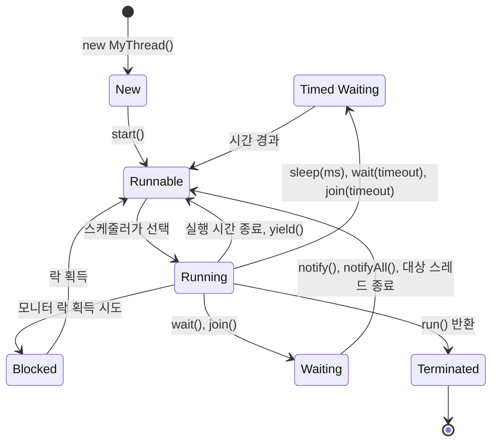

# 13강 — 스레딩

[레포지토리 안내](../../README.ko.md) | [English](Concepts_Lecture.md) | [한국어](Concepts_Lecture.ko.md)

> **최종 수정일:** 2026-10-26

> **학습 목표:**
> 1. Thread 클래스와 Runnable 인터페이스로 스레드를 생성하고 관리할 수 있다
> 2. 스레드의 생명 주기를 설명하고 sleep()과 join()으로 실행 흐름을 제어할 수 있다
> 3. 작업을 여러 스레드로 나누어 실행 시간을 줄이고, 공유 변수에서 생기는 경쟁 조건을 식별할 수 있다

---

## 목차

- [1. 멀티태스킹과 스레드](#1-멀티태스킹과-스레드)
  - [1.1 스레드란?](#11-스레드란)
  - [1.2 스레드 생명 주기](#12-스레드-생명-주기)
- [2. 스레드 생성](#2-스레드-생성)
  - [2.1 Thread 클래스 상속](#21-thread-클래스-상속)
  - [2.2 Runnable 인터페이스 구현](#22-runnable-인터페이스-구현)
  - [2.3 Thread vs. Runnable 비교](#23-thread-vs-runnable-비교)
- [3. 스레드 연산](#3-스레드-연산)
  - [3.1 sleep()](#31-sleep)
  - [3.2 join()](#32-join)
- [4. 멀티스레드 성능](#4-멀티스레드-성능)
- [요약](#요약)
- [점검 문제](#점검-문제)

---

<br>

## 1. 멀티태스킹과 스레드

### 1.1 스레드란?

**멀티태스킹(multi-tasking)** 은 하나의 응용 프로그램이 여러 작업을 동시에 처리하는 것이다. 예를 들어 테트리스 게임은 배경 음악을 재생하는 코드, 블록을 아래로 내리는 코드, 키 입력을 처리하는 코드를 동시에 실행해야 하며, 각 코드를 서로 다른 스레드가 실행한다.



*그림 1. 테트리스 프로그램의 세 스레드*

스레드는 JVM이 스케줄링하는 가장 작은 실행 단위이다. 프로그래머가 작성한 코드 가운데 하나의 실행 흐름으로 스케줄링되고 실행되는 단위가 스레드이며, 각 스레드는 자신의 호출 스택을 가진다. Java 애플리케이션은 항상 메인 스레드로 시작하며, 동시 작업을 위해 추가 스레드를 생성할 수 있다.

> **[운영체제]** 운영체제에서 스레드는 CPU를 배정받는 기본 단위이며, 어느 스레드를 어느 코어에서 언제 실행할지는 운영체제의 스케줄러가 정한다. HotSpot 같은 현재의 JVM은 Java 스레드 하나를 운영체제 스레드 하나에 대응시키므로, JVM이 스케줄링하는 Java 스레드도 실제로 CPU를 배정하는 일은 운영체제가 맡는다(Java 21에 도입된 가상 스레드는 이 대응의 예외이다). CPU의 하드웨어 스레드(코어가 동시에 실행할 수 있는 흐름)와 Java 스레드는 같은 개념이 아니며, 한 프로그램은 코어 수보다 훨씬 많은 Java 스레드를 만들 수 있다.

### 1.2 스레드 생명 주기



*그림 2. 스레드의 상태 전이*

| 상태 | 설명 |
|:------|:------------|
| **New** | 생성되었으나 아직 시작되지 않은 상태 |
| **Runnable** | 실행 준비를 마치고 CPU 시간을 기다리는 상태 |
| **Running** | 현재 실행 중인 상태 (`Thread.State`에서는 RUNNABLE에 포함) |
| **Blocked** | 모니터 락을 기다리는 상태 |
| **Waiting** | 다른 스레드를 무기한 기다리는 상태 (`wait()`, `join()`) |
| **Timed Waiting** | 지정된 시간 동안 대기하는 상태 (`sleep(ms)`, `wait(timeout)`, `join(timeout)`) |
| **Terminated** | 실행이 완료된 상태 |

*표 1. 스레드의 상태*

> **주의:** Running은 실행 대기와 실행을 구분하기 위한 개념적인 상태이다. `getState()`가 반환하는 `Thread.State` 열거형에는 NEW, RUNNABLE, BLOCKED, WAITING, TIMED_WAITING, TERMINATED의 여섯 값만 있으며, 실행 중인 스레드도 RUNNABLE로 보고된다.

---

<br>

## 2. 스레드 생성

스레드를 실행하려면 개발자는 두 가지를 한다. 먼저 스레드가 실행할 코드를 `run()` 메서드에 작성하고, 다음으로 스레드 객체를 만들어 JVM에 그 코드의 실행을 요청한다(`start()`). Java 스레드를 만드는 방법은 `java.lang.Thread` 클래스를 상속하는 방법과 `java.lang.Runnable` 인터페이스를 구현하는 방법의 두 가지이다.

### 2.1 Thread 클래스 상속

(1) `Thread`를 상속하는 클래스를 작성하고, (2) `run()` 메서드를 오버라이딩하고, (3) 스레드 객체를 생성한 뒤, (4) `start()`로 스레드를 시작한다. 다음 `TimerThread`는 1초마다 경과한 초를 출력하는 타이머이다.

```java
class TimerThread extends Thread {
    @Override
    public void run() {
        int n = 0;
        while (true) {
            System.out.println(n++);
            try {
                Thread.sleep(1000);
            } catch (InterruptedException e) {
                return;
            }
        }
    }
}

// 사용법
TimerThread timer = new TimerThread();
timer.start();
```

생성자에서 `JLabel`을 받아 `System.out.println(n++)` 대신 `timerLabel.setText(Integer.toString(n))`을 호출하면 프레임에 1초 단위 타이머가 표시된다. 이 형태의 실습 코드는 [TimerThreadDemo.java](../../Coursework/Lab13_Threading/TimerThreadDemo.java)에 있다.

> **주의:** 스레드를 시작하려면 `run()`이 아니라 `start()`를 호출해야 한다. `start()`는 새 스레드를 만들고 그 스레드에서 `run()`을 실행하지만, `run()`을 직접 호출하면 새 스레드 없이 호출한 스레드에서 일반 메서드처럼 실행된다. 또 이미 시작한 스레드 객체에 `start()`를 다시 호출하면 `IllegalThreadStateException`이 발생한다.

### 2.2 Runnable 인터페이스 구현

(1) `Runnable`을 구현하는 클래스를 작성하고, (2) `run()` 메서드를 구현하고, (3) 그 객체를 생성자에 넘겨 `Thread` 객체를 만든 뒤, (4) `start()`로 시작한다.

```java
class TimerRunnable implements Runnable {
    @Override
    public void run() {
        int n = 0;
        while (true) {
            System.out.println(n++);
            try {
                Thread.sleep(1000);
            } catch (InterruptedException e) {
                return;
            }
        }
    }
}

// 사용법
Thread thread = new Thread(new TimerRunnable());
thread.start();
```

`Runnable` 객체는 스레드가 실행할 코드만 담고, 실제 스레드는 `Thread` 객체이다. 같은 타이머를 `Runnable`로 만든 실습 코드는 [TimerRunnableDemo.java](../../Coursework/Lab13_Threading/TimerRunnableDemo.java)에 있다.

### 2.3 Thread vs. Runnable 비교

| 특징 | extends Thread | implements Runnable |
|:--------|:---------------|:--------------------|
| 상속 | 다른 클래스를 상속할 수 없음 | 다른 클래스를 상속할 수 있음 |
| 재사용성 | 강한 결합 | 느슨한 결합 |
| 유연성 | 덜 유연함 | 더 유연함 |
| 권장 사항 | 단순한 독립 스레드 | 권장되는 방식 |

*표 2. Thread 상속과 Runnable 구현의 비교*

> **핵심:** Java는 단일 상속만 지원하므로 `Runnable`을 사용하는 것이 바람직하다. `Runnable`을 사용하면 해당 클래스가 다른 클래스를 자유롭게 상속할 수 있다.

다음 `FlickeringLabel`은 `JLabel`을 상속하여 레이블로 동작하면서 `Runnable`을 구현하여 스스로 깜박인다. 이미 `JLabel`을 상속했으므로 `Thread`를 상속할 수 없고, `Runnable`을 구현해야 한다.

```java
public class FlickeringLabel extends JLabel implements Runnable {
    private long delay;

    public FlickeringLabel(String text, long delay) {
        super(text);
        this.delay = delay;
        setOpaque(true);              // 배경색이 보이게 한다
        Thread th = new Thread(this); // 자기 자신을 Runnable로 넘긴다
        th.start();
    }

    @Override
    public void run() {
        int n = 0;
        while (true) {
            if (n == 0) setBackground(Color.YELLOW);
            else        setBackground(Color.GREEN);
            n = (n == 0) ? 1 : 0;     // 노란색과 초록색을 번갈아 쓴다
            try {
                Thread.sleep(delay);
            } catch (InterruptedException e) {
                return;
            }
        }
    }
}
```

`new FlickeringLabel("Flickering", 500)`처럼 만들면 레이블의 배경이 0.5초마다 노란색과 초록색으로 바뀐다.

---

<br>

## 3. 스레드 연산

### 3.1 sleep()

`Thread.sleep()`은 현재 스레드를 지정한 밀리초 동안 일시 정지시킨다.

```java
try {
    Thread.sleep(1000); // 1초간 일시 정지
} catch (InterruptedException e) {
    Thread.currentThread().interrupt();
}
```

`sleep()`은 static 메서드이므로 어떤 스레드 객체로 호출하든 이 문장을 실행하는 현재 스레드가 멈춘다. 잠든 동안 다른 스레드가 `interrupt()`를 호출하면 `sleep()`은 검사 예외인 `InterruptedException`을 던지므로 `try-catch`로 처리해야 한다. 예외가 던져지면 스레드의 인터럽트 상태가 지워지므로, 위 코드는 `catch` 블록에서 `interrupt()`를 다시 호출하여 인터럽트가 있었다는 사실을 남긴다. 2.1절의 타이머처럼 `return`으로 `run()`을 끝내 스레드를 종료하는 방식도 있다(15강 3절).

### 3.2 join()

`join()`은 호출한 스레드가 다른 스레드의 완료를 기다린 뒤 계속 진행하게 한다.

```java
Thread worker = new Thread(task);
worker.start();
worker.join(); // 메인 스레드가 worker 완료를 기다림
System.out.println("Worker finished.");
```

`join()`을 호출한 스레드는 대상 스레드가 끝날 때까지 Waiting 상태로 기다리며, `join(long millis)`는 최대 지정한 시간까지만 기다린다. `join()`도 기다리는 동안 인터럽트되면 `InterruptedException`을 던진다.

---

<br>

## 4. 멀티스레드 성능

대규모 연산을 여러 스레드로 분할하면 멀티코어 시스템에서 실행 시간을 크게 줄일 수 있다:

```java
// 싱글 스레드: 0부터 20억까지 합산
// 멀티 스레드: 범위를 N개의 하위 범위로 나누어 스레드당 하나씩 할당
SumThread[] threads = new SumThread[NUM_THREAD];
for (int i = 0; i < NUM_THREAD; i++) {
    threads[i] = new SumThread(start, end);
    threads[i].start();
}
for (SumThread t : threads) {
    t.join();
}
```

싱글 스레드 버전은 `for (int i = 0; i < 2000000000; i++) sum += i;`로 0부터 1,999,999,999까지 더하고 `System.currentTimeMillis()`로 경과 시간을 잰다. 합은 $\frac{n(n-1)}{2}$ ($n = 2 \times 10^9$) = 1,999,999,999,000,000,000이며, `long`의 최댓값(약 $9.22 \times 10^{18}$)보다 작다. 멀티 스레드 버전은 스레드 8개를 만들고, `i`번째 스레드가 `i * (REP_TIMES / NUM_THREAD)`부터 `(i + 1) * (REP_TIMES / NUM_THREAD) - 1`까지 더하게 한다. 각 스레드는 다음과 같이 지역 변수에 부분합을 구한 뒤 공유 변수 `sum`에 더한다.

```java
public class SumThread extends Thread {
    public static long sum;   // 모든 스레드가 공유하는 합
    private int start;
    private int end;

    public SumThread(int start, int end) {
        this.start = start;
        this.end = end;
    }

    @Override
    public void run() {
        long temp = 0;
        for (int i = start; i <= end; i++)
            temp += i;        // 부분합은 지역 변수에 구한다
        sum += temp;          // 공유 변수에 더한다
    }
}
```

12코어 컴퓨터에서 실행한 예로 싱글 스레드 버전은 약 1.2초, 멀티 스레드 버전은 약 0.2초가 걸렸고 두 버전 모두 같은 합을 출력했다. 실행 시간은 컴퓨터의 코어 수와 부하에 따라 달라지며, 이 예제처럼 계산만 하는 작업은 코어 수보다 많은 스레드를 만들어도 그 이상 빨라지지 않는다. 실습 코드 [MultiThreadedSum.java](../../Coursework/Lab13_Threading/MultiThreadedSum.java)는 두 방식을 한 프로그램에서 비교한다.

> **주의:** `sum += temp`는 `sum`을 읽고, 더하고, 다시 쓰는 세 단계로 이루어진다. 두 스레드가 거의 동시에 이 문장을 실행하면 한 스레드가 쓴 값을 다른 스레드가 덮어써 더한 값 하나가 사라질 수 있다. 이처럼 결과가 스레드의 실행 순서에 따라 달라지는 상황을 **경쟁 조건(race condition)** 이라 한다. 이 예제는 각 스레드가 마지막에 한 번만 더하므로 문제가 드물게 나타날 뿐 정확성이 보장되지는 않는다. `synchronized`로 덧셈을 보호하거나(15강 4절), 부분합을 스레드마다 따로 저장해 `join()` 뒤에 메인 스레드가 더해야 한다.

> **핵심:** 스레드 생성과 동기화의 오버헤드로 인해 멀티스레딩은 충분히 큰 작업량에서만 성능 향상 효과가 있다.

---

<br>

## 요약

| 개념 | 핵심 요약 |
|:--------|:----------|
| 멀티태스킹 | 하나의 응용 프로그램이 여러 작업을 동시에 처리하는 것이며, 작업마다 스레드를 둔다. |
| 스레드 | JVM이 스케줄링하는 최소 실행 단위이며, 자체 호출 스택을 가진다. |
| 스레드 상태 | New, Runnable, Running, Blocked, Waiting, Timed Waiting, Terminated를 오가며, `Thread.State`에서는 Running이 RUNNABLE에 포함된다. |
| Thread.start() | 새 스레드를 만들어 그 스레드에서 `run()`을 호출하며, `run()`을 직접 호출하면 새 스레드가 생기지 않는다. |
| Runnable | 다른 클래스를 상속할 수 있어 스레드 동작을 정의하는 권장 방식이다. |
| sleep() | 현재 스레드를 일정 시간 동안 일시 정지하며, 인터럽트되면 `InterruptedException`을 던진다. |
| join() | 다른 스레드가 완료될 때까지 현재 스레드를 기다리게 한다. |
| 멀티스레드 합산 | 작업을 분할하여 병렬로 처리하면 빨라지지만, 공유 변수에 더하는 부분은 경쟁 조건을 막아야 한다. |

---

<br>

## 점검 문제

1. **start()와 run():** 2.1절에서 `timer.start()` 대신 `timer.run()`을 호출하면 프로그램은 어떻게 동작하는가?

   <details>
   <summary>정답</summary>

   새 스레드가 만들어지지 않고 `run()`이 메인 스레드에서 일반 메서드처럼 실행된다. `run()`은 무한 반복문이므로 메인 스레드가 그 안에서 빠져나오지 못하고, `timer.run()` 다음의 코드는 실행되지 않는다.

   </details>

2. **범위 분할:** 4절의 멀티 스레드 버전에서 `REP_TIMES`가 2,000,000,000이고 `NUM_THREAD`가 8일 때, `i = 3`인 스레드가 더하는 범위를 구하라.

   <details>
   <summary>정답</summary>

   `REP_TIMES / NUM_THREAD` = 250,000,000이므로 시작은 3 × 250,000,000 = 750,000,000이고 끝은 4 × 250,000,000 - 1 = 999,999,999이다. 여덟 스레드의 범위를 합치면 0부터 1,999,999,999까지 빠짐없이 한 번씩 덮는다.

   </details>

3. **스레드 상태:** `Thread t = new Thread(r);`로 만든 직후, `t.start()`를 호출하고 `t`가 `Thread.sleep(200)`으로 잠든 동안, `t.join()`이 반환된 뒤에 `t.getState()`는 각각 무엇을 반환하는가?

   <details>
   <summary>정답</summary>

   차례로 `NEW`, `TIMED_WAITING`, `TERMINATED`이다. 시간을 정한 `sleep()` 중인 스레드는 Timed Waiting 상태이고, `join()`이 반환되었다는 것은 `t`의 `run()`이 끝났다는 뜻이다.

   </details>

4. **경쟁 조건:** `SumThread.sum`이 100이고 두 스레드가 각각 `sum += 10`과 `sum += 20`을 거의 동시에 실행한다. 결과가 130이 아닐 수 있는 실행 순서를 하나 쓰라.

   <details>
   <summary>정답</summary>

   스레드 A가 `sum`을 읽어 100을 얻고, A가 쓰기 전에 스레드 B도 `sum`을 읽어 100을 얻는다. A가 110을 쓰고 B가 120을 쓰면 최종값은 120이 되어 A의 덧셈이 사라진다. 반대 순서로 쓰면 110이 된다. 읽고, 더하고, 쓰는 과정이 원자적이지 않기 때문이다.

   </details>

5. **Runnable의 필요성:** 2.3절의 `FlickeringLabel`을 `extends Thread`로 만들 수 없는 이유는 무엇인가?

   <details>
   <summary>정답</summary>

   `FlickeringLabel`은 화면에 표시되는 레이블이어야 하므로 이미 `JLabel`을 상속한다. Java 클래스는 하나의 클래스만 상속할 수 있으므로 `Thread`를 함께 상속할 수 없고, 대신 인터페이스인 `Runnable`을 구현하여 `new Thread(this)`로 스레드를 만든다.

   </details>
