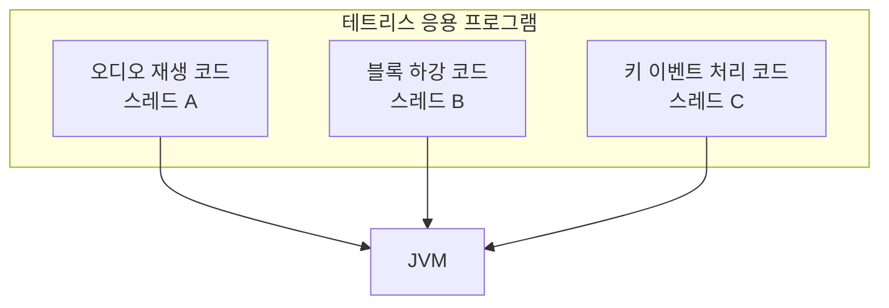
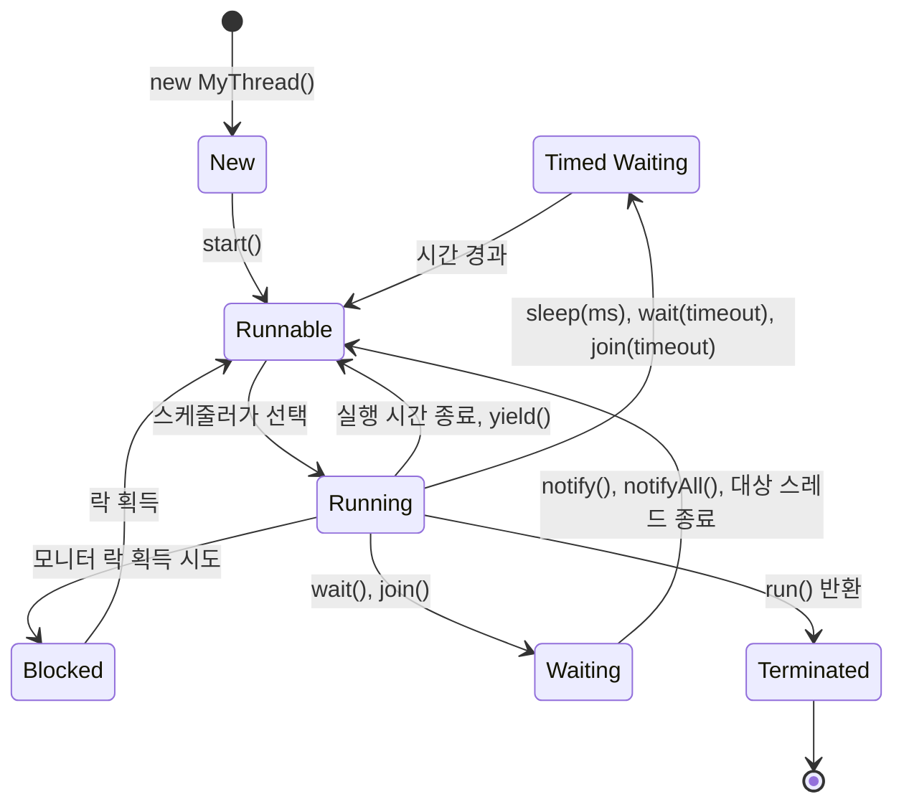
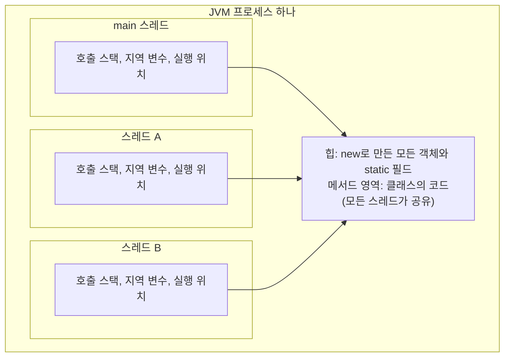

# 13강 — 스레딩

[레포지토리 안내](../../README.ko.md) | [English](Concepts_Lecture.md) | [한국어](Concepts_Lecture.ko.md)

> **최종 수정일:** 2026-11-19

> **학습 목표:**
> 1. Thread 클래스와 Runnable 인터페이스로 스레드를 생성하고 관리할 수 있다
> 2. 스레드의 생명 주기를 설명하고 sleep()과 join()으로 실행 흐름을 제어할 수 있다
> 3. 작업을 여러 스레드로 나누어 실행 시간을 줄이고, 공유 변수에서 생기는 경쟁 조건을 식별할 수 있다
> 4. 실행 중인 스레드의 상태를 관찰하고 스레드의 실행 순서가 정해지지 않는다는 사실을 실행 결과로 설명할 수 있다
> 5. 경쟁 조건이 일어나는 과정을 단계별로 추적하고 동기화, 원자적 변수, 부분합으로 바로잡을 수 있다

---

## 목차

- [1. 멀티태스킹과 스레드](#1-멀티태스킹과-스레드)
  - [1.1 스레드의 개념](#11-스레드의-개념)
  - [1.2 스레드 생명 주기](#12-스레드-생명-주기)
  - [1.3 프로세스와 스레드](#13-프로세스와-스레드)
  - [1.4 스레드 상태의 관찰](#14-스레드-상태의-관찰)
  - [1.5 동시성과 병렬성](#15-동시성과-병렬성)
  - [1.6 스레드를 만드는 비용](#16-스레드를-만드는-비용)
- [2. 스레드 생성](#2-스레드-생성)
  - [2.1 Thread 클래스 상속](#21-thread-클래스-상속)
  - [2.2 Runnable 인터페이스 구현](#22-runnable-인터페이스-구현)
  - [2.3 Thread vs. Runnable 비교](#23-thread-vs-runnable-비교)
  - [2.4 람다로 만드는 스레드와 스레드 이름](#24-람다로-만드는-스레드와-스레드-이름)
  - [2.5 start()와 run()의 차이](#25-start와-run의-차이)
  - [2.6 실행 순서의 비결정성](#26-실행-순서의-비결정성)
  - [2.7 독립적으로 깜박이는 레이블](#27-독립적으로-깜박이는-레이블)
  - [2.8 Thread 클래스의 주요 메서드](#28-thread-클래스의-주요-메서드)
  - [2.9 스레드에 입력을 주고 결과를 받는 방법](#29-스레드에-입력을-주고-결과를-받는-방법)
- [3. 스레드 연산](#3-스레드-연산)
  - [3.1 sleep()](#31-sleep)
  - [3.2 join()](#32-join)
  - [3.3 join()으로 결과 기다리기](#33-join으로-결과-기다리기)
  - [3.4 데몬 스레드](#34-데몬-스레드)
  - [3.5 sleep()의 정확도와 yield()](#35-sleep의-정확도와-yield)
- [4. 멀티스레드 성능](#4-멀티스레드-성능)
  - [4.1 스레드 수에 따른 실행 시간](#41-스레드-수에-따른-실행-시간)
  - [4.2 경쟁 조건의 관찰](#42-경쟁-조건의-관찰)
  - [4.3 경쟁 조건을 없앤 합산](#43-경쟁-조건을-없앤-합산)
  - [4.4 스레드에서 발생한 예외](#44-스레드에서-발생한-예외)
- [5. 흔한 실수](#5-흔한-실수)
- [요약](#요약)
- [점검 문제](#점검-문제)
- [참고 문헌](#참고-문헌)

---

<br>

## 1. 멀티태스킹과 스레드

### 1.1 스레드의 개념

**멀티태스킹(multi-tasking)** 은 하나의 응용 프로그램이 여러 작업을 동시에 처리하는 것이다. 예를 들어 테트리스 게임은 배경 음악을 재생하는 코드, 블록을 아래로 내리는 코드, 키 입력을 처리하는 코드를 동시에 실행해야 하며, 각 코드를 서로 다른 스레드가 실행한다.



*그림 1. 테트리스 프로그램의 세 스레드*

스레드는 JVM이 스케줄링하는 가장 작은 실행 단위이다. 프로그래머가 작성한 코드 가운데 하나의 실행 흐름으로 스케줄링되고 실행되는 단위가 스레드이며, 각 스레드는 자신의 호출 스택을 가진다. Java 애플리케이션은 항상 메인 스레드로 시작하며, 동시 작업을 위해 추가 스레드를 생성할 수 있다.

> **[운영체제]** 운영체제에서 스레드는 CPU를 배정받는 기본 단위이며, 어느 스레드를 어느 코어에서 언제 실행할지는 운영체제의 스케줄러가 정한다. HotSpot 같은 현재의 JVM은 Java 스레드 하나를 운영체제 스레드 하나에 대응시키므로, JVM이 스케줄링하는 Java 스레드도 실제로 CPU를 배정하는 일은 운영체제가 맡는다(Java 21에 도입된 가상 스레드는 이 대응의 예외이다). CPU의 하드웨어 스레드(코어가 동시에 실행할 수 있는 흐름)와 Java 스레드는 같은 개념이 아니며, 한 프로그램은 코어 수보다 훨씬 많은 Java 스레드를 만들 수 있다.

### 1.2 스레드 생명 주기



*그림 2. 스레드의 상태 전이*

| 상태 | 설명 |
|:------|:------------|
| **New** | 생성되었으나 아직 시작되지 않은 상태 |
| **Runnable** | 실행 준비를 마치고 CPU 시간을 기다리는 상태 |
| **Running** | 현재 실행 중인 상태 (`Thread.State`에서는 RUNNABLE에 포함) |
| **Blocked** | 모니터 락을 기다리는 상태 |
| **Waiting** | 다른 스레드를 무기한 기다리는 상태 (`wait()`, `join()`) |
| **Timed Waiting** | 지정된 시간 동안 대기하는 상태 (`sleep(ms)`, `wait(timeout)`, `join(timeout)`) |
| **Terminated** | 실행이 완료된 상태 |

*표 1. 스레드의 상태*

> **주의:** Running은 실행 대기와 실행을 구분하기 위한 개념적인 상태이다. `getState()`가 반환하는 `Thread.State` 열거형에는 NEW, RUNNABLE, BLOCKED, WAITING, TIMED_WAITING, TERMINATED의 여섯 값만 있으며, 실행 중인 스레드도 RUNNABLE로 보고된다.

### 1.3 프로세스와 스레드

**프로세스(process)** 는 실행 중인 프로그램 하나이며, 운영체제로부터 자기만의 메모리 공간을 받는다. `java MyProgram`을 실행하면 JVM 프로세스 하나가 만들어진다. 스레드는 프로세스 안에서 실행되는 흐름이며, 한 프로세스의 스레드들은 그 프로세스의 메모리를 함께 쓴다. Java 프로그램에서 스레드가 공유하는 것과 따로 가지는 것은 다음과 같다.



*그림 3. 한 프로세스 안에서 스레드가 공유하는 영역과 따로 가지는 영역*

메서드의 지역 변수와 매개변수는 그 메서드를 실행하는 스레드의 호출 스택에 놓이므로, 두 스레드가 같은 메서드를 동시에 실행해도 서로의 지역 변수에 영향을 주지 않는다. 반면 객체의 필드와 static 필드는 힙에 하나만 있으므로, 여러 스레드가 같은 객체를 참조하면 그 필드를 함께 읽고 쓴다. 4절의 `SumThread`가 부분합을 지역 변수 `temp`에 구하고 마지막에만 공유 변수 `sum`에 더한 것은 이 차이 때문이며, 경쟁 조건(4.2절)은 항상 공유되는 쪽에서 생긴다.

스레드는 같은 메모리를 쓰므로 프로세스 사이보다 훨씬 가볍게 데이터를 주고받을 수 있다. 같은 이유로 한 스레드의 잘못된 쓰기가 다른 스레드의 데이터를 망가뜨릴 수 있으며, 이를 막는 것이 15강의 동기화이다.

### 1.4 스레드 상태의 관찰

1.2절의 상태는 `getState()`로 실제로 관찰할 수 있다. 다음 프로그램은 스레드를 하나씩 원하는 상태에 두고 그 순간의 상태를 출력한다.

```java
public class States {
    static final Object lock = new Object();

    public static void main(String[] args) throws Exception {
        Thread sleeper = new Thread(() -> {
            try { Thread.sleep(300); } catch (InterruptedException e) { }
        }, "sleeper");
        System.out.println("after new:       " + sleeper.getState());
        sleeper.start();
        System.out.println("after start:     " + sleeper.getState());
        Thread.sleep(100);
        System.out.println("while sleeping:  " + sleeper.getState());

        Thread waiter = new Thread(() -> {
            try { sleeper.join(); } catch (InterruptedException e) { }   // sleeper가 끝나기를 기다린다
        }, "waiter");
        waiter.start();
        Thread.sleep(50);
        System.out.println("waiter joining:  " + waiter.getState());

        Thread blocked;
        synchronized (lock) {                                             // main이 락을 쥔다
            blocked = new Thread(() -> { synchronized (lock) { } }, "blocked");
            blocked.start();
            Thread.sleep(50);
            System.out.println("lock held:       " + blocked.getState());
        }
        sleeper.join();
        waiter.join();
        blocked.join();
        System.out.println("after join:      " + sleeper.getState() + " " + waiter.getState() + " " + blocked.getState());
    }
}
```

```text
after new:       NEW
after start:     RUNNABLE
while sleeping:  TIMED_WAITING
waiter joining:  WAITING
lock held:       BLOCKED
after join:      TERMINATED TERMINATED TERMINATED
```

1. `sleeper`는 만들어진 직후 `NEW`이고, `start()`를 호출한 직후 `RUNNABLE`이다. 실행 기회를 얻었는지와 관계없이 시작된 스레드는 RUNNABLE로 보고된다(1.2절의 주의 상자).
2. 100밀리초 뒤의 `sleeper`는 `sleep(300)` 안에 있으므로 시간을 정한 대기인 `TIMED_WAITING`이다.
3. `waiter`는 시간을 정하지 않은 `join()`으로 `sleeper`를 기다리므로 `WAITING`이다.
4. `blocked`는 main이 쥐고 있는 `lock`의 모니터 락을 얻으려고 `synchronized (lock)`에 들어가려다 멈추었으므로 `BLOCKED`이다(15강 4.1절). main이 `synchronized` 블록을 나와 락을 놓으면 `blocked`는 락을 얻어 실행을 이어 간다.
5. 세 스레드의 `run()`이 모두 끝나면 `TERMINATED`이다.

`Thread.State`의 여섯 값이 모두 나타났다. 각 상태의 뜻은 API 문서가 정하며 [1], 상태는 JVM이 관찰한 그 순간의 값일 뿐 다음 순간에는 바뀌어 있을 수 있으므로, 상태를 보고 동기화를 대신하는 코드를 쓰지 않는다.

### 1.5 동시성과 병렬성

여러 작업을 동시에 처리한다는 말에는 두 가지 뜻이 있다. **동시성(concurrency)** 은 여러 작업이 시작되어 끝나기 전까지의 기간이 서로 겹치는 성질이다. 코어가 하나뿐이어도 운영체제가 짧은 시간 단위(타임 슬라이스)로 스레드를 번갈아 실행하면 사용자에게는 작업들이 동시에 진행되는 것처럼 보인다. **병렬성(parallelism)** 은 여러 작업이 같은 순간에 서로 다른 코어에서 실제로 함께 실행되는 성질이다.

```text
코어 1개에서의 동시성 (번갈아 실행)
코어 1: [A][B][A][B][A][B][A][B]   → 시간

코어 2개에서의 병렬성 (함께 실행)
코어 1: [A][A][A][A]               → 시간
코어 2: [B][B][B][B]
```

*그림 4. 코어 하나에서 번갈아 실행하는 동시성과 코어 두 개에서 함께 실행하는 병렬성*

1.1절의 테트리스 프로그램이 필요로 하는 것은 동시성이다. 음악 재생, 블록 하강, 키 입력 처리는 각각 매우 짧은 계산만 하고 대부분의 시간을 기다리며 보내므로, 코어가 하나여도 번갈아 실행하면 충분하다. 4절의 합산이 필요로 하는 것은 병렬성이다. 계산만 하는 작업은 코어가 하나이면 번갈아 실행해도 전체 시간이 줄지 않으며, 코어 여러 개가 함께 실행해야 빨라진다(4.1절). 스레드는 두 가지 목적에 모두 쓰이지만, 프로그램이 얻으려는 것이 응답성인지 처리 속도인지에 따라 스레드의 수와 구성이 달라진다.

### 1.6 스레드를 만드는 비용

스레드는 공짜가 아니다. 스레드를 하나 만들 때마다 JVM은 운영체제의 스레드와 호출 스택을 위한 메모리를 마련하고, 시작하고 끝낼 때 운영체제와 정보를 주고받는다. 다음 프로그램은 매우 작은 작업을 10,000번 실행하는데, 한 번은 같은 스레드에서 메서드로 부르고, 한 번은 작업마다 새 스레드를 만들어 실행한다.

```java
public class ThreadCost {
    static volatile long sink;

    public static void main(String[] args) throws InterruptedException {
        final int N = 10_000;
        Runnable tiny = () -> { sink += 1; };

        long t0 = System.nanoTime();
        for (int i = 0; i < N; i++) tiny.run();               // 같은 스레드에서 호출
        long direct = System.nanoTime() - t0;

        t0 = System.nanoTime();
        for (int i = 0; i < N; i++) {
            Thread t = new Thread(tiny);                       // 작업마다 스레드를 만든다
            t.start();
            t.join();
        }
        long threads = System.nanoTime() - t0;

        System.out.printf("direct calls:        %8.2f ms (%.3f us each)%n", direct / 1e6, direct / 1e3 / N);
        System.out.printf("new thread per call: %8.2f ms (%.3f us each)%n", threads / 1e6, threads / 1e3 / N);
    }
}
```

```text
direct calls:            0.19 ms (0.019 us each)
new thread per call:   382.78 ms (38.278 us each)
```

시간은 컴퓨터마다 다르지만, 이 실행에서 같은 작업이 메서드 호출로는 한 번에 0.02마이크로초가 걸렸고, 스레드를 만들고 시작하고 끝나기를 기다리는 데는 한 번에 약 38마이크로초, 즉 약 2,000배가 걸렸다. 그러므로 스레드 하나가 맡는 작업은 스레드를 만드는 비용보다 충분히 커야 한다. 4절의 합산이 스레드마다 2억 개 이상의 덧셈을 맡기는 것도, 4절의 핵심 상자가 충분히 큰 작업량에서만 효과가 있다고 한 것도 이 때문이다. 작은 작업이 많을 때는 스레드를 미리 몇 개 만들어 두고 작업을 차례로 맡기는 스레드 풀을 쓴다(15강 5절의 참고 상자).

---

<br>

## 2. 스레드 생성

스레드를 실행하려면 개발자는 두 가지를 한다. 먼저 스레드가 실행할 코드를 `run()` 메서드에 작성하고, 다음으로 스레드 객체를 만들어 JVM에 그 코드의 실행을 요청한다(`start()`). Java 스레드를 만드는 방법은 `java.lang.Thread` 클래스를 상속하는 방법과 `java.lang.Runnable` 인터페이스를 구현하는 방법의 두 가지이다.

### 2.1 Thread 클래스 상속

(1) `Thread`를 상속하는 클래스를 작성하고, (2) `run()` 메서드를 오버라이딩하고, (3) 스레드 객체를 생성한 뒤, (4) `start()`로 스레드를 시작한다. 다음 `TimerThread`는 1초마다 경과한 초를 출력하는 타이머이다.

```java
class TimerThread extends Thread {
    @Override
    public void run() {
        int n = 0;
        while (true) {
            System.out.println(n++);
            try {
                Thread.sleep(1000);
            } catch (InterruptedException e) {
                return;
            }
        }
    }
}

// 사용법
TimerThread timer = new TimerThread();
timer.start();
```

생성자에서 `JLabel`을 받아 `System.out.println(n++)` 대신 `timerLabel.setText(Integer.toString(n))`을 호출하면 프레임에 1초 단위 타이머가 표시된다. 이 형태의 실습 코드는 [TimerThreadDemo.java](../../Coursework/Lab13_Threading/TimerThreadDemo.java)에 있다.

> **주의:** 스레드를 시작하려면 `run()`이 아니라 `start()`를 호출해야 한다. `start()`는 새 스레드를 만들고 그 스레드에서 `run()`을 실행하지만, `run()`을 직접 호출하면 새 스레드 없이 호출한 스레드에서 일반 메서드처럼 실행된다. 또 이미 시작한 스레드 객체에 `start()`를 다시 호출하면 `IllegalThreadStateException`이 발생한다.

### 2.2 Runnable 인터페이스 구현

(1) `Runnable`을 구현하는 클래스를 작성하고, (2) `run()` 메서드를 구현하고, (3) 그 객체를 생성자에 넘겨 `Thread` 객체를 만든 뒤, (4) `start()`로 시작한다.

```java
class TimerRunnable implements Runnable {
    @Override
    public void run() {
        int n = 0;
        while (true) {
            System.out.println(n++);
            try {
                Thread.sleep(1000);
            } catch (InterruptedException e) {
                return;
            }
        }
    }
}

// 사용법
Thread thread = new Thread(new TimerRunnable());
thread.start();
```

`Runnable` 객체는 스레드가 실행할 코드만 담고, 실제 스레드는 `Thread` 객체이다. 같은 타이머를 `Runnable`로 만든 실습 코드는 [TimerRunnableDemo.java](../../Coursework/Lab13_Threading/TimerRunnableDemo.java)에 있다.

### 2.3 Thread vs. Runnable 비교

| 특징 | extends Thread | implements Runnable |
|:--------|:---------------|:--------------------|
| 상속 | 다른 클래스를 상속할 수 없음 | 다른 클래스를 상속할 수 있음 |
| 재사용성 | 강한 결합 | 느슨한 결합 |
| 유연성 | 덜 유연함 | 더 유연함 |
| 권장 사항 | 단순한 독립 스레드 | 권장되는 방식 |

*표 2. Thread 상속과 Runnable 구현의 비교*

> **핵심:** Java는 단일 상속만 지원하므로 `Runnable`을 사용하는 것이 바람직하다. `Runnable`을 사용하면 해당 클래스가 다른 클래스를 자유롭게 상속할 수 있다.

다음 `FlickeringLabel`은 `JLabel`을 상속하여 레이블로 동작하면서 `Runnable`을 구현하여 스스로 깜박인다. 이미 `JLabel`을 상속했으므로 `Thread`를 상속할 수 없고, `Runnable`을 구현해야 한다.

```java
public class FlickeringLabel extends JLabel implements Runnable {
    private long delay;

    public FlickeringLabel(String text, long delay) {
        super(text);
        this.delay = delay;
        setOpaque(true);              // 배경색이 보이게 한다
        Thread th = new Thread(this); // 자기 자신을 Runnable로 넘긴다
        th.start();
    }

    @Override
    public void run() {
        int n = 0;
        while (true) {
            if (n == 0) setBackground(Color.YELLOW);
            else        setBackground(Color.GREEN);
            n = (n == 0) ? 1 : 0;     // 노란색과 초록색을 번갈아 쓴다
            try {
                Thread.sleep(delay);
            } catch (InterruptedException e) {
                return;
            }
        }
    }
}
```

`new FlickeringLabel("Flickering", 500)`처럼 만들면 레이블의 배경이 0.5초마다 노란색과 초록색으로 바뀐다.

### 2.4 람다로 만드는 스레드와 스레드 이름

`Runnable`은 추상 메서드가 `run()` 하나뿐인 함수형 인터페이스이므로, 12강 5.4절처럼 람다식으로 구현할 수 있다. 실행할 코드가 짧으면 클래스를 따로 만들지 않고 스레드를 만드는 자리에서 바로 쓴다.

```java
Thread t = new Thread(() -> System.out.println("hello from " + Thread.currentThread().getName()),
                      "worker-1");
t.start();
```

생성자의 두 번째 인자는 스레드의 이름이다. 이름을 주지 않으면 JVM이 `Thread-0`, `Thread-1`처럼 자동으로 이름을 붙인다. 스레드가 여럿인 프로그램에서 로그나 오류 메시지를 읽을 때 어느 스레드에서 일어난 일인지 알 수 있도록, 역할을 나타내는 이름을 붙이는 것이 좋다. 이름은 `setName()`으로 바꾸고 `getName()`으로 읽는다.

람다 안에서 바깥의 지역 변수를 쓸 때는 그 변수가 사실상 final이어야 한다(12강 5.9절). 반복문의 변수 `i`를 바로 쓸 수 없는 것도 이 때문이며, 4.3절의 `SumCompare`처럼 `final int id = k;` 같은 새 변수에 복사하여 넘긴다.

### 2.5 start()와 run()의 차이

2.1절의 주의 상자에서 `run()`을 직접 호출하면 새 스레드가 만들어지지 않는다고 했다. 스레드의 이름을 출력하면 그 차이가 드러난다.

```java
public class StartVsRun {
    public static void main(String[] args) throws InterruptedException {
        Runnable task = () -> System.out.println("task runs on " + Thread.currentThread().getName());
        Thread t = new Thread(task, "worker-1");

        t.run();                         // 일반 메서드 호출
        t.start();                       // 새 스레드에서 실행
        t.join();
        try {
            t.start();
        } catch (IllegalThreadStateException e) {
            System.out.println("second start(): IllegalThreadStateException");
        }
    }
}
```

```text
task runs on main
task runs on worker-1
second start(): IllegalThreadStateException
```

`t.run()`은 `Runnable`의 `run()`을 일반 메서드처럼 호출하므로, 작업이 호출한 스레드인 main에서 실행된다. `t.start()`는 JVM에 새 스레드를 만들어 달라고 요청하고 바로 반환하며, 새 스레드 `worker-1`이 작업을 실행한다. 한 번 시작하여 끝난 스레드 객체는 다시 시작할 수 없으므로, 두 번째 `start()`는 `IllegalThreadStateException`을 던진다. 같은 작업을 다시 실행하려면 새 `Thread` 객체를 만든다.

### 2.6 실행 순서의 비결정성

두 스레드를 시작하면 어느 스레드가 언제 얼마 동안 실행될지는 스케줄러가 정하며, 프로그램은 그 순서를 알 수 없다. 다음 프로그램은 두 스레드가 각각 `A`와 `B`를 12번씩 공유 버퍼에 덧붙이고, 마지막에 버퍼의 내용을 출력한다. 같은 프로그램을 세 번 실행한 결과는 다음과 같다.

```java
public class Interleave {
    static final StringBuffer trace = new StringBuffer();   // 스레드 안전한 문자열 버퍼

    public static void main(String[] args) throws InterruptedException {
        Runnable a = () -> { for (int i = 0; i < 12; i++) { trace.append('A'); spin(); } };
        Runnable b = () -> { for (int i = 0; i < 12; i++) { trace.append('B'); spin(); } };
        Thread ta = new Thread(a), tb = new Thread(b);
        ta.start();
        tb.start();
        ta.join();
        tb.join();
        System.out.println(trace);
    }

    static void spin() {                                     // 잠깐 계산하며 시간을 보낸다
        long x = 0;
        for (int i = 0; i < 200_000; i++) x += i;
        if (x == 42) System.out.println();
    }
}
```

```text
ABBABAABABABABABABABABAB
ABABBABABABABABABABABABA
ABABBABABABABABABABABABA
```

세 실행 모두 `A`와 `B`가 12개씩이지만, 첫 번째 실행은 세 번째 글자부터 순서가 다르다. 두 번째와 세 번째 실행은 우연히 같았을 뿐 다음 실행에서 같다는 보장은 없다. 이처럼 같은 입력으로 실행해도 스레드 사이의 실행 순서와 결과가 달라질 수 있는 성질을 **비결정성(nondeterminism)** 이라 한다. 스레드가 하나인 프로그램은 같은 입력에 대해 항상 같은 순서로 실행되므로 디버깅할 때 오류를 다시 만들어 볼 수 있지만, 멀티스레드 프로그램의 오류는 특정한 순서에서만 나타나므로 다시 만들어 보기가 어렵다. 그래서 멀티스레드 코드는 몇 번 실행해 결과가 맞는 것으로 정확성을 판단하지 않고, 모든 가능한 순서에서 결과가 맞도록 설계해야 한다.

버퍼로 `StringBuffer`를 쓴 이유는 `append()`가 동기화되어 있어서 두 스레드가 동시에 호출해도 글자가 사라지지 않기 때문이다. 동기화되지 않은 `StringBuilder`를 쓰면 글자가 사라지거나 예외가 날 수 있다.

### 2.7 독립적으로 깜박이는 레이블

2.3절의 `FlickeringLabel`은 레이블마다 스레드를 하나씩 가지므로, 여러 개를 만들면 각자 독립적으로 깜박인다. 다음 프레임은 0.5초마다 깜박이는 레이블, 깜박이지 않는 일반 레이블, 0.3초마다 깜박이는 레이블을 차례로 놓는다.

```java
Container c = getContentPane();
c.setLayout(new FlowLayout());
FlickeringLabel fLabel = new FlickeringLabel("Blink", 500);
JLabel label = new JLabel("No blink");
FlickeringLabel fLabel2 = new FlickeringLabel("Blink independently", 300);
c.add(fLabel);
c.add(label);
c.add(fLabel2);
setSize(300, 150);
setVisible(true);
```

이 프로그램에는 main 스레드와 EDT 외에 두 `FlickeringLabel`의 스레드 두 개가 더 있다. 각 스레드는 자기 레이블의 배경색을 바꾼 뒤 자신의 지연 시간만큼 잠들므로, 두 레이블의 깜박임은 서로 영향을 주지 않으며 가운데의 일반 레이블은 바뀌지 않는다. 이론상으로는 0.5초와 0.3초의 최소공배수인 1.5초마다 두 레이블이 같은 순간에 색을 바꾸지만, 실제로는 `sleep()`의 오차가 쌓여 조금씩 어긋난다.

> **참고:** **Swing의 타이머.** `FlickeringLabel`의 스레드는 EDT가 아닌 곳에서 `setBackground()`를 호출하므로, 12강 5.7절의 원칙에 비추어 엄밀하게는 안전하지 않다. 일정한 간격으로 화면을 바꾸는 작업은 `javax.swing.Timer`로 만들 수 있다. `new Timer(500, e -> 색 바꾸기).start()`처럼 만들면 타이머가 0.5초마다 액션 이벤트를 EDT에서 발생시키므로, 스레드를 만들지 않고도 같은 효과를 안전하게 얻는다.

### 2.8 Thread 클래스의 주요 메서드

| 메서드 | 종류 | 하는 일 |
|:-----|:-----|:-----|
| `start()` | 인스턴스 | 새 스레드를 만들어 `run()`을 실행하게 한다 (한 번만 호출할 수 있다) |
| `run()` | 인스턴스 | 스레드가 실행할 코드이며, 오버라이딩하거나 `Runnable`로 넘긴다 |
| `join()`, `join(ms)` | 인스턴스 | 이 스레드가 끝날 때까지(또는 최대 ms 동안) 호출한 스레드를 기다리게 한다 |
| `isAlive()` | 인스턴스 | 시작되었고 아직 끝나지 않았으면 `true`를 반환한다 |
| `interrupt()` | 인스턴스 | 이 스레드에 인터럽트를 건다 (15강 3.2절) |
| `getName()`, `setName()` | 인스턴스 | 스레드의 이름을 읽거나 바꾼다 |
| `threadId()` | 인스턴스 | 스레드의 고유 번호를 반환한다 (예전 이름은 `getId()`) |
| `getState()` | 인스턴스 | 현재 상태를 `Thread.State`로 반환한다 |
| `getPriority()`, `setPriority()` | 인스턴스 | 우선순위를 읽거나 바꾼다 (15강 2절) |
| `setDaemon()`, `isDaemon()` | 인스턴스 | 데몬 여부를 정하거나 읽는다 (시작 전에만 정할 수 있다) |
| `currentThread()` | static | 이 문장을 실행하는 스레드의 `Thread` 객체를 반환한다 |
| `sleep(ms)` | static | 현재 스레드를 ms 동안 잠재운다 (3.1절) |
| `yield()` | static | 현재 스레드가 실행을 다른 스레드에 양보할 뜻이 있음을 스케줄러에 알린다 (3.5절) |

*표 3. Thread 클래스의 주요 메서드*

static 메서드는 어떤 `Thread` 객체로 호출하든 이 문장을 실행하는 현재 스레드에 작용한다. 예를 들어 main에서 `worker.sleep(1000)`이라고 써도 잠드는 것은 `worker`가 아니라 main이다. 이런 오해를 막기 위해 static 메서드는 `Thread.sleep(1000)`처럼 클래스 이름으로 호출한다.

### 2.9 스레드에 입력을 주고 결과를 받는 방법

`run()`은 매개변수가 없고 반환 타입이 `void`이므로, 스레드에 입력을 주고 결과를 받으려면 다른 통로가 필요하다. 가장 단순한 방법은 입력을 생성자로 받아 필드에 두고, 결과도 필드에 저장해 두었다가 `join()` 뒤에 읽는 것이다.

```java
public class PassData {
    static class WordCounter extends Thread {
        private final String text;                             // 생성자로 받은 입력
        private int count;                                     // 결과를 담는 필드

        WordCounter(String name, String text) {
            super(name);
            this.text = text;
        }

        @Override
        public void run() {
            count = text.isBlank() ? 0 : text.trim().split("\\s+").length;
        }

        int getCount() { return count; }
    }

    public static void main(String[] args) throws InterruptedException {
        String[] parts = {
            "to be or not to be",
            "that is the question",
            "   ",
            "whether tis nobler in the mind to suffer"
        };
        WordCounter[] workers = new WordCounter[parts.length];
        for (int i = 0; i < parts.length; i++) {
            workers[i] = new WordCounter("counter-" + i, parts[i]);
            workers[i].start();
        }
        int total = 0;
        for (WordCounter w : workers) {
            w.join();
            System.out.println(w.getName() + ": " + w.getCount());
            total += w.getCount();
        }
        System.out.println("total: " + total);
    }
}
```

```text
counter-0: 6
counter-1: 4
counter-2: 0
counter-3: 8
total: 18
```

`WordCounter`는 생성자로 받은 문자열을 `final` 필드 `text`에 두고, `run()`에서 공백을 기준으로 나눈 단어 수를 필드 `count`에 저장한다. `split("\\s+")`의 `\\s+`는 하나 이상의 공백 문자를 뜻하는 정규 표현식이다. 빈칸만 있는 세 번째 문자열은 `isBlank()`가 `true`이므로 0으로 처리한다. main은 네 스레드를 모두 시작한 뒤 차례로 `join()`하고 나서 `getCount()`로 결과를 읽으며, 3.3절의 보장에 따라 각 스레드가 저장한 값이 보인다. 스레드마다 자기 객체의 필드에만 쓰므로 4.3절의 부분합처럼 동기화가 필요 없다. 네 결과 6, 4, 0, 8의 합은 18이다.

> **참고:** **Callable과 Future.** `java.util.concurrent.Callable<V>`는 값을 반환하고 검사 예외를 던질 수 있는 `call()`을 가진 인터페이스이다. 스레드 풀(`ExecutorService`)에 `Callable`을 맡기면 결과를 나중에 받을 수 있는 `Future<V>`가 돌아오며, `future.get()`이 작업이 끝날 때까지 기다린 뒤 결과를 반환한다. 결과를 담는 필드와 `join()`을 직접 관리하지 않아도 되므로, 결과가 필요한 작업이 많을 때 쓰인다(15강 5절).

---

<br>

## 3. 스레드 연산

### 3.1 sleep()

`Thread.sleep()`은 현재 스레드를 지정한 밀리초 동안 일시 정지시킨다.

```java
try {
    Thread.sleep(1000); // 1초간 일시 정지
} catch (InterruptedException e) {
    Thread.currentThread().interrupt();
}
```

`sleep()`은 static 메서드이므로 어떤 스레드 객체로 호출하든 이 문장을 실행하는 현재 스레드가 멈춘다. 잠든 동안 다른 스레드가 `interrupt()`를 호출하면 `sleep()`은 검사 예외인 `InterruptedException`을 던지므로 `try-catch`로 처리해야 한다. 예외가 던져지면 스레드의 인터럽트 상태가 지워지므로, 위 코드는 `catch` 블록에서 `interrupt()`를 다시 호출하여 인터럽트가 있었다는 사실을 남긴다. 2.1절의 타이머처럼 `return`으로 `run()`을 끝내 스레드를 종료하는 방식도 있다(15강 3절).

### 3.2 join()

`join()`은 호출한 스레드가 다른 스레드의 완료를 기다린 뒤 계속 진행하게 한다.

```java
Thread worker = new Thread(task);
worker.start();
worker.join(); // 메인 스레드가 worker 완료를 기다림
System.out.println("Worker finished.");
```

`join()`을 호출한 스레드는 대상 스레드가 끝날 때까지 Waiting 상태로 기다리며, `join(long millis)`는 최대 지정한 시간까지만 기다린다. `join()`도 기다리는 동안 인터럽트되면 `InterruptedException`을 던진다.

### 3.3 join()으로 결과 기다리기

`join()`은 다른 스레드가 계산한 결과를 안전하게 읽기 위해서도 필요하다. 다음 프로그램의 작업자 스레드는 1부터 100까지 더한 뒤 0.3초 쉬고 결과를 static 필드에 쓴다.

```java
public class JoinDemo {
    static long result;                                      // 작업자가 쓰는 결과

    public static void main(String[] args) throws InterruptedException {
        Thread worker = new Thread(() -> {
            long s = 0;
            for (int i = 1; i <= 100; i++) s += i;
            try { Thread.sleep(300); } catch (InterruptedException e) { }
            result = s;
        });
        worker.start();

        worker.join(100);                                    // 최대 100ms만 기다린다
        System.out.println("after join(100): alive=" + worker.isAlive() + ", result=" + result);
        worker.join();                                       // 끝날 때까지 기다린다
        System.out.println("after join():    alive=" + worker.isAlive() + ", result=" + result);
    }
}
```

```text
after join(100): alive=true, result=0
after join():    alive=false, result=5050
```

`join(100)`은 최대 100밀리초만 기다리고 반환하므로, 그때 작업자는 아직 살아 있고(`isAlive()`가 `true`) 결과는 초깃값 0이다. 시간 제한이 있는 `join`이 반환되었다고 해서 대상 스레드가 끝났다는 뜻은 아니므로, 반환 뒤에 `isAlive()`로 확인해야 한다. 시간 제한이 없는 `join()`은 작업자가 끝날 때까지 기다리며, 반환된 뒤에는 작업자가 쓴 5050을 읽을 수 있다.

`join()`에는 기다리는 것 외의 역할도 있다. 한 스레드가 필드에 쓴 값을 다른 스레드가 언제 보게 되는지는 일반적으로 보장되지 않지만, Java 메모리 모델은 스레드 안의 모든 동작이 다른 스레드가 그 스레드의 `join()`에서 반환되기 전에 일어난다고 정한다 [2]. 그래서 `join()` 뒤에 읽은 `result`는 작업자가 쓴 최신 값이다. 4절과 4.3절의 합산 프로그램이 모든 스레드를 `join()`한 뒤에 결과를 모으는 것도 이 보장에 기댄다.

### 3.4 데몬 스레드

JVM은 시작된 스레드 가운데 **데몬 스레드(daemon thread)** 가 아닌 스레드가 모두 끝나면 종료 절차를 시작한다 [3]. 데몬 스레드는 다른 스레드를 돕는 보조 작업(가비지 컬렉션, 주기적인 감시, 로그 정리 등)을 맡는 스레드로, 데몬이 아닌 스레드가 모두 끝나면 실행 중이라도 JVM과 함께 끝난다. 새 스레드는 자신을 만든 스레드의 데몬 여부를 물려받으며, 시작하기 전에 `setDaemon(true)`로 바꿀 수 있다.

```java
public class Daemon {
    public static void main(String[] args) throws InterruptedException {
        Thread ticker = new Thread(() -> {
            int n = 0;
            while (true) {
                System.out.println("tick " + n++);
                try { Thread.sleep(100); } catch (InterruptedException e) { return; }
            }
        });
        ticker.setDaemon(args.length == 0);                  // 인자가 없으면 데몬
        System.out.println("daemon? " + ticker.isDaemon());
        ticker.start();
        Thread.sleep(250);
        System.out.println("main ends");
    }
}
```

`java Daemon`으로 실행하면 `ticker`가 데몬 스레드이므로, main이 0.25초 뒤 끝나는 순간 프로그램 전체가 끝난다.

```text
daemon? true
tick 0
tick 1
tick 2
main ends
```

인자를 주어 `java Daemon user`로 실행하면 `ticker`가 데몬이 아니므로, main이 끝난 뒤에도 프로그램이 끝나지 않고 `tick`을 계속 출력한다. 다음은 1초 뒤 프로그램을 밖에서 강제로 끝낼 때까지의 출력이다.

```text
daemon? false
tick 0
tick 1
tick 2
main ends
tick 3
tick 4
tick 5
tick 6
tick 7
tick 8
tick 9
```

2.1절의 `TimerThread`처럼 무한 반복하는 스레드를 데몬으로 만들지 않으면, 창을 닫거나 `main()`이 끝나도 프로그램이 끝나지 않을 수 있다. 반대로 파일 저장처럼 끝까지 마쳐야 하는 작업을 데몬 스레드에 맡기면, 작업 도중에 JVM이 끝나 데이터가 사라질 수 있다.

### 3.5 sleep()의 정확도와 yield()

`sleep(ms)`는 적어도 ms만큼 잠든다는 뜻이며, 정확히 ms 뒤에 깨어난다는 보장은 없다. 깨어날 시각이 되면 스레드는 Timed Waiting에서 Runnable로 돌아갈 뿐이고, 실제로 실행되려면 스케줄러가 다시 코어를 배정해야 하기 때문이다. 다음 프로그램은 1, 10, 100밀리초의 `sleep`을 20번씩 실행하고 실제로 걸린 시간을 잰다.

```java
public class SleepAccuracy {
    public static void main(String[] args) throws InterruptedException {
        for (int ms : new int[] {1, 10, 100}) {
            long min = Long.MAX_VALUE, max = 0, total = 0;
            int trials = 20;
            for (int i = 0; i < trials; i++) {
                long t0 = System.nanoTime();
                Thread.sleep(ms);
                long took = System.nanoTime() - t0;
                min = Math.min(min, took); max = Math.max(max, took); total += took;
            }
            System.out.printf("sleep(%3d): min %7.3f ms, avg %7.3f ms, max %7.3f ms%n",
                    ms, min / 1e6, total / 1e6 / trials, max / 1e6);
        }
    }
}
```

```text
sleep(  1): min   1.503 ms, avg   1.511 ms, max   1.582 ms
sleep( 10): min  12.008 ms, avg  14.737 ms, max  15.021 ms
sleep(100): min 100.247 ms, avg 108.080 ms, max 110.099 ms
```

측정값은 컴퓨터와 운영체제마다 다르지만, 이 실행에서는 세 경우 모두 실제 시간이 요청한 시간보다 길었다. `sleep(10)`은 평균 14.7밀리초로 절반 가까이 길었고, `sleep(100)`은 평균 108밀리초였다. 오차는 운영체제의 타이머 해상도와 그 순간의 부하에 따라 달라진다. 2.1절의 `TimerThread`처럼 `sleep(1000)`을 반복하여 초를 세면 오차가 반복마다 쌓여 시계가 점점 늦어진다. 정확한 경과 시간이 필요하면 시작 시각을 저장해 두고 `System.currentTimeMillis()`나 `System.nanoTime()`과의 차이로 계산한다.

`Thread.yield()`는 현재 스레드가 실행 기회를 다른 스레드에 양보할 뜻이 있다고 스케줄러에 알리는 힌트이다. 스케줄러는 이 힌트를 무시할 수 있으므로, `yield()`로 스레드의 실행 순서를 정하거나 동기화를 대신할 수는 없다. 15강 4.3절의 예제처럼 경쟁 조건이 드러날 기회를 늘리는 실험에 주로 쓰인다.

---

<br>

## 4. 멀티스레드 성능

대규모 연산을 여러 스레드로 분할하면 멀티코어 시스템에서 실행 시간을 크게 줄일 수 있다:

```java
// 싱글 스레드: 0부터 20억까지 합산
// 멀티 스레드: 범위를 N개의 하위 범위로 나누어 스레드당 하나씩 할당
SumThread[] threads = new SumThread[NUM_THREAD];
for (int i = 0; i < NUM_THREAD; i++) {
    threads[i] = new SumThread(start, end);
    threads[i].start();
}
for (SumThread t : threads) {
    t.join();
}
```

싱글 스레드 버전은 `for (int i = 0; i < 2000000000; i++) sum += i;`로 0부터 1,999,999,999까지 더하고 `System.currentTimeMillis()`로 경과 시간을 잰다. 합은 $\frac{n(n-1)}{2}$ ($n = 2 \times 10^9$) = 1,999,999,999,000,000,000이며, `long`의 최댓값(약 $9.22 \times 10^{18}$)보다 작다. 멀티 스레드 버전은 스레드 8개를 만들고, `i`번째 스레드가 `i * (REP_TIMES / NUM_THREAD)`부터 `(i + 1) * (REP_TIMES / NUM_THREAD) - 1`까지 더하게 한다. 각 스레드는 다음과 같이 지역 변수에 부분합을 구한 뒤 공유 변수 `sum`에 더한다.

```java
public class SumThread extends Thread {
    public static long sum;   // 모든 스레드가 공유하는 합
    private int start;
    private int end;

    public SumThread(int start, int end) {
        this.start = start;
        this.end = end;
    }

    @Override
    public void run() {
        long temp = 0;
        for (int i = start; i <= end; i++)
            temp += i;        // 부분합은 지역 변수에 구한다
        sum += temp;          // 공유 변수에 더한다
    }
}
```

12코어 컴퓨터에서 실행한 예로 싱글 스레드 버전은 약 1.2초, 멀티 스레드 버전은 약 0.2초가 걸렸고 두 버전 모두 같은 합을 출력했다. 실행 시간은 컴퓨터의 코어 수와 부하에 따라 달라지며, 이 예제처럼 계산만 하는 작업은 코어 수보다 많은 스레드를 만들어도 그 이상 빨라지지 않는다. 실습 코드 [MultiThreadedSum.java](../../Coursework/Lab13_Threading/MultiThreadedSum.java)는 두 방식을 한 프로그램에서 비교한다.

> **주의:** `sum += temp`는 `sum`을 읽고, 더하고, 다시 쓰는 세 단계로 이루어진다. 두 스레드가 거의 동시에 이 문장을 실행하면 한 스레드가 쓴 값을 다른 스레드가 덮어써 더한 값 하나가 사라질 수 있다. 이처럼 결과가 스레드의 실행 순서에 따라 달라지는 상황을 **경쟁 조건(race condition)** 이라 한다. 이 예제는 각 스레드가 마지막에 한 번만 더하므로 문제가 드물게 나타날 뿐 정확성이 보장되지는 않는다. `synchronized`로 덧셈을 보호하거나(15강 4절), 부분합을 스레드마다 따로 저장해 `join()` 뒤에 메인 스레드가 더해야 한다.

> **핵심:** 스레드 생성과 동기화의 오버헤드로 인해 멀티스레딩은 충분히 큰 작업량에서만 성능 향상 효과가 있다.

### 4.1 스레드 수에 따른 실행 시간

4절의 합산을 스레드 수를 바꾸어 가며 측정하면 병렬 처리의 효과와 한계가 함께 보인다. 다음 프로그램은 0부터 1,999,999,999까지의 합을 스레드 n개로 나누어 구하고, 스레드 1개일 때와 비교한 **속도 향상(speedup)**, 즉 (스레드 1개의 시간) / (스레드 n개의 시간)을 출력한다.

```java
public class SumCompare {
    static final int REP = 2_000_000_000;

    static long parallelSum(int nThreads) throws InterruptedException {
        long[] partial = new long[nThreads];                  // 스레드마다 자기 칸에만 쓴다
        Thread[] ts = new Thread[nThreads];
        int chunk = REP / nThreads;
        for (int k = 0; k < nThreads; k++) {
            final int id = k;
            final int start = k * chunk;
            final int end = (k == nThreads - 1) ? REP - 1 : (k + 1) * chunk - 1;
            ts[k] = new Thread(() -> {
                long s = 0;
                for (int i = start; i <= end; i++) s += i;
                partial[id] = s;
            });
            ts[k].start();
        }
        long total = 0;
        for (int k = 0; k < nThreads; k++) {
            ts[k].join();                                     // join 뒤에 결과를 읽는다
            total += partial[k];
        }
        return total;
    }

    public static void main(String[] args) throws InterruptedException {
        System.out.println("available processors: " + Runtime.getRuntime().availableProcessors());
        parallelSum(4);                                       // 준비 운동
        long base = 0;
        for (int n : new int[] {1, 2, 4, 8, 12, 16, 32}) {
            long t0 = System.nanoTime();
            long sum = parallelSum(n);
            long ms = (System.nanoTime() - t0) / 1_000_000;
            if (n == 1) base = ms;
            System.out.printf("%2d threads: %5d ms  speedup %5.2f  sum %,d%n", n, ms, (double) base / ms, sum);
        }
    }
}
```

```text
available processors: 12
 1 threads:  1221 ms  speedup  1.00  sum 1,999,999,999,000,000,000
 2 threads:   613 ms  speedup  1.99  sum 1,999,999,999,000,000,000
 4 threads:   306 ms  speedup  3.99  sum 1,999,999,999,000,000,000
 8 threads:   164 ms  speedup  7.45  sum 1,999,999,999,000,000,000
12 threads:   132 ms  speedup  9.25  sum 1,999,999,999,000,000,000
16 threads:   126 ms  speedup  9.69  sum 1,999,999,999,000,000,000
32 threads:   128 ms  speedup  9.54  sum 1,999,999,999,000,000,000
```

측정한 컴퓨터의 코어 12개는 성능 코어 8개와 효율 코어 4개로 이루어져 있다. 스레드 2개와 4개에서는 속도 향상이 1.99와 3.99로 스레드 수와 거의 같다. 작업이 서로 독립적이고 각 스레드가 코어 하나를 온전히 쓰기 때문이다. 스레드 8개에서는 7.45로 조금 못 미치고, 12개에서는 9.25에 그친다. 8개를 넘는 스레드는 성능 코어보다 느린 효율 코어에서 실행되고, 가장 늦게 끝나는 스레드를 모두가 기다려야 하기 때문이다. 16개와 32개는 코어 수보다 스레드가 많으므로 코어를 번갈아 쓸 뿐 더 빨라지지 않는다. 일곱 경우 모두 합은 1,999,999,999,000,000,000으로 같다.

> **[병렬컴퓨팅]** 병렬컴퓨팅에서 배우는 Amdahl의 법칙은 프로그램에서 병렬화할 수 있는 비율이 p이면, 프로세서 n개로 얻는 속도 향상이 1 / ((1 - p) + p / n)을 넘지 못한다고 말한다. 예를 들어 p = 0.95이면 n이 아무리 커도 속도 향상은 1 / 0.05 = 20을 넘을 수 없다. 위 합산은 거의 전부가 병렬화되지만, 스레드를 만들고 결과를 모으는 부분과 코어의 성능 차이 때문에 이상적인 값보다 낮게 나온다.

### 4.2 경쟁 조건의 관찰

4절의 주의 상자에서 `sum += temp`가 읽기, 더하기, 쓰기의 세 단계로 이루어져 경쟁 조건이 생길 수 있다고 했다. 단순한 `count++`도 같다. 이 식은 (1) 현재 값을 읽고, (2) 읽은 값에 1을 더하고, (3) 더한 값을 다시 저장하는 세 단계로 나뉘며, 두 스레드의 단계가 겹치면 한쪽의 결과가 사라진다 [4]. 다음 프로그램은 두 스레드가 공유 변수를 각각 1,000,000번 증가시킨다.

```java
import java.util.concurrent.atomic.AtomicInteger;

public class RaceCounter {
    static int plain = 0;
    static int locked = 0;
    static final AtomicInteger atomic = new AtomicInteger();
    static final Object lock = new Object();
    static final int N = 1_000_000;

    static void runTwice(Runnable task) throws InterruptedException {
        Thread t1 = new Thread(task), t2 = new Thread(task);
        t1.start(); t2.start();
        t1.join(); t2.join();
    }

    public static void main(String[] args) throws InterruptedException {
        for (int trial = 1; trial <= 3; trial++) {
            plain = 0;
            runTwice(() -> { for (int i = 0; i < N; i++) plain++; });          // 보호하지 않은 증가
            System.out.printf("trial %d  plain:        %,d (lost %,d)%n", trial, plain, 2 * N - plain);
        }
        runTwice(() -> { for (int i = 0; i < N; i++) synchronized (lock) { locked++; } });
        System.out.printf("         synchronized: %,d%n", locked);
        runTwice(() -> { for (int i = 0; i < N; i++) atomic.incrementAndGet(); });
        System.out.printf("         atomic:       %,d%n", atomic.get());
    }
}
```

```text
trial 1  plain:        1,786,421 (lost 213,579)
trial 2  plain:        1,865,908 (lost 134,092)
trial 3  plain:        2,000,000 (lost 0)
         synchronized: 2,000,000
         atomic:       2,000,000
```

보호하지 않은 `plain`은 2,000,000이어야 하지만, 첫 번째 시도에서 213,579번, 두 번째 시도에서 134,092번의 증가가 사라졌다. 세 번째 시도는 우연히 정확한 값이 나왔다. 두 스레드의 실행이 거의 겹치지 않았거나, 겹친 구간에서 덧셈이 사라지는 순서가 나타나지 않았기 때문이다. 이 결과는 2.6절의 비결정성을 그대로 보여 준다. 몇 번 실행해 맞는 값이 나와도 코드가 올바른 것은 아니다. 덧셈 하나가 사라지는 과정을 추적하면 다음과 같다.

| 시점 | 스레드 A | 스레드 B | `plain`의 값 |
|:-----|:-----|:-----|:-----|
| 1 | `plain`을 읽는다 (100) | | 100 |
| 2 | | `plain`을 읽는다 (100) | 100 |
| 3 | 100 + 1 = 101을 계산한다 | | 100 |
| 4 | 101을 저장한다 | | 101 |
| 5 | | 100 + 1 = 101을 계산한다 | 101 |
| 6 | | 101을 저장한다 | 101 |

*표 4. 두 번의 증가 가운데 하나가 사라지는 실행 순서*

두 스레드가 모두 증가를 마쳤으므로 102가 되어야 하지만, 둘 다 100을 읽었기 때문에 B가 A의 결과를 101로 덮어써 101이 된다. 이처럼 다른 스레드가 쓴 값을 덮어써 갱신 하나가 사라지는 현상을 **갱신 손실(lost update)** 이라 한다. 반면 `synchronized (lock)`으로 감싼 증가와 `AtomicInteger.incrementAndGet()`은 매번 정확히 2,000,000이다. 앞의 방법은 한 번에 한 스레드만 세 단계를 실행하게 하고(15강 4절), 뒤의 방법은 세 단계를 끊을 수 없는 하나의 연산으로 처리한다(15강 5절).

### 4.3 경쟁 조건을 없앤 합산

4절의 `SumThread`는 공유 변수 `sum`에 직접 더하므로 경쟁 조건이 생길 수 있었다. 4.1절의 `SumCompare`는 다른 방법을 쓴다. 각 스레드는 배열 `partial`의 자기 번호 칸에만 부분합을 쓰고, main이 모든 스레드를 `join()`한 뒤 칸을 차례로 더한다. 두 스레드가 같은 메모리 위치에 쓰는 일이 없으므로 동기화가 필요 없고, 3.3절에서 본 `join()`의 보장으로 main은 각 스레드가 쓴 최종 값을 읽는다.

| 방법 | 원리 | 비용 | 쓰기 좋은 경우 |
|:-----|:-----|:-----|:-----|
| 부분합을 따로 두고 `join()` 뒤에 모으기 | 공유 쓰기를 없앤다 | 거의 없음 | 작업을 독립적인 조각으로 나눌 수 있을 때 |
| `synchronized`로 덧셈 보호 | 한 번에 한 스레드만 실행한다 | 락을 얻고 놓는 비용, 기다림 | 여러 변수를 함께 바꾸어야 할 때 |
| `AtomicLong.addAndGet()` | 덧셈을 원자적 연산으로 한다 | `synchronized`보다 작다 | 변수 하나만 고칠 때 |

*표 5. 공유 합계의 경쟁 조건을 없애는 세 가지 방법*

`SumCompare`에서 마지막 스레드의 끝(`end`)을 `REP - 1`로 둔 것은 `REP`가 스레드 수로 나누어떨어지지 않을 때 남는 수를 마지막 스레드가 맡게 하기 위해서이다. 예를 들어 스레드가 12개이면 `chunk`는 2,000,000,000 / 12 = 166,666,666이고, 앞의 11개 스레드가 166,666,666개씩 더한 뒤 마지막 스레드가 나머지 166,666,674개를 더한다. 4절의 계산식 `(i + 1) * (REP_TIMES / NUM_THREAD) - 1`을 그대로 쓰면 나누어떨어지지 않을 때 맨 끝의 수 몇 개가 빠진다.

### 4.4 스레드에서 발생한 예외

한 스레드에서 잡지 않은 예외가 발생하면 그 스레드만 끝나고, 다른 스레드는 계속 실행된다. 스레드마다 자기 호출 스택을 가지므로(1.3절), 예외는 그 스레드의 스택을 따라 `run()`까지 올라온 뒤 더 전달될 곳이 없기 때문이다.

```java
public class Uncaught {
    public static void main(String[] args) throws InterruptedException {
        Thread bad = new Thread(() -> {
            int[] a = new int[2];
            a[5] = 1;                                          // 범위 밖 접근
        }, "bad-worker");
        bad.start();
        bad.join();
        System.out.println("main still running, bad alive? " + bad.isAlive());

        Thread handled = new Thread(() -> { throw new IllegalStateException("boom"); }, "handled-worker");
        handled.setUncaughtExceptionHandler((t, e) ->
                System.out.println("handler caught " + e.getClass().getSimpleName()
                        + " (" + e.getMessage() + ") from " + t.getName()));
        handled.start();
        handled.join();
        System.out.println("main ends normally");
    }
}
```

```text
Exception in thread "bad-worker" java.lang.ArrayIndexOutOfBoundsException: Index 5 out of bounds for length 2
	at Uncaught.lambda$main$0(Uncaught.java:5)
	at java.base/java.lang.Thread.run(Thread.java:1447)
main still running, bad alive? false
handler caught IllegalStateException (boom) from handled-worker
main ends normally
```

`bad-worker`의 배열 범위 오류는 그 스레드의 스택 추적과 함께 출력되고 스레드가 끝나지만, main은 `join()` 뒤의 문장을 그대로 실행한다. main은 `run()`을 호출한 쪽이 아니므로 `try-catch`로 다른 스레드의 예외를 잡을 수 없다. 대신 시작하기 전에 `setUncaughtExceptionHandler()`로 처리기를 등록하면, 스레드가 잡지 않은 예외로 끝날 때 처리기가 스레드와 예외를 받아 호출된다. `handled-worker`의 예외는 기본 출력 대신 처리기가 받아 한 줄로 기록했다.

멀티스레드 프로그램에서는 이 성질 때문에 오류가 조용히 묻히기 쉽다. 작업자 스레드가 예외로 끝나도 main은 결과 필드의 초깃값을 읽고 계속 진행할 수 있다. 2.9절의 방법으로 결과를 모을 때는 각 스레드가 정상적으로 끝났는지를 따로 기록하거나, 처리기에서 오류를 알리도록 한다.

---

<br>

## 5. 흔한 실수

| 실수 | 일어나는 일 | 바로잡는 방법 |
|:-----|:-----|:-----|
| `start()` 대신 `run()`을 호출한다 | 새 스레드 없이 호출한 스레드에서 실행된다 | `start()`를 호출한다 |
| 끝난 스레드 객체에 `start()`를 다시 호출한다 | `IllegalThreadStateException`이 난다 | 새 `Thread` 객체를 만든다 |
| 몇 번 실행해 결과가 맞으면 올바르다고 판단한다 | 드문 실행 순서에서만 나는 오류를 놓친다 | 공유 데이터의 모든 접근을 동기화한다 |
| 여러 스레드가 공유 변수에 `count++`나 `sum +=`를 한다 | 갱신 손실로 결과가 작아진다 | `synchronized`, 원자적 변수, 부분합을 쓴다 |
| `join()` 없이 다른 스레드의 결과를 읽는다 | 아직 계산되지 않았거나 오래된 값을 읽는다 | `join()`한 뒤에 읽는다 |
| `join(ms)`이 반환되면 대상이 끝났다고 여긴다 | 시간 제한으로 반환된 경우를 놓친다 | `isAlive()`로 확인한다 |
| 무한 반복하는 보조 스레드를 데몬으로 만들지 않는다 | `main()`이 끝나도 프로그램이 끝나지 않는다 | 시작 전에 `setDaemon(true)`를 호출하거나 종료 방법을 둔다(15강 3절) |
| `InterruptedException`을 빈 `catch`로 삼킨다 | 스레드를 끝내라는 요청이 사라진다 | `return`하거나 `interrupt()`로 상태를 되살린다(3.1절) |
| 코어 수보다 훨씬 많은 계산 스레드를 만든다 | 빨라지지 않고 전환 비용만 는다 | `Runtime.getRuntime().availableProcessors()`를 참고한다 |
| 람다 안에서 반복문 변수를 바로 쓴다 | 사실상 final이 아니어서 컴파일 오류가 난다 | 새 final 지역 변수에 복사하여 쓴다 |

*표 6. 스레드 프로그래밍의 흔한 실수*

---

<br>

## 요약

| 개념 | 핵심 요약 |
|:--------|:----------|
| 멀티태스킹 | 하나의 응용 프로그램이 여러 작업을 동시에 처리하는 것이며, 작업마다 스레드를 둔다. |
| 스레드 | JVM이 스케줄링하는 최소 실행 단위이며, 자체 호출 스택을 가진다. |
| 스레드 상태 | New, Runnable, Running, Blocked, Waiting, Timed Waiting, Terminated를 오가며, `Thread.State`에서는 Running이 RUNNABLE에 포함된다. |
| Thread.start() | 새 스레드를 만들어 그 스레드에서 `run()`을 호출하며, `run()`을 직접 호출하면 새 스레드가 생기지 않는다. |
| Runnable | 다른 클래스를 상속할 수 있어 스레드 동작을 정의하는 권장 방식이다. |
| sleep() | 현재 스레드를 일정 시간 동안 일시 정지하며, 인터럽트되면 `InterruptedException`을 던진다. |
| join() | 다른 스레드가 완료될 때까지 현재 스레드를 기다리게 한다. |
| 멀티스레드 합산 | 작업을 분할하여 병렬로 처리하면 빨라지지만, 공유 변수에 더하는 부분은 경쟁 조건을 막아야 한다. |
| 프로세스와 스레드 | 한 프로세스의 스레드는 힙과 static 필드를 공유하고, 호출 스택과 지역 변수는 따로 가진다. |
| 비결정성 | 스레드의 실행 순서는 스케줄러가 정하므로 같은 입력에서도 실행마다 순서와 결과가 달라질 수 있다. |
| 데몬 스레드 | 데몬이 아닌 스레드가 모두 끝나면 JVM과 함께 끝나는 보조 스레드이며, 시작 전에 `setDaemon(true)`로 정한다. |
| 속도 향상 | 스레드 1개의 실행 시간을 n개의 실행 시간으로 나눈 값이며, 코어 수와 직렬 부분 때문에 n보다 작다. |
| 갱신 손실 | 두 스레드가 같은 값을 읽고 각자 쓴 결과 한쪽의 갱신이 사라지는 현상이다. |

---

<br>

## 점검 문제

1. **start()와 run():** 2.1절에서 `timer.start()` 대신 `timer.run()`을 호출하면 프로그램은 어떻게 동작하는가?

   <details>
   <summary>정답</summary>

   새 스레드가 만들어지지 않고 `run()`이 메인 스레드에서 일반 메서드처럼 실행된다. `run()`은 무한 반복문이므로 메인 스레드가 그 안에서 빠져나오지 못하고, `timer.run()` 다음의 코드는 실행되지 않는다.

   </details>

2. **범위 분할:** 4절의 멀티 스레드 버전에서 `REP_TIMES`가 2,000,000,000이고 `NUM_THREAD`가 8일 때, `i = 3`인 스레드가 더하는 범위를 구하라.

   <details>
   <summary>정답</summary>

   `REP_TIMES / NUM_THREAD` = 250,000,000이므로 시작은 3 × 250,000,000 = 750,000,000이고 끝은 4 × 250,000,000 - 1 = 999,999,999이다. 여덟 스레드의 범위를 합치면 0부터 1,999,999,999까지 빠짐없이 한 번씩 덮는다.

   </details>

3. **스레드 상태:** `Thread t = new Thread(r);`로 만든 직후, `t.start()`를 호출하고 `t`가 `Thread.sleep(200)`으로 잠든 동안, `t.join()`이 반환된 뒤에 `t.getState()`는 각각 무엇을 반환하는가?

   <details>
   <summary>정답</summary>

   차례로 `NEW`, `TIMED_WAITING`, `TERMINATED`이다. 시간을 정한 `sleep()` 중인 스레드는 Timed Waiting 상태이고, `join()`이 반환되었다는 것은 `t`의 `run()`이 끝났다는 뜻이다.

   </details>

4. **경쟁 조건:** `SumThread.sum`이 100이고 두 스레드가 각각 `sum += 10`과 `sum += 20`을 거의 동시에 실행한다. 결과가 130이 아닐 수 있는 실행 순서를 하나 쓰라.

   <details>
   <summary>정답</summary>

   스레드 A가 `sum`을 읽어 100을 얻고, A가 쓰기 전에 스레드 B도 `sum`을 읽어 100을 얻는다. A가 110을 쓰고 B가 120을 쓰면 최종값은 120이 되어 A의 덧셈이 사라진다. 반대 순서로 쓰면 110이 된다. 읽고, 더하고, 쓰는 과정이 원자적이지 않기 때문이다.

   </details>

5. **Runnable의 필요성:** 2.3절의 `FlickeringLabel`을 `extends Thread`로 만들 수 없는 이유는 무엇인가?

   <details>
   <summary>정답</summary>

   `FlickeringLabel`은 화면에 표시되는 레이블이어야 하므로 이미 `JLabel`을 상속한다. Java 클래스는 하나의 클래스만 상속할 수 있으므로 `Thread`를 함께 상속할 수 없고, 대신 인터페이스인 `Runnable`을 구현하여 `new Thread(this)`로 스레드를 만든다.

   </details>

6. **스레드 상태:** 1.4절의 `States`에서 `waiter`가 `sleeper.join()` 대신 `sleeper.join(1000)`을 호출했다면 `waiter joining:` 줄에는 무엇이 출력되는가?

   <details>
   <summary>정답</summary>

   `TIMED_WAITING`이 출력된다. 시간 제한이 있는 `join(ms)`로 기다리는 스레드는 시간을 정하지 않은 `join()`의 WAITING이 아니라, `sleep(ms)`처럼 시간을 정한 대기인 TIMED_WAITING 상태이다(1.2절의 표).

   </details>

7. **갱신 손실:** 4.2절의 `plain`이 0이고, 두 스레드가 각각 `plain++`를 두 번씩 실행한다. 표 4처럼 단계가 겹친다고 할 때 마지막 값으로 나올 수 있는 가장 작은 값과 가장 큰 값은 무엇인가?

   <details>
   <summary>정답</summary>

   가장 큰 값은 단계가 전혀 겹치지 않을 때의 4이다. 가장 작은 값은 2이다. 예를 들어 A가 0을 읽고, B가 0을 읽어 1을 쓰고, 다시 1을 읽어 2를 쓰고, 그 뒤 A가 처음 읽은 0으로 1을 써서 B의 두 증가를 지운 다음, A가 1을 읽어 2를 쓰면 결과가 2이다. 마지막으로 저장되는 값은 어느 스레드의 두 번째 증가이고, 두 번째 증가는 그 스레드가 1 이상을 저장한 뒤에 값을 읽는다. 그 뒤에 저장될 수 있는 값도 모두 1 이상이므로 읽은 값이 1 이상이 되어, 결과는 2보다 작아질 수 없다.

   </details>

8. **범위 분할:** 4.1절의 `SumCompare`에서 스레드 수가 32일 때 `chunk`의 값과 마지막 스레드가 더하는 수의 개수를 구하라.

   <details>
   <summary>정답</summary>

   `chunk` = 2,000,000,000 / 32 = 62,500,000이고 나누어떨어진다. 앞의 31개 스레드가 62,500,000개씩 더하므로 마지막 스레드는 31 × 62,500,000 = 1,937,500,000부터 1,999,999,999까지 62,500,000개를 더한다. 나누어떨어지므로 다른 스레드와 개수가 같다.

   </details>

---

<br>

## 참고 문헌

1. Oracle, "Thread.State (Java SE 21 & JDK 21)," *Java Platform, Standard Edition 21 API Specification*. https://docs.oracle.com/en/java/javase/21/docs/api/java.base/java/lang/Thread.State.html
2. J. Gosling et al., "17.4.5 Happens-before Order," *The Java Language Specification, Java SE 21 Edition*. https://docs.oracle.com/javase/specs/jls/se21/html/jls-17.html#jls-17.4.5
3. Oracle, "Thread (Java SE 21 & JDK 21)," *Java Platform, Standard Edition 21 API Specification*. https://docs.oracle.com/en/java/javase/21/docs/api/java.base/java/lang/Thread.html
4. Oracle, "Thread Interference," *The Java Tutorials: Essential Java Classes, Concurrency*. https://docs.oracle.com/javase/tutorial/essential/concurrency/interfere.html
