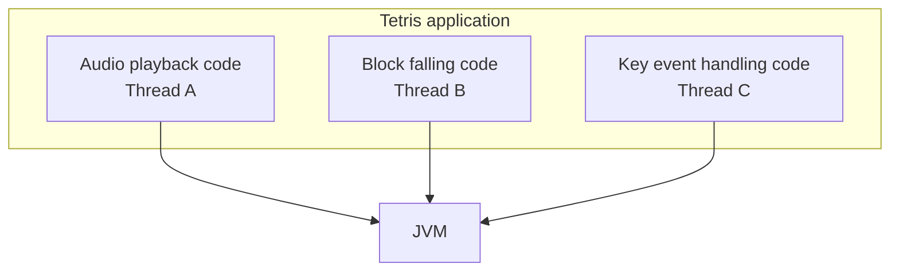
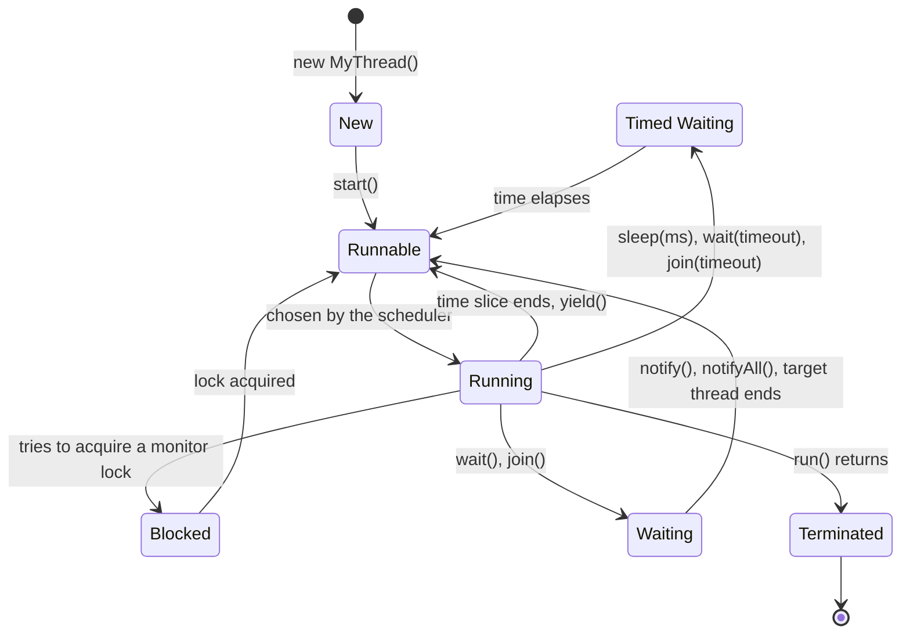

# Lecture 13 — Threading

[Repository Guide](../../README.md) | [English](Concepts_Lecture.md) | [한국어](Concepts_Lecture.ko.md)

> **Last Updated:** 2026-10-26

> **Learning Objectives:**
> 1. Create and manage threads using Thread class and Runnable interface
> 2. Explain the thread life cycle and control the flow of execution with sleep() and join()
> 3. Reduce execution time by splitting work across threads, and identify race conditions on shared variables

---

## Table of Contents

- [1. Multi-tasking and Threads](#1-multi-tasking-and-threads)
  - [1.1 What is a Thread?](#11-what-is-a-thread)
  - [1.2 Thread Life Cycle](#12-thread-life-cycle)
- [2. Creating Threads](#2-creating-threads)
  - [2.1 Extending the Thread Class](#21-extending-the-thread-class)
  - [2.2 Implementing the Runnable Interface](#22-implementing-the-runnable-interface)
  - [2.3 Thread vs. Runnable Comparison](#23-thread-vs-runnable-comparison)
- [3. Thread Operations](#3-thread-operations)
  - [3.1 sleep()](#31-sleep)
  - [3.2 join()](#32-join)
- [4. Multi-threaded Performance](#4-multi-threaded-performance)
- [Summary](#summary)
- [Self-Check Questions](#self-check-questions)

---

<br>

## 1. Multi-tasking and Threads

### 1.1 What is a Thread?

**Multi-tasking** means that one application processes multiple tasks at the same time. For example, a Tetris game must run the code that plays background music, the code that moves blocks down, and the code that handles key input at the same time, and a different thread runs each piece of code.



*Figure 1. Three threads of a Tetris program*

A thread is the smallest unit of execution scheduled by the JVM. A thread is a unit of the code written by the programmer that is scheduled and executed as one flow of execution, and each thread has its own call stack. A Java application always starts with a main thread, and can spawn additional threads for concurrent work.

> **[Operating Systems]** In an operating system, a thread is the basic unit that is assigned the CPU, and the operating system scheduler decides which thread runs on which core and when. Current JVMs such as HotSpot map each Java thread to one operating system thread, so even for Java threads scheduled by the JVM, the actual assignment of the CPU is left to the operating system (virtual threads, introduced in Java 21, are the exception to this mapping). A hardware thread of a CPU (a flow that a core can execute at once) and a Java thread are not the same concept, and a program can create far more Java threads than there are cores.

### 1.2 Thread Life Cycle



*Figure 2. State transitions of a thread*

| State | Description |
|:------|:------------|
| **New** | Created but not started |
| **Runnable** | Ready to run and waiting for CPU time |
| **Running** | Actively executing (included in RUNNABLE in `Thread.State`) |
| **Blocked** | Waiting for a monitor lock |
| **Waiting** | Waiting indefinitely for another thread (`wait()`, `join()`) |
| **Timed Waiting** | Waiting for a specified time (`sleep(ms)`, `wait(timeout)`, `join(timeout)`) |
| **Terminated** | Execution completed |

*Table 1. Thread states*

> **Caution:** Running is a conceptual state that separates waiting to run from running. The `Thread.State` enum returned by `getState()` has only six values, NEW, RUNNABLE, BLOCKED, WAITING, TIMED_WAITING, and TERMINATED, and a running thread is also reported as RUNNABLE.

---

<br>

## 2. Creating Threads

To run a thread, a developer does two things. First, write the code the thread will run in the `run()` method, and then create a thread object and ask the JVM to run that code (`start()`). There are two ways to make a Java thread: extending the `java.lang.Thread` class and implementing the `java.lang.Runnable` interface.

### 2.1 Extending the Thread Class

(1) Write a class that extends `Thread`, (2) override the `run()` method, (3) create a thread object, and (4) start the thread with `start()`. The following `TimerThread` is a timer that prints the elapsed seconds every second.

```java
class TimerThread extends Thread {
    @Override
    public void run() {
        int n = 0;
        while (true) {
            System.out.println(n++);
            try {
                Thread.sleep(1000);
            } catch (InterruptedException e) {
                return;
            }
        }
    }
}

// Usage
TimerThread timer = new TimerThread();
timer.start();
```

If the constructor receives a `JLabel` and the loop calls `timerLabel.setText(Integer.toString(n))` instead of `System.out.println(n++)`, the frame shows a timer in units of one second. The lab code [TimerThreadDemo.java](../../Coursework/Lab13_Threading/TimerThreadDemo.java) takes this form.

> **Caution:** To start a thread, call `start()`, not `run()`. `start()` creates a new thread and runs `run()` in it, but calling `run()` directly executes it like an ordinary method in the calling thread, without a new thread. Calling `start()` again on a thread object that has already been started throws an `IllegalThreadStateException`.

### 2.2 Implementing the Runnable Interface

(1) Write a class that implements `Runnable`, (2) implement the `run()` method, (3) create a `Thread` object by passing that object to its constructor, and (4) start it with `start()`.

```java
class TimerRunnable implements Runnable {
    @Override
    public void run() {
        int n = 0;
        while (true) {
            System.out.println(n++);
            try {
                Thread.sleep(1000);
            } catch (InterruptedException e) {
                return;
            }
        }
    }
}

// Usage
Thread thread = new Thread(new TimerRunnable());
thread.start();
```

The `Runnable` object holds only the code for the thread to run, and the actual thread is the `Thread` object. The lab code [TimerRunnableDemo.java](../../Coursework/Lab13_Threading/TimerRunnableDemo.java) builds the same timer with `Runnable`.

### 2.3 Thread vs. Runnable Comparison

| Feature | extends Thread | implements Runnable |
|:--------|:---------------|:--------------------|
| Inheritance | Cannot extend another class | Can extend another class |
| Reusability | Tightly coupled | Loosely coupled |
| Flexibility | Less flexible | More flexible |
| Best practice | Simple standalone threads | Recommended approach |

*Table 2. Comparison of extending Thread and implementing Runnable*

> **Key Point:** Prefer `Runnable` because Java only supports single inheritance. Using `Runnable` leaves the class free to extend another class.

The following `FlickeringLabel` extends `JLabel` to act as a label and implements `Runnable` to blink by itself. Because it already extends `JLabel`, it cannot extend `Thread` and must implement `Runnable`.

```java
public class FlickeringLabel extends JLabel implements Runnable {
    private long delay;

    public FlickeringLabel(String text, long delay) {
        super(text);
        this.delay = delay;
        setOpaque(true);              // make the background color visible
        Thread th = new Thread(this); // pass itself as the Runnable
        th.start();
    }

    @Override
    public void run() {
        int n = 0;
        while (true) {
            if (n == 0) setBackground(Color.YELLOW);
            else        setBackground(Color.GREEN);
            n = (n == 0) ? 1 : 0;     // alternate between yellow and green
            try {
                Thread.sleep(delay);
            } catch (InterruptedException e) {
                return;
            }
        }
    }
}
```

Creating it as `new FlickeringLabel("Flickering", 500)` switches the background of the label between yellow and green every 0.5 seconds.

---

<br>

## 3. Thread Operations

### 3.1 sleep()

`Thread.sleep()` pauses the current thread for the specified number of milliseconds.

```java
try {
    Thread.sleep(1000); // sleep for 1 second
} catch (InterruptedException e) {
    Thread.currentThread().interrupt();
}
```

`sleep()` is a static method, so whichever thread object it is called through, it pauses the current thread that executes the statement. If another thread calls `interrupt()` while the thread is sleeping, `sleep()` throws the checked exception `InterruptedException`, which must be handled with `try-catch`. Throwing the exception clears the thread's interrupt status, so the code above calls `interrupt()` again in the `catch` block to record that an interrupt occurred. Another approach, as in the timer of Section 2.1, is to end `run()` with `return` and terminate the thread (Lecture 15, Section 3).

### 3.2 join()

`join()` makes the calling thread wait for another thread to finish before continuing.

```java
Thread worker = new Thread(task);
worker.start();
worker.join(); // main thread waits for worker to finish
System.out.println("Worker finished.");
```

The thread that calls `join()` waits in the Waiting state until the target thread ends, and `join(long millis)` waits at most the given time. `join()` also throws `InterruptedException` if the thread is interrupted while waiting.

---

<br>

## 4. Multi-threaded Performance

Splitting a large computation across multiple threads can significantly reduce execution time on multi-core systems:

```java
// Single-threaded: sum 0 to 2 billion
// Multi-threaded: split the range into N sub-ranges, one per thread
SumThread[] threads = new SumThread[NUM_THREAD];
for (int i = 0; i < NUM_THREAD; i++) {
    threads[i] = new SumThread(start, end);
    threads[i].start();
}
for (SumThread t : threads) {
    t.join();
}
```

The single-threaded version adds 0 through 1,999,999,999 with `for (int i = 0; i < 2000000000; i++) sum += i;` and measures the elapsed time with `System.currentTimeMillis()`. The sum is $\frac{n(n-1)}{2}$ ($n = 2 \times 10^9$) = 1,999,999,999,000,000,000, which is less than the maximum `long` value (about $9.22 \times 10^{18}$). The multi-threaded version creates 8 threads and lets the `i`-th thread add from `i * (REP_TIMES / NUM_THREAD)` to `(i + 1) * (REP_TIMES / NUM_THREAD) - 1`. Each thread computes a partial sum in a local variable as follows and then adds it to the shared variable `sum`.

```java
public class SumThread extends Thread {
    public static long sum;   // sum shared by all threads
    private int start;
    private int end;

    public SumThread(int start, int end) {
        this.start = start;
        this.end = end;
    }

    @Override
    public void run() {
        long temp = 0;
        for (int i = start; i <= end; i++)
            temp += i;        // compute the partial sum in a local variable
        sum += temp;          // add it to the shared variable
    }
}
```

In one run on a 12-core computer, the single-threaded version took about 1.2 seconds and the multi-threaded version about 0.2 seconds, and both printed the same sum. The execution time depends on the number of cores and the load of the computer, and for a computation-only task like this one, creating more threads than there are cores gives no further speedup. The lab code [MultiThreadedSum.java](../../Coursework/Lab13_Threading/MultiThreadedSum.java) compares the two approaches in one program.

> **Caution:** `sum += temp` consists of three steps: read `sum`, add, and write it back. If two threads execute this statement at nearly the same time, one thread can overwrite the value written by the other, and one addition can be lost. A situation in which the result depends on the execution order of threads is called a **race condition**. In this example each thread adds only once at the end, so the problem appears rarely, but correctness is not guaranteed. The addition must be protected with `synchronized` (Lecture 15, Section 4), or each thread must store its partial sum separately for the main thread to add after `join()`.

> **Key Point:** The overhead of thread creation and synchronization means multi-threading only pays off for sufficiently large workloads.

---

<br>

## Summary

| Concept | Key Summary |
|:--------|:----------|
| Multi-tasking | It means that one application processes multiple tasks at the same time, with a thread for each task. |
| Thread | It is the smallest unit of execution scheduled by the JVM and has its own call stack. |
| Thread States | A thread moves among New, Runnable, Running, Blocked, Waiting, Timed Waiting, and Terminated, and `Thread.State` includes Running in RUNNABLE. |
| Thread.start() | It creates a new thread and calls `run()` in it, while calling `run()` directly creates no new thread. |
| Runnable | It is the preferred way to define thread behavior because the class can still extend another class. |
| sleep() | It pauses the current thread for a duration and throws `InterruptedException` if interrupted. |
| join() | It makes the current thread wait until another thread completes. |
| Multi-threaded sum | Splitting work into partitions for parallel processing speeds it up, but adding to a shared variable must be protected from race conditions. |

---

<br>

## Self-Check Questions

1. **start() and run():** How does the program behave if `timer.run()` is called instead of `timer.start()` in Section 2.1?

   <details>
   <summary>Answer</summary>

   No new thread is created, and `run()` executes in the main thread like an ordinary method. Since `run()` is an infinite loop, the main thread never leaves it, and the code after `timer.run()` never runs.

   </details>

2. **Range splitting:** In the multi-threaded version of Section 4, with `REP_TIMES` equal to 2,000,000,000 and `NUM_THREAD` equal to 8, find the range that the thread with `i = 3` adds.

   <details>
   <summary>Answer</summary>

   `REP_TIMES / NUM_THREAD` = 250,000,000, so the start is 3 × 250,000,000 = 750,000,000 and the end is 4 × 250,000,000 - 1 = 999,999,999. Together, the ranges of the eight threads cover 0 through 1,999,999,999 exactly once each.

   </details>

3. **Thread states:** What does `t.getState()` return right after `Thread t = new Thread(r);`, while `t` sleeps in `Thread.sleep(200)` after `t.start()`, and after `t.join()` returns?

   <details>
   <summary>Answer</summary>

   `NEW`, `TIMED_WAITING`, and `TERMINATED`, in that order. A thread in a timed `sleep()` is in the Timed Waiting state, and the return of `join()` means that `run()` of `t` has finished.

   </details>

4. **Race conditions:** `SumThread.sum` is 100, and two threads execute `sum += 10` and `sum += 20` at nearly the same time. Give one execution order in which the result is not 130.

   <details>
   <summary>Answer</summary>

   Thread A reads `sum` and gets 100, and before A writes, thread B also reads `sum` and gets 100. If A writes 110 and then B writes 120, the final value is 120 and A's addition is lost. If the writes happen in the opposite order, the result is 110. This happens because reading, adding, and writing is not atomic.

   </details>

5. **Why Runnable is needed:** Why can `FlickeringLabel` from Section 2.3 not be written with `extends Thread`?

   <details>
   <summary>Answer</summary>

   `FlickeringLabel` must be a label displayed on the screen, so it already extends `JLabel`. A Java class can extend only one class, so it cannot also extend `Thread`, and it instead implements the interface `Runnable` and creates a thread with `new Thread(this)`.

   </details>
