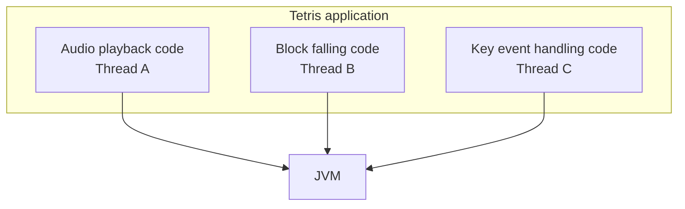
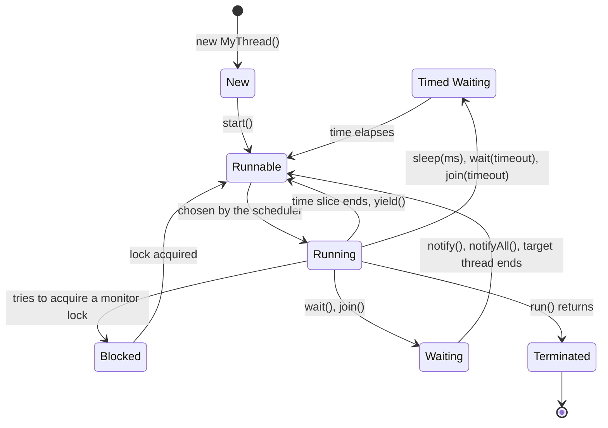
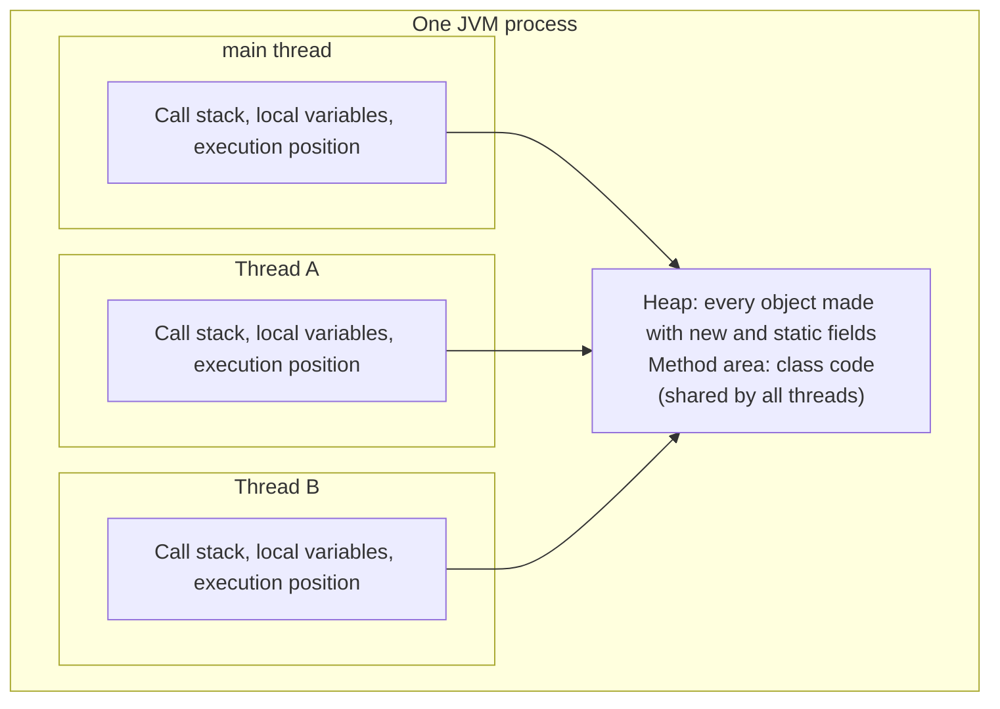

# Lecture 13 — Threading

[Repository Guide](../../README.md) | [English](Concepts_Lecture.md) | [한국어](Concepts_Lecture.ko.md)

> **Last Updated:** 2026-11-19

> **Learning Objectives:**
> 1. Create and manage threads using Thread class and Runnable interface
> 2. Explain the thread life cycle and control the flow of execution with sleep() and join()
> 3. Reduce execution time by splitting work across threads, and identify race conditions on shared variables
> 4. Observe the states of running threads and explain from actual output that the execution order of threads is not determined
> 5. Trace step by step how a race condition arises and fix it with synchronization, atomic variables, or partial sums

---

## Table of Contents

- [1. Multi-tasking and Threads](#1-multi-tasking-and-threads)
  - [1.1 The Concept of a Thread](#11-the-concept-of-a-thread)
  - [1.2 Thread Life Cycle](#12-thread-life-cycle)
  - [1.3 Processes and Threads](#13-processes-and-threads)
  - [1.4 Observing Thread States](#14-observing-thread-states)
  - [1.5 Concurrency and Parallelism](#15-concurrency-and-parallelism)
  - [1.6 The Cost of Creating Threads](#16-the-cost-of-creating-threads)
- [2. Creating Threads](#2-creating-threads)
  - [2.1 Extending the Thread Class](#21-extending-the-thread-class)
  - [2.2 Implementing the Runnable Interface](#22-implementing-the-runnable-interface)
  - [2.3 Thread vs. Runnable Comparison](#23-thread-vs-runnable-comparison)
  - [2.4 Threads Made with Lambdas and Thread Names](#24-threads-made-with-lambdas-and-thread-names)
  - [2.5 The Difference between start() and run()](#25-the-difference-between-start-and-run)
  - [2.6 Nondeterminism of Execution Order](#26-nondeterminism-of-execution-order)
  - [2.7 Labels That Blink Independently](#27-labels-that-blink-independently)
  - [2.8 Main Methods of the Thread Class](#28-main-methods-of-the-thread-class)
  - [2.9 Giving Input to a Thread and Getting Results Back](#29-giving-input-to-a-thread-and-getting-results-back)
- [3. Thread Operations](#3-thread-operations)
  - [3.1 sleep()](#31-sleep)
  - [3.2 join()](#32-join)
  - [3.3 Waiting for Results with join()](#33-waiting-for-results-with-join)
  - [3.4 Daemon Threads](#34-daemon-threads)
  - [3.5 The Accuracy of sleep() and yield()](#35-the-accuracy-of-sleep-and-yield)
- [4. Multi-threaded Performance](#4-multi-threaded-performance)
  - [4.1 Execution Time by Number of Threads](#41-execution-time-by-number-of-threads)
  - [4.2 Observing a Race Condition](#42-observing-a-race-condition)
  - [4.3 Summation without Race Conditions](#43-summation-without-race-conditions)
  - [4.4 Exceptions Raised in Threads](#44-exceptions-raised-in-threads)
- [5. Common Mistakes](#5-common-mistakes)
- [Summary](#summary)
- [Self-Check Questions](#self-check-questions)
- [References](#references)

---

<br>

## 1. Multi-tasking and Threads

### 1.1 The Concept of a Thread

**Multi-tasking** means that one application processes multiple tasks at the same time. For example, a Tetris game must run the code that plays background music, the code that moves blocks down, and the code that handles key input at the same time, and a different thread runs each piece of code.



*Figure 1. Three threads of a Tetris program*

A thread is the smallest unit of execution scheduled by the JVM. A thread is a unit of the code written by the programmer that is scheduled and executed as one flow of execution, and each thread has its own call stack. A Java application always starts with a main thread, and can spawn additional threads for concurrent work.

> **[Operating Systems]** In an operating system, a thread is the basic unit that is assigned the CPU, and the operating system scheduler decides which thread runs on which core and when. Current JVMs such as HotSpot map each Java thread to one operating system thread, so even for Java threads scheduled by the JVM, the actual assignment of the CPU is left to the operating system (virtual threads, introduced in Java 21, are the exception to this mapping). A hardware thread of a CPU (a flow that a core can execute at once) and a Java thread are not the same concept, and a program can create far more Java threads than there are cores.

### 1.2 Thread Life Cycle



*Figure 2. State transitions of a thread*

| State | Description |
|:------|:------------|
| **New** | Created but not started |
| **Runnable** | Ready to run and waiting for CPU time |
| **Running** | Actively executing (included in RUNNABLE in `Thread.State`) |
| **Blocked** | Waiting for a monitor lock |
| **Waiting** | Waiting indefinitely for another thread (`wait()`, `join()`) |
| **Timed Waiting** | Waiting for a specified time (`sleep(ms)`, `wait(timeout)`, `join(timeout)`) |
| **Terminated** | Execution completed |

*Table 1. Thread states*

> **Caution:** Running is a conceptual state that separates waiting to run from running. The `Thread.State` enum returned by `getState()` has only six values, NEW, RUNNABLE, BLOCKED, WAITING, TIMED_WAITING, and TERMINATED, and a running thread is also reported as RUNNABLE.

### 1.3 Processes and Threads

A **process** is one running program, and it receives its own memory space from the operating system. Running `java MyProgram` creates one JVM process. A thread is a flow of execution inside a process, and the threads of one process share that process's memory. In a Java program, what threads share and what each keeps separately are as follows.



*Figure 3. Areas that threads share and areas each keeps separately within one process*

The local variables and parameters of a method sit on the call stack of the thread executing that method, so two threads executing the same method at the same time do not affect each other's local variables. Fields of objects and static fields, on the other hand, exist only once on the heap, so threads that refer to the same object read and write those fields together. This difference is why `SumThread` of Section 4 computed its partial sum in the local variable `temp` and added to the shared variable `sum` only at the end, and race conditions (Section 4.2) always arise on the shared side.

Because threads use the same memory, they can exchange data far more cheaply than processes can. For the same reason, a wrong write by one thread can corrupt the data of another, and preventing this is the synchronization of Lecture 15.

### 1.4 Observing Thread States

The states of Section 1.2 can actually be observed with `getState()`. The following program places threads one by one in the desired state and prints the state at that moment.

```java
public class States {
    static final Object lock = new Object();

    public static void main(String[] args) throws Exception {
        Thread sleeper = new Thread(() -> {
            try { Thread.sleep(300); } catch (InterruptedException e) { }
        }, "sleeper");
        System.out.println("after new:       " + sleeper.getState());
        sleeper.start();
        System.out.println("after start:     " + sleeper.getState());
        Thread.sleep(100);
        System.out.println("while sleeping:  " + sleeper.getState());

        Thread waiter = new Thread(() -> {
            try { sleeper.join(); } catch (InterruptedException e) { }   // wait for sleeper to end
        }, "waiter");
        waiter.start();
        Thread.sleep(50);
        System.out.println("waiter joining:  " + waiter.getState());

        Thread blocked;
        synchronized (lock) {                                             // main holds the lock
            blocked = new Thread(() -> { synchronized (lock) { } }, "blocked");
            blocked.start();
            Thread.sleep(50);
            System.out.println("lock held:       " + blocked.getState());
        }
        sleeper.join();
        waiter.join();
        blocked.join();
        System.out.println("after join:      " + sleeper.getState() + " " + waiter.getState() + " " + blocked.getState());
    }
}
```

```text
after new:       NEW
after start:     RUNNABLE
while sleeping:  TIMED_WAITING
waiter joining:  WAITING
lock held:       BLOCKED
after join:      TERMINATED TERMINATED TERMINATED
```

1. `sleeper` is `NEW` right after it is created and `RUNNABLE` right after `start()` is called. A started thread is reported as RUNNABLE regardless of whether it has actually been given a chance to run (the caution box of Section 1.2).
2. After 100 milliseconds `sleeper` is inside `sleep(300)`, so it is in the timed wait `TIMED_WAITING`.
3. `waiter` waits for `sleeper` with `join()` without a time limit, so it is `WAITING`.
4. `blocked` stopped while trying to enter `synchronized (lock)` to obtain the monitor lock of `lock`, which main holds, so it is `BLOCKED` (Lecture 15, Section 4.1). When main leaves its `synchronized` block and releases the lock, `blocked` obtains it and continues.
5. After the `run()` of all three threads has finished, they are `TERMINATED`.

All six values of `Thread.State` appeared. The meaning of each state is defined by the API documentation [1], and a state is only the value the JVM observed at that moment and may have changed the next moment, so code should not look at states in place of synchronization.

### 1.5 Concurrency and Parallelism

Handling several tasks at the same time has two meanings. **Concurrency** is the property that the periods between the start and end of several tasks overlap. Even with a single core, if the operating system runs threads in turn in short time units (time slices), the tasks appear to the user to progress at the same time. **Parallelism** is the property that several tasks actually run together at the same instant on different cores.

```text
Concurrency on 1 core (taking turns)
Core 1: [A][B][A][B][A][B][A][B]   → time

Parallelism on 2 cores (running together)
Core 1: [A][A][A][A]               → time
Core 2: [B][B][B][B]
```

*Figure 4. Concurrency taking turns on one core and parallelism running together on two cores*

What the Tetris program of Section 1.1 needs is concurrency. Music playback, block descent, and key handling each do only very short computations and spend most of their time waiting, so taking turns on a single core is enough. What the summation of Section 4 needs is parallelism. A computation-only task does not finish sooner overall by taking turns on one core; it speeds up only when several cores run it together (Section 4.1). Threads serve both purposes, but the number and arrangement of threads depend on whether the program seeks responsiveness or throughput.

### 1.6 The Cost of Creating Threads

Threads are not free. For every thread created, the JVM sets up an operating-system thread and memory for its call stack, and it exchanges information with the operating system when the thread starts and ends. The following program runs a very small task 10,000 times, once by calling it as a method on the same thread and once by creating a new thread for each task.

```java
public class ThreadCost {
    static volatile long sink;

    public static void main(String[] args) throws InterruptedException {
        final int N = 10_000;
        Runnable tiny = () -> { sink += 1; };

        long t0 = System.nanoTime();
        for (int i = 0; i < N; i++) tiny.run();               // call on the same thread
        long direct = System.nanoTime() - t0;

        t0 = System.nanoTime();
        for (int i = 0; i < N; i++) {
            Thread t = new Thread(tiny);                       // one thread per task
            t.start();
            t.join();
        }
        long threads = System.nanoTime() - t0;

        System.out.printf("direct calls:        %8.2f ms (%.3f us each)%n", direct / 1e6, direct / 1e3 / N);
        System.out.printf("new thread per call: %8.2f ms (%.3f us each)%n", threads / 1e6, threads / 1e3 / N);
    }
}
```

```text
direct calls:            0.19 ms (0.019 us each)
new thread per call:   382.78 ms (38.278 us each)
```

The times vary from computer to computer, but in this run the same task took 0.02 microseconds per run as a method call and about 38 microseconds per run to create a thread, start it, and wait for it to end, about 2,000 times as long. The work assigned to one thread must therefore be sufficiently larger than the cost of creating the thread. This is why the summation of Section 4 gives each thread more than 200 million additions, and why the key-point box of Section 4 said that multithreading pays off only for sufficiently large workloads. When there are many small tasks, a thread pool, which creates a few threads in advance and hands them tasks in turn, is used (the note box of Lecture 15, Section 5).

---

<br>

## 2. Creating Threads

To run a thread, a developer does two things. First, write the code the thread will run in the `run()` method, and then create a thread object and ask the JVM to run that code (`start()`). There are two ways to make a Java thread: extending the `java.lang.Thread` class and implementing the `java.lang.Runnable` interface.

### 2.1 Extending the Thread Class

(1) Write a class that extends `Thread`, (2) override the `run()` method, (3) create a thread object, and (4) start the thread with `start()`. The following `TimerThread` is a timer that prints the elapsed seconds every second.

```java
class TimerThread extends Thread {
    @Override
    public void run() {
        int n = 0;
        while (true) {
            System.out.println(n++);
            try {
                Thread.sleep(1000);
            } catch (InterruptedException e) {
                return;
            }
        }
    }
}

// Usage
TimerThread timer = new TimerThread();
timer.start();
```

If the constructor receives a `JLabel` and the loop calls `timerLabel.setText(Integer.toString(n))` instead of `System.out.println(n++)`, the frame shows a timer in units of one second. The lab code [TimerThreadDemo.java](../../Coursework/Lab13_Threading/TimerThreadDemo.java) takes this form.

> **Caution:** To start a thread, call `start()`, not `run()`. `start()` creates a new thread and runs `run()` in it, but calling `run()` directly executes it like an ordinary method in the calling thread, without a new thread. Calling `start()` again on a thread object that has already been started throws an `IllegalThreadStateException`.

### 2.2 Implementing the Runnable Interface

(1) Write a class that implements `Runnable`, (2) implement the `run()` method, (3) create a `Thread` object by passing that object to its constructor, and (4) start it with `start()`.

```java
class TimerRunnable implements Runnable {
    @Override
    public void run() {
        int n = 0;
        while (true) {
            System.out.println(n++);
            try {
                Thread.sleep(1000);
            } catch (InterruptedException e) {
                return;
            }
        }
    }
}

// Usage
Thread thread = new Thread(new TimerRunnable());
thread.start();
```

The `Runnable` object holds only the code for the thread to run, and the actual thread is the `Thread` object. The lab code [TimerRunnableDemo.java](../../Coursework/Lab13_Threading/TimerRunnableDemo.java) builds the same timer with `Runnable`.

### 2.3 Thread vs. Runnable Comparison

| Feature | extends Thread | implements Runnable |
|:--------|:---------------|:--------------------|
| Inheritance | Cannot extend another class | Can extend another class |
| Reusability | Tightly coupled | Loosely coupled |
| Flexibility | Less flexible | More flexible |
| Best practice | Simple standalone threads | Recommended approach |

*Table 2. Comparison of extending Thread and implementing Runnable*

> **Key Point:** Prefer `Runnable` because Java only supports single inheritance. Using `Runnable` leaves the class free to extend another class.

The following `FlickeringLabel` extends `JLabel` to act as a label and implements `Runnable` to blink by itself. Because it already extends `JLabel`, it cannot extend `Thread` and must implement `Runnable`.

```java
public class FlickeringLabel extends JLabel implements Runnable {
    private long delay;

    public FlickeringLabel(String text, long delay) {
        super(text);
        this.delay = delay;
        setOpaque(true);              // make the background color visible
        Thread th = new Thread(this); // pass itself as the Runnable
        th.start();
    }

    @Override
    public void run() {
        int n = 0;
        while (true) {
            if (n == 0) setBackground(Color.YELLOW);
            else        setBackground(Color.GREEN);
            n = (n == 0) ? 1 : 0;     // alternate between yellow and green
            try {
                Thread.sleep(delay);
            } catch (InterruptedException e) {
                return;
            }
        }
    }
}
```

Creating it as `new FlickeringLabel("Flickering", 500)` switches the background of the label between yellow and green every 0.5 seconds.

### 2.4 Threads Made with Lambdas and Thread Names

`Runnable` is a functional interface with the single abstract method `run()`, so it can be implemented with a lambda expression, as in Lecture 12, Section 5.4. When the code to run is short, it is written right where the thread is created, without a separate class.

```java
Thread t = new Thread(() -> System.out.println("hello from " + Thread.currentThread().getName()),
                      "worker-1");
t.start();
```

The second argument of the constructor is the name of the thread. Without a name, the JVM gives names automatically, such as `Thread-0` and `Thread-1`. In a program with several threads, it is good to give names that describe their roles, so that logs and error messages show in which thread something happened. The name is changed with `setName()` and read with `getName()`.

When a lambda uses a local variable of the enclosing code, that variable must be effectively final (Lecture 12, Section 5.9). This is also why the loop variable `i` cannot be used directly; it is copied into a new variable such as `final int id = k;` and passed, as in `SumCompare` of Section 4.3.

### 2.5 The Difference between start() and run()

The caution box of Section 2.1 stated that calling `run()` directly creates no new thread. Printing the name of the thread reveals the difference.

```java
public class StartVsRun {
    public static void main(String[] args) throws InterruptedException {
        Runnable task = () -> System.out.println("task runs on " + Thread.currentThread().getName());
        Thread t = new Thread(task, "worker-1");

        t.run();                         // an ordinary method call
        t.start();                       // runs on a new thread
        t.join();
        try {
            t.start();
        } catch (IllegalThreadStateException e) {
            System.out.println("second start(): IllegalThreadStateException");
        }
    }
}
```

```text
task runs on main
task runs on worker-1
second start(): IllegalThreadStateException
```

`t.run()` calls the `run()` of the `Runnable` like an ordinary method, so the task runs on the calling thread, main. `t.start()` asks the JVM to create a new thread and returns at once, and the new thread `worker-1` runs the task. A thread object that has been started and has finished cannot be started again, so the second `start()` throws `IllegalThreadStateException`. To run the same task again, create a new `Thread` object.

### 2.6 Nondeterminism of Execution Order

Once two threads are started, the scheduler decides which thread runs when and for how long, and the program cannot know that order. In the following program, two threads append `A` and `B`, 12 times each, to a shared buffer, and at the end the contents of the buffer are printed. The results of running the same program three times are as follows.

```java
public class Interleave {
    static final StringBuffer trace = new StringBuffer();   // thread-safe string buffer

    public static void main(String[] args) throws InterruptedException {
        Runnable a = () -> { for (int i = 0; i < 12; i++) { trace.append('A'); spin(); } };
        Runnable b = () -> { for (int i = 0; i < 12; i++) { trace.append('B'); spin(); } };
        Thread ta = new Thread(a), tb = new Thread(b);
        ta.start();
        tb.start();
        ta.join();
        tb.join();
        System.out.println(trace);
    }

    static void spin() {                                     // burn a little time
        long x = 0;
        for (int i = 0; i < 200_000; i++) x += i;
        if (x == 42) System.out.println();
    }
}
```

```text
ABBABAABABABABABABABABAB
ABABBABABABABABABABABABA
ABABBABABABABABABABABABA
```

All three runs contain 12 each of `A` and `B`, but the first run differs in order from the third character on. The second and third runs happened to be the same, with no guarantee that the next run will be. This property, by which the execution order between threads and the results can differ between runs even with the same input, is called **nondeterminism**. A single-threaded program always runs in the same order for the same input, so an error can be reproduced while debugging, but errors in multithreaded programs appear only in particular orders and are hard to reproduce. Therefore the correctness of multithreaded code is not judged by getting the right result in a few runs; the code must be designed so that the result is right in every possible order.

`StringBuffer` is used as the buffer because its `append()` is synchronized, so no character is lost even when two threads call it at the same time. Using the unsynchronized `StringBuilder` could lose characters or raise an exception.

### 2.7 Labels That Blink Independently

`FlickeringLabel` of Section 2.3 has one thread per label, so several of them blink independently of each other. The following frame places, in order, a label that blinks every 0.5 seconds, an ordinary label that does not blink, and a label that blinks every 0.3 seconds.

```java
Container c = getContentPane();
c.setLayout(new FlowLayout());
FlickeringLabel fLabel = new FlickeringLabel("Blink", 500);
JLabel label = new JLabel("No blink");
FlickeringLabel fLabel2 = new FlickeringLabel("Blink independently", 300);
c.add(fLabel);
c.add(label);
c.add(fLabel2);
setSize(300, 150);
setVisible(true);
```

Besides the main thread and the EDT, this program has two more threads, one for each `FlickeringLabel`. Each thread changes the background color of its own label and then sleeps for its own delay, so the blinking of the two labels does not affect each other, and the ordinary label in the middle does not change. In theory the two labels change color at the same moment every 1.5 seconds, the least common multiple of 0.5 and 0.3 seconds, but in practice the errors of `sleep()` accumulate and they drift slightly apart.

> **Note:** **Swing timers.** The threads of `FlickeringLabel` call `setBackground()` from outside the EDT, so strictly speaking this is not safe by the principle of Lecture 12, Section 5.7. Work that changes the screen at fixed intervals can be built with `javax.swing.Timer`. Creating one as `new Timer(500, e -> change the color).start()` makes the timer fire an action event on the EDT every 0.5 seconds, giving the same effect safely without creating a thread.

### 2.8 Main Methods of the Thread Class

| Method | Kind | What it does |
|:-----|:-----|:-----|
| `start()` | Instance | Creates a new thread and makes it run `run()` (can be called only once) |
| `run()` | Instance | The code the thread runs, overridden or passed in as a `Runnable` |
| `join()`, `join(ms)` | Instance | Makes the calling thread wait until this thread ends (or for at most ms) |
| `isAlive()` | Instance | Returns `true` if the thread has started and not yet ended |
| `interrupt()` | Instance | Interrupts this thread (Lecture 15, Section 3.2) |
| `getName()`, `setName()` | Instance | Reads or changes the name of the thread |
| `threadId()` | Instance | Returns the unique number of the thread (formerly named `getId()`) |
| `getState()` | Instance | Returns the current state as a `Thread.State` |
| `getPriority()`, `setPriority()` | Instance | Reads or changes the priority (Lecture 15, Section 2) |
| `setDaemon()`, `isDaemon()` | Instance | Sets or reads the daemon status (can be set only before starting) |
| `currentThread()` | static | Returns the `Thread` object of the thread executing this statement |
| `sleep(ms)` | static | Puts the current thread to sleep for ms (Section 3.1) |
| `yield()` | static | Tells the scheduler that the current thread is willing to yield execution to other threads (Section 3.5) |

*Table 3. Main methods of the Thread class*

A static method acts on the current thread executing the statement, whichever `Thread` object it is called through. For example, writing `worker.sleep(1000)` in main puts main to sleep, not `worker`. To avoid this misunderstanding, static methods are called through the class name, as in `Thread.sleep(1000)`.

### 2.9 Giving Input to a Thread and Getting Results Back

`run()` takes no parameters and returns `void`, so giving a thread input and getting results back needs another channel. The simplest way is to receive the input through the constructor and keep it in a field, store the result in a field as well, and read it after `join()`.

```java
public class PassData {
    static class WordCounter extends Thread {
        private final String text;                             // input received through the constructor
        private int count;                                     // field that holds the result

        WordCounter(String name, String text) {
            super(name);
            this.text = text;
        }

        @Override
        public void run() {
            count = text.isBlank() ? 0 : text.trim().split("\\s+").length;
        }

        int getCount() { return count; }
    }

    public static void main(String[] args) throws InterruptedException {
        String[] parts = {
            "to be or not to be",
            "that is the question",
            "   ",
            "whether tis nobler in the mind to suffer"
        };
        WordCounter[] workers = new WordCounter[parts.length];
        for (int i = 0; i < parts.length; i++) {
            workers[i] = new WordCounter("counter-" + i, parts[i]);
            workers[i].start();
        }
        int total = 0;
        for (WordCounter w : workers) {
            w.join();
            System.out.println(w.getName() + ": " + w.getCount());
            total += w.getCount();
        }
        System.out.println("total: " + total);
    }
}
```

```text
counter-0: 6
counter-1: 4
counter-2: 0
counter-3: 8
total: 18
```

`WordCounter` keeps the string received through its constructor in the `final` field `text`, and in `run()` it stores in the field `count` the number of words obtained by splitting on whitespace. The `\\s+` in `split("\\s+")` is a regular expression meaning one or more whitespace characters. The third string, containing only spaces, gives `true` for `isBlank()` and is counted as 0. main starts all four threads, joins them in turn, and then reads the results with `getCount()`; by the guarantee of Section 3.3, the value each thread stored is visible. Each thread writes only to the fields of its own object, so, as with the partial sums of Section 4.3, no synchronization is needed. The four results 6, 4, 0, and 8 add up to 18.

> **Note:** **Callable and Future.** `java.util.concurrent.Callable<V>` is an interface whose `call()` returns a value and may throw checked exceptions. Handing a `Callable` to a thread pool (`ExecutorService`) returns a `Future<V>` through which the result can be received later, and `future.get()` waits until the task finishes and then returns the result. Since there is no need to manage result fields and `join()` directly, it is used when many tasks need results (Lecture 15, Section 5).

---

<br>

## 3. Thread Operations

### 3.1 sleep()

`Thread.sleep()` pauses the current thread for the specified number of milliseconds.

```java
try {
    Thread.sleep(1000); // sleep for 1 second
} catch (InterruptedException e) {
    Thread.currentThread().interrupt();
}
```

`sleep()` is a static method, so whichever thread object it is called through, it pauses the current thread that executes the statement. If another thread calls `interrupt()` while the thread is sleeping, `sleep()` throws the checked exception `InterruptedException`, which must be handled with `try-catch`. Throwing the exception clears the thread's interrupt status, so the code above calls `interrupt()` again in the `catch` block to record that an interrupt occurred. Another approach, as in the timer of Section 2.1, is to end `run()` with `return` and terminate the thread (Lecture 15, Section 3).

### 3.2 join()

`join()` makes the calling thread wait for another thread to finish before continuing.

```java
Thread worker = new Thread(task);
worker.start();
worker.join(); // main thread waits for worker to finish
System.out.println("Worker finished.");
```

The thread that calls `join()` waits in the Waiting state until the target thread ends, and `join(long millis)` waits at most the given time. `join()` also throws `InterruptedException` if the thread is interrupted while waiting.

### 3.3 Waiting for Results with join()

`join()` is also needed to read results computed by another thread safely. The worker thread in the following program adds 1 through 100, rests for 0.3 seconds, and writes the result to a static field.

```java
public class JoinDemo {
    static long result;                                      // written by the worker

    public static void main(String[] args) throws InterruptedException {
        Thread worker = new Thread(() -> {
            long s = 0;
            for (int i = 1; i <= 100; i++) s += i;
            try { Thread.sleep(300); } catch (InterruptedException e) { }
            result = s;
        });
        worker.start();

        worker.join(100);                                    // wait at most 100 ms
        System.out.println("after join(100): alive=" + worker.isAlive() + ", result=" + result);
        worker.join();                                       // wait until it ends
        System.out.println("after join():    alive=" + worker.isAlive() + ", result=" + result);
    }
}
```

```text
after join(100): alive=true, result=0
after join():    alive=false, result=5050
```

`join(100)` waits at most 100 milliseconds and returns, so at that point the worker is still alive (`isAlive()` is `true`) and the result is still the initial value 0. A `join` with a time limit returning does not mean that the target thread has ended, so check with `isAlive()` after it returns. `join()` without a time limit waits until the worker ends, and after it returns the 5050 written by the worker can be read.

`join()` has a role besides waiting. When a value written to a field by one thread becomes visible to another thread is generally not guaranteed, but the Java memory model specifies that all actions in a thread happen before any other thread successfully returns from a `join()` on that thread [2]. So the `result` read after `join()` is the latest value written by the worker. The summation programs of Sections 4 and 4.3 also rely on this guarantee when they gather results after joining all threads.

### 3.4 Daemon Threads

The JVM begins its shutdown sequence when all started threads that are not **daemon threads** have terminated [3]. A daemon thread takes on auxiliary work that serves other threads (garbage collection, periodic monitoring, log cleanup, and so on), and when all non-daemon threads have ended it ends together with the JVM, even if it is still running. A new thread inherits the daemon status of the thread that created it, and it can be changed with `setDaemon(true)` before it is started.

```java
public class Daemon {
    public static void main(String[] args) throws InterruptedException {
        Thread ticker = new Thread(() -> {
            int n = 0;
            while (true) {
                System.out.println("tick " + n++);
                try { Thread.sleep(100); } catch (InterruptedException e) { return; }
            }
        });
        ticker.setDaemon(args.length == 0);                  // daemon unless an argument is given
        System.out.println("daemon? " + ticker.isDaemon());
        ticker.start();
        Thread.sleep(250);
        System.out.println("main ends");
    }
}
```

Running `java Daemon` makes `ticker` a daemon thread, so the whole program ends the moment main ends after 0.25 seconds.

```text
daemon? true
tick 0
tick 1
tick 2
main ends
```

Running `java Daemon user` with an argument makes `ticker` a non-daemon thread, so the program does not end after main ends and keeps printing `tick`. The following is the output until the program was forcibly ended from outside after 1 second.

```text
daemon? false
tick 0
tick 1
tick 2
main ends
tick 3
tick 4
tick 5
tick 6
tick 7
tick 8
tick 9
```

If an endlessly looping thread such as `TimerThread` of Section 2.1 is not made a daemon, the program may not end even after the window is closed or `main()` ends. Conversely, giving a daemon thread work that must run to completion, such as saving a file, can lose data when the JVM ends in the middle of the work.

### 3.5 The Accuracy of sleep() and yield()

`sleep(ms)` means sleeping for at least ms, with no guarantee of waking exactly ms later. When the wake-up time comes, the thread only returns from Timed Waiting to Runnable, and to actually run it must be given a core again by the scheduler. The following program runs `sleep` for 1, 10, and 100 milliseconds 20 times each and measures how long each actually took.

```java
public class SleepAccuracy {
    public static void main(String[] args) throws InterruptedException {
        for (int ms : new int[] {1, 10, 100}) {
            long min = Long.MAX_VALUE, max = 0, total = 0;
            int trials = 20;
            for (int i = 0; i < trials; i++) {
                long t0 = System.nanoTime();
                Thread.sleep(ms);
                long took = System.nanoTime() - t0;
                min = Math.min(min, took); max = Math.max(max, took); total += took;
            }
            System.out.printf("sleep(%3d): min %7.3f ms, avg %7.3f ms, max %7.3f ms%n",
                    ms, min / 1e6, total / 1e6 / trials, max / 1e6);
        }
    }
}
```

```text
sleep(  1): min   1.503 ms, avg   1.511 ms, max   1.582 ms
sleep( 10): min  12.008 ms, avg  14.737 ms, max  15.021 ms
sleep(100): min 100.247 ms, avg 108.080 ms, max 110.099 ms
```

The measurements vary with the computer and operating system, but in this run the actual time was longer than requested in all three cases. `sleep(10)` averaged 14.7 milliseconds, nearly half again as long, and `sleep(100)` averaged 108 milliseconds. The error depends on the timer resolution of the operating system and the load at the moment. Counting seconds by repeating `sleep(1000)`, as `TimerThread` of Section 2.1 does, accumulates the error on every repetition, so the clock falls further and further behind. When accurate elapsed time is needed, store the start time and compute the difference from `System.currentTimeMillis()` or `System.nanoTime()`.

`Thread.yield()` is a hint to the scheduler that the current thread is willing to yield its chance to run to other threads. The scheduler may ignore this hint, so `yield()` cannot decide the execution order of threads or replace synchronization. It is mainly used in experiments that increase the chance of a race condition showing up, as in the example of Lecture 15, Section 4.3.

---

<br>

## 4. Multi-threaded Performance

Splitting a large computation across multiple threads can significantly reduce execution time on multi-core systems:

```java
// Single-threaded: sum 0 to 2 billion
// Multi-threaded: split the range into N sub-ranges, one per thread
SumThread[] threads = new SumThread[NUM_THREAD];
for (int i = 0; i < NUM_THREAD; i++) {
    threads[i] = new SumThread(start, end);
    threads[i].start();
}
for (SumThread t : threads) {
    t.join();
}
```

The single-threaded version adds 0 through 1,999,999,999 with `for (int i = 0; i < 2000000000; i++) sum += i;` and measures the elapsed time with `System.currentTimeMillis()`. The sum is $\frac{n(n-1)}{2}$ ($n = 2 \times 10^9$) = 1,999,999,999,000,000,000, which is less than the maximum `long` value (about $9.22 \times 10^{18}$). The multi-threaded version creates 8 threads and lets the `i`-th thread add from `i * (REP_TIMES / NUM_THREAD)` to `(i + 1) * (REP_TIMES / NUM_THREAD) - 1`. Each thread computes a partial sum in a local variable as follows and then adds it to the shared variable `sum`.

```java
public class SumThread extends Thread {
    public static long sum;   // sum shared by all threads
    private int start;
    private int end;

    public SumThread(int start, int end) {
        this.start = start;
        this.end = end;
    }

    @Override
    public void run() {
        long temp = 0;
        for (int i = start; i <= end; i++)
            temp += i;        // compute the partial sum in a local variable
        sum += temp;          // add it to the shared variable
    }
}
```

In one run on a 12-core computer, the single-threaded version took about 1.2 seconds and the multi-threaded version about 0.2 seconds, and both printed the same sum. The execution time depends on the number of cores and the load of the computer, and for a computation-only task like this one, creating more threads than there are cores gives no further speedup. The lab code [MultiThreadedSum.java](../../Coursework/Lab13_Threading/MultiThreadedSum.java) compares the two approaches in one program.

> **Caution:** `sum += temp` consists of three steps: read `sum`, add, and write it back. If two threads execute this statement at nearly the same time, one thread can overwrite the value written by the other, and one addition can be lost. A situation in which the result depends on the execution order of threads is called a **race condition**. In this example each thread adds only once at the end, so the problem appears rarely, but correctness is not guaranteed. The addition must be protected with `synchronized` (Lecture 15, Section 4), or each thread must store its partial sum separately for the main thread to add after `join()`.

> **Key Point:** The overhead of thread creation and synchronization means multi-threading only pays off for sufficiently large workloads.

### 4.1 Execution Time by Number of Threads

Measuring the summation of Section 4 with different numbers of threads shows both the effect and the limits of parallel processing. The following program computes the sum of 0 through 1,999,999,999 with the work divided among n threads and prints the **speedup**, that is, (time with 1 thread) / (time with n threads).

```java
public class SumCompare {
    static final int REP = 2_000_000_000;

    static long parallelSum(int nThreads) throws InterruptedException {
        long[] partial = new long[nThreads];                  // each thread writes only its own slot
        Thread[] ts = new Thread[nThreads];
        int chunk = REP / nThreads;
        for (int k = 0; k < nThreads; k++) {
            final int id = k;
            final int start = k * chunk;
            final int end = (k == nThreads - 1) ? REP - 1 : (k + 1) * chunk - 1;
            ts[k] = new Thread(() -> {
                long s = 0;
                for (int i = start; i <= end; i++) s += i;
                partial[id] = s;
            });
            ts[k].start();
        }
        long total = 0;
        for (int k = 0; k < nThreads; k++) {
            ts[k].join();                                     // read the result after join
            total += partial[k];
        }
        return total;
    }

    public static void main(String[] args) throws InterruptedException {
        System.out.println("available processors: " + Runtime.getRuntime().availableProcessors());
        parallelSum(4);                                       // warm-up run
        long base = 0;
        for (int n : new int[] {1, 2, 4, 8, 12, 16, 32}) {
            long t0 = System.nanoTime();
            long sum = parallelSum(n);
            long ms = (System.nanoTime() - t0) / 1_000_000;
            if (n == 1) base = ms;
            System.out.printf("%2d threads: %5d ms  speedup %5.2f  sum %,d%n", n, ms, (double) base / ms, sum);
        }
    }
}
```

```text
available processors: 12
 1 threads:  1221 ms  speedup  1.00  sum 1,999,999,999,000,000,000
 2 threads:   613 ms  speedup  1.99  sum 1,999,999,999,000,000,000
 4 threads:   306 ms  speedup  3.99  sum 1,999,999,999,000,000,000
 8 threads:   164 ms  speedup  7.45  sum 1,999,999,999,000,000,000
12 threads:   132 ms  speedup  9.25  sum 1,999,999,999,000,000,000
16 threads:   126 ms  speedup  9.69  sum 1,999,999,999,000,000,000
32 threads:   128 ms  speedup  9.54  sum 1,999,999,999,000,000,000
```

The 12 cores of the computer used for the measurement consist of 8 performance cores and 4 efficiency cores. With 2 and 4 threads the speedups are 1.99 and 3.99, almost equal to the number of threads, because the pieces of work are independent and each thread uses one core fully. With 8 threads it falls slightly short at 7.45, and with 12 it reaches only 9.25. Threads beyond 8 run on the efficiency cores, which are slower than the performance cores, and everyone must wait for the thread that finishes last. With 16 and 32 there are more threads than cores, so they only take turns on the cores and run no faster. In every case the sum is the same, 1,999,999,999,000,000,000.

> **[Parallel Computing]** Amdahl's law, taught in parallel computing, says that if the fraction of a program that can be parallelized is p, the speedup obtained with n processors cannot exceed 1 / ((1 - p) + p / n). For example, with p = 0.95 the speedup cannot exceed 1 / 0.05 = 20 however large n becomes. Almost all of the summation above is parallelized, but the parts that create the threads and gather the results, together with the performance difference between cores, make it lower than the ideal value.

### 4.2 Observing a Race Condition

The caution box of Section 4 stated that `sum += temp` consists of the three steps read, add, and write, so a race condition can arise. A simple `count++` is the same. This expression divides into three steps: (1) read the current value, (2) add 1 to the value read, and (3) store the incremented value back, and when the steps of two threads overlap, one side's result is lost [4]. In the following program, two threads increment a shared variable 1,000,000 times each.

```java
import java.util.concurrent.atomic.AtomicInteger;

public class RaceCounter {
    static int plain = 0;
    static int locked = 0;
    static final AtomicInteger atomic = new AtomicInteger();
    static final Object lock = new Object();
    static final int N = 1_000_000;

    static void runTwice(Runnable task) throws InterruptedException {
        Thread t1 = new Thread(task), t2 = new Thread(task);
        t1.start(); t2.start();
        t1.join(); t2.join();
    }

    public static void main(String[] args) throws InterruptedException {
        for (int trial = 1; trial <= 3; trial++) {
            plain = 0;
            runTwice(() -> { for (int i = 0; i < N; i++) plain++; });          // unprotected increment
            System.out.printf("trial %d  plain:        %,d (lost %,d)%n", trial, plain, 2 * N - plain);
        }
        runTwice(() -> { for (int i = 0; i < N; i++) synchronized (lock) { locked++; } });
        System.out.printf("         synchronized: %,d%n", locked);
        runTwice(() -> { for (int i = 0; i < N; i++) atomic.incrementAndGet(); });
        System.out.printf("         atomic:       %,d%n", atomic.get());
    }
}
```

```text
trial 1  plain:        1,786,421 (lost 213,579)
trial 2  plain:        1,865,908 (lost 134,092)
trial 3  plain:        2,000,000 (lost 0)
         synchronized: 2,000,000
         atomic:       2,000,000
```

The unprotected `plain` should be 2,000,000, but 213,579 increments were lost in the first trial and 134,092 in the second. The third trial happened to give the exact value, because the executions of the two threads barely overlapped or the order that loses an addition did not occur in the overlapping stretch. This result shows the nondeterminism of Section 2.6 exactly. Getting the right value in a few runs does not make the code correct. Tracing how one addition is lost gives the following.

| Time | Thread A | Thread B | Value of `plain` |
|:-----|:-----|:-----|:-----|
| 1 | Reads `plain` (100) | | 100 |
| 2 | | Reads `plain` (100) | 100 |
| 3 | Computes 100 + 1 = 101 | | 100 |
| 4 | Stores 101 | | 101 |
| 5 | | Computes 100 + 1 = 101 | 101 |
| 6 | | Stores 101 | 101 |

*Table 4. An execution order in which one of two increments is lost*

Both threads finished their increments, so the value should be 102, but both read 100, so B overwrites A's result with 101 and the value becomes 101. This phenomenon, in which one update disappears because another thread's written value is overwritten, is called a **lost update**. In contrast, the increment wrapped in `synchronized (lock)` and `AtomicInteger.incrementAndGet()` give exactly 2,000,000 every time. The former lets only one thread at a time execute the three steps (Lecture 15, Section 4), and the latter handles the three steps as one indivisible operation (Lecture 15, Section 5).

### 4.3 Summation without Race Conditions

`SumThread` of Section 4 adds directly to the shared variable `sum`, so a race condition could arise. `SumCompare` of Section 4.1 uses a different method. Each thread writes its partial sum only into its own slot of the array `partial`, and main adds the slots in turn after joining all threads. No two threads ever write to the same memory location, so no synchronization is needed, and through the guarantee of `join()` seen in Section 3.3, main reads the final value written by each thread.

| Method | Principle | Cost | Suitable when |
|:-----|:-----|:-----|:-----|
| Keep partial sums apart and gather them after `join()` | Removes shared writes | Almost none | The work can be divided into independent pieces |
| Protect the addition with `synchronized` | Lets only one thread run at a time | Cost of acquiring and releasing the lock, and waiting | Several variables must change together |
| `AtomicLong.addAndGet()` | Performs the addition as an atomic operation | Lower than `synchronized` | Only one variable changes |

*Table 5. Three ways to remove the race condition on a shared total*

In `SumCompare`, the end (`end`) of the last thread is set to `REP - 1` so that when `REP` is not divisible by the number of threads, the last thread takes the remaining numbers. For example, with 12 threads `chunk` is 2,000,000,000 / 12 = 166,666,666; the first 11 threads add 166,666,666 numbers each, and the last thread adds the remaining 166,666,674. Using the formula `(i + 1) * (REP_TIMES / NUM_THREAD) - 1` of Section 4 as it is would drop the last few numbers when the division is not exact.

### 4.4 Exceptions Raised in Threads

When an uncaught exception occurs in a thread, only that thread ends and the other threads keep running. Each thread has its own call stack (Section 1.3), so the exception travels up that thread's stack to `run()` and then has nowhere further to go.

```java
public class Uncaught {
    public static void main(String[] args) throws InterruptedException {
        Thread bad = new Thread(() -> {
            int[] a = new int[2];
            a[5] = 1;                                          // out-of-range access
        }, "bad-worker");
        bad.start();
        bad.join();
        System.out.println("main still running, bad alive? " + bad.isAlive());

        Thread handled = new Thread(() -> { throw new IllegalStateException("boom"); }, "handled-worker");
        handled.setUncaughtExceptionHandler((t, e) ->
                System.out.println("handler caught " + e.getClass().getSimpleName()
                        + " (" + e.getMessage() + ") from " + t.getName()));
        handled.start();
        handled.join();
        System.out.println("main ends normally");
    }
}
```

```text
Exception in thread "bad-worker" java.lang.ArrayIndexOutOfBoundsException: Index 5 out of bounds for length 2
	at Uncaught.lambda$main$0(Uncaught.java:5)
	at java.base/java.lang.Thread.run(Thread.java:1447)
main still running, bad alive? false
handler caught IllegalStateException (boom) from handled-worker
main ends normally
```

The array index error of `bad-worker` is printed with that thread's stack trace and the thread ends, but main goes on executing the statements after `join()`. main is not the caller of `run()`, so it cannot catch another thread's exception with `try-catch`. Instead, registering a handler with `setUncaughtExceptionHandler()` before starting the thread makes the handler be called with the thread and the exception when the thread ends because of an uncaught exception. The exception of `handled-worker` was received by the handler and recorded in one line instead of the default output.

Because of this property, errors are easily buried in multithreaded programs. Even if a worker thread ends with an exception, main may read the initial value of a result field and keep going. When results are gathered with the method of Section 2.9, record separately whether each thread ended normally, or have the handler report the error.

---

<br>

## 5. Common Mistakes

| Mistake | What happens | How to fix it |
|:-----|:-----|:-----|
| Calling `run()` instead of `start()` | It runs on the calling thread with no new thread | Call `start()` |
| Calling `start()` again on a finished thread object | `IllegalThreadStateException` occurs | Create a new `Thread` object |
| Judging code correct because a few runs give the right result | Errors that appear only in rare orders are missed | Synchronize every access to shared data |
| Several threads doing `count++` or `sum +=` on a shared variable | Lost updates make the result too small | Use `synchronized`, atomic variables, or partial sums |
| Reading another thread's result without `join()` | A value not yet computed or out of date is read | Read after `join()` |
| Assuming the target has ended when `join(ms)` returns | Returns caused by the time limit are missed | Check with `isAlive()` |
| Not making an endlessly looping helper thread a daemon | The program does not end even after `main()` ends | Call `setDaemon(true)` before starting it, or provide a way to stop it (Lecture 15, Section 3) |
| Swallowing `InterruptedException` with an empty `catch` | The request to end the thread is lost | `return`, or restore the status with `interrupt()` (Section 3.1) |
| Creating far more computing threads than cores | It runs no faster and only adds switching cost | Refer to `Runtime.getRuntime().availableProcessors()` |
| Using a loop variable directly inside a lambda | It is not effectively final, so a compile error occurs | Copy it into a new final local variable |

*Table 6. Common mistakes in thread programming*

---

<br>

## Summary

| Concept | Key Summary |
|:--------|:----------|
| Multi-tasking | It means that one application processes multiple tasks at the same time, with a thread for each task. |
| Thread | It is the smallest unit of execution scheduled by the JVM and has its own call stack. |
| Thread States | A thread moves among New, Runnable, Running, Blocked, Waiting, Timed Waiting, and Terminated, and `Thread.State` includes Running in RUNNABLE. |
| Thread.start() | It creates a new thread and calls `run()` in it, while calling `run()` directly creates no new thread. |
| Runnable | It is the preferred way to define thread behavior because the class can still extend another class. |
| sleep() | It pauses the current thread for a duration and throws `InterruptedException` if interrupted. |
| join() | It makes the current thread wait until another thread completes. |
| Multi-threaded sum | Splitting work into partitions for parallel processing speeds it up, but adding to a shared variable must be protected from race conditions. |
| Processes and threads | Threads of one process share the heap and static fields and keep their own call stacks and local variables. |
| Nondeterminism | The scheduler decides the execution order of threads, so the order and results can differ between runs even with the same input. |
| Daemon thread | It is a helper thread that ends with the JVM once all non-daemon threads have ended, and it is set with `setDaemon(true)` before starting. |
| Speedup | It is the execution time with 1 thread divided by the time with n threads, and it is less than n because of the number of cores and the serial part. |
| Lost update | It is the phenomenon in which two threads read the same value and write their own results, so one update disappears. |

---

<br>

## Self-Check Questions

1. **start() and run():** How does the program behave if `timer.run()` is called instead of `timer.start()` in Section 2.1?

   <details>
   <summary>Answer</summary>

   No new thread is created, and `run()` executes in the main thread like an ordinary method. Since `run()` is an infinite loop, the main thread never leaves it, and the code after `timer.run()` never runs.

   </details>

2. **Range splitting:** In the multi-threaded version of Section 4, with `REP_TIMES` equal to 2,000,000,000 and `NUM_THREAD` equal to 8, find the range that the thread with `i = 3` adds.

   <details>
   <summary>Answer</summary>

   `REP_TIMES / NUM_THREAD` = 250,000,000, so the start is 3 × 250,000,000 = 750,000,000 and the end is 4 × 250,000,000 - 1 = 999,999,999. Together, the ranges of the eight threads cover 0 through 1,999,999,999 exactly once each.

   </details>

3. **Thread states:** What does `t.getState()` return right after `Thread t = new Thread(r);`, while `t` sleeps in `Thread.sleep(200)` after `t.start()`, and after `t.join()` returns?

   <details>
   <summary>Answer</summary>

   `NEW`, `TIMED_WAITING`, and `TERMINATED`, in that order. A thread in a timed `sleep()` is in the Timed Waiting state, and the return of `join()` means that `run()` of `t` has finished.

   </details>

4. **Race conditions:** `SumThread.sum` is 100, and two threads execute `sum += 10` and `sum += 20` at nearly the same time. Give one execution order in which the result is not 130.

   <details>
   <summary>Answer</summary>

   Thread A reads `sum` and gets 100, and before A writes, thread B also reads `sum` and gets 100. If A writes 110 and then B writes 120, the final value is 120 and A's addition is lost. If the writes happen in the opposite order, the result is 110. This happens because reading, adding, and writing is not atomic.

   </details>

5. **Why Runnable is needed:** Why can `FlickeringLabel` from Section 2.3 not be written with `extends Thread`?

   <details>
   <summary>Answer</summary>

   `FlickeringLabel` must be a label displayed on the screen, so it already extends `JLabel`. A Java class can extend only one class, so it cannot also extend `Thread`, and it instead implements the interface `Runnable` and creates a thread with `new Thread(this)`.

   </details>

6. **Thread states:** In `States` of Section 1.4, if `waiter` called `sleeper.join(1000)` instead of `sleeper.join()`, what would be printed on the `waiter joining:` line?

   <details>
   <summary>Answer</summary>

   `TIMED_WAITING` is printed. A thread waiting with `join(ms)`, which has a time limit, is not in the WAITING state of `join()` without a time limit but in TIMED_WAITING, the timed wait, like `sleep(ms)` (the table of Section 1.2).

   </details>

7. **Lost updates:** `plain` of Section 4.2 is 0, and two threads each execute `plain++` twice. If the steps can overlap as in Table 4, what are the smallest and largest possible final values?

   <details>
   <summary>Answer</summary>

   The largest is 4, when the steps never overlap. The smallest is 2. For example, if A reads 0, B reads 0 and writes 1, reads 1 again and writes 2, then A writes 1 from the 0 it read first, erasing both of B's increments, and then A reads 1 and writes 2, the result is 2. The value stored last is the second increment of some thread, and a second increment reads its value after that thread has stored a value of 1 or more. Every value that can be stored after that is also 1 or more, so the value read is at least 1, and the result cannot be smaller than 2.

   </details>

8. **Range division:** In `SumCompare` of Section 4.1 with 32 threads, find the value of `chunk` and how many numbers the last thread adds.

   <details>
   <summary>Answer</summary>

   `chunk` = 2,000,000,000 / 32 = 62,500,000, which divides exactly. The first 31 threads add 62,500,000 numbers each, so the last thread adds the 62,500,000 numbers from 31 × 62,500,000 = 1,937,500,000 through 1,999,999,999. Since the division is exact, it adds as many numbers as the other threads.

   </details>

---

<br>

## References

1. Oracle, "Thread.State (Java SE 21 & JDK 21)," *Java Platform, Standard Edition 21 API Specification*. https://docs.oracle.com/en/java/javase/21/docs/api/java.base/java/lang/Thread.State.html
2. J. Gosling et al., "17.4.5 Happens-before Order," *The Java Language Specification, Java SE 21 Edition*. https://docs.oracle.com/javase/specs/jls/se21/html/jls-17.html#jls-17.4.5
3. Oracle, "Thread (Java SE 21 & JDK 21)," *Java Platform, Standard Edition 21 API Specification*. https://docs.oracle.com/en/java/javase/21/docs/api/java.base/java/lang/Thread.html
4. Oracle, "Thread Interference," *The Java Tutorials: Essential Java Classes, Concurrency*. https://docs.oracle.com/javase/tutorial/essential/concurrency/interfere.html
