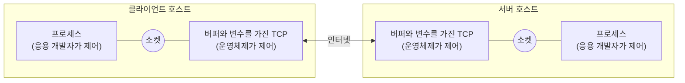
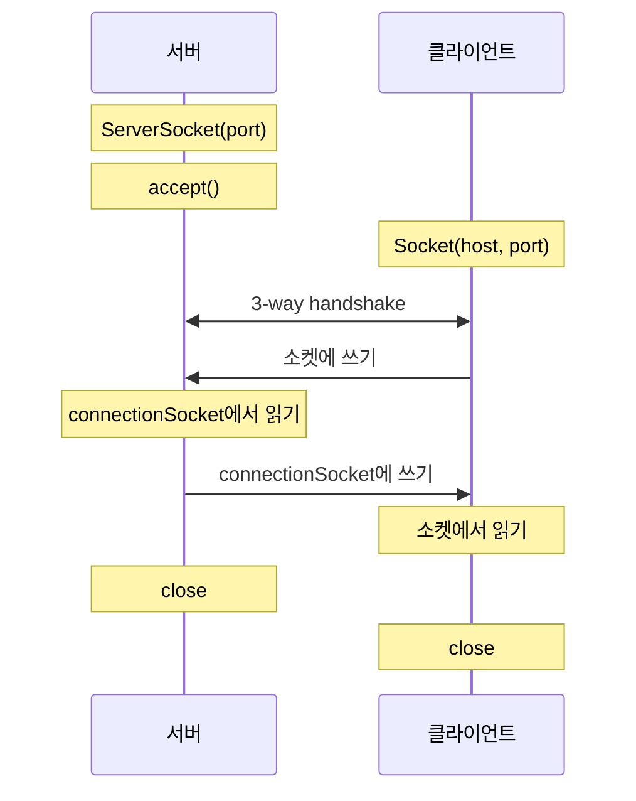

# 14강 — 네트워크 프로그래밍

[레포지토리 안내](../../README.ko.md) | [English](Concepts_Lecture.md) | [한국어](Concepts_Lecture.ko.md)

> **최종 수정일:** 2026-11-27

> **학습 목표:**
> 1. 소켓을 사용하여 클라이언트-서버 통신을 구현할 수 있다
> 2. 멀티스레드 네트워크 서버를 구축할 수 있다
> 3. Swing GUI와 소켓 통신을 결합한 응용 프로그램을 설계할 수 있다
> 4. localhost에서 실행한 에코 서버와 클라이언트의 동작을 단계별로 추적하고 연결의 종료를 처리할 수 있다
> 5. TCP의 바이트 스트림에서 메시지의 경계를 정하는 프로토콜을 설계하고 UDP 소켓과 비교할 수 있다
> 6. 연결 거부, 포트 충돌, 시간 초과 같은 네트워크 예외를 처리할 수 있다

---

## 목차

- [1. 소켓 기초](#1-소켓-기초)
  - [1.1 소켓의 개념](#11-소켓의-개념)
  - [1.2 클라이언트-서버 응용 프로그램](#12-클라이언트-서버-응용-프로그램)
  - [1.3 TCP vs. UDP](#13-tcp-vs-udp)
  - [1.4 소켓 쌍 (4-tuple)](#14-소켓-쌍-4-tuple)
  - [1.5 소켓 API](#15-소켓-api)
  - [1.6 IP 주소, 포트, localhost](#16-ip-주소-포트-localhost)
- [2. Java TCP 소켓](#2-java-tcp-소켓)
  - [2.1 ServerSocket](#21-serversocket)
  - [2.2 Socket (클라이언트)](#22-socket-클라이언트)
  - [2.3 클라이언트-서버 상호작용 흐름](#23-클라이언트-서버-상호작용-흐름)
  - [2.4 에코 서버와 클라이언트의 전 과정](#24-에코-서버와-클라이언트의-전-과정)
  - [2.5 연결의 종료와 반닫기](#25-연결의-종료와-반닫기)
- [3. 소켓을 통한 읽기와 쓰기](#3-소켓을-통한-읽기와-쓰기)
  - [3.1 문자 스트림과 flush()](#31-문자-스트림과-flush)
  - [3.2 채팅 프로그램](#32-채팅-프로그램)
  - [3.3 계산 서버](#33-계산-서버)
  - [3.4 메시지의 경계](#34-메시지의-경계)
  - [3.5 문자 인코딩의 지정](#35-문자-인코딩의-지정)
- [4. 다중 클라이언트 서버 아키텍처](#4-다중-클라이언트-서버-아키텍처)
  - [4.1 연결마다 스레드를 두는 서버의 동작](#41-연결마다-스레드를-두는-서버의-동작)
  - [4.2 서비스 스레드 사이의 공유 자원](#42-서비스-스레드-사이의-공유-자원)
- [5. GUI 기반 네트워크 애플리케이션](#5-gui-기반-네트워크-애플리케이션)
- [6. UDP 소켓](#6-udp-소켓)
- [7. 네트워크 예외와 시간 제한](#7-네트워크-예외와-시간-제한)
- [8. 흔한 실수](#8-흔한-실수)
- [요약](#요약)
- [점검 문제](#점검-문제)
- [참고 문헌](#참고-문헌)

---

<br>

## 1. 소켓 기초

### 1.1 소켓의 개념

소켓은 IP 주소와 포트 번호의 조합이다. TCP/IP를 통해 두 컴퓨터 간 통신을 위한 끝점 역할을 한다. 소켓이라는 이름은 응용 프로그램이 TCP/IP 프로토콜을 쓰도록 Berkeley Unix에서 만든 **응용 프로그래밍 인터페이스(API)** 에서 왔다. 소켓에는 두 종류가 있다.

- **스트림 소켓(stream socket)** 은 연결을 맺은 뒤 신뢰할 수 있는 양방향 바이트 스트림으로 통신하며, TCP를 쓴다.
- **데이터그램 소켓(datagram socket)** 은 연결 없이 독립된 메시지(데이터그램) 단위로 통신하며, UDP를 쓴다.



*그림 1. 응용 프로세스와 TCP 사이의 경계인 소켓*

소켓은 응용 개발자가 제어하는 프로세스와 운영체제가 제어하는 TCP 사이의 문이다. 응용 개발자는 소켓 위쪽의 프로그램을 작성하고, 소켓 아래쪽에 대해서는 최대 버퍼 크기나 최대 세그먼트 크기 같은 몇 가지 TCP 매개변수만 정할 수 있다.

### 1.2 클라이언트-서버 응용 프로그램

클라이언트-서버 응용 프로그램은 두 종류로 나뉜다.

- **표준 프로토콜의 구현:** FTP, HTTP, SMTP처럼 RFC에 정의된 프로토콜 표준을 구현한 프로그램이다. RFC가 정한 규칙을 따라야 하며, 그 프로토콜에 배정된 포트 번호를 써야 한다.
- **독자적인(proprietary) 클라이언트-서버 응용 프로그램:** 한 개발자나 팀이 클라이언트와 서버 프로그램을 모두 만든다. 개발자가 프로토콜을 완전히 통제하지만, RFC에 정의된 잘 알려진 포트 번호를 쓰지 않도록 주의해야 한다.

**잘 알려진 포트 번호(well-known port number)** 는 0\~1023번이며, IANA(Internet Assigned Numbers Authority)가 관리한다. 이 정리본의 예제는 9999, 9998, 1234번 포트를 쓴다.

### 1.3 TCP vs. UDP

| 특징 | TCP | UDP |
|:--------|:----|:----|
| 연결 방식 | 연결 지향 (3-way handshake) | 비연결형 |
| 신뢰성 | 전달 보장, 순서 보장 | 최선 노력, 순서 보장 없음 |
| 속도 | 오버헤드로 인해 느림 | 빠름, 최소 오버헤드 |
| 사용 사례 | HTTP, SSH, 파일 전송 | DNS, 비디오 스트리밍, 게임 |

*표 1. TCP와 UDP의 비교*

### 1.4 소켓 쌍 (4-tuple)

**소켓 쌍(socket pair)** 은 인터넷에서 각 TCP 연결을 고유하게 식별하는 두 끝점을 묶은 것이다. TCP 연결은 다음 4가지 요소로 고유하게 식별된다:
`(client IP, client port, server IP, server port)`

> **[컴퓨터네트워크]** 컴퓨터네트워크에서 TCP와 UDP는 IP 위에서 호스트 안의 프로세스끼리 데이터를 전달하는 전송 계층 프로토콜이며, IP 주소가 호스트를, 포트 번호가 그 호스트의 프로세스를 가리킨다. 운영체제의 TCP는 도착한 세그먼트를 어느 소켓에 넘길지 이 4-tuple로 정하므로(역다중화), 서버의 포트 하나에 여러 클라이언트가 연결해도 연결마다 별도의 연결 소켓(2절)으로 구분된다.

### 1.5 소켓 API

| 함수 | 역할 |
|:-----|:-----|
| `socket()` | 소켓을 만든다 |
| `bind()` | 소켓을 로컬 IP 주소와 포트 번호에 묶는다 |
| `listen()` | 연결 요청을 수동적으로 기다린다 |
| `connect()` | 다른 소켓에 연결을 시작한다 |
| `accept()` | 새 연결을 수락한다 |
| `write()` | 소켓에 데이터를 쓴다 |
| `read()` | 소켓에서 데이터를 읽는다 |
| `sendto()` | 다른 UDP 소켓에 데이터그램을 보낸다 |
| `recvfrom()` | UDP 소켓에서 데이터그램을 읽는다 |
| `close()` | 소켓을 닫는다 (연결을 해제한다) |

*표 2. Berkeley 소켓 API의 주요 함수*

TCP 서버는 `socket()`, `bind()`, `listen()` 뒤에 `accept()`에서 연결 요청을 기다리고, 클라이언트는 `socket()`(필요하면 `bind()`) 뒤에 `connect()`로 연결을 요청한다. TCP 연결 요청과 확인 응답(ACK)이 오가 연결이 맺어지면 양쪽이 `send()`/`write()`와 `recv()`/`read()`를 반복하고, 끝나면 `close()`로 연결을 닫는다. Java는 이 과정을 클래스로 감싸서, `new ServerSocket(port)`가 `socket()`, `bind()`, `listen()`을, `new Socket(host, port)`가 `socket()`과 `connect()`를 한 번에 수행한다.

### 1.6 IP 주소, 포트, localhost

**IP 주소(IP address)** 는 네트워크에 연결된 호스트(정확히는 그 네트워크 인터페이스)를 가리키는 번호이다. IPv4 주소는 32비트이며 `192.168.0.10`처럼 8비트씩 네 부분을 점으로 나누어 쓴다. **포트 번호(port number)** 는 한 호스트 안에서 통신하는 프로세스를 가리키는 16비트 번호(0\~65535)이다. 따라서 IP 주소가 건물의 주소라면 포트 번호는 그 건물 안의 호실에 해당하며, 소켓의 끝점은 이 둘을 합친 것이다 [1].

`localhost`는 자기 자신을 가리키는 이름이며, IPv4에서는 **루프백 주소(loopback address)** `127.0.0.1`에 대응한다. 루프백 주소로 보낸 데이터는 네트워크 카드를 거치지 않고 운영체제 안에서 바로 자기 자신에게 돌아오므로, 한 컴퓨터에서 서버와 클라이언트를 함께 실행해 시험할 수 있다. Java에서는 `InetAddress.getByName("localhost")`로 이름을 주소로 바꾸며(7절의 출력), 다른 호스트의 이름(예: `www.example.com`)을 넘기면 DNS로 조회한 주소를 얻는다.

| 포트 범위 | 이름 | 쓰임 |
|:-----|:-----|:-----|
| 0\~1023 | 잘 알려진 포트 | HTTP(80), HTTPS(443), SSH(22)처럼 표준 서비스에 배정 (1.2절) |
| 1024\~49151 | 등록된 포트 | 특정 응용 프로그램이 IANA에 등록하여 쓰는 포트 |
| 49152\~65535 | 동적 포트 | 클라이언트 소켓의 임시 포트용 범위 (실제로 배정하는 범위는 운영체제마다 다름) |

*표 3. 포트 번호의 범위*

서버는 클라이언트가 찾아올 수 있도록 정해진 포트에서 기다리고, 클라이언트 소켓의 포트는 운영체제가 비어 있는 번호를 골라 배정한다. 2.4절의 실행에서 서버의 포트는 직접 정한 5051이고, 클라이언트의 포트 62936은 운영체제가 고른 것이다. 같은 클라이언트 프로그램을 다시 실행하면 다른 번호를 받는다. 잘 알려진 포트(1023 이하)로 서버를 열려면 운영체제에 따라 관리자 권한이 필요하고 표준 서비스와 충돌할 수도 있으므로, 연습용 서버에는 1024 이상의 번호를 쓴다.

---

<br>

## 2. Java TCP 소켓

TCP 소켓 클래스는 `java.net` 패키지에 있다.

- `java.net.Socket`은 클라이언트 소켓(줄여서 소켓이라고도 한다)을 구현하며, 두 컴퓨터 사이 통신의 끝점이다. 생성자 `Socket(String host, int port)`는 스트림 소켓을 만들어 지정한 호스트의 지정한 포트에 연결하고, `getInputStream()`, `getOutputStream()`, `close()`로 입출력 스트림을 얻거나 소켓을 닫는다.
- `java.net.ServerSocket`은 서버 소켓을 구현한다. 네트워크로 들어오는 요청을 기다렸다가 요청에 따라 작업을 수행한다. 생성자 `ServerSocket(int port)`로 만들고, `accept()`는 이 소켓으로 들어오는 연결을 기다려 수락하며 연결이 맺어질 때까지 블로킹된다.

서버에는 두 종류의 소켓이 있다. **환영 소켓(welcoming socket)** 은 클라이언트의 첫 접촉을 받아들이고, **연결 소켓(connection socket)** 은 클라이언트가 처음 접촉할 때 새로 만들어져 그 클라이언트 하나만 전담한다. 클라이언트는 소켓 객체를 만들어 서버에 TCP 연결을 시작하며(3-way handshake), 이때 서버 프로세스의 주소, 즉 서버의 IP 주소와 프로세스의 포트 번호를 지정한다.

### 2.1 ServerSocket

```java
ServerSocket serverSocket = new ServerSocket(9999);
System.out.println("Waiting for connection...");
Socket clientSocket = serverSocket.accept(); // blocks until client connects
System.out.println("Client connected!");
```

`serverSocket`이 환영 소켓이고, `accept()`가 반환하는 `clientSocket`이 그 클라이언트 전용의 연결 소켓이다. 이후의 데이터 교환은 연결 소켓으로 하며, 환영 소켓은 다음 클라이언트를 받는 데 다시 쓸 수 있다.

### 2.2 Socket (클라이언트)

```java
Socket socket = new Socket("localhost", 9999);
// connection established
```

`localhost`는 자기 컴퓨터를 가리키는 호스트 이름이므로, 같은 컴퓨터에서 서버와 클라이언트를 함께 실행해 시험할 수 있다. 서버가 그 포트에서 기다리고 있지 않으면 생성자가 `ConnectException`(`IOException`의 하위 클래스)을 던진다.

### 2.3 클라이언트-서버 상호작용 흐름



*그림 2. TCP 클라이언트와 서버의 소켓 상호작용*

서버는 먼저 포트 `x`에 환영 소켓을 만들고 `accept()`에서 연결 요청을 기다린다. 클라이언트가 호스트와 포트 `x`를 지정해 소켓을 만들면 TCP 연결이 맺어지고, 서버의 `accept()`가 연결 소켓을 반환한다. 클라이언트가 요청을 보내면 서버는 연결 소켓에서 요청을 읽고 응답을 쓰며, 클라이언트는 응답을 읽는다. 끝나면 양쪽이 각자의 소켓을 닫는다.

### 2.4 에코 서버와 클라이언트의 전 과정

받은 줄을 그대로 돌려주는 **에코 서버(echo server)** 는 소켓 프로그램의 가장 작은 완전한 예이다. 다음 서버는 5051번 포트에서 클라이언트 하나를 받아, 받은 줄마다 `echo: `를 붙여 돌려주고, `bye`를 받거나 클라이언트가 연결을 닫으면 끝난다.

```java
import java.io.*;
import java.net.*;
import java.nio.charset.StandardCharsets;

public class EchoServer {
    public static void main(String[] args) throws IOException {
        int port = 5051;
        try (ServerSocket listener = new ServerSocket(port)) {             // socket, bind, listen
            System.out.println("[server] listening on port " + listener.getLocalPort());
            try (Socket s = listener.accept();                              // blocks until a connection arrives
                 BufferedReader in = new BufferedReader(
                         new InputStreamReader(s.getInputStream(), StandardCharsets.UTF_8));
                 PrintWriter out = new PrintWriter(
                         new OutputStreamWriter(s.getOutputStream(), StandardCharsets.UTF_8), true)) {
                System.out.println("[server] accepted " + s.getInetAddress().getHostAddress()
                        + ":" + s.getPort() + " on local port " + s.getLocalPort());
                String line;
                while ((line = in.readLine()) != null) {                    // null means the peer closed
                    System.out.println("[server] received \"" + line + "\"");
                    out.println("echo: " + line);                           // autoflush is on
                    if (line.equals("bye")) break;
                }
                System.out.println("[server] closing connection");
            }
        }
    }
}
```

클라이언트는 같은 컴퓨터의 5051번 포트에 연결하여 세 줄을 차례로 보내고, 줄마다 서버의 답을 읽는다.

```java wide-ok
import java.io.*;
import java.net.*;
import java.nio.charset.StandardCharsets;

public class EchoClient {
    public static void main(String[] args) throws IOException {
        try (Socket s = new Socket("localhost", 5051);                     // socket and connect
             BufferedReader in = new BufferedReader(
                     new InputStreamReader(s.getInputStream(), StandardCharsets.UTF_8));
             PrintWriter out = new PrintWriter(
                     new OutputStreamWriter(s.getOutputStream(), StandardCharsets.UTF_8), true)) {
            System.out.println("[client] connected from local port " + s.getLocalPort()
                    + " to " + s.getInetAddress().getHostAddress() + ":" + s.getPort());
            for (String msg : new String[] {"hello", "안녕", "bye"}) {
                out.println(msg);
                System.out.println("[client] sent \"" + msg + "\", got \"" + in.readLine() + "\"");
            }
            System.out.println("[client] server closed? " + (in.readLine() == null));
        }
    }
}
```

서버를 먼저 실행하고(`java EchoServer`), 다른 터미널에서 클라이언트를 실행한(`java EchoClient`) 결과는 다음과 같다. 위가 서버, 아래가 클라이언트의 출력이다.

```text wide-ok
[server] listening on port 5051
[server] accepted 127.0.0.1:62936 on local port 5051
[server] received "hello"
[server] received "안녕"
[server] received "bye"
[server] closing connection
```

```text wide-ok
[client] connected from local port 62936 to 127.0.0.1:5051
[client] sent "hello", got "echo: hello"
[client] sent "안녕", got "echo: 안녕"
[client] sent "bye", got "echo: bye"
[client] server closed? true
```

실행을 시간 순서로 추적하면 표 4와 같다. 각 단계에서 어느 쪽이 블로킹되어 기다리는지가 소켓 프로그램을 이해하는 핵심이다.

| 단계 | 서버 | 클라이언트 |
|:-----|:-----|:-----|
| 1 | `new ServerSocket(5051)`이 포트에 묶이고 듣기 시작한다 | 아직 실행되지 않았다 |
| 2 | `accept()`에서 블로킹된다 | `new Socket("localhost", 5051)`이 연결을 요청한다 |
| 3 | 3방향 핸드셰이크가 끝나면 `accept()`가 연결 소켓을 반환한다 | 생성자가 반환된다. 운영체제가 포트 62936을 배정했다 |
| 4 | `readLine()`에서 블로킹된다 | `println("hello")`로 보내고 `readLine()`에서 블로킹된다 |
| 5 | `hello`를 읽고 `echo: hello`를 보낸 뒤 다시 `readLine()`에서 기다린다 | `echo: hello`를 읽는다 |
| 6 | `안녕`, `bye`도 같은 방식으로 처리하고, `bye` 뒤에 반복을 끝낸다 | 같은 방식으로 두 줄을 보내고 답을 읽는다 |
| 7 | try-with-resources가 연결 소켓과 서버 소켓을 닫는다 | 다음 `readLine()`이 `null`을 반환한다 (서버가 닫음) |
| 8 | 끝난다 | try-with-resources가 소켓을 닫고 끝난다 |

*표 4. 에코 서버와 클라이언트의 실행 추적*

서버의 출력 `accepted 127.0.0.1:62936 on local port 5051`과 클라이언트의 출력 `connected from local port 62936 to 127.0.0.1:5051`은 같은 연결을 양쪽에서 본 것이다. 이 연결의 소켓 쌍(1.4절)은 (127.0.0.1, 62936, 127.0.0.1, 5051)이다. 연결 소켓의 로컬 포트가 서버 소켓과 같은 5051이라는 점에서, 연결 소켓이 새 포트를 쓰는 것이 아니라 같은 포트에서 소켓 쌍으로 구별된다는 것을 알 수 있다.

두 프로그램은 `PrintWriter`를 만들 때 두 번째 인자 `true`로 자동 비우기를 켜서, `println()`마다 `flush()`를 따로 호출하지 않는다(3.1절의 핵심 상자). 또 스트림을 만들 때 UTF-8을 지정했으므로 한글 `안녕`이 그대로 오간다(3.5절).

### 2.5 연결의 종료와 반닫기

TCP 연결은 양방향이다. 한쪽이 소켓을 닫으면, 상대 쪽의 읽기는 남은 데이터를 다 읽은 뒤 스트림의 끝을 만난다. `readLine()`은 `null`을, `read()`는 -1을 반환하므로(10강 3.5절) 이것으로 상대가 연결을 끝냈음을 안다. 2.4절의 클라이언트가 마지막에 `in.readLine() == null`로 서버의 종료를 확인한 것이 그 예이다.

소켓을 완전히 닫지 않고 보내는 방향만 닫을 수도 있다. `shutdownOutput()`은 이 소켓의 출력 스트림을 끝내 상대에게 스트림의 끝을 알리지만, 입력 스트림은 열어 둔다. 이렇게 한 방향만 닫는 것을 **반닫기(half-close)** 라고 한다. 보낼 데이터의 개수를 미리 알리지 않고 데이터를 모두 보냈다는 사실만 알리고 싶을 때 쓴다.

```java
import java.io.*;
import java.net.*;

public class HalfClose {
    public static void main(String[] args) throws Exception {
        try (ServerSocket listener = new ServerSocket(5053)) {
            Thread server = new Thread(() -> {
                try (Socket s = listener.accept();
                     BufferedReader in = new BufferedReader(new InputStreamReader(s.getInputStream()));
                     PrintWriter out = new PrintWriter(s.getOutputStream(), true)) {
                    int sum = 0, count = 0;
                    String line;
                    while ((line = in.readLine()) != null) {               // null after the client shuts output
                        sum += Integer.parseInt(line);
                        count++;
                    }
                    out.println(count + " numbers, sum " + sum);
                } catch (IOException e) { e.printStackTrace(); }
            });
            server.start();

            try (Socket s = new Socket("localhost", 5053);
                 PrintWriter out = new PrintWriter(s.getOutputStream(), true);
                 BufferedReader in = new BufferedReader(new InputStreamReader(s.getInputStream()))) {
                for (int v : new int[] {10, 20, 30, 40}) out.println(v);
                s.shutdownOutput();                                         // close only the sending side
                System.out.println("[client] output shut down: " + s.isOutputShutdown()
                        + ", input still open: " + !s.isInputShutdown());
                System.out.println("[client] reply: " + in.readLine());
            }
            server.join();
        }
    }
}
```

```text
[client] output shut down: true, input still open: true
[client] reply: 4 numbers, sum 100
```

클라이언트는 숫자 네 개를 보낸 뒤 `shutdownOutput()`을 호출한다. 서버의 `readLine()`은 네 줄을 읽은 다음 `null`을 반환하여 반복이 끝나고, 서버는 합 10 + 20 + 30 + 40 = 100을 돌려준다. 클라이언트의 입력 방향은 아직 열려 있으므로 이 답을 읽을 수 있다. 반닫기 대신 `close()`를 호출했다면 서버의 답을 받을 길이 없었을 것이다.

> **주의:** 소켓에서 얻은 입력 스트림이나 출력 스트림 가운데 하나를 `close()`하면 소켓 전체가 닫힌다. 한 방향만 끝내려면 스트림을 닫지 말고 소켓의 `shutdownOutput()`이나 `shutdownInput()`을 호출한다.

---

<br>

## 3. 소켓을 통한 읽기와 쓰기

### 3.1 문자 스트림과 flush()

```java
// Server side
BufferedReader in = new BufferedReader(
    new InputStreamReader(socket.getInputStream()));
BufferedWriter out = new BufferedWriter(
    new OutputStreamWriter(socket.getOutputStream()));

String message = in.readLine();
out.write("Response\n");
out.flush();
```

소켓의 `getInputStream()`과 `getOutputStream()`은 바이트 스트림을 반환하므로, `InputStreamReader`와 `OutputStreamWriter`로 문자 스트림으로 바꾸고 `BufferedReader`와 `BufferedWriter`로 감싸 줄 단위로 읽고 쓴다. 클라이언트 측도 같은 방식으로 스트림을 만든다. `readLine()`은 줄 바꿈 문자를 만날 때까지 읽으므로, 보내는 쪽은 메시지 끝에 `"\n"`을 붙여야 한다.

> **핵심:** 데이터가 버퍼에 남지 않고 즉시 전송되도록 쓰기 후 반드시 `flush()`를 호출해야 한다.

> **주의:** 상대가 연결을 닫으면 `readLine()`은 `null`을 반환한다. 3.2절의 서버 반복문처럼 받은 문자열에 바로 `equalsIgnoreCase()` 같은 메서드를 호출하면 이때 `NullPointerException`이 나므로, `null`인지 먼저 검사하는 것이 안전하다.

### 3.2 채팅 프로그램

서버와 클라이언트가 콘솔에서 한 줄씩 번갈아 메시지를 주고받는 채팅 프로그램의 서버 반복문은 다음과 같다. 클라이언트가 `bye`를 보내면 연결을 끝낸다.

```java
while (true) {
    String inputMessage = in.readLine();         // receive one line from the client
    if (inputMessage.equalsIgnoreCase("bye")) {  // end on bye
        System.out.println("Connection terminated!");
        break;
    }
    System.out.println("Client: " + inputMessage);
    System.out.print("Server>>");
    String outputMessage = scanner.nextLine();   // reply typed by the server user
    out.write(outputMessage + "\n");
    out.flush();
}
```

클라이언트는 반대로 `Scanner`로 입력받은 줄을 보내고 서버의 답장을 읽는 일을 반복하며, 사용자가 `bye`를 입력하면 그것을 서버에 보낸 뒤 반복을 끝낸다. 양쪽 모두 `finally` 블록에서 `Scanner`와 소켓(서버는 `ServerSocket`도)을 닫는다. 실습 코드는 [SimpleChatServer.java](../../Coursework/Lab14_Network-Programming/SimpleChatServer.java)와 [SimpleChatClient.java](../../Coursework/Lab14_Network-Programming/SimpleChatClient.java)이다.

### 3.3 계산 서버

클라이언트가 `12 + 3`처럼 피연산자, 연산자, 피연산자를 공백으로 구분한 수식을 보내면 서버가 계산하여 결과를 돌려주는 프로그램이다. 서버는 받은 줄을 다음 `calc()`로 처리한다.

```java
public static String calc(String exp) {
    StringTokenizer st = new StringTokenizer(exp, " ");
    if (st.countTokens() != 3) return "error";   // error unless there are three tokens
    String res = "";
    int op1 = Integer.parseInt(st.nextToken());
    String opcode = st.nextToken();
    int op2 = Integer.parseInt(st.nextToken());
    switch (opcode) {
        case "+": res = Integer.toString(op1 + op2); break;
        case "-": res = Integer.toString(op1 - op2); break;
        case "*": res = Integer.toString(op1 * op2); break;
        default : res = "error";                 // unsupported operator
    }
    return res;
}
```

`StringTokenizer`는 문자열을 구분자(여기서는 공백)로 잘라 토큰을 하나씩 꺼낸다. 공백 없이 `1+1`을 보내면 토큰이 하나뿐이므로 `error`가 반환된다. 피연산자가 정수가 아니면 `Integer.parseInt()`가 `NumberFormatException`을 던지는데, 이 서버는 그 예외를 처리하지 않는다.

### 3.4 메시지의 경계

TCP는 바이트의 순서를 지켜 빠짐없이 전달하지만, 보내는 쪽이 `write()`를 몇 번에 나누어 호출했는지는 전달하지 않는다. 연결은 끝없이 이어지는 하나의 바이트 스트림이며, 메시지가 어디서 끝나는지 표시하는 일은 응용 프로그램의 몫이다.

```java
import java.io.*;
import java.net.*;

public class Boundaries {
    public static void main(String[] args) throws Exception {
        try (ServerSocket listener = new ServerSocket(5052)) {
            Thread client = new Thread(() -> {
                try (Socket s = new Socket("localhost", 5052)) {
                    OutputStream raw = s.getOutputStream();
                    raw.write("Hello".getBytes());                          // two writes
                    raw.write("World".getBytes());
                    raw.flush();
                    Thread.sleep(200);
                    DataOutputStream data = new DataOutputStream(raw);
                    data.writeUTF("first message");                         // length-prefixed
                    data.writeUTF("second message");
                    data.flush();
                } catch (Exception e) { e.printStackTrace(); }
            });
            client.start();
            try (Socket s = listener.accept()) {
                InputStream in = s.getInputStream();
                Thread.sleep(100);                                          // let both writes arrive
                byte[] buf = new byte[100];
                int n = in.read(buf);
                System.out.println("one read() returned " + n + " bytes: " + new String(buf, 0, n));

                DataInputStream data = new DataInputStream(in);
                System.out.println("readUTF: " + data.readUTF());
                System.out.println("readUTF: " + data.readUTF());
            }
            client.join();
        }
    }
}
```

```text
one read() returned 10 bytes: HelloWorld
readUTF: first message
readUTF: second message
```

클라이언트는 `Hello`와 `World`를 두 번의 `write()`로 보냈지만, 서버의 `read()` 한 번은 두 메시지를 합친 10바이트 `HelloWorld`를 반환했다. 반대로 긴 메시지 하나를 보내도 받는 쪽의 `read()` 한 번에 일부만 올 수도 있다. 그래서 응용 프로그램은 다음 가운데 한 가지 방법으로 메시지의 경계를 정하는 **프로토콜(protocol)**, 즉 두 프로그램이 따르기로 약속한 메시지의 형식을 정해야 한다.

- **구분자:** 메시지 끝에 줄바꿈 같은 특별한 문자를 둔다. 3.2절의 채팅과 3.3절의 계산 서버가 이 방법을 쓰며, 받는 쪽은 `readLine()`으로 한 줄씩 읽는다. 메시지 안에 구분자가 들어갈 수 없다는 제약이 있다.
- **길이 접두사:** 메시지 앞에 바이트 수를 먼저 보낸다. `DataOutputStream.writeUTF()`는 2바이트의 길이를 앞에 붙이므로(10강 3.4절), 받는 쪽의 `readUTF()`가 그 길이만큼 정확히 읽어 메시지를 하나씩 돌려준다. 위 출력의 마지막 두 줄이 그 결과이다.
- **고정 길이:** 모든 메시지를 같은 크기로 보낸다. 10강 3.6절의 고정 길이 레코드와 같은 생각이다.

### 3.5 문자 인코딩의 지정

소켓은 바이트를 주고받으므로, 문자열을 보내려면 양쪽이 같은 문자 인코딩으로 바꾸어야 한다(10강 1.5절). 3.1절의 코드처럼 `new InputStreamReader(socket.getInputStream())`으로 인코딩을 생략하면 각 프로그램의 기본 문자 집합이 쓰인다. JDK 18 이상의 두 프로그램끼리는 모두 UTF-8이지만, 이전 버전의 JVM이나 다른 언어로 작성된 상대와 통신할 때는 한글이 깨질 수 있다. 2.4절의 에코 프로그램처럼 `new InputStreamReader(socket.getInputStream(), StandardCharsets.UTF_8)`로 양쪽에 같은 인코딩을 명시하면 이런 문제가 없다. 한글 `안녕`은 UTF-8로 6바이트이므로, 서버가 받은 줄은 바이트 6개와 줄바꿈 문자 1바이트로 전송되었다.

---

<br>

## 4. 다중 클라이언트 서버 아키텍처

여러 클라이언트를 동시에 처리하는 서버는 클라이언트 연결마다 별도의 스레드를 사용한다.

```java
while (true) {
    Socket clientSocket = serverSocket.accept();
    new Thread(new ClientHandler(clientSocket)).start();
}
```

각 `ClientHandler`는 자체 I/O 스트림을 독립적으로 관리하므로, 서버가 여러 클라이언트를 동시에 처리할 수 있다.

`accept()`와 `readLine()`은 모두 블로킹 호출이므로, 스레드 하나로 서버를 만들면 한 클라이언트와 통신하는 동안 다른 클라이언트의 연결을 받을 수 없다. 5절의 GUI 계산 서버는 이 문제를 두 종류의 스레드로 푼다.

- **ServerThread:** 환영 소켓을 만들고 `accept()`를 반복한다. 연결이 들어올 때마다 로그 창에 기록하고 그 연결 소켓으로 ServiceThread를 만들어 시작한다.
- **ServiceThread:** 클라이언트 하나를 전담한다. 클라이언트가 첫 피연산자, 연산자, 둘째 피연산자를 한 줄씩 세 줄로 보내면 결과를 계산해 한 줄로 답하고, 0으로 나누면 `Cannot divide by zero!`, 알 수 없는 연산자이면 `Wrong input`을 보낸다. 클라이언트가 연결을 끊어 `IOException`이 나면 로그에 기록하고 `run()`에서 반환하여 스레드를 끝낸다.

영어 철자 검사 서버도 같은 구조이다. 서버는 시작할 때 사전 파일 `words.txt`의 단어 25,143개를 `Vector<String>`에 읽어 들이고, 클라이언트가 단어를 보내면 `contains()`로 사전에 있는지 확인하여 `CORRECT!` 또는 `INCORRECT`를 답한다. `Vector.contains()`는 원소를 처음부터 차례로 비교하므로, 단어가 많으면 `HashSet` 같은 해시 기반 집합이 더 빠르다.

### 4.1 연결마다 스레드를 두는 서버의 동작

4절의 구조가 실제로 여러 클라이언트를 동시에 처리하는지는 시간을 재어 확인할 수 있다. 다음 서버는 받은 줄을 대문자로 바꾸어 돌려주며, 처리에 0.1초가 걸린다고 가정하여 `sleep(100)`을 둔다. 두 클라이언트 `a`와 `b`가 동시에 접속해 각각 다섯 줄을 보낸다.

```java
import java.io.*;
import java.net.*;

public class MultiEcho {
    static void serve(Socket s) {
        String who = Thread.currentThread().getName();
        try (s; BufferedReader in = new BufferedReader(new InputStreamReader(s.getInputStream()));
             PrintWriter out = new PrintWriter(s.getOutputStream(), true)) {
            String line;
            while ((line = in.readLine()) != null) {
                Thread.sleep(100);                                         // pretend the work takes time
                out.println(line.toUpperCase());
            }
            System.out.println("[" + who + "] client port " + s.getPort() + " done");
        } catch (Exception e) { System.out.println("[" + who + "] " + e); }
    }

    static void client(String name, int n) {
        try (Socket s = new Socket("localhost", 5056);
             BufferedReader in = new BufferedReader(new InputStreamReader(s.getInputStream()));
             PrintWriter out = new PrintWriter(s.getOutputStream(), true)) {
            long t0 = System.nanoTime();
            for (int i = 0; i < n; i++) { out.println(name + i); in.readLine(); }
            System.out.printf("[%s] %d replies in %d ms%n", name, n, (System.nanoTime() - t0) / 1_000_000 / 100 * 100);
        } catch (IOException e) { System.out.println(e); }
    }

    public static void main(String[] args) throws Exception {
        ServerSocket listener = new ServerSocket(5056);
        Thread acceptor = new Thread(() -> {
            int id = 0;
            try {
                while (true) {
                    Socket s = listener.accept();
                    new Thread(() -> serve(s), "service-" + id++).start();  // a service thread per connection
                }
            } catch (IOException e) { }
        }, "acceptor");
        acceptor.setDaemon(true);
        acceptor.start();

        long t0 = System.nanoTime();
        Thread a = new Thread(() -> client("a", 5)), b = new Thread(() -> client("b", 5));
        a.start(); b.start(); a.join(); b.join();
        System.out.printf("both clients finished in %d ms%n", (System.nanoTime() - t0) / 1_000_000 / 100 * 100);
        Thread.sleep(100);
        listener.close();
    }
}
```

```text
[a] 5 replies in 500 ms
[b] 5 replies in 500 ms
[service-0] client port 63022 done
[service-1] client port 63023 done
both clients finished in 500 ms
```

`acceptor` 스레드는 연결이 올 때마다 `service-0`, `service-1`이라는 서비스 스레드를 새로 만들어 연결 소켓을 맡긴다. 두 클라이언트는 각자 다섯 번의 답을 받는 데 약 500밀리초(0.1초 × 5)가 걸렸고, 두 클라이언트가 모두 끝나는 데도 약 500밀리초가 걸렸다. 두 연결이 서로 다른 스레드에서 동시에 처리되었기 때문이다. 서버가 스레드 하나로 연결을 차례로 처리했다면, 두 번째 클라이언트는 첫 번째 클라이언트가 끝날 때까지 기다려야 하므로 전체가 약 1,000밀리초 걸렸을 것이다. `serve()`의 `try (s; ...)`는 이미 만든 소켓 변수 `s`도 try-with-resources로 닫게 한다(10강 2.4절).

`acceptor`를 데몬 스레드로 만든 것은 `accept()`에서 계속 기다리는 이 스레드 때문에 프로그램이 끝나지 않는 일을 막기 위해서이다(13강 3.4절). 서버 소켓을 `close()`하면 `accept()`에서 기다리던 스레드에 `SocketException`이 던져지므로, 그 예외를 잡아 반복을 끝내는 방식으로 서버를 정상 종료할 수 있다.

> **참고:** **스레드 풀을 쓰는 서버.** 연결마다 스레드를 새로 만들면, 클라이언트가 수천 개로 늘어날 때 스레드를 만드는 비용(13강 1.6절)과 메모리가 문제가 된다. 실제 서버는 `ExecutorService pool = Executors.newFixedThreadPool(16);`처럼 크기가 정해진 스레드 풀을 만들고, `accept()`가 반환한 연결마다 `pool.execute(() -> serve(s))`로 작업을 맡긴다. 동시에 처리하는 연결의 수가 풀의 크기로 제한되고, 남는 연결은 풀의 작업 큐에서 차례를 기다린다(15강 5절).

### 4.2 서비스 스레드 사이의 공유 자원

서비스 스레드가 서로 독립적인 일만 하면 동기화가 필요 없다. 그러나 채팅 서버처럼 한 클라이언트의 메시지를 모든 클라이언트에게 보내려면, 서비스 스레드들이 접속한 클라이언트의 목록을 함께 써야 한다. 한 스레드가 새 클라이언트를 목록에 넣는 동안 다른 스레드가 목록을 순회하며 메시지를 보내면, 9강 3.15절의 `ConcurrentModificationException`이나 13강 4.2절의 갱신 손실 같은 문제가 생긴다.

```java
private final List<PrintWriter> clients = new ArrayList<>();

void join(PrintWriter out) {
    synchronized (clients) { clients.add(out); }
}

void broadcast(String msg) {
    synchronized (clients) {                 // keep the list unchanged while iterating
        for (PrintWriter out : clients) out.println(msg);
    }
}
```

목록을 고치는 곳과 순회하는 곳을 모두 같은 객체 `clients`로 동기화하면, 한 번에 한 스레드만 목록을 다룬다(15강 4절). 3절의 계산 서버나 철자 검사 서버처럼 서비스 스레드가 공유 자료를 읽기만 하면 동기화가 필요 없다. 철자 검사 서버의 사전 `Vector<String>`은 서버가 시작할 때 한 번 채운 뒤 읽기만 하므로 안전하다.

---

<br>

## 5. GUI 기반 네트워크 애플리케이션

Swing과 소켓을 결합하면 다음과 같은 대화형 네트워크 애플리케이션을 만들 수 있다:
- 클라이언트가 수식을 입력하고 서버가 결과를 반환하는 GUI 계산기
- 서버가 사전을 저장하고 클라이언트의 질의를 검증하는 철자 검사기
- 실시간 메시지 교환이 가능한 채팅 애플리케이션

GUI 계산기의 서버 창은 `JScrollPane`에 넣은 `JTextArea`에 접속과 계산 기록을 `append()`로 남기고, 소켓 처리는 4절의 ServerThread에 맡긴다. 클라이언트 창은 피연산자, 연산자, 피연산자를 입력하는 `JTextField` 세 개와 결과 칸, Calculate 버튼으로 이루어지며, 버튼의 액션 리스너가 세 값을 서버에 보내고 받은 결과를 결과 칸에 표시한다. 철자 검사 클라이언트는 `JTextField`에서 Enter 키를 누를 때 발생하는 액션 이벤트로 단어를 보내고 결과를 레이블에 표시한다.

> **핵심:** GUI가 멈추는 것을 방지하기 위해, 네트워크 I/O는 Swing EDT(Event Dispatch Thread)와 별도의 스레드에서 실행해야 한다.

> **주의:** 위 클라이언트들은 액션 리스너 안에서 `readLine()`으로 응답을 기다리므로, 응답이 올 때까지 EDT가 멈춘다. 같은 컴퓨터의 서버가 바로 답하는 예제에서는 드러나지 않지만, 응답이 늦어지면 창이 반응하지 않는다. 오래 걸릴 수 있는 통신은 별도 스레드에서 실행하고, 결과를 화면에 반영하는 작업은 `SwingUtilities.invokeLater()`로 EDT에 넘긴다(12강 5.7절, 5.8절).

---

<br>

## 6. UDP 소켓

TCP의 스트림 소켓과 달리 UDP의 **데이터그램 소켓(datagram socket)** 은 연결을 맺지 않고, 독립된 메시지 하나인 데이터그램을 주고받는다. 데이터그램은 그 자체로 완결된 메시지이며, 도착 여부, 도착 시각, 내용이 보장되지 않는다 [2]. 대신 연결 설정과 확인 응답이 없어 지연이 짧고, 데이터그램 하나가 메시지 하나이므로 3.4절의 메시지 경계 문제가 없다. Java에서는 `java.net.DatagramSocket`으로 소켓을 만들고, 보내거나 받을 데이터와 상대의 주소를 `DatagramPacket`에 담는다.

```java wide-ok
import java.net.*;
import java.nio.charset.StandardCharsets;

public class UdpEcho {
    public static void main(String[] args) throws Exception {
        try (DatagramSocket server = new DatagramSocket(5055);
             DatagramSocket client = new DatagramSocket()) {               // the OS picks the port
            Thread t = new Thread(() -> {
                try {
                    byte[] buf = new byte[512];
                    DatagramPacket p = new DatagramPacket(buf, buf.length);
                    server.receive(p);                                      // receive one datagram
                    String msg = new String(p.getData(), 0, p.getLength(), StandardCharsets.UTF_8);
                    System.out.println("[server] " + p.getLength() + " bytes from port " + p.getPort() + ": " + msg);
                    byte[] reply = ("echo: " + msg).getBytes(StandardCharsets.UTF_8);
                    server.send(new DatagramPacket(reply, reply.length, p.getSocketAddress()));
                } catch (Exception e) { e.printStackTrace(); }
            });
            t.start();

            byte[] data = "ping 자바".getBytes(StandardCharsets.UTF_8);
            client.send(new DatagramPacket(data, data.length, InetAddress.getLoopbackAddress(), 5055));
            byte[] buf = new byte[512];
            DatagramPacket reply = new DatagramPacket(buf, buf.length);
            client.setSoTimeout(1000);
            client.receive(reply);
            System.out.println("[client] local port " + client.getLocalPort() + ", reply: "
                    + new String(reply.getData(), 0, reply.getLength(), StandardCharsets.UTF_8));
            t.join();
        }
    }
}
```

```text wide-ok
[server] 11 bytes from port 59507: ping 자바
[client] local port 59507, reply: echo: ping 자바
```

서버는 `new DatagramSocket(5055)`로 5055번 포트에 묶이고, `receive(p)`에서 데이터그램이 올 때까지 블로킹된다. 클라이언트는 포트를 지정하지 않은 `new DatagramSocket()`을 만들어 운영체제가 고른 포트(59507)를 쓰며, 보낼 때마다 `DatagramPacket`에 목적지 주소와 포트를 함께 넣는다. 연결이 없으므로 서버는 받은 패킷의 `getSocketAddress()`에서 보낸 쪽의 주소를 알아내 그곳으로 답을 보낸다. `p.getLength()`는 실제로 받은 바이트 수 11(`ping` 4바이트, 공백 1바이트, `자바` 6바이트)이며, 버퍼의 크기 512와 구별해야 한다.

| 항목 | TCP (`Socket`, `ServerSocket`) | UDP (`DatagramSocket`) |
|:-----|:-----|:-----|
| 연결 | 데이터를 보내기 전에 연결을 맺는다 | 연결 없이 보낸다 |
| 소켓의 수 | 서버는 환영 소켓 하나와 연결마다 연결 소켓 | 서버와 클라이언트가 각각 소켓 하나 |
| 데이터의 단위 | 경계 없는 바이트 스트림 | 경계가 있는 데이터그램 |
| 신뢰성 | 순서대로 빠짐없이 전달된다 | 잃어버리거나, 중복되거나, 순서가 바뀔 수 있다 |
| 입출력 | `getInputStream()`, `getOutputStream()` | `send(packet)`, `receive(packet)` |
| 목적지 지정 | 연결할 때 한 번 | 데이터그램마다 |

*표 5. Java에서의 TCP 소켓과 UDP 소켓*

UDP에서는 보낸 데이터그램이 사라져도 아무도 알려 주지 않는다. 위 클라이언트가 `setSoTimeout(1000)`으로 받기에 시간 제한을 둔 것도, 답이 오지 않으면 `receive()`가 영원히 기다리지 않게 하기 위해서이다. 신뢰성이 필요하면 응용 프로그램이 번호를 붙이고 재전송하는 일을 직접 해야 한다.

---

<br>

## 7. 네트워크 예외와 시간 제한

네트워크 프로그램은 상대가 없거나, 포트가 이미 쓰이고 있거나, 응답이 오지 않는 상황을 항상 고려해야 한다. 다음 프로그램은 세 가지 대표적인 예외를 일부러 일으킨다.

```java
import java.io.*;
import java.net.*;

public class NetErrors {
    public static void main(String[] args) throws Exception {
        try {
            new Socket("localhost", 5999).close();                          // a port nobody listens on
        } catch (ConnectException e) {
            System.out.println("ConnectException: " + e.getMessage());
        }

        try (ServerSocket first = new ServerSocket(5054)) {
            try (ServerSocket second = new ServerSocket(5054)) {
                System.out.println("second bind succeeded");
            } catch (BindException e) {
                System.out.println("BindException: " + e.getMessage());
            }

            try (Socket c = new Socket("localhost", 5054); Socket s = first.accept()) {
                c.setSoTimeout(500);                                        // read timeout 0.5 s
                long t0 = System.nanoTime();
                try {
                    c.getInputStream().read();
                } catch (SocketTimeoutException e) {
                    System.out.printf("SocketTimeoutException after %d ms: %s%n",
                            (System.nanoTime() - t0) / 1_000_000 / 100 * 100, e.getMessage());
                }
            }
        }
        InetAddress lo = InetAddress.getByName("localhost");
        System.out.println("localhost -> " + lo.getHostAddress() + ", loopback? " + lo.isLoopbackAddress());
    }
}
```

```text
ConnectException: Connection refused
BindException: Address already in use
SocketTimeoutException after 500 ms: Read timed out
localhost -> 127.0.0.1, loopback? true
```

| 예외 | 원인 | 대처 |
|:-----|:-----|:-----|
| `ConnectException: Connection refused` | 상대 호스트의 그 포트에서 기다리는 서버가 없다 | 서버가 실행 중인지, 주소와 포트가 맞는지 확인하고 사용자에게 알린다 |
| `BindException: Address already in use` | 같은 포트를 다른 서버 소켓이 이미 쓰고 있다 | 다른 포트를 쓰거나, 앞의 서버를 끝낸다 |
| `SocketTimeoutException: Read timed out` | `setSoTimeout()`으로 정한 시간 안에 데이터가 오지 않았다 | 다시 시도하거나 연결을 끝낸다 |
| `UnknownHostException` | 호스트 이름을 주소로 바꿀 수 없다 | 이름의 철자와 네트워크 연결을 확인한다 |
| `SocketException: Connection reset` | 상대가 연결을 비정상적으로 끊었다 | 그 연결을 닫고 정리한다 |

*표 6. 대표적인 네트워크 예외*

`ConnectException`, `BindException`, `SocketTimeoutException`, `UnknownHostException`은 모두 `IOException`의 하위 클래스이다. 특히 `setSoTimeout(ms)`는 소켓의 읽기 연산이 최대 ms 동안만 블로킹되게 하며, 시간이 지나면 `SocketTimeoutException`을 던진다 [3]. 위 출력에서 아무것도 보내지 않는 상대에게서 읽으려 한 `read()`는 약 0.5초 뒤에 예외로 끝났다. 시간 제한이 없으면 상대가 응답하지 않을 때 스레드가 영원히 멈추므로, 실제 프로그램에서는 읽기에 시간 제한을 두는 것이 안전하다. 시간 초과 뒤에도 소켓 자체는 유효하므로 다시 읽기를 시도할 수 있다. 예외 메시지의 문구(`Connection refused` 등)는 이 실행을 한 macOS의 것이며, 운영체제에 따라 조금 다를 수 있다.

마지막 줄은 `localhost`가 루프백 주소 127.0.0.1로 바뀐다는 것을 보여 준다(1.6절).

---

<br>

## 8. 흔한 실수

| 실수 | 일어나는 일 | 바로잡는 방법 |
|:-----|:-----|:-----|
| 쓴 뒤에 `flush()`를 호출하지 않는다 | 데이터가 버퍼에 남아 상대가 계속 기다린다 | `flush()`를 호출하거나 자동 비우기 `PrintWriter`를 쓴다 |
| `readLine()`으로 읽는 상대에게 줄바꿈 없이 보낸다 | 상대의 `readLine()`이 반환하지 않는다 | 메시지 끝에 `"\n"`을 붙이거나 `println()`을 쓴다 |
| `write()` 한 번이 `read()` 한 번에 그대로 도착한다고 가정한다 | 메시지가 합쳐지거나 나뉘어 해석이 틀린다 | 구분자나 길이 접두사로 메시지의 경계를 정한다 |
| `readLine()`의 `null`을 검사하지 않는다 | 상대가 닫은 뒤 `NullPointerException`이 난다 | `while ((line = in.readLine()) != null)`로 읽는다 |
| 한 방향만 끝내려고 소켓의 스트림을 닫는다 | 소켓 전체가 닫혀 답을 받지 못한다 | `shutdownOutput()`을 쓴다 |
| 서버를 스레드 하나로 만든다 | 한 클라이언트를 처리하는 동안 다른 클라이언트가 기다린다 | 연결마다 서비스 스레드나 스레드 풀을 쓴다 |
| 서비스 스레드들이 공유 목록을 동기화 없이 고친다 | 예외가 나거나 클라이언트가 빠진다 | 목록의 모든 접근을 같은 락으로 동기화한다 |
| 인코딩을 지정하지 않는다 | 상대의 기본 문자 집합이 다르면 한글이 깨진다 | 양쪽에 `StandardCharsets.UTF_8`을 지정한다 |
| 읽기에 시간 제한을 두지 않는다 | 응답하지 않는 상대 때문에 스레드가 영원히 멈춘다 | `setSoTimeout()`을 설정한다 |
| 연습용 서버를 1023 이하의 포트로 연다 | 권한 문제로 `BindException` 등이 날 수 있다 | 1024 이상의 포트를 쓴다 |

*표 7. 네트워크 프로그래밍의 흔한 실수*

---

<br>

## 요약

| 개념 | 핵심 요약 |
|:--------|:----------|
| 소켓 | IP 주소와 포트 번호로 식별되는 통신의 끝점이며, TCP용 스트림 소켓과 UDP용 데이터그램 소켓이 있다. |
| 소켓 쌍 | 클라이언트 IP, 클라이언트 포트, 서버 IP, 서버 포트의 4-tuple이 TCP 연결 하나를 식별한다. |
| ServerSocket | 포트에서 들어오는 연결을 기다리는 환영 소켓이며, `accept()`가 클라이언트 전용 연결 소켓을 반환한다. |
| Socket (클라이언트) | 서버의 호스트와 포트를 지정해 TCP 연결을 시작한다. |
| BufferedReader/Writer | 소켓의 바이트 스트림을 감싸 텍스트를 줄 단위로 읽고 쓴다. |
| flush() | 버퍼에 쌓인 데이터가 실제로 전송되도록 보장한다. |
| 다중 클라이언트 | 연결을 받는 스레드와 클라이언트마다 하나씩 두는 서비스 스레드로 여러 클라이언트를 동시에 처리한다. |
| GUI + 네트워크 | 네트워크 I/O를 EDT에서 분리하여 실행해야 GUI가 멈추지 않는다. |
| 루프백 주소 | `localhost`는 127.0.0.1이며, 보낸 데이터가 같은 컴퓨터로 돌아오므로 서버와 클라이언트를 함께 시험할 수 있다. |
| 블로킹 호출 | `accept()`와 `readLine()`은 연결이나 데이터가 올 때까지 기다리며, 소켓 프로그램의 흐름은 어느 쪽이 기다리는지로 이해한다. |
| 반닫기 | `shutdownOutput()`은 보내는 방향만 닫아 상대에게 스트림의 끝을 알리고 답은 계속 받을 수 있게 한다. |
| 메시지의 경계 | TCP는 경계 없는 바이트 스트림이므로 구분자, 길이 접두사, 고정 길이로 메시지를 나누는 프로토콜이 필요하다. |
| UDP | 연결 없이 경계가 있는 데이터그램을 보내며, 전달과 순서가 보장되지 않는다. |
| 시간 제한 | `setSoTimeout()`은 읽기의 블로킹 시간을 제한하고, 시간이 지나면 `SocketTimeoutException`을 던진다. |

---

<br>

## 점검 문제

1. **환영 소켓과 연결 소켓:** 4절의 GUI 계산 서버에 클라이언트 3개가 동시에 접속해 있다. 서버 쪽에 있는 `ServerSocket` 객체와 `Socket` 객체는 각각 몇 개인가?

   <details>
   <summary>정답</summary>

   `ServerSocket`은 1개, `Socket`은 3개이다. 환영 소켓인 `ServerSocket` 하나가 모든 연결 요청을 받고, `accept()`가 클라이언트마다 새 연결 소켓을 반환하므로 클라이언트 수만큼 `Socket`이 있다. 각 연결 소켓은 ServiceThread 하나가 맡는다.

   </details>

2. **flush():** 계산 서버가 `out.write(res + "\n");` 뒤에 `out.flush();`를 빠뜨렸다. 클라이언트는 어떻게 되는가?

   <details>
   <summary>정답</summary>

   결과가 `BufferedWriter`의 버퍼에 남아 전송되지 않으므로, 클라이언트의 `readLine()`은 응답을 받지 못하고 계속 블로킹된다. 서버도 다음 요청을 기다리므로 양쪽이 서로를 기다리며 멈춘다. 버퍼가 가득 차거나 스트림이 닫히거나 `flush()`가 호출되어야 데이터가 전송된다.

   </details>

3. **계산 서버:** 3.3절의 `calc()`에 다음 문자열을 넘기면 각각 무엇을 반환하는가? (a) `"12 + 3"` (b) `"7 * 6"` (c) `"10 / 2"` (d) `"1+1"`

   <details>
   <summary>정답</summary>

   (a) `"15"` (b) `"42"` (c) `"error"` (d) `"error"`이다. (c)는 토큰이 세 개이지만 `switch`에 `/`가 없어 `default`로 가고, (d)는 공백이 없어 토큰이 `1+1` 하나뿐이므로 `countTokens()`가 3이 아니다.

   </details>

4. **줄 바꿈 문자:** 클라이언트가 `out.write(outputMessage);`처럼 줄 바꿈 문자 없이 보내고 `flush()`를 호출했다. 서버의 `in.readLine()`은 어떻게 되는가?

   <details>
   <summary>정답</summary>

   데이터는 서버에 도착하지만 `readLine()`은 줄 바꿈 문자가 올 때까지 반환하지 않으므로 계속 기다린다. 클라이언트가 연결을 닫으면 그때까지 받은 내용을 반환하지만, 대화를 이어 가려면 메시지마다 `"\n"`을 붙여야 한다.

   </details>

5. **소켓 쌍:** 한 클라이언트 컴퓨터에서 두 개의 클라이언트 프로그램이 같은 서버의 9999번 포트에 동시에 연결했다. 서버는 두 연결을 어떻게 구분하는가?

   <details>
   <summary>정답</summary>

   두 연결은 클라이언트 IP, 서버 IP, 서버 포트가 같지만 클라이언트 포트가 다르다. 클라이언트 쪽 포트는 운영체제가 연결마다 비어 있는 번호를 골라 배정하므로 4-tuple이 서로 달라지고, 서버는 각 연결을 서로 다른 연결 소켓으로 다룬다.

   </details>

6. **에코 추적:** 2.4절의 서버를 실행하지 않은 채 클라이언트만 실행하면 무엇이 출력되는가? 서버가 실행 중일 때 클라이언트가 `bye` 대신 `quit`을 마지막으로 보내고 소켓을 닫으면 서버는 어떻게 끝나는가?

   <details>
   <summary>정답</summary>

   서버가 없으면 `new Socket("localhost", 5051)`이 `ConnectException: Connection refused`를 던지고, `main`이 이를 처리하지 않으므로 예외의 스택 추적이 출력되며 끝난다(7절). `quit`을 보낸 경우 서버는 `echo: quit`을 돌려준 뒤 다시 `readLine()`에서 기다린다. 클라이언트가 소켓을 닫으면 그 `readLine()`이 `null`을 반환하여 반복이 끝나고, `closing connection`을 출력한 뒤 정상적으로 끝난다.

   </details>

7. **메시지의 경계:** 클라이언트가 `writeUTF("ab")`와 `writeUTF("자바")`를 차례로 보냈다. 연결로 전송되는 바이트는 모두 몇 개이고, 받는 쪽이 `read(buf)`를 한 번 호출해 모두 받았다면 그 내용을 어떻게 메시지 두 개로 나눌 수 있는가?

   <details>
   <summary>정답</summary>

   `ab`는 길이 2바이트와 내용 2바이트로 4바이트, `자바`는 길이 2바이트와 내용 6바이트로 8바이트이므로 모두 12바이트이다. 받는 쪽은 처음 2바이트 `00 02`에서 첫 메시지의 길이 2를 읽고 그만큼을 첫 메시지로, 이어지는 2바이트 `00 06`에서 다음 길이 6을 읽고 그만큼을 둘째 메시지로 자른다. `DataInputStream.readUTF()`를 두 번 호출하면 이 일을 대신한다.

   </details>

8. **TCP와 UDP:** 실시간 음성 통화 프로그램과 파일 전송 프로그램에는 각각 TCP와 UDP 가운데 어느 것이 알맞은가? 이유를 쓰라.

   <details>
   <summary>정답</summary>

   음성 통화에는 UDP가 알맞다. 조금 늦게 도착한 음성 데이터는 이미 쓸모가 없으므로, 잃어버린 데이터를 재전송하느라 지연이 생기는 TCP보다 일부 손실을 감수하고 지연이 짧은 UDP가 낫다. 파일 전송에는 TCP가 알맞다. 바이트 하나라도 빠지거나 순서가 바뀌면 파일이 망가지므로, 순서대로 빠짐없이 전달하는 TCP의 신뢰성이 필요하다.

   </details>

---

<br>

## 참고 문헌

1. Oracle, "What Is a Socket?," *The Java Tutorials: Custom Networking, All About Sockets*. https://docs.oracle.com/javase/tutorial/networking/sockets/definition.html
2. Oracle, "What Is a Datagram?," *The Java Tutorials: Custom Networking, All About Datagrams*. https://docs.oracle.com/javase/tutorial/networking/datagrams/definition.html
3. Oracle, "Socket (Java SE 21 & JDK 21)," *Java Platform, Standard Edition 21 API Specification*. https://docs.oracle.com/en/java/javase/21/docs/api/java.base/java/net/Socket.html
