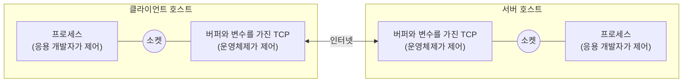

# 14강 — 네트워크 프로그래밍

[레포지토리 안내](../../README.ko.md) | [English](Concepts_Lecture.md) | [한국어](Concepts_Lecture.ko.md)

> **최종 수정일:** 2026-10-26

> **학습 목표:**
> 1. 소켓을 사용하여 클라이언트-서버 통신을 구현할 수 있다
> 2. 멀티스레드 네트워크 서버를 구축할 수 있다
> 3. Swing GUI와 소켓 통신을 결합한 응용 프로그램을 설계할 수 있다

---

## 목차

- [1. 소켓 기초](#1-소켓-기초)
  - [1.1 소켓이란?](#11-소켓이란)
  - [1.2 클라이언트-서버 응용 프로그램](#12-클라이언트-서버-응용-프로그램)
  - [1.3 TCP vs. UDP](#13-tcp-vs-udp)
  - [1.4 소켓 쌍 (4-tuple)](#14-소켓-쌍-4-tuple)
  - [1.5 소켓 API](#15-소켓-api)
- [2. Java TCP 소켓](#2-java-tcp-소켓)
  - [2.1 ServerSocket](#21-serversocket)
  - [2.2 Socket (클라이언트)](#22-socket-클라이언트)
  - [2.3 클라이언트-서버 상호작용 흐름](#23-클라이언트-서버-상호작용-흐름)
- [3. 소켓을 통한 읽기와 쓰기](#3-소켓을-통한-읽기와-쓰기)
  - [3.1 문자 스트림과 flush()](#31-문자-스트림과-flush)
  - [3.2 채팅 프로그램](#32-채팅-프로그램)
  - [3.3 계산 서버](#33-계산-서버)
- [4. 다중 클라이언트 서버 아키텍처](#4-다중-클라이언트-서버-아키텍처)
- [5. GUI 기반 네트워크 애플리케이션](#5-gui-기반-네트워크-애플리케이션)
- [요약](#요약)
- [점검 문제](#점검-문제)

---

<br>

## 1. 소켓 기초

### 1.1 소켓이란?

소켓은 IP 주소와 포트 번호의 조합이다. TCP/IP를 통해 두 컴퓨터 간 통신을 위한 끝점 역할을 한다. 소켓이라는 이름은 응용 프로그램이 TCP/IP 프로토콜을 쓰도록 Berkeley Unix에서 만든 **응용 프로그래밍 인터페이스(API)** 에서 왔다. 소켓에는 두 종류가 있다.

- **스트림 소켓(stream socket)** 은 연결을 맺은 뒤 신뢰할 수 있는 양방향 바이트 스트림으로 통신하며, TCP를 쓴다.
- **데이터그램 소켓(datagram socket)** 은 연결 없이 독립된 메시지(데이터그램) 단위로 통신하며, UDP를 쓴다.



*그림 1. 응용 프로세스와 TCP 사이의 경계인 소켓*

소켓은 응용 개발자가 제어하는 프로세스와 운영체제가 제어하는 TCP 사이의 문이다. 응용 개발자는 소켓 위쪽의 프로그램을 작성하고, 소켓 아래쪽에 대해서는 최대 버퍼 크기나 최대 세그먼트 크기 같은 몇 가지 TCP 매개변수만 정할 수 있다.

### 1.2 클라이언트-서버 응용 프로그램

클라이언트-서버 응용 프로그램은 두 종류로 나뉜다.

- **표준 프로토콜의 구현:** FTP, HTTP, SMTP처럼 RFC에 정의된 프로토콜 표준을 구현한 프로그램이다. RFC가 정한 규칙을 따라야 하며, 그 프로토콜에 배정된 포트 번호를 써야 한다.
- **독자적인(proprietary) 클라이언트-서버 응용 프로그램:** 한 개발자나 팀이 클라이언트와 서버 프로그램을 모두 만든다. 개발자가 프로토콜을 완전히 통제하지만, RFC에 정의된 잘 알려진 포트 번호를 쓰지 않도록 주의해야 한다.

**잘 알려진 포트 번호(well-known port number)** 는 0\~1023번이며, IANA(Internet Assigned Numbers Authority)가 관리한다. 이 정리본의 예제는 9999, 9998, 1234번 포트를 쓴다.

### 1.3 TCP vs. UDP

| 특징 | TCP | UDP |
|:--------|:----|:----|
| 연결 방식 | 연결 지향 (3-way handshake) | 비연결형 |
| 신뢰성 | 전달 보장, 순서 보장 | 최선 노력, 순서 보장 없음 |
| 속도 | 오버헤드로 인해 느림 | 빠름, 최소 오버헤드 |
| 사용 사례 | HTTP, SSH, 파일 전송 | DNS, 비디오 스트리밍, 게임 |

*표 1. TCP와 UDP의 비교*

### 1.4 소켓 쌍 (4-tuple)

**소켓 쌍(socket pair)** 은 인터넷에서 각 TCP 연결을 고유하게 식별하는 두 끝점을 묶은 것이다. TCP 연결은 다음 4가지 요소로 고유하게 식별된다:
`(client IP, client port, server IP, server port)`

> **[컴퓨터네트워크]** 컴퓨터네트워크에서 TCP와 UDP는 IP 위에서 호스트 안의 프로세스끼리 데이터를 전달하는 전송 계층 프로토콜이며, IP 주소가 호스트를, 포트 번호가 그 호스트의 프로세스를 가리킨다. 운영체제의 TCP는 도착한 세그먼트를 어느 소켓에 넘길지 이 4-tuple로 정하므로(역다중화), 서버의 포트 하나에 여러 클라이언트가 연결해도 연결마다 별도의 연결 소켓(2절)으로 구분된다.

### 1.5 소켓 API

| 함수 | 역할 |
|:-----|:-----|
| `socket()` | 소켓을 만든다 |
| `bind()` | 소켓을 로컬 IP 주소와 포트 번호에 묶는다 |
| `listen()` | 연결 요청을 수동적으로 기다린다 |
| `connect()` | 다른 소켓에 연결을 시작한다 |
| `accept()` | 새 연결을 수락한다 |
| `write()` | 소켓에 데이터를 쓴다 |
| `read()` | 소켓에서 데이터를 읽는다 |
| `sendto()` | 다른 UDP 소켓에 데이터그램을 보낸다 |
| `recvfrom()` | UDP 소켓에서 데이터그램을 읽는다 |
| `close()` | 소켓을 닫는다 (연결을 해제한다) |

*표 2. Berkeley 소켓 API의 주요 함수*

TCP 서버는 `socket()`, `bind()`, `listen()` 뒤에 `accept()`에서 연결 요청을 기다리고, 클라이언트는 `socket()`(필요하면 `bind()`) 뒤에 `connect()`로 연결을 요청한다. TCP 연결 요청과 확인 응답(ACK)이 오가 연결이 맺어지면 양쪽이 `send()`/`write()`와 `recv()`/`read()`를 반복하고, 끝나면 `close()`로 연결을 닫는다. Java는 이 과정을 클래스로 감싸서, `new ServerSocket(port)`가 `socket()`, `bind()`, `listen()`을, `new Socket(host, port)`가 `socket()`과 `connect()`를 한 번에 수행한다.

---

<br>

## 2. Java TCP 소켓

TCP 소켓 클래스는 `java.net` 패키지에 있다.

- `java.net.Socket`은 클라이언트 소켓(줄여서 소켓이라고도 한다)을 구현하며, 두 컴퓨터 사이 통신의 끝점이다. 생성자 `Socket(String host, int port)`는 스트림 소켓을 만들어 지정한 호스트의 지정한 포트에 연결하고, `getInputStream()`, `getOutputStream()`, `close()`로 입출력 스트림을 얻거나 소켓을 닫는다.
- `java.net.ServerSocket`은 서버 소켓을 구현한다. 네트워크로 들어오는 요청을 기다렸다가 요청에 따라 작업을 수행한다. 생성자 `ServerSocket(int port)`로 만들고, `accept()`는 이 소켓으로 들어오는 연결을 기다려 수락하며 연결이 맺어질 때까지 블로킹된다.

서버에는 두 종류의 소켓이 있다. **환영 소켓(welcoming socket)** 은 클라이언트의 첫 접촉을 받아들이고, **연결 소켓(connection socket)** 은 클라이언트가 처음 접촉할 때 새로 만들어져 그 클라이언트 하나만 전담한다. 클라이언트는 소켓 객체를 만들어 서버에 TCP 연결을 시작하며(3-way handshake), 이때 서버 프로세스의 주소, 즉 서버의 IP 주소와 프로세스의 포트 번호를 지정한다.

### 2.1 ServerSocket

```java
ServerSocket serverSocket = new ServerSocket(9999);
System.out.println("Waiting for connection...");
Socket clientSocket = serverSocket.accept(); // 클라이언트가 연결될 때까지 블로킹
System.out.println("Client connected!");
```

`serverSocket`이 환영 소켓이고, `accept()`가 반환하는 `clientSocket`이 그 클라이언트 전용의 연결 소켓이다. 이후의 데이터 교환은 연결 소켓으로 하며, 환영 소켓은 다음 클라이언트를 받는 데 다시 쓸 수 있다.

### 2.2 Socket (클라이언트)

```java
Socket socket = new Socket("localhost", 9999);
// 연결 수립 완료
```

`localhost`는 자기 컴퓨터를 가리키는 호스트 이름이므로, 같은 컴퓨터에서 서버와 클라이언트를 함께 실행해 시험할 수 있다. 서버가 그 포트에서 기다리고 있지 않으면 생성자가 `ConnectException`(`IOException`의 하위 클래스)을 던진다.

### 2.3 클라이언트-서버 상호작용 흐름

```text
Server                              Client
------                              ------
ServerSocket(port)
  accept() <-------- 3-way --------> Socket(host, port)
  read from connectionSocket  <---  write to socket
  write to connectionSocket  --->   read from socket
  close                             close
```

*그림 2. TCP 클라이언트와 서버의 소켓 상호작용*

서버는 먼저 포트 `x`에 환영 소켓을 만들고 `accept()`에서 연결 요청을 기다린다. 클라이언트가 호스트와 포트 `x`를 지정해 소켓을 만들면 TCP 연결이 맺어지고, 서버의 `accept()`가 연결 소켓을 반환한다. 클라이언트가 요청을 보내면 서버는 연결 소켓에서 요청을 읽고 응답을 쓰며, 클라이언트는 응답을 읽는다. 끝나면 양쪽이 각자의 소켓을 닫는다.

---

<br>

## 3. 소켓을 통한 읽기와 쓰기

### 3.1 문자 스트림과 flush()

```java
// 서버 측
BufferedReader in = new BufferedReader(
    new InputStreamReader(socket.getInputStream()));
BufferedWriter out = new BufferedWriter(
    new OutputStreamWriter(socket.getOutputStream()));

String message = in.readLine();
out.write("Response\n");
out.flush();
```

소켓의 `getInputStream()`과 `getOutputStream()`은 바이트 스트림을 반환하므로, `InputStreamReader`와 `OutputStreamWriter`로 문자 스트림으로 바꾸고 `BufferedReader`와 `BufferedWriter`로 감싸 줄 단위로 읽고 쓴다. 클라이언트 측도 같은 방식으로 스트림을 만든다. `readLine()`은 줄 바꿈 문자를 만날 때까지 읽으므로, 보내는 쪽은 메시지 끝에 `"\n"`을 붙여야 한다.

> **핵심:** 데이터가 버퍼에 남지 않고 즉시 전송되도록 쓰기 후 반드시 `flush()`를 호출해야 한다.

> **주의:** 상대가 연결을 닫으면 `readLine()`은 `null`을 반환한다. 3.2절의 서버 반복문처럼 받은 문자열에 바로 `equalsIgnoreCase()` 같은 메서드를 호출하면 이때 `NullPointerException`이 나므로, `null`인지 먼저 검사하는 것이 안전하다.

### 3.2 채팅 프로그램

서버와 클라이언트가 콘솔에서 한 줄씩 번갈아 메시지를 주고받는 채팅 프로그램의 서버 반복문은 다음과 같다. 클라이언트가 `bye`를 보내면 연결을 끝낸다.

```java
while (true) {
    String inputMessage = in.readLine();         // 클라이언트의 한 줄을 받는다
    if (inputMessage.equalsIgnoreCase("bye")) {  // bye를 받으면 끝낸다
        System.out.println("Connection terminated!");
        break;
    }
    System.out.println("Client: " + inputMessage);
    System.out.print("Server>>");
    String outputMessage = scanner.nextLine();   // 서버 사용자가 입력한 답장
    out.write(outputMessage + "\n");
    out.flush();
}
```

클라이언트는 반대로 `Scanner`로 입력받은 줄을 보내고 서버의 답장을 읽는 일을 반복하며, 사용자가 `bye`를 입력하면 그것을 서버에 보낸 뒤 반복을 끝낸다. 양쪽 모두 `finally` 블록에서 `Scanner`와 소켓(서버는 `ServerSocket`도)을 닫는다. 실습 코드는 [SimpleChatServer.java](../../Coursework/Lab14_Network-Programming/SimpleChatServer.java)와 [SimpleChatClient.java](../../Coursework/Lab14_Network-Programming/SimpleChatClient.java)이다.

### 3.3 계산 서버

클라이언트가 `12 + 3`처럼 피연산자, 연산자, 피연산자를 공백으로 구분한 수식을 보내면 서버가 계산하여 결과를 돌려주는 프로그램이다. 서버는 받은 줄을 다음 `calc()`로 처리한다.

```java
public static String calc(String exp) {
    StringTokenizer st = new StringTokenizer(exp, " ");
    if (st.countTokens() != 3) return "error";   // 토큰이 세 개가 아니면 오류
    String res = "";
    int op1 = Integer.parseInt(st.nextToken());
    String opcode = st.nextToken();
    int op2 = Integer.parseInt(st.nextToken());
    switch (opcode) {
        case "+": res = Integer.toString(op1 + op2); break;
        case "-": res = Integer.toString(op1 - op2); break;
        case "*": res = Integer.toString(op1 * op2); break;
        default : res = "error";                 // 지원하지 않는 연산자
    }
    return res;
}
```

`StringTokenizer`는 문자열을 구분자(여기서는 공백)로 잘라 토큰을 하나씩 꺼낸다. 공백 없이 `1+1`을 보내면 토큰이 하나뿐이므로 `error`가 반환된다. 피연산자가 정수가 아니면 `Integer.parseInt()`가 `NumberFormatException`을 던지는데, 이 서버는 그 예외를 처리하지 않는다.

---

<br>

## 4. 다중 클라이언트 서버 아키텍처

여러 클라이언트를 동시에 처리하는 서버는 클라이언트 연결마다 별도의 스레드를 사용한다.

```java
while (true) {
    Socket clientSocket = serverSocket.accept();
    new Thread(new ClientHandler(clientSocket)).start();
}
```

각 `ClientHandler`는 자체 I/O 스트림을 독립적으로 관리하므로, 서버가 여러 클라이언트를 동시에 처리할 수 있다.

`accept()`와 `readLine()`은 모두 블로킹 호출이므로, 스레드 하나로 서버를 만들면 한 클라이언트와 통신하는 동안 다른 클라이언트의 연결을 받을 수 없다. 5절의 GUI 계산 서버는 이 문제를 두 종류의 스레드로 푼다.

- **ServerThread:** 환영 소켓을 만들고 `accept()`를 반복한다. 연결이 들어올 때마다 로그 창에 기록하고 그 연결 소켓으로 ServiceThread를 만들어 시작한다.
- **ServiceThread:** 클라이언트 하나를 전담한다. 클라이언트가 첫 피연산자, 연산자, 둘째 피연산자를 한 줄씩 세 줄로 보내면 결과를 계산해 한 줄로 답하고, 0으로 나누면 `Cannot divide by zero!`, 알 수 없는 연산자이면 `Wrong input`을 보낸다. 클라이언트가 연결을 끊어 `IOException`이 나면 로그에 기록하고 `run()`에서 반환하여 스레드를 끝낸다.

영어 철자 검사 서버도 같은 구조이다. 서버는 시작할 때 사전 파일 `words.txt`의 단어 25,143개를 `Vector<String>`에 읽어 들이고, 클라이언트가 단어를 보내면 `contains()`로 사전에 있는지 확인하여 `CORRECT!` 또는 `INCORRECT`를 답한다. `Vector.contains()`는 원소를 처음부터 차례로 비교하므로, 단어가 많으면 `HashSet` 같은 해시 기반 집합이 더 빠르다.

---

<br>

## 5. GUI 기반 네트워크 애플리케이션

Swing과 소켓을 결합하면 다음과 같은 대화형 네트워크 애플리케이션을 만들 수 있다:
- 클라이언트가 수식을 입력하고 서버가 결과를 반환하는 GUI 계산기
- 서버가 사전을 저장하고 클라이언트의 질의를 검증하는 철자 검사기
- 실시간 메시지 교환이 가능한 채팅 애플리케이션

GUI 계산기의 서버 창은 `JScrollPane`에 넣은 `JTextArea`에 접속과 계산 기록을 `append()`로 남기고, 소켓 처리는 4절의 ServerThread에 맡긴다. 클라이언트 창은 피연산자, 연산자, 피연산자를 입력하는 `JTextField` 세 개와 결과 칸, Calculate 버튼으로 이루어지며, 버튼의 액션 리스너가 세 값을 서버에 보내고 받은 결과를 결과 칸에 표시한다. 철자 검사 클라이언트는 `JTextField`에서 Enter 키를 누를 때 발생하는 액션 이벤트로 단어를 보내고 결과를 레이블에 표시한다.

> **핵심:** GUI가 멈추는 것을 방지하기 위해, 네트워크 I/O는 Swing EDT(Event Dispatch Thread)와 별도의 스레드에서 실행해야 한다.

> **주의:** 위 클라이언트들은 액션 리스너 안에서 `readLine()`으로 응답을 기다리므로, 응답이 올 때까지 EDT가 멈춘다. 같은 컴퓨터의 서버가 바로 답하는 예제에서는 드러나지 않지만, 응답이 늦어지면 창이 반응하지 않는다. 오래 걸릴 수 있는 통신은 별도 스레드에서 실행하고, 결과를 화면에 반영하는 작업은 `SwingUtilities.invokeLater()`로 EDT에 넘긴다(12강 2.1절).

---

<br>

## 요약

| 개념 | 핵심 요약 |
|:--------|:----------|
| 소켓 | IP 주소와 포트 번호로 식별되는 통신의 끝점이며, TCP용 스트림 소켓과 UDP용 데이터그램 소켓이 있다. |
| 소켓 쌍 | 클라이언트 IP, 클라이언트 포트, 서버 IP, 서버 포트의 4-tuple이 TCP 연결 하나를 식별한다. |
| ServerSocket | 포트에서 들어오는 연결을 기다리는 환영 소켓이며, `accept()`가 클라이언트 전용 연결 소켓을 반환한다. |
| Socket (클라이언트) | 서버의 호스트와 포트를 지정해 TCP 연결을 시작한다. |
| BufferedReader/Writer | 소켓의 바이트 스트림을 감싸 텍스트를 줄 단위로 읽고 쓴다. |
| flush() | 버퍼에 쌓인 데이터가 실제로 전송되도록 보장한다. |
| 다중 클라이언트 | 연결을 받는 스레드와 클라이언트마다 하나씩 두는 서비스 스레드로 여러 클라이언트를 동시에 처리한다. |
| GUI + 네트워크 | 네트워크 I/O를 EDT에서 분리하여 실행해야 GUI가 멈추지 않는다. |

---

<br>

## 점검 문제

1. **환영 소켓과 연결 소켓:** 4절의 GUI 계산 서버에 클라이언트 3개가 동시에 접속해 있다. 서버 쪽에 있는 `ServerSocket` 객체와 `Socket` 객체는 각각 몇 개인가?

   <details>
   <summary>정답</summary>

   `ServerSocket`은 1개, `Socket`은 3개이다. 환영 소켓인 `ServerSocket` 하나가 모든 연결 요청을 받고, `accept()`가 클라이언트마다 새 연결 소켓을 반환하므로 클라이언트 수만큼 `Socket`이 있다. 각 연결 소켓은 ServiceThread 하나가 맡는다.

   </details>

2. **flush():** 계산 서버가 `out.write(res + "\n");` 뒤에 `out.flush();`를 빠뜨렸다. 클라이언트는 어떻게 되는가?

   <details>
   <summary>정답</summary>

   결과가 `BufferedWriter`의 버퍼에 남아 전송되지 않으므로, 클라이언트의 `readLine()`은 응답을 받지 못하고 계속 블로킹된다. 서버도 다음 요청을 기다리므로 양쪽이 서로를 기다리며 멈춘다. 버퍼가 가득 차거나 스트림이 닫히거나 `flush()`가 호출되어야 데이터가 전송된다.

   </details>

3. **계산 서버:** 3.3절의 `calc()`에 다음 문자열을 넘기면 각각 무엇을 반환하는가? (a) `"12 + 3"` (b) `"7 * 6"` (c) `"10 / 2"` (d) `"1+1"`

   <details>
   <summary>정답</summary>

   (a) `"15"` (b) `"42"` (c) `"error"` (d) `"error"`이다. (c)는 토큰이 세 개이지만 `switch`에 `/`가 없어 `default`로 가고, (d)는 공백이 없어 토큰이 `1+1` 하나뿐이므로 `countTokens()`가 3이 아니다.

   </details>

4. **줄 바꿈 문자:** 클라이언트가 `out.write(outputMessage);`처럼 줄 바꿈 문자 없이 보내고 `flush()`를 호출했다. 서버의 `in.readLine()`은 어떻게 되는가?

   <details>
   <summary>정답</summary>

   데이터는 서버에 도착하지만 `readLine()`은 줄 바꿈 문자가 올 때까지 반환하지 않으므로 계속 기다린다. 클라이언트가 연결을 닫으면 그때까지 받은 내용을 반환하지만, 대화를 이어 가려면 메시지마다 `"\n"`을 붙여야 한다.

   </details>

5. **소켓 쌍:** 한 클라이언트 컴퓨터에서 두 개의 클라이언트 프로그램이 같은 서버의 9999번 포트에 동시에 연결했다. 서버는 두 연결을 어떻게 구분하는가?

   <details>
   <summary>정답</summary>

   두 연결은 클라이언트 IP, 서버 IP, 서버 포트가 같지만 클라이언트 포트가 다르다. 클라이언트 쪽 포트는 운영체제가 연결마다 비어 있는 번호를 골라 배정하므로 4-tuple이 서로 달라지고, 서버는 각 연결을 서로 다른 연결 소켓으로 다룬다.

   </details>
