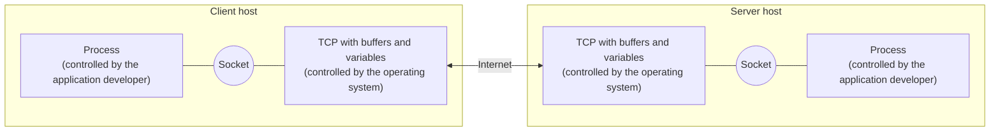
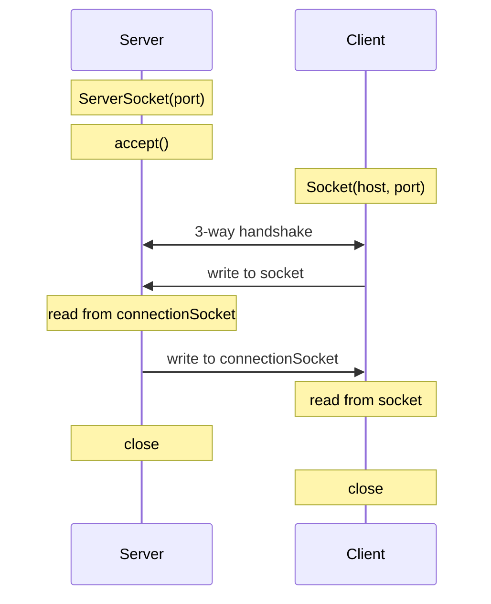

# Lecture 14 — Network Programming

[Repository Guide](../../README.md) | [English](Concepts_Lecture.md) | [한국어](Concepts_Lecture.ko.md)

> **Last Updated:** 2026-11-19

> **Learning Objectives:**
> 1. Implement client-server communication using sockets
> 2. Build multi-threaded network servers
> 3. Design applications that combine a Swing GUI with socket communication
> 4. Trace step by step how an echo server and client run on localhost and handle the end of a connection
> 5. Design a protocol that marks message boundaries in the TCP byte stream and compare it with UDP sockets
> 6. Handle network exceptions such as refused connections, port conflicts, and timeouts

---

## Table of Contents

- [1. Socket Fundamentals](#1-socket-fundamentals)
  - [1.1 The Concept of a Socket](#11-the-concept-of-a-socket)
  - [1.2 Client-Server Applications](#12-client-server-applications)
  - [1.3 TCP vs. UDP](#13-tcp-vs-udp)
  - [1.4 Socket Pair (4-tuple)](#14-socket-pair-4-tuple)
  - [1.5 The Socket API](#15-the-socket-api)
  - [1.6 IP Addresses, Ports, and localhost](#16-ip-addresses-ports-and-localhost)
- [2. Java TCP Sockets](#2-java-tcp-sockets)
  - [2.1 ServerSocket](#21-serversocket)
  - [2.2 Socket (Client)](#22-socket-client)
  - [2.3 Client-Server Interaction Flow](#23-client-server-interaction-flow)
  - [2.4 The Whole Run of an Echo Server and Client](#24-the-whole-run-of-an-echo-server-and-client)
  - [2.5 Ending a Connection and Half-Close](#25-ending-a-connection-and-half-close)
- [3. Reading and Writing over Sockets](#3-reading-and-writing-over-sockets)
  - [3.1 Character Streams and flush()](#31-character-streams-and-flush)
  - [3.2 A Chat Program](#32-a-chat-program)
  - [3.3 A Calculation Server](#33-a-calculation-server)
  - [3.4 Message Boundaries](#34-message-boundaries)
  - [3.5 Specifying the Character Encoding](#35-specifying-the-character-encoding)
- [4. Multi-client Server Architecture](#4-multi-client-server-architecture)
  - [4.1 How a Thread-per-Connection Server Behaves](#41-how-a-thread-per-connection-server-behaves)
  - [4.2 Shared Resources among Service Threads](#42-shared-resources-among-service-threads)
- [5. GUI-based Network Applications](#5-gui-based-network-applications)
- [6. UDP Sockets](#6-udp-sockets)
- [7. Network Exceptions and Timeouts](#7-network-exceptions-and-timeouts)
- [8. Common Mistakes](#8-common-mistakes)
- [Summary](#summary)
- [Self-Check Questions](#self-check-questions)
- [References](#references)

---

<br>

## 1. Socket Fundamentals

### 1.1 The Concept of a Socket

A socket is the combination of an IP address and a port number. It is the endpoint for communication between two machines over TCP/IP. The name socket comes from the **application programming interface (API)** created in Berkeley Unix so that applications can use the TCP/IP protocols. There are two types of sockets.

- A **stream socket** communicates through a reliable two-way byte stream after a connection is established, and uses TCP.
- A **datagram socket** communicates in independent messages (datagrams) without a connection, and uses UDP.



*Figure 1. The socket as the boundary between an application process and TCP*

A socket is the door between the process, which the application developer controls, and TCP, which the operating system controls. The application developer writes the program above the socket and, below the socket, can set only a few TCP parameters such as the maximum buffer size and the maximum segment size.

### 1.2 Client-Server Applications

Client-server applications fall into two types.

- **Implementations of a standard protocol:** Programs that implement a protocol standard defined in an RFC, such as FTP, HTTP, and SMTP. They must conform to the rules dictated by the RFC and use the port number associated with the protocol.
- **Proprietary client-server applications:** A single developer or team creates both the client and the server program. The developer has complete control over the protocol but must be careful not to use one of the well-known port numbers defined in the RFCs.

**Well-known port numbers** are 0-1023 and are managed by the IANA (Internet Assigned Numbers Authority). The examples in these notes use ports 9999, 9998, and 1234.

### 1.3 TCP vs. UDP

| Feature | TCP | UDP |
|:--------|:----|:----|
| Connection | Connection-oriented (3-way handshake) | Connectionless |
| Reliability | Guaranteed delivery, ordering | Best-effort, no ordering |
| Speed | Slower due to overhead | Faster, minimal overhead |
| Use cases | HTTP, SSH, file transfer | DNS, video streaming, gaming |

*Table 1. Comparison of TCP and UDP*

### 1.4 Socket Pair (4-tuple)

A **socket pair** is the pair of endpoints that uniquely identifies each TCP connection on the Internet. A TCP connection is uniquely identified by:
`(client IP, client port, server IP, server port)`

> **[Computer Networks]** In computer networks, TCP and UDP are transport-layer protocols that run on top of IP and deliver data between processes on hosts, where the IP address identifies a host and the port number identifies a process on that host. The TCP of the operating system uses this 4-tuple to decide which socket receives an arriving segment (demultiplexing), so even when many clients connect to one server port, each connection is kept apart by its own connection socket (Section 2).

### 1.5 The Socket API

| Function | Role |
|:-----|:-----|
| `socket()` | Creates a socket |
| `bind()` | Binds a socket to a local IP address and port number |
| `listen()` | Passively waits for connection requests |
| `connect()` | Initiates a connection to another socket |
| `accept()` | Accepts a new connection |
| `write()` | Writes data to a socket |
| `read()` | Reads data from a socket |
| `sendto()` | Sends a datagram to another UDP socket |
| `recvfrom()` | Reads a datagram from a UDP socket |
| `close()` | Closes a socket (tears down the connection) |

*Table 2. Main functions of the Berkeley socket API*

A TCP server calls `socket()`, `bind()`, and `listen()` and then waits for connection requests in `accept()`, and a client calls `socket()` (and `bind()` if needed) and then requests a connection with `connect()`. Once the TCP connection request and acknowledgment (ACK) are exchanged and the connection is established, both sides repeat `send()`/`write()` and `recv()`/`read()`, and when they finish they close the connection with `close()`. Java wraps this process in classes: `new ServerSocket(port)` performs `socket()`, `bind()`, and `listen()`, and `new Socket(host, port)` performs `socket()` and `connect()` in one step.

### 1.6 IP Addresses, Ports, and localhost

An **IP address** is a number that identifies a host connected to the network (strictly, its network interface). An IPv4 address is 32 bits, written in four 8-bit parts separated by dots, as in `192.168.0.10`. A **port number** is a 16-bit number (0-65535) that identifies a communicating process within a host. So if the IP address is the address of a building, the port number is a room in that building, and the endpoint of a socket is the combination of the two [1].

`localhost` is a name that refers to the machine itself, and in IPv4 it corresponds to the **loopback address** `127.0.0.1`. Data sent to the loopback address returns to the machine directly inside the operating system without passing through the network card, so a server and a client can be tested together on one computer. In Java, `InetAddress.getByName("localhost")` turns the name into an address (the output of Section 7), and passing the name of another host (for example `www.example.com`) gives the address looked up through DNS.

| Port range | Name | Use |
|:-----|:-----|:-----|
| 0-1023 | Well-known ports | Assigned to standard services such as HTTP (80), HTTPS (443), and SSH (22) (Section 1.2) |
| 1024-49151 | Registered ports | Ports registered with IANA for particular applications |
| 49152-65535 | Dynamic ports | Range set aside for temporary ports of client sockets (the range actually assigned varies by operating system) |

*Table 3. Ranges of port numbers*

A server waits on a fixed port so that clients can find it, and the operating system picks a free number for the port of a client socket. In the run of Section 2.4, the server's port is 5051, chosen by the program, and the client's port 62936 was chosen by the operating system. Running the same client program again gets a different number. Opening a server on a well-known port (1023 or below) requires administrator privileges on some operating systems and may conflict with standard services, so practice servers use numbers of 1024 or above.

---

<br>

## 2. Java TCP Sockets

The TCP socket classes are in the `java.net` package.

- `java.net.Socket` implements client sockets (also called just sockets) and is an endpoint for communication between two machines. The constructor `Socket(String host, int port)` creates a stream socket and connects it to the specified port on the named host, and `getInputStream()`, `getOutputStream()`, and `close()` get the I/O streams or close the socket.
- `java.net.ServerSocket` implements server sockets. It waits for requests to come in over the network and performs some operation based on the request. It is created with the constructor `ServerSocket(int port)`, and `accept()` listens for a connection to be made to this socket and accepts it, blocking until a connection is made.

A server has two kinds of sockets. The **welcoming socket** welcomes the initial contact from a client, and the **connection socket** is newly created at the client's initial contact and is dedicated to that one client. A client initiates a TCP connection to the server by creating a socket object (3-way handshake), specifying the address of the server process, namely the IP address of the server and the port number of the process.

### 2.1 ServerSocket

```java
ServerSocket serverSocket = new ServerSocket(9999);
System.out.println("Waiting for connection...");
Socket clientSocket = serverSocket.accept(); // blocks until client connects
System.out.println("Client connected!");
```

`serverSocket` is the welcoming socket, and the `clientSocket` returned by `accept()` is the connection socket dedicated to that client. Further data exchange goes through the connection socket, and the welcoming socket can be used again to accept the next client.

### 2.2 Socket (Client)

```java
Socket socket = new Socket("localhost", 9999);
// connection established
```

`localhost` is the host name that refers to the local computer, so the server and client can be tested together on the same computer. If no server is waiting on that port, the constructor throws a `ConnectException` (a subclass of `IOException`).

### 2.3 Client-Server Interaction Flow



*Figure 2. Socket interaction between a TCP client and server*

The server first creates a welcoming socket on port `x` and waits for a connection request in `accept()`. When the client creates a socket specifying the host and port `x`, a TCP connection is set up, and the server's `accept()` returns a connection socket. The client sends a request, the server reads the request from the connection socket and writes a reply, and the client reads the reply. When they finish, each side closes its own socket.

### 2.4 The Whole Run of an Echo Server and Client

An **echo server**, which sends back each line it receives, is the smallest complete example of a socket program. The following server accepts one client on port 5051, sends back each received line with `echo: ` prepended, and ends when it receives `bye` or the client closes the connection.

```java
import java.io.*;
import java.net.*;
import java.nio.charset.StandardCharsets;

public class EchoServer {
    public static void main(String[] args) throws IOException {
        int port = 5051;
        try (ServerSocket listener = new ServerSocket(port)) {             // socket, bind, listen
            System.out.println("[server] listening on port " + listener.getLocalPort());
            try (Socket s = listener.accept();                              // blocks until a connection arrives
                 BufferedReader in = new BufferedReader(
                         new InputStreamReader(s.getInputStream(), StandardCharsets.UTF_8));
                 PrintWriter out = new PrintWriter(
                         new OutputStreamWriter(s.getOutputStream(), StandardCharsets.UTF_8), true)) {
                System.out.println("[server] accepted " + s.getInetAddress().getHostAddress()
                        + ":" + s.getPort() + " on local port " + s.getLocalPort());
                String line;
                while ((line = in.readLine()) != null) {                    // null means the peer closed
                    System.out.println("[server] received \"" + line + "\"");
                    out.println("echo: " + line);                           // autoflush is on
                    if (line.equals("bye")) break;
                }
                System.out.println("[server] closing connection");
            }
        }
    }
}
```

The client connects to port 5051 on the same computer, sends three lines in turn, and reads the server's reply to each.

```java
import java.io.*;
import java.net.*;
import java.nio.charset.StandardCharsets;

public class EchoClient {
    public static void main(String[] args) throws IOException {
        try (Socket s = new Socket("localhost", 5051);                     // socket and connect
             BufferedReader in = new BufferedReader(
                     new InputStreamReader(s.getInputStream(), StandardCharsets.UTF_8));
             PrintWriter out = new PrintWriter(
                     new OutputStreamWriter(s.getOutputStream(), StandardCharsets.UTF_8), true)) {
            System.out.println("[client] connected from local port " + s.getLocalPort()
                    + " to " + s.getInetAddress().getHostAddress() + ":" + s.getPort());
            for (String msg : new String[] {"hello", "안녕", "bye"}) {
                out.println(msg);
                System.out.println("[client] sent \"" + msg + "\", got \"" + in.readLine() + "\"");
            }
            System.out.println("[client] server closed? " + (in.readLine() == null));
        }
    }
}
```

The results of running the server first (`java EchoServer`) and the client in another terminal (`java EchoClient`) are as follows. The upper output is the server's and the lower is the client's.

```text
[server] listening on port 5051
[server] accepted 127.0.0.1:62936 on local port 5051
[server] received "hello"
[server] received "안녕"
[server] received "bye"
[server] closing connection
```

```text
[client] connected from local port 62936 to 127.0.0.1:5051
[client] sent "hello", got "echo: hello"
[client] sent "안녕", got "echo: 안녕"
[client] sent "bye", got "echo: bye"
[client] server closed? true
```

Tracing the run in time order gives Table 4. Which side is blocked and waiting at each step is the key to understanding socket programs.

| Step | Server | Client |
|:-----|:-----|:-----|
| 1 | `new ServerSocket(5051)` binds to the port and starts listening | Not yet running |
| 2 | Blocks in `accept()` | `new Socket("localhost", 5051)` requests a connection |
| 3 | When the three-way handshake finishes, `accept()` returns a connection socket | The constructor returns; the operating system assigned port 62936 |
| 4 | Blocks in `readLine()` | Sends with `println("hello")` and blocks in `readLine()` |
| 5 | Reads `hello`, sends `echo: hello`, and waits in `readLine()` again | Reads `echo: hello` |
| 6 | Handles `안녕` and `bye` the same way and ends the loop after `bye` | Sends two more lines the same way and reads the replies |
| 7 | try-with-resources closes the connection socket and the server socket | The next `readLine()` returns `null` (the server closed) |
| 8 | Ends | try-with-resources closes the socket and the program ends |

*Table 4. Trace of the echo server and client*

The server's output `accepted 127.0.0.1:62936 on local port 5051` and the client's output `connected from local port 62936 to 127.0.0.1:5051` are the same connection seen from both sides. The socket pair (Section 1.4) of this connection is (127.0.0.1, 62936, 127.0.0.1, 5051). The fact that the local port of the connection socket is 5051, the same as the server socket's, shows that a connection socket does not use a new port but is distinguished on the same port by its socket pair.

Both programs turn on automatic flushing with the second argument `true` when creating `PrintWriter`, so they need not call `flush()` separately after each `println()` (the key-point box of Section 3.1). They also specify UTF-8 when creating the streams, so the Hangul `안녕` passes through unchanged (Section 3.5).

### 2.5 Ending a Connection and Half-Close

A TCP connection is bidirectional. When one side closes its socket, reading on the other side reaches the end of the stream after the remaining data is read. `readLine()` returns `null` and `read()` returns -1 (Lecture 10, Section 3.5), which tells that the peer has ended the connection. The client of Section 2.4 checking the server's close with `in.readLine() == null` at the end is an example.

A socket can also close only its sending direction without closing completely. `shutdownOutput()` ends the output stream of this socket, signaling the end of the stream to the peer, but keeps the input stream open. Closing only one direction in this way is called a **half-close**. It is used to signal only the fact that all the data has been sent, without announcing the amount of data in advance.

```java
import java.io.*;
import java.net.*;

public class HalfClose {
    public static void main(String[] args) throws Exception {
        try (ServerSocket listener = new ServerSocket(5053)) {
            Thread server = new Thread(() -> {
                try (Socket s = listener.accept();
                     BufferedReader in = new BufferedReader(new InputStreamReader(s.getInputStream()));
                     PrintWriter out = new PrintWriter(s.getOutputStream(), true)) {
                    int sum = 0, count = 0;
                    String line;
                    while ((line = in.readLine()) != null) {               // null after the client shuts output
                        sum += Integer.parseInt(line);
                        count++;
                    }
                    out.println(count + " numbers, sum " + sum);
                } catch (IOException e) { e.printStackTrace(); }
            });
            server.start();

            try (Socket s = new Socket("localhost", 5053);
                 PrintWriter out = new PrintWriter(s.getOutputStream(), true);
                 BufferedReader in = new BufferedReader(new InputStreamReader(s.getInputStream()))) {
                for (int v : new int[] {10, 20, 30, 40}) out.println(v);
                s.shutdownOutput();                                         // close only the sending side
                System.out.println("[client] output shut down: " + s.isOutputShutdown()
                        + ", input still open: " + !s.isInputShutdown());
                System.out.println("[client] reply: " + in.readLine());
            }
            server.join();
        }
    }
}
```

```text
[client] output shut down: true, input still open: true
[client] reply: 4 numbers, sum 100
```

The client sends four numbers and then calls `shutdownOutput()`. The server's `readLine()` returns `null` after reading four lines, ending the loop, and the server sends back the sum 10 + 20 + 30 + 40 = 100. The client's input direction is still open, so it can read this reply. Had it called `close()` instead of the half-close, there would be no way to receive the server's reply.

> **Caution:** Calling `close()` on either the input stream or the output stream obtained from a socket closes the whole socket. To end only one direction, do not close a stream; call the socket's `shutdownOutput()` or `shutdownInput()`.

---

<br>

## 3. Reading and Writing over Sockets

### 3.1 Character Streams and flush()

```java
// Server side
BufferedReader in = new BufferedReader(
    new InputStreamReader(socket.getInputStream()));
BufferedWriter out = new BufferedWriter(
    new OutputStreamWriter(socket.getOutputStream()));

String message = in.readLine();
out.write("Response\n");
out.flush();
```

`getInputStream()` and `getOutputStream()` of a socket return byte streams, so they are turned into character streams with `InputStreamReader` and `OutputStreamWriter` and wrapped in `BufferedReader` and `BufferedWriter` to read and write line by line. The client side creates its streams the same way. `readLine()` reads until it meets a line terminator, so the sender must append `"\n"` to each message.

> **Key Point:** Always call `flush()` after writing to ensure data is sent immediately rather than buffered.

> **Caution:** When the other side closes the connection, `readLine()` returns `null`. Calling a method such as `equalsIgnoreCase()` directly on the received string, as the server loop of Section 3.2 does, then throws a `NullPointerException`, so it is safer to check for `null` first.

### 3.2 A Chat Program

The server loop of a chat program in which the server and client exchange messages line by line in turn on the console is as follows. The connection ends when the client sends `bye`.

```java
while (true) {
    String inputMessage = in.readLine();         // receive one line from the client
    if (inputMessage.equalsIgnoreCase("bye")) {  // end on bye
        System.out.println("Connection terminated!");
        break;
    }
    System.out.println("Client: " + inputMessage);
    System.out.print("Server>>");
    String outputMessage = scanner.nextLine();   // reply typed by the server user
    out.write(outputMessage + "\n");
    out.flush();
}
```

The client conversely repeats sending a line read with `Scanner` and reading the server's reply, and when the user types `bye`, it sends that to the server and ends the loop. Both sides close the `Scanner` and the socket (and the server also the `ServerSocket`) in a `finally` block. The lab code is [SimpleChatServer.java](../../Coursework/Lab14_Network-Programming/SimpleChatServer.java) and [SimpleChatClient.java](../../Coursework/Lab14_Network-Programming/SimpleChatClient.java).

### 3.3 A Calculation Server

In this program the client sends a formula such as `12 + 3`, an operand, an operator, and an operand separated by spaces, and the server computes it and returns the result. The server processes each received line with the following `calc()`.

```java
public static String calc(String exp) {
    StringTokenizer st = new StringTokenizer(exp, " ");
    if (st.countTokens() != 3) return "error";   // error unless there are three tokens
    String res = "";
    int op1 = Integer.parseInt(st.nextToken());
    String opcode = st.nextToken();
    int op2 = Integer.parseInt(st.nextToken());
    switch (opcode) {
        case "+": res = Integer.toString(op1 + op2); break;
        case "-": res = Integer.toString(op1 - op2); break;
        case "*": res = Integer.toString(op1 * op2); break;
        default : res = "error";                 // unsupported operator
    }
    return res;
}
```

`StringTokenizer` splits a string by a delimiter (here a space) and returns the tokens one at a time. Sending `1+1` without spaces yields only one token, so `error` is returned. If an operand is not an integer, `Integer.parseInt()` throws a `NumberFormatException`, which this server does not handle.

### 3.4 Message Boundaries

TCP delivers bytes in order without loss, but it does not convey how many `write()` calls the sender split them into. A connection is a single byte stream that goes on and on, and marking where a message ends is the application's job.

```java
import java.io.*;
import java.net.*;

public class Boundaries {
    public static void main(String[] args) throws Exception {
        try (ServerSocket listener = new ServerSocket(5052)) {
            Thread client = new Thread(() -> {
                try (Socket s = new Socket("localhost", 5052)) {
                    OutputStream raw = s.getOutputStream();
                    raw.write("Hello".getBytes());                          // two writes
                    raw.write("World".getBytes());
                    raw.flush();
                    Thread.sleep(200);
                    DataOutputStream data = new DataOutputStream(raw);
                    data.writeUTF("first message");                         // length-prefixed
                    data.writeUTF("second message");
                    data.flush();
                } catch (Exception e) { e.printStackTrace(); }
            });
            client.start();
            try (Socket s = listener.accept()) {
                InputStream in = s.getInputStream();
                Thread.sleep(100);                                          // let both writes arrive
                byte[] buf = new byte[100];
                int n = in.read(buf);
                System.out.println("one read() returned " + n + " bytes: " + new String(buf, 0, n));

                DataInputStream data = new DataInputStream(in);
                System.out.println("readUTF: " + data.readUTF());
                System.out.println("readUTF: " + data.readUTF());
            }
            client.join();
        }
    }
}
```

```text
one read() returned 10 bytes: HelloWorld
readUTF: first message
readUTF: second message
```

The client sent `Hello` and `World` with two `write()` calls, but one `read()` on the server returned the 10 bytes `HelloWorld`, the two messages joined. Conversely, even a single long message may arrive only partly in one `read()` on the receiving side. So the application must define a **protocol**, the message format the two programs agree to follow, that marks message boundaries in one of the following ways.

- **Delimiter:** put a special character such as a newline at the end of each message. The chat of Section 3.2 and the calculator server of Section 3.3 use this method, and the receiver reads one line at a time with `readLine()`. The constraint is that a message cannot contain the delimiter.
- **Length prefix:** send the number of bytes before the message. `DataOutputStream.writeUTF()` prepends a 2-byte length (Lecture 10, Section 3.4), so `readUTF()` on the receiving side reads exactly that many bytes and returns the messages one by one. The last two lines of the output above are the result.
- **Fixed length:** send every message in the same size. This is the same idea as the fixed-length records of Lecture 10, Section 3.6.

### 3.5 Specifying the Character Encoding

Sockets exchange bytes, so to send strings both sides must convert them with the same character encoding (Lecture 10, Section 1.5). Omitting the encoding, as in `new InputStreamReader(socket.getInputStream())` in the code of Section 3.1, uses each program's default charset. Between two programs on JDK 18 or later both are UTF-8, but Hangul can be garbled when communicating with an older JVM or a peer written in another language. Specifying the same encoding on both sides with `new InputStreamReader(socket.getInputStream(), StandardCharsets.UTF_8)`, as the echo programs of Section 2.4 do, avoids this problem. The Hangul `안녕` is 6 bytes in UTF-8, so the line the server received was transmitted as 6 bytes and 1 byte for the newline character.

---

<br>

## 4. Multi-client Server Architecture

A server that handles multiple clients at the same time uses a separate thread for each client connection.

```java
while (true) {
    Socket clientSocket = serverSocket.accept();
    new Thread(new ClientHandler(clientSocket)).start();
}
```

Each `ClientHandler` manages its own I/O streams independently, allowing the server to handle multiple clients concurrently.

`accept()` and `readLine()` are both blocking calls, so a server built with a single thread cannot accept other clients while it communicates with one client. The GUI calculation server of Section 5 solves this with two kinds of threads.

- **ServerThread:** Creates the welcoming socket and repeats `accept()`. For each incoming connection, it writes a record to the log window and creates and starts a ServiceThread with that connection socket.
- **ServiceThread:** Serves one client. When the client sends the first operand, the operator, and the second operand as three separate lines, it computes the result and replies with one line, sending `Cannot divide by zero!` for division by zero and `Wrong input` for an unknown operator. When the client disconnects and an `IOException` occurs, it writes a record to the log and returns from `run()` to end the thread.

The English spell checker server has the same structure. At startup the server reads the 25,143 words of the dictionary file `words.txt` into a `Vector<String>`, and when a client sends a word, it checks with `contains()` whether the word is in the dictionary and replies `CORRECT!` or `INCORRECT`. `Vector.contains()` compares the elements one by one from the beginning, so a hash-based set such as `HashSet` is faster when there are many words.

### 4.1 How a Thread-per-Connection Server Behaves

Whether the structure of Section 4 actually serves several clients at once can be checked by measuring time. The following server sends back each received line in uppercase and contains `sleep(100)`, pretending that the work takes 0.1 seconds. Two clients `a` and `b` connect at the same time and send five lines each.

```java
import java.io.*;
import java.net.*;

public class MultiEcho {
    static void serve(Socket s) {
        String who = Thread.currentThread().getName();
        try (s; BufferedReader in = new BufferedReader(new InputStreamReader(s.getInputStream()));
             PrintWriter out = new PrintWriter(s.getOutputStream(), true)) {
            String line;
            while ((line = in.readLine()) != null) {
                Thread.sleep(100);                                         // pretend the work takes time
                out.println(line.toUpperCase());
            }
            System.out.println("[" + who + "] client port " + s.getPort() + " done");
        } catch (Exception e) { System.out.println("[" + who + "] " + e); }
    }

    static void client(String name, int n) {
        try (Socket s = new Socket("localhost", 5056);
             BufferedReader in = new BufferedReader(new InputStreamReader(s.getInputStream()));
             PrintWriter out = new PrintWriter(s.getOutputStream(), true)) {
            long t0 = System.nanoTime();
            for (int i = 0; i < n; i++) { out.println(name + i); in.readLine(); }
            System.out.printf("[%s] %d replies in %d ms%n", name, n, (System.nanoTime() - t0) / 1_000_000 / 100 * 100);
        } catch (IOException e) { System.out.println(e); }
    }

    public static void main(String[] args) throws Exception {
        ServerSocket listener = new ServerSocket(5056);
        Thread acceptor = new Thread(() -> {
            int id = 0;
            try {
                while (true) {
                    Socket s = listener.accept();
                    new Thread(() -> serve(s), "service-" + id++).start();  // a service thread per connection
                }
            } catch (IOException e) { }
        }, "acceptor");
        acceptor.setDaemon(true);
        acceptor.start();

        long t0 = System.nanoTime();
        Thread a = new Thread(() -> client("a", 5)), b = new Thread(() -> client("b", 5));
        a.start(); b.start(); a.join(); b.join();
        System.out.printf("both clients finished in %d ms%n", (System.nanoTime() - t0) / 1_000_000 / 100 * 100);
        Thread.sleep(100);
        listener.close();
    }
}
```

```text
[a] 5 replies in 500 ms
[b] 5 replies in 500 ms
[service-0] client port 63022 done
[service-1] client port 63023 done
both clients finished in 500 ms
```

The `acceptor` thread creates a new service thread, `service-0` and `service-1`, for each incoming connection and hands it the connection socket. Each client took about 500 milliseconds (0.1 seconds × 5) to receive its five replies, and both clients together also finished in about 500 milliseconds, because the two connections were handled at the same time on different threads. If the server had handled the connections one after another on a single thread, the second client would have had to wait until the first finished, and the whole run would have taken about 1,000 milliseconds. The `try (s; ...)` in `serve()` lets try-with-resources close the already created socket variable `s` as well (Lecture 10, Section 2.4).

`acceptor` is made a daemon thread to keep this thread, which keeps waiting in `accept()`, from stopping the program from ending (Lecture 13, Section 3.4). Closing the server socket with `close()` throws a `SocketException` into the thread waiting in `accept()`, so the server can be shut down cleanly by catching that exception and ending the loop.

> **Note:** **Servers that use a thread pool.** Creating a new thread for every connection makes the cost of creating threads (Lecture 13, Section 1.6) and their memory a problem when clients number in the thousands. Real servers create a fixed-size thread pool, as in `ExecutorService pool = Executors.newFixedThreadPool(16);`, and hand each connection returned by `accept()` to it with `pool.execute(() -> serve(s))`. The number of connections handled at once is limited by the size of the pool, and the remaining connections wait their turn in the pool's work queue (Lecture 15, Section 5).

### 4.2 Shared Resources among Service Threads

If the service threads do only independent work, no synchronization is needed. But to send one client's message to every client, as in a chat server, the service threads must share the list of connected clients. If one thread adds a new client to the list while another iterates over it sending a message, problems such as the `ConcurrentModificationException` of Lecture 9, Section 3.15 or the lost updates of Lecture 13, Section 4.2 arise.

```java
private final List<PrintWriter> clients = new ArrayList<>();

void join(PrintWriter out) {
    synchronized (clients) { clients.add(out); }
}

void broadcast(String msg) {
    synchronized (clients) {                 // keep the list unchanged while iterating
        for (PrintWriter out : clients) out.println(msg);
    }
}
```

Synchronizing both the places that change the list and the place that iterates over it on the same object `clients` lets only one thread handle the list at a time (Lecture 15, Section 4). If the service threads only read shared data, as in the calculator server or the spelling server of Section 3, no synchronization is needed. The dictionary `Vector<String>` of the spelling server is filled once when the server starts and only read afterward, so it is safe.

---

<br>

## 5. GUI-based Network Applications

Combining Swing with sockets creates interactive networked applications like:
- GUI calculators where the client inputs a formula and the server returns the result
- Spell checkers where the server stores a dictionary and validates client queries
- Chat applications with real-time message exchange

The server window of the GUI calculator records connections and calculations with `append()` in a `JTextArea` placed in a `JScrollPane`, and leaves socket handling to the ServerThread of Section 4. The client window consists of three `JTextField`s for the operand, operator, and operand, a result field, and a Calculate button, and the button's action listener sends the three values to the server and shows the received result in the result field. The spell checker client sends a word on the action event generated by pressing Enter in a `JTextField` and shows the result in a label.

> **Key Point:** Network I/O should run on a separate thread from the Swing EDT (Event Dispatch Thread) to prevent the GUI from freezing.

> **Caution:** The clients above wait for the reply with `readLine()` inside the action listener, so the EDT stops until the reply arrives. This does not show in examples where a server on the same computer replies at once, but if a reply is delayed, the window stops responding. Communication that may take long should run on a separate thread, and the work of reflecting the result on the screen should be handed to the EDT with `SwingUtilities.invokeLater()` (Lecture 12, Sections 5.7 and 5.8).

---

<br>

## 6. UDP Sockets

Unlike the stream sockets of TCP, the **datagram sockets** of UDP make no connection and exchange datagrams, each an independent message. A datagram is a self-contained message whose arrival, arrival time, and content are not guaranteed [2]. In exchange, there is no connection setup or acknowledgment, so latency is short, and since one datagram is one message, the message-boundary problem of Section 3.4 does not arise. In Java, a socket is created with `java.net.DatagramSocket`, and the data to send or receive and the address of the peer are put in a `DatagramPacket`.

```java
import java.net.*;
import java.nio.charset.StandardCharsets;

public class UdpEcho {
    public static void main(String[] args) throws Exception {
        try (DatagramSocket server = new DatagramSocket(5055);
             DatagramSocket client = new DatagramSocket()) {               // the OS picks the port
            Thread t = new Thread(() -> {
                try {
                    byte[] buf = new byte[512];
                    DatagramPacket p = new DatagramPacket(buf, buf.length);
                    server.receive(p);                                      // receive one datagram
                    String msg = new String(p.getData(), 0, p.getLength(), StandardCharsets.UTF_8);
                    System.out.println("[server] " + p.getLength() + " bytes from port " + p.getPort() + ": " + msg);
                    byte[] reply = ("echo: " + msg).getBytes(StandardCharsets.UTF_8);
                    server.send(new DatagramPacket(reply, reply.length, p.getSocketAddress()));
                } catch (Exception e) { e.printStackTrace(); }
            });
            t.start();

            byte[] data = "ping 자바".getBytes(StandardCharsets.UTF_8);
            client.send(new DatagramPacket(data, data.length, InetAddress.getLoopbackAddress(), 5055));
            byte[] buf = new byte[512];
            DatagramPacket reply = new DatagramPacket(buf, buf.length);
            client.setSoTimeout(1000);
            client.receive(reply);
            System.out.println("[client] local port " + client.getLocalPort() + ", reply: "
                    + new String(reply.getData(), 0, reply.getLength(), StandardCharsets.UTF_8));
            t.join();
        }
    }
}
```

```text
[server] 11 bytes from port 59507: ping 자바
[client] local port 59507, reply: echo: ping 자바
```

The server binds to port 5055 with `new DatagramSocket(5055)` and blocks in `receive(p)` until a datagram arrives. The client creates `new DatagramSocket()` without a port and uses the port the operating system chose (59507), and every send puts the destination address and port into the `DatagramPacket` together with the data. Since there is no connection, the server finds the sender's address from `getSocketAddress()` of the received packet and sends the reply there. `p.getLength()` is the number of bytes actually received, 11 (`ping` 4 bytes, a space 1 byte, `자바` 6 bytes), and must be distinguished from the buffer size 512.

| Aspect | TCP (`Socket`, `ServerSocket`) | UDP (`DatagramSocket`) |
|:-----|:-----|:-----|
| Connection | A connection is made before data is sent | Data is sent without a connection |
| Number of sockets | The server has one welcoming socket and one connection socket per connection | The server and the client have one socket each |
| Unit of data | A byte stream without boundaries | Datagrams with boundaries |
| Reliability | Delivered in order without loss | Can be lost, duplicated, or reordered |
| Input and output | `getInputStream()`, `getOutputStream()` | `send(packet)`, `receive(packet)` |
| Specifying the destination | Once, when connecting | For every datagram |

*Table 5. TCP sockets and UDP sockets in Java*

With UDP, nobody reports it when a sent datagram disappears. The client above sets a time limit on receiving with `setSoTimeout(1000)` so that `receive()` does not wait forever if no reply comes. If reliability is needed, the application must number the messages and retransmit them itself.

---

<br>

## 7. Network Exceptions and Timeouts

Network programs must always consider situations in which there is no peer, the port is already in use, or no reply comes. The following program deliberately causes three typical exceptions.

```java
import java.io.*;
import java.net.*;

public class NetErrors {
    public static void main(String[] args) throws Exception {
        try {
            new Socket("localhost", 5999).close();                          // a port nobody listens on
        } catch (ConnectException e) {
            System.out.println("ConnectException: " + e.getMessage());
        }

        try (ServerSocket first = new ServerSocket(5054)) {
            try (ServerSocket second = new ServerSocket(5054)) {
                System.out.println("second bind succeeded");
            } catch (BindException e) {
                System.out.println("BindException: " + e.getMessage());
            }

            try (Socket c = new Socket("localhost", 5054); Socket s = first.accept()) {
                c.setSoTimeout(500);                                        // read timeout 0.5 s
                long t0 = System.nanoTime();
                try {
                    c.getInputStream().read();
                } catch (SocketTimeoutException e) {
                    System.out.printf("SocketTimeoutException after %d ms: %s%n",
                            (System.nanoTime() - t0) / 1_000_000 / 100 * 100, e.getMessage());
                }
            }
        }
        InetAddress lo = InetAddress.getByName("localhost");
        System.out.println("localhost -> " + lo.getHostAddress() + ", loopback? " + lo.isLoopbackAddress());
    }
}
```

```text
ConnectException: Connection refused
BindException: Address already in use
SocketTimeoutException after 500 ms: Read timed out
localhost -> 127.0.0.1, loopback? true
```

| Exception | Cause | Response |
|:-----|:-----|:-----|
| `ConnectException: Connection refused` | No server is waiting on that port of the peer host | Check that the server is running and that the address and port are right, and tell the user |
| `BindException: Address already in use` | Another server socket is already using the same port | Use another port, or end the earlier server |
| `SocketTimeoutException: Read timed out` | No data arrived within the time set with `setSoTimeout()` | Try again or end the connection |
| `UnknownHostException` | The host name cannot be turned into an address | Check the spelling of the name and the network connection |
| `SocketException: Connection reset` | The peer broke the connection abnormally | Close that connection and clean up |

*Table 6. Typical network exceptions*

`ConnectException`, `BindException`, `SocketTimeoutException`, and `UnknownHostException` are all subclasses of `IOException`. In particular, `setSoTimeout(ms)` makes read operations on the socket block for at most ms, after which a `SocketTimeoutException` is thrown [3]. In the output above, the `read()` that tried to read from a peer sending nothing ended with the exception after about 0.5 seconds. Without a time limit, a thread stops forever when the peer does not respond, so in real programs it is safe to put a time limit on reads. The socket itself remains valid after a timeout, so the read can be tried again. The wording of the exception messages (`Connection refused` and so on) is that of macOS, where this was run, and may differ slightly on other operating systems.

The last line shows that `localhost` turns into the loopback address 127.0.0.1 (Section 1.6).

---

<br>

## 8. Common Mistakes

| Mistake | What happens | How to fix it |
|:-----|:-----|:-----|
| Not calling `flush()` after writing | The data stays in the buffer and the peer keeps waiting | Call `flush()` or use an auto-flushing `PrintWriter` |
| Sending without a newline to a peer that reads with `readLine()` | The peer's `readLine()` does not return | Append `"\n"` to the message or use `println()` |
| Assuming one `write()` arrives as one `read()` | Messages are joined or split and misinterpreted | Mark message boundaries with a delimiter or a length prefix |
| Not checking `readLine()` for `null` | A `NullPointerException` occurs after the peer closes | Read with `while ((line = in.readLine()) != null)` |
| Closing a socket's stream to end only one direction | The whole socket closes and the reply cannot be received | Use `shutdownOutput()` |
| Building a server with a single thread | Other clients wait while one client is being served | Use a service thread per connection or a thread pool |
| Service threads changing a shared list without synchronization | Exceptions occur or clients are dropped | Synchronize every access to the list on the same lock |
| Not specifying the encoding | Hangul is garbled if the peer's default charset differs | Specify `StandardCharsets.UTF_8` on both sides |
| Putting no time limit on reads | A thread stops forever because of an unresponsive peer | Set `setSoTimeout()` |
| Opening a practice server on a port of 1023 or below | Permission problems can cause `BindException` and the like | Use a port of 1024 or above |

*Table 7. Common mistakes in network programming*

---

<br>

## Summary

| Concept | Key Summary |
|:--------|:----------|
| Socket | It is a communication endpoint identified by an IP address and a port number, and comes as a stream socket for TCP or a datagram socket for UDP. |
| Socket Pair | The 4-tuple of client IP, client port, server IP, and server port identifies one TCP connection. |
| ServerSocket | It is the welcoming socket that listens for incoming connections on a port, and `accept()` returns a connection socket dedicated to a client. |
| Socket (client) | It initiates a TCP connection by specifying the server's host and port. |
| BufferedReader/Writer | They wrap the byte streams of a socket to read and write text line by line. |
| flush() | It ensures that buffered data is actually sent. |
| Multi-client | A thread that accepts connections plus one service thread per client lets the server handle multiple clients concurrently. |
| GUI + Network | Network I/O must run off the EDT so that the GUI does not freeze. |
| Loopback address | `localhost` is 127.0.0.1, and data sent there returns to the same computer, so a server and a client can be tested together. |
| Blocking calls | `accept()` and `readLine()` wait until a connection or data arrives, and the flow of a socket program is understood by which side is waiting. |
| Half-close | `shutdownOutput()` closes only the sending direction, signaling the end of the stream to the peer while still allowing replies to be received. |
| Message boundaries | TCP is a byte stream without boundaries, so a protocol that divides messages with delimiters, length prefixes, or fixed lengths is needed. |
| UDP | It sends datagrams with boundaries without a connection, and delivery and order are not guaranteed. |
| Timeout | `setSoTimeout()` limits how long a read blocks and throws `SocketTimeoutException` when the time passes. |

---

<br>

## Self-Check Questions

1. **Welcoming and connection sockets:** Three clients are connected at the same time to the GUI calculation server of Section 4. How many `ServerSocket` objects and how many `Socket` objects exist on the server side?

   <details>
   <summary>Answer</summary>

   One `ServerSocket` and three `Socket`s. The single `ServerSocket`, the welcoming socket, receives all connection requests, and `accept()` returns a new connection socket for each client, so there are as many `Socket`s as clients. Each connection socket is served by one ServiceThread.

   </details>

2. **flush():** The calculation server omits `out.flush();` after `out.write(res + "\n");`. What happens to the client?

   <details>
   <summary>Answer</summary>

   The result stays in the buffer of the `BufferedWriter` and is not sent, so the client's `readLine()` receives no reply and keeps blocking. The server also waits for the next request, so both sides stop, each waiting for the other. The data is sent only when the buffer fills, the stream is closed, or `flush()` is called.

   </details>

3. **Calculation server:** What does `calc()` from Section 3.3 return for each of the following strings? (a) `"12 + 3"` (b) `"7 * 6"` (c) `"10 / 2"` (d) `"1+1"`

   <details>
   <summary>Answer</summary>

   (a) `"15"` (b) `"42"` (c) `"error"` (d) `"error"`. (c) has three tokens, but the `switch` has no `/` case, so it goes to `default`, and (d) has no spaces, so its only token is `1+1` and `countTokens()` is not 3.

   </details>

4. **Line terminators:** A client sends a message without a line terminator, as in `out.write(outputMessage);`, and calls `flush()`. What happens to the server's `in.readLine()`?

   <details>
   <summary>Answer</summary>

   The data reaches the server, but `readLine()` does not return until a line terminator arrives, so it keeps waiting. If the client closes the connection, it returns what it has received so far, but to continue a conversation each message must end with `"\n"`.

   </details>

5. **Socket pair:** Two client programs on one client computer connect at the same time to port 9999 of the same server. How does the server tell the two connections apart?

   <details>
   <summary>Answer</summary>

   The two connections share the client IP, server IP, and server port but have different client ports. The operating system picks a free port number for the client side of each connection, so the 4-tuples differ, and the server handles each connection with a different connection socket.

   </details>

6. **Echo trace:** What is printed if only the client of Section 2.4 is run without the server? With the server running, how does the server end if the client sends `quit` instead of `bye` last and closes the socket?

   <details>
   <summary>Answer</summary>

   Without a server, `new Socket("localhost", 5051)` throws `ConnectException: Connection refused`, and since `main` does not handle it, the stack trace of the exception is printed and the program ends (Section 7). When `quit` is sent, the server sends back `echo: quit` and waits in `readLine()` again. When the client closes the socket, that `readLine()` returns `null`, ending the loop, and the server prints `closing connection` and ends normally.

   </details>

7. **Message boundaries:** A client sent `writeUTF("ab")` and `writeUTF("자바")` in turn. How many bytes in all are sent over the connection, and if the receiver got them all with a single call to `read(buf)`, how can the contents be divided into two messages?

   <details>
   <summary>Answer</summary>

   `ab` is 4 bytes, a 2-byte length and 2 bytes of content, and `자바` is 8 bytes, a 2-byte length and 6 bytes of content, so 12 bytes in all. The receiver reads the length 2 of the first message from the first 2 bytes `00 02` and cuts that many bytes as the first message, then reads the next length 6 from the following 2 bytes `00 06` and cuts that many as the second message. Calling `DataInputStream.readUTF()` twice does this work for you.

   </details>

8. **TCP and UDP:** Which of TCP and UDP suits a real-time voice call program and a file transfer program, respectively? Explain why.

   <details>
   <summary>Answer</summary>

   UDP suits a voice call. Voice data that arrives a little late is already useless, so UDP, which accepts some loss in exchange for short latency, is better than TCP, which adds delay by retransmitting lost data. TCP suits file transfer. If even one byte is missing or out of order the file is corrupted, so the reliability of TCP, which delivers in order without loss, is needed.

   </details>

---

<br>

## References

1. Oracle, "What Is a Socket?," *The Java Tutorials: Custom Networking, All About Sockets*. https://docs.oracle.com/javase/tutorial/networking/sockets/definition.html
2. Oracle, "What Is a Datagram?," *The Java Tutorials: Custom Networking, All About Datagrams*. https://docs.oracle.com/javase/tutorial/networking/datagrams/definition.html
3. Oracle, "Socket (Java SE 21 & JDK 21)," *Java Platform, Standard Edition 21 API Specification*. https://docs.oracle.com/en/java/javase/21/docs/api/java.base/java/net/Socket.html
