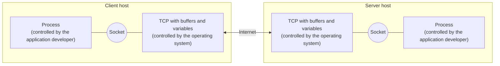

# Lecture 14 — Network Programming

[Repository Guide](../../README.md) | [English](Concepts_Lecture.md) | [한국어](Concepts_Lecture.ko.md)

> **Last Updated:** 2026-10-19

> **Learning Objectives:**
> 1. Implement client-server communication using sockets
> 2. Build multi-threaded network servers
> 3. Design applications that combine a Swing GUI with socket communication

---

## Table of Contents

- [1. Socket Fundamentals](#1-socket-fundamentals)
  - [1.1 What is a Socket?](#11-what-is-a-socket)
  - [1.2 Client-Server Applications](#12-client-server-applications)
  - [1.3 TCP vs. UDP](#13-tcp-vs-udp)
  - [1.4 Socket Pair (4-tuple)](#14-socket-pair-4-tuple)
  - [1.5 The Socket API](#15-the-socket-api)
- [2. Java TCP Sockets](#2-java-tcp-sockets)
  - [2.1 ServerSocket](#21-serversocket)
  - [2.2 Socket (Client)](#22-socket-client)
  - [2.3 Client-Server Interaction Flow](#23-client-server-interaction-flow)
- [3. Reading and Writing over Sockets](#3-reading-and-writing-over-sockets)
  - [3.1 Character Streams and flush()](#31-character-streams-and-flush)
  - [3.2 A Chat Program](#32-a-chat-program)
  - [3.3 A Calculation Server](#33-a-calculation-server)
- [4. Multi-client Server Architecture](#4-multi-client-server-architecture)
- [5. GUI-based Network Applications](#5-gui-based-network-applications)
- [Summary](#summary)
- [Self-Check Questions](#self-check-questions)

---

<br>

## 1. Socket Fundamentals

### 1.1 What is a Socket?

A socket is the combination of an IP address and a port number. It is the endpoint for communication between two machines over TCP/IP. The name socket comes from the **application programming interface (API)** created in Berkeley Unix so that applications can use the TCP/IP protocols. There are two types of sockets.

- A **stream socket** communicates through a reliable two-way byte stream after a connection is established, and uses TCP.
- A **datagram socket** communicates in independent messages (datagrams) without a connection, and uses UDP.



*Figure 1. The socket as the boundary between an application process and TCP*

A socket is the door between the process, which the application developer controls, and TCP, which the operating system controls. The application developer writes the program above the socket and, below the socket, can set only a few TCP parameters such as the maximum buffer size and the maximum segment size.

### 1.2 Client-Server Applications

Client-server applications fall into two types.

- **Implementations of a standard protocol:** Programs that implement a protocol standard defined in an RFC, such as FTP, HTTP, and SMTP. They must conform to the rules dictated by the RFC and use the port number associated with the protocol.
- **Proprietary client-server applications:** A single developer or team creates both the client and the server program. The developer has complete control over the protocol but must be careful not to use one of the well-known port numbers defined in the RFCs.

**Well-known port numbers** are 0-1023 and are managed by the IANA (Internet Assigned Numbers Authority). The examples in these notes use ports 9999, 9998, and 1234.

### 1.3 TCP vs. UDP

| Feature | TCP | UDP |
|:--------|:----|:----|
| Connection | Connection-oriented (3-way handshake) | Connectionless |
| Reliability | Guaranteed delivery, ordering | Best-effort, no ordering |
| Speed | Slower due to overhead | Faster, minimal overhead |
| Use cases | HTTP, SSH, file transfer | DNS, video streaming, gaming |

*Table 1. Comparison of TCP and UDP*

### 1.4 Socket Pair (4-tuple)

A **socket pair** is the pair of end points that uniquely identifies each TCP connection on the Internet. A TCP connection is uniquely identified by:
`(client IP, client port, server IP, server port)`

### 1.5 The Socket API

| Function | Role |
|:-----|:-----|
| `socket()` | Creates a socket |
| `bind()` | Binds a socket to a local IP address and port number |
| `listen()` | Passively waits for connection requests |
| `connect()` | Initiates a connection to another socket |
| `accept()` | Accepts a new connection |
| `write()` | Writes data to a socket |
| `read()` | Reads data from a socket |
| `sendto()` | Sends a datagram to another UDP socket |
| `recvfrom()` | Reads a datagram from a UDP socket |
| `close()` | Closes a socket (tears down the connection) |

*Table 2. Main functions of the Berkeley socket API*

A TCP server calls `socket()`, `bind()`, and `listen()` and then waits for connection requests in `accept()`, and a client calls `socket()` (and `bind()` if needed) and then requests a connection with `connect()`. Once the TCP connection request and acknowledgment (ACK) are exchanged and the connection is established, both sides repeat `send()`/`write()` and `recv()`/`read()`, and when they finish they close the connection with `close()`. Java wraps this process in classes: `new ServerSocket(port)` performs `socket()`, `bind()`, and `listen()`, and `new Socket(host, port)` performs `socket()` and `connect()` in one step.

---

<br>

## 2. Java TCP Sockets

The TCP socket classes are in the `java.net` package.

- `java.net.Socket` implements client sockets (also called just sockets) and is an endpoint for communication between two machines. The constructor `Socket(String host, int port)` creates a stream socket and connects it to the specified port on the named host, and `getInputStream()`, `getOutputStream()`, and `close()` get the I/O streams or close the socket.
- `java.net.ServerSocket` implements server sockets. It waits for requests to come in over the network and performs some operation based on the request. It is created with the constructor `ServerSocket(int port)`, and `accept()` listens for a connection to be made to this socket and accepts it, blocking until a connection is made.

A server has two kinds of sockets. The **welcoming socket** welcomes the initial contact from a client, and the **connection socket** is newly created at the client's initial contact and is dedicated to that one client. A client initiates a TCP connection to the server by creating a socket object (3-way handshake), specifying the address of the server process, namely the IP address of the server and the port number of the process.

### 2.1 ServerSocket

```java
ServerSocket serverSocket = new ServerSocket(9999);
System.out.println("Waiting for connection...");
Socket clientSocket = serverSocket.accept(); // blocks until client connects
System.out.println("Client connected!");
```

`serverSocket` is the welcoming socket, and the `clientSocket` returned by `accept()` is the connection socket dedicated to that client. Further data exchange goes through the connection socket, and the welcoming socket can be used again to accept the next client.

### 2.2 Socket (Client)

```java
Socket socket = new Socket("localhost", 9999);
// connection established
```

`localhost` is the host name that refers to the local computer, so the server and client can be tested together on the same computer. If no server is waiting on that port, the constructor throws a `ConnectException` (a subclass of `IOException`).

### 2.3 Client-Server Interaction Flow

```text
Server                              Client
------                              ------
ServerSocket(port)
  accept() <-------- 3-way --------> Socket(host, port)
  read from connectionSocket  <---  write to socket
  write to connectionSocket  --->   read from socket
  close                             close
```

*Figure 2. Socket interaction between a TCP client and server*

The server first creates a welcoming socket on port `x` and waits for a connection request in `accept()`. When the client creates a socket specifying the host and port `x`, a TCP connection is set up, and the server's `accept()` returns a connection socket. The client sends a request, the server reads the request from the connection socket and writes a reply, and the client reads the reply. When they finish, each side closes its own socket.

---

<br>

## 3. Reading and Writing over Sockets

### 3.1 Character Streams and flush()

```java
// Server side
BufferedReader in = new BufferedReader(
    new InputStreamReader(socket.getInputStream()));
BufferedWriter out = new BufferedWriter(
    new OutputStreamWriter(socket.getOutputStream()));

String message = in.readLine();
out.write("Response\n");
out.flush();
```

`getInputStream()` and `getOutputStream()` of a socket return byte streams, so they are turned into character streams with `InputStreamReader` and `OutputStreamWriter` and wrapped in `BufferedReader` and `BufferedWriter` to read and write line by line. The client side creates its streams the same way. `readLine()` reads until it meets a line terminator, so the sender must append `"\n"` to each message.

> **Key Point:** Always call `flush()` after writing to ensure data is sent immediately rather than buffered.

> **Caution:** When the other side closes the connection, `readLine()` returns `null`. Calling a method such as `equalsIgnoreCase()` directly on the received string then throws a `NullPointerException`, so it is safer to check for `null` first.

### 3.2 A Chat Program

The server loop of a chat program in which the server and client exchange messages line by line in turn on the console is as follows. The connection ends when the client sends `bye`.

```java
while (true) {
    String inputMessage = in.readLine();         // receive one line from the client
    if (inputMessage.equalsIgnoreCase("bye")) {  // end on bye
        System.out.println("Connection terminated!");
        break;
    }
    System.out.println("Client: " + inputMessage);
    System.out.print("Server>>");
    String outputMessage = scanner.nextLine();   // reply typed by the server user
    out.write(outputMessage + "\n");
    out.flush();
}
```

The client conversely repeats sending a line read with `Scanner` and reading the server's reply, and when the user types `bye`, it sends that to the server and ends the loop. Both sides close the `Scanner` and the socket (and the server also the `ServerSocket`) in a `finally` block. The lab code is [SimpleChatServer.java](../../Coursework/Lab14_Network-Programming/SimpleChatServer.java) and [SimpleChatClient.java](../../Coursework/Lab14_Network-Programming/SimpleChatClient.java).

### 3.3 A Calculation Server

In this program the client sends a formula such as `12 + 3`, an operand, an operator, and an operand separated by spaces, and the server computes it and returns the result. The server processes each received line with the following `calc()`.

```java
public static String calc(String exp) {
    StringTokenizer st = new StringTokenizer(exp, " ");
    if (st.countTokens() != 3) return "error";   // error unless there are three tokens
    String res = "";
    int op1 = Integer.parseInt(st.nextToken());
    String opcode = st.nextToken();
    int op2 = Integer.parseInt(st.nextToken());
    switch (opcode) {
        case "+": res = Integer.toString(op1 + op2); break;
        case "-": res = Integer.toString(op1 - op2); break;
        case "*": res = Integer.toString(op1 * op2); break;
        default : res = "error";                 // unsupported operator
    }
    return res;
}
```

`StringTokenizer` splits a string by a delimiter (here a space) and returns the tokens one at a time. Sending `1+1` without spaces yields only one token, so `error` is returned. If an operand is not an integer, `Integer.parseInt()` throws a `NumberFormatException`, which this server does not handle.

---

<br>

## 4. Multi-client Server Architecture

Use a separate thread for each client connection:

```java
while (true) {
    Socket clientSocket = serverSocket.accept();
    new Thread(new ClientHandler(clientSocket)).start();
}
```

Each `ClientHandler` manages its own I/O streams independently, allowing the server to handle multiple clients concurrently.

`accept()` and `readLine()` are both blocking calls, so a server built with a single thread cannot accept other clients while it communicates with one client. The GUI calculation server solves this with two kinds of threads.

- **ServerThread:** Creates the welcoming socket and repeats `accept()`. For each incoming connection, it writes a record to the log window and creates and starts a ServiceThread with that connection socket.
- **ServiceThread:** Serves one client. When the client sends the first operand, the operator, and the second operand as three separate lines, it computes the result and replies with one line, sending `Cannot divide by zero!` for division by zero and `Wrong input` for an unknown operator. When the client disconnects and an `IOException` occurs, it writes a record to the log and returns from `run()` to end the thread.

The English spell checker server has the same structure. At startup the server reads the 25,143 words of the dictionary file `words.txt` into a `Vector<String>`, and when a client sends a word, it checks with `contains()` whether the word is in the dictionary and replies `CORRECT!` or `INCORRECT`. `Vector.contains()` compares the elements one by one from the beginning, so a hash-based set such as `HashSet` is faster when there are many words.

---

<br>

## 5. GUI-based Network Applications

Combining Swing with sockets creates interactive networked applications like:
- GUI calculators where the client inputs a formula and the server returns the result
- Spell checkers where the server stores a dictionary and validates client queries
- Chat applications with real-time message exchange

The server window of the GUI calculator records connections and calculations with `append()` in a `JTextArea` placed in a `JScrollPane`, and leaves socket handling to the ServerThread of Section 4. The client window consists of three `JTextField`s for the operand, operator, and operand, a result field, and a Calculate button, and the button's action listener sends the three values to the server and shows the received result in the result field. The spell checker client sends a word on the action event generated by pressing Enter in a `JTextField` and shows the result in a label.

> **Key Point:** Network I/O should run on a separate thread from the Swing EDT (Event Dispatch Thread) to prevent the GUI from freezing.

> **Caution:** The clients above wait for the reply with `readLine()` inside the action listener, so the EDT stops until the reply arrives. This does not show in examples where a server on the same computer replies at once, but if a reply is delayed, the window stops responding. Communication that may take long should run on a separate thread, and the work of reflecting the result on the screen should be handed to the EDT with `SwingUtilities.invokeLater()` (Lecture 12, Section 2.1).

---

<br>

## Summary

| Concept | Key Summary |
|:--------|:----------|
| Socket | It is a communication endpoint identified by an IP address and a port number, and comes as a stream socket for TCP or a datagram socket for UDP. |
| Socket Pair | The 4-tuple of client IP, client port, server IP, and server port identifies one TCP connection. |
| ServerSocket | It is the welcoming socket that listens for incoming connections on a port, and `accept()` returns a connection socket dedicated to a client. |
| Socket (client) | It initiates a TCP connection by specifying the server's host and port. |
| BufferedReader/Writer | They wrap the byte streams of a socket to read and write text line by line. |
| flush() | It ensures that buffered data is actually sent. |
| Multi-client | A thread that accepts connections plus one service thread per client lets the server handle multiple clients concurrently. |
| GUI + Network | Network I/O must run off the EDT so that the GUI does not freeze. |

---

<br>

## Self-Check Questions

1. **Welcoming and connection sockets:** Three clients are connected at the same time to the GUI calculation server of Section 4. How many `ServerSocket` objects and how many `Socket` objects exist on the server side?

   <details>
   <summary>Answer</summary>

   One `ServerSocket` and three `Socket`s. The single `ServerSocket`, the welcoming socket, receives all connection requests, and `accept()` returns a new connection socket for each client, so there are as many `Socket`s as clients. Each connection socket is served by one ServiceThread.

   </details>

2. **flush():** The calculation server omits `out.flush();` after `out.write(res + "\n");`. What happens to the client?

   <details>
   <summary>Answer</summary>

   The result stays in the buffer of the `BufferedWriter` and is not sent, so the client's `readLine()` receives no reply and keeps blocking. The server also waits for the next request, so both sides stop, each waiting for the other. The data is sent only when the buffer fills, the stream is closed, or `flush()` is called.

   </details>

3. **Calculation server:** What does `calc()` from Section 3.3 return for each of the following strings? (a) `"12 + 3"` (b) `"7 * 6"` (c) `"10 / 2"` (d) `"1+1"`

   <details>
   <summary>Answer</summary>

   (a) `"15"` (b) `"42"` (c) `"error"` (d) `"error"`. (c) has three tokens, but the `switch` has no `/` case, so it goes to `default`, and (d) has no spaces, so its only token is `1+1` and `countTokens()` is not 3.

   </details>

4. **Line terminators:** A client sends a message without a line terminator, as in `out.write(outputMessage);`, and calls `flush()`. What happens to the server's `in.readLine()`?

   <details>
   <summary>Answer</summary>

   The data reaches the server, but `readLine()` does not return until a line terminator arrives, so it keeps waiting. If the client closes the connection, it returns what it has received so far, but to continue a conversation each message must end with `"\n"`.

   </details>

5. **Socket pair:** Two client programs on one client computer connect at the same time to port 9999 of the same server. How does the server tell the two connections apart?

   <details>
   <summary>Answer</summary>

   The two connections share the client IP, server IP, and server port but have different client ports. The operating system picks a free port number for the client side of each connection, so the 4-tuples differ, and the server handles each connection with a different connection socket.

   </details>
