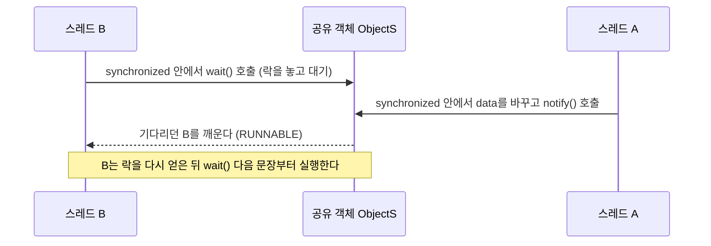

# 15강 — 고급 스레딩

[레포지토리 안내](../../README.ko.md) | [English](Concepts_Lecture.md) | [한국어](Concepts_Lecture.ko.md)

> **최종 수정일:** 2026-10-26

> **학습 목표:**
> 1. 스레드의 정보와 상태를 조회하고 우선순위를 설정할 수 있다
> 2. interrupt()와 플래그를 사용하여 스레드를 종료할 수 있다
> 3. synchronized로 공유 데이터에 대한 경쟁 조건을 방지할 수 있다
> 4. wait(), notify(), notifyAll()로 스레드의 실행 순서를 조율할 수 있다

---

## 목차

- [1. 스레드 제어 블록과 상태](#1-스레드-제어-블록과-상태)
- [2. 스레드 우선순위와 스케줄링](#2-스레드-우선순위와-스케줄링)
- [3. 스레드 종료](#3-스레드-종료)
  - [3.1 자연 종료](#31-자연-종료)
  - [3.2 interrupt() 메서드](#32-interrupt-메서드)
  - [3.3 플래그 기반 종료](#33-플래그-기반-종료)
- [4. 스레드 동기화](#4-스레드-동기화)
  - [4.1 synchronized 키워드](#41-synchronized-키워드)
  - [4.2 동기화 블록 vs. 동기화 메서드](#42-동기화-블록-vs-동기화-메서드)
  - [4.3 동기화 전후의 비교](#43-동기화-전후의-비교)
  - [4.4 wait(), notify(), notifyAll()](#44-wait-notify-notifyall)
- [5. 경쟁 조건과 예방](#5-경쟁-조건과-예방)
- [요약](#요약)
- [점검 문제](#점검-문제)

---

<br>

## 1. 스레드 제어 블록과 상태

각 스레드는 다음 정보를 포함하는 **스레드 제어 블록(thread control block, TCB)** 으로 관리된다.

| 필드 | 설명 |
|:------|:------------|
| Thread ID | 고유 식별자 |
| Thread State | 현재 생명 주기 상태 |
| Program Counter | 다음 명령어의 주소 |
| Registers | 저장된 CPU 레지스터 값 |
| Stack Pointer | 스레드의 스택을 가리킴 |
| Priority | 스케줄링 우선순위 (1~10) |
| Thread-Specific Data | 스레드마다 따로 가지는 데이터 |
| Pointer to PCB | 스레드가 속한 프로세스의 프로세스 제어 블록(PCB)을 가리킴 |

*표 1. 스레드 제어 블록의 필드*

> **[운영체제]** TCB는 운영체제가 스레드를 관리하기 위해 두는 자료 구조이며, 스레드를 다른 스레드로 바꿀 때(문맥 교환) 표 1의 레지스터와 프로그램 카운터 값을 여기에 저장하고 복원한다. 같은 프로세스의 스레드들은 코드와 힙 같은 프로세스의 자원을 공유하고, 스택과 레지스터 값은 스레드마다 따로 가진다.

Java 프로그램에서는 `Thread` 객체의 메서드로 이 정보의 일부를 조회한다. 다음 코드는 `main()`을 실행하는 스레드의 정보를 출력한다.

```java
public class Chap15Program1 {
    public static void main(String[] args) {
        long id = Thread.currentThread().getId();
        String name = Thread.currentThread().getName();
        int priority = Thread.currentThread().getPriority();
        Thread.State s = Thread.currentThread().getState();

        System.out.println("Thread name = " + name);
        System.out.println("Thread ID = " + id);
        System.out.println("Priority of Thread = " + priority);
        System.out.println("State of current thread = " + s);
    }
}
```

`Thread.currentThread()`는 이 문장을 실행하는 스레드의 `Thread` 객체를 반환한다. 실행하면 이름은 `main`, 우선순위는 5, 상태는 `RUNNABLE`로 출력되고, ID는 JVM이 정하는 값이라 버전에 따라 다르다(예: Java 24에서는 3). `getId()`는 Java 19부터 사용 중단되었고 대신 `threadId()`를 쓴다. 같은 정보를 출력하는 실습 코드는 [MainThreadInfoDemo.java](../../Coursework/Lab15_Advanced-Threading/MainThreadInfoDemo.java)에 있다.

스레드의 상태를 네 가지로 간단히 나누면 다음과 같다. 13강 1.2절의 상태와 비교하면 New Thread는 New에, Runnable은 Runnable과 Running에, Not Runnable은 Blocked, Waiting, Timed Waiting에, Dead는 Terminated에 해당한다.

- **New Thread:** `Thread myThread = new MyThreadClass();`처럼 스레드 객체를 만들었지만 시작하지 않은 상태이다.
- **Runnable:** `myThread.start()`를 호출하면 실행할 수 있는 상태가 된다.
- **Not Runnable:** `sleep()`이 호출되었을 때, 스레드가 `wait()`로 조건을 기다릴 때, 입출력에서 블로킹되었을 때 실행할 수 없는 상태가 된다(입출력에서 블로킹된 스레드는 `getState()`에서 RUNNABLE로 보고된다).
- **Dead:** `run()` 메서드가 정상적으로 끝나면 스레드는 자연히 종료된다. 예를 들어 100번 반복하는 유한 루프를 가진 `run()`은 반복이 끝나고 메서드가 완료되면 종료된다.

> **주의:** 초기 Java에는 스레드를 일시 정지시키는 `suspend()`와 강제로 종료시키는 `stop()`이 있었지만, 락을 쥔 채 멈추거나 공유 데이터를 불완전한 상태로 남길 수 있어 오래전에 사용 중단되었다. `stop()`은 Java 20부터 호출하면 `UnsupportedOperationException`을 던지고, `suspend()`와 `resume()`은 Java 23에서 제거되었다. 스레드를 끝낼 때는 3절의 방법을 쓴다.

---

<br>

## 2. 스레드 우선순위와 스케줄링

스레드의 우선순위는 최댓값 10(`MAX_PRIORITY`), 최솟값 1(`MIN_PRIORITY`), 보통값 5(`NORM_PRIORITY`) 사이의 정수이며, 응용 프로그램이 `void setPriority(int priority)`로 바꾸고 `int getPriority()`로 읽을 수 있다.

```java
thread.setPriority(Thread.MAX_PRIORITY);  // 10
thread.setPriority(Thread.MIN_PRIORITY);  // 1
thread.setPriority(Thread.NORM_PRIORITY); // 5 (기본값)
```

- 스레드 우선순위는 JVM과 운영체제 스케줄러에 대한 힌트이다. 우선순위 동작은 플랫폼에 따라 다르며, 높은 우선순위의 스레드가 일반적으로 선호되지만 엄격한 선점이 보장되지는 않는다.
- 개념적인 JVM 스케줄링 정책에서는 우선순위가 가장 높은 스레드가 먼저 스케줄링되고, 동일한 우선순위의 스레드는 라운드 로빈 방식으로 스케줄링된다. 실제 순서는 앞 항목처럼 운영체제의 스케줄러가 정하므로 보장되지 않는다.
- 메인 스레드는 우선순위 5로 시작한다.
- 새로 만든 스레드는 자신을 만든 부모 스레드와 같은 우선순위를 가진다.

**메인 스레드:** JVM은 응용 프로그램을 실행하기 시작할 때 메인 스레드를 만들고, 메인 스레드에 `main()` 메서드를 실행하게 한다. `main()` 메서드가 끝나면 메인 스레드도 끝난다. 그러나 JVM은 데몬 스레드가 아닌 스레드가 모두 끝나야 종료되므로, `main()`이 끝나도 다른 스레드가 실행 중이면 프로그램은 계속 실행된다.

---

<br>

## 3. 스레드 종료

스레드가 스스로 끝나려면 `run()` 메서드에서 반환하고, 다른 스레드가 강제로 끝내려면 `interrupt()` 메서드를 쓴다. 어느 경우든 스레드는 `run()`에서 반환할 때 끝나므로, `interrupt()`와 3.3절의 플래그는 대상 스레드가 `run()`에서 반환하도록 알리는 수단이다.

### 3.1 자연 종료

`run()` 메서드가 반환되면 스레드가 종료된다:

```java
public void run() {
    for (int i = 0; i < 100; i++) {
        System.out.println(i);
    }
    // 스레드가 여기서 종료됨
}
```

### 3.2 interrupt() 메서드

```java
TimerThread th = new TimerThread();
th.start();
// ...
th.interrupt(); // 슬립 중인 스레드에서 InterruptedException 발생
```

`interrupt()`는 대상 스레드의 인터럽트 상태를 설정한다. 대상 스레드가 `sleep()`, `wait()`, `join()`으로 기다리는 중이면 그 메서드가 `InterruptedException`을 던지고, 13강 2.1절의 `TimerThread`처럼 `catch` 블록에서 `return`하면 스레드가 종료된다. Swing 프로그램이라면 "kill Timer" 버튼의 액션 리스너에서 `th.interrupt()`를 호출하고 버튼을 비활성화하여 타이머 스레드를 끝낼 수 있다.

> **주의:** 대상 스레드가 기다리지 않고 계산만 하는 중이면 `interrupt()`는 인터럽트 상태만 설정하고 예외를 던지지 않는다. 이런 스레드는 반복문에서 `Thread.currentThread().isInterrupted()`를 검사하여 스스로 끝내야 하며, 그렇지 않으면 `interrupt()`를 호출해도 계속 실행된다.

### 3.3 플래그 기반 종료

플래그 기반 종료는 스레드 A가 스레드 B의 플래그를 `true`로 설정하면 스레드 B가 플래그를 확인하고 스스로 종료하는 방식이다.

```java
class WorkerThread extends Thread {
    private volatile boolean finished = false;

    public void finish() { finished = true; }

    @Override
    public void run() {
        while (!finished) {
            // 작업 수행
            try { Thread.sleep(100); }
            catch (InterruptedException e) { return; }
        }
    }
}
```

> **핵심:** 한 스레드가 바꾼 플래그 값을 다른 스레드가 바로 볼 수 있도록(스레드 간 가시성) 플래그 변수에 `volatile`을 사용해야 한다.

예를 들어 프로그램이 시작되자마자 0.3초마다 임의의 위치에 `java` 문자열을 만드는 스레드를 실행하고, 컨텐트팬에서 마우스를 누르면 리스너가 그 스레드의 `finish()`를 호출하게 할 수 있다. 스레드는 `sleep(300)`에서 깨어날 때마다 플래그를 확인하고, 플래그가 `true`이면 컨텐트팬을 비우고 (100, 100) 위치에 `finish`를 표시한 뒤 `run()`에서 반환한다.

---

<br>

## 4. 스레드 동기화

여러 스레드가 공유 데이터에 동시에 접근하면 공유 데이터의 값이 예상하지 못한 결과가 될 수 있으므로, 동기화는 멀티스레드 프로그램을 작성할 때 가장 중요하게 고려할 부분이다. **스레드 동기화(thread synchronization)** 는 한 스레드가 공유 데이터에 대한 작업을 끝낼 때까지 다른 스레드를 기다리게 하여 이 문제를 해결하며, 그 본질은 스레드가 공유 데이터에 **배타적으로 접근(exclusive access)** 하도록 보장하는 것이다.

예를 들어 스레드 A는 "I love you forever."를, 스레드 B는 "자바는 좋은 것이야. 배워서 많이 알고 취직도 잘 되고."를 동시에 한 프린터로 출력하면 두 문장의 낱말이 뒤섞여 인쇄된다. 동기화하면 스레드 B는 스레드 A가 프린터를 다 쓸 때까지 기다리므로 두 문장이 온전하게 차례로 인쇄된다.

Java에서 스레드를 동기화하는 방법은 두 가지이다. `synchronized`로 동기화 블록을 지정하는 방법과, `wait()`, `notify()` 메서드로 스레드의 실행 순서를 제어하는 방법이다.

### 4.1 synchronized 키워드

`synchronized`는 한 번에 하나의 스레드만 **임계 영역(critical section)**, 즉 공유 데이터에 접근하는 코드 부분을 실행할 수 있도록 보장한다.

```java
synchronized void add() {
    int n = getCurrentSum();
    n += 10;
    setCurrentSum(n);
}
```

모든 객체에는 **모니터 락(monitor lock)** 이 하나씩 있다. 스레드가 `synchronized` 인스턴스 메서드에 들어가려면 그 객체(`this`)의 락을 얻어야 하고, 메서드에서 나오면 락을 놓는다. 다른 스레드가 락을 쥐고 있으면 락이 풀릴 때까지 Blocked 상태로 기다린다. `static synchronized` 메서드는 그 클래스의 `Class` 객체의 락을 쓴다.

### 4.2 동기화 블록 vs. 동기화 메서드

```java
// 동기화 메서드 -- 메서드 전체를 잠금
synchronized void method() { /* ... */ }

// 동기화 블록 -- 임계 영역만 잠금
void method() {
    // 비임계 코드
    synchronized (this) {
        // 임계 영역
    }
    // 비임계 코드
}
```

> **핵심:** 잠금 범위를 최소화하기 위해 동기화 메서드보다 동기화 블록을 사용하는 것이 바람직하다.

### 4.3 동기화 전후의 비교

다음 프로그램에서 두 학생 스레드 `kitae`와 `hyosoo`는 공유 게시판 `SharedBoard`의 `add()`를 각각 10번 호출하여 합계를 10씩 늘린다. 두 스레드가 20번 더하므로 마지막 합계는 200이어야 한다.

```java
class SharedBoard {
    private int sum = 0;

    public void add() {
        int n = sum;
        Thread.yield();   // 다른 스레드에 실행을 양보하여 끼어들 기회를 준다
        n += 10;
        sum = n;
        System.out.println(Thread.currentThread().getName() + " : " + sum);
    }

    public int getSum() { return sum; }
}

class StudentThread extends Thread {
    private SharedBoard board;

    public StudentThread(String name, SharedBoard board) {
        super(name);
        this.board = board;
    }

    @Override
    public void run() {
        for (int i = 0; i < 10; i++)
            board.add();
    }
}
```

`main()`은 `SharedBoard` 하나를 만들고 두 `StudentThread`에 넘겨 시작한다. 동기화하지 않으면 한 스레드가 `sum`을 읽은 뒤 쓰기 전에 다른 스레드가 같은 값을 읽을 수 있어, 두 스레드가 같은 값을 출력하거나(예: `kitae : 30`, `hyosoo : 30`) 덧셈이 사라져 마지막 합계가 200보다 작아진다(예: 150이나 190). `add()`를 `public synchronized void add()`로 바꾸면 한 스레드가 `add()`를 마칠 때까지 다른 스레드가 들어오지 못하므로 출력되는 합계가 10, 20, ..., 200으로 겹치지 않고 늘어나며 마지막 합계는 항상 200이다. 실습 코드 [SynchronizationDemo.java](../../Coursework/Lab15_Advanced-Threading/SynchronizationDemo.java)는 두 스레드가 공유 카운터를 늘리는 프로그램으로 두 경우를 비교한다.

### 4.4 wait(), notify(), notifyAll()

| 메서드 | 설명 |
|:-------|:------------|
| `wait()` | 락을 해제하고 통지될 때까지 대기 |
| `notify()` | 대기 중인 스레드 하나를 깨움 |
| `notifyAll()` | 대기 중인 모든 스레드를 깨움 |

*표 2. 스레드 간 통지 메서드*

이 메서드들은 반드시 `synchronized` 블록 또는 메서드 내에서 호출해야 한다.

`wait()`를 호출한 스레드는 다른 스레드가 같은 객체에 `notify()`를 호출할 때까지 기다린다. `notify()`는 기다리는 스레드가 여럿이어도 하나만 깨워 RUNNABLE 상태로 만들고, `notifyAll()`은 기다리는 모든 스레드를 깨워 RUNNABLE 상태로 만든다. 세 메서드는 `Object`의 메서드이므로 어떤 객체든 동기화 객체가 될 수 있으며, `Thread` 객체도 동기화 객체로 쓸 수 있다.



*그림 1. 공유 객체에서 wait()와 notify()로 이루어지는 통지*

다음 `SharedData`는 한 스레드가 `put()`으로 값을 넣을 때까지 다른 스레드가 `take()`에서 기다리게 한다.

```java
class SharedData {
    private int data;
    private boolean ready = false;

    synchronized void put(int value) {
        data = value;
        ready = true;
        notify();                // 기다리는 스레드 하나를 깨운다
    }

    synchronized int take() throws InterruptedException {
        while (!ready)           // 조건이 만족될 때까지
            wait();              // 락을 놓고 기다린다
        ready = false;
        return data;
    }
}
```

> **주의:** 락을 쥐지 않은 채 `wait()`나 `notify()`를 호출하면 `IllegalMonitorStateException`이 발생한다. 또 깨어난 스레드가 락을 다시 얻기 전에 조건이 바뀌거나 통지 없이 깨어날(spurious wakeup) 수 있으므로, `wait()`는 `if`가 아니라 위처럼 조건을 다시 검사하는 `while` 반복문 안에서 호출한다.

---

<br>

## 5. 경쟁 조건과 예방

경쟁 조건은 여러 스레드가 공유 데이터에 동시에 접근하고, 결과가 스레드의 실행 순서에 따라 달라질 때 발생한다(13강 4절).

**예방 전략:**
1. `synchronized` 블록/메서드 사용
2. `java.util.concurrent` 클래스 사용 (`AtomicInteger`, `ConcurrentHashMap` 등)
3. 단순한 가시성 보장을 위해 `volatile` 사용
4. 공유 가변 상태 최소화

> **주의:** `volatile`은 한 스레드가 쓴 값을 다른 스레드가 바로 보게 할 뿐, `count++`처럼 읽고, 바꾸고, 쓰는 복합 연산을 원자적으로 만들지 않는다. 두 스레드가 `volatile int count`를 각각 100,000번 증가시키면 결과가 200,000보다 작게 나올 수 있다. 복합 연산은 `synchronized`나 `AtomicInteger.incrementAndGet()`으로 보호한다.

> **[운영체제]** 운영체제에서 배우는 **교착 상태(deadlock)** 는 스레드들이 서로가 쥔 자원을 기다리느라 진행하지 못하는 상태이며, `synchronized`를 중첩해 모니터 락을 둘 이상 쥐는 프로그램에서 생길 수 있다. 스레드 A가 락 X를 쥔 채 락 Y를 기다리고, 스레드 B가 락 Y를 쥔 채 락 X를 기다리면 두 스레드는 영원히 진행하지 못한다. 모든 스레드가 같은 순서로 락을 얻게 하면 이런 순환 대기를 막을 수 있다.

---

<br>

## 요약

| 개념 | 핵심 요약 |
|:--------|:----------|
| 스레드 제어 블록 | 스레드 ID, 상태, 프로그램 카운터, 레지스터, 스택 포인터, 우선순위 등을 담아 스레드를 관리하는 자료 구조이다. |
| 스레드 우선순위 | 1(최소)~10(최대)이고 기본값은 5이며, 새 스레드는 부모 스레드의 우선순위를 물려받는다. |
| 스레드 종료 | 자연 종료(run 반환), interrupt(), 또는 플래그 기반으로 끝내며, `stop()`은 쓰지 않는다. |
| synchronized | 객체의 모니터 락으로 상호 배제를 구현하여 한 번에 하나의 스레드만 접근하게 한다. |
| 동기화 블록 | 동기화 메서드보다 세밀하게 잠금 범위를 제어한다. |
| wait/notify | synchronized 안에서 락을 놓고 기다리거나 기다리는 스레드를 깨워 스레드 간 실행 순서를 조율한다. |
| volatile | 스레드 간 변수 가시성을 보장하지만 복합 연산을 원자적으로 만들지는 않는다. |
| 경쟁 조건 | 결과가 스레드의 실행 순서에 따라 달라지는 상황이며, 동기화나 원자적 연산으로 예방한다. |

---

<br>

## 점검 문제

1. **스레드 정보:** 1절의 `Chap15Program1`을 실행하면 메인 스레드의 이름, 우선순위, 상태는 각각 어떻게 출력되는가? 상태가 `RUNNING`이 아닌 이유도 설명하라.

   <details>
   <summary>정답</summary>

   이름은 `main`, 우선순위는 5, 상태는 `RUNNABLE`이다. `Thread.State` 열거형에는 RUNNING이라는 값이 없고, 실행 대기 중인 스레드와 실제로 실행 중인 스레드를 모두 RUNNABLE로 나타낸다. `getState()`를 호출하는 순간 메인 스레드는 실행 중이므로 RUNNABLE이다.

   </details>

2. **interrupt():** 스레드가 `while (true) { n++; }`처럼 `sleep()` 없이 계산만 반복하고 있을 때 다른 스레드가 이 스레드의 `interrupt()`를 호출하면 스레드는 종료되는가?

   <details>
   <summary>정답</summary>

   종료되지 않는다. 기다리는 중이 아닌 스레드에 대한 `interrupt()`는 인터럽트 상태만 설정하고 예외를 던지지 않기 때문이다. 반복 조건을 `while (!Thread.currentThread().isInterrupted())`로 바꾸면 인터럽트 상태를 확인하고 반복을 끝내 스레드가 종료된다.

   </details>

3. **동기화:** 4.3절의 `SharedBoard`에서 동기화하지 않았을 때 마지막 합계가 200보다 작아질 수 있는 이유를 쓰고, `add()`에 `synchronized`를 붙이면 마지막 합계가 얼마가 되는지 쓰라.

   <details>
   <summary>정답</summary>

   `add()`는 `sum`을 `n`에 읽고, `Thread.yield()`로 양보한 뒤, 10을 더해 다시 쓴다. 한 스레드가 읽은 뒤 쓰기 전에 다른 스레드가 같은 `sum`을 읽으면 두 스레드가 같은 값에 10을 더해 쓰므로 덧셈 하나가 사라진다. `synchronized`를 붙이면 읽기부터 쓰기까지를 한 스레드만 실행하므로 20번의 덧셈이 모두 반영되어 마지막 합계는 항상 200이다.

   </details>

4. **wait()의 호출 위치:** `synchronized` 밖에서 `obj.wait()`를 호출하면 어떻게 되는가?

   <details>
   <summary>정답</summary>

   `IllegalMonitorStateException`이 발생한다(메시지: "current thread is not owner"). `wait()`는 호출한 스레드가 쥐고 있는 `obj`의 락을 놓고 기다리는 메서드이므로, 먼저 `synchronized`로 그 객체의 락을 얻어야 한다. `notify()`와 `notifyAll()`도 같다.

   </details>

5. **volatile:** 두 스레드가 `static volatile int count`를 각각 100,000번 `count++`했다. 결과는 항상 200,000인가? 아니라면 어떻게 고쳐야 하는가?

   <details>
   <summary>정답</summary>

   항상 200,000은 아니다. 실제로 실행하면 108,202나 181,949처럼 더 작은 값이 나올 수 있다. `volatile`은 가시성만 보장하고 `count++`의 읽기, 증가, 쓰기를 원자적으로 만들지 않아 덧셈이 사라지기 때문이다. 증가 부분을 `synchronized`로 감싸거나 `AtomicInteger`의 `incrementAndGet()`을 쓰면 항상 200,000이 된다.

   </details>
