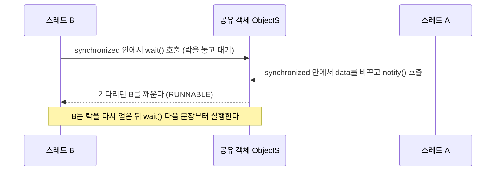

# 15강 — 고급 스레딩

[레포지토리 안내](../../README.ko.md) | [English](Concepts_Lecture.md) | [한국어](Concepts_Lecture.ko.md)

> **최종 수정일:** 2026-11-27

> **학습 목표:**
> 1. 스레드의 정보와 상태를 조회하고 우선순위를 설정할 수 있다
> 2. interrupt()와 플래그를 사용하여 스레드를 종료할 수 있다
> 3. synchronized로 공유 데이터에 대한 경쟁 조건을 방지할 수 있다
> 4. wait(), notify(), notifyAll()로 스레드의 실행 순서를 조율할 수 있다
> 5. 생산자와 소비자 문제를 wait()와 notifyAll()로 풀고 교착 상태가 생기는 조건을 설명할 수 있다
> 6. 락 객체의 선택, 원자적 변수, 스레드 풀 같은 동시성 도구를 상황에 맞게 고를 수 있다

---

## 목차

- [1. 스레드 제어 블록과 상태](#1-스레드-제어-블록과-상태)
- [2. 스레드 우선순위와 스케줄링](#2-스레드-우선순위와-스케줄링)
- [3. 스레드 종료](#3-스레드-종료)
  - [3.1 자연 종료](#31-자연-종료)
  - [3.2 interrupt() 메서드](#32-interrupt-메서드)
  - [3.3 플래그 기반 종료](#33-플래그-기반-종료)
  - [3.4 인터럽트 상태의 동작](#34-인터럽트-상태의-동작)
  - [3.5 버튼으로 타이머 스레드 끝내기](#35-버튼으로-타이머-스레드-끝내기)
- [4. 스레드 동기화](#4-스레드-동기화)
  - [4.1 synchronized 키워드](#41-synchronized-키워드)
  - [4.2 동기화 블록 vs. 동기화 메서드](#42-동기화-블록-vs-동기화-메서드)
  - [4.3 동기화 전후의 비교](#43-동기화-전후의-비교)
  - [4.4 wait(), notify(), notifyAll()](#44-wait-notify-notifyall)
  - [4.5 동기화 전후의 실제 결과](#45-동기화-전후의-실제-결과)
  - [4.6 락의 재진입과 락 객체의 선택](#46-락의-재진입과-락-객체의-선택)
  - [4.7 생산자와 소비자](#47-생산자와-소비자)
  - [4.8 키 입력 게임의 막대](#48-키-입력-게임의-막대)
  - [4.9 게임 프로그램의 스레드 구성](#49-게임-프로그램의-스레드-구성)
- [5. 경쟁 조건과 예방](#5-경쟁-조건과-예방)
  - [5.1 원자적 변수](#51-원자적-변수)
  - [5.2 교착 상태의 재현과 발견](#52-교착-상태의-재현과-발견)
  - [5.3 java.util.concurrent의 도구](#53-javautilconcurrent의-도구)
- [6. 흔한 실수](#6-흔한-실수)
- [요약](#요약)
- [점검 문제](#점검-문제)
- [참고 문헌](#참고-문헌)

---

<br>

## 1. 스레드 제어 블록과 상태

각 스레드는 다음 정보를 포함하는 **스레드 제어 블록(thread control block, TCB)** 으로 관리된다.

| 필드 | 설명 |
|:------|:------------|
| 스레드 ID | 고유 식별자 |
| 스레드 상태 | 현재 생명 주기 상태 |
| 프로그램 카운터 | 다음 명령어의 주소 |
| 레지스터 | 저장된 CPU 레지스터 값 |
| 스택 포인터 | 스레드의 스택을 가리킴 |
| 우선순위 | 스케줄링 우선순위 (1~10) |
| 스레드별 데이터 | 스레드마다 따로 가지는 데이터 |
| PCB 포인터 | 스레드가 속한 프로세스의 프로세스 제어 블록(PCB)을 가리킴 |

*표 1. 스레드 제어 블록의 필드*

> **[운영체제]** TCB는 운영체제가 스레드를 관리하기 위해 두는 자료 구조이며, 스레드를 다른 스레드로 바꿀 때(문맥 교환) 표 1의 레지스터와 프로그램 카운터 값을 여기에 저장하고 복원한다. 같은 프로세스의 스레드들은 코드와 힙 같은 프로세스의 자원을 공유하고, 스택과 레지스터 값은 스레드마다 따로 가진다.

Java 프로그램에서는 `Thread` 객체의 메서드로 이 정보의 일부를 조회한다. 다음 코드는 `main()`을 실행하는 스레드의 정보를 출력한다.

```java
public class Chap15Program1 {
    public static void main(String[] args) {
        long id = Thread.currentThread().getId();
        String name = Thread.currentThread().getName();
        int priority = Thread.currentThread().getPriority();
        Thread.State s = Thread.currentThread().getState();

        System.out.println("Thread name = " + name);
        System.out.println("Thread ID = " + id);
        System.out.println("Priority of Thread = " + priority);
        System.out.println("State of current thread = " + s);
    }
}
```

`Thread.currentThread()`는 이 문장을 실행하는 스레드의 `Thread` 객체를 반환한다. 실행하면 이름은 `main`, 우선순위는 5, 상태는 `RUNNABLE`로 출력되고, ID는 JVM이 정하는 값이라 버전에 따라 다르다(예: Java 24에서는 3). `getId()`는 Java 19부터 사용 중단되었고 대신 `threadId()`를 쓴다. 같은 정보를 출력하는 실습 코드는 [MainThreadInfoDemo.java](../../Coursework/Lab15_Advanced-Threading/MainThreadInfoDemo.java)에 있다.

스레드의 상태를 네 가지로 간단히 나누면 다음과 같다. 13강 1.2절의 상태와 비교하면 New Thread는 New에, Runnable은 Runnable과 Running에, Not Runnable은 Blocked, Waiting, Timed Waiting에, Dead는 Terminated에 해당한다.

- **New Thread:** `Thread myThread = new MyThreadClass();`처럼 스레드 객체를 만들었지만 시작하지 않은 상태이다.
- **Runnable:** `myThread.start()`를 호출하면 실행할 수 있는 상태가 된다.
- **Not Runnable:** `sleep()`이 호출되었을 때, 스레드가 `wait()`로 조건을 기다릴 때, 입출력에서 블로킹되었을 때 실행할 수 없는 상태가 된다(입출력에서 블로킹된 스레드는 `getState()`에서 RUNNABLE로 보고된다).
- **Dead:** `run()` 메서드가 정상적으로 끝나면 스레드는 자연히 종료된다. 예를 들어 100번 반복하는 유한 루프를 가진 `run()`은 반복이 끝나고 메서드가 완료되면 종료된다.

> **주의:** 초기 Java에는 스레드를 일시 정지시키는 `suspend()`와 강제로 종료시키는 `stop()`이 있었지만, 락을 쥔 채 멈추거나 공유 데이터를 불완전한 상태로 남길 수 있어 오래전에 사용 중단되었다. `stop()`은 Java 20부터 호출하면 `UnsupportedOperationException`을 던지고 [1], `suspend()`와 `resume()`은 Java 23에서 제거되었다 [2]. 스레드를 끝낼 때는 3절의 방법을 쓴다.

---

<br>

## 2. 스레드 우선순위와 스케줄링

스레드의 우선순위는 최댓값 10(`MAX_PRIORITY`), 최솟값 1(`MIN_PRIORITY`), 보통값 5(`NORM_PRIORITY`) 사이의 정수이며, 응용 프로그램이 `void setPriority(int priority)`로 바꾸고 `int getPriority()`로 읽을 수 있다.

```java
thread.setPriority(Thread.MAX_PRIORITY);  // 10
thread.setPriority(Thread.MIN_PRIORITY);  // 1
thread.setPriority(Thread.NORM_PRIORITY); // 5 (default)
```

- 스레드 우선순위는 JVM과 운영체제 스케줄러에 대한 힌트이다. 우선순위 동작은 플랫폼에 따라 다르며, 높은 우선순위의 스레드가 일반적으로 선호되지만 엄격한 선점이 보장되지는 않는다.
- 개념적인 JVM 스케줄링 정책에서는 우선순위가 가장 높은 스레드가 먼저 스케줄링되고, 동일한 우선순위의 스레드는 라운드 로빈 방식으로 스케줄링된다. 실제 순서는 앞 항목처럼 운영체제의 스케줄러가 정하므로 보장되지 않는다.
- 메인 스레드는 우선순위 5로 시작한다.
- 새로 만든 스레드는 자신을 만든 부모 스레드와 같은 우선순위를 가진다.

**메인 스레드:** JVM은 응용 프로그램을 실행하기 시작할 때 메인 스레드를 만들고, 메인 스레드에 `main()` 메서드를 실행하게 한다. `main()` 메서드가 끝나면 메인 스레드도 끝난다. 그러나 JVM은 데몬 스레드가 아닌 스레드가 모두 끝나야 종료되므로, `main()`이 끝나도 다른 스레드가 실행 중이면 프로그램은 계속 실행된다.

---

<br>

## 3. 스레드 종료

스레드가 스스로 끝나려면 `run()` 메서드에서 반환하고, 다른 스레드가 강제로 끝내려면 `interrupt()` 메서드를 쓴다. 어느 경우든 스레드는 `run()`에서 반환할 때 끝나므로, `interrupt()`와 3.3절의 플래그는 대상 스레드가 `run()`에서 반환하도록 알리는 수단이다.

### 3.1 자연 종료

`run()` 메서드가 반환되면 스레드가 종료된다:

```java
public void run() {
    for (int i = 0; i < 100; i++) {
        System.out.println(i);
    }
    // thread terminates here
}
```

### 3.2 interrupt() 메서드

```java
TimerThread th = new TimerThread();
th.start();
// ...
th.interrupt(); // causes InterruptedException in sleeping thread
```

`interrupt()`는 대상 스레드의 인터럽트 상태를 설정한다. 대상 스레드가 `sleep()`, `wait()`, `join()`으로 기다리는 중이면 그 메서드가 `InterruptedException`을 던지고, 13강 2.1절의 `TimerThread`처럼 `catch` 블록에서 `return`하면 스레드가 종료된다. Swing 프로그램이라면 "kill Timer" 버튼의 액션 리스너에서 `th.interrupt()`를 호출하고 버튼을 비활성화하여 타이머 스레드를 끝낼 수 있다.

> **주의:** 대상 스레드가 기다리지 않고 계산만 하는 중이면 `interrupt()`는 인터럽트 상태만 설정하고 예외를 던지지 않는다. 이런 스레드는 반복문에서 `Thread.currentThread().isInterrupted()`를 검사하여 스스로 끝내야 하며, 그렇지 않으면 `interrupt()`를 호출해도 계속 실행된다.

### 3.3 플래그 기반 종료

플래그 기반 종료는 스레드 A가 스레드 B의 플래그를 `true`로 설정하면 스레드 B가 플래그를 확인하고 스스로 종료하는 방식이다.

```java
class WorkerThread extends Thread {
    private volatile boolean finished = false;

    public void finish() { finished = true; }

    @Override
    public void run() {
        while (!finished) {
            // do work
            try { Thread.sleep(100); }
            catch (InterruptedException e) { return; }
        }
    }
}
```

> **핵심:** 한 스레드가 바꾼 플래그 값을 다른 스레드가 바로 볼 수 있도록(스레드 간 가시성) 플래그 변수에 `volatile`을 사용해야 한다.

예를 들어 프로그램이 시작되자마자 0.3초마다 임의의 위치에 `java` 문자열을 만드는 스레드를 실행하고, 컨텐트팬에서 마우스를 누르면 리스너가 그 스레드의 `finish()`를 호출하게 할 수 있다. 스레드는 `sleep(300)`에서 깨어날 때마다 플래그를 확인하고, 플래그가 `true`이면 컨텐트팬을 비우고 (100, 100) 위치에 `finish`를 표시한 뒤 `run()`에서 반환한다.

### 3.4 인터럽트 상태의 동작

모든 스레드에는 **인터럽트 상태(interrupt status)** 라는 `boolean` 표시가 하나 있다. `interrupt()`는 이 표시를 `true`로 바꾸는 것이 기본 동작이며, 대상 스레드가 그때 무엇을 하고 있었느냐에 따라 결과가 갈린다.

```java
public class InterruptStatus {
    public static void main(String[] args) throws InterruptedException {
        Thread sleeper = new Thread(() -> {
            try {
                Thread.sleep(10_000);
            } catch (InterruptedException e) {
                System.out.println("sleeper: InterruptedException, flag now "
                        + Thread.currentThread().isInterrupted());     // cleared when thrown
            }
        });
        sleeper.start();
        Thread.sleep(100);
        sleeper.interrupt();
        sleeper.join();

        Thread busy = new Thread(() -> {
            long n = 0;
            while (!Thread.currentThread().isInterrupted()) n++;      // check the status itself
            System.out.println("busy: saw the flag after " + (n > 0 ? "many" : "no") + " iterations, flag "
                    + Thread.currentThread().isInterrupted());
            System.out.println("busy: Thread.interrupted() = " + Thread.interrupted()
                    + ", then isInterrupted() = " + Thread.currentThread().isInterrupted());
        });
        busy.start();
        Thread.sleep(100);
        busy.interrupt();
        busy.join();
    }
}
```

```text
sleeper: InterruptedException, flag now false
busy: saw the flag after many iterations, flag true
busy: Thread.interrupted() = true, then isInterrupted() = false
```

`sleeper`는 `sleep(10_000)` 안에서 기다리다가 인터럽트를 받는다. 이때 `sleep()`은 `InterruptedException`을 던지면서 인터럽트 상태를 `false`로 되돌린다 [3]. 그래서 `catch` 블록에서 `isInterrupted()`를 확인하면 `false`이다. 13강 3.1절의 코드가 `catch` 블록에서 `interrupt()`를 다시 호출한 것은 이렇게 지워진 표시를 되살려, 이 스레드를 호출한 코드도 인터럽트가 있었다는 것을 알 수 있게 하기 위해서이다.

`busy`는 기다리지 않고 계산만 반복하므로 예외가 나지 않는다. 대신 반복 조건에서 `isInterrupted()`를 매번 검사하다가 표시가 `true`로 바뀐 것을 보고 반복을 끝낸다(3.2절의 주의 상자). 이 스레드에 대한 두 메서드의 차이도 출력에 나타난다.

| 메서드 | 종류 | 반환값 | 상태를 지우는가 |
|:-----|:-----|:-----|:-----|
| `t.isInterrupted()` | 인스턴스 | 스레드 `t`의 인터럽트 상태 | 지우지 않는다 |
| `Thread.interrupted()` | static | 현재 스레드의 인터럽트 상태 | 읽은 뒤 `false`로 지운다 |

*표 2. 인터럽트 상태를 읽는 두 메서드*

`Thread.interrupted()`는 `true`를 반환하면서 상태를 지우므로, 바로 뒤의 `isInterrupted()`는 `false`이다. 인터럽트는 강제로 스레드를 멈추는 장치가 아니라 끝내 달라는 요청이며, 그 요청에 응할지, 언제 어떻게 응할지는 대상 스레드의 코드가 정한다. 그래서 스레드를 끝낼 수 있게 만들려면 기다리는 메서드의 `InterruptedException`을 처리하고, 오래 걸리는 계산 반복문에서는 인터럽트 상태를 검사해야 한다.

### 3.5 버튼으로 타이머 스레드 끝내기

3.2절에서 Swing 프로그램의 "kill Timer" 버튼으로 타이머 스레드를 끝낼 수 있다고 했다. 그 프로그램의 핵심은 다음과 같다. 타이머는 13강 2.2절의 `TimerRunnable`처럼 1초마다 레이블의 숫자를 늘리고, `sleep()` 중에 `InterruptedException`을 받으면 `run()`에서 반환한다.

```java
TimerRunnable runnable = new TimerRunnable(timerLabel);
th = new Thread(runnable);
c.add(timerLabel);

JButton btn = new JButton("kill Timer");
btn.addActionListener(new ActionListener() {
    @Override
    public void actionPerformed(ActionEvent e) {
        th.interrupt();                      // ask the timer thread to end
        JButton btn = (JButton) e.getSource();
        btn.setEnabled(false);               // keep the button from being pressed again
    }
});
c.add(btn);
setSize(300, 170);
setVisible(true);
th.start();
```

버튼을 누르면 EDT가 액션 리스너를 실행하고(12강 5.7절), 리스너는 타이머 스레드 `th`에 `interrupt()`를 호출한다. 타이머 스레드는 대부분의 시간을 `sleep(1000)`에서 보내므로 거의 즉시 `InterruptedException`을 받아 `return`하고, 레이블의 숫자는 마지막 값에서 멈춘다. 리스너가 버튼을 비활성화하는 것은 이미 끝난 스레드에 다시 인터럽트를 거는 의미 없는 동작을 막기 위해서이다. 리스너는 `interrupt()`를 호출한 뒤 스레드가 끝나기를 기다리지 않고 바로 반환하므로 EDT가 막히지 않는다.

---

<br>

## 4. 스레드 동기화

여러 스레드가 공유 데이터에 동시에 접근하면 공유 데이터의 값이 예상하지 못한 결과가 될 수 있으므로, 동기화는 멀티스레드 프로그램을 작성할 때 가장 중요하게 고려할 부분이다. **스레드 동기화(thread synchronization)** 는 한 스레드가 공유 데이터에 대한 작업을 끝낼 때까지 다른 스레드를 기다리게 하여 이 문제를 해결하며, 그 본질은 스레드가 공유 데이터에 **배타적으로 접근(exclusive access)** 하도록 보장하는 것이다.

예를 들어 스레드 A는 "I love you forever."를, 스레드 B는 "자바는 좋은 것이야. 배워서 많이 알고 취직도 잘 되고."를 동시에 한 프린터로 출력하면 두 문장의 낱말이 뒤섞여 인쇄된다. 동기화하면 스레드 B는 스레드 A가 프린터를 다 쓸 때까지 기다리므로 두 문장이 온전하게 차례로 인쇄된다.

Java에서 스레드를 동기화하는 방법은 두 가지이다. `synchronized`로 동기화 블록을 지정하는 방법과, `wait()`, `notify()` 메서드로 스레드의 실행 순서를 제어하는 방법이다.

### 4.1 synchronized 키워드

`synchronized`는 한 번에 하나의 스레드만 **임계 영역(critical section)**, 즉 공유 데이터에 접근하는 코드 부분을 실행할 수 있도록 보장한다.

```java
synchronized void add() {
    int n = getCurrentSum();
    n += 10;
    setCurrentSum(n);
}
```

모든 객체에는 **모니터 락(monitor lock)** 이 하나씩 있다. 스레드가 `synchronized` 인스턴스 메서드에 들어가려면 그 객체(`this`)의 락을 얻어야 하고, 메서드에서 나오면 락을 놓는다. 다른 스레드가 락을 쥐고 있으면 락이 풀릴 때까지 Blocked 상태로 기다린다. `static synchronized` 메서드는 그 클래스의 `Class` 객체의 락을 쓴다.

### 4.2 동기화 블록 vs. 동기화 메서드

```java
// Synchronized method -- locks the entire method
synchronized void method() { /* ... */ }

// Synchronized block -- locks only the critical section
void method() {
    // non-critical code
    synchronized (this) {
        // critical section
    }
    // non-critical code
}
```

> **핵심:** 잠금 범위를 최소화하기 위해 동기화 메서드보다 동기화 블록을 사용하는 것이 바람직하다.

### 4.3 동기화 전후의 비교

다음 프로그램에서 두 학생 스레드 `kitae`와 `hyosoo`는 공유 게시판 `SharedBoard`의 `add()`를 각각 10번 호출하여 합계를 10씩 늘린다. 두 스레드가 20번 더하므로 마지막 합계는 200이어야 한다.

```java
class SharedBoard {
    private int sum = 0;

    public void add() {
        int n = sum;
        Thread.yield();   // yield to another thread, giving it a chance to cut in
        n += 10;
        sum = n;
        System.out.println(Thread.currentThread().getName() + " : " + sum);
    }

    public int getSum() { return sum; }
}

class StudentThread extends Thread {
    private SharedBoard board;

    public StudentThread(String name, SharedBoard board) {
        super(name);
        this.board = board;
    }

    @Override
    public void run() {
        for (int i = 0; i < 10; i++)
            board.add();
    }
}
```

`main()`은 `SharedBoard` 하나를 만들고 두 `StudentThread`에 넘겨 시작한다. 동기화하지 않으면 한 스레드가 `sum`을 읽은 뒤 쓰기 전에 다른 스레드가 같은 값을 읽을 수 있어, 두 스레드가 같은 값을 출력하거나(예: `kitae : 30`, `hyosoo : 30`) 덧셈이 사라져 마지막 합계가 200보다 작아진다(예: 150이나 190). `add()`를 `public synchronized void add()`로 바꾸면 한 스레드가 `add()`를 마칠 때까지 다른 스레드가 들어오지 못하므로 출력되는 합계가 10, 20, ..., 200으로 겹치지 않고 늘어나며 마지막 합계는 항상 200이다. 실습 코드 [SynchronizationDemo.java](../../Coursework/Lab15_Advanced-Threading/SynchronizationDemo.java)는 두 스레드가 공유 카운터를 늘리는 프로그램으로 두 경우를 비교한다.

### 4.4 wait(), notify(), notifyAll()

| 메서드 | 설명 |
|:-------|:------------|
| `wait()` | 락을 해제하고 통지될 때까지 대기 |
| `notify()` | 대기 중인 스레드 하나를 깨움 |
| `notifyAll()` | 대기 중인 모든 스레드를 깨움 |

*표 3. 스레드 간 통지 메서드*

이 메서드들은 반드시 `synchronized` 블록 또는 메서드 내에서 호출해야 한다.

`wait()`를 호출한 스레드는 다른 스레드가 같은 객체에 `notify()`를 호출할 때까지 기다린다. `notify()`는 기다리는 스레드가 여럿이어도 하나만 깨워 RUNNABLE 상태로 만들고, `notifyAll()`은 기다리는 모든 스레드를 깨워 RUNNABLE 상태로 만든다. 세 메서드는 `Object`의 메서드이므로 어떤 객체든 동기화 객체가 될 수 있으며, `Thread` 객체도 동기화 객체로 쓸 수 있다.



*그림 1. 공유 객체에서 wait()와 notify()로 이루어지는 통지*

다음 `SharedData`는 한 스레드가 `put()`으로 값을 넣을 때까지 다른 스레드가 `take()`에서 기다리게 한다.

```java
class SharedData {
    private int data;
    private boolean ready = false;

    synchronized void put(int value) {
        data = value;
        ready = true;
        notify();                // wake one waiting thread
    }

    synchronized int take() throws InterruptedException {
        while (!ready)           // until the condition holds
            wait();              // release the lock and wait
        ready = false;
        return data;
    }
}
```

> **주의:** 락을 쥐지 않은 채 `wait()`나 `notify()`를 호출하면 `IllegalMonitorStateException`이 발생한다. 또 깨어난 스레드가 락을 다시 얻기 전에 조건이 바뀌거나 통지 없이 깨어날(spurious wakeup) 수 있으므로, `wait()`는 `if`가 아니라 위처럼 조건을 다시 검사하는 `while` 반복문 안에서 호출한다.

### 4.5 동기화 전후의 실제 결과

4.3절의 `SharedBoard`를 실제로 실행하여 두 경우를 비교한다. 출력을 줄이기 위해 각 스레드가 `add()`를 10,000번 호출하고 마지막 합계만 출력한다. 두 스레드가 10씩 20,000번 더하므로 올바른 합계는 200,000이다.

```java
public class BoardRun {
    static class SharedBoard {
        private int sum = 0;
        private final boolean sync;
        SharedBoard(boolean sync) { this.sync = sync; }

        void add() {
            if (sync) { synchronized (this) { step(); } } else step();
        }

        private void step() {
            int n = sum;
            Thread.yield();
            n += 10;
            sum = n;
        }
        int getSum() { return sum; }
    }

    static int run(boolean sync) throws InterruptedException {
        SharedBoard board = new SharedBoard(sync);
        Runnable student = () -> { for (int i = 0; i < 10_000; i++) board.add(); };
        Thread a = new Thread(student, "kitae"), b = new Thread(student, "hyosoo");
        a.start(); b.start(); a.join(); b.join();
        return board.getSum();
    }

    public static void main(String[] args) throws InterruptedException {
        for (int i = 1; i <= 3; i++)
            System.out.printf("trial %d  unsynchronized %,7d   synchronized %,7d%n", i, run(false), run(true));
    }
}
```

```text
trial 1  unsynchronized 102,710   synchronized 200,000
trial 2  unsynchronized 106,420   synchronized 200,000
trial 3  unsynchronized 101,080   synchronized 200,000
```

동기화하지 않은 합계는 세 번 모두 200,000의 절반 정도인 101,080\~106,420에 그쳤다. `add()`가 `sum`을 읽은 뒤 `Thread.yield()`로 실행을 양보하므로, 다른 스레드가 그 사이에 같은 값을 읽을 기회가 매우 많아 덧셈의 절반 가까이가 사라졌다(13강 4.2절의 갱신 손실). `synchronized (this)`로 읽기부터 쓰기까지를 감싸면, 한 스레드가 `yield()`로 양보하더라도 락을 쥐고 있으므로 다른 스레드가 `step()`에 들어오지 못하고, 합계는 항상 200,000이다. `yield()`는 동기화된 코드에서도 다른 스레드에 실행 기회를 줄 수는 있지만 락을 놓지는 않는다는 점이 중요하다.

### 4.6 락의 재진입과 락 객체의 선택

`synchronized`의 락은 스레드 단위로 소유된다. 이미 락을 가진 스레드가 같은 락이 필요한 코드에 다시 들어가면 기다리지 않고 바로 들어가며, 이 성질을 **재진입(reentrancy)** 이라고 한다. 락은 얻은 횟수를 세어 두었다가 그만큼 나와야 풀린다. 또 동기화는 모든 스레드가 같은 객체의 락을 쓸 때만 효과가 있다.

```java
public class LockChoice {
    static class Counter {
        private int value = 0;
        synchronized void inc() { value++; }
        synchronized void incTwice() { inc(); inc(); }                    // reacquires the same lock
        int get() { return value; }
    }

    static int shared = 0;

    public static void main(String[] args) throws InterruptedException {
        Counter c = new Counter();
        c.incTwice();
        System.out.println("reentrant call finished, value " + c.get());

        Runnable wrongLock = () -> {
            Object myLock = new Object();                                  // a different lock per thread
            for (int i = 0; i < 1_000_000; i++) synchronized (myLock) { shared++; }
        };
        Thread t1 = new Thread(wrongLock), t2 = new Thread(wrongLock);
        t1.start(); t2.start(); t1.join(); t2.join();
        System.out.printf("different locks: %,d (expected 2,000,000)%n", shared);
    }
}
```

```text
reentrant call finished, value 2
different locks: 1,057,743 (expected 2,000,000)
```

`incTwice()`는 동기화된 메서드 안에서 같은 객체의 동기화된 메서드 `inc()`를 두 번 호출한다. 호출한 스레드는 이미 `c`의 락을 가지고 있으므로 `inc()`에 바로 들어가며, 재진입이 없다면 스레드가 자기 자신이 가진 락을 기다리느라 영원히 멈추었을 것이다.

`wrongLock`은 동기화를 잘못 쓴 예이다. 람다 안에서 `new Object()`로 락 객체를 만들기 때문에 두 스레드가 각자 다른 락을 쓰며, 서로를 전혀 막지 못한다. 결과는 보호하지 않은 13강 4.2절의 `plain`처럼 2,000,000보다 훨씬 작은 1,057,743이다. 공유 데이터를 보호하는 락은 그 데이터를 다루는 모든 코드가 같은 객체를 쓰도록 정해야 한다. 흔히 보호할 데이터를 가진 객체 자신(`this`, 동기화 메서드가 쓰는 락)이나, 그 목적으로만 쓰는 `private final Object lock = new Object();` 필드를 쓴다. 인스턴스 메서드의 `synchronized`는 `this`를, `static synchronized`는 `Class` 객체를 락으로 쓰므로(4.1절), 같은 static 필드를 두 종류의 메서드에서 고치면 서로 다른 락을 쓰게 되어 보호되지 않는다.

### 4.7 생산자와 소비자

4.4절의 `SharedData`는 값 하나를 넘겼다. 이를 넓혀, 데이터를 만드는 **생산자(producer)** 스레드와 데이터를 쓰는 **소비자(consumer)** 스레드가 크기가 정해진 버퍼를 사이에 두고 일하는 구조를 **생산자-소비자 문제(producer-consumer problem)** 라고 한다. 버퍼가 가득 차면 생산자가, 비어 있으면 소비자가 기다려야 한다.

```java
import java.util.ArrayDeque;
import java.util.Deque;

public class BoundedBuffer {
    private final Deque<Integer> items = new ArrayDeque<>();
    private final int capacity;

    BoundedBuffer(int capacity) { this.capacity = capacity; }

    synchronized void put(int x) throws InterruptedException {
        while (items.size() == capacity) {                                 // wait while full
            System.out.println("  producer waits (full " + items + ")");
            wait();
        }
        items.addLast(x);
        System.out.println("put " + x + " -> " + items);
        notifyAll();                                                       // wake waiting consumers
    }

    synchronized int take() throws InterruptedException {
        while (items.isEmpty()) {                                          // wait while empty
            System.out.println("  consumer waits (empty)");
            wait();
        }
        int x = items.removeFirst();
        System.out.println("take " + x + " -> " + items);
        notifyAll();
        return x;
    }

    public static void main(String[] args) throws InterruptedException {
        BoundedBuffer buf = new BoundedBuffer(2);
        Thread producer = new Thread(() -> {
            try { for (int i = 1; i <= 5; i++) buf.put(i); } catch (InterruptedException e) { }
        });
        Thread consumer = new Thread(() -> {
            try {
                int sum = 0;
                for (int i = 1; i <= 5; i++) { Thread.sleep(50); sum += buf.take(); }
                System.out.println("consumer sum " + sum);
            } catch (InterruptedException e) { }
        });
        producer.start(); consumer.start();
        producer.join(); consumer.join();
    }
}
```

```text
put 1 -> [1]
put 2 -> [1, 2]
  producer waits (full [1, 2])
take 1 -> [2]
put 3 -> [2, 3]
  producer waits (full [2, 3])
take 2 -> [3]
put 4 -> [3, 4]
  producer waits (full [3, 4])
take 3 -> [4]
put 5 -> [4, 5]
take 4 -> [5]
take 5 -> []
consumer sum 15
```

버퍼의 용량은 2이다. 생산자는 1과 2를 곧바로 넣고, 3을 넣으려다 버퍼가 가득 차서 `wait()`로 락을 놓고 기다린다. 소비자는 50밀리초마다 하나씩 꺼내므로, 1을 꺼낸 뒤 `notifyAll()`로 생산자를 깨우고, 생산자는 락을 다시 얻어 `while` 조건을 다시 검사한 다음 3을 넣는다. 이 과정이 반복되어 넣고 꺼내는 순서가 엄격하게 번갈아 나타나며, 생산자가 5까지 넣은 뒤에는 소비자가 남은 4와 5를 꺼낸다. 꺼낸 값의 합은 1 + 2 + 3 + 4 + 5 = 15이고, 버퍼에 들어간 순서대로 나왔다.

이 구현은 세 가지 원칙을 따른다. 첫째, 조건을 검사하고 버퍼를 바꾸는 일은 모두 같은 락(버퍼 객체) 안에서 한다. 둘째, `wait()`는 `while` 반복문 안에서 호출하여 깨어난 뒤 조건을 다시 검사한다(4.4절의 주의 상자). 셋째, `notify()` 대신 `notifyAll()`을 쓴다. 생산자와 소비자가 같은 객체에서 기다리므로, `notify()`가 하나만 깨울 때 깨어나야 할 쪽이 아닌 스레드를 깨우면 모두가 기다리는 상태에 빠질 수 있기 때문이다.

### 4.8 키 입력 게임의 막대

생산자-소비자 구조는 게임에도 쓰인다. 다음은 키를 누를 때마다 막대가 한 칸씩 차고, 소비자 스레드가 0.2초마다 한 칸씩 줄이는 게임에서 막대를 나타내는 `MyLabel`의 두 메서드이다. 사용자가 키를 빨리 눌러 막대를 끝까지 채우는 것이 목표이다.

```java
synchronized public void fill() {
    if (barSize == maxBarSize) {
        try {
            wait();              // wait when the bar is full
        } catch (InterruptedException e) { return; }
    }
    barSize++;
    repaint();                   // repaint the bar
    notify();
}

synchronized public void consume() {
    if (barSize == 0) {
        try {
            wait();              // wait when the bar is empty
        } catch (InterruptedException e) { return; }
    }
    barSize--;
    repaint();
    notify();
}
```

키 리스너가 EDT에서 `fill()`을 호출하는 쪽이 생산자이고, `while (true) { sleep(200); bar.consume(); }`를 반복하는 `ConsumerThread`가 소비자이다. 막대는 `JLabel`을 상속한 클래스이며, `paintComponent()`에서 `barSize`에 비례하는 폭으로 사각형을 채워 그린다(그리는 방법은 16강 4절). 막대가 비면 소비자는 `wait()`로 기다리다가 키가 눌려 `fill()`이 `notify()`를 호출하면 깨어난다.

> **참고:** **if와 while.** 위 코드는 `wait()`를 `if` 안에서 호출한다. 이 게임에서는 생산자와 소비자가 하나씩이고 `notify()`를 부르는 쪽이 항상 조건을 바꾼 뒤에 부르므로 대부분 문제가 드러나지 않는다. 그러나 4.4절에서 본 대로 스레드가 통지 없이 깨어날 수 있으므로, 그때는 막대가 0인데도 `barSize--`가 실행되어 음수가 될 수 있다. 4.7절처럼 `if`를 `while`로 바꾸면 깨어날 때마다 조건을 다시 검사하므로 안전하다. 또 `fill()`은 EDT에서 실행되므로, 막대가 가득 찬 상태에서 키를 누르면 EDT가 `wait()`에서 멈추어 창 전체가 응답하지 않게 된다. 가득 찼을 때는 기다리지 않고 바로 반환하는 편이 GUI에는 맞다.

### 4.9 게임 프로그램의 스레드 구성

같은 원리로 만든 두 게임의 스레드 구성은 다음과 같다.

- **뱀 게임:** 패널 클래스 `GroundPanel`이 `JPanel`을 상속하면서 `Runnable`을 구현하고, 프레임은 `new Thread(p)`로 패널 자신을 실행하는 스레드를 시작한다. 스레드는 `sleep(200)`을 반복하면서 뱀을 현재 방향으로 한 칸(20픽셀) 옮긴다. 뱀은 머리와 몸통 레이블 열 개를 담은 `Vector<JLabel>`이며, 옮길 때는 꼬리부터 머리 쪽으로 각 레이블을 앞 레이블의 자리로 옮긴 뒤 머리를 방향대로 옮긴다. 방향은 EDT에서 실행되는 키 리스너가 `direction` 필드를 방향키에 따라 바꾸어 정한다. 패널은 배치 관리자 없이(12강 3.4절) 레이블의 위치를 직접 정하고, 패널을 클릭하면 `requestFocus()`로 키 포커스를 되찾는다(12강 5.6절).
- **타자 연습 게임:** 단어 파일 `words.txt`에서 읽은 단어 가운데 하나를 골라 레이블로 위에서 떨어뜨린다. `FallingThread`가 `sleep(200)`마다 레이블을 5픽셀씩 내리고, 바닥에 닿으면 시간 초과를 표시하고 새 단어로 게임을 다시 시작한다. 아래의 `JTextField`에서 Enter 키를 누르면 액션 리스너가 입력한 단어를 비교하여, 맞으면 `interrupt()`로 떨어지던 스레드를 끝내고 새 단어와 새 스레드로 다시 시작한다. `bye`를 입력하면 프로그램을 끝낸다.

두 게임 모두 화면을 움직이는 스레드와 사용자 입력을 처리하는 EDT가 함께 동작하며, 두 스레드가 공유하는 값은 뱀의 `direction`과 타자 게임의 단어와 레이블이다. 이 값을 한 스레드가 바꾸는 동안 다른 스레드가 읽는 것이 문제가 되지 않도록, 값이 하나뿐인 필드는 `volatile`로(3.3절), 여러 값을 함께 바꾸는 부분은 `synchronized`나 `SwingUtilities.invokeLater()`로(12강 5.7절) 다루는 것이 원칙이다.

---

<br>

## 5. 경쟁 조건과 예방

경쟁 조건은 여러 스레드가 공유 데이터에 동시에 접근하고, 결과가 스레드의 실행 순서에 따라 달라질 때 발생한다(13강 4절).

**예방 전략:**
1. `synchronized` 블록/메서드 사용
2. `java.util.concurrent` 클래스 사용 (`AtomicInteger`, `ConcurrentHashMap` 등)
3. 단순한 가시성 보장을 위해 `volatile` 사용
4. 공유 가변 상태 최소화

> **주의:** `volatile`은 한 스레드가 쓴 값을 다른 스레드가 바로 보게 할 뿐, `count++`처럼 읽고, 바꾸고, 쓰는 복합 연산을 원자적으로 만들지 않는다. 두 스레드가 `volatile int count`를 각각 100,000번 증가시키면 결과가 200,000보다 작게 나올 수 있다. 복합 연산은 `synchronized`나 `AtomicInteger.incrementAndGet()`으로 보호한다.

> **[운영체제]** 운영체제에서 배우는 **교착 상태(deadlock)** 는 스레드들이 서로가 쥔 자원을 기다리느라 진행하지 못하는 상태이며, `synchronized`를 중첩해 모니터 락을 둘 이상 쥐는 프로그램에서 생길 수 있다. 스레드 A가 락 X를 쥔 채 락 Y를 기다리고, 스레드 B가 락 Y를 쥔 채 락 X를 기다리면 두 스레드는 영원히 진행하지 못한다. 모든 스레드가 같은 순서로 락을 얻게 하면 이런 순환 대기를 막을 수 있다.

### 5.1 원자적 변수

`java.util.concurrent.atomic` 패키지의 `AtomicInteger`, `AtomicLong`, `AtomicBoolean`, `AtomicReference`는 값 하나를 원자적으로 읽고 바꾸는 메서드를 제공한다. **원자적(atomic)** 연산은 다른 스레드가 중간 상태를 볼 수 없도록 끊기지 않고 한 번에 실행되는 연산이다. 13강 4.2절의 실험에서 `AtomicInteger.incrementAndGet()`이 락 없이도 항상 2,000,000을 낸 것이 그 예이다.

| 메서드 | 하는 일 |
|:-----|:-----|
| `get()`, `set(v)` | 값을 읽거나 쓴다 (`volatile` 필드처럼 다른 스레드에 바로 보인다) |
| `incrementAndGet()`, `getAndIncrement()` | 1을 더한 뒤의 값, 더하기 전의 값을 반환한다 |
| `addAndGet(d)` | `d`를 더한 뒤의 값을 반환한다 |
| `compareAndSet(expect, update)` | 현재 값이 `expect`일 때만 `update`로 바꾸고 성공 여부를 반환한다 |

*표 4. AtomicInteger의 주요 메서드*

`compareAndSet`은 원자적 변수의 바탕이 되는 연산이다. 현재 값을 읽어 새 값을 계산한 뒤, 그사이에 다른 스레드가 값을 바꾸지 않았을 때만 새 값을 쓴다. 바뀌었으면 쓰기에 실패하므로 다시 읽어 계산을 되풀이한다. 원자적 변수는 변수 하나를 보호할 때 `synchronized`보다 가볍지만, 두 변수를 함께 일관되게 바꾸어야 하는 경우(예: 계좌 이체에서 두 잔액)에는 쓸 수 없고 락이 필요하다.

### 5.2 교착 상태의 재현과 발견

5절의 운영체제 상자에서 설명한 교착 상태를 실제로 만들어 보면 다음과 같다. 스레드 A는 락 X를 얻은 뒤 락 Y를, 스레드 B는 락 Y를 얻은 뒤 락 X를 얻으려 한다. 두 스레드 모두 첫 락을 얻은 뒤 0.1초를 쉬어, 서로 첫 락을 쥔 상태가 확실히 만들어지게 했다.

```java
import java.lang.management.ManagementFactory;
import java.lang.management.ThreadInfo;
import java.lang.management.ThreadMXBean;

public class Deadlock {
    static final Object lockX = new Object(), lockY = new Object();

    static void pause() { try { Thread.sleep(100); } catch (InterruptedException e) { } }

    public static void main(String[] args) throws InterruptedException {
        Thread a = new Thread(() -> {
            synchronized (lockX) { pause(); synchronized (lockY) { System.out.println("A done"); } }
        }, "thread-A");
        Thread b = new Thread(() -> {
            synchronized (lockY) { pause(); synchronized (lockX) { System.out.println("B done"); } }
        }, "thread-B");
        a.setDaemon(true); b.setDaemon(true);
        a.start(); b.start();
        Thread.sleep(500);

        ThreadMXBean mx = ManagementFactory.getThreadMXBean();
        long[] ids = mx.findDeadlockedThreads();                           // find deadlocked threads
        System.out.println("deadlocked threads: " + (ids == null ? 0 : ids.length));
        for (ThreadInfo info : mx.getThreadInfo(ids))
            System.out.println(info.getThreadName() + " is " + info.getThreadState()
                    + ", waiting for a lock held by " + info.getLockOwnerName());
    }
}
```

```text
deadlocked threads: 2
thread-A is BLOCKED, waiting for a lock held by thread-B
thread-B is BLOCKED, waiting for a lock held by thread-A
```

`A done`과 `B done`은 끝내 출력되지 않는다. 0.5초 뒤 main은 `ThreadMXBean.findDeadlockedThreads()`로 JVM 안에서 서로의 락을 기다리며 멈춘 스레드를 찾는다 [4]. 두 스레드 모두 BLOCKED 상태이고, A는 B가 가진 락을, B는 A가 가진 락을 기다린다. 두 스레드는 데몬으로 만들었으므로 main이 끝나면 프로그램도 끝나지만, 데몬이 아니었다면 프로그램은 영원히 끝나지 않았을 것이다. 교착 상태는 다음 네 조건이 모두 성립할 때 생긴다.

1. **상호 배제:** 자원(락)을 한 번에 한 스레드만 쓸 수 있다.
2. **점유와 대기:** 스레드가 자원을 쥔 채 다른 자원을 기다린다.
3. **비선점:** 다른 스레드가 쥔 자원을 강제로 빼앗을 수 없다.
4. **순환 대기:** 스레드들이 원을 이루며 서로의 자원을 기다린다.

`synchronized`는 앞의 세 조건을 늘 만족하므로, 교착 상태를 막는 실용적인 방법은 네 번째 조건을 깨는 것이다. 모든 스레드가 락 X를 먼저, 락 Y를 나중에 얻도록 순서를 정하면 원이 생기지 않는다. 위 프로그램에서 B도 X를 먼저 얻게 바꾸면 두 줄이 모두 출력되고 정상적으로 끝난다.

### 5.3 java.util.concurrent의 도구

`synchronized`와 `wait()`, `notify()`는 모든 동기화를 표현할 수 있지만, 직접 쓰면 4.7절과 4.8절에서 본 것처럼 실수하기 쉽다. `java.util.concurrent` 패키지는 자주 쓰는 동기화 구조를 검증된 클래스로 제공한다.

| 클래스 | 하는 일 | 직접 만들 때의 대응 |
|:-----|:-----|:-----|
| `ArrayBlockingQueue`, `LinkedBlockingQueue` | 가득 차면 `put()`이, 비어 있으면 `take()`가 기다리는 큐 | 4.7절의 `BoundedBuffer` |
| `ConcurrentHashMap` | 여러 스레드가 동시에 읽고 쓸 수 있는 맵 | `synchronized`로 감싼 `HashMap` |
| `CopyOnWriteArrayList` | 고칠 때마다 복사본을 만들어 순회 중 수정에 안전한 리스트 | 14강 4.2절의 동기화된 클라이언트 목록 |
| `ReentrantLock` | `lock()`, `unlock()`으로 쓰는 재진입 락, 시간 제한이 있는 `tryLock()` | `synchronized` 블록 |
| `CountDownLatch` | 다른 스레드들이 정해진 횟수만큼 신호를 보낼 때까지 기다린다 | 여러 번의 `join()` |
| `ExecutorService` | 스레드 풀에 작업을 맡기고 결과를 `Future`로 받는다 | 직접 만든 스레드와 결과 필드 |

*표 5. java.util.concurrent의 주요 클래스*

예를 들어 4.7절의 생산자와 소비자는 `BlockingQueue<Integer> q = new ArrayBlockingQueue<>(2);`를 만들고 생산자가 `q.put(i)`, 소비자가 `q.take()`를 호출하는 것으로 바뀐다. 기다리고 깨우는 일은 큐가 맡는다.

> **참고:** **스레드 풀과 Future.** `ExecutorService`는 스레드를 미리 몇 개 만들어 두고 작업을 차례로 맡기는 스레드 풀이다. 작업마다 스레드를 만드는 비용(13강 1.6절)을 없애고 동시에 실행되는 스레드의 수를 제한한다. 값을 반환하는 작업(`Callable`)을 `submit()`하면 결과를 나중에 받을 수 있는 `Future`가 돌아오고, `get()`은 결과가 나올 때까지 기다린다.
>
> ```java
> ExecutorService pool = Executors.newFixedThreadPool(3);
> List<Future<Long>> futures = new ArrayList<>();
> for (int k = 0; k < 6; k++) {
>     final long start = k * 1_000_000L, end = start + 999_999;
>     futures.add(pool.submit(() -> { long s = 0; for (long i = start; i <= end; i++) s += i; return s; }));
> }
> long total = 0;
> for (Future<Long> f : futures) total += f.get();
> pool.shutdown();
> ```
>
> 이 코드를 실행하면 작업 6개가 `pool-1-thread-1`\~`pool-1-thread-3`의 세 스레드에서 나누어 실행되고, `total`은 0부터 5,999,999까지의 합 17,999,997,000,000이 된다. 풀은 `shutdown()`으로 닫아야 하며, 닫지 않으면 풀의 스레드가 남아 프로그램이 끝나지 않는다.

---

<br>

## 6. 흔한 실수

| 실수 | 일어나는 일 | 바로잡는 방법 |
|:-----|:-----|:-----|
| `stop()`이나 `suspend()`로 스레드를 멈춘다 | 사용 중단된 메서드라 예외가 나거나 쓸 수 없다 | 인터럽트나 플래그로 끝내기를 요청한다 |
| `InterruptedException`을 잡고 아무것도 하지 않는다 | 끝내 달라는 요청이 사라진다 | `return`하거나 `interrupt()`로 상태를 되살린다 |
| 계산만 하는 반복문에서 인터럽트 상태를 검사하지 않는다 | `interrupt()`를 호출해도 끝나지 않는다 | 반복 조건에서 `isInterrupted()`를 검사한다 |
| 스레드마다 다른 객체로 `synchronized`한다 | 서로를 막지 못해 경쟁 조건이 그대로 남는다 | 공유 데이터마다 하나의 락 객체를 정한다 |
| `wait()`를 `if` 안에서 호출한다 | 통지 없이 깨어나거나 조건이 바뀌어도 그대로 진행한다 | `while` 반복문 안에서 호출한다 |
| `synchronized` 밖에서 `wait()`, `notify()`를 호출한다 | `IllegalMonitorStateException`이 난다 | 그 객체로 동기화한 블록 안에서 호출한다 |
| 여러 종류의 스레드가 기다리는데 `notify()`를 쓴다 | 깨어나야 할 쪽이 아닌 스레드만 깨어나 모두 기다리게 될 수 있다 | `notifyAll()`을 쓴다 |
| 두 락을 스레드마다 다른 순서로 얻는다 | 교착 상태로 프로그램이 멈춘다 | 모든 스레드가 같은 순서로 락을 얻게 한다 |
| `volatile`로 `count++`를 보호하려 한다 | 증가가 원자적이지 않아 값이 사라진다 | `synchronized`나 `AtomicInteger`를 쓴다 |
| EDT에서 `wait()`나 오래 걸리는 락 대기를 한다 | 창 전체가 응답하지 않는다 | EDT에서는 기다리지 않고, 기다리는 일은 다른 스레드에 맡긴다 |

*표 6. 스레드 종료와 동기화의 흔한 실수*

---

<br>

## 요약

| 개념 | 핵심 요약 |
|:--------|:----------|
| 스레드 제어 블록 | 스레드 ID, 상태, 프로그램 카운터, 레지스터, 스택 포인터, 우선순위 등을 담아 스레드를 관리하는 자료 구조이다. |
| 스레드 우선순위 | 1(최소)~10(최대)이고 기본값은 5이며, 새 스레드는 부모 스레드의 우선순위를 물려받는다. |
| 스레드 종료 | 자연 종료(run 반환), interrupt(), 또는 플래그 기반으로 끝내며, `stop()`은 쓰지 않는다. |
| synchronized | 객체의 모니터 락으로 상호 배제를 구현하여 한 번에 하나의 스레드만 접근하게 한다. |
| 동기화 블록 | 동기화 메서드보다 세밀하게 잠금 범위를 제어한다. |
| wait/notify | synchronized 안에서 락을 놓고 기다리거나 기다리는 스레드를 깨워 스레드 간 실행 순서를 조율한다. |
| volatile | 스레드 간 변수 가시성을 보장하지만 복합 연산을 원자적으로 만들지는 않는다. |
| 경쟁 조건 | 결과가 스레드의 실행 순서에 따라 달라지는 상황이며, 동기화나 원자적 연산으로 예방한다. |
| 인터럽트 상태 | `interrupt()`가 세우는 표시이며, 기다리던 메서드가 `InterruptedException`을 던지면 지워지고 `Thread.interrupted()`도 읽은 뒤 지운다. |
| 재진입 | 이미 락을 가진 스레드는 같은 락이 필요한 코드에 기다리지 않고 다시 들어간다. |
| 생산자와 소비자 | 크기가 정해진 버퍼를 사이에 두고 가득 차면 생산자가, 비면 소비자가 `while` 안의 `wait()`로 기다린다. |
| 원자적 변수 | `AtomicInteger` 등은 값 하나의 읽기와 변경을 끊기지 않는 한 연산으로 처리한다. |
| 교착 상태 | 상호 배제, 점유와 대기, 비선점, 순환 대기가 모두 성립할 때 생기며, 락을 얻는 순서를 통일하여 막는다. |
| 스레드 풀 | `ExecutorService`는 미리 만든 스레드에 작업을 맡기고 결과를 `Future`로 돌려준다. |

---

<br>

## 점검 문제

1. **스레드 정보:** 1절의 `Chap15Program1`을 실행하면 메인 스레드의 이름, 우선순위, 상태는 각각 어떻게 출력되는가? 상태가 `RUNNING`이 아닌 이유도 설명하라.

   <details>
   <summary>정답</summary>

   이름은 `main`, 우선순위는 5, 상태는 `RUNNABLE`이다. `Thread.State` 열거형에는 RUNNING이라는 값이 없고, 실행 대기 중인 스레드와 실제로 실행 중인 스레드를 모두 RUNNABLE로 나타낸다. `getState()`를 호출하는 순간 메인 스레드는 실행 중이므로 RUNNABLE이다.

   </details>

2. **interrupt():** 스레드가 `while (true) { n++; }`처럼 `sleep()` 없이 계산만 반복하고 있을 때 다른 스레드가 이 스레드의 `interrupt()`를 호출하면 스레드는 종료되는가?

   <details>
   <summary>정답</summary>

   종료되지 않는다. 기다리는 중이 아닌 스레드에 대한 `interrupt()`는 인터럽트 상태만 설정하고 예외를 던지지 않기 때문이다. 반복 조건을 `while (!Thread.currentThread().isInterrupted())`로 바꾸면 인터럽트 상태를 확인하고 반복을 끝내 스레드가 종료된다.

   </details>

3. **동기화:** 4.3절의 `SharedBoard`에서 동기화하지 않았을 때 마지막 합계가 200보다 작아질 수 있는 이유를 쓰고, `add()`에 `synchronized`를 붙이면 마지막 합계가 얼마가 되는지 쓰라.

   <details>
   <summary>정답</summary>

   `add()`는 `sum`을 `n`에 읽고, `Thread.yield()`로 양보한 뒤, 10을 더해 다시 쓴다. 한 스레드가 읽은 뒤 쓰기 전에 다른 스레드가 같은 `sum`을 읽으면 두 스레드가 같은 값에 10을 더해 쓰므로 덧셈 하나가 사라진다. `synchronized`를 붙이면 읽기부터 쓰기까지를 한 스레드만 실행하므로 20번의 덧셈이 모두 반영되어 마지막 합계는 항상 200이다.

   </details>

4. **wait()의 호출 위치:** `synchronized` 밖에서 `obj.wait()`를 호출하면 어떻게 되는가?

   <details>
   <summary>정답</summary>

   `IllegalMonitorStateException`이 발생한다(메시지: "current thread is not owner"). `wait()`는 호출한 스레드가 쥐고 있는 `obj`의 락을 놓고 기다리는 메서드이므로, 먼저 `synchronized`로 그 객체의 락을 얻어야 한다. `notify()`와 `notifyAll()`도 같다.

   </details>

5. **volatile:** 두 스레드가 `static volatile int count`를 각각 100,000번 `count++`했다. 결과는 항상 200,000인가? 아니라면 어떻게 고쳐야 하는가?

   <details>
   <summary>정답</summary>

   항상 200,000은 아니다. 실제로 실행하면 108,202나 181,949처럼 더 작은 값이 나올 수 있다. `volatile`은 가시성만 보장하고 `count++`의 읽기, 증가, 쓰기를 원자적으로 만들지 않아 덧셈이 사라지기 때문이다. 증가 부분을 `synchronized`로 감싸거나 `AtomicInteger`의 `incrementAndGet()`을 쓰면 항상 200,000이 된다.

   </details>

6. **인터럽트:** 다음 `run()`을 가진 스레드에 `interrupt()`를 호출하면 스레드는 끝나는가? `while (true) { try { Thread.sleep(100); } catch (InterruptedException e) { } }`

   <details>
   <summary>정답</summary>

   끝나지 않는다. `sleep()` 중에 인터럽트를 받으면 `InterruptedException`이 던져지면서 인터럽트 상태가 지워지는데, `catch` 블록이 아무것도 하지 않으므로 반복이 계속되고 다음 `sleep()`은 다시 정상적으로 잠든다. `catch` 블록에서 `return`하거나, `Thread.currentThread().interrupt()`로 상태를 되살리고 반복 조건을 `while (!Thread.currentThread().isInterrupted())`로 바꾸어야 끝난다.

   </details>

7. **생산자와 소비자:** 4.7절의 `BoundedBuffer`에서 용량을 1로 바꾸고 소비자의 `sleep(50)`을 없앴다. 꺼낸 값의 합과 순서는 어떻게 되는가? 넣기와 꺼내기의 출력 순서는 항상 같은가?

   <details>
   <summary>정답</summary>

   꺼낸 값은 항상 1, 2, 3, 4, 5의 순서이고 합은 15이다. 버퍼는 넣은 순서대로 꺼내는 큐이고, 모든 조작이 같은 락 안에서 이루어지기 때문이다. 그러나 대기 메시지가 나오는 시점과 넣기, 꺼내기 줄이 섞이는 모양은 스케줄링에 따라 실행마다 달라질 수 있다. 용량이 1이므로 버퍼에는 원소가 많아야 하나만 있다.

   </details>

8. **교착 상태:** 5.2절의 프로그램에서 스레드 B의 코드를 `synchronized (lockX) { pause(); synchronized (lockY) { ... } }`로 바꾸면 결과는 어떻게 되는가? 네 조건 가운데 어느 것이 깨지는가?

   <details>
   <summary>정답</summary>

   교착 상태가 생기지 않고 `A done`과 `B done`이 모두 출력되며, `findDeadlockedThreads()`는 `null`을 반환한다. 두 스레드가 같은 순서(X 다음 Y)로 락을 얻으므로, 먼저 X를 얻은 스레드가 Y까지 얻어 일을 마치는 동안 다른 스레드는 X에서 기다릴 뿐 Y를 쥐고 있지 않다. 따라서 순환 대기 조건이 깨진다.

   </details>

---

<br>

## 참고 문헌

1. Oracle, "JDK 20 Release Notes, Important Changes, and Information," *Java SE*. https://www.oracle.com/java/technologies/javase/20-relnote-issues.html
2. Oracle, "JDK 23 Release Notes, Important Changes, and Information," *Java SE*. https://www.oracle.com/java/technologies/javase/23-relnote-issues.html
3. Oracle, "Thread (Java SE 21 & JDK 21)," *Java Platform, Standard Edition 21 API Specification*. https://docs.oracle.com/en/java/javase/21/docs/api/java.base/java/lang/Thread.html
4. Oracle, "ThreadMXBean (Java SE 21 & JDK 21)," *Java Platform, Standard Edition 21 API Specification*. https://docs.oracle.com/en/java/javase/21/docs/api/java.management/java/lang/management/ThreadMXBean.html
