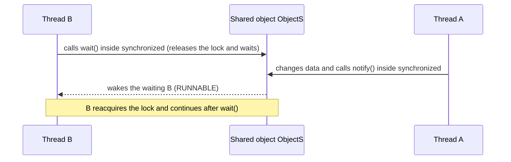

# Lecture 15 — Advanced Threading

[Repository Guide](../../README.md) | [English](Concepts_Lecture.md) | [한국어](Concepts_Lecture.ko.md)

> **Last Updated:** 2026-11-19

> **Learning Objectives:**
> 1. Query thread information and state and set thread priorities
> 2. Terminate threads using interrupt() and flags
> 3. Prevent race conditions on shared data with synchronized
> 4. Coordinate the execution order of threads with wait(), notify(), and notifyAll()
> 5. Solve the producer-consumer problem with wait() and notifyAll() and explain the conditions under which deadlock arises
> 6. Choose concurrency tools such as the lock object, atomic variables, and thread pools to fit the situation

---

## Table of Contents

- [1. Thread Control Block and States](#1-thread-control-block-and-states)
- [2. Thread Priority and Scheduling](#2-thread-priority-and-scheduling)
- [3. Thread Termination](#3-thread-termination)
  - [3.1 Natural Termination](#31-natural-termination)
  - [3.2 interrupt() Method](#32-interrupt-method)
  - [3.3 Flag-based Termination](#33-flag-based-termination)
  - [3.4 How the Interrupt Status Works](#34-how-the-interrupt-status-works)
  - [3.5 Ending a Timer Thread with a Button](#35-ending-a-timer-thread-with-a-button)
- [4. Thread Synchronization](#4-thread-synchronization)
  - [4.1 The synchronized Keyword](#41-the-synchronized-keyword)
  - [4.2 Synchronized Blocks vs. Methods](#42-synchronized-blocks-vs-methods)
  - [4.3 Before and After Synchronization](#43-before-and-after-synchronization)
  - [4.4 wait(), notify(), and notifyAll()](#44-wait-notify-and-notifyall)
  - [4.5 Actual Results before and after Synchronization](#45-actual-results-before-and-after-synchronization)
  - [4.6 Lock Reentrancy and the Choice of Lock Object](#46-lock-reentrancy-and-the-choice-of-lock-object)
  - [4.7 Producers and Consumers](#47-producers-and-consumers)
  - [4.8 The Bar of a Key-Stroke Game](#48-the-bar-of-a-key-stroke-game)
  - [4.9 Thread Structure of Game Programs](#49-thread-structure-of-game-programs)
- [5. Race Conditions and Prevention](#5-race-conditions-and-prevention)
  - [5.1 Atomic Variables](#51-atomic-variables)
  - [5.2 Reproducing and Detecting Deadlock](#52-reproducing-and-detecting-deadlock)
  - [5.3 Tools of java.util.concurrent](#53-tools-of-javautilconcurrent)
- [6. Common Mistakes](#6-common-mistakes)
- [Summary](#summary)
- [Self-Check Questions](#self-check-questions)
- [References](#references)

---

<br>

## 1. Thread Control Block and States

Each thread is managed by a **thread control block (TCB)** containing the following information.

| Field | Description |
|:------|:------------|
| Thread ID | Unique identifier |
| Thread State | Current lifecycle state |
| Program Counter | Address of the next instruction |
| Registers | Saved CPU register values |
| Stack Pointer | Points to the thread's stack |
| Priority | Scheduling priority (1-10) |
| Thread-Specific Data | Data that each thread keeps separately |
| Pointer to PCB | Points to the process control block (PCB) of the process the thread belongs to |

*Table 1. Fields of the thread control block*

> **[Operating Systems]** A TCB is the data structure the operating system keeps to manage a thread, and when it switches from one thread to another (a context switch), it saves and restores the register and program counter values of Table 1 here. Threads of the same process share process resources such as the code and the heap, while each thread has its own stack and register values.

A Java program queries part of this information through the methods of a `Thread` object. The following code prints information about the thread that runs `main()`.

```java
public class Chap15Program1 {
    public static void main(String[] args) {
        long id = Thread.currentThread().getId();
        String name = Thread.currentThread().getName();
        int priority = Thread.currentThread().getPriority();
        Thread.State s = Thread.currentThread().getState();

        System.out.println("Thread name = " + name);
        System.out.println("Thread ID = " + id);
        System.out.println("Priority of Thread = " + priority);
        System.out.println("State of current thread = " + s);
    }
}
```

`Thread.currentThread()` returns the `Thread` object of the thread executing the statement. Running it prints the name `main`, the priority 5, and the state `RUNNABLE`, while the ID is a value chosen by the JVM and differs by version (for example, 3 on Java 24). `getId()` has been deprecated since Java 19 in favor of `threadId()`. The lab code [MainThreadInfoDemo.java](../../Coursework/Lab15_Advanced-Threading/MainThreadInfoDemo.java) prints the same information.

Divided simply into four states, the states of a thread are as follows. Compared with the states of Lecture 13, Section 1.2, New Thread corresponds to New, Runnable to Runnable and Running, Not Runnable to Blocked, Waiting, and Timed Waiting, and Dead to Terminated.

- **New Thread:** A thread object has been created, as in `Thread myThread = new MyThreadClass();`, but not started.
- **Runnable:** Calling `myThread.start()` makes the thread able to run.
- **Not Runnable:** The thread cannot run when `sleep()` is called, when it waits on a condition with `wait()`, or when it is blocking on I/O (a thread blocked on I/O is reported as RUNNABLE by `getState()`).
- **Dead:** When the `run()` method exits normally, the thread dies naturally. For example, a `run()` with a finite loop of 100 iterations dies after the loop ends and the method completes.

> **Caution:** Early Java had `suspend()` to pause a thread and `stop()` to kill it, but they were deprecated long ago because they can stop a thread while it holds a lock or leave shared data in an inconsistent state. Since Java 20, calling `stop()` throws `UnsupportedOperationException` [1], and `suspend()` and `resume()` were removed in Java 23 [2]. Use the methods of Section 3 to end a thread.

---

<br>

## 2. Thread Priority and Scheduling

A thread priority is an integer between the maximum 10 (`MAX_PRIORITY`), the minimum 1 (`MIN_PRIORITY`), and the normal value 5 (`NORM_PRIORITY`), and the application can change it with `void setPriority(int priority)` and read it with `int getPriority()`.

```java
thread.setPriority(Thread.MAX_PRIORITY);  // 10
thread.setPriority(Thread.MIN_PRIORITY);  // 1
thread.setPriority(Thread.NORM_PRIORITY); // 5 (default)
```

- Thread priorities are hints to the JVM and the operating system scheduler. Priority behavior is platform-dependent; higher-priority threads are generally preferred but strict preemption is not guaranteed.
- In the conceptual JVM scheduling policy, the highest-priority thread is scheduled first, and threads with equal priority are scheduled in round-robin fashion. The actual order is decided by the operating system scheduler, as in the previous item, so it is not guaranteed.
- The main thread starts with priority 5.
- A newly created thread has the same priority as the parent thread that created it.

**The main thread:** When the JVM starts running an application, it creates the main thread and tells it to execute the `main()` method. When the `main()` method ends, the main thread ends. However, the JVM exits only when all non-daemon threads have ended, so if other threads are still running after `main()` ends, the program keeps running.

---

<br>

## 3. Thread Termination

A thread terminates itself by returning from its `run()` method, and another thread forces it to terminate with the `interrupt()` method. In either case a thread ends when it returns from `run()`, so `interrupt()` and the flag of Section 3.3 are means of telling the target thread to return from `run()`.

### 3.1 Natural Termination

A thread dies when its `run()` method returns:

```java
public void run() {
    for (int i = 0; i < 100; i++) {
        System.out.println(i);
    }
    // thread terminates here
}
```

### 3.2 interrupt() Method

```java
TimerThread th = new TimerThread();
th.start();
// ...
th.interrupt(); // causes InterruptedException in sleeping thread
```

`interrupt()` sets the interrupt status of the target thread. If the target thread is waiting in `sleep()`, `wait()`, or `join()`, that method throws `InterruptedException`, and returning in the `catch` block, as in the `TimerThread` of Lecture 13, Section 2.1, terminates the thread. In a Swing program, the action listener of a "kill Timer" button can call `th.interrupt()` and disable the button to end the timer thread.

> **Caution:** If the target thread is computing rather than waiting, `interrupt()` only sets the interrupt status and throws no exception. Such a thread must check `Thread.currentThread().isInterrupted()` in its loop and end itself, or it keeps running even after `interrupt()` is called.

### 3.3 Flag-based Termination

In this approach, thread A sets thread B's flag to `true`, and thread B checks the flag and terminates itself.

```java
class WorkerThread extends Thread {
    private volatile boolean finished = false;

    public void finish() { finished = true; }

    @Override
    public void run() {
        while (!finished) {
            // do work
            try { Thread.sleep(100); }
            catch (InterruptedException e) { return; }
        }
    }
}
```

> **Key Point:** Use `volatile` for the flag variable so that a value one thread writes to it is immediately visible to other threads (visibility across threads).

For example, a program can start, as soon as it runs, a thread that creates the string `java` at a random location every 0.3 seconds, and a listener can call that thread's `finish()` when the mouse is pressed on the content pane. Each time the thread wakes from `sleep(300)`, it checks the flag, and if the flag is `true`, it clears the content pane, shows `finish` at the location (100, 100), and returns from `run()`.

### 3.4 How the Interrupt Status Works

Every thread has one `boolean` flag called the **interrupt status**. The basic action of `interrupt()` is to set this flag to `true`, and the outcome depends on what the target thread was doing at the time.

```java
public class InterruptStatus {
    public static void main(String[] args) throws InterruptedException {
        Thread sleeper = new Thread(() -> {
            try {
                Thread.sleep(10_000);
            } catch (InterruptedException e) {
                System.out.println("sleeper: InterruptedException, flag now "
                        + Thread.currentThread().isInterrupted());     // cleared when thrown
            }
        });
        sleeper.start();
        Thread.sleep(100);
        sleeper.interrupt();
        sleeper.join();

        Thread busy = new Thread(() -> {
            long n = 0;
            while (!Thread.currentThread().isInterrupted()) n++;      // check the status itself
            System.out.println("busy: saw the flag after " + (n > 0 ? "many" : "no") + " iterations, flag "
                    + Thread.currentThread().isInterrupted());
            System.out.println("busy: Thread.interrupted() = " + Thread.interrupted()
                    + ", then isInterrupted() = " + Thread.currentThread().isInterrupted());
        });
        busy.start();
        Thread.sleep(100);
        busy.interrupt();
        busy.join();
    }
}
```

```text
sleeper: InterruptedException, flag now false
busy: saw the flag after many iterations, flag true
busy: Thread.interrupted() = true, then isInterrupted() = false
```

`sleeper` receives the interrupt while waiting in `sleep(10_000)`. At that point `sleep()` throws `InterruptedException` and resets the interrupt status to `false` [3]. So checking `isInterrupted()` in the `catch` block gives `false`. The code of Lecture 13, Section 3.1 calls `interrupt()` again in its `catch` block to restore this cleared flag, so that the code that called this thread can also learn that an interrupt happened.

`busy` computes without waiting, so no exception occurs. Instead it checks `isInterrupted()` in its loop condition on every iteration and ends the loop when it sees the flag turn `true` (the caution box of Section 3.2). The difference between two methods for this thread also appears in the output.

| Method | Kind | Return value | Clears the status |
|:-----|:-----|:-----|:-----|
| `t.isInterrupted()` | Instance | The interrupt status of thread `t` | Does not clear it |
| `Thread.interrupted()` | static | The interrupt status of the current thread | Clears it to `false` after reading |

*Table 2. Two methods that read the interrupt status*

`Thread.interrupted()` returns `true` and clears the status, so `isInterrupted()` right after it is `false`. An interrupt is not a device that stops a thread by force but a request to end, and the target thread's code decides whether, when, and how to respond to it. So to make a thread endable, handle the `InterruptedException` of waiting methods, and check the interrupt status in long-running computation loops.

### 3.5 Ending a Timer Thread with a Button

Section 3.2 stated that a timer thread can be ended with a "kill Timer" button in a Swing program. The core of that program is as follows. The timer increases the number in a label every second, like `TimerRunnable` of Lecture 13, Section 2.2, and returns from `run()` when it receives `InterruptedException` during `sleep()`.

```java
TimerRunnable runnable = new TimerRunnable(timerLabel);
th = new Thread(runnable);
c.add(timerLabel);

JButton btn = new JButton("kill Timer");
btn.addActionListener(new ActionListener() {
    @Override
    public void actionPerformed(ActionEvent e) {
        th.interrupt();                      // ask the timer thread to end
        JButton btn = (JButton) e.getSource();
        btn.setEnabled(false);               // keep the button from being pressed again
    }
});
c.add(btn);
setSize(300, 170);
setVisible(true);
th.start();
```

Pressing the button makes the EDT run the action listener (Lecture 12, Section 5.7), and the listener calls `interrupt()` on the timer thread `th`. The timer thread spends most of its time in `sleep(1000)`, so it receives `InterruptedException` almost at once and returns, and the number in the label stops at its last value. The listener disables the button to prevent the meaningless action of interrupting a thread that has already ended. The listener returns right after calling `interrupt()` without waiting for the thread to end, so the EDT is not blocked.

---

<br>

## 4. Thread Synchronization

When multiple threads access shared data at the same time, the values of the shared data can become unexpected, so synchronization is the most important part to consider when writing a multi-threaded program. **Thread synchronization** solves this problem by making other threads wait until one thread finishes working on shared data, and its essence is to ensure that threads have **exclusive access** to shared data.

For example, if thread A prints "I love you forever." and thread B prints the Korean sentence "자바는 좋은 것이야. 배워서 많이 알고 취직도 잘 되고." (Java is good; learn it, know a lot, and get a job easily) on one printer at the same time, the words of the two sentences are printed mixed together. With synchronization, thread B waits until thread A is finished using the printer, so the two sentences are printed intact one after the other.

There are two ways to synchronize threads in Java: specifying a synchronized block with `synchronized`, and controlling the execution order of threads with the `wait()` and `notify()` methods.

### 4.1 The synchronized Keyword

`synchronized` ensures that only one thread at a time can execute a **critical section**, that is, the part of the code that accesses shared data.

```java
synchronized void add() {
    int n = getCurrentSum();
    n += 10;
    setCurrentSum(n);
}
```

Every object has one **monitor lock**. To enter a `synchronized` instance method, a thread must acquire the lock of that object (`this`), and it releases the lock when it leaves the method. If another thread holds the lock, the thread waits in the Blocked state until the lock is released. A `static synchronized` method uses the lock of the class's `Class` object.

### 4.2 Synchronized Blocks vs. Methods

```java
// Synchronized method -- locks the entire method
synchronized void method() { /* ... */ }

// Synchronized block -- locks only the critical section
void method() {
    // non-critical code
    synchronized (this) {
        // critical section
    }
    // non-critical code
}
```

> **Key Point:** Prefer synchronized blocks over methods to minimize the scope of locking.

### 4.3 Before and After Synchronization

In the following program, two student threads, `kitae` and `hyosoo`, each call `add()` of a shared board `SharedBoard` 10 times to increase the sum by 10. Since the two threads add 20 times in total, the final sum should be 200.

```java
class SharedBoard {
    private int sum = 0;

    public void add() {
        int n = sum;
        Thread.yield();   // yield to another thread, giving it a chance to cut in
        n += 10;
        sum = n;
        System.out.println(Thread.currentThread().getName() + " : " + sum);
    }

    public int getSum() { return sum; }
}

class StudentThread extends Thread {
    private SharedBoard board;

    public StudentThread(String name, SharedBoard board) {
        super(name);
        this.board = board;
    }

    @Override
    public void run() {
        for (int i = 0; i < 10; i++)
            board.add();
    }
}
```

`main()` creates one `SharedBoard`, passes it to two `StudentThread`s, and starts them. Without synchronization, another thread can read the same value after one thread reads `sum` and before it writes, so the two threads may print the same value (for example, `kitae : 30` and `hyosoo : 30`) or an addition may be lost and the final sum may fall below 200 (for example, 150 or 190). Changing `add()` to `public synchronized void add()` keeps other threads out until one thread finishes `add()`, so the printed sums increase as 10, 20, ..., 200 without repetition and the final sum is always 200. The lab code [SynchronizationDemo.java](../../Coursework/Lab15_Advanced-Threading/SynchronizationDemo.java) compares the two cases with a program in which two threads increase a shared counter.

### 4.4 wait(), notify(), and notifyAll()

| Method | Description |
|:-------|:------------|
| `wait()` | Releases the lock and waits until notified |
| `notify()` | Wakes up one waiting thread |
| `notifyAll()` | Wakes up all waiting threads |

*Table 3. Methods for notification between threads*

These must be called from within a `synchronized` block or method.

A thread that calls `wait()` waits until another thread calls `notify()` on the same object. `notify()` wakes only one thread and makes it RUNNABLE even if several threads are waiting, and `notifyAll()` wakes all waiting threads and makes them all RUNNABLE. The three methods are methods of `Object`, so any object can be a synchronization object, and `Thread` objects can also be used as synchronization objects.



*Figure 1. Notification with wait() and notify() on a shared object*

The following `SharedData` makes a thread wait in `take()` until another thread puts a value with `put()`.

```java
class SharedData {
    private int data;
    private boolean ready = false;

    synchronized void put(int value) {
        data = value;
        ready = true;
        notify();                // wake one waiting thread
    }

    synchronized int take() throws InterruptedException {
        while (!ready)           // until the condition holds
            wait();              // release the lock and wait
        ready = false;
        return data;
    }
}
```

> **Caution:** Calling `wait()` or `notify()` without holding the lock throws `IllegalMonitorStateException`. Also, the condition may change before the awakened thread reacquires the lock, or the thread may wake without a notification (a spurious wakeup), so `wait()` is called inside a `while` loop that rechecks the condition, as above, rather than an `if`.

### 4.5 Actual Results before and after Synchronization

The `SharedBoard` of Section 4.3 is actually run to compare the two cases. To shorten the output, each thread calls `add()` 10,000 times and only the final total is printed. Two threads add 10 a total of 20,000 times, so the correct total is 200,000.

```java
public class BoardRun {
    static class SharedBoard {
        private int sum = 0;
        private final boolean sync;
        SharedBoard(boolean sync) { this.sync = sync; }

        void add() {
            if (sync) { synchronized (this) { step(); } } else step();
        }

        private void step() {
            int n = sum;
            Thread.yield();
            n += 10;
            sum = n;
        }
        int getSum() { return sum; }
    }

    static int run(boolean sync) throws InterruptedException {
        SharedBoard board = new SharedBoard(sync);
        Runnable student = () -> { for (int i = 0; i < 10_000; i++) board.add(); };
        Thread a = new Thread(student, "kitae"), b = new Thread(student, "hyosoo");
        a.start(); b.start(); a.join(); b.join();
        return board.getSum();
    }

    public static void main(String[] args) throws InterruptedException {
        for (int i = 1; i <= 3; i++)
            System.out.printf("trial %d  unsynchronized %,7d   synchronized %,7d%n", i, run(false), run(true));
    }
}
```

```text
trial 1  unsynchronized 102,710   synchronized 200,000
trial 2  unsynchronized 106,420   synchronized 200,000
trial 3  unsynchronized 101,080   synchronized 200,000
```

The unsynchronized total stopped at about half of 200,000, between 101,080 and 106,420, in all three trials. `add()` yields execution with `Thread.yield()` after reading `sum`, so the other thread has very many chances to read the same value in between, and nearly half of the additions were lost (the lost updates of Lecture 13, Section 4.2). Wrapping everything from the read to the write in `synchronized (this)` means that even when one thread yields with `yield()`, it still holds the lock, so the other thread cannot enter `step()`, and the total is always 200,000. It is important that `yield()`, even in synchronized code, can give other threads a chance to run but does not release the lock.

### 4.6 Lock Reentrancy and the Choice of Lock Object

The lock of `synchronized` is owned per thread. When a thread that already holds a lock enters code that needs the same lock again, it enters at once without waiting; this property is called **reentrancy**. The lock counts how many times it was acquired and is released only after the thread has left that many times. Also, synchronization works only when all threads use the lock of the same object.

```java
public class LockChoice {
    static class Counter {
        private int value = 0;
        synchronized void inc() { value++; }
        synchronized void incTwice() { inc(); inc(); }                    // reacquires the same lock
        int get() { return value; }
    }

    static int shared = 0;

    public static void main(String[] args) throws InterruptedException {
        Counter c = new Counter();
        c.incTwice();
        System.out.println("reentrant call finished, value " + c.get());

        Runnable wrongLock = () -> {
            Object myLock = new Object();                                  // a different lock per thread
            for (int i = 0; i < 1_000_000; i++) synchronized (myLock) { shared++; }
        };
        Thread t1 = new Thread(wrongLock), t2 = new Thread(wrongLock);
        t1.start(); t2.start(); t1.join(); t2.join();
        System.out.printf("different locks: %,d (expected 2,000,000)%n", shared);
    }
}
```

```text
reentrant call finished, value 2
different locks: 1,057,743 (expected 2,000,000)
```

`incTwice()` calls the synchronized method `inc()` of the same object twice inside a synchronized method. The calling thread already holds the lock of `c`, so it enters `inc()` at once; without reentrancy the thread would have stopped forever waiting for a lock it holds itself.

`wrongLock` is an example of misused synchronization. It creates its lock object with `new Object()` inside the lambda, so the two threads use different locks and do not block each other at all. The result, 1,057,743, is far below 2,000,000, like the unprotected `plain` of Lecture 13, Section 4.2. The lock that protects shared data must be chosen so that all code handling that data uses the same object. Commonly used are the object that holds the data itself (`this`, the lock a synchronized method uses) or a `private final Object lock = new Object();` field used only for that purpose. An instance method's `synchronized` uses `this` as its lock and `static synchronized` uses the `Class` object (Section 4.1), so if the same static field is changed from both kinds of methods, they use different locks and the field is not protected.

### 4.7 Producers and Consumers

The `SharedData` of Section 4.4 passed a single value. Widening this, the structure in which a **producer** thread that makes data and a **consumer** thread that uses data work with a fixed-size buffer between them is called the **producer-consumer problem**. The producer must wait when the buffer is full, and the consumer when it is empty.

```java
import java.util.ArrayDeque;
import java.util.Deque;

public class BoundedBuffer {
    private final Deque<Integer> items = new ArrayDeque<>();
    private final int capacity;

    BoundedBuffer(int capacity) { this.capacity = capacity; }

    synchronized void put(int x) throws InterruptedException {
        while (items.size() == capacity) {                                 // wait while full
            System.out.println("  producer waits (full " + items + ")");
            wait();
        }
        items.addLast(x);
        System.out.println("put " + x + " -> " + items);
        notifyAll();                                                       // wake waiting consumers
    }

    synchronized int take() throws InterruptedException {
        while (items.isEmpty()) {                                          // wait while empty
            System.out.println("  consumer waits (empty)");
            wait();
        }
        int x = items.removeFirst();
        System.out.println("take " + x + " -> " + items);
        notifyAll();
        return x;
    }

    public static void main(String[] args) throws InterruptedException {
        BoundedBuffer buf = new BoundedBuffer(2);
        Thread producer = new Thread(() -> {
            try { for (int i = 1; i <= 5; i++) buf.put(i); } catch (InterruptedException e) { }
        });
        Thread consumer = new Thread(() -> {
            try {
                int sum = 0;
                for (int i = 1; i <= 5; i++) { Thread.sleep(50); sum += buf.take(); }
                System.out.println("consumer sum " + sum);
            } catch (InterruptedException e) { }
        });
        producer.start(); consumer.start();
        producer.join(); consumer.join();
    }
}
```

```text
put 1 -> [1]
put 2 -> [1, 2]
  producer waits (full [1, 2])
take 1 -> [2]
put 3 -> [2, 3]
  producer waits (full [2, 3])
take 2 -> [3]
put 4 -> [3, 4]
  producer waits (full [3, 4])
take 3 -> [4]
put 5 -> [4, 5]
take 4 -> [5]
take 5 -> []
consumer sum 15
```

The buffer's capacity is 2. The producer puts 1 and 2 right away, finds the buffer full when trying to put 3, and releases the lock and waits with `wait()`. The consumer takes one item every 50 milliseconds, so after taking 1 it wakes the producer with `notifyAll()`, and the producer reacquires the lock, checks the `while` condition again, and puts 3. Repeating this, putting and taking alternate strictly, and after the producer has put up to 5, the consumer takes the remaining 4 and 5. The values taken add up to 1 + 2 + 3 + 4 + 5 = 15 and came out in the order they went into the buffer.

This implementation follows three principles. First, checking the condition and changing the buffer are all done inside the same lock (the buffer object). Second, `wait()` is called inside a `while` loop so that the condition is checked again after waking (the caution box of Section 4.4). Third, `notifyAll()` is used instead of `notify()`. Producers and consumers wait on the same object, so if `notify()` wakes only one thread and that thread is not the side that should wake, everyone can end up waiting.

### 4.8 The Bar of a Key-Stroke Game

The producer-consumer structure is also used in games. The following are the two methods of `MyLabel`, which represents the bar in a game where each key press fills the bar by one unit and a consumer thread shrinks it by one unit every 0.2 seconds. The goal is for the user to press keys fast enough to fill the bar to the end.

```java
synchronized public void fill() {
    if (barSize == maxBarSize) {
        try {
            wait();              // wait when the bar is full
        } catch (InterruptedException e) { return; }
    }
    barSize++;
    repaint();                   // repaint the bar
    notify();
}

synchronized public void consume() {
    if (barSize == 0) {
        try {
            wait();              // wait when the bar is empty
        } catch (InterruptedException e) { return; }
    }
    barSize--;
    repaint();
    notify();
}
```

The key listener calling `fill()` on the EDT is the producer, and `ConsumerThread`, which repeats `while (true) { sleep(200); bar.consume(); }`, is the consumer. The bar is a class that extends `JLabel` and draws, in `paintComponent()`, a filled rectangle whose width is proportional to `barSize` (drawing is covered in Lecture 16, Section 4). When the bar is empty, the consumer waits with `wait()` and wakes when a key press makes `fill()` call `notify()`.

> **Note:** **if and while.** The code above calls `wait()` inside `if`. In this game there is one producer and one consumer, and the side that calls `notify()` always does so after changing the condition, so the problem mostly stays hidden. But as seen in Section 4.4, a thread can wake without notification, and then `barSize--` can run even though the bar is 0, making it negative. Changing `if` to `while`, as in Section 4.7, checks the condition again on every wake-up and is safe. Also, `fill()` runs on the EDT, so pressing a key while the bar is full stops the EDT in `wait()` and the whole window becomes unresponsive. For a GUI it is better to return at once without waiting when the bar is full.

### 4.9 Thread Structure of Game Programs

The thread structures of two games built on the same principles are as follows.

- **Snake game:** the panel class `GroundPanel` extends `JPanel` and implements `Runnable`, and the frame starts a thread that runs the panel itself with `new Thread(p)`. The thread repeats `sleep(200)` and moves the snake one unit (20 pixels) in the current direction. The snake is a `Vector<JLabel>` holding ten head and body labels, and moving it shifts each label, from the tail toward the head, to the place of the label in front of it and then moves the head in the current direction. The direction is set by a key listener running on the EDT, which changes the `direction` field according to the arrow keys. The panel sets the label positions directly without a layout manager (Lecture 12, Section 3.4), and clicking the panel regains the key focus with `requestFocus()` (Lecture 12, Section 5.6).
- **Typing game:** one of the words read from the word file `words.txt` is chosen and dropped from the top as a label. `FallingThread` moves the label down 5 pixels every `sleep(200)`, and when the label reaches the bottom it shows a timeout and restarts the game with a new word. Pressing Enter in the `JTextField` below makes an action listener compare the typed word; if it matches, it ends the falling thread with `interrupt()` and starts again with a new word and a new thread. Typing `bye` ends the program.

In both games a thread that moves things on the screen and the EDT that handles user input work together, and the values the two threads share are `direction` in the snake game and the word and label in the typing game. So that one thread changing a value while another reads it does not cause trouble, the principle is to handle a single-valued field with `volatile` (Section 3.3) and parts that change several values together with `synchronized` or `SwingUtilities.invokeLater()` (Lecture 12, Section 5.7).

---

<br>

## 5. Race Conditions and Prevention

A race condition occurs when multiple threads access shared data concurrently and the result depends on the execution order of the threads (Lecture 13, Section 4).

**Prevention strategies:**
1. Use `synchronized` blocks/methods
2. Use `java.util.concurrent` classes (`AtomicInteger`, `ConcurrentHashMap`, etc.)
3. Use `volatile` for simple visibility guarantees
4. Minimize shared mutable state

> **Caution:** `volatile` only makes a value written by one thread immediately visible to other threads; it does not make a compound operation that reads, modifies, and writes, such as `count++`, atomic. If two threads each increment a `volatile int count` 100,000 times, the result can be less than 200,000. Protect compound operations with `synchronized` or `AtomicInteger.incrementAndGet()`.

> **[Operating Systems]** **Deadlock**, as taught in operating systems, is a state in which threads cannot proceed because each waits for a resource that another holds, and it can occur in a program that nests `synchronized` to hold two or more monitor locks. If thread A holds lock X while waiting for lock Y, and thread B holds lock Y while waiting for lock X, neither thread can ever proceed. Making every thread acquire locks in the same order prevents this circular wait.

### 5.1 Atomic Variables

`AtomicInteger`, `AtomicLong`, `AtomicBoolean`, and `AtomicReference` of the `java.util.concurrent.atomic` package provide methods that read and change a single value atomically. An **atomic** operation is one that runs at once without interruption, so other threads cannot see its intermediate state. `AtomicInteger.incrementAndGet()` always giving 2,000,000 without a lock in the experiment of Lecture 13, Section 4.2 is an example.

| Method | What it does |
|:-----|:-----|
| `get()`, `set(v)` | Reads or writes the value (visible to other threads at once, like a `volatile` field) |
| `incrementAndGet()`, `getAndIncrement()` | Returns the value after adding 1, or the value before adding |
| `addAndGet(d)` | Returns the value after adding `d` |
| `compareAndSet(expect, update)` | Changes the value to `update` only if the current value is `expect`, and returns whether it succeeded |

*Table 4. The main methods of AtomicInteger*

`compareAndSet` is the operation underlying atomic variables. It reads the current value and computes a new value, then writes the new value only if no other thread has changed the value in the meantime. If it was changed, the write fails, so the value is read again and the computation repeated. Atomic variables are lighter than `synchronized` for protecting one variable, but they cannot be used when two variables must change together consistently (for example, the two balances in a transfer between accounts); a lock is needed then.

### 5.2 Reproducing and Detecting Deadlock

Actually creating the deadlock described in the operating-systems box of Section 5 looks as follows. Thread A acquires lock X and then tries for lock Y, and thread B acquires lock Y and then tries for lock X. Both threads rest for 0.1 seconds after their first lock, so that the state in which each holds its first lock is sure to arise.

```java
import java.lang.management.ManagementFactory;
import java.lang.management.ThreadInfo;
import java.lang.management.ThreadMXBean;

public class Deadlock {
    static final Object lockX = new Object(), lockY = new Object();

    static void pause() { try { Thread.sleep(100); } catch (InterruptedException e) { } }

    public static void main(String[] args) throws InterruptedException {
        Thread a = new Thread(() -> {
            synchronized (lockX) { pause(); synchronized (lockY) { System.out.println("A done"); } }
        }, "thread-A");
        Thread b = new Thread(() -> {
            synchronized (lockY) { pause(); synchronized (lockX) { System.out.println("B done"); } }
        }, "thread-B");
        a.setDaemon(true); b.setDaemon(true);
        a.start(); b.start();
        Thread.sleep(500);

        ThreadMXBean mx = ManagementFactory.getThreadMXBean();
        long[] ids = mx.findDeadlockedThreads();                           // find deadlocked threads
        System.out.println("deadlocked threads: " + (ids == null ? 0 : ids.length));
        for (ThreadInfo info : mx.getThreadInfo(ids))
            System.out.println(info.getThreadName() + " is " + info.getThreadState()
                    + ", waiting for a lock held by " + info.getLockOwnerName());
    }
}
```

```text
deadlocked threads: 2
thread-A is BLOCKED, waiting for a lock held by thread-B
thread-B is BLOCKED, waiting for a lock held by thread-A
```

`A done` and `B done` are never printed. After 0.5 seconds, main uses `ThreadMXBean.findDeadlockedThreads()` to find threads in the JVM that are stopped waiting for each other's locks [4]. Both threads are BLOCKED, A waiting for the lock B holds and B waiting for the lock A holds. The two threads were made daemons, so the program ends when main ends; had they not been daemons, the program would never have ended. Deadlock arises when all four of the following conditions hold.

1. **Mutual exclusion:** a resource (lock) can be used by only one thread at a time.
2. **Hold and wait:** a thread waits for another resource while holding one.
3. **No preemption:** a resource held by another thread cannot be taken away by force.
4. **Circular wait:** threads wait for each other's resources in a circle.

`synchronized` always satisfies the first three conditions, so the practical way to prevent deadlock is to break the fourth. If every thread acquires lock X first and lock Y later, no circle forms. Changing B in the program above to acquire X first prints both lines and ends normally.

### 5.3 Tools of java.util.concurrent

`synchronized`, `wait()`, and `notify()` can express any synchronization, but using them directly invites mistakes, as seen in Sections 4.7 and 4.8. The `java.util.concurrent` package provides frequently used synchronization structures as tested classes.

| Class | What it does | Hand-made counterpart |
|:-----|:-----|:-----|
| `ArrayBlockingQueue`, `LinkedBlockingQueue` | A queue whose `put()` waits when full and whose `take()` waits when empty | `BoundedBuffer` of Section 4.7 |
| `ConcurrentHashMap` | A map that several threads can read and write at the same time | A `HashMap` wrapped in `synchronized` |
| `CopyOnWriteArrayList` | A list that makes a copy on every change and is safe against modification during iteration | The synchronized client list of Lecture 14, Section 4.2 |
| `ReentrantLock` | A reentrant lock used with `lock()` and `unlock()`, with `tryLock()` that has a time limit | A `synchronized` block |
| `CountDownLatch` | Waits until other threads have sent a set number of signals | Several calls to `join()` |
| `ExecutorService` | Hands tasks to a thread pool and returns the results as `Future`s | Hand-made threads and result fields |

*Table 5. The main classes of java.util.concurrent*

For example, the producer and consumer of Section 4.7 become creating `BlockingQueue<Integer> q = new ArrayBlockingQueue<>(2);` and having the producer call `q.put(i)` and the consumer `q.take()`. The queue takes care of waiting and waking.

> **Note:** **Thread pools and Future.** `ExecutorService` is a thread pool that creates a few threads in advance and hands them tasks in turn. It removes the cost of creating a thread per task (Lecture 13, Section 1.6) and limits the number of threads running at once. Submitting a task that returns a value (a `Callable`) with `submit()` returns a `Future` through which the result can be received later, and `get()` waits until the result is ready.
>
> ```java
> ExecutorService pool = Executors.newFixedThreadPool(3);
> List<Future<Long>> futures = new ArrayList<>();
> for (int k = 0; k < 6; k++) {
>     final long start = k * 1_000_000L, end = start + 999_999;
>     futures.add(pool.submit(() -> { long s = 0; for (long i = start; i <= end; i++) s += i; return s; }));
> }
> long total = 0;
> for (Future<Long> f : futures) total += f.get();
> pool.shutdown();
> ```
>
> Running this code splits the 6 tasks among the three threads `pool-1-thread-1` through `pool-1-thread-3`, and `total` becomes 17,999,997,000,000, the sum of 0 through 5,999,999. The pool must be closed with `shutdown()`; otherwise its threads remain and the program does not end.

---

<br>

## 6. Common Mistakes

| Mistake | What happens | How to fix it |
|:-----|:-----|:-----|
| Stopping threads with `stop()` or `suspend()` | These are deprecated methods that throw exceptions or are unavailable | Request termination with an interrupt or a flag |
| Catching `InterruptedException` and doing nothing | The request to end is lost | `return`, or restore the status with `interrupt()` |
| Not checking the interrupt status in a computation-only loop | The thread does not end even when `interrupt()` is called | Check `isInterrupted()` in the loop condition |
| Synchronizing on a different object in each thread | The threads do not block each other and the race condition remains | Choose one lock object for each piece of shared data |
| Calling `wait()` inside `if` | The thread proceeds even if it wakes without notification or the condition changed | Call it inside a `while` loop |
| Calling `wait()` or `notify()` outside `synchronized` | `IllegalMonitorStateException` occurs | Call them inside a block synchronized on that object |
| Using `notify()` when several kinds of threads wait | Only a thread from the wrong side may wake and everyone may end up waiting | Use `notifyAll()` |
| Acquiring two locks in a different order in each thread | The program stops in a deadlock | Make every thread acquire the locks in the same order |
| Trying to protect `count++` with `volatile` | The increment is not atomic and values are lost | Use `synchronized` or `AtomicInteger` |
| Calling `wait()` or waiting long for a lock on the EDT | The whole window becomes unresponsive | Do not wait on the EDT; leave waiting to other threads |

*Table 6. Common mistakes in thread termination and synchronization*

---

<br>

## Summary

| Concept | Key Summary |
|:--------|:----------|
| Thread Control Block | It is the data structure that manages a thread, holding its ID, state, program counter, registers, stack pointer, priority, and more. |
| Thread Priority | It ranges from 1 (min) to 10 (max) with a default of 5, and a new thread inherits the priority of its parent thread. |
| Thread Termination | A thread ends naturally (run returns), through interrupt(), or by a flag, and `stop()` is not used. |
| synchronized | It implements mutual exclusion with the monitor lock of an object so that only one thread at a time has access. |
| Synchronized block | It controls the scope of locking more finely than a synchronized method. |
| wait/notify | Inside synchronized, they coordinate the execution order of threads by releasing the lock to wait or waking waiting threads. |
| volatile | It ensures variable visibility across threads but does not make compound operations atomic. |
| Race condition | It is a situation in which the result depends on the execution order of threads, prevented by synchronization or atomic operations. |
| Interrupt status | It is the flag set by `interrupt()`; it is cleared when a waiting method throws `InterruptedException`, and `Thread.interrupted()` also clears it after reading. |
| Reentrancy | A thread that already holds a lock enters code that needs the same lock again without waiting. |
| Producers and consumers | With a fixed-size buffer between them, the producer waits when it is full and the consumer when it is empty, using `wait()` inside `while`. |
| Atomic variable | `AtomicInteger` and the like handle reading and changing a single value as one uninterruptible operation. |
| Deadlock | It arises when mutual exclusion, hold and wait, no preemption, and circular wait all hold, and it is prevented by fixing the order in which locks are acquired. |
| Thread pool | `ExecutorService` hands tasks to threads created in advance and returns the results as `Future`s. |

---

<br>

## Self-Check Questions

1. **Thread information:** What does `Chap15Program1` from Section 1 print for the name, priority, and state of the main thread? Also explain why the state is not `RUNNING`.

   <details>
   <summary>Answer</summary>

   The name is `main`, the priority is 5, and the state is `RUNNABLE`. The `Thread.State` enum has no RUNNING value and represents both threads waiting to run and threads actually running as RUNNABLE. The main thread is running at the moment it calls `getState()`, so its state is RUNNABLE.

   </details>

2. **interrupt():** A thread repeats only computation without `sleep()`, as in `while (true) { n++; }`. If another thread calls `interrupt()` on it, does the thread terminate?

   <details>
   <summary>Answer</summary>

   It does not terminate. `interrupt()` on a thread that is not waiting only sets the interrupt status and throws no exception. Changing the loop condition to `while (!Thread.currentThread().isInterrupted())` makes the thread check the interrupt status, end the loop, and terminate.

   </details>

3. **Synchronization:** For `SharedBoard` in Section 4.3, explain why the final sum can fall below 200 without synchronization, and give the final sum after adding `synchronized` to `add()`.

   <details>
   <summary>Answer</summary>

   `add()` reads `sum` into `n`, yields with `Thread.yield()`, adds 10, and writes it back. If another thread reads the same `sum` after one thread reads it and before it writes, both threads add 10 to the same value and write it, so one addition is lost. With `synchronized`, only one thread executes the steps from reading to writing, so all 20 additions take effect and the final sum is always 200.

   </details>

4. **Where to call wait():** What happens if `obj.wait()` is called outside `synchronized`?

   <details>
   <summary>Answer</summary>

   An `IllegalMonitorStateException` is thrown (message: "current thread is not owner"). `wait()` releases the lock on `obj` held by the calling thread and waits, so the thread must first acquire that object's lock with `synchronized`. The same holds for `notify()` and `notifyAll()`.

   </details>

5. **volatile:** Two threads each perform `count++` 100,000 times on a `static volatile int count`. Is the result always 200,000? If not, how should it be fixed?

   <details>
   <summary>Answer</summary>

   It is not always 200,000. Actual runs can give smaller values such as 108,202 or 181,949. `volatile` guarantees only visibility and does not make the read, increment, and write of `count++` atomic, so additions are lost. Wrapping the increment in `synchronized` or using `incrementAndGet()` of `AtomicInteger` always gives 200,000.

   </details>

6. **Interrupts:** If `interrupt()` is called on a thread whose `run()` is the following, does the thread end? `while (true) { try { Thread.sleep(100); } catch (InterruptedException e) { } }`

   <details>
   <summary>Answer</summary>

   It does not end. When it receives the interrupt during `sleep()`, `InterruptedException` is thrown and the interrupt status is cleared, but the `catch` block does nothing, so the loop continues and the next `sleep()` sleeps normally again. It ends only if the `catch` block returns, or restores the status with `Thread.currentThread().interrupt()` and the loop condition is changed to `while (!Thread.currentThread().isInterrupted())`.

   </details>

7. **Producers and consumers:** In the `BoundedBuffer` of Section 4.7, the capacity is changed to 1 and the consumer's `sleep(50)` is removed. What are the order and sum of the values taken? Is the order of the put and take output lines always the same?

   <details>
   <summary>Answer</summary>

   The values taken are always in the order 1, 2, 3, 4, 5, and their sum is 15, because the buffer is a queue that removes items in the order they were put in and every operation happens inside the same lock. However, when the waiting messages appear and how they mix with the put and take lines can differ between runs depending on scheduling. With capacity 1, the buffer holds at most one item.

   </details>

8. **Deadlock:** If the code of thread B in the program of Section 5.2 is changed to `synchronized (lockX) { pause(); synchronized (lockY) { ... } }`, what is the result? Which of the four conditions is broken?

   <details>
   <summary>Answer</summary>

   No deadlock occurs: both `A done` and `B done` are printed, and `findDeadlockedThreads()` returns `null`. Both threads acquire the locks in the same order (X, then Y), so while the thread that got X first goes on to get Y and finish its work, the other thread only waits at X without holding Y. The circular-wait condition is thus broken.

   </details>

---

<br>

## References

1. Oracle, "JDK 20 Release Notes, Important Changes, and Information," *Java SE*. https://www.oracle.com/java/technologies/javase/20-relnote-issues.html
2. Oracle, "JDK 23 Release Notes, Important Changes, and Information," *Java SE*. https://www.oracle.com/java/technologies/javase/23-relnote-issues.html
3. Oracle, "Thread (Java SE 21 & JDK 21)," *Java Platform, Standard Edition 21 API Specification*. https://docs.oracle.com/en/java/javase/21/docs/api/java.base/java/lang/Thread.html
4. Oracle, "ThreadMXBean (Java SE 21 & JDK 21)," *Java Platform, Standard Edition 21 API Specification*. https://docs.oracle.com/en/java/javase/21/docs/api/java.management/java/lang/management/ThreadMXBean.html
