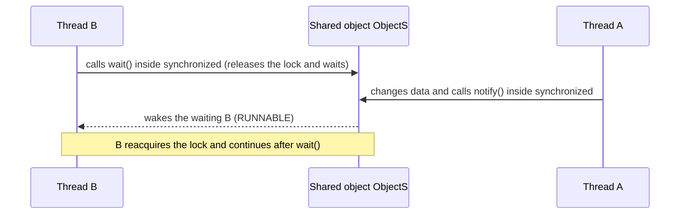

# Lecture 15 — Advanced Threading

[Repository Guide](../../README.md) | [English](Concepts_Lecture.md) | [한국어](Concepts_Lecture.ko.md)

> **Last Updated:** 2026-10-19

> **Learning Objectives:**
> 1. Query thread information and state and set thread priorities
> 2. Terminate threads using interrupt() and flags
> 3. Prevent race conditions on shared data with synchronized
> 4. Coordinate the execution order of threads with wait(), notify(), and notifyAll()

---

## Table of Contents

- [1. Thread Control Block and States](#1-thread-control-block-and-states)
- [2. Thread Priority and Scheduling](#2-thread-priority-and-scheduling)
- [3. Thread Termination](#3-thread-termination)
  - [3.1 Natural Termination](#31-natural-termination)
  - [3.2 interrupt() Method](#32-interrupt-method)
  - [3.3 Flag-based Termination](#33-flag-based-termination)
- [4. Thread Synchronization](#4-thread-synchronization)
  - [4.1 The synchronized Keyword](#41-the-synchronized-keyword)
  - [4.2 Synchronized Blocks vs. Methods](#42-synchronized-blocks-vs-methods)
  - [4.3 Before and After Synchronization](#43-before-and-after-synchronization)
  - [4.4 wait(), notify(), and notifyAll()](#44-wait-notify-and-notifyall)
- [5. Race Conditions and Prevention](#5-race-conditions-and-prevention)
- [Summary](#summary)
- [Self-Check Questions](#self-check-questions)

---

<br>

## 1. Thread Control Block and States

Each thread is managed by a Thread Control Block (TCB) containing:

| Field | Description |
|:------|:------------|
| Thread ID | Unique identifier |
| Thread State | Current lifecycle state |
| Program Counter | Address of the next instruction |
| Registers | Saved CPU register values |
| Stack Pointer | Points to the thread's stack |
| Priority | Scheduling priority (1-10) |
| Thread-Specific Data | Data that each thread keeps separately |
| Pointer to PCB | Points to the process control block (PCB) of the process the thread belongs to |

*Table 1. Fields of the thread control block*

> **[Operating Systems]** A TCB is the data structure the operating system keeps to manage a thread, and when it switches from one thread to another (a context switch), it saves and restores the registers and program counter here. Threads of the same process share process resources such as the code and the heap, while each thread has its own stack and register values.

A Java program queries part of this information through the methods of a `Thread` object. The following code prints information about the thread that runs `main()`.

```java
public class Chap15Program1 {
    public static void main(String[] args) {
        long id = Thread.currentThread().getId();
        String name = Thread.currentThread().getName();
        int priority = Thread.currentThread().getPriority();
        Thread.State s = Thread.currentThread().getState();

        System.out.println("Thread name = " + name);
        System.out.println("Thread ID = " + id);
        System.out.println("Priority of Thread = " + priority);
        System.out.println("State of current thread = " + s);
    }
}
```

`Thread.currentThread()` returns the `Thread` object of the thread executing the statement. Running it prints the name `main`, the priority 5, and the state `RUNNABLE`, while the ID is a value chosen by the JVM and differs by version (for example, 3 on Java 24). `getId()` has been deprecated since Java 19 in favor of `threadId()`. The lab code [MainThreadInfoDemo.java](../../Coursework/Lab15_Advanced-Threading/MainThreadInfoDemo.java) prints the same information.

The state of a thread changes as follows (Lecture 13, Section 1.2).

- **New Thread:** A thread object has been created, as in `Thread myThread = new MyThreadClass();`, but not started.
- **Runnable:** Calling `myThread.start()` makes the thread able to run.
- **Not Runnable:** The thread cannot run when `sleep()` is called, when it waits on a condition with `wait()`, or when it is blocking on I/O.
- **Dead:** When the `run()` method exits normally, the thread dies naturally. For example, a `run()` with a finite loop of 100 iterations dies after the loop ends and the method completes.

> **Caution:** Early Java had `suspend()` to pause a thread and `stop()` to kill it, but they were deprecated long ago because they can stop a thread while it holds a lock or leave shared data in an inconsistent state. Since Java 20, calling `stop()` throws `UnsupportedOperationException`, and `suspend()` and `resume()` were removed in Java 23. Use the methods of Section 3 to end a thread.

---

<br>

## 2. Thread Priority and Scheduling

A thread priority is an integer between the maximum 10 (`MAX_PRIORITY`), the minimum 1 (`MIN_PRIORITY`), and the normal value 5 (`NORM_PRIORITY`), and the application can change it with `void setPriority(int priority)` and read it with `int getPriority()`.

```java
thread.setPriority(Thread.MAX_PRIORITY);  // 10
thread.setPriority(Thread.MIN_PRIORITY);  // 1
thread.setPriority(Thread.NORM_PRIORITY); // 5 (default)
```

- Thread priorities are hints to the JVM and OS scheduler. Priority behavior is platform-dependent; higher-priority threads are generally preferred but strict preemption is not guaranteed.
- In the conceptual JVM scheduling policy, the highest-priority thread is scheduled first, and threads with equal priority are scheduled in round-robin fashion. The actual order is decided by the operating system scheduler, as in the previous item, so it is not guaranteed.
- The main thread starts with priority 5.
- A newly created thread has the same priority as the parent thread that created it.

**The main thread:** When the JVM starts running an application, it creates the main thread and tells it to execute the `main()` method. When the `main()` method ends, the main thread ends. However, the JVM exits only when all non-daemon threads have ended, so if other threads are still running after `main()` ends, the program keeps running.

---

<br>

## 3. Thread Termination

A thread terminates itself by returning from its `run()` method, and another thread forces it to terminate with the `interrupt()` method.

### 3.1 Natural Termination

A thread dies when its `run()` method returns:

```java
public void run() {
    for (int i = 0; i < 100; i++) {
        System.out.println(i);
    }
    // thread terminates here
}
```

### 3.2 interrupt() Method

```java
TimerThread th = new TimerThread();
th.start();
// ...
th.interrupt(); // causes InterruptedException in sleeping thread
```

`interrupt()` sets the interrupt status of the target thread. If the target thread is waiting in `sleep()`, `wait()`, or `join()`, that method throws `InterruptedException`, and returning in the `catch` block, as in the `TimerThread` of Lecture 13, Section 2.1, terminates the thread. In a Swing program, the action listener of a "kill Timer" button can call `th.interrupt()` and disable the button to end the timer thread.

> **Caution:** If the target thread is computing rather than waiting, `interrupt()` only sets the interrupt status and throws no exception. Such a thread must check `Thread.currentThread().isInterrupted()` in its loop and end itself, or it keeps running even after `interrupt()` is called.

### 3.3 Flag-based Termination

In this approach, thread A sets thread B's flag to `true`, and thread B checks the flag and terminates itself.

```java
class WorkerThread extends Thread {
    private volatile boolean finished = false;

    public void finish() { finished = true; }

    @Override
    public void run() {
        while (!finished) {
            // do work
            try { Thread.sleep(100); }
            catch (InterruptedException e) { return; }
        }
    }
}
```

> **Key Point:** Use `volatile` for the flag variable to ensure visibility across threads.

For example, a program can start, as soon as it runs, a thread that creates the string `java` at a random location every 0.3 seconds, and a listener can call that thread's `finish()` when the mouse is pressed on the content pane. Each time the thread wakes from `sleep(300)`, it checks the flag, and if the flag is `true`, it clears the content pane, shows `finish` at the location (100, 100), and returns from `run()`.

---

<br>

## 4. Thread Synchronization

When multiple threads access shared data at the same time, the values of the shared data can become unexpected, so synchronization is the most important part to consider when writing a multi-threaded program. **Thread synchronization** solves this problem by making other threads wait until one thread finishes working on shared data, and its essence is to ensure that threads have **exclusive access** to shared data.

For example, if thread A prints "I love you forever." and thread B prints the Korean sentence "자바는 좋은 것이야. 배워서 많이 알고 취직도 잘 되고." (Java is good; learn it, know a lot, and get a job easily) on one printer at the same time, the words of the two sentences are printed mixed together. With synchronization, thread B waits until thread A is finished using the printer, so the two sentences are printed intact one after the other.

There are two ways to synchronize threads in Java: specifying a synchronized block with `synchronized`, and controlling the execution order of threads with the `wait()` and `notify()` methods.

### 4.1 The synchronized Keyword

Ensures only one thread at a time can execute a critical section:

```java
synchronized void add() {
    int n = getCurrentSum();
    n += 10;
    setCurrentSum(n);
}
```

Every object has one **monitor lock**. To enter a `synchronized` instance method, a thread must acquire the lock of that object (`this`), and it releases the lock when it leaves the method. If another thread holds the lock, the thread waits in the Blocked state until the lock is released. A `static synchronized` method uses the lock of the class's `Class` object.

### 4.2 Synchronized Blocks vs. Methods

```java
// Synchronized method -- locks the entire method
synchronized void method() { /* ... */ }

// Synchronized block -- locks only the critical section
void method() {
    // non-critical code
    synchronized (this) {
        // critical section
    }
    // non-critical code
}
```

> **Key Point:** Prefer synchronized blocks over methods to minimize the scope of locking.

### 4.3 Before and After Synchronization

In the following program, two student threads, `kitae` and `hyosoo`, each call `add()` of a shared board `SharedBoard` 10 times to increase the sum by 10. Since the two threads add 20 times in total, the final sum should be 200.

```java
class SharedBoard {
    private int sum = 0;

    public void add() {
        int n = sum;
        Thread.yield();   // yield to another thread, giving it a chance to cut in
        n += 10;
        sum = n;
        System.out.println(Thread.currentThread().getName() + " : " + sum);
    }

    public int getSum() { return sum; }
}

class StudentThread extends Thread {
    private SharedBoard board;

    public StudentThread(String name, SharedBoard board) {
        super(name);
        this.board = board;
    }

    @Override
    public void run() {
        for (int i = 0; i < 10; i++)
            board.add();
    }
}
```

`main()` creates one `SharedBoard`, passes it to two `StudentThread`s, and starts them. Without synchronization, another thread can read the same value after one thread reads `sum` and before it writes, so the two threads may print the same value (for example, `kitae : 30` and `hyosoo : 30`) or an addition may be lost and the final sum may fall below 200 (for example, 150 or 190). Changing `add()` to `public synchronized void add()` keeps other threads out until one thread finishes `add()`, so the printed sums increase as 10, 20, ..., 200 without repetition and the final sum is always 200. The lab code [SynchronizationDemo.java](../../Coursework/Lab15_Advanced-Threading/SynchronizationDemo.java) compares the two cases with a program in which two threads increase a shared counter.

### 4.4 wait(), notify(), and notifyAll()

| Method | Description |
|:-------|:------------|
| `wait()` | Releases the lock and waits until notified |
| `notify()` | Wakes up one waiting thread |
| `notifyAll()` | Wakes up all waiting threads |

*Table 2. Methods for notification between threads*

These must be called from within a `synchronized` block or method.

A thread that calls `wait()` waits until another thread calls `notify()` on the same object. `notify()` wakes only one thread and makes it RUNNABLE even if several threads are waiting, and `notifyAll()` wakes all waiting threads and makes them all RUNNABLE. The three methods are methods of `Object`, so any object can be a synchronization object, and `Thread` objects can also be used as synchronization objects.



*Figure 1. Notification with wait() and notify() on a shared object*

The following `SharedData` makes a thread wait in `take()` until another thread puts a value with `put()`.

```java
class SharedData {
    private int data;
    private boolean ready = false;

    synchronized void put(int value) {
        data = value;
        ready = true;
        notify();                // wake one waiting thread
    }

    synchronized int take() throws InterruptedException {
        while (!ready)           // until the condition holds
            wait();              // release the lock and wait
        ready = false;
        return data;
    }
}
```

> **Caution:** Calling `wait()` or `notify()` without holding the lock throws `IllegalMonitorStateException`. Also, the condition may change before the awakened thread reacquires the lock, or the thread may wake without a notification (a spurious wakeup), so `wait()` is called inside a `while` loop that rechecks the condition, as above, rather than an `if`.

---

<br>

## 5. Race Conditions and Prevention

A race condition occurs when multiple threads access shared data concurrently and the result depends on the scheduling order.

**Prevention strategies:**
1. Use `synchronized` blocks/methods
2. Use `java.util.concurrent` classes (`AtomicInteger`, `ConcurrentHashMap`, etc.)
3. Use `volatile` for simple visibility guarantees
4. Minimize shared mutable state

> **Caution:** `volatile` only makes a value written by one thread immediately visible to other threads; it does not make a compound operation that reads, modifies, and writes, such as `count++`, atomic. If two threads each increment a `volatile int count` 100,000 times, the result can be less than 200,000. Protect compound operations with `synchronized` or `AtomicInteger.incrementAndGet()`.

> **[Operating Systems]** Locks can lead to **deadlock**. If thread A holds lock X while waiting for lock Y, and thread B holds lock Y while waiting for lock X, neither thread can ever proceed. Making every thread acquire locks in the same order prevents this circular wait.

---

<br>

## Summary

| Concept | Key Summary |
|:--------|:----------|
| Thread Control Block | It is the data structure that manages a thread, holding its ID, state, program counter, registers, stack pointer, priority, and more. |
| Thread Priority | It ranges from 1 (min) to 10 (max) with a default of 5, and a new thread inherits the priority of its parent thread. |
| Thread Termination | A thread ends naturally (run returns), through interrupt(), or by a flag, and `stop()` is not used. |
| synchronized | It implements mutual exclusion with the monitor lock of an object so that only one thread at a time has access. |
| Synchronized block | It controls the scope of locking more finely than a synchronized method. |
| wait/notify | Inside synchronized, they coordinate the execution order of threads by releasing the lock to wait or waking waiting threads. |
| volatile | It ensures variable visibility across threads but does not make compound operations atomic. |
| Race condition | It is a situation in which the result depends on the execution order of threads, prevented by synchronization or atomic operations. |

---

<br>

## Self-Check Questions

1. **Thread information:** What does `Chap15Program1` from Section 1 print for the name, priority, and state of the main thread? Also explain why the state is not `RUNNING`.

   <details>
   <summary>Answer</summary>

   The name is `main`, the priority is 5, and the state is `RUNNABLE`. The `Thread.State` enum has no RUNNING value and represents both threads waiting to run and threads actually running as RUNNABLE. The main thread is running at the moment it calls `getState()`, so its state is RUNNABLE.

   </details>

2. **interrupt():** A thread repeats only computation without `sleep()`, as in `while (true) { n++; }`. If another thread calls `interrupt()` on it, does the thread terminate?

   <details>
   <summary>Answer</summary>

   It does not terminate. `interrupt()` on a thread that is not waiting only sets the interrupt status and throws no exception. Changing the loop condition to `while (!Thread.currentThread().isInterrupted())` makes the thread check the interrupt status, end the loop, and terminate.

   </details>

3. **Synchronization:** For `SharedBoard` in Section 4.3, explain why the final sum can fall below 200 without synchronization, and give the final sum after adding `synchronized` to `add()`.

   <details>
   <summary>Answer</summary>

   `add()` reads `sum` into `n`, yields with `Thread.yield()`, adds 10, and writes it back. If another thread reads the same `sum` after one thread reads it and before it writes, both threads add 10 to the same value and write it, so one addition is lost. With `synchronized`, only one thread executes the steps from reading to writing, so all 20 additions take effect and the final sum is always 200.

   </details>

4. **Where to call wait():** What happens if `obj.wait()` is called outside `synchronized`?

   <details>
   <summary>Answer</summary>

   An `IllegalMonitorStateException` is thrown (message: "current thread is not owner"). `wait()` releases the lock on `obj` held by the calling thread and waits, so the thread must first acquire that object's lock with `synchronized`. The same holds for `notify()` and `notifyAll()`.

   </details>

5. **volatile:** Two threads each perform `count++` 100,000 times on a `static volatile int count`. Is the result always 200,000? If not, how should it be fixed?

   <details>
   <summary>Answer</summary>

   It is not always 200,000. Actual runs can give smaller values such as 108,202 or 181,949. `volatile` guarantees only visibility and does not make the read, increment, and write of `count++` atomic, so additions are lost. Wrapping the increment in `synchronized` or using `incrementAndGet()` of `AtomicInteger` always gives 200,000.

   </details>
