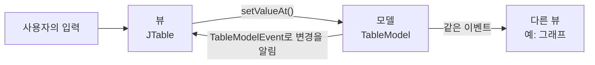
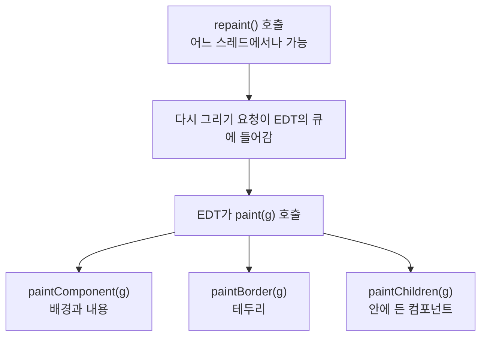

# 16강 — Swing 컴포넌트와 그래픽

[레포지토리 안내](../../README.ko.md) | [English](Concepts_Lecture.md) | [한국어](Concepts_Lecture.ko.md)

> **최종 수정일:** 2026-11-19

> **학습 목표:**
> 1. 체크 박스, 라디오 버튼, 콤보 박스, 리스트, 슬라이더로 선택을 받고 각각의 이벤트를 처리할 수 있다
> 2. 메뉴, 툴바, 대화 상자로 응용 프로그램의 명령과 확인 절차를 구성할 수 있다
> 3. 모델과 뷰를 분리한 Swing의 구조를 설명하고 TableModel로 JTable을 만들 수 있다
> 4. paintComponent()를 오버라이딩하여 도형과 문자열을 그리고 repaint()의 동작을 설명할 수 있다
> 5. Swing 타이머와 마우스 이벤트로 애니메이션과 그리기 프로그램을 만들 수 있다

---

## 목차

- [1. 선택 컴포넌트와 이벤트](#1-선택-컴포넌트와-이벤트)
  - [1.1 JCheckBox와 아이템 이벤트](#11-jcheckbox와-아이템-이벤트)
  - [1.2 JRadioButton과 ButtonGroup](#12-jradiobutton과-buttongroup)
  - [1.3 JComboBox와 JList](#13-jcombobox와-jlist)
  - [1.4 JSlider와 JProgressBar](#14-jslider와-jprogressbar)
- [2. 메뉴, 툴바, 대화 상자](#2-메뉴-툴바-대화-상자)
  - [2.1 메뉴](#21-메뉴)
  - [2.2 툴바와 툴팁](#22-툴바와-툴팁)
  - [2.3 JOptionPane의 대화 상자](#23-joptionpane의-대화-상자)
  - [2.4 JDialog와 모달 대화 상자](#24-jdialog와-모달-대화-상자)
- [3. 모델과 뷰](#3-모델과-뷰)
  - [3.1 Swing 컴포넌트의 모델](#31-swing-컴포넌트의-모델)
  - [3.2 TableModel과 JTable](#32-tablemodel과-jtable)
  - [3.3 JTabbedPane, JSplitPane, JScrollPane](#33-jtabbedpane-jsplitpane-jscrollpane)
- [4. 그래픽](#4-그래픽)
  - [4.1 좌표계와 paintComponent()](#41-좌표계와-paintcomponent)
  - [4.2 Graphics의 그리기 메서드](#42-graphics의-그리기-메서드)
  - [4.3 다시 그리기의 흐름](#43-다시-그리기의-흐름)
  - [4.4 Swing 타이머를 이용한 애니메이션](#44-swing-타이머를-이용한-애니메이션)
  - [4.5 마우스로 그리기](#45-마우스로-그리기)
- [5. 흔한 실수](#5-흔한-실수)
- [요약](#요약)
- [점검 문제](#점검-문제)
- [참고 문헌](#참고-문헌)

---

<br>

## 1. 선택 컴포넌트와 이벤트

12강의 표 3에 나열한 컴포넌트 가운데, 사용자가 여러 값 가운데 하나 또는 여럿을 고르게 하는 컴포넌트를 선택 컴포넌트라고 부를 수 있다. 선택 컴포넌트는 선택 상태가 바뀔 때 12강 5.11절의 규칙에 맞는 이벤트를 발생시킨다. 다음 프로그램은 각 컴포넌트의 상태를 코드로 바꾸면서 리스너가 받는 이벤트를 출력하고, 마지막에 컴포넌트들을 패널 하나에 배치해 그린다.

```java
import javax.swing.*;
import javax.swing.event.*;
import java.awt.*;
import java.awt.event.*;
import java.awt.image.BufferedImage;
import java.io.File;
import javax.imageio.ImageIO;

public class Selection {
    public static void main(String[] args) throws Exception {
        JCheckBox bold = new JCheckBox("Bold");
        bold.addItemListener(e -> System.out.println("check box: "
                + (e.getStateChange() == ItemEvent.SELECTED ? "SELECTED" : "DESELECTED")));
        bold.doClick();                                         // 선택
        bold.doClick();                                         // 해제

        JRadioButton small = new JRadioButton("Small"), medium = new JRadioButton("Medium", true),
                     large = new JRadioButton("Large");
        ButtonGroup sizes = new ButtonGroup();                  // 하나만 선택되게 묶는다
        sizes.add(small); sizes.add(medium); sizes.add(large);
        large.doClick();
        System.out.println("radio: small=" + small.isSelected() + " medium=" + medium.isSelected()
                + " large=" + large.isSelected());

        JComboBox<String> fruit = new JComboBox<>(new String[] {"apple", "banana", "kiwi"});
        fruit.addItemListener(e -> System.out.println("combo item " + e.getItem() + " "
                + (e.getStateChange() == ItemEvent.SELECTED ? "SELECTED" : "DESELECTED")));
        fruit.addActionListener(e -> System.out.println("combo action, index "
                + fruit.getSelectedIndex() + " = " + fruit.getSelectedItem()));
        fruit.setSelectedIndex(2);

        JList<String> list = new JList<>(new String[] {"Java", "C", "Python", "Kotlin"});
        list.addListSelectionListener(e -> {
            if (!e.getValueIsAdjusting())                        // 선택이 끝났을 때만
                System.out.println("list selection " + list.getSelectedValuesList());
        });
        list.setSelectedIndices(new int[] {0, 2});

        JSlider volume = new JSlider(0, 100, 50);
        volume.addChangeListener(e -> System.out.println("slider value " + volume.getValue()));
        volume.setValue(75);
        volume.setValue(150);                                    // 최댓값을 넘는 값

        JProgressBar progress = new JProgressBar(0, 10);
        progress.setValue(7);
        progress.setStringPainted(true);
        System.out.println("progress " + progress.getPercentComplete() + " " + progress.getString());

        if (args.length > 0) render(args[0], bold, small, medium, large, fruit, list, volume, progress);
    }

    static void render(String file, JComponent... cs) throws Exception {
        JPanel p = new JPanel(new GridLayout(0, 2, 8, 8));
        p.setBorder(BorderFactory.createEmptyBorder(8, 8, 8, 8));
        JPanel radios = new JPanel(new FlowLayout(FlowLayout.LEFT, 4, 0));
        radios.add(cs[1]); radios.add(cs[2]); radios.add(cs[3]);
        p.add(cs[0]); p.add(radios); p.add(cs[4]); p.add(new JScrollPane(cs[5])); p.add(cs[6]); p.add(cs[7]);
        p.setSize(440, 190);
        layoutAll(p);
        BufferedImage img = new BufferedImage(440, 190, BufferedImage.TYPE_INT_RGB);
        Graphics2D g = img.createGraphics(); p.paint(g); g.dispose();
        ImageIO.write(img, "png", new File(file));
    }

    static void layoutAll(Container c) { c.doLayout(); for (Component k : c.getComponents()) if (k instanceof Container cc) layoutAll(cc); }
}
```

```text
check box: SELECTED
check box: DESELECTED
radio: small=false medium=false large=true
combo item apple DESELECTED
combo item kiwi SELECTED
combo action, index 2 = kiwi
list selection [Java]
list selection [Java, Python]
slider value 75
slider value 100
progress 0.7 70%
```


*그림 1. 체크 박스, 라디오 버튼, 콤보 박스, 리스트, 슬라이더, 진행 막대*

그림 1은 위 프로그램이 마지막 상태의 컴포넌트를 그린 것이다. 체크 박스는 두 번 눌러 해제된 상태이고, 라디오 버튼은 Large가, 콤보 박스는 kiwi가, 리스트는 Java와 Python이 선택되어 있다. 슬라이더는 최댓값 100에 있고, 진행 막대는 70%를 보여 준다.

### 1.1 JCheckBox와 아이템 이벤트

`JCheckBox`는 선택과 해제를 오가는 상자이며, 여러 개가 서로 독립적이다. 상태가 바뀌면 `ItemEvent`가 발생하여 `ItemListener`의 `itemStateChanged()`가 호출되고, 이벤트의 `getStateChange()`가 `ItemEvent.SELECTED` 또는 `ItemEvent.DESELECTED`를 알려 준다. 출력의 첫 두 줄은 `doClick()`으로 체크 박스를 두 번 누른 결과로, 선택과 해제가 차례로 일어났다. 현재 상태는 언제든 `isSelected()`로 읽고 `setSelected(boolean)`으로 바꿀 수 있다. 체크 박스는 누를 때 `ActionEvent`도 발생시키지만, 코드에서 `setSelected()`로 상태를 바꾼 경우에는 `ItemEvent`만 발생하므로 상태 변화를 놓치지 않으려면 `ItemListener`를 쓴다.

### 1.2 JRadioButton과 ButtonGroup

`JRadioButton`은 여러 선택지 가운데 하나만 고르는 버튼이다. 라디오 버튼 자체는 체크 박스처럼 독립적으로 선택되므로, 하나만 선택되게 하려면 `ButtonGroup`에 함께 넣어야 한다. 그룹 안에서 한 버튼이 선택되면 이전에 선택된 버튼은 자동으로 해제된다. 위 프로그램은 Medium을 처음부터 선택된 상태로 만들고 Large를 눌렀으므로, Medium이 해제되고 Large만 선택되었다. `ButtonGroup`은 버튼을 묶는 논리적인 장치일 뿐 컴포넌트가 아니므로 화면에 붙이지 않으며, 화면에는 각 라디오 버튼을 따로 `add()`한다. 그림 1의 라디오 버튼 셋은 FlowLayout 패널 하나에 넣었다(12강 3.6절).

### 1.3 JComboBox와 JList

`JComboBox<E>`는 펼쳐지는 목록에서 항목 하나를 고르는 컴포넌트이고, `JList<E>`는 목록을 늘 펼쳐 보여 주며 여러 항목을 함께 고를 수 있는 컴포넌트이다. 둘 다 원소 타입을 타입 매개변수로 갖는 제네릭 클래스이다(9강 2절).

콤보 박스의 선택을 apple에서 kiwi로 바꾸면 이벤트가 세 번 일어난다. 이전 항목 apple의 `DESELECTED`, 새 항목 kiwi의 `SELECTED`, 그리고 선택이 바뀌었음을 알리는 `ActionEvent`이다. 선택한 항목은 `getSelectedItem()`, 위치는 `getSelectedIndex()`로 읽는다. `setEditable(true)`로 바꾸면 사용자가 목록에 없는 값을 직접 입력할 수도 있다.

리스트는 선택이 바뀔 때 `javax.swing.event.ListSelectionEvent`를 발생시킨다. 사용자가 마우스를 끌어 여러 항목을 고르는 동안에는 이벤트가 연속해서 일어나므로, 선택이 끝났을 때만 처리하려면 `getValueIsAdjusting()`이 `false`인 이벤트만 다룬다. 위 프로그램의 `setSelectedIndices({0, 2})`는 위치 0과 2를 차례로 선택하므로 이벤트가 두 번 일어났고, 마지막 이벤트에서 `getSelectedValuesList()`는 `[Java, Python]`이다. 선택 방식은 `setSelectionMode()`로 정하며, `ListSelectionModel.SINGLE_SELECTION`이면 하나만 고를 수 있다. 항목이 많으면 그림 1처럼 리스트를 `JScrollPane`에 넣는다.

### 1.4 JSlider와 JProgressBar

`JSlider`는 막대 위의 손잡이를 끌어 최솟값과 최댓값 사이의 정수를 고르게 한다. `new JSlider(0, 100, 50)`은 범위가 0\~100이고 처음 값이 50인 슬라이더이다. 값이 바뀌면 `ChangeEvent`가 발생하여 `ChangeListener`의 `stateChanged()`가 호출된다. `ChangeEvent`는 무엇이 바뀌었는지 담지 않으므로 리스너는 `getValue()`로 현재 값을 다시 읽는다. 출력의 `slider value 100`은 범위를 넘는 150을 넣었을 때 슬라이더가 값을 최댓값 100으로 맞춘 결과이다.

`JProgressBar`는 사용자가 고르는 컴포넌트가 아니라 작업의 진행 정도를 보여 주는 컴포넌트이다. 범위가 0\~10이고 값이 7이면 `getPercentComplete()`는 0.7이고, `setStringPainted(true)`로 막대 위에 `70%`라는 글자를 표시한다. 진행 막대는 오래 걸리는 작업과 함께 쓰이므로, 12강 5.8절의 `SwingWorker`가 `process()`에서 값을 고치는 것이 전형적인 형태이다.

---

<br>

## 2. 메뉴, 툴바, 대화 상자

### 2.1 메뉴

메뉴는 프레임 위쪽의 메뉴 막대(`JMenuBar`), 그 안의 메뉴(`JMenu`), 메뉴를 펼쳤을 때 나타나는 메뉴 항목(`JMenuItem`)의 세 단계로 이루어진다.

```java
JMenuBar bar = new JMenuBar();
JMenu file = new JMenu("File");
file.setMnemonic(KeyEvent.VK_F);                    // Alt+F로 메뉴를 연다

JMenuItem open = new JMenuItem("Open...");
open.setAccelerator(KeyStroke.getKeyStroke(KeyEvent.VK_O, InputEvent.CTRL_DOWN_MASK));
open.addActionListener(e -> openFile());            // 메뉴 항목도 액션 이벤트를 낸다

file.add(open);
file.addSeparator();                                // 구분선
file.add(new JMenuItem("Exit"));
bar.add(file);
frame.setJMenuBar(bar);                             // 컨텐트팬이 아니라 프레임에 붙인다
```

메뉴 항목을 선택하면 버튼처럼 `ActionEvent`가 발생하므로 같은 방법으로 `ActionListener`를 등록한다. **니모닉(mnemonic)** 은 Alt와 함께 눌러 메뉴를 여는 문자이고, **액셀러레이터(accelerator)** 는 메뉴를 열지 않고 항목을 바로 실행하는 단축키(위에서는 Ctrl+O)이다. 메뉴 막대는 `setJMenuBar()`로 프레임에 직접 붙이며, 컨텐트팬의 배치와 관계없이 제목 표시줄 바로 아래에 놓인다. 메뉴 안에는 `JCheckBoxMenuItem`, `JRadioButtonMenuItem`처럼 선택 상태를 가진 항목과, 또 다른 `JMenu`(하위 메뉴)를 넣을 수 있다. 12강 1.2절의 계층에서 `JMenu`가 `JMenuItem`의 하위 클래스인 이유가 여기에 있다.

### 2.2 툴바와 툴팁

`JToolBar`는 자주 쓰는 명령의 버튼을 한 줄로 모은 컨테이너이다. 보통 BorderLayout을 쓰는 컨텐트팬의 NORTH에 놓고, 그 안에 아이콘 버튼을 `add()`한다. 사용자는 툴바를 끌어 창의 다른 가장자리로 옮기거나 별도의 창으로 떼어 낼 수 있으며, `setFloatable(false)`로 이 기능을 끌 수 있다. 같은 명령을 메뉴 항목과 툴바 버튼에서 모두 실행할 수 있게 하려면 두 컴포넌트에 같은 리스너를 등록한다.

**툴팁(tool tip)** 은 마우스를 컴포넌트 위에 잠시 올려 두면 나타나는 짧은 설명이다. 모든 `JComponent`에 `setToolTipText("Open a file")`처럼 문자열을 정하면 되며, 아이콘만 있는 툴바 버튼에는 툴팁을 다는 것이 사용성의 기본이다.

### 2.3 JOptionPane의 대화 상자

`JOptionPane`은 자주 쓰는 형태의 대화 상자를 static 메서드 하나로 띄운다. 2강과 3강에서 쓴 `showMessageDialog()`와 `showInputDialog()` 외에 다음 메서드가 있다.

| 메서드 | 보여 주는 것 | 반환값 |
|:-----|:-----|:-----|
| `showMessageDialog(parent, msg)` | 메시지와 OK 버튼 | 없음 |
| `showConfirmDialog(parent, msg)` | 질문과 Yes, No, Cancel 버튼 | 누른 버튼의 `int` 상수 |
| `showInputDialog(parent, msg)` | 질문과 입력 칸 | 입력한 `String`, 취소하면 `null` |
| `showOptionDialog(...)` | 직접 정한 버튼들 | 누른 버튼의 위치 |

*표 1. JOptionPane의 주요 메서드*

확인 대화 상자의 반환값은 다음 상수와 비교한다.

```java
import javax.swing.JOptionPane;

public class DialogConstants {
    public static void main(String[] args) {
        System.out.println("YES_OPTION    = " + JOptionPane.YES_OPTION);
        System.out.println("NO_OPTION     = " + JOptionPane.NO_OPTION);
        System.out.println("CANCEL_OPTION = " + JOptionPane.CANCEL_OPTION);
        System.out.println("OK_OPTION     = " + JOptionPane.OK_OPTION);
        System.out.println("CLOSED_OPTION = " + JOptionPane.CLOSED_OPTION);
        try {
            JOptionPane.showConfirmDialog(null, "Save changes?");
        } catch (java.awt.HeadlessException e) {
            System.out.println("no screen: HeadlessException");
        }
    }
}
```

```text
YES_OPTION    = 0
NO_OPTION     = 1
CANCEL_OPTION = 2
OK_OPTION     = 0
CLOSED_OPTION = -1
no screen: HeadlessException
```

`YES_OPTION`과 `OK_OPTION`은 같은 값 0이며, 사용자가 버튼을 누르지 않고 창을 닫으면 `CLOSED_OPTION`(-1)이 반환된다. 따라서 `if (answer == JOptionPane.YES_OPTION)`처럼 상수와 비교하고, 창을 닫은 경우도 처리해야 한다. 마지막 줄은 이 프로그램을 화면이 없는 환경에서 실행했기 때문에 대화 상자를 띄울 수 없어 `HeadlessException`이 난 결과이다. 이 메서드들은 사용자가 답할 때까지 반환하지 않는데, 그동안에도 화면은 계속 다시 그려진다. 모달 대화 상자(2.4절)가 떠 있는 동안에도 다른 이벤트가 막히지 않도록 툴킷이 보장하므로, 이 메서드는 이벤트 리스너 안, 즉 EDT에서 호출해도 된다.

### 2.4 JDialog와 모달 대화 상자

`JOptionPane`으로 만들 수 없는 대화 상자(예: 여러 입력 칸이 있는 설정 창)는 `JDialog`를 상속하거나 직접 만들어 컴포넌트를 배치한다. `JDialog`는 `JFrame`처럼 최상위 창이며 자기만의 컨텐트팬을 가진다(12강 1.2절).

`new JDialog(owner, "Settings", true)`의 세 번째 인자가 `true`이면 **모달(modal)** 대화 상자이다. 모달 대화 상자가 떠 있는 동안 사용자는 주인 창을 조작할 수 없고, `setVisible(true)`는 대화 상자가 닫힐 때까지 반환하지 않는다. 그래서 대화 상자를 닫은 뒤 입력값을 읽는 코드를 `setVisible(true)` 다음 줄에 바로 쓸 수 있다. `false`이면 **모달리스(modeless)** 대화 상자로, 대화 상자와 주인 창을 함께 쓸 수 있고 `setVisible(true)`가 바로 반환한다. 찾기 창처럼 계속 띄워 두고 쓰는 창은 모달리스로, 저장 여부를 묻는 창처럼 답을 받아야 진행할 수 있는 창은 모달로 만든다.

---

<br>

## 3. 모델과 뷰

### 3.1 Swing 컴포넌트의 모델

대부분의 Swing 컴포넌트는 데이터와 상태를 화면 표시와 분리하여 **모델(model)** 객체에 둔다 [1]. 버튼은 눌림, 선택, 활성 상태를 `ButtonModel`에, 리스트는 항목을 `ListModel`에, 선택 상태를 `ListSelectionModel`에, 표는 셀의 값을 `TableModel`에 둔다. 컴포넌트 자신은 모델의 내용을 화면에 그리고 사용자의 입력을 모델에 전하는 **뷰(view)** 의 역할을 맡는다.

> **용어 정의:** **모델-뷰 분리(model-view separation)** 는 데이터와 그 규칙을 담는 모델과, 데이터를 보여 주는 뷰를 서로 다른 객체로 나누고, 모델이 바뀌면 이벤트로 뷰에 알리게 하는 설계이다. 한 모델을 여러 뷰가 함께 보여 줄 수 있고, 화면을 바꾸어도 모델의 코드는 바뀌지 않는다.



*그림 2. 모델과 뷰 사이의 변경 전달*

> **[소프트웨어공학]** 소프트웨어공학의 MVC(Model-View-Controller) 패턴은 모델, 뷰, 입력을 처리하는 컨트롤러를 나눈다. Swing은 뷰와 컨트롤러를 UI 위임 객체(UI delegate) 하나로 합치고 모델만 분리한 변형을 쓴다. 컴포넌트의 겉모양을 룩 앤 필에 따라 바꿀 수 있는 것도(12강 1.1절) 그리는 일을 UI 위임 객체가 맡기 때문이다.

### 3.2 TableModel과 JTable

`JTable`은 행과 열로 된 데이터를 보여 주는 표이다. 데이터가 적고 고정되어 있으면 `new JTable(Object[][] data, String[] columnNames)`로 바로 만들 수 있지만, 데이터가 바뀌거나 셀마다 규칙이 있으면 `AbstractTableModel`을 상속한 모델을 만든다. 모델은 행 수, 열 수, 셀의 값을 알려 주는 세 메서드를 반드시 구현하고, 필요하면 열 이름, 편집 가능 여부, 값의 변경을 오버라이딩한다.

```java
import javax.swing.*;
import javax.swing.table.AbstractTableModel;
import java.awt.*;
import java.awt.image.BufferedImage;
import java.io.File;
import java.util.ArrayList;
import java.util.List;
import javax.imageio.ImageIO;

public class ScoreTable {
    record Row(String name, int score) { }

    static class ScoreModel extends AbstractTableModel {              // 모델: 데이터와 그 규칙
        private final String[] columns = {"Name", "Score", "Pass"};
        private final List<Row> rows = new ArrayList<>();

        void add(String name, int score) {
            rows.add(new Row(name, score));
            fireTableRowsInserted(rows.size() - 1, rows.size() - 1);   // 뷰에 알린다
        }

        @Override public int getRowCount() { return rows.size(); }
        @Override public int getColumnCount() { return columns.length; }
        @Override public String getColumnName(int c) { return columns[c]; }
        @Override public Object getValueAt(int r, int c) {
            Row row = rows.get(r);
            return switch (c) {
                case 0 -> row.name();
                case 1 -> row.score();
                default -> row.score() >= 60 ? "yes" : "no";
            };
        }
        @Override public boolean isCellEditable(int r, int c) { return c == 1; }
        @Override public void setValueAt(Object v, int r, int c) {
            rows.set(r, new Row(rows.get(r).name(), Integer.parseInt(v.toString())));
            fireTableRowsUpdated(r, r);
        }
    }

    public static void main(String[] args) throws Exception {
        ScoreModel model = new ScoreModel();
        JTable table = new JTable(model);                               // 뷰: 모델을 보여 준다
        model.addTableModelListener(e -> System.out.println("model changed: rows "
                + e.getFirstRow() + "-" + e.getLastRow() + ", type " + e.getType()));
        model.add("Kim", 90);
        model.add("Lee", 55);
        model.add("Park", 72);
        System.out.println("table rows " + table.getRowCount() + ", columns " + table.getColumnCount()
                + ", header " + table.getColumnName(0) + "/" + table.getColumnName(1) + "/" + table.getColumnName(2));
        System.out.println("Lee: " + table.getValueAt(1, 1) + " pass=" + table.getValueAt(1, 2)
                + ", editable name? " + table.isCellEditable(1, 0) + ", score? " + table.isCellEditable(1, 1));
        table.setValueAt("65", 1, 1);                                   // 편집한 값이 모델로 간다
        System.out.println("Lee after edit: " + model.getValueAt(1, 1) + " pass=" + model.getValueAt(1, 2));

        if (args.length > 0) {
            JPanel sp = new JPanel(new BorderLayout());
            sp.add(table.getTableHeader(), BorderLayout.NORTH);
            sp.add(table, BorderLayout.CENTER);
            sp.setSize(300, 70);
            layoutAll(sp);
            BufferedImage img = new BufferedImage(300, 70, BufferedImage.TYPE_INT_RGB);
            Graphics2D g = img.createGraphics(); sp.paint(g); g.dispose();
            ImageIO.write(img, "png", new File(args[0]));
        }
    }

    static void layoutAll(Container c) { c.doLayout(); for (Component k : c.getComponents()) if (k instanceof Container cc) layoutAll(cc); }
}
```

```text
model changed: rows 0-0, type 1
model changed: rows 1-1, type 1
model changed: rows 2-2, type 1
table rows 3, columns 3, header Name/Score/Pass
Lee: 55 pass=no, editable name? false, score? true
model changed: rows 1-1, type 0
Lee after edit: 65 pass=yes
```


*그림 3. ScoreModel을 보여 주는 JTable*

`ScoreModel`은 학생의 이름과 점수를 리스트에 저장하고, 셋째 열 Pass는 저장하지 않고 점수가 60 이상인지로 계산하여 돌려준다. `add()`는 행을 더한 뒤 `fireTableRowsInserted()`로 모델의 리스너에게 변경을 알린다. `JTable`은 모델을 받으면서 스스로를 그 리스너로 등록하므로, 이 알림을 받아 새 행을 화면에 그린다. 출력의 `type 1`은 행이 삽입되었다는 `TableModelEvent.INSERT`이고, `type 0`은 값이 바뀌었다는 `UPDATE`이다.

`isCellEditable()`이 점수 열(1)만 `true`를 반환하므로 사용자는 점수만 고칠 수 있다. 사용자가 셀을 편집하면 `JTable`이 `setValueAt()`을 호출하는데, 위 프로그램은 `table.setValueAt("65", 1, 1)`로 같은 일을 흉내 냈다. 모델은 Lee의 점수를 65로 바꾸고 `fireTableRowsUpdated()`로 알리며, Pass 열은 따로 고치지 않아도 다음에 `getValueAt()`을 부를 때 `yes`로 계산된다. 그림 3은 이 상태를 그린 것이다. 이처럼 데이터의 규칙은 모델에 한 번만 두고, 표는 모델이 주는 값을 보여 주기만 한다.

### 3.3 JTabbedPane, JSplitPane, JScrollPane

세 컨테이너는 다른 컴포넌트가 화면을 나누어 쓰는 방식을 정한다.

- `JTabbedPane`은 탭마다 패널 하나를 두고, 탭을 누르면 그 패널만 보여 준다. `tabs.addTab("General", generalPanel)`로 탭을 더하며, 12강 3.7절의 CardLayout에 탭 단추를 붙인 것과 같다.
- `JSplitPane`은 두 컴포넌트를 가로나 세로로 나란히 놓고, 사이의 경계선을 끌어 크기를 나누게 한다. `new JSplitPane(JSplitPane.HORIZONTAL_SPLIT, fileList, editor)`처럼 만든다.
- `JScrollPane`은 안의 컴포넌트가 보이는 영역보다 크면 스크롤바를 붙인다. 12강 4.1절의 `JTextArea`, 1.3절의 `JList`, 3.2절의 `JTable`을 넣는 곳이 이것이다. `JTable`을 `JScrollPane`에 넣으면 열 이름의 머리글이 스크롤 영역 위에 자동으로 붙는다.

---

<br>

## 4. 그래픽

### 4.1 좌표계와 paintComponent()

컴포넌트 위에 직접 그림을 그리려면 `JPanel`을 상속한 클래스를 만들고 `paintComponent(Graphics g)`를 오버라이딩한다. Swing은 컴포넌트를 그려야 할 때 이 메서드를 호출하며, 그리기에 쓸 도구인 `Graphics` 객체를 인자로 넘긴다. 그리는 코드는 모두 이 메서드 안에 둔다 [2].

`Graphics`의 좌표계는 컴포넌트의 왼쪽 위가 원점 (0, 0)이고, x는 오른쪽으로, y는 아래쪽으로 커진다. 단위는 픽셀이다. 수학의 좌표계와 달리 y가 아래로 커진다는 점에 주의해야 한다. 좌표는 프레임이나 화면이 아니라 그 컴포넌트를 기준으로 하므로, 패널을 다른 위치로 옮겨도 그리는 코드를 바꿀 필요가 없다.

```text
(0,0) ──────────────► x
  │
  │      (130,10) ┌──────────┐
  │               │          │ 높이 50
  │               └──────────┘
  │                  폭 80
  ▼
  y
```

*그림 4. 컴포넌트의 좌표계와 drawRect(130, 10, 80, 50)*

> **[컴퓨터그래픽스]** 컴퓨터그래픽스에서는 이런 좌표를 화면 좌표(장치 좌표)라 하며, 도형을 픽셀의 격자로 바꾸는 과정을 래스터화라고 한다. `Graphics2D`는 `translate()`, `rotate()`, `scale()`로 좌표계를 변환한 뒤 그릴 수 있게 하여, 그리는 코드를 도형 자신의 좌표로 쓰고 위치와 방향은 변환으로 정할 수 있게 한다.

### 4.2 Graphics의 그리기 메서드

다음 패널은 `Graphics`의 대표적인 메서드로 도형과 문자열을 그린다. 화면에 창을 띄우는 대신 패널을 이미지에 그려 파일로 저장했다.

```java
import javax.swing.*;
import java.awt.*;
import java.awt.image.BufferedImage;
import java.io.File;
import javax.imageio.ImageIO;

public class Drawing extends JPanel {
    @Override
    protected void paintComponent(Graphics g) {
        super.paintComponent(g);                                       // 배경을 먼저 지운다
        g.setColor(Color.BLUE);
        g.drawLine(10, 10, 110, 60);                                   // 선
        g.drawRect(130, 10, 80, 50);                                   // 사각형의 윤곽
        g.setColor(Color.ORANGE);
        g.fillOval(230, 10, 80, 50);                                   // 채운 타원
        g.setColor(Color.MAGENTA);
        g.fillArc(330, 10, 60, 60, 0, 270);                            // 0도에서 270도까지의 부채꼴
        g.setColor(Color.DARK_GRAY);
        g.drawPolygon(new int[] {20, 70, 120}, new int[] {150, 90, 150}, 3);
        g.setFont(new Font(Font.SANS_SERIF, Font.BOLD, 20));
        g.drawString("Hello Graphics", 140, 125);                      // 기준선의 왼쪽 끝이 (140, 125)

        Graphics2D g2 = (Graphics2D) g;                                // 더 많은 기능
        g2.setRenderingHint(RenderingHints.KEY_ANTIALIASING, RenderingHints.VALUE_ANTIALIAS_ON);
        g2.setStroke(new BasicStroke(4));
        g2.setColor(new Color(0, 128, 0));
        g2.drawOval(320, 90, 70, 60);
    }

    public static void main(String[] args) throws Exception {
        Drawing d = new Drawing();
        d.setBackground(Color.WHITE);
        d.setSize(400, 160);
        BufferedImage img = new BufferedImage(400, 160, BufferedImage.TYPE_INT_RGB);
        Graphics2D g = img.createGraphics();
        d.paint(g);                                                    // 화면 대신 이미지에 그린다
        g.dispose();
        ImageIO.write(img, "png", new File(args[0]));
        System.out.println("pixel at (270, 35): " + Integer.toHexString(img.getRGB(270, 35) & 0xFFFFFF));
        System.out.println("pixel at (5, 150):  " + Integer.toHexString(img.getRGB(5, 150) & 0xFFFFFF));
    }
}
```

```text
pixel at (270, 35): ffc800
pixel at (5, 150):  ffffff
```


*그림 5. Graphics와 Graphics2D로 그린 도형과 문자열*

| 메서드 | 그리는 것 |
|:-----|:-----|
| `drawLine(x1, y1, x2, y2)` | (x1, y1)에서 (x2, y2)까지의 선 |
| `drawRect(x, y, w, h)`, `fillRect(...)` | 왼쪽 위가 (x, y)이고 폭 w, 높이 h인 사각형의 윤곽, 채운 사각형 |
| `drawOval(x, y, w, h)`, `fillOval(...)` | 그 사각형에 내접하는 타원 |
| `drawArc(x, y, w, h, start, angle)`, `fillArc(...)` | 타원의 일부인 호, 부채꼴 (각도는 3시 방향에서 반시계 방향) |
| `drawPolygon(xs, ys, n)`, `fillPolygon(...)` | 꼭짓점 n개를 이은 다각형 |
| `drawString(s, x, y)` | 기준선의 왼쪽 끝이 (x, y)인 문자열 |
| `drawImage(img, x, y, observer)` | 이미지 |
| `setColor(c)`, `setFont(f)` | 이후에 그릴 색과 글꼴 |

*표 2. Graphics의 주요 메서드*

`draw`로 시작하는 메서드는 윤곽만, `fill`로 시작하는 메서드는 안쪽까지 채워 그린다. 타원은 중심과 반지름이 아니라 타원을 둘러싸는 사각형으로 지정하므로, `fillOval(230, 10, 80, 50)`은 중심이 (270, 35)인 타원이다. 출력의 첫 줄은 그 중심 픽셀의 색이 주황(`ffc800`, 빨강 255, 초록 200, 파랑 0)이라는 것을, 둘째 줄은 아무것도 그리지 않은 곳이 배경색 흰색이라는 것을 보여 준다. `fillArc(330, 10, 60, 60, 0, 270)`은 3시 방향(0도)에서 반시계 방향으로 270도를 채우므로 오른쪽 아래 4분의 1이 빠진 부채꼴이 된다. `drawString`의 y는 글자의 위쪽이 아니라 기준선의 위치이므로, 글자는 대부분 y보다 위에 그려진다.

`paintComponent()`가 받는 객체의 실제 타입은 `Graphics`의 하위 클래스인 `Graphics2D`이다. 캐스트하여 쓰면 선의 굵기(`setStroke`), 계단 현상을 줄이는 안티에일리어싱(`setRenderingHint`), 좌표 변환 같은 기능을 더 쓸 수 있다. 그림 5의 초록 타원은 굵기 4의 선과 안티에일리어싱으로 그려 다른 도형보다 테두리가 매끄럽다.

### 4.3 다시 그리기의 흐름

프로그램이 `paintComponent()`를 직접 호출하는 일은 없다. 창이 처음 나타날 때, 가려졌던 부분이 다시 보일 때, 크기가 바뀔 때 Swing이 알아서 그리기를 요청하고, 프로그램이 그림의 내용을 바꾸었을 때는 `repaint()`를 호출하여 다시 그려 달라고 요청한다. `repaint()`는 그리기를 바로 하지 않고, 다시 그릴 영역을 기록하여 EDT의 큐에 요청을 넣은 뒤 반환한다. 짧은 시간에 여러 번 호출된 요청은 하나로 합쳐질 수 있다.



*그림 6. repaint()에서 paintComponent()까지의 다시 그리기 흐름*

EDT가 요청을 처리하면 컴포넌트의 `paint()`가 호출되고, Swing의 `paint()`는 이를 `paintComponent()`, `paintBorder()`, `paintChildren()`의 순서로 나누어 부른다 [2]. 그래서 직접 그리는 코드는 `paint()`가 아니라 `paintComponent()`에 두어야 테두리와 자식 컴포넌트가 그 위에 제대로 그려진다. `paintComponent()`의 첫 문장 `super.paintComponent(g)`는 불투명한 컴포넌트의 배경을 배경색으로 채운다. 이 호출을 빼면 이전에 그린 그림이 지워지지 않아 잔상이 남는다.

이 구조에서 중요한 결론은 그림의 상태를 필드에 저장해야 한다는 것이다. `paintComponent()`는 언제든 다시 호출될 수 있으므로, 이 메서드는 매번 필드에 저장된 상태로부터 그림 전체를 처음부터 그려야 한다. 리스너에서 `getGraphics()`로 얻은 객체에 바로 그리면, 창이 가려졌다 다시 나타나는 순간 그 그림은 사라진다.

### 4.4 Swing 타이머를 이용한 애니메이션

애니메이션은 일정한 간격으로 그림의 상태를 바꾸고 `repaint()`를 호출하는 일의 반복이다. 13강처럼 스레드에서 `sleep()`을 반복할 수도 있지만, `javax.swing.Timer`를 쓰면 정해진 간격마다 액션 이벤트가 EDT에서 발생하므로 컴포넌트를 안전하게 고칠 수 있다 [3].

```java
import javax.swing.*;

public class TimerAnim {
    static int x = 0, ticks = 0;

    public static void main(String[] args) throws Exception {
        long t0 = System.nanoTime();
        Timer timer = new Timer(100, null);                            // 0.1초마다
        timer.addActionListener(e -> {
            x += 10;                                                   // 위치를 옮기고 repaint()를 부르는 자리
            ticks++;
            System.out.printf("tick %d at ~%d ms on %s, x = %d%n", ticks,
                    Math.round((System.nanoTime() - t0) / 1e6 / 100) * 100,
                    Thread.currentThread().getName(), x);
            if (ticks == 5) timer.stop();
        });
        timer.start();
        Thread.sleep(800);
        System.out.println("running after stop? " + timer.isRunning());
    }
}
```

```text
tick 1 at ~100 ms on AWT-EventQueue-0, x = 10
tick 2 at ~200 ms on AWT-EventQueue-0, x = 20
tick 3 at ~400 ms on AWT-EventQueue-0, x = 30
tick 4 at ~500 ms on AWT-EventQueue-0, x = 40
tick 5 at ~600 ms on AWT-EventQueue-0, x = 50
running after stop? false
```

`new Timer(100, listener)`는 0.1초마다 리스너를 호출하는 타이머이며, `start()`로 시작하고 `stop()`으로 멈춘다. 출력의 모든 틱이 `AWT-EventQueue-0`, 즉 EDT에서 실행되었다. 실제 애니메이션이라면 리스너 안에서 `x`를 바꾼 뒤 `repaint()`를 호출하고, `paintComponent()`는 필드 `x`의 위치에 도형을 그린다. 세 번째 틱이 약 400밀리초에 실행된 것처럼 타이머의 간격은 정확하지 않으며, EDT가 다른 이벤트를 처리하느라 바쁘면 더 늦어진다. 그래서 움직임의 정확한 속도가 중요하면 틱의 횟수가 아니라 실제로 흐른 시간(`System.nanoTime()`)으로 위치를 계산한다. 다섯 번째 틱에서 `stop()`을 호출했으므로 그 뒤에는 리스너가 호출되지 않고 `isRunning()`은 `false`이다.

Swing 타이머의 리스너는 EDT에서 실행되므로 짧게 끝나야 한다(12강 5.7절). 오래 걸리는 계산이 필요하면 `SwingWorker`를 함께 쓴다(12강 5.8절).

### 4.5 마우스로 그리기

마우스를 끄는 대로 선이 그려지는 그림판은 4.3절의 원칙을 그대로 따른다. 마우스 리스너는 그림의 상태(점의 목록)만 바꾸고 `repaint()`를 요청하며, 실제로 그리는 일은 `paintComponent()`가 상태로부터 한다.

```java
import javax.swing.*;
import java.awt.*;
import java.awt.event.*;
import java.util.ArrayList;
import java.util.List;

public class MouseDraw extends JPanel {
    private final List<Point> points = new ArrayList<>();             // 그림의 상태를 기억한다
    int repaints = 0;

    MouseDraw() {
        MouseAdapter handler = new MouseAdapter() {
            @Override public void mousePressed(MouseEvent e) { points.clear(); points.add(e.getPoint()); requestRepaint(); }
            @Override public void mouseDragged(MouseEvent e) { points.add(e.getPoint()); requestRepaint(); }
        };
        addMouseListener(handler);
        addMouseMotionListener(handler);                               // 드래그는 모션 리스너
    }

    void requestRepaint() { repaints++; repaint(); }

    @Override
    protected void paintComponent(Graphics g) {
        super.paintComponent(g);
        for (int i = 1; i < points.size(); i++) {
            Point a = points.get(i - 1), b = points.get(i);
            g.drawLine(a.x, a.y, b.x, b.y);
        }
    }

    public static void main(String[] args) {
        MouseDraw p = new MouseDraw();
        p.setSize(200, 100);
        long when = System.currentTimeMillis();
        p.dispatchEvent(new MouseEvent(p, MouseEvent.MOUSE_PRESSED, when, 0, 10, 10, 1, false, MouseEvent.BUTTON1));
        for (int x = 20; x <= 60; x += 10)
            p.dispatchEvent(new MouseEvent(p, MouseEvent.MOUSE_DRAGGED, when, InputEvent.BUTTON1_DOWN_MASK,
                    x, 10 + x / 2, 0, false, MouseEvent.NOBUTTON));
        System.out.println("points " + p.points.size() + ", segments " + (p.points.size() - 1)
                + ", repaint requests " + p.repaints);
        System.out.println("last point " + p.points.get(p.points.size() - 1));
    }
}
```

```text
points 6, segments 5, repaint requests 6
last point java.awt.Point[x=60,y=40]
```

`MouseAdapter`는 `MouseListener`와 `MouseMotionListener`를 모두 구현하므로(12강 5.5절), 같은 객체를 `addMouseListener()`와 `addMouseMotionListener()`에 함께 등록한다. 버튼을 누를 때의 `mousePressed()`는 목록을 비우고 첫 점을 넣으며, 버튼을 누른 채 움직일 때의 `mouseDragged()`는 점을 하나씩 더한다. 위 프로그램은 (10, 10)에서 누르고 (60, 40)까지 다섯 번 끄는 이벤트를 전달했으므로(12강 5.10절) 점은 6개, 이웃한 점을 잇는 선분은 5개이고, 이벤트마다 `repaint()`를 요청하여 요청은 6번이다. `paintComponent()`는 이웃한 두 점을 `drawLine()`으로 이어 끊김 없는 곡선을 그린다. 여러 획을 남기려면 점 목록의 목록을 저장하면 된다.

---

<br>

## 5. 흔한 실수

| 실수 | 일어나는 일 | 바로잡는 방법 |
|:-----|:-----|:-----|
| 라디오 버튼을 `ButtonGroup`에 넣지 않는다 | 여러 버튼이 함께 선택된다 | 하나만 선택되어야 하는 버튼을 한 `ButtonGroup`에 넣는다 |
| `ButtonGroup`을 컨테이너에 `add()`하려 한다 | 컴포넌트가 아니므로 컴파일 오류가 난다 | 각 라디오 버튼을 따로 화면에 붙인다 |
| 리스트의 선택 이벤트를 `getValueIsAdjusting()` 검사 없이 처리한다 | 끄는 동안 같은 처리가 여러 번 실행된다 | 조정이 끝난 이벤트만 처리한다 |
| 확인 대화 상자의 반환값을 `true`, `false`로 여긴다 | 정수 상수이므로 비교가 틀린다 | `JOptionPane.YES_OPTION` 등과 비교하고 `CLOSED_OPTION`도 처리한다 |
| 표의 데이터를 바꾼 뒤 모델의 `fire...` 메서드를 호출하지 않는다 | 화면에 변경이 나타나지 않는다 | 바꾼 범위에 맞는 `fireTable...()`을 호출한다 |
| `paint()`를 오버라이딩하여 그린다 | 테두리와 자식 컴포넌트가 제대로 그려지지 않는다 | `paintComponent()`를 오버라이딩한다 |
| `paintComponent()`에서 `super.paintComponent(g)`를 빼먹는다 | 배경이 지워지지 않아 잔상이 남는다 | 첫 문장에서 호출한다 |
| `paintComponent()`를 직접 호출하거나 `getGraphics()`에 그린다 | 그림이 다시 그려질 때 사라진다 | 상태를 필드에 두고 `repaint()`를 호출한다 |
| `paintComponent()` 안에서 상태를 바꾸거나 오래 계산한다 | 그릴 때마다 결과가 달라지고 화면이 느려진다 | 상태는 리스너나 타이머에서 바꾸고, 그리기는 그리기만 한다 |
| 수학의 좌표계처럼 y가 위로 커진다고 생각한다 | 그림이 위아래로 뒤집힌다 | y는 아래로 커진다는 것을 기억한다 |

*표 3. Swing 컴포넌트와 그래픽의 흔한 실수*

---

<br>

## 요약

| 개념 | 핵심 요약 |
|:-----|:-----|
| 선택 컴포넌트 | 체크 박스와 라디오 버튼, 콤보 박스는 `ItemEvent`를, 리스트는 `ListSelectionEvent`를, 슬라이더는 `ChangeEvent`를 발생시킨다. |
| ButtonGroup | 라디오 버튼을 묶어 그 가운데 하나만 선택되게 하는 논리적인 장치이며, 화면에는 붙이지 않는다. |
| 메뉴 | `JMenuBar`, `JMenu`, `JMenuItem`의 세 단계로 이루어지며, 메뉴 항목은 액션 이벤트를 낸다. |
| JOptionPane | 메시지, 확인, 입력 대화 상자를 static 메서드로 띄우며, 확인 결과는 정수 상수로 돌려준다. |
| 모달 대화 상자 | 닫힐 때까지 주인 창을 조작할 수 없고 `setVisible(true)`가 반환하지 않는다. |
| 모델과 뷰 | 컴포넌트의 데이터와 상태를 모델에 두고, 모델이 바뀌면 이벤트로 뷰에 알린다. |
| TableModel | 행 수, 열 수, 셀의 값을 제공하며, 데이터를 바꾸면 `fireTable...()`로 표에 알린다. |
| 좌표계 | 컴포넌트의 왼쪽 위가 (0, 0)이고 x는 오른쪽, y는 아래쪽으로 커지는 픽셀 좌표이다. |
| paintComponent | 그리는 코드를 두는 메서드이며, 첫 문장에서 `super.paintComponent(g)`를 호출하고 필드의 상태로부터 매번 전부 그린다. |
| repaint | 다시 그리기를 요청만 하고 반환하며, EDT가 나중에 `paint()`를 통해 `paintComponent()`를 호출한다. |
| Swing 타이머 | 정해진 간격으로 EDT에서 액션 이벤트를 발생시켜 애니메이션을 안전하게 만든다. |

---

<br>

## 점검 문제

1. **아이템 이벤트:** 1.3절의 콤보 박스에서 선택이 kiwi일 때 `setSelectedIndex(2)`를 다시 호출하면 이벤트가 발생하는가? 선택을 kiwi에서 banana로 바꾸면 어떤 이벤트가 어떤 순서로 발생하는가?

   <details>
   <summary>정답</summary>

   같은 항목을 다시 선택하면 선택 상태가 바뀌지 않으므로 아이템 이벤트는 발생하지 않고, 액션 이벤트만 한 번 발생한다. 실제로 실행하면 액션 리스너만 한 번 호출된다. kiwi에서 banana로 바꾸면 이전 항목 kiwi의 `DESELECTED`, 새 항목 banana의 `SELECTED`라는 두 `ItemEvent`가 이 순서로 발생하고, 이어서 `ActionEvent`가 발생한다. 1.3절의 출력에서 apple에서 kiwi로 바꿀 때와 같은 순서이다.

   </details>

2. **ButtonGroup:** 라디오 버튼 셋을 `ButtonGroup`에 넣지 않고 화면에만 붙였다. Small을 누른 뒤 Large를 누르면 두 버튼의 상태는 어떻게 되는가?

   <details>
   <summary>정답</summary>

   둘 다 선택된 상태가 된다. `JRadioButton`은 그 자체로는 체크 박스처럼 독립적으로 선택되며, 다른 버튼을 해제하는 일은 `ButtonGroup`이 한다. 하나만 선택되게 하려면 세 버튼을 같은 `ButtonGroup`에 `add()`해야 한다.

   </details>

3. **TableModel:** 3.2절의 `ScoreModel`에서 `setValueAt()`의 `fireTableRowsUpdated(r, r)`을 지우면, 프로그램의 출력과 화면은 각각 어떻게 달라지는가?

   <details>
   <summary>정답</summary>

   모델의 리스너가 호출되지 않으므로 출력에서 `model changed: rows 1-1, type 0` 줄이 사라진다. 모델의 값은 바뀌었으므로 `getValueAt()`으로 읽은 `Lee after edit: 65 pass=yes`는 그대로이다. 그러나 화면의 `JTable`은 변경 알림을 받지 못하므로, 다른 이유로 그 셀을 다시 그리기 전까지 예전 값이 표시될 수 있다. 데이터와 화면이 어긋나지 않도록 모델을 바꾼 뒤에는 반드시 알린다.

   </details>

4. **좌표:** 폭 200, 높이 100인 패널의 한가운데에 지름 40인 원을 채워 그리려면 `fillOval`에 어떤 인자를 넘겨야 하는가?

   <details>
   <summary>정답</summary>

   `fillOval(80, 30, 40, 40)`이다. 타원은 둘러싸는 사각형의 왼쪽 위 좌표와 폭, 높이로 지정한다. 원의 중심이 패널의 중심 (100, 50)이 되려면 사각형의 왼쪽 위는 (100 - 20, 50 - 20) = (80, 30)이고, 폭과 높이는 지름 40이다.

   </details>

5. **다시 그리기:** 마우스를 클릭할 때마다 클릭한 자리에 점을 찍는 프로그램을 만들면서, 리스너 안에서 `getGraphics().fillOval(...)`로 바로 그렸다. 처음에는 점이 보이지만 창을 최소화했다가 되돌리면 점이 모두 사라진다. 이유와 고치는 방법을 쓰라.

   <details>
   <summary>정답</summary>

   창이 다시 나타날 때 Swing은 `paintComponent()`를 호출하여 컴포넌트를 다시 그리는데, 점의 위치가 어디에도 저장되어 있지 않으므로 `super.paintComponent(g)`가 배경을 채운 뒤 아무것도 그리지 않는다. 클릭한 위치를 리스트 필드에 저장하고 `repaint()`를 호출하며, `paintComponent()`에서 리스트의 모든 점을 그리도록 바꾸면 언제 다시 그려도 점이 유지된다(4.3절, 4.5절).

   </details>

6. **Swing 타이머:** 0.05초마다 공을 오른쪽으로 5픽셀씩 옮기는 애니메이션을 만들려고 한다. `Thread`와 `sleep(50)`으로 만드는 방법과 `javax.swing.Timer`로 만드는 방법의 차이를 공의 위치를 바꾸는 코드가 실행되는 스레드의 관점에서 설명하라.

   <details>
   <summary>정답</summary>

   `Thread`와 `sleep(50)`으로 만들면 위치를 바꾸는 코드가 별도의 스레드에서 실행되므로, EDT에서 실행되는 `paintComponent()`와 같은 필드를 함께 쓰게 되어 동기화를 고려해야 하고, 컴포넌트를 직접 고치면 Swing의 스레드 원칙에 어긋난다. `javax.swing.Timer`의 리스너는 EDT에서 실행되므로 위치를 바꾸고 `repaint()`를 호출하는 일이 그리기와 같은 스레드에서 차례로 일어나 안전하다(4.4절). 다만 리스너는 짧게 끝나야 한다.

   </details>

---

<br>

## 참고 문헌

1. Oracle, "How to Use Models," *The Java Tutorials: Creating a GUI With Swing, Using Swing Components*. https://docs.oracle.com/javase/tutorial/uiswing/components/model.html
2. Oracle, "A Closer Look at the Paint Mechanism," *The Java Tutorials: Creating a GUI With Swing, Performing Custom Painting*. https://docs.oracle.com/javase/tutorial/uiswing/painting/closer.html
3. Oracle, "How to Use Swing Timers," *The Java Tutorials: Creating a GUI With Swing, Using Other Swing Features*. https://docs.oracle.com/javase/tutorial/uiswing/misc/timer.html
